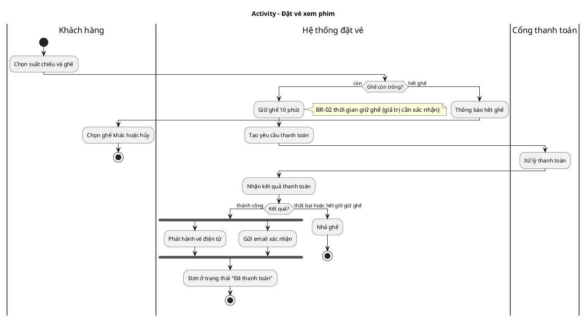
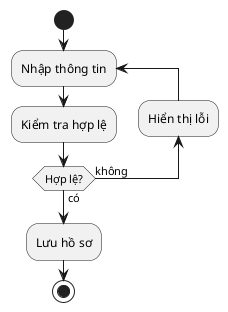
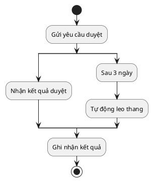
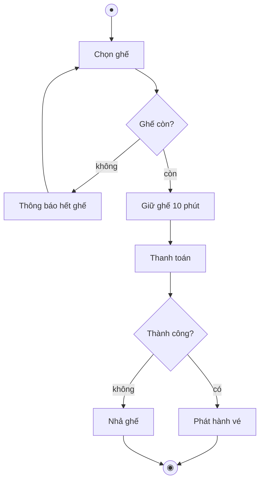

# Mẫu đầu ra cho Activity Diagram

## Mục lục
1. Bảng ánh xạ UML → PlantUML (và giới hạn)
2. Mẫu PlantUML (cú pháp mới)
3. Mermaid flowchart (dự phòng)
4. Mẫu bảng đặc tả
5. Mẫu kết quả kiểm chứng token
6. Lưu ý kiểm tra cú pháp

Cú pháp PlantUML dưới đây bám tài liệu chính thức https://plantuml.com/activity-diagram-beta (đã đọc trực tiếp khi viết skill). Cú pháp cũ không còn được khuyến nghị.

## 1. Bảng ánh xạ UML → PlantUML (và giới hạn)

| UML | PlantUML | Ghi chú |
|---|---|---|
| Initial Node | `start` | |
| Activity Final / kết thúc luồng | `stop` hoặc `end` | PlantUML không phân biệt rõ hai ký hiệu như UML; xem hình render |
| Flow Final / kết thúc một nhánh | `kill` hoặc `detach` | Nhánh kết thúc mà các nhánh khác tiếp tục (trong fork/split); kiểm tra hình render, ghi chú nếu cần phân biệt |
| Action | `:Tên hành động;` | Nhiều dòng được |
| Decision và Merge | `if (guard?) then (yes) ... else (no) ... endif` | Merge sau `endif` là ngầm định (hình thoi) |
| Nhiều nhánh | `elseif`, hoặc `switch/case/endswitch` | `!pragma useVerticalIf on` để xếp dọc |
| Fork rồi Join | `fork ... fork again ... end fork` | `end fork {and}` hoặc `{or}` ghi nhãn join spec |
| Fork rồi Merge (không đồng bộ) | `fork ... fork again ... end merge` | Dùng khi cố ý không đồng bộ |
| Rẽ nhiều nhánh độc lập (split) | `split ... split again ... end split` | Khác `fork`: không đồng bộ ở cuối; dùng cho multi-start/multi-end |
| Vòng lặp | `while (cond?) ... endwhile`, `repeat ... repeat while (cond?)` | `backward :action;` chèn hành động ở đường quay về; `break` thoát vòng |
| Swimlane (Partition) | `\|Tên làn\|` đổi làn bằng dòng `\|Làn khác\|` | Có thể gán alias và màu |
| Nhóm/Partition | `partition Tên { ... }` hoặc `group` | Fork xuyên partition dạng khối bị hạn chế, dùng swimlane |
| Object Node | `:Đơn hàng [đã thanh toán]; <<object>>` | |
| Accept Event | `:Nhận kết quả thanh toán; <<acceptEvent>>` | |
| Accept Time Event | `:Sau 10 phút; <<timeEvent>>` | |
| Send Signal | `:Gửi thông báo; <<sendSignal>>` | |
| Note | `note right: ...` hoặc khối `note ... end note` | Dùng để ghi BR, giả định, giới hạn công cụ |
| Connector | `(A)` | |

**Không biểu diễn trực tiếp được**: pin, interruptible activity region, exception handler, expansion region, join spec ngoài nhãn đơn giản, partition nhiều chiều. Cách xấp xỉ: ghi `note` nêu rõ yếu tố UML tương ứng (ví dụ "Vùng hủy được: các bước 3–6, ngắt bởi sự kiện 'Khách hủy'"), và giữ mô hình đúng chuẩn trong bảng đặc tả.

## 2. Mẫu PlantUML (cú pháp mới)

**Đặt vé và thanh toán, có swimlane, song song, timeout**

Ghi chú ngữ nghĩa cho mẫu này: kết quả thanh toán và hết giờ là hai nguyên nhân loại trừ, nhập vào một nhánh `else`; thanh toán đến muộn sau khi hết giờ là ngoại lệ cần xử lý (xem state machine của đơn). Join sau fork đảm bảo chỉ kết thúc khi cả vé và email xong.

**Vòng lặp kiểm tra và sửa**


**Song song kiểu race (chỉ một nhánh thắng)**

Lưu ý: `split` trong PlantUML không đồng bộ ở cuối; đây là cách gần nhất để biểu diễn hai nhánh cùng chờ và hợp (Merge) trong UML. Ghi `note` giải thích cơ chế hủy nhánh còn lại.

## 3. Mermaid flowchart (dự phòng)

Dùng khi người dùng muốn render ngay trong Markdown và không cần song song chuẩn. Ghi rõ đây là **mô phỏng** activity diagram bằng flowchart.

Giới hạn: không có ký hiệu fork/join, swimlane chỉ qua `subgraph`, không phân biệt Activity Final và Flow Final.

## 4. Mẫu bảng đặc tả

```markdown
### Activity: <Tên>
- Mục đích: ...
- Use case liên quan: UC-03 | Quy tắc: BR-01, BR-02
- Kích hoạt: ...
- Tiền điều kiện: ...
- Hậu điều kiện: thành công ... / thất bại ...

| ID | Hành động | Làn | Loại | Mô tả | Vào | Ra |
|---|---|---|---|---|---|---|
| A1 | Chọn suất chiếu và ghế | Khách hàng | Action | ... | suất chiếu | danh sách ghế |
| A3 | Giữ ghế | Hệ thống | Action | giữ trong N phút | ghế | phiên giữ ghế |

| Quyết định | Guard | Nhánh | Đích |
|---|---|---|---|
| D1 Ghế còn trống? | [còn] / [else] | còn / hết | A3 / A2 |

| Sự kiện / timer | Loại | Kích hoạt | Hiệu ứng |
|---|---|---|---|
| E1 Kết quả thanh toán | Accept Event | cổng gọi lại | tiếp tục A5 hoặc A6 |
| T1 Hết giờ giữ ghế | Time Event | sau N phút | nhả ghế |

| Ngoại lệ | Điều kiện | Xử lý |
|---|---|---|
| X1 Thanh toán đến muộn | sau khi nhả ghế | hoàn tiền (xem state machine) |

Giả định và câu hỏi mở: ...
```

## 5. Mẫu kết quả kiểm chứng token

```markdown
| Kịch bản | Chuỗi hành động | Kết thúc | Token còn lại |
|---|---|---|---|
| S1 Thành công | A1, D1(còn), A3, A4, E1, D2(thành công), Fork, A5 + A6, Join | Activity Final | 0 |
| S2 Hết ghế | A1, D1(hết), A2, A1... (vòng) | Người dùng hủy -> Final | 0 |
| S3 Hết giờ | A3, T1, A7 (nhả ghế) | Activity Final | 0 |
| S4 Song song | Fork -> A5 và A6 chạy độc lập | Join chờ đủ 2 token | 0 sau Join |
Kết luận: không deadlock, không nhân token ngoài ý muốn, mọi nhánh kết thúc đúng.
```

## 6. Lưu ý kiểm tra cú pháp
Mã PlantUML/Mermaid trong skill chưa được render khi viết (môi trường không có trình biên dịch). Khi giao kết quả: render thử nếu có công cụ; nếu không, nói rõ "mã chưa được kiểm tra" và mời dán vào https://www.plantuml.com/plantuml hoặc công cụ tương đương. Điểm dễ sai: dấu `;` kết thúc action, nhãn nhiều dòng, ký tự đặc biệt, vị trí `<<stereotype>>` (đặt sau dấu `;`), và `end fork` thiếu.
