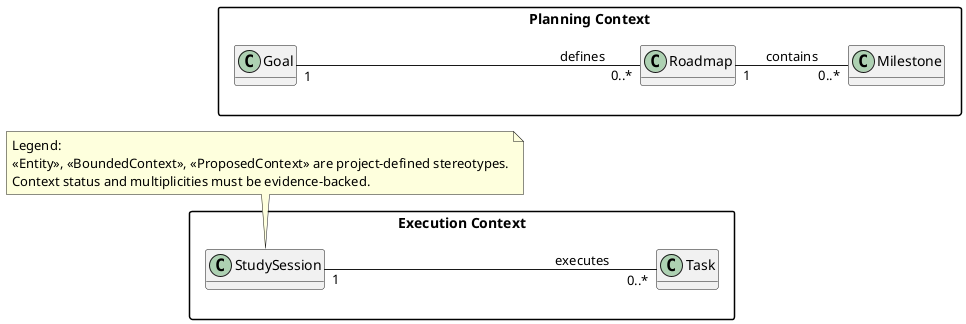
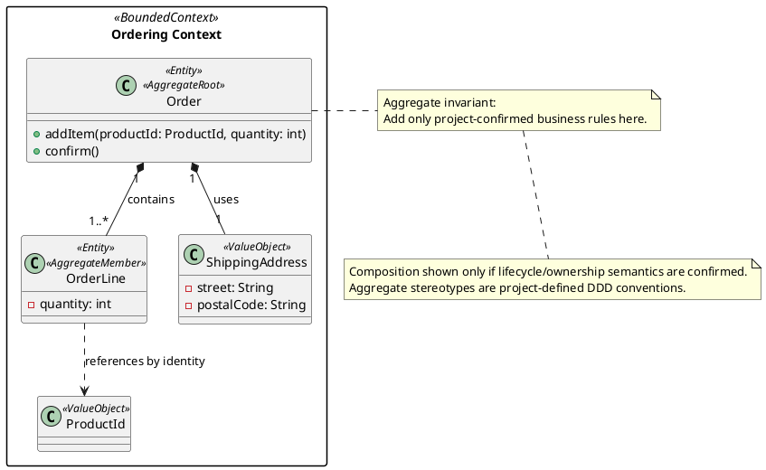
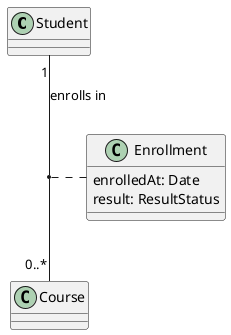
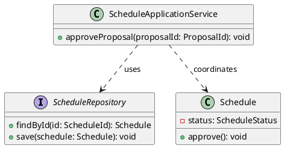
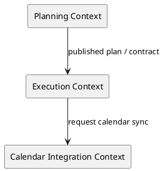

# PlantUML Templates

Các template dưới đây là điểm khởi đầu. Luôn kiểm tra cú pháp bằng renderer thực tế nếu tuyên bố đã validate. Stereotype DDD/Context là quy ước dự án và phải có legend.

## 1. Domain Overview Class Diagram

Chỉ dùng ví dụ class/relationship khi phù hợp với domain thực tế. Không sao chép ví dụ thành yêu cầu.

## 2. Detailed DDD Model with Aggregate

Không mặc định mọi Aggregate member phải dùng Composition. Có thể dùng association và Aggregate Map nếu semantics lifecycle UML khác consistency boundary.

## 3. Association Class

Xác nhận syntax theo phiên bản PlantUML hiện dùng. Nếu tool không hỗ trợ tốt, mô tả Enrollment như relationship classifier với note rõ ràng.

## 4. Software Design Class Diagram

Đây là design-level illustration; không đưa application service/repository vào Domain Overview theo mặc định.

## 5. Context Map (minh họa tự định nghĩa)

Đây là sơ đồ tích hợp Context ở mức khái niệm, không phải UML Class Diagram và không đại diện đầy đủ mọi pattern DDD. Thêm legend giải thích upstream/downstream, contract, ACL hoặc pattern khác khi đã xác nhận.

## 6. Quy tắc naming và rendering

- Dùng tên class số ít (`Task`, không `Tasks`).
- Role name mô tả vai trò ở đầu association khi hữu ích.
- Association label dùng động từ nghiệp vụ.
- Tránh đường nối chéo; dùng package và diagram con.
- Tên package/Context không quá dài; giữ consistent language.
- Không đặt database column name trong domain diagram.
- Không dùng màu hoặc stereotype để ngụ ý trạng thái CONFIRMED nếu legend không định nghĩa.
- Nếu có nhiều bản PlantUML/Mermaid, một bản phải được chỉ định làm source of truth.
