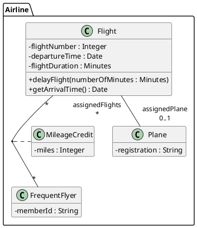
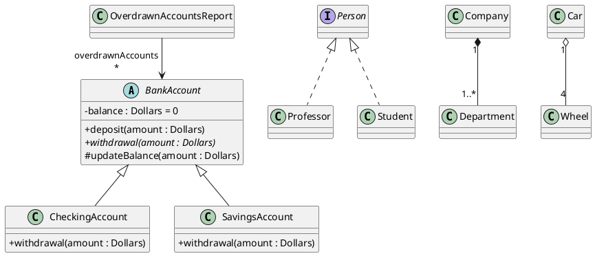
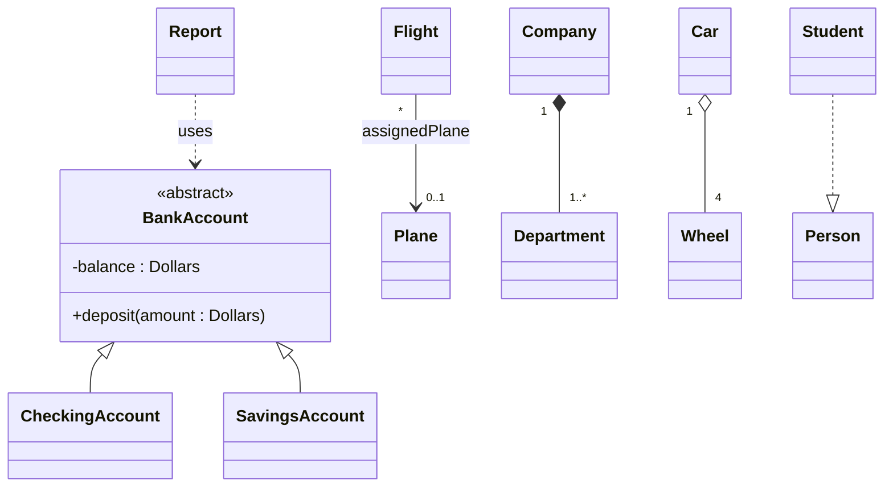

# Mẫu PlantUML / Mermaid và bảng mô tả lớp

## Mục lục
1. Quy ước PlantUML
2. Bảng tra ký hiệu → PlantUML
3. Ví dụ hoàn chỉnh (chuyến bay – theo bài IBM)
4. Ví dụ kế thừa, abstract, interface
5. Mermaid classDiagram (khi cần render nhanh)
6. Mẫu bảng mô tả lớp
7. Lưu ý kiểm tra cú pháp

## 1. Quy ước PlantUML

Đầu file nên có:
```plantuml
@startuml
skinparam classAttributeIconSize 0   ' hiển thị + - # ~ thay vì icon tròn
skinparam linetype ortho             ' (tùy chọn) đường vuông góc dễ đọc
hide empty members                   ' ẩn ngăn rỗng ở góc nhìn khái niệm
```
- Chú thích: `' ...` hoặc `note right of X : ...`.
- Gói: `package "Booking" { ... }`.
- Nhãn đầu mút: `A "role\n0..*" -- "role\n1" B : tên association`. Nhãn bên trái gần A, nhãn bên phải gần B.
- Thành viên static: `{static}`; abstract: `{abstract}`.

## 2. Bảng tra ký hiệu → PlantUML

| Ý nghĩa | PlantUML |
|---|---|
| Class | `class Flight` |
| Abstract class | `abstract class BankAccount` |
| Interface | `interface Person` |
| Enumeration | `enum Status { ACTIVE ; CLOSED }` (mỗi literal một dòng) |
| Data type | `class Money <<dataType>>` |
| Generalization (con → cha) | `BankAccount <|-- CheckingAccount` |
| Realization | `Person <|.. Student` |
| Association (hai chiều) | `Flight "0..*" -- "0..1" Plane` |
| Uni-directional | `Report --> "0..*" BankAccount : overdrawnAccounts` |
| Aggregation (thoi rỗng ở toàn thể) | `Car "1" o-- "4" Wheel` |
| Composition (thoi đặc ở toàn thể) | `Company "1" *-- "1..*" Department` |
| Association class | `Flight "*" -- "*" FrequentFlyer` rồi `(Flight, FrequentFlyer) .. MileageCredit` |
| Dependency | `Report ..> BankAccount : <<use>>` |
| Reflexive | `Employee "manager\n0..1" -- "directReports\n*" Employee` |
| Thuộc tính dẫn xuất | `/age : Integer` |
| Instance (object diagram) | `object "Donald : Person" as d` |

## 3. Ví dụ hoàn chỉnh: chuyến bay, máy bay, hội viên thường xuyên


Đọc diagram: một Flight có thể chưa gán Plane (`0..1`); một Plane có thể không có hoặc có nhiều Flight (`*`). Mỗi cặp (Flight, FrequentFlyer) có đúng một MileageCredit.

## 4. Ví dụ kế thừa, abstract, interface, composition, aggregation


Ghi chú: `OverdrawnAccountsReport` biết `BankAccount` nhưng `BankAccount` không biết báo cáo (giảm coupling).

## 5. Mermaid classDiagram (khi cần render nhanh)


Giới hạn của Mermaid cần nói rõ với người dùng: không có association class gốc (mô phỏng bằng lớp trung gian + ghi chú), không vẽ internal structure, `*--` và `o--` đặt thoi ở bên **trái** của mũi tên (viết toàn thể ở bên trái), không gạch chân thành viên static theo chuẩn UML (dùng `$`).

## 6. Mẫu bảng mô tả lớp

```markdown
### <TênLớp> (<class | abstract | interface | enum>) — package <Tên>

**Mục đích**: 1–2 câu.
**Use case liên quan**: UC-03, UC-08
**Quy tắc nghiệp vụ**: BR-01, BR-04

| Thuộc tính | Kiểu | Bội số | Mặc định | Ràng buộc | Mô tả |
|---|---|---|---|---|---|
| flightNumber | Integer | 1 | | duy nhất theo ngày | Số hiệu chuyến |

| Thao tác | Tham số → Kết quả | Mô tả |
|---|---|---|
| delayFlight | numberOfMinutes : Minutes → (không) | Dời giờ khởi hành |

| Quan hệ | Lớp đích | Loại | Role / Multiplicity | Ghi chú |
|---|---|---|---|---|
| assignedPlane | Plane | Association | 0..1 | Chưa gán khi mới lập lịch |
```

## 7. Lưu ý kiểm tra cú pháp
- PlantUML và Mermaid dễ sai ở nhãn đầu mút, ký tự đặc biệt và vị trí `{abstract}`. Nếu có công cụ render, **render thử**; nếu không, nói rõ với người dùng rằng mã chưa được biên dịch thử và mời họ dán vào plantuml.com để kiểm tra.
- Không dùng dấu `"` bên trong nhãn; xuống dòng nhãn bằng `\n`.
- Kiểm tra chiều thoi (`o--`, `*--` đặt thoi ở lớp **bên trái**) khớp với "toàn thể".
