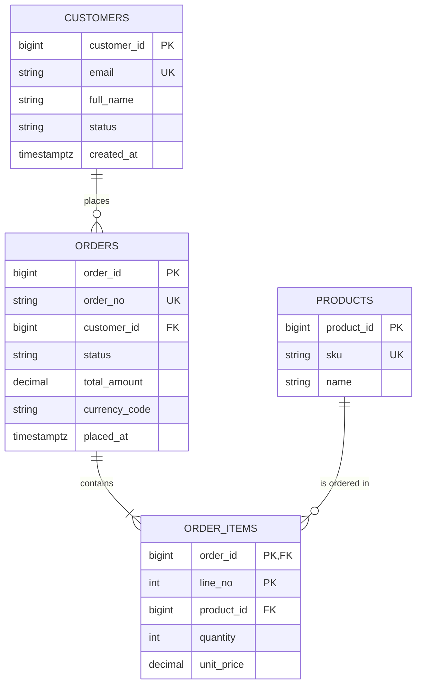

# Mẫu sản phẩm đầu ra

## Mục lục
1. ERD bằng Mermaid
2. ERD bằng DBML
3. DDL mẫu (PostgreSQL)
4. Ví dụ N–N có thuộc tính quan hệ
5. Chuyển DDL sang DBMS khác
6. Data dictionary
7. Kế hoạch index
8. Kế hoạch migration
9. Lưu ý kiểm tra cú pháp

## 1. ERD bằng Mermaid (`erDiagram`, ký hiệu crow's foot)


Quy ước: `||` đúng một, `|o` không hoặc một, `}o` không hoặc nhiều, `}|` một hoặc nhiều; `--` quan hệ định danh, `..` không định danh. Mermaid không cho ghi độ dài trong kiểu (`varchar(254)`): ghi độ dài ở data dictionary và DDL. Tên thực thể trong ERD viết hoa theo quy ước Mermaid; tên bảng thật trong DDL là `snake_case`.

## 2. ERD bằng DBML (dbdiagram.io)

```dbml
Table customers {
  customer_id bigint [pk, increment]
  email varchar(254) [not null, unique]
  full_name varchar(200) [not null]
  created_at timestamptz [not null, default: `now()`]
}

Table orders {
  order_id bigint [pk, increment]
  customer_id bigint [not null, ref: > customers.customer_id]
  placed_at timestamptz
  indexes {
    (customer_id, placed_at) [name: 'ix_orders_customer_placed']
  }
}
```
`ref: >` nhiều–một, `<` một–nhiều, `-` một–một, `<>` nhiều–nhiều (nên mở rộng thành bảng nối).

## 3. DDL mẫu (PostgreSQL)

Thứ tự: bảng cha trước bảng con; ràng buộc đặt tên; index sau bảng.

```sql
CREATE TABLE customers (
  customer_id  bigint       GENERATED ALWAYS AS IDENTITY,
  email        varchar(254) NOT NULL,
  full_name    varchar(200) NOT NULL,
  status       varchar(20)  NOT NULL DEFAULT 'ACTIVE',
  created_at   timestamptz  NOT NULL DEFAULT now(),
  updated_at   timestamptz  NOT NULL DEFAULT now(),
  CONSTRAINT pk_customers PRIMARY KEY (customer_id),
  CONSTRAINT ck_customers_status CHECK (status IN ('ACTIVE','SUSPENDED','CLOSED'))
);
CREATE UNIQUE INDEX uq_customers_email ON customers (lower(email));

CREATE TABLE products (
  product_id  bigint        GENERATED ALWAYS AS IDENTITY,
  sku         varchar(50)   NOT NULL,
  name        varchar(200)  NOT NULL,
  list_price  numeric(19,4) NOT NULL,
  is_active   boolean       NOT NULL DEFAULT true,
  CONSTRAINT pk_products PRIMARY KEY (product_id),
  CONSTRAINT uq_products_sku UNIQUE (sku),
  CONSTRAINT ck_products_price CHECK (list_price >= 0)
);

CREATE TABLE orders (
  order_id      bigint        GENERATED ALWAYS AS IDENTITY,
  order_no      varchar(30)   NOT NULL,
  customer_id   bigint        NOT NULL,
  status        varchar(20)   NOT NULL DEFAULT 'DRAFT',
  total_amount  numeric(19,4) NOT NULL DEFAULT 0,
  currency_code char(3)       NOT NULL,
  placed_at     timestamptz,
  version       integer       NOT NULL DEFAULT 0,
  created_at    timestamptz   NOT NULL DEFAULT now(),
  updated_at    timestamptz   NOT NULL DEFAULT now(),
  CONSTRAINT pk_orders PRIMARY KEY (order_id),
  CONSTRAINT uq_orders_order_no UNIQUE (order_no),
  CONSTRAINT fk_orders_customer FOREIGN KEY (customer_id)
    REFERENCES customers (customer_id) ON DELETE RESTRICT,
  CONSTRAINT ck_orders_status CHECK (status IN ('DRAFT','PLACED','PAID','SHIPPED','CANCELLED')),
  CONSTRAINT ck_orders_total CHECK (total_amount >= 0)
);
CREATE INDEX ix_orders_customer_placed ON orders (customer_id, placed_at DESC);

-- Composition: dòng đơn không tồn tại thiếu đơn
CREATE TABLE order_items (
  order_id    bigint        NOT NULL,
  line_no     integer       NOT NULL,
  product_id  bigint        NOT NULL,
  quantity    integer       NOT NULL,
  unit_price  numeric(19,4) NOT NULL,  -- snapshot giá tại thời điểm đặt
  CONSTRAINT pk_order_items PRIMARY KEY (order_id, line_no),
  CONSTRAINT fk_order_items_order FOREIGN KEY (order_id)
    REFERENCES orders (order_id) ON DELETE CASCADE,
  CONSTRAINT fk_order_items_product FOREIGN KEY (product_id)
    REFERENCES products (product_id) ON DELETE RESTRICT,
  CONSTRAINT ck_order_items_qty CHECK (quantity > 0),
  CONSTRAINT ck_order_items_price CHECK (unit_price >= 0)
);
CREATE INDEX ix_order_items_product ON order_items (product_id);

COMMENT ON COLUMN order_items.unit_price IS 'Giá tại thời điểm đặt hàng (snapshot), không đổi theo products.list_price';
```
Mỗi quyết định không hiển nhiên (snapshot giá, CASCADE, partial index) cần một dòng chú thích hoặc nằm trong mục "Quyết định thiết kế".

## 4. Ví dụ N–N có thuộc tính quan hệ (association class)

Sinh viên đăng ký học phần, có điểm: cặp (student, course_offering) duy nhất → PK tổ hợp.

```sql
CREATE TABLE enrollments (
  student_id          bigint      NOT NULL,
  course_offering_id  bigint      NOT NULL,
  enrolled_at         timestamptz NOT NULL DEFAULT now(),
  grade               numeric(4,2),
  CONSTRAINT pk_enrollments PRIMARY KEY (student_id, course_offering_id),
  CONSTRAINT fk_enrollments_student FOREIGN KEY (student_id)
    REFERENCES students (student_id) ON DELETE RESTRICT,
  CONSTRAINT fk_enrollments_offering FOREIGN KEY (course_offering_id)
    REFERENCES course_offerings (course_offering_id) ON DELETE RESTRICT,
  CONSTRAINT ck_enrollments_grade CHECK (grade IS NULL OR grade BETWEEN 0 AND 10)
);
-- PK phục vụ tra theo student_id; thêm index cho chiều ngược lại:
CREATE INDEX ix_enrollments_offering ON enrollments (course_offering_id);
```
Nếu một sinh viên có thể đăng ký **cùng học phần nhiều lần** (học lại), PK `(student_id, course_offering_id)` sai: dùng surrogate PK và `attempt_no`, hoặc đưa `attempt_no` vào khóa.

## 5. Chuyển DDL sang DBMS khác (điểm cần đổi)

| Hạng mục | PostgreSQL (mẫu) | MySQL 8 | SQL Server | Oracle |
|---|---|---|---|---|
| Identity | `bigint GENERATED ALWAYS AS IDENTITY` | `BIGINT AUTO_INCREMENT` | `bigint IDENTITY(1,1)` | `NUMBER(19) GENERATED ALWAYS AS IDENTITY` |
| Thời điểm | `timestamptz DEFAULT now()` | `DATETIME(6) DEFAULT CURRENT_TIMESTAMP(6)` (UTC ở ứng dụng/phiên) | `datetimeoffset DEFAULT SYSDATETIMEOFFSET()` | `TIMESTAMP WITH TIME ZONE DEFAULT SYSTIMESTAMP` |
| Chuỗi | `varchar(n)` | `VARCHAR(n)` + `CHARSET utf8mb4` | `nvarchar(n)` | `VARCHAR2(n CHAR)` / `NVARCHAR2(n)` |
| Boolean | `boolean` | `BOOLEAN` | `bit` | `NUMBER(1) CHECK (x IN (0,1))` hoặc `BOOLEAN` (23ai) |
| Index biểu thức `lower(email)` | trực tiếp | `((lower(email)))` (8.0.13+) | computed column + index | function-based index |
| Tên bảng ràng buộc | cú pháp `CONSTRAINT name` như mẫu | tương tự | tương tự | tương tự |
| `COMMENT ON` | có | `COMMENT '...'` trong định nghĩa cột | `sp_addextendedproperty` | `COMMENT ON` |

Ghi `ENGINE=InnoDB` (MySQL) và collation rõ ràng khi sinh DDL MySQL.

## 6. Data dictionary

```markdown
### orders — Đơn hàng
Mục đích: Mỗi dòng là một đơn đặt hàng của khách. Nguồn: UC-03, lớp Order.

| Cột | Kiểu | Null | Mặc định | Ràng buộc | Mô tả | Nhạy cảm |
|---|---|---|---|---|---|---|
| order_id | bigint | NO | identity | PK | Khóa kỹ thuật | |
| order_no | varchar(30) | NO | | UNIQUE | Số đơn hiển thị cho khách | |
| customer_id | bigint | NO | | FK → customers | Khách đặt đơn | |
| status | varchar(20) | NO | 'DRAFT' | CHECK (DRAFT,PLACED,PAID,SHIPPED,CANCELLED) | Trạng thái | |
| total_amount | numeric(19,4) | NO | 0 | CHECK ≥ 0 | Tổng tiền (đồng bộ từ order_items trong cùng transaction) | |

Quan hệ: N–1 customers (RESTRICT); 1–N order_items (CASCADE).
Index: ix_orders_customer_placed (customer_id, placed_at DESC).
Quy tắc nghiệp vụ: BR-01 ...
```

## 7. Kế hoạch index

| # | Truy vấn / use case | Index | Lý do | Chi phí ghi |
|---|---|---|---|---|
| 1 | Đơn gần đây của một khách (UC-05) | `orders (customer_id, placed_at DESC)` | Lọc bằng + sắp xếp, tránh sort | Thấp |
| 2 | Đơn theo mã sản phẩm (báo cáo) | `order_items (product_id)` | FK + lọc | Trung bình (bảng lớn) |

Ghi rõ index **không** tạo và vì sao (cột ít giá trị, bảng nhỏ).

## 8. Kế hoạch migration

- Dùng công cụ migration có phiên bản (Flyway, Liquibase, Alembic, EF Migrations, Prisma Migrate, Knex...): mỗi thay đổi là một file có thứ tự, chạy được lặp lại an toàn.
- **Expand → migrate → contract** cho thay đổi không gián đoạn: (1) thêm cột/bảng mới (tương thích ngược); (2) ghi kép/backfill theo lô nhỏ; (3) chuyển ứng dụng sang cấu trúc mới; (4) xóa cấu trúc cũ ở bản phát hành sau.
- Thêm `NOT NULL` cho cột mới trên bảng có dữ liệu: thêm cột nullable → backfill → thêm ràng buộc. PostgreSQL: `ADD CONSTRAINT ... CHECK (...) NOT VALID` rồi `VALIDATE CONSTRAINT` để giảm khóa; tạo index với `CREATE INDEX CONCURRENTLY` (không chạy trong transaction); SQL Server `WITH (ONLINE = ON)` (tùy edition); MySQL `ALGORITHM=INPLACE, LOCK=NONE` khi hỗ trợ.
- Mỗi migration có **kế hoạch hoàn tác** hoặc lý do không thể hoàn tác; thử trên bản sao dữ liệu thật về khối lượng.
- Backfill theo lô, có điểm dừng/tiếp tục, đo tải. Đối soát số liệu trước và sau.

## 9. Lưu ý kiểm tra cú pháp
Mã DDL và ERD trong skill chưa được chạy trên máy chủ CSDL khi viết skill. Khi giao kết quả: nếu có thể chạy thử (container Postgres, SQLite cho kiểm tra thô, công cụ lint), **chạy thật**; nếu không, nói rõ DDL chưa được thực thi thử và mời người dùng chạy trên môi trường dev trước.
