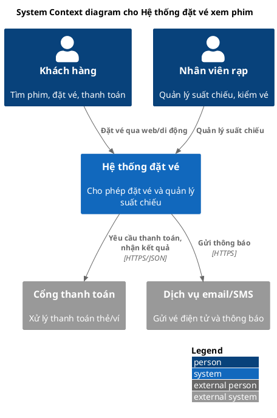
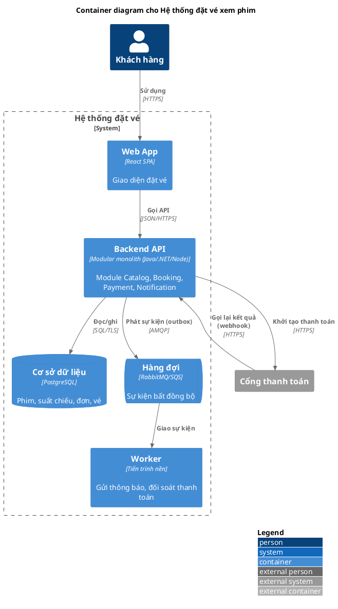
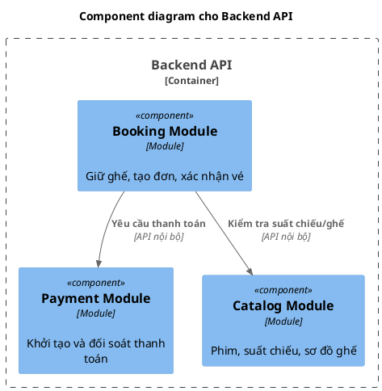
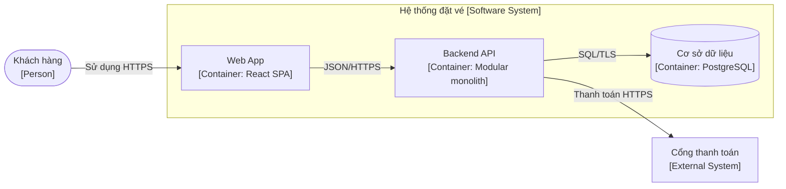
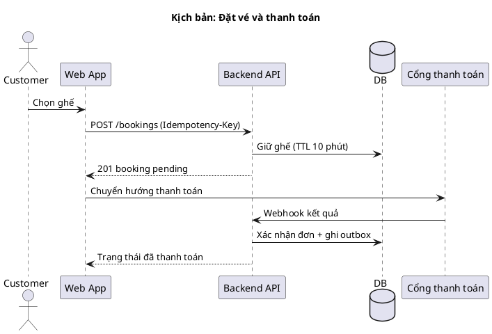
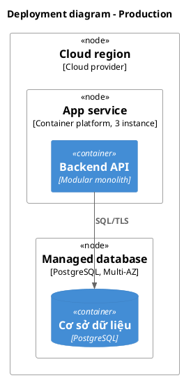

# Tài liệu kiến trúc: C4, ADR, arc42

## Mục lục
1. C4 model
2. Quy ước ký hiệu
3. Mẫu PlantUML (C4 stdlib)
4. Mermaid
5. Dynamic và deployment
6. ADR
7. arc42
8. Checklist diagram
9. Lưu ý kiểm tra cú pháp

## 1. C4 model (Simon Brown)

Bốn tầng trừu tượng, mỗi tầng một diagram, như bản đồ thu phóng:

| Mức | Diagram | Cho ai | Nội dung |
|---|---|---|---|
| 1 | **System Context** | Mọi người, kể cả phi kỹ thuật | Hệ thống đang thiết kế ở giữa; **người dùng (Person)** và **hệ thống ngoài** xung quanh; quan hệ |
| 2 | **Container** | Dev, ops, kiến trúc sư | Các **container** bên trong hệ thống và quan hệ |
| 3 | **Component** | Dev, kiến trúc sư | **Component** bên trong **một** container |
| 4 | **Code** | Dev | Lớp/interface, thường sinh tự động; hiếm khi vẽ tay (chỉ cho thành phần cốt lõi, phức tạp, ổn định) |

Diagram bổ trợ: **System Landscape** (nhiều hệ thống trong tổ chức), **Dynamic** (luồng kịch bản có đánh số), **Deployment** (container ánh xạ lên hạ tầng theo môi trường).

**Container** ở C4 là *đơn vị chạy/triển khai được hoặc kho dữ liệu* (ứng dụng web phía server, SPA, ứng dụng di động, microservice, hàm serverless, CSDL, kho blob, hàng đợi/broker...), **không** có nghĩa là Docker container. Component là nhóm chức năng có giao diện rõ bên trong container, không phải đơn vị triển khai riêng.

Thực hành: **Context + Container đủ cho phần lớn đội**; chỉ vẽ Component cho container phức tạp/quan trọng; mỗi diagram nhắm một đối tượng người đọc. Component và Code thay đổi nhanh nên tốn công bảo trì; ưu tiên sinh từ code/công cụ nếu có.

C4 không phụ thuộc ký hiệu hay công cụ; quan trọng là **trừu tượng nhất quán**. Công cụ: Structurizr (mô hình dạng mã sinh mọi diagram), PlantUML C4, Mermaid C4, draw.io.

## 2. Quy ước ký hiệu (khuyến nghị của C4)

- Mỗi diagram có **tiêu đề** (loại và phạm vi, vd. "Container diagram for Hệ thống đặt vé").
- Mỗi phần tử có **tên, loại (Person / Software System / Container / Component), công nghệ (Container, Component) và mô tả ngắn**.
- Mỗi **đường nối một chiều**, có nhãn mô tả mục đích ("Đặt vé") và công nghệ/giao thức khi liên quan ("JSON/HTTPS", "AMQP"). Mũi tên theo hướng phụ thuộc/khởi tạo.
- Có **chú giải (legend)** nếu dùng màu/hình dạng/đường nét riêng; không dùng màu làm kênh thông tin duy nhất.
- Ranh giới (boundary) cho hệ thống/container đang xét; hệ thống ngoài khác màu hoặc đánh dấu `External`.
- Không trộn mức trừu tượng trong một diagram (không để Component cạnh Software System).
- Tên nhất quán giữa mọi diagram, ADR, tài liệu.

## 3. Mẫu PlantUML (C4 stdlib)

Thư viện C4-PlantUML có trong stdlib: `!include <C4/C4_Context>`, `<C4/C4_Container>`, `<C4/C4_Component>`, `<C4/C4_Deployment>`, `<C4/C4_Dynamic>`. Phiên bản PlantUML cũ có thể thiếu; khi đó include từ URL của thư viện (cần mạng).

**Level 1: System Context**


**Level 2: Container**

Trong container diagram dùng `System_Boundary`; trong component diagram dùng `Container_Boundary`.

**Level 3: Component** (chỉ một container)


Macro hay dùng: `Person`, `Person_Ext`, `System`, `System_Ext`, `Container`, `ContainerDb`, `ContainerQueue`, `Component`, `Rel`, `BiRel`, `Rel_D/U/L/R` (ép hướng), `System_Boundary`, `Container_Boundary`, `Deployment_Node`, `LAYOUT_WITH_LEGEND()`, `SHOW_LEGEND()`.

## 4. Mermaid

Mermaid có kiểu C4 (`C4Context`, `C4Container`...) nhưng ở trạng thái thử nghiệm, bố cục kém linh hoạt. Khi cần render trực tiếp trong chat/Markdown, dùng `flowchart` với quy ước C4 (subgraph làm boundary, nhãn ghi loại/công nghệ):


Nói rõ đó là mô phỏng C4 bằng flowchart nếu dùng cách này.

## 5. Dynamic và deployment

**Dynamic / kịch bản chính**: dùng sequence diagram cho 2–4 luồng quan trọng nhất (đặt vé, thanh toán, hủy/hoàn tiền, xử lý lỗi/timeout).

Luồng lỗi (timeout, trùng yêu cầu, thanh toán thất bại) nên có diagram hoặc bảng riêng.

**Deployment** (C4_Deployment):

Ghi trên deployment: môi trường, số bản sao, vùng/AZ, mạng (subnet công khai/riêng), điểm vào, kho bí mật, sao lưu.

## 6. ADR (Architecture Decision Record)

Mỗi quyết định có ý nghĩa một file ngắn, đánh số, lưu cạnh mã (`docs/adr/0007-...md`), **không sửa nội dung cũ**: quyết định thay đổi thì tạo ADR mới và đánh dấu ADR cũ là *Superseded*.

```markdown
# ADR-0007: Dùng modular monolith cho giai đoạn 1

- Trạng thái: Proposed | Accepted | Deprecated | Superseded bởi ADR-00xx
- Ngày: 2026-10-25
- Người quyết định: ...

## Bối cảnh
Lực tác động: ASR liên quan, ràng buộc (đội 6 dev, thời hạn 4 tháng), giả định.

## Quyết định
Chúng ta sẽ ... (một hoặc hai câu, thể chủ động).

## Phương án đã xét
1. Modular monolith - ưu: ...; nhược: ...
2. Microservices - ưu: ...; nhược: ...
3. ...

## Hệ quả
- Tích cực: ...
- Tiêu cực / chi phí: ...
- Rủi ro và cách giảm: ...
- Việc phải làm tiếp: ...

## Tiêu chí xem xét lại
Ví dụ: khi có > 3 đội cùng phát triển hoặc module Notification cần co giãn độc lập.
```
Quy tắc: một ADR một quyết định; nêu cả phương án bị loại và **lý do**; ghi rõ ASR nó phục vụ; ngắn gọn (một trang).

## 7. arc42 (cấu trúc tài liệu đầy đủ)

1. Giới thiệu và mục tiêu (yêu cầu chính, mục tiêu chất lượng, các bên liên quan)
2. Ràng buộc (kỹ thuật, tổ chức, quy ước)
3. Bối cảnh và phạm vi (nghiệp vụ và kỹ thuật) → C4 Context
4. Chiến lược giải pháp (quyết định nền tảng, ánh xạ mục tiêu chất lượng → cách đạt)
5. Góc nhìn khối xây dựng (building block view) → C4 Container/Component
6. Góc nhìn thời gian chạy (runtime view) → dynamic/sequence
7. Góc nhìn triển khai (deployment view) → C4 Deployment
8. Khái niệm xuyên suốt (cross-cutting: bảo mật, quan sát, xử lý lỗi, mô hình miền...)
9. Quyết định kiến trúc → danh sách ADR
10. Yêu cầu chất lượng (cây chất lượng và scenario)
11. Rủi ro và nợ kỹ thuật
12. Thuật ngữ

Ghi chú: ghi tới mức cần thiết, không điền mục chỉ cho đủ; tài liệu sống, nằm cạnh mã (docs-as-code).

## 8. Checklist diagram (theo tinh thần checklist của C4)
- [ ] Có tiêu đề nêu loại và phạm vi; có chú giải khi cần.
- [ ] Mọi phần tử có tên, loại, công nghệ (nếu là container/component) và mô tả.
- [ ] Mọi đường nối một chiều, có nhãn mục đích và giao thức/công nghệ khi liên quan.
- [ ] Mức trừu tượng nhất quán, không trộn mức.
- [ ] Người đọc đích rõ; không quá ~15–20 phần tử/diagram.
- [ ] Ngoại vi (hệ thống ngoài) được phân biệt.
- [ ] Tên khớp giữa các diagram, bảng thành phần, ADR.

## 9. Lưu ý kiểm tra cú pháp
Mã PlantUML/Mermaid trong tài liệu này chưa được biên dịch thử khi viết skill. Khi giao kết quả: nếu có công cụ render, **render thử**; nếu không, nói rõ mã chưa được kiểm tra và mời người dùng dán vào plantuml.com hoặc mermaid.live. Điểm dễ sai: đường dẫn `!include` theo phiên bản PlantUML, tên macro C4, ký tự đặc biệt trong nhãn, và dấu ngoặc.
