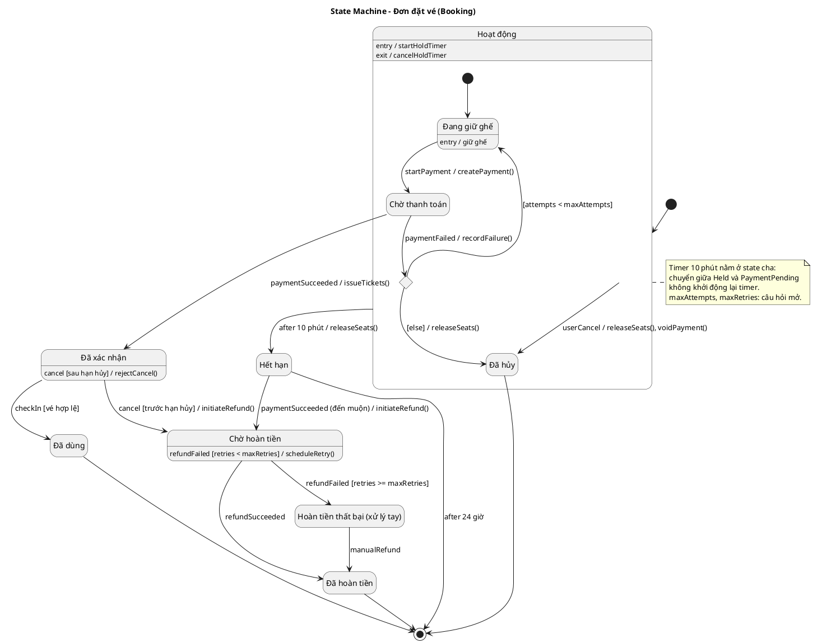
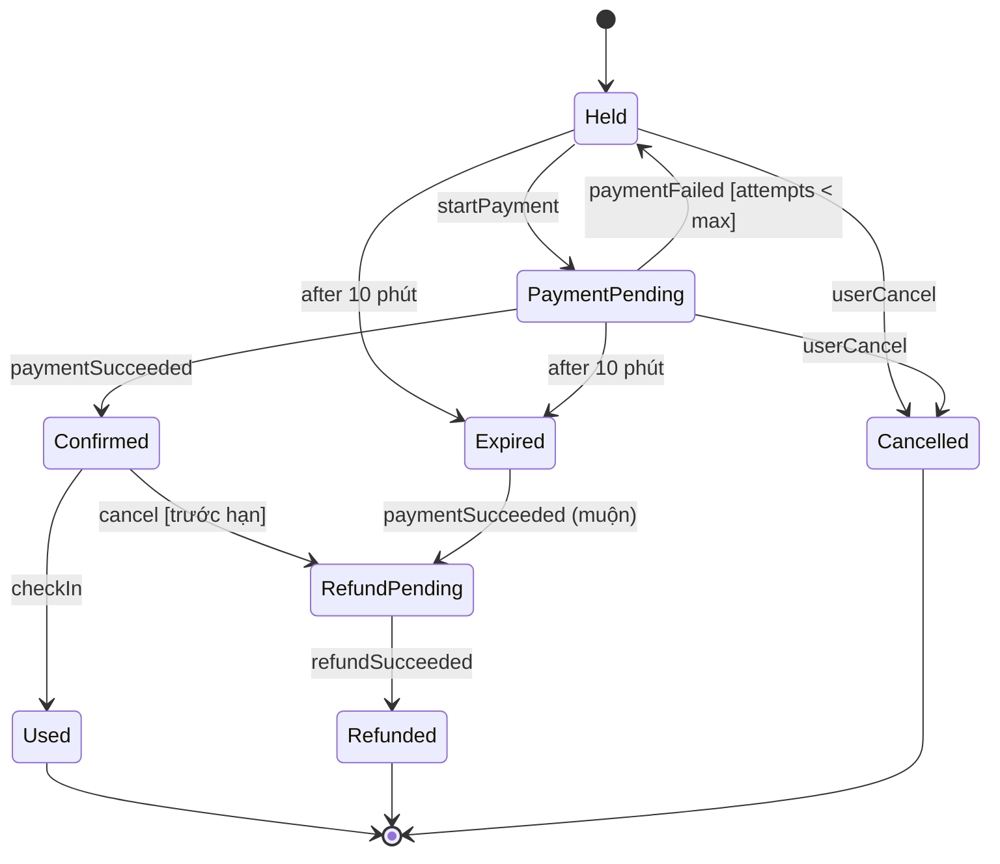

# Mẫu đầu ra cho State Machine

## Mục lục
1. Ánh xạ UML → PlantUML, Mermaid (và giới hạn)
2. Ví dụ PlantUML: vòng đời đơn đặt vé
3. Mermaid stateDiagram-v2
4. SCXML (định dạng thực thi)
5. Event catalogue
6. Đặc tả trạng thái
7. Bảng chuyển trạng thái và ma trận state × event
8. Test case theo transition
9. Lưu ý kiểm tra cú pháp

Cú pháp PlantUML bám tài liệu chính thức https://plantuml.com/state-diagram (đã đọc trực tiếp khi viết skill).

## 1. Ánh xạ UML → PlantUML, Mermaid

| UML | PlantUML | Mermaid `stateDiagram-v2` |
|---|---|---|
| Initial / Final | `[*] --> A`, `A --> [*]` | giống |
| State, mô tả | `state A`, `A : entry / hành vi` (mỗi dòng mô tả một dòng văn bản) | `A : mô tả` |
| State tên dài | `state "Tên dài" as A` | `state "Tên dài" as A` |
| Transition | `A --> B : trigger [guard] / effect` | `A --> B : trigger [guard] / effect` (chỉ là văn bản nhãn) |
| Composite | `state C { [*] --> X ... }` | `state C { [*] --> X ... }` |
| Orthogonal regions | dòng `--` hoặc `\|\|` giữa các vùng trong composite | `--` |
| Choice | `state c <<choice>>` | `state c <<choice>>` |
| Fork / Join | `state f <<fork>>`, `state j <<join>>` | `state f <<fork>>`, `state j <<join>>` |
| Shallow / Deep history | `[H]`, `[H*]` (ví dụ `State2 --> [H]`) | Không hỗ trợ chuẩn; ghi chú bằng note |
| Entry/Exit point | `<<entryPoint>>`, `<<exitPoint>>` | Không |
| Note | `note left of A : ...`, `note on link` | `note right of A : ...` |
| Alias, màu | `state "x" as a #pink` | `classDef` |

Quy ước nhãn: dùng đúng chuỗi `trigger [guard] / effect`. Trigger thời gian ghi `after 10 phút`. Các dòng `entry /`, `exit /`, `do /` ghi trong mô tả state.

**Không biểu diễn đầy đủ trên công cụ**: internal transition (ghi bằng dòng mô tả `event [guard] / effect` trong state), deferred event (ghi `event / defer` trong mô tả), junction khác choice (PlantUML không phân biệt, ghi chú), time event dạng `at`, transition giữa các state con của hai composite khác nhau trong Mermaid, history trong Mermaid. Giữ mô hình đúng chuẩn trong bảng đặc tả.

## 2. Ví dụ PlantUML: vòng đời đơn đặt vé


Điểm kiểm chứng của mẫu: (1) sự kiện *thanh toán thành công đến muộn* ở *Hết hạn* có xử lý (bồi hoàn); (2) hủy sau hạn là **chuyển nội bộ bị từ chối** ở *Đã xác nhận*; (3) timer nằm ở state cha; (4) mọi nhánh kết thúc ở final; (5) choice có `[else]`. Mã chưa được render khi viết skill; xem mục 9.

## 3. Mermaid stateDiagram-v2

Dạng phẳng (do Mermaid không vẽ được transition từ state con ra ngoài composite một cách đáng tin cậy):

Nhận xét: dạng phẳng phải **lặp** `after 10 phút` và `userCancel` ở từng state con; đây chính là lý do UML dùng state cha. Khi dùng Mermaid, nói rõ timer thực sự nằm ở cha và là mô phỏng.

## 4. SCXML (định dạng thực thi, W3C SCXML 1.0)

```xml
<?xml version="1.0" encoding="UTF-8"?>
<scxml xmlns="http://www.w3.org/2005/07/scxml" version="1.0"
       initial="active" datamodel="ecmascript">
  <datamodel>
    <data id="attempts" expr="0"/>
  </datamodel>

  <state id="active" initial="held">
    <onentry><send id="holdTimer" event="holdExpired" delay="10m"/></onentry>
    <onexit><cancel sendid="holdTimer"/></onexit>

    <state id="held">
      <transition event="startPayment" target="paymentPending"/>
    </state>
    <state id="paymentPending">
      <transition event="paymentSucceeded" target="confirmed"/>
      <!-- Thứ tự quan trọng: transition khớp đầu tiên theo thứ tự tài liệu thắng -->
      <transition event="paymentFailed" cond="attempts &lt; 3" target="held">
        <assign location="attempts" expr="attempts + 1"/>
      </transition>
      <transition event="paymentFailed" target="cancelled"/>
    </state>

    <transition event="holdExpired" target="expired"/>
    <transition event="userCancel" target="cancelled"/>
  </state>

  <state id="confirmed">
    <transition event="checkIn" target="used"/>
    <transition event="cancel" cond="beforeCutoff" target="refundPending"/>
  </state>
  <state id="expired">
    <transition event="paymentSucceeded" target="refundPending"/>
  </state>
  <state id="refundPending">
    <transition event="refundSucceeded" target="refunded"/>
  </state>

  <final id="used"/>
  <final id="refunded"/>
  <final id="cancelled"/>
</scxml>
```
Ghi chú: `maxAttempts = 3` ở đây chỉ để minh họa (giá trị thật lấy từ quy tắc nghiệp vụ); `beforeCutoff` là biến/biểu thức cần định nghĩa trong datamodel. Chưa được chạy thử khi viết skill. Phần `expired` và `cancelled` có thể thêm `after`-tương-đương bằng `send` nếu cần.

## 5. Event catalogue

```markdown
| Sự kiện | Loại | Nguồn | Dữ liệu | Idempotent | Đến muộn/trùng thì sao |
|---|---|---|---|---|---|
| startPayment | call | Khách hàng | bookingId, phương thức | không (cần idempotency key) | ✗ nếu đã Confirmed |
| paymentSucceeded | signal | Cổng thanh toán | paymentId, số tiền | có (theo paymentId) | Hết hạn: → RefundPending |
| holdExpired (after 10 phút) | time | Bộ hẹn giờ | — | có | bị hủy khi rời Active |
```

## 6. Đặc tả trạng thái

```markdown
### Confirmed — Đã xác nhận
- Ý nghĩa: đã thanh toán, vé đã phát hành.
- Bất biến: paymentId NOT NULL; ghế ở trạng thái "đã bán".
- Entry: phát hành vé; Exit: —; Do: —
- Sự kiện chấp nhận: checkIn, cancel
- Sự kiện bỏ qua có chủ ý: paymentSucceeded (trùng) — idempotent
- Sự kiện từ chối: startPayment (✗ 409)
- Truy vết: UC-03, UC-08, BR-04
```

## 7. Bảng chuyển trạng thái và ma trận state × event

Danh sách transition:
```markdown
| ID | Từ | Sự kiện | Guard | Hiệu ứng | Đến | BR |
|---|---|---|---|---|---|---|
| T1 | Held | startPayment | hold còn hiệu lực | createPayment | PaymentPending | BR-03 |
| T2 | PaymentPending | paymentSucceeded | — | issueTickets | Confirmed | BR-04 |
| T3 | Active | after 10 phút | — | releaseSeats | Expired | BR-02 |
```
Ma trận đầy đủ (mỗi ô một quyết định; ký hiệu `→ S`, `∘`, `—` kèm lý do, `⧖`, `✗`):
```markdown
| State \ Event | startPayment | paymentSucceeded | paymentFailed | userCancel | after 10 phút | checkIn | cancel |
|---|---|---|---|---|---|---|---|
| Held | → PaymentPending | ✗ (chưa khởi tạo) | — (không có thanh toán) | → Cancelled | → Expired | ✗ | → Cancelled |
| PaymentPending | ✗ (đang xử lý) | → Confirmed | → Held (choice) | → Cancelled | → Expired | ✗ | → Cancelled |
| Confirmed | ✗ | — (trùng, idempotent) | — | — | — (timer đã hủy) | → Used | → RefundPending / ∘ từ chối |
| Expired | ✗ | → RefundPending (muộn) | — | — | — | ✗ | ✗ |
```

## 8. Test case theo transition

```markdown
| TC | Điều kiện đầu | Sự kiện | Kỳ vọng |
|---|---|---|---|
| TC-01 | Held | startPayment | PaymentPending, có payment mới |
| TC-02 | Expired | paymentSucceeded | RefundPending, hoàn tiền được tạo |
| TC-03 | Confirmed, sau hạn hủy | cancel | Không đổi trạng thái, trả 409 |
| TC-04 | PaymentPending | paymentFailed x3 | Cancelled, ghế được nhả |
| TC-05 | Held, đồng hồ giả +10 phút | (timer) | Expired, ghế được nhả |
```

## 9. Lưu ý kiểm tra cú pháp
Mã PlantUML, Mermaid, SCXML trong skill chưa được render hoặc chạy khi viết (môi trường không có trình biên dịch). Khi giao kết quả: render thử nếu có công cụ; nếu không, nói rõ "mã chưa được kiểm tra" và mời dán vào https://www.plantuml.com/plantuml hoặc công cụ tương đương. Điểm dễ sai trong PlantUML: tên state có dấu cách cần `state "..." as alias`, tham chiếu state con từ ngoài composite phải duy nhất về tên, `<<choice>>` đặt đúng phạm vi, nhãn chứa ký tự đặc biệt.
