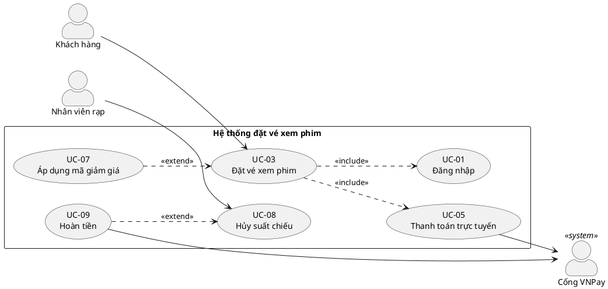

# Hướng dẫn thiết kế Use Case Diagram

## Mục lục
1. Ký hiệu chuẩn
2. Bảng chọn quan hệ
3. Mẫu PlantUML
4. Lỗi hay gặp
5. Chia nhỏ diagram lớn

## 1. Ký hiệu chuẩn (UML 2.x)

| Phần tử | Ký hiệu | Ghi chú |
|---|---|---|
| Actor | Hình người que (hoặc <<system>> hình chữ nhật cho hệ thống ngoài) | Ngoài system boundary |
| Use case | Hình elip chứa tên | Tên: động từ + đối tượng |
| System boundary | Hình chữ nhật có tên hệ thống ở góc trên | Chứa toàn bộ use case |
| Association | Đường liền actor–use case | Mặc định không mũi tên; có thể thêm mũi tên hướng tới actor phụ |
| Include | Mũi tên nét đứt `<<include>>` | Từ UC gốc → UC được include |
| Extend | Mũi tên nét đứt `<<extend>>` | Từ UC mở rộng → UC gốc |
| Generalization | Đường liền, tam giác rỗng | Trỏ về phần tử cha |

Quy ước bố cục: actor chính bên trái, actor phụ/hệ thống ngoài bên phải; use case đặt theo luồng thời gian hoặc nhóm nghiệp vụ.

## 2. Bảng chọn quan hệ

| Tình huống | Dùng |
|---|---|
| Actor kích hoạt / tham gia use case | Association |
| Nhiều use case cùng dùng một hành vi bắt buộc (vd: Xác thực, Thanh toán) | `<<include>>` |
| Hành vi chỉ xảy ra khi có điều kiện, hoặc tùy chọn, và use case gốc vẫn hoàn chỉnh khi thiếu nó | `<<extend>>` |
| Actor/use case là một dạng đặc biệt của cái khác | Generalization |

Kiểm tra nhanh: nếu bỏ use case con mà use case gốc **không còn chạy được** → include. Nếu bỏ mà gốc vẫn chạy trọn vẹn → extend. Use case gốc **biết** use case include nó gọi; use case extend **tự biết** nó mở rộng gốc ở extension point nào.

## 3. Mẫu PlantUML



Mẹo: ghi ID trong tên use case để khớp với bảng đặc tả. Nếu không render được PlantUML, dùng draw.io (Arrange → Insert → Advanced → PlantUML) hoặc vẽ SVG thủ công, vẫn tuân theo bảng ký hiệu trên. Mermaid không có loại use case diagram gốc; chỉ dùng flowchart mô phỏng khi bắt buộc và nói rõ đó là mô phỏng.

Generalization:
```plantuml
actor "Người dùng" as U
actor "Quản trị viên" as A
A --|> U
```

## 4. Lỗi hay gặp (kiểm tra trước khi giao)

1. **Phân rã chức năng**: use case kiểu "Nhập họ tên", "Kiểm tra mật khẩu". → gộp vào luồng của use case mục tiêu.
2. **Đảo chiều include/extend**.
3. **Lạm dụng include/extend** làm cây phân cấp nhiều tầng.
4. **Actor trong boundary** hoặc actor là một thành phần nội bộ (module, database của chính hệ thống). Database nội bộ không phải actor.
5. **Actor là chức danh cụ thể / tên người** thay vì vai trò.
6. **Tên use case là danh từ** ("Quản lý đơn hàng") mơ hồ hoặc không có mục tiêu rõ.
7. **Actor nối với actor** bằng association (chỉ cho phép generalization).
8. **Use case mồ côi**: không actor nào kích hoạt, và không được include/extend bởi ai.
9. **Thiếu actor phụ** cho hệ thống bên ngoài có tương tác thực sự.
10. **Quá nhiều CRUD**: 4 use case Thêm/Sửa/Xóa/Xem cho một đối tượng không có luồng khác biệt.
11. **Vẽ thứ tự/điều kiện lên diagram**: use case diagram không biểu diễn trình tự; việc đó thuộc đặc tả hoặc activity/sequence diagram.

## 5. Chia nhỏ diagram lớn

- Một diagram tổng quan (system context: actor + use case mức cao nhất).
- Mỗi module một diagram, dùng `package` hoặc `rectangle` con.
- Use case dùng chung (Đăng nhập, Phân quyền) đặt ở diagram riêng "Common" và tham chiếu bằng ID.
