# BẢN PHẢN BIỆN HỌC THUẬT & KIẾN TRÚC CHUYÊN SÂU
## (Architectural Review & Academic Critique)
**Đối tượng thẩm định:** Báo cáo Review Sơ đồ Lớp Miền v10.0 (`docs/domain-class-diagram-review-v10.0-analysis.md`)  
**Tài liệu gốc được đối chiếu:** Sơ đồ Lớp Miền v10.0 (`docs/uml/class-diagrams.md` & `class-diagram.puml`)  
**Hệ quy chiếu lý thuyết:** OMG UML 2.5.1 Specification, Domain-Driven Design (Eric Evans, Vaughn Vernon), Clean/Hexagonal Architecture, Martin Fowler (UML Distilled), Craig Larman (Applying UML and Patterns).  
**Vai trò thẩm định:** Principal Software Architect & Senior Domain Modeler.

---

## 1. TỔNG QUAN KIẾN TRÚC & ĐỊNH VỊ HỌC THUẬT

Bản báo cáo review v10.0 (`domain-class-diagram-review-v10.0-analysis.md`) là một công trình thẩm định kỹ lưỡng, sắc sảo về mặt thống kê, phát hiện chính xác nhiều khiếm khuyết thuộc tính, enum, stereotype và trích dẫn tài liệu. 

Tuy nhiên, dưới góc nhìn của **Principal Software Architect & Senior Domain Modeler**, bản review này bộc lộ **3 "vết gãy học thuật" (Academic Fractures) rất nghiêm trọng**:
1. **Sa đà vào tư duy Cơ sở dữ liệu quan hệ truyền thống (Relational / ERD Bias)**: Đánh đồng quan hệ khái niệm miền với khóa ngoại/liên kết thực thể vật lý, ép buộc chuyển các tham chiếu lỏng lẻo xuyên Bounded Context thành quan hệ kết hợp (Association) có bội số hai đầu — vi phạm trực tiếp nguyên tắc sống còn của Domain-Driven Design (DDD) và kiến trúc Context-First Modular Monolith.
2. **Rò rỉ tư duy lưu trữ vào mô hình miền (Persistence Leakage into Conceptual Domain Model)**: Dùng cấu trúc kỹ thuật hạ tầng (như việc PostgreSQL lưu bản nháp dưới dạng cột `proposal_data JSONB`) làm căn cứ để phủ nhận quan hệ hợp thành khái niệm (Composition) trong không gian vấn đề (Problem Space).
3. **Tiêu chuẩn kép và mâu thuẫn nội tại (Internal Double Standards)**: Một mặt chỉ trích tác giả sơ đồ đưa chi tiết kỹ thuật hạ tầng vào mô hình (như Redis TTL), nhưng mặt khác chính reviewer lại dùng chi tiết kỹ thuật lưu trữ DB để phủ nhận logic miền của nghiệp vụ; một mặt ca tụng Profile A (Domain Overview, 2–5 thuộc tính tiêu biểu), mặt khác lại đòi hỏi nhét đầy đủ các payload văn bản tự do khổng lồ biến sơ đồ thành Data Dictionary.

Dưới đây là các phân tích phản biện chuyên sâu và giải pháp chuẩn hóa kiến trúc.

---

## 2. PHẢN BIỆN CHUYÊN SÂU 4 TRỌNG ĐIỂM CỐT LÕI

### 2.1. Phản biện D-H01: Bản chất Quan hệ Cross-Context (Dependency `«by id»` vs. Association)

#### A. Phân tích luận điểm của Reviewer
Reviewer gán mức **High | Confirmed Defect** cho 14 quan hệ `«by id»` và lập luận:
- UML 2.5.1 không định nghĩa `multiplicity` cho `Dependency` (`..>`), các con số chỉ là nhãn chữ vô nghĩa về mặt siêu mô hình (metamodel).
- `«by id»` không phải stereotype chuẩn, không có Profile định nghĩa.
- Bắt buộc phải vẽ lại toàn bộ 14 đường này thành **Association thường (`--`) có multiplicity hai đầu**.
- Quy tắc "không có Association cắt ngang Bounded Context" bị reviewer quy kết là "quy tắc triển khai hạ tầng, không phải của mô hình miền khái niệm".

#### B. Phản biện học thuật & kiến trúc
1. **Điểm đúng về mặt hình thức cú pháp UML (Syntactic Validity)**:
   - Reviewer hoàn toàn chính xác khi dẫn chiếu **OMG UML 2.5.1 §7.7 (Dependencies)**: Dependency là một `DirectedRelationship` kết nối Client với Supplier, nó KHÔNG sở hữu `AssociationEnd`, do đó trong siêu mô hình UML chuẩn, **Dependency không có thuộc tính `multiplicity`**.
   - Việc PlantUML cho phép viết `"0..*" ..> "1"` thực chất chỉ là render nhãn chuỗi (string label), không mang ngữ nghĩa hình thức của UML Metamodel.
   - Stereotype `«by id»` chưa được công bố trong một UML Profile chuẩn (§12 Profiles).

2. **Sai lầm kiến trúc cốt tử của Reviewer (Architectural Flaw & DDD Violation)**:
   - **Vi phạm trực tiếp Nguyên tắc Vàng của Aggregate trong DDD (Evans & Vernon)**:
     Trong cuốn *Implementing Domain-Driven Design* (Vaughn Vernon), Chương 10 xác lập 4 quy tắc nền tảng của Aggregate, trong đó **Rule 3** nêu rõ:
     > *"Rule 3: Reference Other Aggregates by Identity, NOT by direct object reference/pointer."*
     Eric Evans trong *Domain-Driven Design (Blue Book)* cũng nhấn mạnh: Ranh giới Aggregate là ranh giới bất biến giao dịch (Transactional Consistency Boundary). Việc giữ tham chiếu đối tượng trực tiếp giữa các Aggregate phá vỡ ranh giới này, dẫn đến nguy cơ sửa đổi nhiều Aggregate trong cùng một giao dịch.
   - **Xóa nhòa ranh giới Bounded Context trong Modular Monolith**:
     Trong kiến trúc Context-First Modular Monolith (ADR-001 của FocusFlow), mỗi Bounded Context sở hữu cơ sở dữ liệu riêng (logical schemas độc lập), tuyệt đối cấm cross-context foreign keys và cross-context ORM relationships.
     Nếu vẽ một Association liền nét (`--`) với bội số hai đầu (ví dụ: `Task "0..*" -- "1" Roadmap`), trong tư duy OOP và UML:
     - Association biểu thị một liên kết cấu trúc (structural feature) mà tại thời điểm runtime, instance của `Task` có thể điều hướng (navigate) trực tiếp tới instance của `Roadmap`.
     - Lập trình viên và kỹ sư dữ liệu nhìn vào sẽ tự nhiên map thành `@ManyToOne` / `relationship()` ORM hoặc viết lệnh SQL JOIN trực tiếp xuyên Context!
   - **Sự ngây thơ khi xem Bounded Context chỉ là "chi tiết triển khai"**:
     Reviewer tuyên bố: *"Lý do không có Association cắt ngang Context là quy tắc kiến trúc triển khai... Bounded Context trong DDD là ranh giới ngôn ngữ, không phải lệnh cấm vẽ association"*.
     Đây là quan điểm hoàn toàn sai lệch! Trong DDD, **Bounded Context là Khái niệm Chiến lược (Strategic Design)** thuộc không gian nghiệp vụ. Nó phân định ranh giới mô hình có ý nghĩa độc lập. Việc ép vẽ Association hai đầu xuyên Bounded Context làm biến dạng mô hình thành **Enterprise Data Model / Big Ball of Mud** mà DDD sinh ra để xóa bỏ.

#### C. Giải pháp Kiến trúc & UML 2.5.1 Chuẩn mực
Không chọn giải pháp chắp vá của tác giả sơ đồ (Dependency gán multiplicity giả), cũng KHÔNG chọn giải pháp giáo điều tai hại của Reviewer (Association 2 đầu).
Giải pháp chuẩn mực quốc tế kết hợp hoàn hảo giữa UML 2.5.1 và DDD:

```
[Task] 0..* -----------> 1 [Roadmap]
              «references»
```

- **Sử dụng Unidirectional Association (`-->`)**: 
  - Trong OMG UML 2.5.1 §11.5, một Unidirectional Association chỉ có một đầu điều hướng (navigable end). Đầu đích sở hữu thuộc tính điều hướng kèm `multiplicity` hợp thức theo chuẩn UML (§9.5 Property). Đầu nguồn KHÔNG có thuộc tính điều hướng (non-navigable), thể hiện rõ tính lỏng lẻo (loose coupling): `Roadmap` hoàn toàn không nắm giữ tham chiếu đối tượng tới `Task` trong ranh giới của mình.
- **Áp dụng Stereotype `«references»` hoặc `«id-ref»`**:
  - Gắn stereotype chuẩn trên đường Association để truyền tải thông điệp DDD Ubiquitous Language: Đây là tham chiếu định danh (Identity Reference), không phải tham chiếu bộ nhớ/con trỏ đối tượng.
- **Định nghĩa một Mini-Profile UML cho DDD (Profile A Extension)**:
  - Công bố một UML Profile siêu gọn gồm stereotype `«references»` mở rộng từ metaclass `Association` theo UML 2.5.1 Clause 12.

---

### 2.2. Phản biện D-H02: ScheduleProposal *-- ScheduleBlock mâu thuẫn Q-07 và Xung đột Aggregate

#### A. Phân tích luận điểm của Reviewer
Reviewer gán mức **High | Confirmed Defect** cho quan hệ `ScheduleProposal "1" *-- "1..*" ScheduleBlock` vì:
1. Mâu thuẫn trực tiếp với F.2 Q-07 và CSDL: Bản nháp lưu dưới dạng cột `proposal_data JSONB`. Khối chỉ vật chất hóa thành bản ghi vật lý trong bảng `schedule_blocks` khi Apply. Do đó, bản đề xuất DRAFT có 0 khối `ScheduleBlock`, không thể có `1..*`.
2. Xung đột Aggregate: `ScheduleBlock` vừa là phần tử hợp thành của `ScheduleProposal`, vừa là thành viên association của `OfficialSchedule` — một thực thể không thể cùng lúc thuộc về hai Aggregate.

#### B. Phản biện học thuật: Bóc tách giữa "Persistence Leak" và "Aggregate Conflict"
1. **Lỗi Rò rỉ Lưu trữ (Persistence Leakage) của Reviewer**:
   - Luận điểm: *"Bản nháp lưu JSONB trong Postgres nên đề xuất DRAFT có 0 khối"* là **sai lầm kinh điển về vi phạm tính độc lập lưu trữ (Persistence Ignorance)** trong phân tích hướng đối tượng (OOA/DDD)!
   - Craig Larman (*Applying UML and Patterns*, Chapter 9 - Domain Models) và Martin Fowler (*UML Distilled*, Conceptual Perspective) đã khẳng định:
     > **Mô hình Khái niệm Miền (Conceptual Domain Model) mô tả Không gian Vấn đề (Problem Space) trong thế giới thực, TUYỆT ĐỐI KHÔNG mô tả cách thức một hệ quản trị CSDL quan hệ lưu trữ dữ liệu.**
   - Hãy đặt câu hỏi nghiệp vụ thuần túy: Khi một học viên nhận được một bản đề xuất lịch từ AI (`ScheduleProposal`), bản đề xuất đó có chứa các khối học không?
     **CÓ!** Bản đề xuất bao gồm danh sách các khung giờ học cụ thể (thứ 2 học 20h–21h, thứ 4 học 19h–20h30). Về mặt khái niệm, nếu không có các khối thời gian được đề xuất thì bản đề xuất là rỗng và vô nghĩa!
   - Việc PostgreSQL lưu cấu trúc này trong một cột JSONB hay tạo bảng tạm chỉ là **quyết định kỹ thuật tối ưu hóa hiệu năng lưu trữ (Persistence Mechanism)** của kiến trúc hạ tầng. Lấy lý do "chưa INSERT vào bảng `schedule_blocks`" để khẳng định số lượng khối bằng 0 ở tầng khái niệm là một sự lẫn lộn tai hại giữa Conceptual Model và Relational Schema.

2. **Điểm đúng của Reviewer về Xung đột Ranh giới Aggregate (Aggregate Boundary Conflict)**:
   - Dù luận cứ JSONB của reviewer là sai, nhưng **kết luận về xung đột cấu trúc Aggregate là CHÍNH XÁC**.
   - Trong DDD (Evans Ch. 6, Vernon Ch. 10): Một Entity không thể vừa thuộc về vòng đời sinh tử nội bộ (Composition - Black Diamond) của Aggregate Root A (`ScheduleProposal`), lại vừa là một Entity thành viên của Aggregate Root B (`OfficialSchedule`). 
   - `ScheduleBlock` mang trạng thái thực thi (`status : BlockStatus`), cờ bảo vệ (`isProtected`), gắn với lịch chính thức. Bản nháp đề xuất không nên dùng chung định danh và lớp thực thể này.

#### C. Giải pháp Kiến trúc & Domain Modeling Chuẩn mực (DDD Canonical Pattern)
Tách bạch ranh giới khái niệm giữa "Khối đề xuất" và "Khối lịch chính thức":

```
[ScheduleProposal] 1 *-- 1..* [ProposedTimeSlot] (ValueObject)
        |
        ..> «create/apply»
        v
[OfficialSchedule] 1 *-- 0..* [ScheduleBlock] (Entity)
```

1. **Chuẩn hóa `ProposedTimeSlot` (hoặc `DraftBlock`) là Value Object nội tại của `ScheduleProposal`**:
   - Bản đề xuất lịch sở hữu Composition (`*--`) với `1..* ProposedTimeSlot`. Đây là Value Object biểu diễn thời gian đề xuất, dự kiến học task nào, hoàn toàn bất biến và không có định danh vòng đời độc lập.
2. **Hành động Apply chuyển hóa Value Object thành Domain Entity**:
   - Khi người học nhấn **Apply** (qua Domain Service / Scheduling Engine), các `ProposedTimeSlot` được vật chất hóa thành các `ScheduleBlock` (Entity) gắn với `OfficialSchedule`.
3. **Nếu muốn giữ số lượng 33 Classes trong Profile A**:
   - Sử dụng quan hệ phụ thuộc hoặc liên kết có hướng: `ScheduleProposal "1" --> "0..*" ScheduleBlock : proposes` kèm chú thích rõ ràng: `ScheduleBlock` đại diện cho khái niệm khối thời gian học tập xuyên suốt chu trình lập lịch. Tuyệt đối loại bỏ luận điệu "vì Postgres lưu JSONB nên có 0 khối".

---

### 2.3. Phản biện D-M03: "3 Class rỗng ruột" & Nghệ thuật Cân bằng Profile A

#### A. Phân tích luận điểm của Reviewer
Reviewer gán mức **Medium | Confirmed Defect** cho 3 class:
- `LearnerMemoryItem`: chỉ có 3 thuộc tính phân loại, thiếu `claim_value`.
- `KnowledgeChunk`: chỉ có `provenance`, thiếu `content_text`.
- `AIReview`: chỉ có `cycle`, thiếu `quantitative_summary` và `user_reflection_payload`.
Reviewer yêu cầu bổ sung toàn bộ các trường text/payload này vào sơ đồ.

#### B. Phản biện học thuật: Phân định Thuộc tính Bản thể (Essential) vs. Dữ liệu Payload (Bloat)
1. **Tiếp thu có chọn lọc (Valid Criticisms)**:
   - **`LearnerMemoryItem` cần `claimValue : String`**: Một mục bộ nhớ mà không có giá trị nội dung được ghi nhớ (ví dụ: "Người học tiếp thu tốt qua sơ đồ mindmap") thì trở thành một "vỏ bọc phân loại rỗng". `claimValue` là thuộc tính định danh ngữ nghĩa (semantic payload) bắt buộc phải có.
   - **`KnowledgeChunk` cần `contentText : String`**: Bản chất của một đoạn tri thức RAG (Chunk) là một đoạn văn bản (text segment). Chỉ có `provenance` (nguồn trích dẫn) thì class này biến thành thư mục trích dẫn thay vì đoạn tri thức.

2. **Phản biện sự sa đà, biến Profile A thành Data Dictionary**:
   - Đối với **`AIReview`**: Reviewer đòi hỏi đưa `quantitative_summary` (chuỗi số liệu tổng kết) và `user_reflection_payload` (toàn bộ nội dung tự phản tư của người học) vào sơ đồ.
     - Đây là yêu cầu **phi lý và vi phạm triết lý thiết kế của UML Profile A**!
     - Profile A (Domain Overview) có sứ mệnh thể hiện cấu trúc phân rã, ranh giới Aggregate, các chỉ số điều hướng và vòng đời máy trạng thái. Nó giới hạn 2–5 thuộc tính tiêu biểu.
     - `AIReview` là một Aggregate Root đại diện cho sự kiện đánh giá định kỳ (`cycle : ReviewCycle`, `evaluationDate : Date`, `status : ReviewStatus`).
     - Nội dung phản tư hay tóm tắt định lượng là các **Document/Text Payloads** kích thước lớn, thuộc về tầng chi tiết (Detailed Specifications / Document Store). Việc nhét các thuộc tính text blob này vào hộp class trên sơ đồ tổng quan sẽ gây nhiễu thị giác, phình to sơ đồ vô ích mà không cung cấp thêm bất kỳ hiểu biết nào về mặt kiến trúc hướng đối tượng.
   - Đối với **`StudyNote`**: Reviewer bắt lỗi thiếu `content : String`. Một ghi chú hiển nhiên mang nội dung văn bản. Việc vẽ hay không vẽ `content` không làm thay đổi cấu trúc quan hệ hay hành vi của hệ thống.

---

### 2.4. Phản biện D-M10: 15 `<<AggregateRoot>>` và Vấn đề Aggregate Boundaries

#### A. Phân tích luận điểm của Reviewer
Reviewer chỉ ra: Có 15 class mang stereotype `<<AggregateRoot>>` trên tổng số 33 class (gần 50%), nhưng trong toàn bộ tài liệu và sơ đồ không có bất kỳ Aggregate Boundary nào được vạch rõ; nhiều AR đứng trơ trọi một mình (`AIReview`, `PauseRecord`, `PaymentOrder`). Reviewer coi đây là stereotype "mang tính trang trí".

#### B. Đánh giá kiến trúc: Finding HỢP LÝ nhưng cần bảo vệ thiết kế Small Aggregates
1. **Thừa nhận tính chính xác của Reviewer**:
   - Reviewer đã đưa ra một nhận xét sắc đáng ở góc độ DDD: Một sơ đồ gán mác `<<AggregateRoot>>` dày đặc mà không chỉ ra ranh giới bao bọc (Aggregate Boundary) gồm những Entity/Value Object nào bên trong thì stereotype đó bị giảm sút giá trị truyền tải kiến trúc.

2. **Bảo vệ tính hợp lệ của "Single-Entity Aggregates" trong FocusFlow**:
   - Trong tác phẩm kinh điển *Effective Aggregate Design: Part I - Modeling a Single Aggregate*, Vaughn Vernon chỉ rõ:
     > *"Rule 2: Design Small Aggregates. A common mistake is designing large, bloated aggregates. Extreme small aggregates may contain only a Root Entity and zero child entities, maintaining their own transactional consistency."*
   - Các class như `AIReview`, `PauseRecord`, `PaymentOrder` trong FocusFlow được thiết kế như những **Single-Entity Aggregates**:
     - Chúng có định danh toàn cục độc lập (Global Identity).
     - Chúng có vòng đời riêng biệt, được tải và lưu qua Repository riêng (`AIReviewRepository`, `PauseRecordRepository`).
     - Chúng có các bất biến giao dịch riêng biệt mà không phụ thuộc vào chu kỳ sống của các Entity xung quanh.
   - Do đó, việc gắn `<<AggregateRoot>>` cho chúng là **hoàn toàn chính xác về mặt lý thuyết DDD**, không phải phân loại sai!

3. **Khuyến nghị chuẩn hóa hiển thị**:
   - Không hạ cấp stereotype của các Single-Entity Aggregates xuống `<<Entity>>` (vì làm thế sẽ vi phạm nguyên tắc thiết kế Repository trong DDD: chỉ Aggregate Root mới có Repository).
   - Thay vào đó, trong tài liệu và sơ đồ, thể hiện rõ **Aggregate Boundaries** bằng một trong hai cách:
     - Bổ sung Bảng phân định Aggregate Ranh giới (Aggregate Boundary Matrix): Liệt kê rõ từng Aggregate Root quản lý những Entity/Value Object nào (ví dụ: `User AR` quản lý `LearnerProfile`, `LearnerMemoryItem`, `ConceptMastery`; `OfficialSchedule AR` quản lý `ScheduleBlock`).
     - Thể hiện trực quan bằng các đường nét đứt gom cụm Aggregate bên trong từng Package Bounded Context.

---

## 3. PHÂN LOẠI & ĐÁNH GIÁ TOÀN DIỆN 30 FINDINGS

Dưới đây là bảng phân loại khách quan, khoa học toàn bộ 30 findings thành 3 nhóm rõ rệt:

```
┌────────────────────────────────────────────────────────────────────────┐
│                      TỔNG THỂ 30 FINDINGS REVIEW                       │
├──────────────────────────┬─────────────────────────┬───────────────────┤
│ Nhóm A: Hợp lý & Đúng    │ Nhóm B: Giáo điều /     │ Nhóm C: Mâu thuẫn │
│         (Valid Findings) │         Persistence-Leak│         Nội tại   │
│         [ 18 Findings ]  │         [ 7 Findings ]  │         [ 5 ]     │
└──────────────────────────┴─────────────────────────┴───────────────────┘
```

### BẢNG ĐÁNH GIÁ CHI TIẾT 30 FINDINGS

| Mã Finding | Tên Vấn Đề | Đánh Giá Học Thuật / Kiến Trúc | Phân Nhóm | Khuyến Nghị Xử Lý Cho CCB FocusFlow |
|---|---|---|:---:|---|
| **D-H01** | 14 quan hệ `«by id»` thay Association | **Sai lầm kiến trúc của Reviewer**: Đúng về mặt cú pháp UML (multiplicity trên dependency không chuẩn), nhưng giải pháp ép Association 2 đầu vi phạm DDD và phá vỡ ranh giới Bounded Context. | **Nhóm B + C** | Đổi thành **Unidirectional Association (`-->`)** có stereotype `«references»` và multiplicity đầu đích. |
| **D-H02** | `ScheduleProposal *-- ScheduleBlock` mâu thuẫn Q-07 | **Rò rỉ tư duy lưu trữ (Persistence Leak)**: Viện cớ Postgres JSONB là sai logic OOA; nhưng đúng về xung đột 1 Entity bị 2 Root sở hữu. | **Nhóm B + A** | Tách `ProposedTimeSlot` (VO) trong Proposal, map sang `ScheduleBlock` (Entity) khi Apply. |
| **D-H03** | `KeyTakeaway.alignmentFlag : Boolean` | **Hoàn toàn chính xác**: SRS §12 #27 quy định enum 5 giá trị; Boolean phá hủy khả năng cảnh báo của Anti-Gaming Guard. | **Nhóm A** | **Tiếp thu 100%**: Đổi thành `alignmentFlag : AlignmentFlag` (5 giá trị enum). |
| **D-M01** | `PasswordResetToken` sai stereotype `<<ValueObject>>` | **Hoàn toàn chính xác**: Token có vòng đời, có cờ `used` thay đổi trạng thái, có định danh. Không thể là VO bất biến. | **Nhóm A** | **Tiếp thu 100%**: Đổi thành `<<Entity>>` (Transient Entity). Bỏ ghi chú "Redis" khỏi mô hình miền. |
| **D-M02** | `MistakeTaxonomy` trùng lặp biểu diễn | **Hoàn toàn chính xác**: Vừa có thuộc tính `mistakeTaxonomyJson`, vừa có VO `MistakeTaxonomy`. | **Nhóm A** | **Tiếp thu 100%**: Giữ VO `MistakeTaxonomy`, bỏ thuộc tính JSON kỹ thuật trên `MilestoneProof`. |
| **D-M03** | 3 class mang nội dung thiếu thuộc tính | **Đúng một phần, quá đà một phần**: Cần thiết với `claimValue` và `contentText`; phi lý khi đòi nhồi text payloads vào `AIReview`. | **Nhóm A + B** | Tiếp thu có chọn lọc: Thêm `claimValue` (Memory) và `contentText` (Chunk); giữ gọn `AIReview`. |
| **D-M04** | Ngân sách dời lịch tuần (3 lượt/tuần) thiếu | **Hoàn toàn chính xác**: Đây là Core Business Invariant trong SRS §12 #16 và §16 AC. | **Nhóm A** | **Tiếp thu 100%**: Thêm 3 thuộc tính ngân sách vào `Roadmap` và `countsTowardBudget` vào `ScheduleChangeLog`. |
| **D-M05** | `ScheduleBlock` thiếu `is_protected` và mốc thời gian | **Hoàn toàn chính xác**: `isProtected` là cờ chặn Domino Shift (BUSR-07), `startAt` là mốc thời gian định nghĩa khối lịch. | **Nhóm A** | **Tiếp thu 100%**: Thêm `isProtected : Boolean` và `startAt : Timestamp`. |
| **D-M06** | `AvailabilitySlot` thiếu `energy_level` | **Hoàn toàn chính xác**: Khung giờ rảnh Mode B cần `energyLevel` để phục vụ Energy-Aware Scheduling. | **Nhóm A** | **Tiếp thu 100%**: Thêm `energyLevel : EnergyLevel`. |
| **D-M07** | `AIQuota` thiếu chu kỳ và `reserved_calls` | **Hoàn toàn chính xác**: Bất biến giữ chỗ 2 pha (BUSR-10) đòi hỏi `usedCalls + reservedCalls <= monthlyLimit`. | **Nhóm A** | **Tiếp thu 100%**: Thêm `cycleStart : Date`, `reservedCalls : Integer`, cập nhật note invariant. |
| **D-M08** | Enum `TimerMode` chứa `FLOWMODORO` bịa | **Hoàn toàn chính xác**: SRS v1.4 chỉ quy định Pomodoro và Stopwatch. Không tự ý bịa enum khi chưa có quyết định CCB. | **Nhóm A** | **Tiếp thu 100%**: Bỏ `FLOWMODORO`, chỉ giữ `POMODORO` và `STOPWATCH`. |
| **D-M09** | Trích dẫn sai (BUSR-14, FR-STUDY-004, DEC-04...) | **Hoàn toàn chính xác**: Bắt lỗi sắc sảo về tính toàn vẹn tài liệu (Documentation Integrity). | **Nhóm A** | **Tiếp thu 100%**: Hiệu chỉnh toàn bộ trích dẫn về đúng mã chuẩn trong SRS v1.4. |
| **D-M10** | 15 `<<AggregateRoot>>` thiếu Aggregate Boundary | **Chính xác về mặt hiển thị**: Cần làm rõ ranh giới của các Aggregate thay vì chỉ gắn nhãn hình thức. | **Nhóm A** | Thêm Bảng phân định Aggregate Boundary; giữ nguyên AR cho Single-Entity Aggregates. |
| **D-M11** | 3 bội số khẳng định trên sơ đồ nhưng Q- ghi OPEN | **Bắt bẻ quan liêu (Over-pedantic)**: Một Baseline hoàn toàn có thể thể hiện hiện trạng chắc chắn nhất đồng thời track câu hỏi mở cho tương lai. | **Nhóm B** | Giữ nguyên hiện trạng `1:0..1` kèm note Q-01 OPEN như tài liệu v10.0 đã làm. |
| **D-M12** | Tuyên bố "khớp 100% với 35 bảng" sai số học | **Hoàn toàn chính xác**: Đếm số học bị vênh giữa bảng vật lý và classifier. | **Nhóm A** | **Tiếp thu 100%**: Viết lại công thức truy vết minh bạch: 29 class bảng + 2 quan hệ + 4 phi-bảng. |
| **D-M13** | Generalization thiếu discriminator | **Hoàn toàn chính xác**: Kế thừa `StudyNote <|-- KeyTakeaway` cần `{noteType = TAKEAWAY}` để tường minh. | **Nhóm A** | **Tiếp thu 100%**: Bổ sung ràng buộc discriminator `{noteType = TAKEAWAY}`. |
| **D-L01** | B#4 ghi thang điểm `masteryScore` 0.00..1.00 | **Chính xác (Lỗi văn bản)**: SRS quy định 0..100. | **Nhóm A** | Hiệu chỉnh văn bản tài liệu mô tả B#4. |
| **D-L02** | G.2 ghi "36 kiểu" nhưng đếm có 37 | **Chính xác (Lỗi đếm số)**: Lỗi chính tả nhỏ. | **Nhóm A** | Sửa tiêu đề bảng thành 37 kiểu enum. |
| **D-L03** | `SessionTask.sequenceOrder` không có trong SRS | **Hoàn toàn chính xác**: Bảng `session_tasks` có `allocated_minutes` thay vì `sequenceOrder`. | **Nhóm A** | Thay `sequenceOrder` bằng `allocatedMinutes : Integer`. |
| **D-L04** | WorkflowRun 2 dependency tùy chọn không có `{xor}` | **Quá khắt khe (Over-pedantic)**: Workflow có thể điều phối cả Goal hoặc Roadmap tùy loại workflow. | **Nhóm B** | Giữ nguyên 0..1 tùy chọn, không cần ép `{xor}` cứng. |
| **D-L05** | `StudyNote` thiếu liên kết tới `Task` | **Chính xác**: Schema hỗ trợ `task_id` cho ghi chú; nên thể hiện liên kết tùy chọn `0..1`. | **Nhóm A** | Bổ sung association có hướng: `StudyNote "0..*" --> "0..1" Task : refers to`. |
| **D-L06** | `PaymentOrder` thiếu `orderCode`, `expiresAt` | **Chính xác**: Giúp thể hiện vòng đời đơn thanh toán (TTL 15 phút). | **Nhóm A** | Bổ sung 2 thuộc tính này. |
| **D-L07** | `User` thiếu thuộc tính `email` | **Chính xác**: Email là định danh nghiệp vụ cốt lõi để đăng nhập và gửi thông báo. | **Nhóm A** | Bổ sung `email : String`. |
| **D-L08** | `PauseRecord` thiếu khoảng ngày `[start, end]` | **Chính xác**: Domino Shift cần khoảng thời gian này để tính toán dời lịch. | **Nhóm A** | Bổ sung `pauseStartDate : Date` và `pauseEndDate : Date`. |
| **D-L09** | Thiếu một số thuộc tính phụ (`betaBias`, `sequenceOrder`...)| **Chính xác**: Các thuộc tính nghiệp vụ có căn cứ rõ trong SRS §12. | **Nhóm A** | Bổ sung có chọn lọc theo đúng SRS §12. |
| **D-L10** | 5 tên class lệch khỏi SRS §12 | **Hợp lý về mặt truy vết**: Nếu đổi tên để tối ưu OOA thì phải có Decision Record ghi nhận. | **Nhóm A** | Khôi phục tên chuẩn SRS hoặc lập Decision Record giải trình. |
| **D-L11** | Thiếu Role Name và dấu chiều đọc trên Association | **Chính xác về quy ước UML**: Giúp sơ đồ dễ đọc hiểu hơn. | **Nhóm A** | Bổ sung Role Name cho các liên kết chính. |
| **D-I01** | Ghi nhận các quyết định đúng của v10.0 | **Đúng đắn, khách quan**: Đánh giá cao các điểm cải tiến của v10.0. | **Nhóm A** | Giữ vững các cải tiến đã đạt được. |
| **D-I02** | Ma trận tích hợp C.2 là kiến trúc, không phải miền | **Mâu thuẫn nội tại của Reviewer**: Reviewer coi C.2 là kiến trúc nhưng lại dùng chi tiết DB Postgres để phán xét D-H02. | **Nhóm C** | Định vị C.2 là "Tài liệu Kiến trúc Hỗ trợ Bounded Context", không gộp vào mô hình miền. |
| **D-I03** | Enum `ConceptVerification` thiếu `REJECTED` | **Chính xác**: UC-ADM-07 có trạng thái này. | **Nhóm A** | Bổ sung `REJECTED` vào danh mục enum. |

---

## 4. BÓC TÁCH CÁC MÂU THUẪN NỘI TẠI CỦA CHÍNH BẢN REVIEW (Nhóm C)

Để bảo đảm tính khách quan và khoa học, bản phản biện chỉ rõ **3 mâu thuẫn nội tại lớn trong lập luận của Reviewer**:

### Mâu thuẫn 1: "Chống rò rỉ hạ tầng" nhưng lại lấy "Postgres JSONB" làm thước đo đúng sai của Domain Model (D-H02 vs. D-I02 & §13.8)
- Tại mục §13.8 và D-I02, Reviewer gay gắt phê phán việc đưa "Redis TTL 15'" hay "Ma trận C.2 (Query Port/Redis Streams)" vào tài liệu miền vì cho rằng đó là chi tiết kiến trúc/hạ tầng.
- Thế nhưng, ngay tại finding nghiêm trọng nhất **D-H02**, Reviewer lại dùng chính chi tiết thiết kế lưu trữ vật lý của PostgreSQL (`proposal_data JSONB`) để lập luận: *"vì Postgres chưa tạo bản ghi trong bảng schedule_blocks nên bản nháp DRAFT có 0 khối và không được dùng Composition"*.
- **Phản biện**: Đây là tiêu chuẩn kép (Double Standard). Bản chất khái niệm của "Bản đề xuất lịch" là phải chứa các "Khối thời gian đề xuất". Việc CSDL lưu bằng JSONB hay bảng quan hệ hoàn toàn không làm thay đổi bản chất của mối quan hệ hợp thành này ở tầng khái niệm OOA.

### Mâu thuẫn 2: Đòi hỏi tuân thủ DDD nhưng lại ép vẽ Association hai đầu xuyên Bounded Context (D-H01 vs. Evans/Vernon)
- Trong danh mục tài liệu tham chiếu (§13), Reviewer liệt kê Eric Evans (*Domain-Driven Design*) và Vaughn Vernon (*Implementing DDD*).
- Tuy nhiên, khi giải quyết vấn đề tích hợp liên miền, Reviewer lại bắt buộc tác giả sơ đồ phải vẽ **Association liền nét (`--`) với bội số hai đầu cắt ngang qua 4 Bounded Contexts**.
- **Phản biện**: Đề xuất này vi phạm trực tiếp nguyên tắc độc lập Bounded Context và nguyên tắc "Aggregate Reference by Identity" của chính Evans và Vernon mà Reviewer trích dẫn! Việc vẽ Association hai đầu xuyên Context chính là tư duy "kéo lùi lịch sử" về thời kỳ ERD nguyên khối (Monolithic Database).

### Mâu thuẫn 3: Đòi hỏi Profile A (tối giản, tổng quan) nhưng lại bắt nhồi nhét text payloads khổng lồ (D-M03 vs. §13.1)
- Reviewer mở đầu bằng việc xác nhận và tán dương mô hình v10.0 đã tuân thủ chuẩn **Profile A (Domain Overview)**: Mỗi class chỉ nên thể hiện 2–5 thuộc tính mang ý nghĩa nghiệp vụ tiêu biểu nhất, không biến sơ đồ thành Data Dictionary.
- Nhưng đến mục D-M03 và D-M04, Reviewer lại bắt buộc phải nhét toàn bộ các trường dữ liệu nặng như `quantitative_summary`, `user_reflection_payload`, `content` vào sơ đồ.
- **Phản biện**: Đòi hỏi này tự mâu thuẫn với định nghĩa Profile A, làm phình to kích thước các classifier và làm giảm mạnh khả năng đọc hiểu trực quan của một sơ đồ lớp tổng quan.

---

## 5. BẢN THIẾT KẾ ĐỀ XUẤT CẢI TIẾN TOÀN DIỆN CHO V11.0 (PROPOSED V11.0)

Để giải quyết triệt để cả 30 findings mà vẫn bảo toàn 100% nguyên lý DDD và chuẩn OMG UML 2.5.1, kiến trúc v11.0 cần áp dụng các nguyên tắc sau:
1. **Quan hệ xuyên Context**: Chuyển toàn bộ thành **Unidirectional Association (`-->`)** có stereotype `«references»` kèm bội số đầu đích.
2. **Quan hệ Lập lịch**: `ScheduleProposal 1 *-- 1..* ProposedTimeSlot (VO)`, liên kết `ScheduleProposal ..> OfficialSchedule : «apply»`.
3. **Stereotype chuẩn xác**: Chuyển `PasswordResetToken` thành `<<Entity>>`, loại bỏ ghi chú Redis.
4. **Bổ sung thuộc tính cốt lõi**: `KeyTakeaway.alignmentFlag : AlignmentFlag` (5 giá trị), `User.email`, `LearnerMemoryItem.claimValue`, `KnowledgeChunk.contentText`, `Roadmap` (3 thuộc tính ngân sách tuần), `ScheduleBlock.isProtected` và `startAt`, `AIQuota.reservedCalls`.
5. **Định vị ma trận C.2**: Tách hẳn ma trận C.2 thành phụ lục "Context Integration Architecture", không gộp lẫn vào định nghĩa mô hình miền thuần túy.

### Mã nguồn PlantUML Chuẩn hóa (Kiến trúc v11.0 Hoàn thiện)

```plantuml
@startuml FocusFlow_Domain_Model_v11_Architecture_Standard
title FocusFlow — Conceptual Domain Model (v11.0 Architecturally Critique-Approved)

hide circle
hide empty members
skinparam packageStyle rectangle
skinparam classAttributeIconSize 0
skinparam defaultFontName Arial
skinparam shadowing false

' ====================================================================
' CONTEXT: ACCOUNT (Identity, Profile, Quota, Payment)
' ====================================================================
package "Account Context" <<Rectangle>> #F8FAFC {
  class User <<AggregateRoot>> {
    email : String
    role : UserRole
    tier : SubscriptionTier
    timezone : String
    status : UserStatus
    is_active : Boolean
  }

  class LearnerProfile <<Entity>> {
    optimalFocusDuration : Integer
    peakProductivitySlots : String
    weeklyCompletionRate : Decimal
    betaBias : Decimal
  }

  class LearnerMemoryItem <<Entity>> {
    claimValue : String
    category : MemoryCategory
    epistemicType : EpistemicType
    confirmationStatus : ConfirmationStatus
  }

  class LearnerConceptMastery <<Entity>> {
    masteryLevel : MasteryLevel
    masteryScore : Decimal
    nextReviewAt : Timestamp
  }

  class Availability <<AggregateRoot>> {
    mode : AvailabilityMode
  }

  class AvailabilitySlot <<Entity>> {
    dayOfWeek : DayOfWeek
    startTime : Time
    endTime : Time
    energyLevel : EnergyLevel
  }

  class CalendarConnection <<Entity>> {
    provider : CalendarProvider
    syncStatus : ConnectionStatus
  }

  class WebCalToken <<Entity>> {
    active : Boolean
  }

  class AIQuota <<AggregateRoot>> {
    monthlyLimit : Integer
    usedCalls : Integer
    reservedCalls : Integer
    cycleStart : Date
  }

  class AIQuotaReservation <<Entity>> {
    status : ReservationStatus
    expiresAt : Timestamp
  }

  class PaymentTransaction <<AggregateRoot>> {
    orderCode : String
    amount : Decimal
    status : PaymentStatus
    expiresAt : Timestamp
  }

  class PasswordResetToken <<Entity>> {
    tokenHash : String
    expiresAt : Timestamp
    used : Boolean
  }

  note bottom of PasswordResetToken
    {single-use, TTL 15m}
    FR-AUTH-004 (Transient Entity)
  end note

  note right of AIQuota
    {usedCalls + reservedCalls <= monthlyLimit}
  end note

  ' Internal Account Associations
  User "1" *-- "0..1" LearnerProfile
  User "1" *-- "0..*" LearnerMemoryItem
  User "1" *-- "0..*" LearnerConceptMastery
  User "1" *-- "0..1" Availability
  Availability "1" *-- "0..*" AvailabilitySlot
  User "1" *-- "0..*" CalendarConnection
  User "1" *-- "0..1" WebCalToken
  User "1" *-- "0..1" AIQuota
  AIQuota "1" *-- "0..*" AIQuotaReservation
  User "1" *-- "0..*" PaymentTransaction
  User "1" *-- "0..*" PasswordResetToken
}

' ====================================================================
' CONTEXT: PLANNING (Goal, Roadmap, RAG, Scheduling)
' ====================================================================
package "Planning Context" <<Rectangle>> #F0FDF4 {
  class Goal <<AggregateRoot>> {
    description : String
    currentLevel : SkillLevel
    targetDate : Date
    clarificationContext : String
  }

  class KnowledgeSource <<AggregateRoot>> {
    sourceType : SourceType
    ingestionStatus : IngestionStatus
  }

  class KnowledgeChunk <<ValueObject>> {
    chunkIndex : Integer
    contentText : String
    provenance : String
  }

  class LearningConcept <<AggregateRoot>> {
    name : String
    description : String
    learningOutcomes : String
    verificationStatus : ConceptVerification
  }

  class Roadmap <<AggregateRoot>> {
    title : String
    status : RoadmapStatus
    targetDate : Date
    weeklyRescheduleBudget : Integer
    weeklyRescheduleUsed : Integer
    budgetWeekStart : Date
  }

  class Milestone <<Entity>> {
    name : String
    sequenceOrder : Integer
    proofStatus : ProofStatus
  }

  class ScheduleProposal <<AggregateRoot>> {
    purpose : ProposalPurpose
    status : ProposalStatus
  }

  class ProposedTimeSlot <<ValueObject>> {
    scheduledStart : Timestamp
    durationMinutes : Integer
    blockType : BlockType
  }

  class OfficialSchedule <<AggregateRoot>> {
    bufferMinutesPerWeek : Integer
    recoveryWindowDays : Integer
    dailyWorkloadCapMinutes : Integer
    stabilityWeight : Decimal
  }

  class ScheduleBlock <<Entity>> {
    blockType : BlockType
    startAt : Timestamp
    scheduledDuration : Integer
    status : BlockStatus
    isProtected : Boolean
  }

  note bottom of Roadmap
    {1 active Roadmap per Goal}
    {Q-01 OPEN: multiple roadmaps over time?}
  end note

  ' Internal Planning Associations
  Goal "1" *-- "0..1" Roadmap
  Goal "1" *-- "0..*" KnowledgeSource
  KnowledgeSource "1" *-- "0..*" KnowledgeChunk
  Roadmap "1" *-- "0..*" Milestone
  Roadmap "1" *-- "0..1" OfficialSchedule
  Roadmap "1" *-- "0..*" ScheduleProposal
  ScheduleProposal "1" *-- "1..*" ProposedTimeSlot : contains proposed slots
  ScheduleProposal "0..*" ..> "1" OfficialSchedule : «apply / materialize»
  OfficialSchedule "1" *-- "0..*" ScheduleBlock : active blocks
  LearningConcept "0..*\n+prerequisites" --> "0..*\n+advancedConcepts" LearningConcept : requires {acyclic}
}

' ====================================================================
' CONTEXT: EXECUTION (Task, StudySession, Note, Proof)
' ====================================================================
package "Execution Context" <<Rectangle>> #FEFCE8 {
  class Task <<AggregateRoot>> {
    title : String
    estimatedEffort : Integer
    status : TaskStatus
    scheduledDate : Date
    rescheduleCount : Integer
  }

  class StudySession <<AggregateRoot>> {
    mode : SessionMode
    status : SessionStatus
    pendingTakeaway : Boolean
    timerMode : TimerMode
    actualDurationMinutes : Integer
  }

  class SessionTask <<AssociationClass>> {
    allocatedMinutes : Integer
    statusAfterSession : TaskStatus
    actualMinutes : Integer
  }

  class DailyCheckin <<ValueObject>> {
    timeSufficiency : Integer
    perceivedDifficulty : Integer
    focusLevel : Integer
  }

  class StudyNote <<Entity>> {
    noteType : NoteType
    content : String
  }

  class KeyTakeaway <<Entity>> {
    selfConfidence : Integer
    verificationStatus : TakeawayVerification
    alignmentFlag : AlignmentFlag
    aiEvidenceScore : Decimal
  }

  note bottom of Task
    {STALLED when rescheduleCount >= 3}
    {estimatedEffort: AI 30..120, manual 15..240}
  end note

  ' Internal Execution Associations
  StudySession "0..*" -- "0..*" Task
  (StudySession, Task) .. SessionTask
  StudySession "1" *-- "0..1" DailyCheckin
  StudySession "0..1" *-- "0..*" StudyNote
  StudyNote "0..*" --> "0..1" Task : «refers to»
  StudyNote <|-- KeyTakeaway : {noteType = TAKEAWAY}
  Task "0..1\n+parentTask" --> "0..*\n+subTasks" Task : parent of {acyclic}
  Task "0..*\n+predecessors" --> "0..*\n+successors" Task : precedes {acyclic}
}

' ====================================================================
' CONTEXT: EVALUATION (Adaptation, Proof, Review, ChangeLog)
' ====================================================================
package "Evaluation Context" <<Rectangle>> #FDF2F8 {
  class MilestoneProof <<AggregateRoot>> {
    attemptNo : Integer
    verdict : ProofVerdict
    calibrationGap : Decimal
  }

  class MistakeTaxonomy <<ValueObject>> {
    cause : MistakeCause
  }

  class AIReview <<AggregateRoot>> {
    cycle : ReviewCycle
    evaluationDate : Date
  }

  class PauseRecord <<AggregateRoot>> {
    pauseStartDate : Date
    pauseEndDate : Date
    status : PauseStatus
    shiftedDays : Integer
  }

  class ScheduleChangeLog <<Entity>> {
    trigger : ChangeTriggerType
    disruptionCategory : DisruptionCategory
    countsTowardBudget : Boolean
  }

  MilestoneProof "1" *-- "0..*" MistakeTaxonomy : categorizes mistakes
}

' ====================================================================
' SHARED KERNEL (Durable Workflow Coordination)
' ====================================================================
package "Shared Kernel" <<Rectangle>> #F3F4F6 {
  class WorkflowRun <<Entity>> {
    type : WorkflowType
    status : WorkflowStatus
    currentStep : String
  }
}

' ====================================================================
' STRATEGIC CROSS-CONTEXT REFERENCES (DDD Rule of Aggregates: Reference by Identity)
' Represented via Unidirectional Associations (-->) with «references» stereotype
' ====================================================================
Goal "0..*" --> "1" User : «references»
Task "0..*" --> "1" Roadmap : «references»
Task "0..*" --> "1" Milestone : «references»
Task "0..*" --> "0..1" LearningConcept : «references»
ScheduleBlock "0..*" --> "0..1" Task : «references»
StudySession "0..*" --> "1" Roadmap : «references»
LearnerConceptMastery "0..*" --> "1" LearningConcept : «references»
MilestoneProof "0..*" --> "1" Milestone : «references»
MilestoneProof "0..*" --> "0..1" Task : «references corrective»
AIReview "0..*" --> "1" Roadmap : «references»
PauseRecord "0..*" --> "1" Roadmap : «references»
ScheduleChangeLog "0..*" --> "1" Roadmap : «references»
WorkflowRun "0..*" --> "0..1" Goal : «references»
WorkflowRun "0..*" --> "0..1" Roadmap : «references»

legend bottom
  **Academic & Architectural Modeling Conventions (v11.0 Baseline Ready)**
  --
  • **Bounded Context Isolation**: Packages define strict DDD Bounded Contexts.
  • **Aggregate Reference Rule**: Cross-context relations MUST be Unidirectional Associations (`-->`) with «references» stereotype, preserving Zero-ORM/Zero-FK cross-context boundaries.
  • **Composition (`*--`)**: Applied strictly to intra-aggregate lifecycle containment.
  • **Proposal vs. Official Schedule**: ScheduleProposal composes `ProposedTimeSlot` (VO); OfficialSchedule composes `ScheduleBlock` (Entity) materialized upon Apply.
  • **Formally Acyclic**: `{acyclic}` applied to reflexive DAG relations (Tasks, LearningConcepts).
end legend
@enduml
```



---

## 6. KẾT LUẬN KIẾN TRÚC & PHÁN QUYẾT CUỐI CÙNG

### 6.1. Đánh giá lại Phán quyết "NEEDS REVISION" của Reviewer
Reviewer đưa ra phán quyết **NEEDS REVISION** dựa trên 3 lỗi High (D-H01, D-H02, D-H03).
Sau khi thẩm định học thuật và kiến trúc chuyên sâu:
1. **D-H03 (`alignmentFlag`)**: Là lỗi miền thật sự (Confirmed Defect), sửa rất nhanh bằng cách đổi kiểu enum.
2. **D-H02 (`ScheduleProposal *-- ScheduleBlock`)**: Là một điểm xung đột cấu trúc cần phân tách giữa `ProposedSlot` và `ScheduleBlock`, hoàn toàn KHÔNG PHẢI lỗi do "Postgres lưu JSONB" như reviewer ngộ nhận.
3. **D-H01 (14 quan hệ `«by id»`)**: Đây là một **tranh cãi học thuật về cách thể hiện ký hiệu (Notation Representation Debate)**. Việc tác giả sơ đồ dùng Dependency có thể chưa chuẩn siêu mô hình UML 2.5.1, nhưng giải pháp của Reviewer bắt đổi thành Association hai đầu là một **bước lùi nguy hiểm** về mặt kiến trúc DDD.

### 6.2. Phán quyết Kiến trúc Chính thức (Architectural Verdict)
Thay vì bác bỏ toàn bộ nỗ lực của bản v10.0, Hội đồng Kiến trúc đưa ra phán quyết:

> **CONDITIONAL BASELINE APPROVED (CHẤP THUẬN BASELINE CÓ ĐIỀU KIỆN HIỆU CHỈNH TINH GỌN)**

### 6.3. Khuyến nghị Hành động cho CCB & Lead Architect FocusFlow
1. **Tiếp thu toàn bộ 18 Valid Findings (Nhóm A)**: Đổi kiểu `KeyTakeaway.alignmentFlag : AlignmentFlag` (5 giá trị), chuẩn hóa stereotype `PasswordResetToken` thành `<<Entity>>`, bỏ `FLOWMODORO`, thêm các thuộc tính định nghĩa còn thiếu (`claimValue`, `contentText`, ngân sách dời lịch tuần, `isProtected`, `startAt`, `reservedCalls`, `email`), và hiệu chỉnh các trích dẫn sai (D-M09).
2. **Bác bỏ giải pháp ép Association hai đầu của Reviewer tại D-H01**: Áp dụng chuẩn **Unidirectional Association (`-->`) có stereotype `«references»`** cho 14 quan hệ xuyên Bounded Context, bảo vệ toàn vẹn nguyên lý Modular Monolith của ADR-001.
3. **Giải quyết xung đột D-H02 bằng cách đưa `ProposedTimeSlot` (VO) vào `ScheduleProposal`**: Giữ vững ranh giới sạch giữa Không gian Vấn đề (Problem Space) và Tầng Lưu trữ CSDL (Persistence Layer), chấm dứt hoàn toàn tình trạng rò rỉ tư duy lưu trữ vào mô hình miền.
4. **Giữ nguyên ranh giới Profile A**: Kiên quyết không đưa các trường text payload khổng lồ (`quantitative_summary`, `user_reflection_payload`) vào sơ đồ lớp tổng quan, giữ cho sơ đồ luôn thanh thoát, sắc nét và đạt chuẩn kiến trúc quốc tế.
