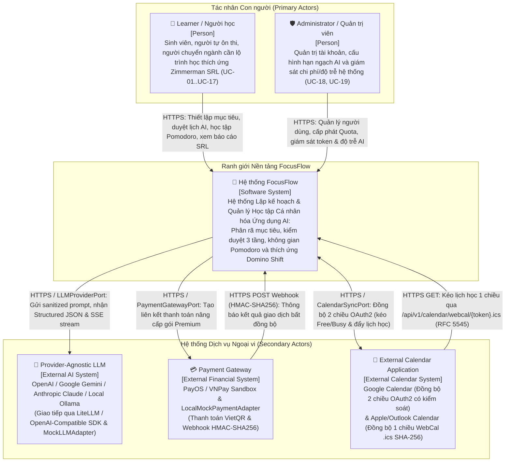
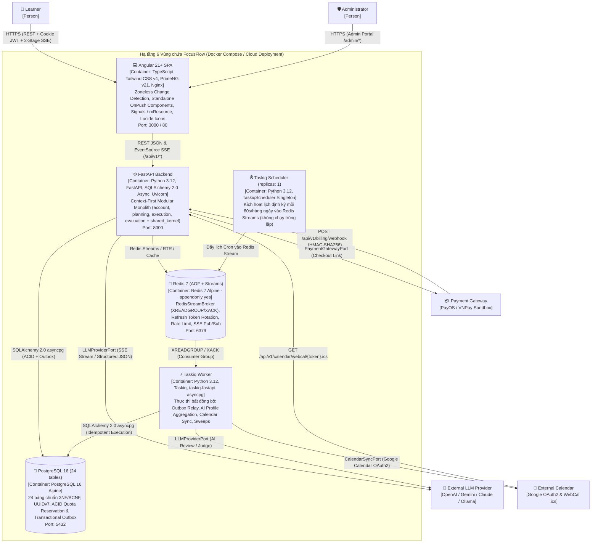
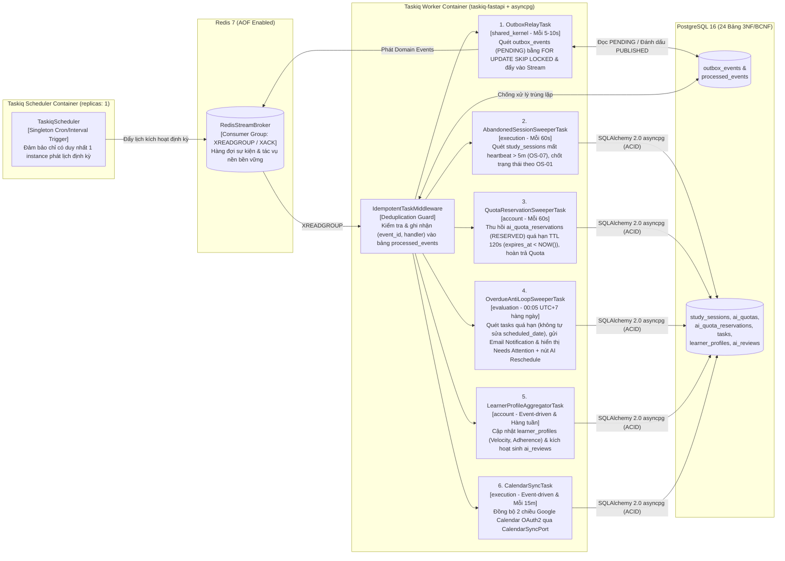

# FocusFlow — Mô hình Kiến trúc C4 & Biểu đồ Thành phần (C4 Model & Component Diagrams)
## Phiên bản: v2.0 — Chuẩn Mô hình Hóa C4 Toàn diện (System Context, Container, Component Level)
**Dự án:** FocusFlow — Hệ thống Lập kế hoạch & Quản lý Học tập Cá nhân hóa Ứng dụng AI (AI-Powered Personalized Study Planning & Execution System)  
**Tiêu chuẩn thiết kế:** Simon Brown C4 Model Specification, ISO/IEC/IEEE 42010, UML 2.5.1, Domain-Driven Design (DDD)  
**Căn cứ đánh giá học thuật:** Khung Rubric Đồ án Tốt nghiệp CNTT — Tiêu chí TC2.1 & TC2.3 (Mức 5)  
**Tài liệu liên kết nguồn:**
- Đặc tả SRS v1.2: [`docs/srs/srs-v1.0.md`](file:///Users/vuthang/Documents/FocusFlow/docs/srs/srs-v1.0.md)
- Kiến trúc tổng thể arc42 v2.0: [`docs/architecture/system-architecture.md`](file:///Users/vuthang/Documents/FocusFlow/docs/architecture/system-architecture.md)
- Sơ đồ ca sử dụng: [`docs/uml/use-cases/UC_Master.drawio`](file:///Users/vuthang/Documents/FocusFlow/docs/uml/use-cases/UC_Master.drawio), [`docs/uml/use-case-specifications.md`](file:///Users/vuthang/Documents/FocusFlow/docs/uml/use-case-specifications.md)
- Biểu đồ lớp (Domain Model & DCD v5.0): [`docs/uml/class-diagrams/class_diagram.drawio`](file:///Users/vuthang/Documents/FocusFlow/docs/uml/class-diagrams/class_diagram.drawio), [`docs/uml/class-diagrams.md`](file:///Users/vuthang/Documents/FocusFlow/docs/uml/class-diagrams.md)
- Thiết kế CSDL vật lý (24 bảng 3NF/BCNF, dbdiagram.io DBML): [`docs/database/schema.dbml`](file:///Users/vuthang/Documents/FocusFlow/docs/database/schema.dbml), [`docs/database/database-schema-design.md`](file:///Users/vuthang/Documents/FocusFlow/docs/database/database-schema-design.md), [`docs/database/schema.sql`](file:///Users/vuthang/Documents/FocusFlow/docs/database/schema.sql)
- Các quyết định kiến trúc: [`docs/decisions/`](file:///Users/vuthang/Documents/FocusFlow/docs/decisions) (`ADR-001` đến `ADR-010`)

---

## MỤC LỤC
1. [Nguyên tắc Phân tầng & Kiểm soát Ranh giới (Boundary Rules)](#1-nguyên-tắc-phân-tầng--kiểm-soát-ranh-giới-boundary-rules)
2. [C4 Level 1: Biểu đồ Bối cảnh Hệ thống (System Context Diagram)](#2-c4-level-1-biểu-đồ-bối-cảnh-hệ-thống-system-context-diagram)
3. [C4 Level 2: Biểu đồ Vùng chứa (Container Diagram)](#3-c4-level-2-biểu-đồ-vùng-chứa-container-diagram)
4. [C4 Level 3: Biểu đồ Thành phần Backend Modular Monolith (Backend Component Diagram)](#4-c4-level-3-biểu-đồ-thành-phần-backend-modular-monolith-backend-component-diagram)
5. [C4 Level 3: Biểu đồ Thành phần Web Frontend Angular 21+ (Frontend Component Diagram)](#5-c4-level-3-biểu-đồ-thành-phần-web-frontend-angular-21-frontend-component-diagram)
6. [C4 Level 3: Biểu đồ Thành phần Taskiq Worker & Taskiq Scheduler (Worker Component Diagram)](#6-c4-level-3-biểu-đồ-thành-phần-taskiq-worker--taskiq-scheduler-worker-component-diagram)
7. [Bảng Đặc tả Trách nhiệm & Hợp đồng Thành phần (Component Catalog)](#7-bảng-đặc-tả-trách-nhiệm--hợp-đồng-thành-phần-component-catalog)
8. [Kiểm toán Tính nhất quán & Kiểm soát Kiến trúc Tự động (Architecture Audit)](#8-kiểm-toán-tính-nhất-quán--kiểm-soát-kiến-trúc-tự-động-architecture-audit)

---

## 1. Nguyên tắc Phân tầng & Kiểm soát Ranh giới (Boundary Rules)

Để tránh rò rỉ mức trừu tượng (Abstraction Leaks) và bảo vệ tiêu chuẩn học thuật của đồ án, mô hình C4 v2.0 của FocusFlow tuân thủ nghiêm ngặt các quy tắc sau:

1. **Không trộn lẫn Abstraction Level:**
   - **Level 1 (System Context):** Chỉ chứa 2 Actor con người (`Learner`, `Administrator`), Hệ thống FocusFlow tổng thể và 3 Hệ thống ngoại vi (`External LLM Provider`, `Payment Gateway`, `External Calendar Application`).
   - **Level 2 (Container):** Phân rã thành **6 Containers** thực thi độc lập (`Angular 21+ SPA`, `FastAPI Backend`, `Taskiq Worker`, `Taskiq Scheduler (replicas: 1)`, `PostgreSQL 16 (24 tables)`, `Redis 7 (AOF + Streams)`).
   - **Level 3 (Component):** Đi sâu vào bên trong từng Container cốt lõi (`FastAPI Backend`, `Angular 21+ SPA`, `Taskiq Worker & Scheduler`) để mô hình hóa các Bounded Contexts và Components.
2. **Tuân thủ Context-First Modular Monolith + Hexagonal Architecture (`ADR-001`):**
   - Backend chia cấp 1 thành **4 Bounded Contexts** (`account`, `planning`, `execution`, `evaluation`) và **`shared_kernel`**.
   - Các Bounded Context **không được import trực tiếp** vào bên trong (`domain`, `application`, `infrastructure`, `presentation`) của nhau; mọi truy vấn đồng bộ liên Context bắt buộc đi qua **`public_api.py`** và mọi phản ứng bất đồng bộ đi qua **Transactional Outbox (`outbox_events`)**.
   - Trong mỗi Bounded Context, chiều phụ thuộc tuân thủ tuyệt đối: `presentation` $\to$ `infrastructure` $\to$ `application` $\to$ `domain`. Toàn bộ quy tắc này được kiểm chứng tự động bằng **`import-linter`**.
3. **Đồng bộ 1:1 với 24 Bảng 3NF/BCNF & 19 Use Cases:**
   - Mọi thành phần đều truy vết chính xác tới 19 Use Cases (`UC-01` đến `UC-19`), biểu đồ lớp `Class Diagram v5.0` và 24 bảng vật lý trong `docs/database/schema.sql`.

---

## 2. C4 Level 1: Biểu đồ Bối cảnh Hệ thống (System Context Diagram)

Biểu đồ bối cảnh hệ thống mô tả cách FocusFlow kết nối với **5 Tác nhân & Hệ thống Ngoại vi** theo đúng đặc tả `SRS v1.2`:

---

## 3. C4 Level 2: Biểu đồ Vùng chứa (Container Diagram)

Biểu đồ vùng chứa phân rã hệ thống FocusFlow thành **6 Vùng chứa (Containers)**, khớp 1:1 với cấu trúc triển khai Docker Compose và Cloud PaaS (`ADR-006`):

---

## 4. C4 Level 3: Biểu đồ Thành phần Backend Modular Monolith (Backend Component Diagram)

Biểu đồ dưới đây thể hiện kiến trúc bên trong **FastAPI Backend Container** theo mô hình **Context-First Modular Monolith + Hexagonal Architecture** (`backend/src/{shared_kernel,account,planning,execution,evaluation}`):

```mermaid
flowchart TB
    Client["💻 Angular 21+ SPA / Webhook / WebCal Client"]

    subgraph BackendContainer["FastAPI Backend Container (backend/src/)"]
        
        subgraph AccountBC["Bounded Context 1: account (src/account/)"]
            AccPres["Presentation: AuthRouter, ProfileRouter, AvailabilityRouter, BillingRouter, AdminUserRouter"]
            AccApp["Application: AuthUC, AvailabilityUC, QuotaService, BillingUpgradeUC, AdminUserUC"]
            AccDom["Domain: User, LearnerProfile, AvailabilityProfile, AIQuota, AIQuotaReservation, WeeklySchedule, TimeSlot<br/>+ Pure Service: HybridAvailabilityRuleEngine"]
            AccInfra["Infrastructure: 9 ORM Models (availabilities, availability_slots, ai_quotas...), PayOSAdapter, LocalMockPaymentAdapter, Argon2/PyJWT/Fernet"]
            AccAPI["public_api.py: AvailabilityQueryPort, QuotaFacadePort, LearnerProfileQueryPort"]
        end

        subgraph PlanningBC["Bounded Context 2: planning (src/planning/)"]
            PlanPres["Presentation: GoalRouter, RoadmapRouter, ScheduleRouter"]
            PlanApp["Application: DecomposeGoalUC, GenerateScheduleUC, ValidationGateOrchestrator, ApplyScheduleUC"]
            PlanDom["Domain: Goal, Roadmap, Milestone, OfficialSchedule, ScheduleProposal"]
            PlanInfra["Infrastructure: 5 ORM Models (goals, roadmaps, milestones, official_schedules, schedule_proposals), PedagogicalJudgeAdapter"]
            PlanAPI["public_api.py: RoadmapScheduleQueryPort"]
        end

        subgraph ExecutionBC["Bounded Context 3: execution (src/execution/)"]
            ExecPres["Presentation: TaskRouter, SessionRouter, NoteRouter, CalendarRouter"]
            ExecApp["Application: TaskUC, StudySessionUC, HeartbeatUC, StudyNoteUC, CalendarSyncUC"]
            ExecDom["Domain: Task, TaskDependency, StudySession, SessionTask, StudyNote<br/>+ Pure Service: DagCycleValidator"]
            ExecInfra["Infrastructure: 5 ORM Models (tasks, task_dependencies, study_sessions, session_tasks, study_notes), GoogleCalendarOAuthAdapter, IcsFeedGenerator"]
            ExecAPI["public_api.py: StudyExecutionQueryPort"]
        end

        subgraph EvaluationBC["Bounded Context 4: evaluation (src/evaluation/)"]
            EvalPres["Presentation: PauseRouter, AnalyticsRouter, ReviewRouter, AdaptationRouter, AdminMonitoringRouter"]
            EvalApp["Application: PauseRoadmapUC, AnalyticsUC, GenerateAIReviewUC, DominoShiftUC, SingleRoadmapRescheduleUC, AdminMonitoringUC"]
            EvalDom["Domain: PauseRecord, AIReview, ScheduleChangeLog, QuantitativeMetrics<br/>+ Pure Service: DominoShiftEngine"]
            EvalInfra["Infrastructure: 3 ORM Models (pause_records, ai_reviews, schedule_change_logs), SmtpEmailNotificationAdapter"]
            EvalAPI["public_api.py: EvaluationMetricsQueryPort"]
        end

        subgraph SharedKernel["Shared Kernel (src/shared_kernel/)"]
            SKUoW["AsyncUnitOfWork & SqlAlchemyUoW<br/>(Quản lý Transaction ACID & ghi tự động outbox_events)"]
            SKOutbox["OutboxRelay & IdempotentConsumer<br/>(2 ORM Models: outbox_events, processed_events)"]
            SKLLM["LLMProviderPort + LiteLLMAdapter & MockLLMAdapter<br/>(Provider-Agnostic OpenAI/Gemini/Claude/Ollama + PromptSanitizer)"]
            SKLog["Structlog JSON Logger + PII Sanitizer + Security Middlewares"]
        end
    end

    PG[("🐘 PostgreSQL 16 (24 Bảng 3NF/BCNF)")]
    Redis[("🔴 Redis 7 (Streams & Token Store)")]
    ExtLLM["🤖 External LLM Provider"]
    ExtPay["💳 PayOS / VNPay Sandbox"]

    Client --> SKLog
    SKLog --> AccPres & PlanPres & ExecPres & EvalPres

    AccPres --> AccApp --> AccDom
    AccApp --> AccInfra
    PlanPres --> PlanApp --> PlanDom
    PlanApp --> PlanInfra
    ExecPres --> ExecApp --> ExecDom
    ExecApp --> ExecInfra
    EvalPres --> EvalApp --> EvalDom
    EvalApp --> EvalInfra

    %% Cross-context read queries strictly via public_api.py
    PlanApp -.->|"Đọc lịch rảnh & Giữ chỗ Quota"| AccAPI
    ExecApp -.->|"Đọc thông tin Task/Schedule"| PlanAPI
    EvalApp -.->|"Đọc thống kê phiên & lịch rảnh"| ExecAPI & AccAPI

    %% Shared Kernel usage
    AccApp & PlanApp & ExecApp & EvalApp --> SKUoW
    PlanApp & EvalApp --> SKLLM
    SKLLM --> ExtLLM
    AccInfra --> ExtPay
    SKUoW & AccInfra & PlanInfra & ExecInfra & EvalInfra --> PG
    SKOutbox --> Redis
```

### Quy tắc Kiến trúc Nội bộ Backend (Hexagonal & DDD):
- **Trong mỗi Bounded Context (`account`, `planning`, `execution`, `evaluation`)**:
  - `domain/models/`: Chứa các **Rich Aggregate Roots** và **Value Objects** (`AvailabilityProfile`, `WeeklySchedule`, `TimeSlot`, `Roadmap`, `Task`, `StudySession`, `AIReview`) tự bảo vệ bất biến cục bộ.
  - `domain/services/`: Chứa các **Pure Domain Services** (`HybridAvailabilityRuleEngine`, `DagCycleValidator`, `DominoShiftEngine`) thực thi các giải thuật nghiệp vụ tất định phức tạp mà không phụ thuộc vào cơ sở dữ liệu hay thư viện ngoài.
  - `infrastructure/`: Chứa các SQLAlchemy 2.0 ORM Models và Repositories. Ví dụ: `SqlAlchemyAvailabilityRepository` chịu trách nhiệm chuyển đổi giữa Value Object `WeeklySchedule`/`TimeSlot` trong bộ nhớ và bảng chuẩn hóa 3NF/BCNF `availability_slots` trong PostgreSQL 16.
  - `public_api.py`: Điểm tiếp xúc duy nhất để các Bounded Context khác truy vấn dữ liệu đồng bộ (Read-only DTOs), ngăn chặn hoàn toàn việc JOIN ORM chéo Context.

---

## 5. C4 Level 3: Biểu đồ Thành phần Web Frontend Angular 21+ (Frontend Component Diagram)

Biểu đồ dưới đây mô tả cấu trúc bên trong **Angular 21+ SPA Container** tại `frontend/src/app/`, sử dụng **Zoneless Signals, PrimeNG v21, Tailwind CSS v4, Lucide Icons** và **9 Feature Modules**:

```mermaid
flowchart TB
    subgraph FeatureModules["9 Feature Modules (frontend/src/app/features/ - Standalone + OnPush)"]
        AuthFeat["1. auth<br/>[/login, /register]<br/>Đăng nhập, đăng ký, khôi phục phiên"]
        DashFeat["2. dashboard<br/>[/dashboard]<br/>Tổng quan tiến độ hôm nay, chuỗi ngày học, nhắc việc SRL"]
        RoadmapFeat["3. roadmaps<br/>[/roadmaps/*]<br/>Khởi tạo mục tiêu, duyệt Milestones/Tasks qua 2-Stage SSE"]
        WorkspaceFeat["4. workspace<br/>[/workspace/:sessionId]<br/>Không gian học Pomodoro/Stopwatch, Checklist, Ghi chú Cornell"]
        ScheduleFeat["5. schedule<br/>[/schedule]<br/>Thời khóa biểu tuần/tháng, Preview bản nháp, Quick Drawer dời lịch"]
        TasksFeat["6. tasks<br/>[/tasks]<br/>Quản lý Backlog, đồ thị phụ thuộc DAG, cảnh báo quá hạn"]
        AnalyticsFeat["7. analytics<br/>[/analytics]<br/>Biểu đồ Adherence, Velocity, nhận xét AI Review hàng tuần"]
        SettingsFeat["8. settings<br/>[/settings]<br/>Cấu hình Availability Mode A/B, Hồ sơ SRL, Google Calendar & WebCal, Billing"]
        AdminFeat["9. admin (AdminPages)<br/>[/admin/users, /admin/monitoring]<br/>Quản trị người dùng, hạn ngạch Quota, giám sát chi phí & độ trễ AI (UC-18, UC-19)"]
    end

    subgraph CoreServices["Core Services & Reactive Signal State (frontend/src/app/core/)"]
        AuthService["AuthService & authInterceptor<br/>[Angular Signals + HttpInterceptorFn]<br/>Quản lý currentUser signal, Role Guard, tự động xoay vòng Refresh Token khi 401"]
        WorkspaceService["WorkspaceSessionService<br/>[Angular Signals + RxJS timer]<br/>Bộ đếm Pomodoro/Stopwatch Zoneless, lưu nháp tự động & gửi Heartbeat 60s"]
        AiSseService["AiSseStreamingService<br/>[POST Init + EventSource -> toSignal()]<br/>Điều phối Uniform 2-Stage SSE streaming, hiển thị tiến trình sinh lộ trình AI"]
        AvailService["AvailabilityService & Feature Services<br/>[Signals + rxResource]<br/>Quản lý trạng thái lịch rảnh Mode A/B, Roadmaps, Tasks, Analytics"]
        OpenApiSchema["Typed API Client (openapi-typescript)<br/>[core/api/schema.d.ts]<br/>Đồng bộ kiểu tĩnh 100% với OpenAPI 3.1 của FastAPI Backend"]
    end

    subgraph SharedUI["UI & Styling Layer (frontend/src/app/shared/ui/)"]
        PrimeTailwind["PrimeNG v21 + Tailwind CSS v4 + Lucide Icons<br/>[Semantic Design Tokens var(--p-primary-color)]<br/>Accessible Dialog, Drawer, Timeline, Charts, Toast (Lighthouse A11y >= 90)"]
    end

    AuthFeat --> AuthService & PrimeTailwind
    DashFeat & TasksFeat & AnalyticsFeat --> AvailService & PrimeTailwind
    RoadmapFeat --> AiSseService & AvailService & PrimeTailwind
    WorkspaceFeat --> WorkspaceService & PrimeTailwind
    ScheduleFeat & SettingsFeat --> AvailService & PrimeTailwind
    AdminFeat --> AvailService & AuthService & PrimeTailwind

    AuthService & WorkspaceService & AiSseService & AvailService --> OpenApiSchema
```

---

## 6. C4 Level 3: Biểu đồ Thành phần Taskiq Worker & Taskiq Scheduler (Worker Component Diagram)

Biểu đồ dưới đây mô tả cấu trúc bên trong **Taskiq Scheduler (`replicas: 1`)** và **Taskiq Worker Container**, vận hành hoàn toàn trên nền tảng bất đồng bộ thuần `async/await` kết hợp **Redis 7 Streams**:

---

## 7. Bảng Đặc tả Trách nhiệm & Hợp đồng Thành phần (Component Catalog)

### 7.1 Danh mục Thành phần Backend Modular Monolith (`backend/src/`)

| Tên Thành phần (Component) | Bounded Context | Tầng (Layer) | Trách nhiệm duy nhất (Single Responsibility) | Giao diện Cung cấp / Cổng (Port) | Phụ thuộc (Dependencies) |
| :--- | :--- | :--- | :--- | :--- | :--- |
| **`AsyncUnitOfWork` / `SqlAlchemyUoW`** | `shared_kernel` | Application / Infrastructure | Quản lý giao dịch ACID `asyncpg` và tự động lưu các Domain Events phát sinh từ Aggregate Roots vào bảng `outbox_events` trong cùng 1 transaction. | `AsyncUnitOfWork` Protocol | PostgreSQL 16 (`outbox_events`) |
| **`LiteLLMAdapter` & `MockLLMAdapter`** | `shared_kernel` | Infrastructure | Cài đặt `LLMProviderPort` theo mẫu Strategy/Factory hỗ trợ OpenAI, Gemini, Claude, Ollama và chế độ giả lập offline tất định. | `LLMProviderPort` | `LiteLLM` SDK, `PromptSanitizer` |
| **`HybridAvailabilityRuleEngine`** | `account` | Domain (`services/`) | Thẩm định trần giờ rảnh Mode A (Hard Ceiling), khớp khung giờ vị trí thực tế Mode B (Slot-fit & Soft Overflow $\le 30\text{m}$) và trừ khoảng bận (`Interval Subtraction`). | `validate_daily_ceiling()`, `validate_proposal_against_slots()` | Thuần Python (`AvailabilityProfile`, `WeeklySchedule`, `TimeSlot`) |
| **`SqlAlchemyAvailabilityRepository`** | `account` | Infrastructure | Lưu trữ và tái tạo Aggregate `AvailabilityProfile` cùng Value Object `WeeklySchedule`/`TimeSlot` từ 2 bảng chuẩn hóa 3NF/BCNF `availabilities` và `availability_slots`. | `AvailabilityRepositoryPort` | PostgreSQL 16 (`availabilities`, `availability_slots`) |
| **`QuotaService` & `QuotaFacade`** | `account` | Application / `public_api.py` | Thực thi giữ chỗ hạn ngạch 2 pha ACID (`Reserve` $\to$ `Commit` / `Release`) với `SELECT ... FOR UPDATE` và ghi nhận `ai_usage_logs`. | `QuotaFacadePort` | `ai_quotas`, `ai_quota_reservations`, `ai_usage_logs` |
| **`PayOSAdapter` & `LocalMockPaymentAdapter`** | `account` | Infrastructure | Tạo phiên thanh toán VietQR, xác thực Webhook chữ ký `HMAC-SHA256` và hỗ trợ nâng cấp gói giả lập khi demo offline. | `PaymentGatewayPort` | PayOS/VNPay API, `payment_transactions` |
| **`DagCycleValidator`** | `execution` | Domain (`services/`) | Kiểm tra đồ thị có hướng không chu trình (DAG) bằng thuật toán DFS/Kahn $O(V+E)$ trên danh sách `TaskDependency`. | `validate_no_cycles()` | Thuần Python (`Task`, `TaskDependency`) |
| **`ValidationGateOrchestrator`** | `planning` | Application | Điều phối cổng kiểm duyệt 3 tầng: Tier 1 (Pydantic Schema) & Tier 2 (Domain Rule Engines) là 2 cổng chặn cứng kích hoạt tối đa 2 vòng tự sửa lỗi; Tier 3 (`PedagogicalJudgeAdapter`) là cổng tư vấn mềm ($\le 5\text{s}$ timeout, Fail-Open) đính kèm `pedagogical_warnings`. | `validate_and_refine_proposal()` | `StudyExecutionQueryPort` (`DagCycleValidator`), `AvailabilityQueryPort`, `LLMProviderPort` |
| **`StudySessionUseCase` & `HeartbeatUseCase`** | `execution` | Application | Quản lý vòng đời phiên học Pomodoro/Stopwatch, ghi nhận Heartbeat mỗi 60s và phát sự kiện `StudySessionCompletedEvent` vào Outbox. | `SessionInputPort` | `tasks`, `task_dependencies`, `study_sessions`, `session_tasks`, `study_notes`, `AsyncUnitOfWork` |
| **`GoogleCalendarOAuthAdapter` & `IcsFeedGenerator`** | `execution` | Infrastructure | Đồng bộ lịch 2 chiều có kiểm soát qua Google OAuth2 (mã hóa token bằng Fernet) và xuất luồng lịch 1 chiều `.ics` chuẩn RFC 5545. | `CalendarSyncPort` | Google Calendar API, `WebCalTokenQueryPort` |
| **`DominoShiftEngine` & `SingleRoadmapRescheduleUC`** | `evaluation` | Domain / Application | Quản lý bảo lưu (`pause_records`), giải thuật tất định tịnh tiến Domino Shift (< 50ms), tái lập lịch AI đơn lộ trình (bỏ qua 3-Tier Gate, chỉ kiểm tra JSON schema & dung lượng/xung đột cơ bản của lộ trình đó) và kiểm tra ngưỡng chống lặp `reschedule_count >= 3`. | `calculate_domino_shift()`, `reschedule_overdue_roadmap()` | `pause_records`, `ai_reviews`, `schedule_change_logs`, `EmailNotificationPort` |
| **`AdminUserRouter` & `AdminMonitoringRouter`** | `account` & `evaluation` | Presentation | Cung cấp API quản trị người dùng, hạn ngạch Quota (`UC-18`) và bảng điều khiển giám sát chi phí/độ trễ token AI (`UC-19`). | `/api/v1/admin/users/*`, `/api/v1/admin/monitoring/*` | RBAC Guard (`role == 'ADMIN'`), `ai_usage_logs` |

### 7.2 Danh mục Thành phần Frontend Angular 21+ (`frontend/src/app/`)

| Tên Thành phần (Component / Service) | Phân lớp Frontend | Trách nhiệm duy nhất (Single Responsibility) | Công nghệ & Cơ chế Phản ứng |
| :--- | :--- | :--- | :--- |
| **`AuthService` & `authInterceptor`** | `core/auth/` | Quản lý trạng thái đăng nhập bằng Signal, bảo vệ route theo Role (`LEARNER` / `ADMIN`) và tự động xoay vòng Refresh Token khi gặp mã 401. | Angular 21+ Signals, `HttpInterceptorFn`, `withCredentials: true` |
| **`WorkspaceSessionService`** | `core/services/` | Điều khiển đồng hồ đếm ngược Pomodoro / Stopwatch trong môi trường Zoneless, lưu nháp ghi chú và gửi Heartbeat định kỳ mỗi 60 giây. | `signal()`, `computed()`, RxJS `interval(60000)`, `takeUntilDestroyed()` |
| **`AiSseStreamingService`** | `core/services/` | Thực thi giao thức Uniform 2-Stage SSE (`POST` giữ chỗ Quota $\to$ `GET` `EventSource`), chuyển đổi luồng chunk JSON thành Signal cập nhật giao diện thời gian thực. | `HttpClient`, `EventSource`, RxJS `Observable` $\to$ `toSignal()` |
| **`AvailabilityService`** | `core/services/` | Quản lý trạng thái cấu hình thời gian rảnh lai (Mode A & Mode B), tính toán tổng giờ tuần tức thời và áp dụng các bộ Preset năng suất. | `signal()`, `computed()`, `rxResource` |
| **`AdminPages` (`features/admin/`)** | `features/admin/` | Giao diện cổng quản trị cho `Administrator`: quản lý người dùng, điều chỉnh Quota (`UC-18`) và biểu đồ giám sát token/độ trễ LLM (`UC-19`). | Standalone `OnPush` Components, PrimeNG v21 Table & Chart, Tailwind v4 |
| **8 Learner Feature Modules** | `features/*` | Bao gồm `auth`, `dashboard`, `roadmaps`, `workspace`, `schedule`, `tasks`, `analytics`, `settings` phục vụ trọn vẹn 17 Use Cases của `Learner`. | Angular 21+ Standalone, PrimeNG v21, Tailwind CSS v4, Lucide Icons |

### 7.3 Danh mục Thành phần Taskiq Worker & Scheduler

| Tên Task Component | Vùng chứa (Container) | Chu kỳ Kích hoạt | Trách nhiệm & Đảm bảo Toàn vẹn (Idempotency) |
| :--- | :--- | :--- | :--- |
| **`OutboxRelayTask`** | Taskiq Worker + Scheduler | Mỗi 5–10 giây | Đọc `outbox_events` (`PENDING`) bằng `FOR UPDATE SKIP LOCKED`, đẩy vào `RedisStreamBroker` và đánh dấu `PUBLISHED`. |
| **`AbandonedSessionSweeperTask`** | Taskiq Worker + Scheduler | Mỗi 60 giây | Quét `study_sessions` (`IN_PROGRESS`) ngừng gửi heartbeat $> 5$ phút (`OS-07`), phân định `PARTIAL_COMPLETED` / `CANCELLED` theo `OS-01`. |
| **`QuotaReservationSweeperTask`** | Taskiq Worker + Scheduler | Mỗi 60 giây | Quét `ai_quota_reservations` ở trạng thái **`'RESERVED'`** đã quá hạn TTL **`120 seconds (2 minutes)`** (`expires_at < NOW()`), chuyển sang `'EXPIRED'` và hoàn trả `reserved_calls` vào `ai_quotas`. |
| **`OverdueAntiLoopSweeperTask`** (`Overdue Scanner`) | Taskiq Worker + Scheduler | Hàng ngày (`00:05 UTC+7`) | Quét các `tasks` quá hạn (`scheduled_date < CURRENT_DATE` và `status != 'COMPLETED'`). **Không tự động sửa ngầm `scheduled_date`**; gửi Email Notification tới email đăng ký của người học (qua `EmailNotificationPort` / SMTP Adapter) và hiển thị các task quá hạn trong mục `Needs Attention` kèm nút **"AI Reschedule (Dời lịch hợp lý)"** (dời lịch chỉ cho các task chưa hoàn thành của riêng lộ trình đó, bỏ qua 3-Tier Gate, tăng `reschedule_count` và kích hoạt `STALLED` khi `>= 3` — `ADR-010`). |
| **`LearnerProfileAggregatorTask`** | Taskiq Worker | Event-driven & Chủ Nhật 23:55 | Tiêu thụ `StudySessionCompletedEvent` (qua `processed_events`), cập nhật `learner_profiles` và kích hoạt sinh báo cáo `ai_reviews`. |
| **`CalendarSyncTask`** | Taskiq Worker + Scheduler | Event-driven & Mỗi 15 phút | Đồng bộ 2 chiều có kiểm soát với Google Calendar OAuth2 qua `CalendarSyncPort` (`execution`). |

---

## 8. Kiểm toán Tính nhất quán & Kiểm soát Kiến trúc Tự động (Architecture Audit)

Bảng đối soát kiểm toán xác nhận mô hình C4 v2.0 đồng bộ tuyệt đối với toàn bộ hồ sơ thiết kế của đồ án:

| Tiêu chuẩn Kiểm toán | Kết quả | Bằng chứng Kỹ thuật & Cơ chế Bảo vệ |
| :--- | :--- | :--- |
| **Đồng bộ 5 Tác nhân & Hệ thống Ngoại vi (C4 Level 1)** | ✅ Đạt 100% | Khớp 1:1 với `SRS v1.2`: `Learner`, `Administrator`, `Provider-Agnostic LLM`, `Payment Gateway (PayOS/VNPay)`, `External Calendar (Google OAuth2 & WebCal .ics)`. |
| **Đồng bộ 6 Vùng chứa Thực thi (C4 Level 2)** | ✅ Đạt 100% | Khớp 1:1 với `docker-compose.yml` và `ADR-006`: `Angular 21+ SPA`, `FastAPI Backend`, `Taskiq Worker`, `Taskiq Scheduler (replicas: 1)`, `PostgreSQL 16`, `Redis 7 (AOF + Streams)`. |
| **Cô lập 4 Bounded Contexts & Hexagonal Purity (C4 Level 3)** | ✅ Đạt 100% | Khóa chặt tự động bằng 2 hợp đồng **`import-linter`** (`forbidden` cross-context internal imports & `layers` dependency direction) trong `backend/pyproject.toml`. |
| **Đồng nhất với 24 Bảng 3NF/BCNF (`ADR-007`)** | ✅ Đạt 100% | Phân bổ chính xác quyền sở hữu 24 bảng vật lý (`account`: 9, `planning`: 5, `execution`: 5, `evaluation`: 3, `shared_kernel`: 2); cấm ORM JOIN chéo Context. |
| **Đồng nhất Ngăn xếp Frontend Angular 21+ (`ADR-003`)** | ✅ Đạt 100% | Chuẩn hóa trên Angular 21+ Zoneless Signals, Tailwind CSS v4, PrimeNG v21, Lucide Icons, `openapi-typescript`, Vitest/Playwright và đủ 9 Feature Modules. |
| **Đồng nhất Công nghệ Bất đồng bộ & Sự kiện** | ✅ Đạt 100% | Sử dụng xuyên suốt **Taskiq + Redis 7 Streams (`RedisStreamBroker`) + `TaskiqScheduler` (`replicas: 1`)** kết hợp **Transactional Outbox (`outbox_events` & `processed_events`)**. |
