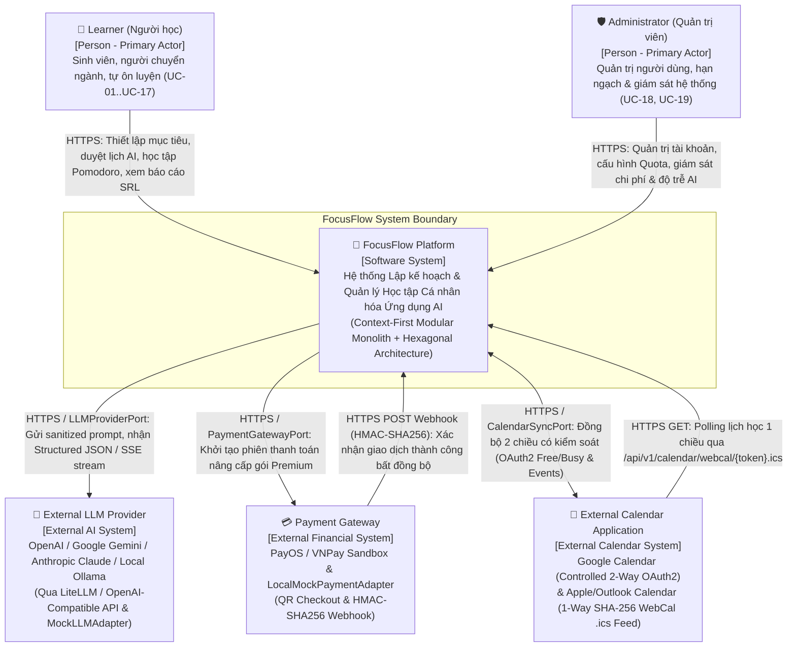
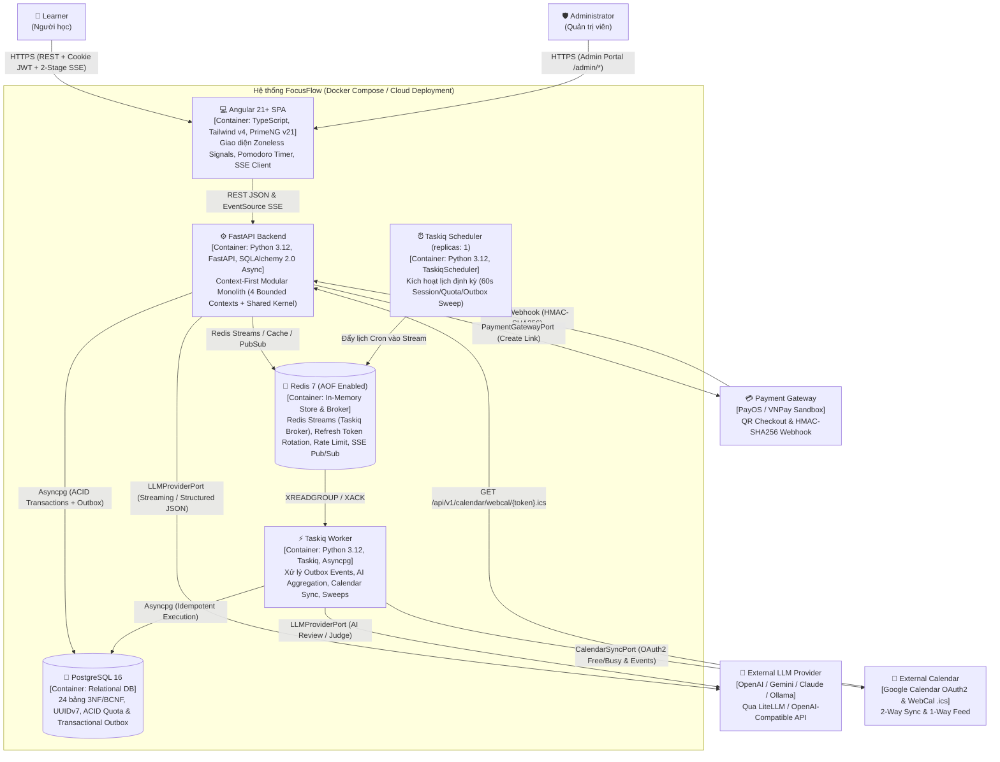

# FocusFlow — Tài liệu Kiến trúc Hệ thống (System Architecture Document - arc42)
## Phiên bản: v2.0 — Chuẩn Kiến trúc Cơ sở Hoàn chỉnh (Comprehensive Architecture Baseline)
**Dự án:** FocusFlow — Hệ thống Lập kế hoạch & Quản lý Học tập Cá nhân hóa Ứng dụng AI (AI-Powered Personalized Study Planning & Execution System)  
**Tiêu chuẩn tài liệu:** arc42 Architecture Template (v8.2), ISO/IEC/IEEE 42010, ISO/IEC 25010:2023, C4 Model, UML 2.5.1, Domain-Driven Design (DDD)  
**Căn cứ đánh giá học thuật:** Khung Rubric Đồ án Tốt nghiệp CNTT — Tiêu chí TC1, TC2.1 & TC2.3 (Mức 5)  
**Tài liệu liên kết nguồn:**
- Định nghĩa bài toán & Yêu cầu: [`docs/requirements/problem-definition.md`](file:///Users/vuthang/Documents/FocusFlow/docs/requirements/problem-definition.md), [`docs/requirements/business-goals-and-kpis.md`](file:///Users/vuthang/Documents/FocusFlow/docs/requirements/business-goals-and-kpis.md)
- Đặc tả yêu cầu phần mềm (SRS v1.2): [`docs/srs/srs-v1.0.md`](file:///Users/vuthang/Documents/FocusFlow/docs/srs/srs-v1.0.md)
- Sơ đồ ca sử dụng & Luồng nghiệp vụ: [`docs/uml/use-cases/UC_Master.drawio`](file:///Users/vuthang/Documents/FocusFlow/docs/uml/use-cases/UC_Master.drawio), [`docs/uml/use-case-specifications.md`](file:///Users/vuthang/Documents/FocusFlow/docs/uml/use-case-specifications.md)
- Biểu đồ Lớp (Domain Model & DCD v5.0): [`docs/uml/class-diagrams/class_diagram.drawio`](file:///Users/vuthang/Documents/FocusFlow/docs/uml/class-diagrams/class_diagram.drawio), [`docs/uml/class-diagrams.md`](file:///Users/vuthang/Documents/FocusFlow/docs/uml/class-diagrams.md)
- Mô hình C4 & Thành phần: [`docs/architecture/c4-model-components.md`](file:///Users/vuthang/Documents/FocusFlow/docs/architecture/c4-model-components.md)
- Thiết kế cơ sở dữ liệu (24 bảng 3NF/BCNF, dbdiagram.io DBML): [`docs/database/schema.dbml`](file:///Users/vuthang/Documents/FocusFlow/docs/database/schema.dbml), [`docs/database/database-schema-design.md`](file:///Users/vuthang/Documents/FocusFlow/docs/database/database-schema-design.md), [`docs/database/schema.sql`](file:///Users/vuthang/Documents/FocusFlow/docs/database/schema.sql)
- Các bản ghi quyết định kiến trúc: [`docs/decisions/`](file:///Users/vuthang/Documents/FocusFlow/docs/decisions) (`ADR-001` đến `ADR-010`)

---

## MỤC LỤC THEO CHUẨN ARC42
1. [Giới thiệu & Mục tiêu (Introduction and Goals)](#1-giới-thiệu--mục-tiêu-introduction-and-goals)
2. [Ràng buộc Kiến trúc (Architecture Constraints)](#2-ràng-buộc-kiến-trúc-architecture-constraints)
3. [Bối cảnh & Phạm vi (Context and Scope)](#3-bối-cảnh--phạm-vi-context-and-scope)
4. [Chiến lược Giải pháp (Solution Strategy)](#4-chiến-lược-giải-pháp-solution-strategy)
5. [Cấu trúc Khối tĩnh (Building Block View)](#5-cấu-trúc-khối-tĩnh-building-block-view)
6. [Động lực học & Luồng Thực thi (Runtime View)](#6-động-lực-học--luồng-thực-thi-runtime-view)
7. [Kiến trúc Triển khai (Deployment View)](#7-kiến-trúc-triển-khai-deployment-view)
8. [Các Khái niệm Xuyên suốt (Cross-cutting Concepts)](#8-các-khái-niệm-xuyên-suốt-cross-cutting-concepts)
9. [Các Quyết định Kiến trúc Cốt lõi (Architecture Decisions - ADRs)](#9-các-quyết-định-kiến-trúc-cốt-lõi-architecture-decisions---adrs)
10. [Yêu cầu Chất lượng (Quality Requirements)](#10-yêu-cầu-chất-lượng-quality-requirements)
11. [Rủi ro & Nợ Kỹ thuật (Risks and Technical Debt)](#11-rủi-ro--nợ-kỹ-thuật-risks-and-technical-debt)
12. [Thuật ngữ Chuẩn hóa (Glossary)](#12-thuật-ngữ-chuẩn-hóa-glossary)

---

## 1. Giới thiệu & Mục tiêu (Introduction and Goals)

### 1.1 Tổng quan bài toán & Triết lý cốt lõi
**FocusFlow** là hệ thống Lập kế hoạch & Quản lý Học tập Cá nhân hóa ứng dụng AI, kết hợp **Lý thuyết Học tập Tự điều chỉnh của Zimmerman (SRL)** (*Forethought → Performance → Self-Reflection*) với **Giải thuật Lập lịch Tất định (Deterministic Scheduling)** và **Mô hình Ngôn ngữ Lớn Đa nhà cung cấp (Provider-Agnostic LLM)**.

Hệ thống giải quyết chuỗi đứt gãy liên hoàn của người tự học công nghệ và kỹ năng số:
1. **Rào cản phân rã mục tiêu (Decomposition Barrier):** Mục tiêu lớn trừu tượng khó chuyển hóa thành đầu việc học tập khả thi hàng ngày có xét đến điều kiện tiên quyết (DAG).
2. **Phân mảnh công cụ (Tool Fragmentation):** Người học bị phân tán sự chú ý giữa Chatbot AI, Google Calendar, Notion và Pomodoro App độc lập.
3. **Đứt gãy kế hoạch khi có biến cố (Rigid Planning Failure):** Khi có việc bận đột xuất hoặc quá tải, kế hoạch bị đổ vỡ dồn ứ (cascade overdue loop), dẫn đến bỏ cuộc.

### 1.2 Mục tiêu nghiệp vụ & 5 KPI định lượng
Hệ thống được thiết kế để thỏa mãn 5 chỉ số KPI định lượng đo lường được trong đợt thử nghiệm người dùng thật (UAT):

| Mã KPI | Tên chỉ số | Giá trị mục tiêu | Ý nghĩa đo lường kỹ thuật |
| :--- | :--- | :--- | :--- |
| **KPI 1** | Thời gian khởi tạo lộ trình (*Plan Creation Time*) | $\le \mathbf{5}$ phút | Tự động hóa quá trình phân rã mục tiêu 2 cấp (Milestones $\to$ Tasks) thay vì mất 30–60 phút thủ công. |
| **KPI 2** | Hiệu quả thực thi buổi học (*Session Execution Efficiency*) | $\ge \mathbf{80\%}$ | Tỷ lệ hoàn thành các đầu việc được lên lịch trong mỗi phiên học Pomodoro/Stopwatch. |
| **KPI 3** | Tỷ lệ duy trì lộ trình (*Plan Adherence Rate*) | $\ge \mathbf{70\%}$ | Tỷ lệ số buổi học tham gia thực tế trên tổng số buổi đã lên lịch (loại trừ thời gian `PAUSED`). |
| **KPI 4** | Tỷ lệ hoàn thành tác vụ (*Task Success Rate*) | $\ge \mathbf{90\%}$ | Người dùng hoàn thành luồng chính (tạo lộ trình, chạy Pomodoro, lưu ghi chú, xem báo cáo SRL). |
| **KPI 5** | Điểm trải nghiệm người dùng (*SUS Usability Score*) | $\ge \mathbf{80/100}$ | Đánh giá độ khả dụng theo bảng câu hỏi chuẩn hóa System Usability Scale trên $\ge 10$ người dùng. |

### 1.3 Yêu cầu Có Ý nghĩa Kiến trúc (ASR — Architecturally Significant Requirements)

| Mã ASR | Thuộc tính chất lượng (ISO 25010) | Kịch bản đo lường (Quality Attribute Scenario) | Chiến thuật kiến trúc đáp ứng (Architectural Tactics) |
| :--- | :--- | :--- | :--- |
| **ASR-01** | **Modularity & Maintainability** (Tính mô-đun & Bảo trì) | Khi thêm mới hoặc sửa đổi một quy tắc nghiệp vụ trong 1 Bounded Context (ví dụ: `evaluation`), không có bất kỳ file nội bộ nào của 3 Context còn lại bị ảnh hưởng. | **Context-First Modular Monolith** (`account`, `planning`, `execution`, `evaluation`, `shared_kernel`); giao tiếp duy nhất qua `public_api.py` (Read-only Query Port) và **Transactional Outbox**; kiểm chứng tự động bằng **`import-linter`**. |
| **ASR-02** | **Data Integrity & Consistency** (Toàn vẹn & Nhất quán dữ liệu) | Khi nhiều luồng cùng yêu cầu gọi AI hoặc khi sự kiện hoàn thành phiên học kích hoạt cập nhật chéo module, hệ thống đảm bảo **0% race condition** trên hạn ngạch AI và **0% mất sự kiện** nếu worker sập giữa chừng. | **2-Phase ACID Quota Reservation** (`SELECT ... FOR UPDATE` trên `ai_quotas` + `ai_quota_reservations`); **Transactional Outbox (`outbox_events`) + Idempotent Consumer (`processed_events`)** đẩy qua **Taskiq Redis Streams (`XACK`)**. |
| **ASR-03** | **Performance & Responsiveness** (Hiệu năng & Phản hồi thời gian thực) | Khi người học yêu cầu AI phân rã mục tiêu lớn (mất 8–20 giây), giao diện hiển thị token đầu tiên (**TTFT**) trong $\le 2.5\text{s}$ (P95); API CRUD phản hồi trong $\le 250\text{ms}$ (P95). | **Uniform 2-Stage SSE Streaming** (`POST` khởi tạo/giữ chỗ $\to$ `GET` `EventSource` bọc qua RxJS `toSignal()` trên **Angular 21+ Zoneless**); **SQLAlchemy 2.0 Async (`asyncpg`)**. |
| **ASR-04** | **AI Output Reliability & Safety** (Độ tin cậy của đầu ra AI) | Khi LLM sinh lộ trình hoặc lịch học bị ảo giác (vượt trần Mode A/B, tạo chu trình DAG, sai JSON), **100% lịch trình vi phạm bị chặn** trước khi lưu bản nháp `DRAFT`. | **3-Tier Hybrid Validation Gate** (`Tier 1`: Pydantic v2 Structured Output $\to$ `Tier 2`: Pure Domain Rule Engine `HybridAvailabilityRuleEngine` & `DagCycleValidator` là 2 cổng chặn cứng kích hoạt tối đa 2 vòng tự sửa lỗi $\to$ `Tier 3`: `PedagogicalJudgeAdapter` là cổng tư vấn mềm $\le 5\text{s}$ timeout, Fail-Open đính kèm `pedagogical_warnings`). |
| **ASR-05** | **Fault Tolerance & Recoverability** (Khả năng chịu lỗi & Phục hồi) | Khi người học mất kết nối mạng hoặc đóng trình duyệt đột ngột lúc đang chạy Pomodoro, hệ thống bảo toàn tiến độ với độ lệch tối đa **$\le 60\text{s}$** và tự động thu hồi phiên treo sau **5 phút**. | **60s Client Heartbeat** ghi trực tiếp xuống PostgreSQL + **Taskiq Scheduler (`replicas: 1`)** quét định kỳ mỗi 60s với `SELECT ... FOR UPDATE SKIP LOCKED`. |
| **ASR-06** | **Portability & Vendor Independence** (Độc lập nhà cung cấp) | Khi đổi nhà cung cấp LLM (Gemini, OpenAI, Claude, Ollama) hoặc chạy bảo vệ khóa luận **offline không có Internet**, hệ thống chuyển đổi chỉ qua cấu hình `.env` mà **không sửa code**. | **Hexagonal Output Ports** (`LLMProviderPort` dùng `LiteLLM`/Strategy + `MockLLMAdapter`; `PaymentGatewayPort` hỗ trợ PayOS/VNPay Sandbox + `LocalMockPaymentAdapter`; `CalendarSyncPort` hỗ trợ Google OAuth2/WebCal + `LocalCalendarAdapter`). |

### 1.4 Các bên liên quan (Stakeholders)
- **Learner (Người học):** Sinh viên, người chuyển ngành cần lộ trình học thích ứng và không gian học tập trung (Study Workspace).
- **Administrator (Quản trị viên hệ thống):** Giám sát mức tiêu thụ token AI, chi phí API, quản trị tài khoản và hạn ngạch Quota phân tầng (Free/Premium).
- **External Systems:** Nhà cung cấp LLM đa nền tảng (OpenAI / Gemini / Claude / Ollama), Cổng thanh toán (PayOS / VNPay Sandbox), và Hệ thống lịch cá nhân (Google Calendar OAuth2 2 chiều & Apple/Outlook WebCal `.ics` 1 chiều).
- **Giảng viên hướng dẫn & Hội đồng bảo vệ khóa luận:** Đánh giá tính chuẩn mực công nghệ phần mềm, độ tinh khiết của kiến trúc, chuẩn hóa CSDL 3NF/BCNF và khả năng vận hành thực chứng.

---

## 2. Ràng buộc Kiến trúc (Architecture Constraints)

| Mã Ràng buộc | Phân loại | Nội dung chi tiết | Tác động kiến trúc |
| :--- | :--- | :--- | :--- |
| **CON-01** | Thời gian & Nhân lực | Hoàn thành toàn bộ đồ án trong 15 tuần với đội ngũ 2 sinh viên. | Loại bỏ Microservices phân tán; chọn **Context-First Modular Monolith + Hexagonal Architecture** để cô lập miền nghiệp vụ nhưng đơn giản hóa vận hành. |
| **CON-02** | Ngân sách vận hành | Chi phí gọi API LLM và máy chủ hạ tầng ở mức sinh viên (\$0 – \$5/tháng). | Thiết kế **2-Phase ACID Quota Reservation** (`ai_quotas` + `ai_quota_reservations`) ngăn cạn kiệt ngân sách; hỗ trợ Ollama local & `MockLLMAdapter`. |
| **CON-03** | Bảo mật bí mật | Tuyệt đối không rò rỉ API Key của LLM, `SECRET_KEY`, OAuth Token ra client (*Zero Secret Leak*). | Backend proxy toàn bộ cuộc gọi AI; mã hóa OAuth token bằng **Fernet (AES-128-CBC + HMAC)**; lọc sạch secret/PII qua `structlog` processor. |
| **CON-04** | Môi trường nghiệm thu | Hệ thống phải demo offline mượt mà trước Hội đồng (Local Docker) và deploy online cho UAT người dùng thật. | Mô hình triển khai Hybrid: Docker Compose 6 containers đồng nhất với Cloud PaaS, tích hợp `MockLLMAdapter` và `LocalMockPaymentAdapter` cho phòng bảo vệ offline. |
| **CON-05** | Chuẩn mực học thuật & CSDL | Tuân thủ ISO/IEC 42010, UML 2.5.1, RFC 5545 iCalendar, chuẩn hóa CSDL **3NF/BCNF** nghiêm ngặt. | Đồng bộ **24 bảng vật lý 3NF/BCNF** trong schema `public` với khóa ngoại đơn (Single Surrogate FK) đảm bảo toàn vẹn tham chiếu ở cấp DB, nhưng **cấm tuyệt đối ORM JOIN chéo Bounded Context** ở tầng code. |
| **CON-06** | Kiểm soát ranh giới tự động | Ngăn chặn suy thoái kiến trúc (Architectural Erosion) trong quá trình phát triển. | Bắt buộc tích hợp **`import-linter`** trong `pyproject.toml` làm cổng chặn CI/CD kiểm tra cô lập giữa 4 Bounded Contexts và chiều phụ thuộc Hexagonal. |

---

## 3. Bối cảnh & Phạm vi (Context and Scope)

### 3.1 Bối cảnh Nghiệp vụ (Business Context - C4 Level 1)
Hệ thống FocusFlow tương tác với **5 Tác nhân & Hệ thống Ngoại vi (5 External Actors / Integrations)** đồng bộ tuyệt đối với `SRS v1.2` và `19 Use Cases`:



### 3.2 Bối cảnh Kỹ thuật & Giao thức Tích hợp (Technical Context)

| Tác nhân / Hệ thống ngoài | Chiều tương tác | Giao thức & Định dạng | Cổng Trừu tượng (Hexagonal Port) | Cơ chế Bảo mật & Dự phòng |
| :--- | :--- | :--- | :--- | :--- |
| **Learner** | 2 chiều (Client $\leftrightarrow$ Server) | HTTPS (TLS 1.3), REST JSON + Uniform 2-Stage SSE (`EventSource`) | FastAPI Routers (`/api/v1/*`) | `PyJWT` (`HttpOnly`, `Secure`, `SameSite=Lax`) + Redis Refresh Token Rotation |
| **Administrator** | 2 chiều (Client $\leftrightarrow$ Server) | HTTPS REST JSON (`/api/v1/admin/*`) | `AdminUserRouter`, `AdminMonitoringRouter` | RBAC Guard (`role == 'ADMIN'`) |
| **External LLM Provider** | Outbound (Backend/Worker $\to$ LLM) | HTTPS Streaming & Structured JSON Output | `LLMProviderPort` (`shared_kernel`) | Strategy/Factory + `LiteLLM` + `PromptSanitizer` + `MockLLMAdapter` (Offline) |
| **Payment Gateway** | Outbound (Tạo link) & Inbound (Webhook) | HTTPS REST + Webhook Callback (`POST /api/v1/billing/webhook`) | `PaymentGatewayPort` (`account`) | Xác thực chữ ký **`HMAC-SHA256`** + Idempotent `transaction_ref` + `LocalMockPaymentAdapter` |
| **External Calendar Application** | 2 chiều (Google OAuth2) & 1 chiều (WebCal Pull) | Google Calendar REST API v3 & HTTP GET `text/calendar` (RFC 5545) | `CalendarSyncPort` (`execution`) | Mã hóa OAuth token bằng **Fernet**; WebCal Token băm **SHA-256** |

---

## 4. Chiến lược Giải pháp (Solution Strategy)

### 4.1 So sánh Phương án Kiến trúc & Phân tích Đánh đổi (Trade-off Analysis)

| Tiêu chí Đánh giá (Trọng số) | Phương án A: Layer-First Monolith + Celery (Kiến trúc cũ) | Phương án B (Được chọn): Context-First Modular Monolith + Hexagonal + Taskiq + Outbox | Phương án C: Microservices (4 Services độc lập + Kafka/RabbitMQ) |
| :--- | :--- | :--- | :--- |
| **Cô lập miền nghiệp vụ (25%)** | 2/5 — Các lớp của 4 module nằm lẫn lộn trong `src/domain/`, dễ gọi chéo mất kiểm soát. | **5/5** — Cô lập theo 4 Bounded Contexts ở cấp 1, chỉ lộ `public_api.py`, khóa chặt bằng `import-linter`. | 5/5 — Cô lập vật lý ở cấp tiến trình và DB riêng. |
| **Tương thích Async Python (20%)** | 2/5 — Celery là đồng bộ, lệch pha với `FastAPI + asyncpg`, phải dùng `asyncio.run()` / `NullPool`. | **5/5** — **Taskiq + Redis Streams** thuần `async/await`, dùng chung DI (`taskiq-fastapi`) và `AsyncUnitOfWork`. | 4/5 — Thuần async nhưng phức tạp hóa giao tiếp mạng gRPC/HTTP. |
| **Độ tin cậy sự kiện liên module (20%)** | 2/5 — Không có Outbox, dễ mất sự kiện hoặc lệch trạng thái khi process chết sau commit. | **5/5** — **Transactional Outbox (`outbox_events`)** + **Idempotent Handler (`processed_events`)** + **Redis Streams ACK**. | 4/5 — Đòi hỏi triển khai Distributed Saga & Outbox trên từng DB riêng. |
| **Chi phí vận hành & Phù hợp quy mô đồ án (20%)** | 4/5 — 6 containers nhưng cấu hình Celery cồng kềnh. | **5/5** — 6 containers gọn nhẹ (`postgres`, `redis`, `backend`, `worker`, `scheduler`, `frontend`), dễ debug local. | 1/5 — Quá tải vận hành (12+ containers) cho quy mô sinh viên / UAT. |
| **Bảo toàn chuẩn 3NF/BCNF cho Hội đồng (15%)** | 3/5 — Tài liệu cũ mâu thuẫn giữa 15, 16 và 19 bảng. | **5/5** — Đồng bộ tuyệt đối **24 bảng 3NF/BCNF** trong schema `public`, giữ FK vật lý ở DB nhưng cấm ORM JOIN chéo Context. | 2/5 — Mất hoàn toàn Foreign Key vật lý giữa các service. |
| **Tổng điểm có trọng số** | **2.55 / 5.0** | **5.00 / 5.0 (Lựa chọn tối ưu)** | **3.35 / 5.0** |

> [!IMPORTANT]
> **Điều kiện chuyển đổi kiến trúc (Re-evaluation Trigger):** Chỉ tách một Bounded Context (ví dụ: `planning` hoặc `evaluation`) từ Modular Monolith sang Microservice độc lập hoặc tách Schema DB vật lý khi lưu lượng vượt ngưỡng $> 500\text{ req/s}$ bền vững hoặc khi dự án tách thành nhiều đội phát triển độc lập. Do mọi giao tiếp hiện đã đi qua `public_api.py` và `outbox_events`, chi phí tách service trong tương lai là tối thiểu.

### 4.2 Bảng Chiến lược Giải pháp Kỹ thuật

| Thách thức Kỹ thuật | Giải pháp Kiến trúc Lựa chọn | Căn cứ Quyết định |
| :--- | :--- | :--- |
| Cô lập 4 miền nghiệp vụ rõ ràng, bảo vệ Domain tinh khiết và ngăn gọi chéo tùy tiện | **Context-First Modular Monolith kết hợp Kiến trúc Lục giác (Hexagonal Architecture)**. Mỗi Context (`account`, `planning`, `execution`, `evaluation`) tự đóng gói 4 tầng `domain`, `application`, `infrastructure`, `presentation` và chỉ giao tiếp qua `public_api.py` hoặc Outbox Events. Kiểm chứng tự động bằng **`import-linter`**. | **ADR-001** |
| Xử lý I/O bất đồng bộ hiệu năng cao và tương thích hoàn toàn với hệ sinh thái AI Đa nhà cung cấp | Backend **Python 3.12 + FastAPI + Pydantic v2 + SQLAlchemy 2.0 Async (`asyncpg`)**. Tích hợp AI qua cổng trừu tượng `LLMProviderPort` sử dụng **Strategy/Factory + `LiteLLM`** hỗ trợ OpenAI, Gemini, Claude, Ollama và `MockLLMAdapter`. | **ADR-002** |
| Giao diện công thái học hiện đại, phản ứng tức thời không cần `zone.js`, đồng bộ kiểu 100% với Backend | Frontend **Angular 21+ (Zoneless Change Detection, Standalone Components, `OnPush`, Signals / `rxResource`) + Tailwind CSS v4 + PrimeNG v21 + Lucide Icons**. Sinh kiểu tự động từ OpenAPI 3.1 qua **`openapi-typescript`**, kiểm thử bằng **Vitest & Playwright**. | **ADR-003** |
| Xử lý tác vụ nền thuần `async/await`, đặt lịch định kỳ không trùng lặp và đảm bảo At-least-once Event Delivery | **Taskiq + Redis 7 Streams (`RedisStreamBroker` với Consumer Groups `XREADGROUP`/`XACK`) + `TaskiqScheduler` (`replicas: 1`) + `taskiq-fastapi`**, kết hợp **Transactional Outbox (`outbox_events`)** và **Idempotent Consumer (`processed_events`)**. | **ADR-004** |
| Hiển thị tiến trình sinh lộ trình AI mượt mà, chống mất kết nối hoặc trừ Quota kép khi F5 trình duyệt | **Uniform 2-Stage Server-Sent Events (SSE)** (`POST` khởi tạo và giữ chỗ Quota $\to$ `GET` `EventSource` stream) kết hợp **2-Phase ACID Quota Reservation** (`ai_quotas` + `ai_quota_reservations`). | **ADR-005** |
| Lưu trữ dữ liệu chuẩn hóa học thuật 3NF/BCNF, vẫn giữ được mô hình Rich DDD ở tầng code | **PostgreSQL 16 với 24 bảng chuẩn 3NF/BCNF**, khóa chính **UUIDv7**, giữ Single Surrogate FK ở mức DB nhưng cấm ORM JOIN chéo Context. Ánh xạ Value Objects (`WeeklySchedule`, `TimeSlot`) xuống bảng chuẩn hóa `availability_slots` qua Repository. | **ADR-007** |
| Ngăn chặn ảo giác AI (Hallucination) tạo lịch học vượt quá sức người học hoặc phụ thuộc vòng | **3-Tier Hybrid Validation Gate**: Tier 1 (Pydantic v2 Schema) $\to$ Tier 2 (Pure Domain Services: `HybridAvailabilityRuleEngine` & `DagCycleValidator`) là 2 cổng chặn cứng (kích hoạt tối đa 2 vòng tự sửa lỗi) $\to$ Tier 3 (`PedagogicalJudgeAdapter` — cổng tư vấn mềm $\le 5\text{s}$ timeout, Fail-Open đính kèm `pedagogical_warnings`). | **ADR-009** |
| Cá nhân hóa theo chu kỳ Zimmerman SRL và ngăn chặn vòng lặp dời lịch vô tận khi người học trì hoãn | **Learner Profile Memory** (`learner_profiles` cập nhật bất đồng bộ sau mỗi phiên học/đánh giá), giải thuật tịnh tiến lịch khi tạm dừng (**Domino Shift** — `UC-16`), và cơ chế **Overdue Anti-Loop Escalation** (`tasks.reschedule_count >= 3` khi gọi AI Reschedule tại `UC-17` chuyển sang trạng thái `STALLED` để gợi ý chia nhỏ/giảm tải). | **ADR-010** |

---

## 5. Cấu trúc Khối tĩnh (Building Block View)

### 5.1 Cấp độ 1: Mô hình Vùng chứa (C4 Level 2 — Container View)



### 5.2 Cấp độ 2: Phân rã Context-First Modular Monolith + Hexagonal Architecture (Backend)
Khác với cách chia theo tầng kỹ thuật ở cấp cao nhất (Layer-First), FocusFlow v2.0 phân rã cấp 1 theo **4 Bounded Contexts nghiệp vụ (`account`, `planning`, `execution`, `evaluation`) + `shared_kernel`**, và bên trong mỗi Bounded Context áp dụng **Kiến trúc Lục giác (Hexagonal Architecture / Ports & Adapters)** 4 tầng:

```text
backend/src/
├── main.py                           # FastAPI Entrypoint, Middlewares, Router & Taskiq Registration
├── shared_kernel/                    # Shared Kernel (Tất cả Context được phép import)
│   ├── config.py                     # Pydantic Settings (.env)
│   ├── logging.py                    # Structlog JSON + Correlation ID + PII Sanitizer
│   ├── domain/
│   │   ├── base.py                   # Entity, AggregateRoot, ValueObject base classes (UUIDv7)
│   │   ├── events.py                 # DomainEvent base class
│   │   └── exceptions.py             # Base DomainException
│   ├── application/
│   │   ├── uow.py                    # AsyncUnitOfWork Protocol
│   │   ├── event_bus.py              # InProcessEventBus & OutboxPort Protocols
│   │   └── ports/
│   │       └── llm_provider_port.py  # LLMProviderPort (Provider-Agnostic Output Port)
│   └── infrastructure/
│       ├── database/                 # SQLAlchemy 2.0 AsyncEngine, Base, Outbox SqlAlchemyUoW
│       ├── outbox/                   # OutboxEventORM, ProcessedEventORM, OutboxRelayTask
│       ├── redis/                    # Redis client & Streams helper
│       ├── worker/                   # Taskiq RedisStreamBroker & TaskiqScheduler setup
│       └── external_ai/              # Provider-Agnostic LiteLLM / Strategy Adapter & MockLLMAdapter
├── account/                          # Bounded Context 1: Account, Profile, Availability & Quota
│   ├── domain/
│   │   ├── models/                   # Rich Aggregates & VOs: User, LearnerProfile, AvailabilityProfile, AIQuota, AIQuotaReservation, PaymentTransaction, WebCalToken, WeeklySchedule, TimeSlot
│   │   └── services/                 # Pure Domain Service: HybridAvailabilityRuleEngine
│   ├── application/                  # UC-01..UC-05, UC-18 Use Cases, Ports (PaymentGatewayPort, QuotaQueryPort, AvailabilityQueryPort)
│   ├── infrastructure/               # 9 ORM Models (availabilities + availability_slots, etc.), Repositories, PayOSAdapter, LocalMockPaymentAdapter, Argon2/PyJWT/Fernet Adapters
│   ├── presentation/                 # Routers (/auth, /profile, /availabilities, /billing, /admin/users), Taskiq Tasks (QuotaReservationSweeperTask, LearnerProfileAggregatorTask), deps.py
│   └── public_api.py                 # Facade/Query DTOs & Protocols cho Context khác gọi đọc đồng bộ
├── planning/                         # Bounded Context 2: Goal, Roadmap, Milestone & Schedule
│   ├── domain/
│   │   └── models/                   # Rich Aggregates: Goal, Roadmap, Milestone, OfficialSchedule, ScheduleProposal
│   ├── application/                  # UC-06..UC-09 Use Cases, 3-Tier Validation Gate Orchestrator
│   ├── infrastructure/               # 5 ORM Models (goals, roadmaps, milestones, official_schedules, schedule_proposals), Repositories, PedagogicalJudgeAdapter
│   ├── presentation/                 # Routers (/goals, /roadmaps, /schedules), Taskiq Tasks, deps.py
│   └── public_api.py                 # Roadmap/Schedule Read Query Interface & Events
├── execution/                        # Bounded Context 3: Task DAG, Study Session, Pomodoro Workspace & Calendar Sync
│   ├── domain/
│   │   ├── models/                   # Rich Aggregates: Task, TaskDependency, StudySession, SessionTask, StudyNote
│   │   └── services/                 # Pure Domain Service: DagCycleValidator
│   ├── application/                  # UC-10..UC-13 Use Cases, Ports (CalendarSyncPort)
│   ├── infrastructure/               # 5 ORM Models (tasks, task_dependencies, study_sessions, session_tasks, study_notes), Repositories, GoogleCalendarOAuthAdapter, IcsFeedGenerator, LocalCalendarAdapter
│   ├── presentation/                 # Routers (/tasks, /sessions, /notes, /calendar), Taskiq Tasks (AbandonedSessionSweeperTask, CalendarSyncTask), deps.py
│   └── public_api.py                 # Task & Execution Query Interface & Events
└── evaluation/                       # Bounded Context 4: Pause Management, Analytics, AI Review & Schedule Adaptation
    ├── domain/
    │   ├── models/                   # Rich Aggregates & VOs: PauseRecord, AIReview, ScheduleChangeLog, QuantitativeMetrics
    │   └── services/                 # Pure Domain Service: DominoShiftEngine
    ├── application/                  # UC-14..UC-17, UC-19 Use Cases, Ports (EmailNotificationPort)
    ├── infrastructure/               # 3 ORM Models (pause_records, ai_reviews, schedule_change_logs), Repositories, SmtpEmailNotificationAdapter
    ├── presentation/                 # Routers (/pauses, /analytics, /reviews, /adaptation, /admin/monitoring), Taskiq Tasks (OverdueAntiLoopSweeperTask), deps.py
    └── public_api.py                 # Evaluation Query Interface & Events
```

#### Sự kết hợp hài hòa giữa Rich Aggregate Roots và Pure Domain Services
Để đạt chuẩn DDD học thuật (khớp `Class Diagram v5.0`), tầng `domain/` của mỗi Bounded Context kết hợp:
1. **Rich Aggregate Roots & Value Objects (`domain/models/`)**: Tự bảo vệ các bất biến nội tại (local invariants) của thực thể như `TimeSlot` ($\ge 30\text{m}$, `end_day_offset`), `WeeklySchedule`, `AvailabilityProfile`, `Roadmap`, `Task`, `StudySession`, `PauseRecord`, `AIQuota`.
2. **Pure Domain Services (`domain/services/`)**: Chứa các thuật toán nghiệp vụ phức tạp hoặc phối hợp nhiều cấu trúc dữ liệu mà không làm phình to một Entity đơn lẻ:
   - `HybridAvailabilityRuleEngine` (`account/domain/services/`): Thẩm định trần giờ rảnh Mode A (Hard Ceiling), khớp khung giờ vị trí thực tế Mode B (Slot-fit & Soft Overflow $\le 30\text{m}$) và trừ đoạn thời gian bận đa lộ trình (`Interval Subtraction`).
   - `DagCycleValidator` (`execution/domain/services/`): Kiểm tra chu trình đồ thị có hướng (DFS/Kahn $O(V+E)$) trên tập `TaskDependency` trước khi lưu lộ trình hoặc cập nhật phụ thuộc công việc.
   - `DominoShiftEngine` (`evaluation/domain/services/`): Giải thuật tất định tịnh tiến các `Task` chưa hoàn thành qua các ngày khả dụng tiếp theo (< 50ms) khi tạm dừng/tiếp tục lộ trình (`PauseRecord`) và kiểm tra ngưỡng chống lặp `reschedule_count >= 3`.

### 5.3 Ma trận Trách nhiệm, Sở hữu Dữ liệu (24 Bảng 3NF/BCNF) & Giao tiếp Liên Context

| Bounded Context | Trách nhiệm cốt lõi (Single Sentence Responsibility) | Bảng PostgreSQL 16 sở hữu (Tổng: 24 bảng 3NF/BCNF) | Giao diện công khai (`public_api.py`) | Sự kiện phát ra (Outbox Domain Events) |
| :--- | :--- | :--- | :--- | :--- |
| **`shared_kernel`** | Cung cấp hạt nhân kỹ thuật dùng chung: Base Aggregate, `AsyncUnitOfWork`, In-Process Event Bus, Transactional Outbox Relay, Taskiq Broker và Provider-Agnostic LLM Adapter. | `outbox_events`, `processed_events` **(2 bảng)** | `AsyncUnitOfWork`, `DomainEvent`, `LLMProviderPort` | — |
| **`account`** | Quản lý định danh, xác thực, hồ sơ năng lực SRL, cấu hình lịch rảnh Mode A/B, hạn ngạch AI 2 pha, nhật ký token AI và thanh toán nâng cấp gói. | `users`, `learner_profiles`, `webcal_tokens`, `availabilities`, `availability_slots`, `ai_quotas`, `ai_quota_reservations`, `ai_usage_logs`, `payment_transactions` **(9 bảng)** | `AvailabilityQueryPort`, `QuotaFacadePort` (Reserve/Commit/Release), `LearnerProfileQueryPort`, `WebCalTokenQueryPort` | `UserUpgradedToPremiumEvent`, `AvailabilityUpdatedEvent` |
| **`planning`** | Quản lý mục tiêu, lộ trình, cột mốc, cổng kiểm duyệt AI 3 tầng và áp dụng lịch học chính thức. | `goals`, `roadmaps`, `milestones`, `official_schedules`, `schedule_proposals` **(5 bảng)** | `RoadmapScheduleQueryPort` (đọc thông tin Roadmap/Milestone/Schedule cho thực thi và đánh giá) | `OfficialScheduleAppliedEvent`, `RoadmapPausedEvent` |
| **`execution`** | Quản lý công việc, đồ thị phụ thuộc DAG (`DagCycleValidator`), vận hành không gian học tập Pomodoro/Stopwatch, ghi nhận Heartbeat 60s, thu hồi phiên học treo và đồng bộ lịch 2 chiều / WebCal `.ics`. | `tasks`, `task_dependencies`, `study_sessions`, `session_tasks`, `study_notes` **(5 bảng)** | `StudyExecutionQueryPort` (cung cấp thông tin Task/DAG và thống kê phiên học cho lập kế hoạch và đánh giá) | `StudySessionCompletedEvent`, `StudySessionAbandonedEvent`, `ExternalCalendarBusyUpdatedEvent`, `TaskStalledThresholdReachedEvent` |
| **`evaluation`** | Quản lý bảo lưu/tạm dừng lộ trình (`pause_records`), tính toán chỉ số định lượng (Adherence, Velocity), sinh nhận xét AI theo chu kỳ SRL, thực thi dịch lịch Domino Shift, quét thông báo email quá hạn và tái lập lịch AI đơn lộ trình (Single-Roadmap AI Reschedule). | `pause_records`, `ai_reviews`, `schedule_change_logs` **(3 bảng)** | `EvaluationMetricsQueryPort` | `DominoShiftRequestedEvent`, `AIReviewGeneratedEvent`, `OverdueTasksDetectedEvent` |

> [!NOTE]
> **Nguyên tắc Ranh giới Dữ liệu trong PostgreSQL 16 (24 Bảng 3NF/BCNF):**  
> Toàn bộ 24 bảng nằm trong schema `public` với khóa chính **UUIDv7** và giữ **Single Surrogate Foreign Keys** ở mức DDL vật lý để đảm bảo toàn vẹn tham chiếu (Referential Integrity) khi kiểm định học thuật. Tuy nhiên, ở tầng mã nguồn SQLAlchemy ORM, **nghiêm cấm sử dụng `relationship()` hoặc câu lệnh `JOIN` trực tiếp giữa các bảng thuộc 2 Bounded Context khác nhau**. Mọi nhu cầu đọc dữ liệu liên Context phải gọi qua Query Port trong `public_api.py`, và mọi cập nhật chéo Context phải đi qua Domain Event / Transactional Outbox.

### 5.4 Kiến trúc Frontend Angular 21+ (`frontend/src/app/`)
- **Nền tảng Core:** **Angular 21+** với `standalone: true`, `provideZonelessChangeDetection()` (loại bỏ hoàn toàn `zone.js`) và `ChangeDetectionStrategy.OnPush` trên 100% components.
- **UI & Styling:** **Tailwind CSS v4** kết hợp **PrimeNG v21** (Preset Semantic CSS Variables `var(--p-primary-color)`) + **Lucide Icons**, đạt chuẩn khả năng tiếp cận Lighthouse Accessibility $\ge 90$.
- **State Management & Reactivity:**
  - **Local & Feature State:** Native Angular **Signals** (`signal`, `computed`, `linkedSignal`, `rxResource`) bên trong các `@Injectable` Services (`AuthService`, `WorkspaceSessionService`, `AvailabilityService`).
  - **Streaming & Async:** `HttpClient` + `EventSource` bọc thành RxJS `Observable` trong `AiSseStreamingService` và chuyển đổi sang Signal bằng `toSignal()`, tự động hủy đăng ký qua `takeUntilDestroyed()`.
- **Đồng bộ Hợp đồng API & Kiểm thử:** Sinh tự động `core/api/schema.d.ts` từ OpenAPI 3.1 của FastAPI bằng **`openapi-typescript`**; kiểm thử đơn vị bằng **Vitest** và kiểm thử E2E bằng **Playwright**.
- **9 Feature Modules (`frontend/src/app/features/`):**
  - `auth/` (`UC-01`, `UC-02`): Đăng ký, đăng nhập, quản lý phiên.
  - `dashboard/`: Tổng quan tiến độ hôm nay, mục `Needs Attention` cảnh báo quá hạn và nút `AI Reschedule (Dời lịch hợp lý)`.
  - `planning/` (`UC-06..UC-09`, tương ứng `roadmaps/`): Khởi tạo mục tiêu, duyệt Milestones, sinh & duyệt Schedule Proposal.
  - `workspace/` (`UC-11`, `UC-12`): Không gian học tập trung Pomodoro/Stopwatch, ghi chú `StudyNote`, Heartbeat 60s.
  - `calendar/` (`UC-10`, `UC-13`, tương ứng `schedule/`): Xem lịch học chính thức và đồng bộ lịch ngoại vi Google Calendar OAuth2 / WebCal `.ics`.
  - `tasks/` (`UC-09`, `UC-17`): Quản lý danh sách công việc, đồ thị phụ thuộc DAG và hộp thoại can thiệp `STALLED`.
  - `analytics/` (`UC-14..UC-16`): Biểu đồ thống kê định lượng, đánh giá AI Review định kỳ và bảo lưu/dời lịch lộ trình.
  - `settings/` (`UC-03..UC-05`): Thiết lập thời gian rảnh Mode A/B & hồ sơ năng lực SRL (`UC-03`), nâng cấp gói Premium (`UC-04`) và thanh toán trực tuyến (`UC-05`).
  - `admin/` (`UC-18`, `UC-19`): Cổng quản trị người dùng, hạn ngạch Quota và giám sát telemetry AI.

### 5.5 Kiểm soát Kiến trúc Tự động (Architectural Fitness Functions)
Sử dụng **`import-linter`** trong `backend/pyproject.toml` làm cổng chặn tự động (Quality Gate):
1. **Contract 1 — Context Isolation (`forbidden`)**: Các module `account`, `planning`, `execution`, `evaluation` **cấm import** bất kỳ module con nội bộ nào (`domain`, `application`, `infrastructure`, `presentation`) của nhau; chỉ được phép import `src.<context>.public_api` và `src.shared_kernel`.
2. **Contract 2 — Hexagonal Layer Purity (`layers`)**: Trong từng Bounded Context và `shared_kernel`, chiều phụ thuộc bắt buộc là `presentation -> infrastructure -> application -> domain`. Tầng `domain` hoàn toàn tinh khiết (0 import từ FastAPI, SQLAlchemy, Taskiq, Redis).

---

## 6. Động lực học & Luồng Thực thi (Runtime View)

### 6.1 Luồng Phân rã Mục tiêu AI qua Uniform 2-Stage SSE, ACID Quota 2 Pha & 3-Tier Validation Gate (`UC-06..UC-09`)
- **Tác nhân:** Learner $\to$ `Angular 21+ SPA` $\to$ `RoadmapRouter` (`planning`) $\to$ `QuotaFacadePort` (`account`) $\to$ `GenerateProposalUseCase` $\to$ `LLMProviderPort` (`LiteLLM`) $\to$ `3-Tier Validation Gate` $\to$ PostgreSQL 16.
- **Cơ chế vận hành:**
  1. **Giai đoạn 1 — Khởi tạo & Giữ chỗ ACID (`POST /api/v1/roadmaps/{id}/proposals/init`):**
     - `QuotaFacadePort` khóa dòng `SELECT ... FOR UPDATE` trên bảng `ai_quotas`, tăng `reserved_tokens`/`reserved_calls` và tạo bản ghi trạng thái **`'RESERVED'`** trong bảng **`ai_quota_reservations`** (với TTL **`120 seconds (2 minutes)`**, `expires_at = NOW() + INTERVAL '120 seconds'`). Trả về `reservation_id` và `stream_url`.
  2. **Giai đoạn 2 — Stream SSE & Kiểm duyệt 3 Tầng (`GET /api/v1/roadmaps/{id}/proposals/stream?reservation_id=...`):**
     - `AiSseStreamingService` trên Angular 21+ mở kết nối `EventSource`.
     - Backend gọi `LLMProviderPort` (sau khi qua `PromptSanitizer`) để stream quá trình sinh Milestones/Tasks.
     - Kết quả sinh ra đi qua **3-Tier Hybrid Validation Gate**:
       - *Tier 1 (Syntactic):* Pydantic v2 Structured Output validation.
       - *Tier 2 (Deterministic Domain Rules):* `DagCycleValidator` kiểm tra không có chu trình phụ thuộc; `HybridAvailabilityRuleEngine` kiểm tra trần giờ Mode A (Hard Ceiling) hoặc khớp khung giờ Mode B (Soft Overflow $\le 30\text{m}$). Nếu vi phạm **Tier 1 hoặc Tier 2 (Hard Blocking Gates)**, hệ thống tự động đính kèm lỗi vào prompt phản hồi (tối đa 2 vòng self-correction).
       - *Tier 3 (Pedagogical LLM Judge — Soft Advisory Gate):* `PedagogicalJudgeAdapter` đánh giá độ dốc nhận thức với timeout $\le 5\text{s}$ và cơ chế **Fail-Open**; chỉ đính kèm cảnh báo `pedagogical_warnings` vào bản nháp mà không chặn luồng hay kích hoạt vòng lặp gọi lại LLM.
  3. **Giai đoạn 3 — Chốt hoặc Hoàn trả Quota:**
     - Thành công: Chuyển `ai_quota_reservations.status = 'COMMITTED'`, cộng lượt vào `ai_quotas`, ghi nhận chi tiết token/độ trễ vào **`ai_usage_logs`** và lưu `schedule_proposals` (`DRAFT`).
     - Lỗi hoặc Timeout 55s: Chuyển `ai_quota_reservations.status = 'RELEASED'`, hoàn trả `reserved_calls` ngay lập tức cho người học.

### 6.2 Luồng Sự kiện Liên Module qua Transactional Outbox & Taskiq Redis Streams
- **Tác nhân:** `StudySessionUseCase` (`execution`) $\to$ `SqlAlchemyUoW` (`outbox_events`) $\to$ `OutboxRelayTask` (Taskiq) $\to$ `RedisStreamBroker` $\to$ `Taskiq Worker` $\to$ `account` & `evaluation`.
- **Cơ chế vận hành:**
  1. Khi người học hoàn thành phiên học (`UC-11`, `UC-12`), trong cùng **1 giao dịch ACID PostgreSQL**, `execution` cập nhật `study_sessions` (`COMPLETED`), `session_tasks`, và ghi sự kiện `StudySessionCompletedEvent` vào bảng **`outbox_events`** (`status = 'PENDING'`).
  2. `OutboxRelayTask` đọc các bản ghi `outbox_events` chưa gửi (sử dụng `FOR UPDATE SKIP LOCKED`), đẩy thông điệp vào **Redis Streams** qua Taskiq `RedisStreamBroker` và đánh dấu `PUBLISHED`.
  3. `Taskiq Worker` tiêu thụ sự kiện qua Consumer Group (`XREADGROUP`), kiểm tra chống trùng lặp bằng cách chèn `(event_id, handler_name)` vào bảng **`processed_events`** trước khi cập nhật `learner_profiles` (trong `account`) và kích hoạt tính toán chỉ số SRL (trong `evaluation`), sau đó gửi `XACK`.

### 6.3 Luồng Tạm dừng Lộ trình (`DominoShiftEngine`), Cảnh báo Email Quá hạn & Tái lập lịch AI Đơn Lộ trình (`UC-16`, `UC-17`)
- **Tác nhân:** `OverdueAntiLoopSweeperTask` (`00:05 UTC+7`) / Learner $\to$ `AdaptationRouter` (`evaluation`) $\to$ `EmailNotificationPort` / `LLMProviderPort` / `DominoShiftEngine` $\to$ `execution` & `schedule_change_logs`.
- **Cơ chế vận hành:**
  1. **Tạm dừng & Tiếp tục Lộ trình (`Pause / Resume` — `UC-16`):** Khi người học chủ động tạm dừng và tiếp tục lộ trình (lưu tại `pause_records` thuộc `evaluation`), `DominoShiftEngine` tính toán quỹ ngày khả dụng tiếp theo dựa trên `AvailabilityQueryPort` và dời các task chưa hoàn thành trong $< 50\text{ms}$ mà không tốn chi phí gọi AI, không tăng `reschedule_count`, đồng thời ghi vết kiểm toán vào bảng **`schedule_change_logs`**.
  2. **Quét Nhiệm vụ Quá hạn & Cảnh báo Email (`Overdue Scanner` lúc `00:05 UTC+7`):** Khi phát hiện các task bị quá hạn (`scheduled_date < CURRENT_DATE` và `status != 'COMPLETED'`), tác vụ nền **KHÔNG tự động thay đổi ngầm `scheduled_date` (does NOT silently mutate `scheduled_date`)**. Thay vào đó, hệ thống gửi **Email Notification** tới địa chỉ email đăng ký của người học (qua `EmailNotificationPort` / `SmtpEmailNotificationAdapter`) và hiển thị các task quá hạn trong mục **`Needs Attention`** kèm nút **"AI Reschedule (Dời lịch hợp lý)"** khi người học đăng nhập vào ứng dụng Web.
  3. **Tái lập lịch AI Đơn Lộ trình Bỏ qua Cổng 3 Tầng (Single-Roadmap AI Reschedule without 3-Tier Gate) & Chống Lặp (`ADR-009`, `ADR-010`):** Khi người học bấm nút **"AI Reschedule"** trên một lộ trình có task quá hạn, AI quét danh sách các task chưa hoàn thành của **riêng Lộ trình đó (that specific Roadmap)** cùng lịch học tương lai của người dùng (trừ đi các khung giờ đã bị chiếm dụng bởi các lộ trình khác hoặc lịch ngoại vi) để sắp xếp lại **chỉ các task của Lộ trình đó** (tuyệt đối không chạm tới các lộ trình hay công việc khác của người dùng). Luồng này **bỏ qua Cổng Kiểm duyệt 3 Tầng (bypassing the 3-Tier Hybrid Validation Gate — bỏ qua Tier 3 Pedagogical Judge**, chỉ kiểm tra định dạng JSON Schema và ràng buộc dung lượng/tránh xung đột cơ bản cho lộ trình đó), đồng thời tăng `tasks.reschedule_count` thêm 1. Khi `reschedule_count >= 3`, hệ thống kích hoạt cơ chế leo thang chống lặp (`STALLED` anti-loop escalation), phát sự kiện `TaskStalledThresholdReachedEvent` và hiển thị hộp thoại can thiệp chia nhỏ đầu việc (Micro-task Split) hoặc giảm tải phạm vi.

### 6.4 Luồng Đồng bộ Phiên học Heartbeat 60s & Quét Phiên Treo Taskiq (`UC-11`, `UC-12`, `OS-01`, `OS-07`)
- **Tác nhân:** `WorkspaceSessionService` (Angular 21+) $\to$ `SessionRouter` (`execution`) $\to$ PostgreSQL 16 $\leftrightarrow$ `TaskiqScheduler` (`replicas: 1`) $\leftrightarrow$ `Taskiq Worker`.
- **Cơ chế vận hành:**
  1. Trong phiên học Pomodoro/Stopwatch, Angular SPA gửi Heartbeat mỗi **60 giây** cập nhật trực tiếp `actual_minutes` và `last_heartbeat_at = NOW()` vào bảng `study_sessions` (độ lệch dữ liệu tối đa $\le 60\text{s}$).
  2. Mỗi 60 giây, `TaskiqScheduler` kích hoạt `AbandonedSessionSweeperTask` trên `Taskiq Worker` quét các phiên `IN_PROGRESS` có `last_heartbeat_at < NOW() - INTERVAL '5 minutes'` bằng truy vấn `SELECT ... FOR UPDATE SKIP LOCKED`.
  3. Áp dụng quy tắc `OS-01`: Nếu $\text{actual\_minutes} \ge 0.5 \times \text{planned\_minutes}$ hoặc có $\ge 1$ `session_tasks` hoàn tất $\to$ chốt `PARTIAL_COMPLETED`; ngược lại chốt `CANCELLED`, đặt `ended_at = last_heartbeat_at` và phát sự kiện `StudySessionAbandonedEvent`.

---

## 7. Kiến trúc Triển khai (Deployment View)

Hệ thống FocusFlow áp dụng **Mô hình Triển khai Hybrid (Hybrid Deployment Model)** theo **`ADR-006`**, bao gồm **6 Containers** đồng nhất giữa môi trường Local Defense và Cloud UAT:

```
+─────────────────────────────────────────────────────────────────────────────────+
|                         MÔ HÌNH TRIỂN KHAI HYBRID FOCUSFLOW v2.0                |
+────────────────────────────────────────┬────────────────────────────────────────+
|   MÔI TRƯỜNG NỘI BỘ / BẢO VỆ ĐỒ ÁN     |   MÔI TRƯỜNG CLOUD UAT (PRODUCTION)    |
|   (Local Defense Environment)          |   (Public Testing Environment)         |
+────────────────────────────────────────┼────────────────────────────────────────+
| • 100% Container hóa bằng Docker       | • Tên miền hợp nhất: .focusflow.vn     |
|   Compose (6 containers chuẩn):        | • Frontend SPA: Vercel / Cloudflare    |
|   1. frontend (Angular 21+ / Nginx)    |   (app.focusflow.vn)                   |
|   2. backend (FastAPI / Uvicorn ASGI)  | • Backend API: Render / Cloud VPS      |
|   3. worker (Taskiq Worker)            |   (api.focusflow.vn - không sleep)     |
|   4. scheduler (TaskiqScheduler, rep:1)| • Worker & Scheduler: Taskiq Prozesse  |
|   5. postgres (PostgreSQL 16 - 24 tbls)|   chạy liên tục 24/7 (`replicas: 1`    |
|   6. redis (Redis 7 AOF + Streams)     |   bắt buộc cho `scheduler`)            |
| • Chạy offline 100% với MockLLMAdapter | • Database & Broker: Managed PG 16     |
|   & LocalMockPaymentAdapter hoặc Ollama|   & Managed Redis 7 (AOF enabled)      |
+────────────────────────────────────────┴────────────────────────────────────────+
```

### 7.1 Cấu hình Mạng, Tài nguyên & Ràng buộc Triển khai
- **Quy tắc Singleton cho Bộ lập lịch (`scheduler`):** Container `scheduler` chạy `TaskiqScheduler` bắt buộc cấu hình **`replicas: 1`** để đảm bảo các tác vụ định kỳ (quét mỗi 60s) chỉ được đẩy vào Redis Streams đúng 1 lần mỗi chu kỳ.
- **Bền vững hóa Redis Broker:** Container `redis` (Redis 7 Alpine) bật chế độ **`appendonly yes` (AOF)** để bảo toàn các sự kiện trong Redis Streams và danh sách Refresh Token khi khởi động lại container.
- **Port Mapping chuẩn:**
  - `frontend`: Cổng `3000` (Nginx phục vụ Angular 21+ SPA tĩnh và reverse proxy)
  - `backend`: Cổng `8000` (Endpoints `/api/v1/*`, OpenAPI `/docs`, Health `/api/health`)
  - `postgres`: Cổng `5432` (Cô lập trong mạng nội bộ `focusflow_net` trên production)
  - `redis`: Cổng `6379` (Bảo vệ bằng mật khẩu `requirepass` trong mạng nội bộ)

---

## 8. Các Khái niệm Xuyên suốt (Cross-cutting Concepts)

### 8.1 Kiến trúc Bảo mật Đa tầng & Quyền riêng tư (`ADR-008`)
1. **Xác thực JWT Hai Token & Refresh Token Rotation:** Sử dụng thư viện **`PyJWT`** ký Access Token (15 phút, lưu trong `HttpOnly`, `Secure`, `SameSite=Lax` Cookie) và Refresh Token (7 ngày, lưu trên Redis kèm cơ chế **Refresh Token Rotation - RTR** và thu hồi toàn bộ Token Family khi phát hiện tái sử dụng bất thường).
2. **Băm Mật khẩu Chuẩn Hiện đại (`NFR-SEC-002`):** Sử dụng **`pwdlib[argon2]`** (thuật toán **Argon2id**) kháng tấn công GPU/ASIC.
3. **Mã hóa Token Ngoại vi & Bảo mật Lịch:**
   - OAuth2 Refresh/Access Token của Google Calendar được mã hóa đối xứng bằng **Fernet (`cryptography` — AES-128-CBC + HMAC-SHA256)** trước khi lưu vào CSDL.
   - Token lịch 1 chiều WebCal (`webcal_tokens`) được sinh ngẫu nhiên 32-byte CSPRNG (`secrets.token_urlsafe(32)`), chỉ lưu bản băm **SHA-256** (`token_hash`) trong PostgreSQL.
4. **Xác thực Webhook Thanh toán:** Mọi thông báo callback từ PayOS / VNPay Sandbox tới `/api/v1/billing/webhook` đều được kiểm tra chữ ký điện tử **`HMAC-SHA256`** trên raw payload và đối chiếu khóa chống trùng lặp `transaction_ref` trong bảng `payment_transactions`.
5. **Nhật ký Cấu trúc & Khử PII (`NFR-SEC-003`, `NFR-SEC-004`):**
   - Toàn hệ thống sử dụng **`structlog`** xuất định dạng JSON kèm `correlation_id` xuyên suốt từ HTTP Request sang Taskiq Worker.
   - Bộ lọc `PII & Secret Sanitizer Processor` tự động che giấu `password`, `token`, `api_key`, `authorization` thành `[REDACTED]` trong log và lọc sạch PII (email, số điện thoại, tên thật) qua `PromptSanitizer` trước khi gửi tới External LLM.

### 8.2 Kiến trúc AI Đa Nhà Cung Cấp (Provider-Agnostic LLM — `ADR-002`, `ADR-009`)
- Tầng Application chỉ phụ thuộc vào giao diện **`LLMProviderPort`** định nghĩa trong `shared_kernel`.
- Tầng Infrastructure cài đặt mẫu **Strategy / Factory** sử dụng **`LiteLLM` / OpenAI-Compatible SDK**, cho phép chuyển đổi linh hoạt giữa **Google Gemini, OpenAI (GPT-4o), Anthropic Claude, hoặc Local Ollama** chỉ bằng biến môi trường (`LLM_PROVIDER`, `LLM_MODEL`, `LLM_API_BASE`) trong `.env`.
- Cung cấp **`MockLLMAdapter`** trả về dữ liệu mẫu tất định (deterministic streaming response) phục vụ kiểm thử tự động CI/CD và kịch bản bảo vệ đồ án khi mất kết nối Internet.

### 8.3 Quản trị Hạn ngạch AI 2 Pha ACID & Cổng Thanh toán (`ADR-005`, `ADR-007`)
- **2-Phase ACID Quota Reservation:** Ngăn chặn hoàn toàn lỗi trừ oan lượt gọi AI khi mạng đứt hoặc race condition khi người dùng mở nhiều tab nhờ sự phối hợp giữa bảng `ai_quotas` (khóa dòng `SELECT ... FOR UPDATE`) và bảng **`ai_quota_reservations`** (khởi tạo ở trạng thái **`'RESERVED'`** với TTL **`120 seconds (2 minutes)`** $\to$ `'COMMITTED'` / `'RELEASED'` / `'EXPIRED'`).
- **Giám sát Token & Chi phí (`UC-19`):** Mọi lời gọi LLM đều được ghi nhận số lượng `prompt_tokens`, `completion_tokens`, `latency_ms`, `model_name` và trạng thái vào bảng **`ai_usage_logs`** để Admin theo dõi trên Dashboard giám sát.
- **Nâng cấp Gói Cước (`UC-05`):** Tích hợp qua `PaymentGatewayPort` với 2 adapter: `PayOSAdapter` / `VNPaySandboxAdapter` (tạo mã VietQR và nhận Webhook `HMAC-SHA256`) và `LocalMockPaymentAdapter` (môi trường giả lập kích hoạt nâng cấp tức thời khi demo offline).

### 8.4 Danh mục Tác vụ Nền & Định kỳ (Taskiq Worker & Scheduler Catalog — `ADR-004`)
Hệ thống vận hành **6 tác vụ nền và định kỳ** thông qua `TaskiqScheduler` (`replicas: 1`) và `Taskiq Worker` trên nền **Redis Streams (`RedisStreamBroker`)**:

| Tên Task (Taskiq) | Bounded Context | Chu kỳ / Kích hoạt | Trách nhiệm & Cơ chế An toàn Đồng thời |
| :--- | :--- | :--- | :--- |
| **`OutboxRelayTask`** | `shared_kernel` | Định kỳ mỗi **5–10 giây** (hoặc trigger tức thời) | Quét bảng `outbox_events` (`status = 'PENDING'`) với `FOR UPDATE SKIP LOCKED`, đẩy sự kiện vào Redis Streams và cập nhật `PUBLISHED`. |
| **`AbandonedSessionSweeperTask`** | `execution` | Định kỳ mỗi **60 giây** | Quét các phiên `study_sessions` (`IN_PROGRESS`) mất heartbeat $> 5$ phút (`OS-07`), phân định `PARTIAL_COMPLETED` / `CANCELLED` (`OS-01`) với `FOR UPDATE SKIP LOCKED`. |
| **`QuotaReservationSweeperTask`** | `account` | Định kỳ mỗi **60 giây** | Thu hồi các bản ghi `ai_quota_reservations` bị treo ở trạng thái **`'RESERVED'`** quá hạn TTL **`120 seconds (2 minutes)`** (`expires_at < NOW()`), chuyển sang `'EXPIRED'` và hoàn trả `reserved_calls` về `ai_quotas`. |
| **`OverdueAntiLoopSweeperTask`** (`Overdue Scanner`) | `evaluation` | Định kỳ mỗi ngày (**00:05 UTC+7**) | Quét các `tasks` quá hạn (`scheduled_date < CURRENT_DATE` và `status != 'COMPLETED'`). **Không tự động sửa ngầm `scheduled_date`**; gửi Email Notification qua `EmailNotificationPort` (SMTP Adapter) tới email người dùng và đẩy cảnh báo vào mục `Needs Attention` trên Web kèm nút **"AI Reschedule (Dời lịch hợp lý)"** (chỉ dời lịch các task chưa xong của riêng lộ trình đó, bỏ qua cổng 3-Tier Gate và tăng `reschedule_count`, chạm ngưỡng `>= 3` sẽ chuyển sang `STALLED` — `ADR-010`). |
| **`LearnerProfileAggregatorTask`** | `account` | Event-driven (từ Outbox) & Hàng tuần (**Chủ Nhật 23:55**) | Lắng nghe `StudySessionCompletedEvent`, tính toán lại vận tốc học tập (Velocity), độ tuân thủ (Adherence) vào `learner_profiles` và kích hoạt sinh `ai_reviews`. |
| **`CalendarSyncTask`** | `execution` | Event-driven & Định kỳ mỗi **15 phút** | Đồng bộ 2 chiều có kiểm soát với Google Calendar qua `CalendarSyncPort` (kéo Free/Busy slots và đẩy lịch học `OfficialSchedule`). |

---

## 9. Các Quyết định Kiến trúc Cốt lõi (Architecture Decisions - ADRs)

Dự án FocusFlow quản trị kiến trúc thông qua **10 bản ghi quyết định kiến trúc (ADR-001 đến ADR-010)** chuẩn MADR tại thư mục [`docs/decisions/`](file:///Users/vuthang/Documents/FocusFlow/docs/decisions):

| Mã ADR | Tài liệu Liên kết | Tiêu đề Quyết định | Tóm tắt Quyết định & Luận cứ Kỹ thuật |
| :--- | :--- | :--- | :--- |
| **ADR-001** | [`ADR-001-architectural-style.md`](file:///Users/vuthang/Documents/FocusFlow/docs/decisions/ADR-001-architectural-style.md) | Phong cách Kiến trúc: Context-First Modular Monolith & Hexagonal | Phân rã hệ thống thành 4 Bounded Contexts (`account`, `planning`, `execution`, `evaluation`) + `shared_kernel`; mỗi Context áp dụng Hexagonal 4 tầng, giao tiếp qua `public_api.py` và Transactional Outbox, kiểm soát tự động bằng `import-linter`. |
| **ADR-002** | [`ADR-002-backend-tech-stack.md`](file:///Users/vuthang/Documents/FocusFlow/docs/decisions/ADR-002-backend-tech-stack.md) | Ngăn xếp Backend & Provider-Agnostic AI | Sử dụng **Python 3.12 + FastAPI + Pydantic v2 + SQLAlchemy 2.0 Async (`asyncpg`)**. Trừu tượng hóa LLM qua `LLMProviderPort` + Strategy/Factory (`LiteLLM` / OpenAI-compatible SDK + `MockLLMAdapter`), cấu hình qua `.env`. |
| **ADR-003** | [`ADR-003-frontend-tech-stack.md`](file:///Users/vuthang/Documents/FocusFlow/docs/decisions/ADR-003-frontend-tech-stack.md) | Ngăn xếp Frontend Hiện đại | Sử dụng **Angular 21+ (Zoneless, Standalone, `OnPush`, Signals / `rxResource`) + Tailwind CSS v4 + PrimeNG v21 + Lucide Icons**. Đồng bộ contract bằng `openapi-typescript`, kiểm thử với Vitest & Playwright. |
| **ADR-004** | [`ADR-004-worker-and-scheduled-jobs.md`](file:///Users/vuthang/Documents/FocusFlow/docs/decisions/ADR-004-worker-and-scheduled-jobs.md) | Tác vụ Nền, Lập lịch & Đưa tin Đáng tin cậy | Thay thế Celery bằng **Taskiq + Redis 7 Streams (`RedisStreamBroker`) + `TaskiqScheduler` (`replicas: 1`) + `taskiq-fastapi`** thuần `async/await`, kết hợp **Transactional Outbox (`outbox_events`)** và **Idempotent Consumer (`processed_events`)**. |
| **ADR-005** | [`ADR-005-ai-streaming-protocol.md`](file:///Users/vuthang/Documents/FocusFlow/docs/decisions/ADR-005-ai-streaming-protocol.md) | Giao thức Streaming AI & Quản trị Quota 2 Pha | Áp dụng **Uniform 2-Stage SSE** (`POST` khởi tạo/giữ chỗ $\to$ `GET` `EventSource` stream) kết hợp **2-Phase ACID Quota Reservation** (`ai_quotas` + `ai_quota_reservations`) và Hard Timeout 55s. |
| **ADR-006** | [`ADR-006-deployment-strategy.md`](file:///Users/vuthang/Documents/FocusFlow/docs/decisions/ADR-006-deployment-strategy.md) | Chiến lược Triển khai Hybrid 6 Containers | Đồng bộ 6 containers (`frontend`, `backend`, `worker`, `scheduler` với `replicas: 1`, `postgres`, `redis` bật AOF) trên Docker Compose Local và Cloud PaaS. |
| **ADR-007** | [`ADR-007-database-schema-and-persistence.md`](file:///Users/vuthang/Documents/FocusFlow/docs/decisions/ADR-007-database-schema-and-persistence.md) | Thiết kế CSDL Quan hệ 24 Bảng 3NF/BCNF & Toàn vẹn ACID | Chuẩn hóa **24 bảng vật lý 3NF/BCNF** trên PostgreSQL 16, khóa chính **UUIDv7**, giữ Single Surrogate FK ở mức DB nhưng cấm ORM JOIN chéo Context; chuẩn hóa `availability_slots` cho `WeeklySchedule` VO. |
| **ADR-008** | [`ADR-008-security-architecture-and-tokens.md`](file:///Users/vuthang/Documents/FocusFlow/docs/decisions/ADR-008-security-architecture-and-tokens.md) | Kiến trúc Bảo mật Đa tầng & Quản lý Token | Xác thực `PyJWT` (`HttpOnly` Cookie) + Redis Refresh Token Rotation, băm mật khẩu `pwdlib[argon2]`, mã hóa OAuth token bằng **Fernet**, xác thực Webhook **`HMAC-SHA256`**, băm WebCal **SHA-256** và khử PII qua `structlog`. |
| **ADR-009** | [`ADR-009-ai-constraint-validation-and-evaluation-harness.md`](file:///Users/vuthang/Documents/FocusFlow/docs/decisions/ADR-009-ai-constraint-validation-and-evaluation-harness.md) | Cổng Kiểm duyệt Ràng buộc AI 3 Tầng (3-Tier Hybrid Validation Gate) | Kết hợp tuần tự: Tier 1 (Pydantic v2 Schema) $\to$ Tier 2 (Pure Domain Services: `HybridAvailabilityRuleEngine`, `DagCycleValidator`) là 2 cổng chặn cứng (tối đa 2 vòng self-correction) $\to$ Tier 3 (`PedagogicalJudgeAdapter` là cổng tư vấn mềm $\le 5\text{s}$ timeout, Fail-Open đính kèm `pedagogical_warnings`). |
| **ADR-010** | [`ADR-010-learner-profile-memory-and-anti-loop.md`](file:///Users/vuthang/Documents/FocusFlow/docs/decisions/ADR-010-learner-profile-memory-and-anti-loop.md) | Bộ nhớ Hồ sơ Người học SRL & Cơ chế Chống lặp Quá hạn | Duy trì `learner_profiles` theo lý thuyết Zimmerman SRL, tách biệt Domino Shift khi tạm dừng lộ trình (`UC-16`) với cơ chế chặn vòng lặp tái lập lịch AI đơn lộ trình (`UC-17`) khi `tasks.reschedule_count >= 3` bằng leo thang xử lý `STALLED` (Micro-task Split / Scope Reduction). |

---

## 10. Yêu cầu Chất lượng (Quality Requirements)

Hệ thống được ánh xạ chặt chẽ theo tiêu chuẩn chất lượng **ISO/IEC 25010:2023**:

| Thuộc tính Chất lượng (ISO 25010) | Chỉ số Định lượng (SRS v1.2 & ASR) | Giải pháp Kiến trúc & Fitness Function |
| :--- | :--- | :--- |
| **Performance Efficiency** | API CRUD latency $\le 250\text{ms}$ (P95); AI SSE TTFT $\le 2.5\text{s}$; Hard Timeout $55\text{s}$ (`NFR-PERF-001..002`, `ASR-03`) | FastAPI + SQLAlchemy 2.0 `asyncpg`, B-Tree Partial Indexes trên UUIDv7, Uniform 2-Stage SSE, Angular 21+ Zoneless Signals. |
| **Modularity & Maintainability** | 0 vi phạm phụ thuộc giữa 4 Bounded Contexts; 100% Domain Layer thuần Python (`ASR-01`) | Context-First Modular Monolith + Hexagonal Architecture; kiểm chứng tự động qua **`import-linter`** (`forbidden` & `layers` contracts). |
| **Reliability & Fault Tolerance** | 0% race condition Quota; 0% mất sự kiện liên module; độ lệch phiên học khi mất mạng $\le 60\text{s}$ (`ASR-02`, `ASR-05`) | 2-Phase ACID Quota (`SELECT ... FOR UPDATE`), Transactional Outbox (`outbox_events`) + Idempotent (`processed_events`) qua Taskiq Redis Streams, Heartbeat 60s. |
| **Functional Correctness (AI Safety)** | Chặn 100% lịch trình AI vi phạm trần Mode A/B hoặc chứa chu trình DAG (`ASR-04`) | 3-Tier Hybrid Validation Gate (`Pydantic v2` + `HybridAvailabilityRuleEngine` + `DagCycleValidator` + `PedagogicalJudgeAdapter`). |
| **Security & Privacy** | 0 rò rỉ secret/PII; chống chiếm quyền phiên và giả mạo Webhook (`NFR-SEC-001..004`) | `PyJWT` HttpOnly Cookie + Redis RTR, `pwdlib[argon2]`, Fernet encryption, `HMAC-SHA256` Webhook, SHA-256 WebCal, `structlog` PII Sanitizer. |
| **Usability & Accessibility** | Điểm SUS $\ge 80/100$; Điểm Lighthouse Accessibility $\ge 90$ (`KPI 5`, `NFR-UX-001..002`) | Angular 21+ OnPush, PrimeNG v21 Semantic Preset + Tailwind CSS v4 + Lucide Icons, hỗ trợ đầy đủ điều hướng bàn phím và ARIA. |
| **Portability & Adaptability** | Chuyển đổi nhà cung cấp LLM hoặc chạy demo offline trong $< 1$ phút chỉ qua `.env` (`ASR-06`) | `LLMProviderPort` (`LiteLLM` + `MockLLMAdapter`), `PaymentGatewayPort` (`LocalMockPaymentAdapter`), `CalendarSyncPort` (`LocalCalendarAdapter`). |

---

## 11. Rủi ro & Nợ Kỹ thuật (Risks and Technical Debt)

| Mã Rủi ro | Mô tả Vấn đề | Tác động Tiềm ẩn | Chiến lược Giảm thiểu & Khắc phục (Đã thiết kế trong v2.0) |
| :--- | :--- | :--- | :--- |
| **RSK-01** | Độ trễ biến thiên hoặc gián đoạn mạng tới dịch vụ LLM đám mây. | Vượt quá thời gian chờ hoặc lỗi kết nối khi bảo vệ khóa luận. | Thiết lập Hard Timeout 55s, Exponential Backoff + Jitter; hiển thị tiến trình qua 2-Stage SSE; hỗ trợ chuyển sang Local Ollama hoặc `MockLLMAdapter` qua `.env` và lập kế hoạch thủ công (`FR-PLAN-004`). |
| **RSK-02** | Trùng lặp tác vụ định kỳ nếu mở rộng nhiều instance Scheduler. | Quét phiên học hoặc đẩy sự kiện trùng lặp gây tranh chấp khóa DB. | Cố định cấu hình `replicas: 1` cho container `scheduler` (`TaskiqScheduler`) và sử dụng `SELECT ... FOR UPDATE SKIP LOCKED` kèm bảng `processed_events` tại tất cả các Taskiq Workers. |
| **RSK-03** | Sự kiện Outbox bị tích tụ nếu Redis tạm thời mất kết nối. | Trễ cập nhật hồ sơ `learner_profiles` sau khi kết thúc phiên học. | Bảng `outbox_events` lưu bền vững trong PostgreSQL 16 với chỉ mục partial index `WHERE status = 'PENDING'`; khi Redis phục hồi, `OutboxRelayTask` tự động vét sạch hàng đợi mà không mất dữ liệu. |
| **RSK-04** | Suy thoái ranh giới module khi lập trình viên import trực tiếp ORM hoặc Entity của Context khác. | Phá vỡ cấu trúc Modular Monolith, gây phụ thuộc vòng. | Tích hợp cứng **`import-linter`** vào quy trình kiểm thử (`lint-imports`) chặn đứng mọi lệnh import vượt qua `public_api.py`. |

---

## 12. Thuật ngữ Chuẩn hóa (Glossary)

| Thuật ngữ | Khái niệm & Ranh giới Kỹ thuật trong Hệ thống FocusFlow |
| :--- | :--- |
| **Bounded Context** | Ranh giới ngữ nghĩa cô lập một miền nghiệp vụ trong Modular Monolith (`account`, `planning`, `execution`, `evaluation`). |
| **Shared Kernel (`shared_kernel`)** | Hạt nhân kỹ thuật dùng chung chứa Base Aggregate, `AsyncUnitOfWork`, Transactional Outbox, Taskiq Broker và `LLMProviderPort`. |
| **Goal & Roadmap** | `Goal` là mục tiêu học tập đầu vào; `Roadmap` là lộ trình tổng thể gồm các `Milestone` (Cấp 1) và `Task` (Cấp 2) liên kết theo đồ thị có hướng không chu trình (DAG). |
| **Schedule Proposal & Official Schedule** | `ScheduleProposal` là bản nháp lịch học (`DRAFT`) do AI sinh ra; `OfficialSchedule` là lịch học chính thức đã vượt qua 3-Tier Validation Gate khi người học bấm "Apply". |
| **Hybrid Availability (Mode A / Mode B)** | Mô hình thời gian rảnh lai: **Mode A** quản lý theo tổng quỹ giờ/ngày (0.5h–14.0h, chặn cứng Hard Ceiling); **Mode B** quản lý theo các khung giờ cố định `TimeSlot` (lưu chuẩn hóa tại bảng `availability_slots`, cho phép Soft Overflow $\le 30$ phút). |
| **2-Phase ACID Quota Reservation** | Cơ chế quản lý hạn ngạch AI 2 pha (`Reserve` vào bảng `ai_quota_reservations` trước khi stream SSE $\to$ `Commit` khi hoàn tất hoặc `Release` khi lỗi/timeout). |
| **3-Tier Hybrid Validation Gate** | Cổng kiểm duyệt đầu ra AI 3 tầng: Pydantic Schema (Tier 1) $\to$ Pure Domain Rule Engines (`HybridAvailabilityRuleEngine`, `DagCycleValidator`) (Tier 2) $\to$ Pedagogical LLM Judge (Tier 3). |
| **Transactional Outbox** | Mẫu thiết kế ghi nhận Domain Event vào bảng `outbox_events` trong cùng giao dịch ACID với dữ liệu nghiệp vụ, sau đó đẩy qua Taskiq Redis Streams và chống trùng bằng `processed_events`. |
| **Domino Shift & Overdue Anti-Loop** | **Domino Shift** (`DominoShiftEngine`, `UC-16`) là giải thuật tất định dời lịch hàng loạt khi tạm dừng/tiếp tục lộ trình mà không gọi AI và không tăng `reschedule_count`; **Overdue Anti-Loop** (`UC-17`) là cơ chế cảnh báo email quá hạn + nút `AI Reschedule` đơn lộ trình (bỏ qua 3-Tier Gate), tự động chuyển sang trạng thái `STALLED` gợi ý chia nhỏ task khi `reschedule_count >= 3`. |
| **Zimmerman SRL** | Lý thuyết Học tập Tự điều chỉnh gồm 3 pha: *Forethought* (Lập kế hoạch `planning`), *Performance* (Thực thi Pomodoro `execution`), và *Self-Reflection* (Đánh giá & Thích ứng `evaluation`). |
