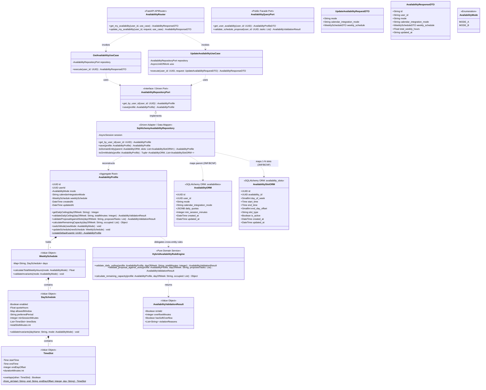
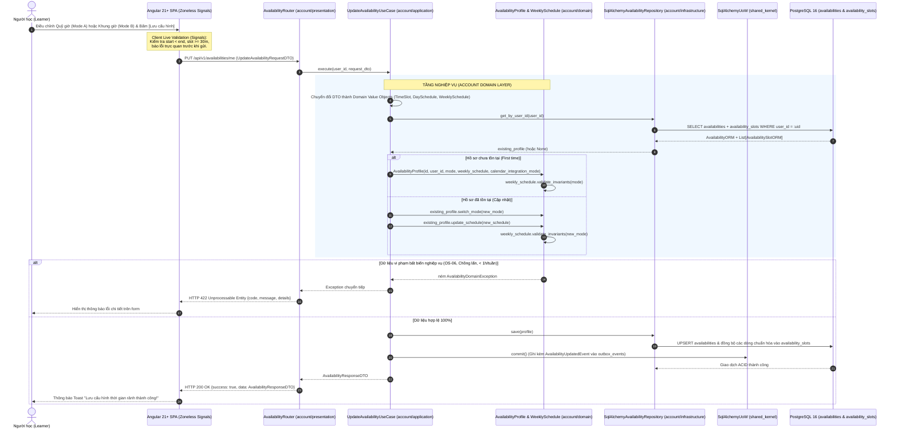
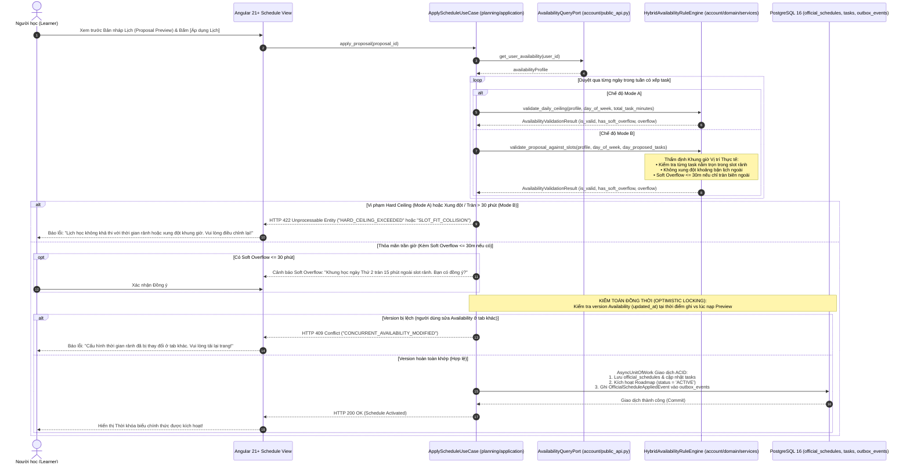

# Đặc Tả Kỹ Thuật & Luận Chứng Kiến Trúc: Phân Hệ Cấu Hình Thời Gian Rảnh Lai (FR-AVAIL)
## Hybrid Availability Management Module (Mode A Quota & Mode B Time Slots — v2.0)

---

| **Thuộc tính** | **Nội dung chi tiết** |
| :--- | :--- |
| **Dự án** | FocusFlow — Hệ thống Lập kế hoạch & Quản lý Học tập Cá nhân hóa Ứng dụng AI |
| **Mã phân hệ** | `FR-AVAIL` (Bao gồm `FR-AVAIL-001`, `FR-AVAIL-002`, liên đới `FR-AVAIL-003`) |
| **Bounded Context sở hữu** | `account` (`backend/src/account/`) — Phối hợp với `planning` qua `public_api.py` (`AvailabilityQueryPort`) |
| **Hạng mục WBS** | **WBS 5.3** (Sprint 1 — Milestone 2.5) |
| **Tác giả / Sinh viên** | Vũ Toàn Thắng |
| **Trạng thái tài liệu** | Hoàn thiện v2.0 (Đồng bộ Context-First Modular Monolith, Rich DDD + 3NF/BCNF `availability_slots`) |
| **Căn cứ đánh giá** | Rubric Đồ án Tốt nghiệp CNTT — HCMUTE (Tiêu chí TC2.1, TC2.3, TC2.4, TC2.7) |
| **Truy vết SRS & Quyết định**| `SRS v1.2 (Mục 7.4)`, `OS-04`, `OS-06`, `BUSR-02`, `BUSR-03`, `BUSR-04`, `ADR-001`, `ADR-003`, `ADR-007`, `ADR-009` |

---

## MỤC LỤC
1. [Bối cảnh Thực tế & Đặt vấn đề Kỹ thuật](#1-bối-cảnh-thực-tế--đặt-vấn-đề-kỹ-thuật)
2. [Luận chứng Kỹ thuật & Phân tích Đánh đổi (Trade-off Analysis)](#2-luận-chứng-kỹ-thuật--phân-tích-đánh-đổi-trade-off-analysis)
3. [Mô hình Hóa Thiết kế Hệ thống Chuẩn UML 2.5.1](#3-mô-hình-hóa-thiết-kế-hệ-thống-chuẩn-uml-251)
4. [Đặc tả Thuật toán & Phân tích Độ phức tạp](#4-đặc-tả-thuật-toán--phân-tích-độ-phức-tạp)
5. [Thiết kế Cơ sở Dữ liệu 3NF/BCNF & Chiến lược Lưu trữ (Persistence Design)](#5-thiết-kế-cơ-sở-dữ-liệu-3nfbcnf--chiến-lược-lưu-trữ-persistence-design)
6. [Hợp đồng Giao diện Lập trình Ứng dụng (RESTful API Contract)](#6-hợp-đồng-giao-diện-lập-trình-ứng-dụng-restful-api-contract)
7. [Kiến trúc Giao diện Người dùng Frontend (Angular 21+ Zoneless Signals Architecture)](#7-kiến-trúc-giao-diện-người-dùng-frontend-angular-21-zoneless-signals-architecture)
8. [Ma trận Truy vết & Chiến lược Kiểm thử Chất lượng (Verification Matrix)](#8-ma-trận-truy-vết--chiến-lược-kiểm-thử-chất-lượng-verification-matrix)
9. [Lộ trình Triển khai Kỹ thuật Từng bước (Implementation Roadmap)](#9-lộ-trình-triển-khai-kỹ-thuật-từng-bước-implementation-roadmap)

---

## 1. Bối cảnh Thực tế & Đặt vấn đề Kỹ thuật

### 1.1. Nỗi đau Người học & Giới hạn của Các Giải pháp Hiện hành
Nghiên cứu thứ cấp (Secondary Research — Reich & Ruipérez-Valiente, *Science*, 2019 chỉ ra tỷ lệ bỏ cuộc **85–95%** ở các khóa tự học trực tuyến) kết hợp đánh giá thực nghiệm Cognitive Walkthrough (`docs/requirements/user-survey-and-benchmarking.md` — trung bình mất **52 phút** để tự lập lịch thủ công từ đầu và **25 phút** kéo thả lại lịch khi bị trễ 3 ngày) cho thấy nguyên nhân hàng đầu khiến người tự học bỏ cuộc ngay trong 2 tuần đầu tiên là kế hoạch học tập phi thực tế và không ăn khớp với quỹ thời gian rảnh thực tế của họ:
- **Các ứng dụng To-Do truyền thống (Todoist, TickTick):** Chỉ quản lý danh sách công việc tĩnh, phó mặc hoàn toàn cho người dùng tự ước lượng và tự tìm giờ học.
- **Lịch biểu điện tử (Google Calendar, Apple Calendar):** Quản lý sự kiện theo khung giờ cứng ngắc, đòi hỏi người dùng phải tự sắp xếp thủ công từng block giờ, tốn từ 45–60 phút mỗi tuần.
- **Chatbot AI tạo kế hoạch dạng văn bản:** Khi được yêu cầu lập lộ trình, AI chỉ trả về danh sách bài học kèm mốc tuần chung chung ("Tuần 1: Học cú pháp cơ bản; Tuần 2: Học OOP"), hoàn toàn mù mờ về việc người học rảnh vào thứ mấy, khung giờ nào và tối đa bao nhiêu tiếng mỗi ngày.

### 1.2. Khái niệm Mô hình Thời gian Rảnh Lai (Hybrid Availability Model)
Hệ thống FocusFlow tiếp cận bài toán bằng việc định nghĩa **Mô hình Thời gian Rảnh Lai (Hybrid Model)**, bao quát 2 nhóm chân dung người học đối lập:

```
                          ┌──────────────────────────────────────────────┐
                          │     HỒ SƠ THỜI GIAN RẢNH CỦA NGƯỜI HỌC       │
                          │        (AvailabilityProfile Aggregate)       │
                          └──────────────────────┬───────────────────────┘
                                                 │
                   ┌─────────────────────────────┴─────────────────────────────┐
                   ▼                                                           ▼
       ┌───────────────────────┐                                   ┌───────────────────────┐
       │   CHẾ ĐỘ A: MODE_A    │                                   │   CHẾ ĐỘ B: MODE_B    │
       │ (Daily Hours Quota)   │                                   │  (Fixed Time Slots)   │
       └───────────┬───────────┘                                   └───────────┬───────────┘
                   │                                                           │
     • Đối tượng: Người chuyển ngành (Hùng)                      • Đối tượng: Sinh viên ĐH (Mai)
     • Đặc thù: Thời gian biểu phân tán,                       • Đặc thù: Lịch cố định trên trường,
       không cố định giờ giấc từng ngày.                           chỉ rảnh tối T2-T4-T6.
     • Cấu hình: Tổng giờ rảnh / ngày (Hours).                   • Cấu hình: Khoảng thời gian cụ thể:
     • Phạm vi hợp lệ: 0.5h — 14.0h (OS-06).                       [19:30 - 21:30], [20:00 - 22:00].
     • Kiểm tra trần: Chặn cứng (Hard Ceiling).                 • Kiểm tra trần: Dung sai Soft Overflow
                                                                   (cho phép tràn <= 30 phút).
```

### 1.3. Các Yêu cầu Kỹ thuật Cốt lõi
- **`FR-AVAIL-001` (Cấu hình Chế độ A):** Thiết lập tổng số giờ rảnh mỗi ngày (Thứ 2 đến Chủ Nhật) kết hợp với Chính sách Lập lịch Dự kiến (Scheduling Preferences):
  - Áp dụng ngưỡng giá trị cận biên theo Quyết định Mở `OS-06`:
    $$\text{Cận dưới} = 0.5 \text{ giờ (30 phút/ngày)}; \quad \text{Cận trên} = 14.0 \text{ giờ/ngày}$$
    Tổng số giờ rảnh hợp lệ cả tuần phải thỏa mãn điều kiện sàn: $\sum \text{quota\_hours} \ge 1.0 \text{ giờ/tuần}$.
  - Nhằm cho phép bộ lập lịch AI (qua cổng trừu tượng đa nhà cung cấp `LLMProviderPort`) tạo thời khóa biểu có giờ bắt đầu/kết thúc cụ thể mà không cần đọc Google Calendar, Mode A bổ sung 3 trường cấu hình trong `DaySchedule`:
    1. `allowed_window`: Khung giờ cho phép xếp lịch trong ngày (ví dụ `07:00 - 23:00`).
    2. `preferred_period`: Buổi học ưu tiên (`MORNING`, `AFTERNOON`, `EVENING`, `ANY`).
    3. `min_session_minutes`: Thời lượng phiên học tối thiểu (mặc định $30$ phút).
- **`FR-AVAIL-002` (Cấu hình Chế độ B):** Thiết lập các khung giờ rảnh cố định `[StartTime, EndTime]` cho từng ngày trong tuần. Bắt buộc:
  - Khung giờ hỗ trợ qua nửa đêm thông qua thuộc tính `end_day_offset` ($0$: cùng ngày, $1$: qua 00:00 ngày hôm sau). Khi `end_day_offset = 0`, yêu cầu $\text{StartTime} < \text{EndTime}$. Khi `end_day_offset = 1`, cho phép slot kéo dài qua nửa đêm (ví dụ: `22:30 - 01:30`).
  - Độ dài khung giờ tối thiểu $\text{Duration} \ge 30 \text{ phút}$ (tương ứng 1 đơn vị phiên học Pomodoro).
  - Tuyệt đối không được xảy ra chồng lấn (Overlapping) giữa các khung giờ trong cùng một ngày.
- **`FR-AVAIL-003` (Quản lý Năng lực Đa Lộ trình & Lịch Ngoại vi):**
  - Với **Mode A**: Trả về `remaining_capacity_minutes: int` (tổng số phút còn lại từ quỹ giờ sau khi trừ thời lượng đã phân bổ). Không tự suy diễn thành các slot giả lập.
  - Với **Mode B**: Áp dụng giải thuật trừ đoạn thời gian (Interval Subtraction) trong `HybridAvailabilityRuleEngine` để tính toán danh sách các khoảng rảnh thực tế còn lại (`List<TimeSlot>`) sau khi đã trừ các khoảng thời gian bị chiếm dụng bởi lộ trình khác hoặc sự kiện bận từ Google Calendar (`CalendarSyncPort`).
- **Phân tách Cấu hình Tích hợp Lịch Ngoại vi (`calendar_integration_mode`):** Độc lập với `availability_mode`, người dùng có thể cấu hình trạng thái tích hợp lịch: `NONE` (chỉ dùng nội bộ), `EXPORT_ICS` (xuất tệp tĩnh hoặc WebCal 1 chiều) hoặc `CONNECTED` (đồng bộ 2 chiều có kiểm soát với Google Calendar OAuth2).

---

## 2. Luận chứng Kỹ thuật & Phân tích Đánh đổi (Trade-off Analysis)

### 2.1. Phân tách Lục giác (Hexagonal Separation): Rich Value Objects trong Bộ nhớ vs Chuẩn hóa 3NF/BCNF trong PostgreSQL (`ADR-007`)
Một trong những quyết định kiến trúc quan trọng nhất trong phiên bản v2.0 (`ADR-007`) là giải quyết bài toán cân bằng giữa **Mô hình Miền Giàu (Rich DDD)** ở tầng mã nguồn và **Tính Chuẩn hóa Học thuật 3NF/BCNF** ở tầng cơ sở dữ liệu:

| Tiêu chí Đánh giá | Phương án A: Lưu cột `JSONB` nguyên khối trong DB | Phương án B: Anemic CRUD trực tiếp trên bảng 1-N (Không có Value Object) | Phương án C (Được chọn - v2.0): Rich DDD Value Objects (`WeeklySchedule`/`TimeSlot`) + Bảng chuẩn hóa 3NF/BCNF (`availabilities` & `availability_slots`) qua Repository |
| :--- | :--- | :--- | :--- |
| **Chuẩn hóa Học thuật 3NF/BCNF** | **Vi phạm 1NF** dưới góc nhìn CSDL quan hệ thuần túy (lưu mảng lặp các slot giờ vào 1 ô JSONB, không truy vấn SQL trực tiếp từng slot được). | **Đạt 3NF/BCNF** (tách bảng cha `availabilities` và bảng con `availability_slots`). | **Đạt tuyệt đối 3NF/BCNF** trên toàn bộ 35 bảng PostgreSQL 16: bảng cha `availabilities` lưu cấu hình chung và bảng con `availability_slots` lưu từng dòng khung giờ/quỹ giờ theo ngày. |
| **Mô hình hóa Nghiệp vụ (DDD)** | Tốt ở tầng Domain nhưng rò rỉ cấu trúc lưu trữ tài liệu JSONB. | **Kém (Anemic):** Mất tính đóng gói của Aggregate Root, khó kiểm tra chồng lấn khung giờ trên toàn tuần. | **Xuất sắc (Rich DDD + Pure Domain Service):** Trong bộ nhớ (`account/domain/`), `AvailabilityProfile` nắm giữ Value Object bất biến `WeeklySchedule`, `DaySchedule`, `TimeSlot` và phối hợp cùng `HybridAvailabilityRuleEngine`. |
| **Vai trò của Hexagonal Adapter** | Ánh xạ 1-1 đơn giản nhưng hy sinh ràng buộc khóa/kiểu dữ liệu SQL trên từng slot. | Không có ranh giới Domain/Infrastructure rõ ràng. | **`SqlAlchemyAvailabilityRepository`** đóng vai trò **Data Mapper** đích thực: khi đọc (`get_by_user_id`), gom các dòng từ `availabilities` + `availability_slots` để tái tạo `WeeklySchedule` VO; khi ghi (`save`), đồng bộ nguyên tử (atomic replacement trong `AsyncUnitOfWork`) từ `WeeklySchedule` VO xuống bảng `availability_slots`. |

> [!IMPORTANT]
> **Kết luận Kiến trúc v2.0:** Nhờ Kiến trúc Lục giác (Ports & Adapters), tầng Domain hoàn toàn không biết dữ liệu được lưu bằng JSONB hay bảng quan hệ. Việc `SqlAlchemyAvailabilityRepository` ánh xạ `WeeklySchedule` và `TimeSlot` xuống bảng chuẩn hóa 3NF/BCNF **`availability_slots`** giúp hệ thống vừa thỏa mãn **100% tiêu chuẩn thiết kế CSDL quan hệ 3NF/BCNF** trước Hội đồng chấm khóa luận, vừa bảo toàn nguyên vẹn **Rich Domain Model** trong mã nguồn Python.

---

### 2.2. Sự Phối Hợp Giữa Rich Aggregate Root (`AvailabilityProfile`) và Pure Domain Service (`HybridAvailabilityRuleEngine`)
Theo tiêu chuẩn Domain-Driven Design (DDD) và `Class Diagram v5.0`, tầng `backend/src/account/domain/` phân chia trách nhiệm rõ ràng giữa **Models (`domain/models/`)** và **Services (`domain/services/`)**:
1. **Rich Aggregate Root & Value Objects (`backend/src/account/domain/models/availability.py`):**
   - `TimeSlot`: Tự bảo vệ bất biến cục bộ ngay tại `__post_init__` ($\text{Duration} \ge 30$ phút, xử lý `end_day_offset` $0$ hoặc $1$).
   - `DaySchedule` & `WeeklySchedule`: Tự bảo vệ bất biến nội tại của cấu hình 7 ngày (cận giờ Mode A $0.5\text{h} - 14.0\text{h}$ theo `OS-06`, tổng giờ tuần $\ge 1.0\text{h}$, không chồng lấn giữa các `TimeSlot` trong cùng ngày).
   - `AvailabilityProfile`: Quản lý vòng đời cấu hình thời gian rảnh của người học (`switch_mode`, `update_schedule`) và ủy quyền (delegate) các phép kiểm chứng lịch học phức tạp cho `HybridAvailabilityRuleEngine`.
2. **Pure Domain Service (`backend/src/account/domain/services/hybrid_availability_rule_engine.py`):**
   - Chứa các giải thuật thẩm định liên thực thể (cross-entity validation) giữa `AvailabilityProfile`, danh sách `ProposedTask` do AI sinh ra (qua `LLMProviderPort`), và danh sách khoảng bận từ các lộ trình khác hoặc Google Calendar:
     - `validate_daily_ceiling(...)`: Thẩm định trần cứng Mode A (Hard Ceiling Gate).
     - `validate_proposal_against_slots(...)`: Thẩm định vị trí khung giờ thực tế Mode B (Slot-fit & Soft Overflow $\le 30\text{m}$).
     - `calculate_remaining_capacity(...)`: Giải thuật trừ đoạn thời gian (`Interval Subtraction`) cho đa lộ trình (`FR-AVAIL-003`).

---

### 2.3. Cơ chế Hard Ceiling vs Slot-fit Validation & Soft Overflow
Tại sao hệ thống FocusFlow không áp dụng cùng một cơ chế thẩm định cho cả 2 chế độ?
1. **Đối với Mode A (Hard Ceiling Gate — Chặn cứng):**
   - Người học Mode A thiết lập quỹ thời gian trần theo con số tuyệt đối (ví dụ: Thứ 2 rảnh đúng 2 giờ).
   - Nếu thuật toán xếp lịch nhồi nhét $2.5$ giờ vào ngày đó, người học chắc chắn sẽ không đủ thể lực hoặc thời gian để hoàn thành. Do đó, `HybridAvailabilityRuleEngine` áp dụng **Hard Ceiling Gate**: Bất kỳ sự vi phạm nào ($> 0$ phút) đều bị chặn đứng ở Tier 2 của **3-Tier Hybrid Validation Gate** (`ADR-009`) hoặc từ chối áp dụng lịch với lỗi `422 Unprocessable Entity`.
2. **Đối với Mode B (Slot-fit Validation & Soft Overflow Tolerance):**
   - **Bản chất của Mode B:** Không chỉ cho biết tổng lượng giờ rảnh, Mode B xác định **thời điểm cụ thể** người học có thể học. Do đó, việc chỉ so sánh tổng số phút task với tổng phút rảnh trong ngày (`validate_daily_ceiling`) là **sai bản chất nghiệp vụ**.
   - **Quy tắc Kiểm tra Vị trí Thực tế (`validate_proposal_against_slots`):**
     - Từng task trong proposal phải được đối chiếu trực tiếp: `task.start_time` và `task.end_time` có nằm trọn trong một slot rảnh hợp lệ của ngày đó hay không.
     - Đồng thời đối chiếu với các task đã được lên lịch trước đó hoặc khoảng bận từ Google Calendar để đảm bảo không bị xung đột.
   - **Chính sách Dung sai Soft Overflow ($\le 30$ phút):**
     - Trong trường hợp một task Pomodoro (ví dụ: 105 phút) hơi tràn ra ngoài biên kết thúc của một slot rảnh 90 phút (tràn 15 phút), nhưng **không va chạm** với bất kỳ lịch bận hay task nào khác:
     - Hệ thống cho phép task được tràn tối đa **không quá 30 phút**, đồng thời trả về cờ cảnh báo `has_soft_overflow = True`. Giao diện hiển thị cảnh báo rõ ràng để người học xác nhận chấp thuận học thêm 15–30 phút hay không trước khi chính thức áp dụng.
     - Nếu tràn quá 30 phút hoặc đè lên khoảng thời gian bận, hệ thống lập tức coi là vi phạm và từ chối.

---

### 2.4. Phạm Vi Thẩm Định Khi Chuyển Đổi Chế Độ & Trạng Thái `enabled`
1. **Phạm vi Thẩm định (Validation Scope):**
   - Hệ thống **chỉ thẩm định nghiêm ngặt chế độ đang được kích hoạt (`active_mode`)**.
   - Nếu người dùng lưu `mode = 'MODE_A'`, hệ thống chỉ kiểm tra các bất biến của Mode A (0.5h – 14.0h/ngày, tổng tuần $\ge 1.0$h, tính hợp lệ của `allowed_window`). Các khung giờ trong `time_slots` của Mode B dù có đang rỗng hoặc chưa hoàn thiện vẫn được giữ nguyên vẹn trong bảng `availability_slots`.
   - Ngược lại, khi chuyển sang lưu `mode = 'MODE_B'`, hệ thống mới kích hoạt bộ thẩm định kiểm tra chồng lấn và thời lượng tối thiểu của các khung giờ.
2. **Ngữ nghĩa của trường `enabled`:**
   - Trường `enabled: Boolean` trong mỗi `DaySchedule` là **trạng thái dùng chung có chủ đích của ngày**: Mang ý nghĩa "Người học quyết định ngày này nghỉ hoàn toàn, không xếp bất kỳ lịch học nào, bất kể đang dùng Mode A hay Mode B".
   - Khi `enabled = false`, toàn bộ dữ liệu `quota_hours` và `time_slots` đã nhập trước đó vẫn được bảo toàn nguyên vẹn (State Retention).

---

### 2.5. Xử Lý Xung Đột Với Lịch Chính Thức & Phân Tách Trách Nhiệm Với Domino Shift
1. **Ứng xử khi người học sửa giảm giờ rảnh trong lúc đã có Lịch học chính thức (Official Schedule):**
   - Áp dụng nguyên lý **Non-blocking with Advisory Warning**: Cấu hình rảnh mới luôn được phép lưu thành công ngay lập tức và phát sự kiện `AvailabilityUpdatedEvent` qua Transactional Outbox (`outbox_events`).
   - Nếu phát hiện cấu hình mới làm cho các task `PENDING` trong tương lai bị vượt trần hoặc rơi ra ngoài khung rảnh, hệ thống **không tự ý thay đổi hoặc hủy bỏ** lịch đã cam kết. Thay vào đó, hệ thống gắn cờ cảnh báo trên màn hình Thời khóa biểu và Dashboard, gợi ý người học kích hoạt tái cấu trúc lịch học thích ứng.
2. **Phân định Ranh giới Kỹ thuật Rõ ràng giữa Settings Hub và Quick Drawer:**
   - **Cài đặt Tập trung (Settings Hub - `/settings`):** Chuyên trách cập nhật **Khuôn mẫu lặp lại hàng tuần (Weekly Recurring Template)** thông qua API `PUT /api/v1/availabilities/me` (thuộc Context `account`).
   - **Tương tác Nhanh (Quick Drawer tại `/schedule`):** Phục vụ việc điều chỉnh cục bộ đột xuất cho một ngày cụ thể (ví dụ: tối nay bận đột xuất muốn dời phiên học sang ngày mai). Thao tác này **tuyệt đối KHÔNG gọi `PUT /availabilities/me`** để tránh phá vỡ khuôn mẫu tuần; thay vào đó nó gọi API của phân hệ `execution`/`evaluation` (`PauseRecord` / `DominoShiftEngine`) để dời lịch cho riêng khoảng thời gian đó.

---

## 3. Mô hình Hóa Thiết kế Hệ thống Chuẩn UML 2.5.1

### 3.1. Sơ đồ Lớp Thiết kế Chi tiết (Design Class Diagram - DCD v2.0)



---

### 3.2. Sơ đồ Tuần tự 1: Thiết lập & Thẩm định Cấu hình Rảnh (`UC-03` / `FR-AVAIL-001..002`)



---

### 3.3. Sơ đồ Tuần tự 2: Chốt Chặn Thẩm định Trần giờ Liên Context khi Áp dụng Lịch (Apply Gate — `planning` $\to$ `account/public_api.py`)



---

## 4. Đặc Tả Thuật Toán & Phân Tích Độ Phức Tạp

### 4.1. Thuật toán Kiểm tra Khung giờ Không Chồng lấn (Hỗ trợ Cross-Midnight Slot qua `end_day_offset`)
- **Mục tiêu:** Đảm bảo rằng trong một ngày bất kỳ của Chế độ B, không có bất kỳ 2 khung giờ nào bị đè lên nhau, đồng thời hỗ trợ các khung giờ qua nửa đêm (`end_day_offset = 1`).
- **Ý tưởng giải thuật:**
  1. Nếu số lượng khung giờ $N \le 1$, trả về hợp lệ ngay lập tức.
  2. Chuẩn hóa thời gian bắt đầu và kết thúc thành phút tính từ 00:00 của ngày:
     $$\text{start\_min} = \text{hour} \times 60 + \text{minute}; \quad \text{end\_min} = (\text{hour} \times 60 + \text{minute}) + (\text{end\_day\_offset} \times 1440)$$
  3. Kiểm tra tính hợp lệ đơn khung: $\text{end\_min} - \text{start\_min} \ge 30$ phút.
  4. Sắp xếp danh sách $N$ khung giờ theo $\text{start\_min}$ tăng dần: $O(N \log N)$.
  5. Duyệt tuyến tính từ phần tử đầu tiên đến phần tử kế cuối: $O(N)$. Nếu $\text{slots}[i].\text{end\_min} > \text{slots}[i+1].\text{start\_min}$, phát hiện xung đột và ném ngoại lệ `OverlappingTimeSlotsException`.
- **Mã giả (Pseudocode):**
  ```python
  def slot_minutes_range(slot: TimeSlot) -> tuple[int, int]:
      start_m = slot.start_time.hour * 60 + slot.start_time.minute
      end_m = slot.end_time.hour * 60 + slot.end_time.minute + (slot.end_day_offset * 1440)
      return start_m, end_m

  def check_intervals_no_overlap(slots: list[TimeSlot], day_name: str) -> None:
      if len(slots) <= 1:
          return
      
      # Sắp xếp theo start_time tăng dần: O(N log N)
      sorted_slots = sorted(slots, key=lambda s: slot_minutes_range(s)[0])
      
      for i in range(len(sorted_slots) - 1):
          curr_start, curr_end = slot_minutes_range(sorted_slots[i])
          next_start, next_end = slot_minutes_range(sorted_slots[i + 1])
          
          if curr_end > next_start:
              raise OverlappingTimeSlotsException(
                  day=day_name,
                  slot1=f"{sorted_slots[i].start_time} - {sorted_slots[i].end_time} (+{sorted_slots[i].end_day_offset}d)",
                  slot2=f"{sorted_slots[i + 1].start_time} - {sorted_slots[i + 1].end_time} (+{sorted_slots[i + 1].end_day_offset}d)"
              )
  ```
- **Phân tích Độ phức tạp:**
  - Thời gian (Time Complexity): $O(N \log N)$. Do số lượng khung giờ của một người học trong một ngày rất nhỏ ($N \le 6$), số phép tính tối đa $< 20$ phép toán, thời gian chạy đo được $< 0.05\text{ms}$.
  - Không gian (Space Complexity): $O(N)$ để chứa danh sách đã sắp xếp.

---

### 4.2. Thuật toán Trừ Đoạn Thời gian Đa Lộ trình & Thẩm định Khung Khả thi (`HybridAvailabilityRuleEngine`)
- **Mục tiêu:**
  1. Với Mode A: Trả về `remaining_capacity_minutes: int` bằng $\text{quota\_hours} \times 60 - \sum \text{allocated\_minutes}$.
  2. Với Mode B: Trừ các khoảng thời gian bị chiếm dụng (Occupied Intervals của các Roadmap khác hoặc sự kiện bận từ Google Calendar) và trả về các khoảng rảnh còn lại (`List<TimeSlot>`).
  3. Cung cấp giải thuật `validate_proposal_against_slots` kiểm tra từng task đề xuất có nằm trọn trong các slot rảnh thực tế hay không.
- **Mã giả giải thuật trong `backend/src/account/domain/services/hybrid_availability_rule_engine.py`:**
  ```python
  class HybridAvailabilityRuleEngine:
      @staticmethod
      def subtract_intervals(base_slots: list[TimeSlot], occupied: list[tuple[time, time]]) -> list[TimeSlot]:
          sorted_occupied = sorted(occupied, key=lambda x: x[0])
          current_available = list(base_slots)
          
          for occ_start, occ_end in sorted_occupied:
              next_available = []
              for slot in current_available:
                  if slot.end_time <= occ_start or slot.start_time >= occ_end:
                      next_available.append(slot)
                  else:
                      if slot.start_time < occ_start:
                          left_duration = time_diff_minutes(slot.start_time, occ_start)
                          if left_duration >= 30:
                              next_available.append(TimeSlot(slot.start_time, occ_start))
                      
                      if slot.end_time > occ_end:
                          right_duration = time_diff_minutes(occ_end, slot.end_time)
                          if right_duration >= 30:
                              next_available.append(TimeSlot(occ_end, slot.end_time))
              current_available = next_available
              
          return current_available

      @staticmethod
      def validate_proposal_against_slots(
          available_slots: list[TimeSlot], 
          proposed_tasks: list[ProposedTask]
      ) -> AvailabilityValidationResult:
          """Kiểm tra từng task có nằm trọn trong slot rảnh không (D-01)."""
          for task in proposed_tasks:
              matched = False
              overflow_minutes = 0
              for slot in available_slots:
                  # Task nằm hoàn toàn trong slot
                  if slot.start_time <= task.start_time and task.end_time <= slot.end_time:
                      matched = True
                      break
                  # Kiểm tra Soft Overflow (tràn đuôi slot <= 30 phút mà không đè slot khác)
                  if slot.start_time <= task.start_time and task.start_time < slot.end_time:
                      overflow = time_diff_minutes(slot.end_time, task.end_time)
                      if 0 < overflow <= 30:
                          matched = True
                          overflow_minutes = max(overflow_minutes, overflow)
                          break
              if not matched:
                  return AvailabilityValidationResult(
                      is_valid=False, 
                      violation_reasons=[f"Task {task.title} [{task.start_time}-{task.end_time}] nằm ngoài khung giờ rảnh."]
                  )
          
          return AvailabilityValidationResult(
              is_valid=True,
              has_soft_overflow=(overflow_minutes > 0),
              overflow_minutes=overflow_minutes
          )
  ```

---

## 5. Thiết Kế Cơ Sở Dữ Liệu 3NF/BCNF & Chiến Lược Lưu Trữ (Persistence Design)

### 5.1. Lược đồ 2 Bảng Vật lý Chuẩn hóa 3NF/BCNF: `availabilities` & `availability_slots` (PostgreSQL 16)
Tuân thủ thiết kế chuẩn hóa 35 bảng tại `docs/database/schema.sql` (v3.2), `Class Diagram` và `ADR-007`, cấu hình thời gian rảnh được lưu trữ chuẩn hóa 3NF/BCNF trên 2 bảng thuộc sở hữu của Bounded Context `account` (lưu ý: cột `timezone` nằm tại bảng `users`, không lặp lại ở `availabilities`):

```sql
-- =============================================================================
-- 1. BẢNG CHA: AVAILABILITIES (HỒ SƠ THỜI GIAN RẢNH LAI CỦA NGƯỜI HỌC)
-- Quan hệ: 1-1 với bảng users (cột timezone được lưu tại bảng users)
-- =============================================================================
CREATE TABLE IF NOT EXISTS availabilities (
    id UUID PRIMARY KEY DEFAULT gen_random_uuid(),
    user_id UUID NOT NULL,
    mode VARCHAR(20) NOT NULL DEFAULT 'MODE_A',
    calendar_integration_mode VARCHAR(20) NOT NULL DEFAULT 'NONE',
    daily_quotas JSONB NOT NULL DEFAULT '{}'::jsonb,
    min_session_minutes INTEGER NOT NULL DEFAULT 30,
    created_at TIMESTAMPTZ NOT NULL DEFAULT NOW(),
    updated_at TIMESTAMPTZ NOT NULL DEFAULT NOW(),

    CONSTRAINT uq_availabilities_user_id UNIQUE (user_id),
    CONSTRAINT fk_availabilities_user FOREIGN KEY (user_id) REFERENCES users(id) ON DELETE CASCADE,
    CONSTRAINT chk_availabilities_mode CHECK (mode IN ('MODE_A', 'MODE_B')),
    CONSTRAINT chk_availabilities_cal_mode CHECK (calendar_integration_mode IN ('NONE', 'EXPORT_ICS', 'CONNECTED')),
    CONSTRAINT chk_availabilities_min_session CHECK (min_session_minutes BETWEEN 15 AND 120)
);

-- =============================================================================
-- 2. BẢNG CON CHUẨN HÓA 3NF/BCNF: AVAILABILITY_SLOTS
-- Quan hệ: N-1 với bảng availabilities (Ánh xạ trực tiếp sang WeeklySchedule & TimeSlot VO)
-- =============================================================================
CREATE TABLE IF NOT EXISTS availability_slots (
    id UUID PRIMARY KEY DEFAULT gen_random_uuid(),
    availability_id UUID NOT NULL,
    day_of_week SMALLINT NOT NULL CHECK (day_of_week BETWEEN 0 AND 6), -- 0: Monday .. 6: Sunday
    start_time TIME NOT NULL,
    end_time TIME NOT NULL,
    end_day_offset SMALLINT NOT NULL DEFAULT 0 CHECK (end_day_offset IN (0, 1)),
    slot_type VARCHAR(20) NOT NULL DEFAULT 'FIXED' CHECK (slot_type IN ('ALLOWED', 'FIXED')),
    is_active BOOLEAN NOT NULL DEFAULT TRUE,
    created_at TIMESTAMPTZ NOT NULL DEFAULT NOW(),
    updated_at TIMESTAMPTZ NOT NULL DEFAULT NOW(),

    CONSTRAINT fk_avail_slots_availability FOREIGN KEY (availability_id) REFERENCES availabilities(id) ON DELETE CASCADE,
    CONSTRAINT chk_avail_slots_time CHECK (end_day_offset = 1 OR end_time > start_time)
);

CREATE INDEX IF NOT EXISTS idx_availability_slots_avail_day
    ON availability_slots(availability_id, day_of_week);
```

### 5.2. Cơ chế Ánh xạ Hai chiều (Data Mapping) trong `SqlAlchemyAvailabilityRepository`
Tại tầng Infrastructure (`backend/src/account/infrastructure/repositories/availability_repository.py`):
- **Khi đọc (`get_by_user_id`)**: Repository thực hiện truy vấn `availabilities` kèm eager-load `availability_slots`, gom nhóm theo `day_of_week` ($0 \dots 6$) và tái tạo đầy đủ cây Value Object **`WeeklySchedule` $\to$ `DaySchedule` $\to$ `List[TimeSlot]`** cho `AvailabilityProfile`.
- **Khi ghi (`save`)**: Sau khi `AvailabilityProfile` và `WeeklySchedule` đã kiểm chứng 100% các bất biến trong bộ nhớ, Repository chuyển đổi `WeeklySchedule` thành các bản ghi `AvailabilitySlotORM` và thực hiện cập nhật nguyên tử (atomic flush) bên trong giao dịch của `AsyncUnitOfWork`.
- Nhờ đó, hợp đồng JSON trả về qua REST API (bên dưới) vẫn giữ nguyên cấu trúc phân cấp trực quan `weekly_schedule` cho Frontend Angular 21+, trong khi tầng lưu trữ vật lý đạt chuẩn 3NF/BCNF tuyệt đối.

---

## 6. Hợp Đồng Giao Diện Lập Trình Ứng Dụng (RESTful API Contract)

Toàn bộ các endpoint tuân thủ chuẩn RESTful, sử dụng mã trạng thái HTTP tiêu chuẩn và định dạng phản hồi nhất quán theo `ApiResponse<T>` / `ApiErrorResponse` (`RFC 7807 Problem Details`).

### 6.1. Endpoint 1: Lấy Cấu hình Thời gian Rảnh Hiện tại
- **Đường dẫn:** `GET /api/v1/availabilities/me`
- **Mô tả:** Lấy thông tin cấu hình thời gian rảnh của người học đang đăng nhập. Nếu người học mới chưa từng cấu hình, Use Case tự động áp dụng **Lazy Initialization** trả về hồ sơ mẫu mặc định trong bộ nhớ với `id = null` (không thực hiện ghi INSERT CSDL để tránh race condition và write-side effect cho thao tác đọc). CSDL chỉ được tạo bản ghi khi người dùng gọi `PUT /me` lần đầu tiên.
- **Tiêu đề Yêu cầu (Request Headers):**
  ```http
  Cookie: access_token=<jwt_access_token> (hoặc Authorization: Bearer <jwt_access_token>)
  ```
- **Mã phản hồi Thành công:** `200 OK`
- **Thân phản hồi (Response Body):**
  ```json
  {
    "success": true,
    "data": {
      "id": "0192a3b4-c5d6-7e8f-9a0b-1c2d3e4f5a6b",
      "user_id": "018f0000-0000-7000-8000-000000000001",
      "mode": "MODE_A",
      "calendar_integration_mode": "NONE",
      "weekly_schedule": {
        "monday": { "enabled": true, "quota_hours": 2.0, "time_slots": [{ "start": "19:30", "end": "21:30", "end_day_offset": 0 }] },
        "tuesday": { "enabled": true, "quota_hours": 2.0, "time_slots": [{ "start": "19:30", "end": "21:30", "end_day_offset": 0 }] },
        "wednesday": { "enabled": true, "quota_hours": 2.0, "time_slots": [{ "start": "19:30", "end": "21:30", "end_day_offset": 0 }] },
        "thursday": { "enabled": true, "quota_hours": 2.0, "time_slots": [{ "start": "19:30", "end": "21:30", "end_day_offset": 0 }] },
        "friday": { "enabled": true, "quota_hours": 2.0, "time_slots": [{ "start": "19:30", "end": "21:30", "end_day_offset": 0 }] },
        "saturday": { "enabled": true, "quota_hours": 3.0, "time_slots": [{ "start": "14:00", "end": "17:00", "end_day_offset": 0 }] },
        "sunday": { "enabled": true, "quota_hours": 3.0, "time_slots": [{ "start": "14:00", "end": "17:00", "end_day_offset": 0 }] }
      },
      "total_weekly_hours": 16.0,
      "updated_at": "2026-10-19T04:15:00.000000Z"
    }
  }
  ```

---

### 6.2. Endpoint 2: Cập nhật Cấu hình Thời gian Rảnh (UPSERT)
- **Đường dẫn:** `PUT /api/v1/availabilities/me`
- **Mô tả:** Cập nhật chế độ hoạt động và toàn bộ lịch tuần của người học.
- **Thân yêu cầu (Request Body):**
  ```json
  {
    "mode": "MODE_B",
    "calendar_integration_mode": "EXPORT_ICS",
    "weekly_schedule": {
      "monday": {
        "enabled": true,
        "quota_hours": 2.0,
        "time_slots": [
          { "start": "19:00", "end": "21:00", "end_day_offset": 0 }
        ]
      },
      "tuesday": {
        "enabled": true,
        "quota_hours": 2.0,
        "time_slots": [
          { "start": "20:00", "end": "22:00", "end_day_offset": 0 }
        ]
      },
      "wednesday": { "enabled": false, "quota_hours": 0.0, "time_slots": [] },
      "thursday": { "enabled": false, "quota_hours": 0.0, "time_slots": [] },
      "friday": { "enabled": false, "quota_hours": 0.0, "time_slots": [] },
      "saturday": { "enabled": false, "quota_hours": 0.0, "time_slots": [] },
      "sunday": { "enabled": false, "quota_hours": 0.0, "time_slots": [] }
    }
  }
  ```
- **Mã phản hồi Thành công:** `200 OK` (Trả về đối tượng `AvailabilityResponseDTO` cập nhật).
- **Mã phản hồi Lỗi Nghiệp vụ (Validation Error):** `422 Unprocessable Entity`
  - *Ví dụ 1: Vi phạm Cận giờ Mode A theo `OS-06`:*
    ```json
    {
      "code": "INVALID_QUOTA_BOUNDS",
      "message": "Số giờ rảnh cho monday (0.3h) không hợp lệ theo OS-06. Phải nằm trong khoảng từ 0.5 giờ (30 phút) đến 14.0 giờ.",
      "details": {
        "day": "monday",
        "quota_hours": 0.3,
        "min_allowed": 0.5,
        "max_allowed": 14.0
      }
    }
    ```
  - *Ví dụ 2: Vi phạm Chồng lấn Khung giờ Mode B:*
    ```json
    {
      "code": "OVERLAPPING_TIME_SLOTS",
      "message": "Khung giờ vào tuesday bị xung đột: [19:00 - 21:00] chồng lấn với [20:00 - 22:00].",
      "details": {
        "day": "tuesday",
        "conflicting_slots": ["19:00 - 21:00", "20:00 - 22:00"]
      }
    }
    ```
  - *Ví dụ 3: Vi phạm Tổng giờ cả tuần không đủ điều kiện tối thiểu:*
    ```json
    {
      "code": "INSUFFICIENT_WEEKLY_AVAILABILITY",
      "message": "Tổng thời gian rảnh trong tuần (0.5h) quá thấp. Cần tối thiểu 1.0 giờ/tuần để hệ thống có thể lập kế hoạch học tập.",
      "details": {
        "total_hours": 0.5,
        "min_required": 1.0
      }
    }
    ```

---

## 7. Kiến Trúc Giao Diện Người Dùng Frontend (Angular 21+ Zoneless Signals Architecture)

### 7.1. Phân chia Điểm Chạm UX Kép (Dual Touchpoint Strategy)
Phân hệ Availability trên **Angular 21+ (Zoneless, Standalone, `OnPush`, PrimeNG v21 + Tailwind CSS v4 + Lucide Icons)** cung cấp 2 điểm chạm trải nghiệm phục vụ 2 ngữ cảnh sử dụng khác nhau:
1. **Điểm chạm Quản trị Tập trung (Settings Hub - `/settings`):**
   - Đặt tại tab "Cấu hình Thời gian rảnh" trong trang Cài đặt.
   - Thích hợp khi người học muốn tinh chỉnh chi tiết, nghiên cứu các Mẫu gợi ý (Presets) hoặc thiết lập lịch rảnh ban đầu.
2. **Điểm chạm Tương tác Nhanh (In-context Quick Drawer - `/schedule`):**
   - Đặt nút `[Điều chỉnh lịch hôm nay]` trên thanh công cụ điều khiển tuần của Thời khóa biểu (`SCR-05`).
   - Mở ra một PrimeNG v21 Drawer từ phía bên phải màn hình phục vụ việc điều chỉnh ngoại lệ cục bộ cho ngày được chọn (dời phiên học, tăng giảm thời lượng hôm nay).
   - **Ranh giới kỹ thuật:** Thao tác này tương tác với API của phân hệ `execution`/`evaluation` (`DominoShiftEngine`), **tuyệt đối không gọi `PUT /availabilities/me`** để bảo toàn khuôn mẫu tuần lặp lại vĩnh viễn.

---

### 7.2. Bộ Mẫu Thời Gian Rảnh Gợi Ý (UX Productivity Presets)
Nhằm giúp người học không bị nản lòng trước việc phải tự thiết lập 7 ngày, hệ thống cung cấp 3 bộ Presets tích hợp sẵn với 1 cú click:
1. **Preset 1: Người Đi Làm Bận Rộn (Busy Professional):**
   - Thứ 2 $\rightarrow$ Thứ 6: Rảnh tối 1.5h (`20:30 - 22:00`).
   - Thứ 7 & Chủ Nhật: Rảnh chiều 3.0h (`14:00 - 17:00`).
   - *Tổng quỹ tuần:* $13.5$ giờ.
2. **Preset 2: Sinh Viên Đại Học (University Student):**
   - Thứ 2, 4, 6: Rảnh tối 2.5h (`19:30 - 22:00`).
   - Thứ 3, 5: Nghỉ ngơi học bài trên lớp.
   - Thứ 7 & Chủ Nhật: Rảnh 4.0h/ngày (Sáng `08:30 - 11:00` = 2.5h và Chiều `14:30 - 16:00` = 1.5h).
   - *Tổng quỹ tuần:* $3 \times 2.5 + 2 \times 4.0 = 15.5$ giờ chuẩn xác 100%.
3. **Preset 3: Học Tập Toàn Thời Gian (Full-time Bootcamper):**
   - Thứ 2 $\rightarrow$ Thứ 7: Mỗi ngày rảnh 6.0h chia làm 2 ca (Sáng `08:30 - 11:30`, Chiều `14:00 - 17:00`).
   - Chủ Nhật: Nghỉ hoàn toàn.
   - *Tổng quỹ tuần:* $36.0$ giờ.

Kèm theo đó là nút tiện ích: **"Sao chép Thứ 2 sang tất cả các ngày trong tuần" (Batch Copy to Weekdays)**, giảm 80% thao tác bấm chuột của người dùng.

---

### 7.3. Thiết Kế Quản Trị Trạng Thái Bằng Angular 21+ Zoneless Signals
Ứng dụng khai thác tối đa tính năng **Fine-grained Reactivity** của Angular 21+ Signals (`signal`, `computed`, `linkedSignal`, `rxResource`):

```typescript
@Injectable({ providedIn: 'root' })
export class AvailabilityService {
  private readonly http = inject(HttpClient);

  // Core State Signals (Zoneless Ready)
  readonly profile = signal<AvailabilityProfile | null>(null);
  readonly activeMode = signal<AvailabilityMode>('MODE_A');
  readonly weeklySchedule = signal<WeeklySchedule>(DEFAULT_SCHEDULE);
  readonly loading = signal<boolean>(false);
  readonly saving = signal<boolean>(false);
  readonly errorMessage = signal<string | null>(null);

  // Computed Derived Signals (Tự động cập nhật không cần subscribe)
  readonly totalWeeklyHours = computed(() => {
    const sched = this.weeklySchedule();
    const mode = this.activeMode();
    let total = 0;
    for (const day of DAYS_OF_WEEK) {
      const dayData = sched[day];
      if (dayData.enabled) {
        if (mode === 'MODE_A') {
          total += dayData.quota_hours;
        } else {
          total += dayData.time_slots.reduce((acc, s) => acc + calculateDurationMinutes(s.start, s.end, s.end_day_offset), 0) / 60;
        }
      }
    }
    return Math.round(total * 10) / 10;
  });

  readonly isWeeklyValid = computed(() => this.totalWeeklyHours() >= 1.0);
}
```

---

## 8. Ma Trận Truy Vết & Chiến Lược Kiểm Thử Chất Lượng (Verification Matrix)

### 8.1. Ma trận Truy vết Yêu cầu Kỹ thuật (Requirements Traceability Matrix - RTM)

| Mã Yêu cầu | Nguồn truy vết | Thành phần Xử lý (Component) | Phương pháp Kiểm chứng (Verification) | Tiêu chí Nghiệm thu (Acceptance Criteria) |
| :--- | :--- | :--- | :--- | :--- |
| **`FR-AVAIL-001`** | SRS v1.2 Mục 7.4, `OS-06`, `BUSR-03` | `AvailabilityProfile`, `DaySchedule`, Mode A View | `test_mode_a_os06_quota_bounds` | Cho phép nhập quota 0.5h – 14.0h; chặn nếu < 0.5h hoặc > 14.0h. |
| **`FR-AVAIL-002`** | SRS v1.2 Mục 7.4, `BUSR-04` | `TimeSlot`, `DaySchedule`, Mode B View | `test_mode_b_overlapping_slots`, `test_time_slot_minimum_duration_30m` | Chặn Start $\ge$ End; chặn slot < 30m; chặn 2 slot đè giờ nhau trong ngày. |
| **`FR-AVAIL-003`** | SRS v1.2 Mục 7.4, `OS-04`, `BUSR-05` | `HybridAvailabilityRuleEngine.calculate_remaining_capacity()` | `test_calculate_remaining_capacity_subtraction` | Phép trừ đoạn thời gian chính xác khi có lịch Roadmap khác chạy song song. |
| **`BUSR-02`** | SRS v1.2 Mục 5.2, `ADR-009` | `HybridAvailabilityRuleEngine` (`validate_daily_ceiling` & `validate_proposal_against_slots`) | `test_rich_entity_daily_ceiling_and_validation` | Hard Ceiling chặn vượt giờ Mode A; Mode B cho phép Soft Overflow $\le 30$m. |
| **`NFR-PERF-002`** | SRS v1.2 Mục 8.2 | PostgreSQL 16 (`availabilities` + `availability_slots`), FastAPI Router | Integration Test `test_api_latency` | Tốc độ phản hồi API `GET /me` và `PUT /me` $\le 250$ms (P95). |

---

### 8.2. Danh mục Ca Kiểm thử Tự động Chi tiết (Test Cases Specification)

```text
backend/tests/unit/account/domain/
├── test_time_slot_invariants.py
│   ├── TC-TS-01: TimeSlot hợp lệ [19:00 - 21:00] -> duration = 120m.
│   ├── TC-TS-02: Start >= End [21:00 - 20:00] (end_day_offset=0) -> Ném InvalidTimeSlotException.
│   ├── TC-TS-03: Slot bằng nhau [20:00 - 20:00] -> Ném InvalidTimeSlotException.
│   ├── TC-TS-04: Slot ngắn hơn 30 phút [20:00 - 20:25] -> Ném InvalidTimeSlotException.
│   └── TC-TS-05: Kiểm tra overlaps() giữa 2 slot tiếp giáp vs giao thoa.
├── test_mode_a_quota_validation.py
│   ├── TC-MA-01: Giá trị biên 0.5h và 14.0h -> Hợp lệ.
│   ├── TC-MA-02: Giá trị vi phạm cận dưới 0.4h -> Ném InvalidQuotaBoundException.
│   ├── TC-MA-03: Giá trị vi phạm cận trên 14.5h -> Ném InvalidQuotaBoundException.
│   └── TC-MA-04: Ngày tắt (enabled=False) có quota=0.0 -> Hợp lệ.
├── test_mode_b_overlap_validation.py
│   ├── TC-MB-01: 2 slot độc lập [08:00 - 10:00] và [14:00 - 16:00] -> Hợp lệ.
│   ├── TC-MB-02: 2 slot tiếp giáp nhau [18:00 - 19:30] và [19:30 - 21:00] -> Hợp lệ.
│   └── TC-MB-03: 2 slot đè nhau [19:00 - 21:00] và [20:00 - 22:00] -> Ném OverlappingTimeSlotsException.
├── test_weekly_schedule_invariants.py
│   ├── TC-WS-01: Tổng giờ cả tuần = 16.0h -> Hợp lệ.
│   └── TC-WS-02: Tổng giờ cả tuần = 0.5h (< 1.0h) -> Ném InsufficientWeeklyAvailabilityException.
└── test_hybrid_availability_rule_engine.py
    ├── TC-RE-01: Mode A Hard Ceiling: Tổng task 130m > Quỹ 120m -> is_valid = False.
    ├── TC-RE-02: Mode B Soft Overflow: Task tràn 20m <= 30m ngoài slot -> is_valid = True, has_soft_overflow = True.
    ├── TC-RE-03: Mode B Hard Block: Task tràn 40m > 30m ngoài slot -> is_valid = False.
    ├── TC-RE-04: Trừ đoạn thời gian calculate_remaining_capacity() chính xác (Mode A -> int minutes, Mode B -> List[TimeSlot]).
    ├── TC-RE-05: Thẩm định proposal vị trí thực tế validate_proposal_against_slots() (chặn task đè vào khoảng bận dù tổng phút hợp lệ).
    └── TC-RE-06: TimeSlot xử lý end_day_offset = 1 (22:30 T2 -> 00:30 T3) tính duration = 120m chuẩn xác.

backend/tests/integration/account/
└── test_availability_api.py
    ├── TC-API-01: GET /api/v1/availabilities/me lần đầu trả về Default Template (200 OK).
    ├── TC-API-02: PUT /api/v1/availabilities/me lưu chuẩn hóa vào availabilities & availability_slots (200 OK).
    ├── TC-API-03: PUT gửi quota 0.2h -> Trả về HTTP 422 {"code": "INVALID_QUOTA_BOUNDS"}.
    ├── TC-API-04: PUT gửi slot chồng lấn -> Trả về HTTP 422 {"code": "OVERLAPPING_TIME_SLOTS"}.
    ├── TC-API-05: Chuyển đổi mode qua lại bảo toàn 100% dữ liệu trong availability_slots (State Retention).
    ├── TC-API-06: GET /api/v1/availabilities/me lần đầu trả về default profile với id = null mà không INSERT DB.
    └── TC-API-07: Apply Gate (planning -> account/public_api.py) trả về HTTP 409 Conflict khi updated_at bị thay đổi đồng thời.
```

---

## 9. Lộ Trình Triển Khai Kỹ Thuật Từng Bước (Implementation Roadmap)

Quá trình triển khai tuân thủ nghiêm ngặt cấu trúc **Context-First Modular Monolith** (`backend/src/account/` và `backend/src/planning/`):

```text
[BƯỚC 1: DOMAIN LAYER (backend/src/account/domain/)] 
  ├── Tạo backend/src/account/domain/exceptions/availability.py
  ├── Tạo backend/src/account/domain/models/availability.py (TimeSlot, DaySchedule, WeeklySchedule, AvailabilityProfile)
  ├── Tạo backend/src/account/domain/services/hybrid_availability_rule_engine.py (HybridAvailabilityRuleEngine)
  └── Viết & Chạy backend/tests/unit/account/domain/ (Đảm bảo 100% Green)
           │
           ▼
[BƯỚC 2: APPLICATION LAYER & PUBLIC API (backend/src/account/)]
  ├── Tạo backend/src/account/application/dtos/availability.py (Pydantic v2 Schemas)
  ├── Tạo backend/src/account/application/ports/availability_repository_port.py (Driven Port)
  ├── Tạo backend/src/account/application/use_cases/availability/ (GetAvailabilityUseCase, UpdateAvailabilityUseCase)
  └── Xuất AvailabilityQueryPort tại backend/src/account/public_api.py cho planning/evaluation gọi
           │
           ▼
[BƯỚC 3: INFRASTRUCTURE LAYER (backend/src/account/infrastructure/)]
  ├── Tạo backend/src/account/infrastructure/orm/availability_orm.py (AvailabilityORM & AvailabilitySlotORM chuẩn 3NF/BCNF)
  ├── Tạo backend/src/account/infrastructure/repositories/availability_repository.py (SqlAlchemyAvailabilityRepository)
  └── Cập nhật Alembic migration cho bảng availabilities và availability_slots
           │
           ▼
[BƯỚC 4: PRESENTATION LAYER - BACKEND API (backend/src/account/presentation/)]
  ├── Tạo backend/src/account/presentation/routers/availability_router.py (GET /me, PUT /me)
  ├── Đăng ký router vào backend/src/main.py & kiểm tra import-linter
  └── Viết & Chạy backend/tests/integration/account/test_availability_api.py
           │
           ▼
[BƯỚC 5: FRONTEND LAYER - ANGULAR 21+ SPA (frontend/src/app/)]
  ├── Sinh kiểu tự động core/api/schema.d.ts qua openapi-typescript
  ├── Tạo core/services/availability.service.ts (Zoneless Signals + rxResource)
  ├── Xây dựng features/settings/components/availability-config/ (PrimeNG v21 + Tailwind CSS v4 + Lucide Icons)
  └── Tích hợp Quick Drawer trên Schedule Page (features/schedule/)
           │
           ▼
[BƯỚC 6: VERIFICATION & FITNESS GATE]
  ├── Chạy pytest & lint-imports (import-linter) trên backend
  ├── Chạy Vitest & pnpm build trên frontend Angular 21+
  └── Biên soạn tài liệu nghiệm thu kỹ thuật Walkthrough
```

---
*Tài liệu được lưu trữ chính thức tại `docs/architecture/technical-spec-fr-avail-hybrid-availability.md` phục vụ hồ sơ đồ án tốt nghiệp kỹ thuật phần mềm FocusFlow.*
