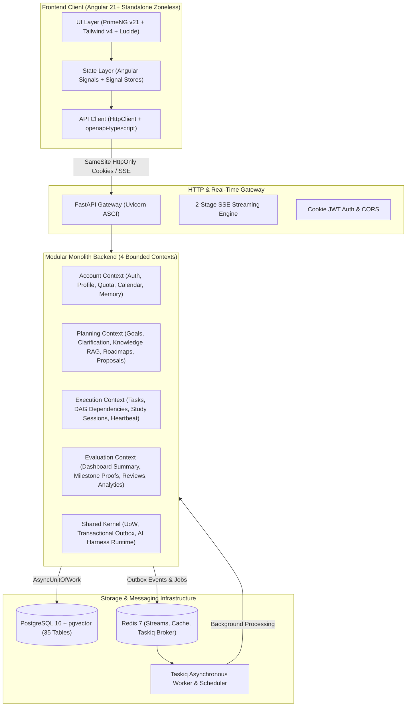
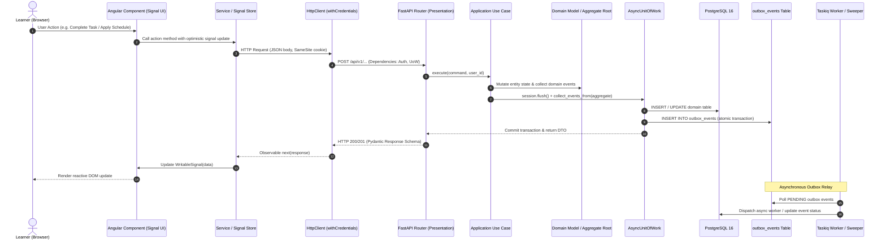

# Fullstack System Inventory & Service Mapping — FocusFlow

> **Audit Target**: FocusFlow Learning Intelligence Harness  
> **Auditor**: Principal Fullstack Engineer & Software Architecture Auditor  
> **Date**: 2026-11-20  
> **Scope**: Entire codebase (`frontend/src/app`, `backend/src/`, `backend/alembic/`, `docs/database/`)  
> **Architecture Model**: Context-First Modular Monolith + Hexagonal Architecture (Backend: Python 3.12, FastAPI, SQLAlchemy 2.0 Async, Taskiq, Redis Streams, PostgreSQL 16 + pgvector; Frontend: Angular 21+ Zoneless, Signals, PrimeNG v21, Tailwind CSS v4, openapi-typescript)

---

## 1. Architectural Overview & Technology Stack



### Technology Matrix

| Layer | Technologies & Libraries | Key Responsibilities |
|---|---|---|
| **Frontend UI** | Angular 21.0 (Zoneless, OnPush, `@if`/`@for`), PrimeNG v21, Tailwind CSS v4, Lucide Icons | Reactive, accessible, responsive learner interface (375px–1024px+). |
| **Frontend State** | Angular Signals (`signal`, `computed`, `effect`), Signal Stores | Granular reactivity, timer synchronization, and optimistic UI updates. |
| **API Integration** | Angular `HttpClient`, `EventSource` (SSE), `openapi-typescript` (`schema.d.ts`) | Strict type-safe client with zero hand-written API interfaces. |
| **Backend Web** | FastAPI 0.115+, Pydantic v2, Uvicorn (ASGI) | REST API endpoints, OpenAPI 3.1 documentation, SSE streaming job tickets. |
| **Modular Core** | Clean Architecture / Hexagonal: 4 Bounded Contexts + Shared Kernel | Strict layer separation: `domain` -> `application` -> `infrastructure` -> `presentation`. |
| **AI Harness** | `LLMProviderPort`, Prompt Registry, Context Builder, 3-Tier Guardrails | Quota lifecycle (`RESERVE -> COMMIT/RELEASE`), SSRF URL fetcher, `<untrusted_knowledge_context>`. |
| **Persistence** | PostgreSQL 16 + `pgvector`, SQLAlchemy 2.0 (asyncpg), Alembic | 35 domain tables (3NF/BCNF), 58 foreign keys, UTC timestamps, JSONB constraints. |
| **Async & Queue** | Taskiq (Async broker) + Redis 7 (Streams, Caching, Broker) | Transactional Outbox relay, scheduled sweepers, background AI generation workflows. |

---

## 2. Route & Feature Classification Inventory *(Updated Post-P2B2B — 2026-11-21)*

Every route has been re-classified based on verified runtime & Playwright E2E evidence (not unit tests alone):

- **PRODUCTION READY**: Full backend + PostgreSQL + E2E verified, zero fake mocks or unverified external blockers.
- **PARTIAL**: Core functionality verified end-to-end, with documented non-blocking UX/scope limitations or external live provider unverified.
- **FEATURE GATED**: Safely gated behind role/availability checks with honest UI notice; backend capability not yet live.
- **NOT IMPLEMENTED**: Orphaned/dead code or unbuilt route.

| Route | Primary Component | Layout Shell | Reconciled Status (Post-P2B2B) | Verification Notes |
|---|---|---|---|---|
| `/`, `/how-it-works`, `/features`, `/faq` | Static Marketing Pages | Public Shell | **PRODUCTION READY** | Static editorial content verified. |
| `/pricing` | `PricingComponent` | Public Shell | **PARTIAL** | Real Checkout modal + HMAC webhook verified with `local_mock`; **live SePay/VietQR gateway `NOT VERIFIED`**, fails closed `503` in prod. |
| `/sign-in`, `/sign-up`, `/forgot-password`, `/verify-otp` | Auth Components | Auth Shell | **PRODUCTION READY** | Pure HttpOnly cookie auth + OTP Mailpit E2E (8/8 passed); `localStorage` JWT eliminated. |
| `/dashboard` | `DashboardComponent` | Main Shell (`authGuard`) | **PRODUCTION READY** | Real PostgreSQL summary, `(roadmapApplied)` auto-sync, Human-in-the-loop Adaptation → DRAFT Review, honest `"Phiên học hoàn tất"` KPI, Navbar Notification Bell. |
| `/roadmaps`, `/roadmaps/new`, `/roadmaps/:id` | `RoadmapsHubComponent`, `RoadmapPageComponent` | Main Shell (`authGuard`) | **PRODUCTION READY** | Shared `RoadmapStore`, fixed Resume/Pause/Archive error handling, Prove Mode UI (`GET .../proofs/latest` + `generate-jobs` + `submit`) E2E verified. |
| `/schedule` | `SchedulePageComponent` | Main Shell (`authGuard`) | **PARTIAL** | Real schedule CRUD + stale-response guard + cross-page invalidation E2E verified; click reschedule works (optional CDK drag-and-drop deferred to P3). |
| `/availability` | `AvailabilityConfigComponent` | Main Shell (`authGuard`) | **PRODUCTION READY** | Mode A/B + hardened Google Calendar OAuth (`BE-SEC-01` HMAC + Redis nonce) verified. |
| `/tasks` | `TasksPageComponent` | Main Shell (`authGuard`) | **PRODUCTION READY** | Shared `RoadmapStore`, synced with Workspace & Schedule, stale-response guard E2E verified. |
| `/workspace` | `WorkspaceComponent` | Main Shell (`authGuard`) | **PRODUCTION READY** | Server-backed `completed_sessions_today` (zero `localStorage`), multi-device consistency E2E verified. |
| `/analytics` | `AnalyticsPageComponent` | Main Shell (`authGuard`) | **PRODUCTION READY** | Live PostgreSQL analytics + weekly reviews verified. |
| `/profile` | `ProfilePageComponent` | Main Shell (`authGuard`) | **PRODUCTION READY** | Real Outbox-aggregated SRL metrics + honest `"Chưa đủ dữ liệu học tập"` cold-start state; zero hardcoded `45`/`1.05x`. |
| `/settings` | `SettingsPageComponent` | Main Shell (`authGuard`) | **PARTIAL** | Real AI quota states (no mock fallback), real CSPRNG/SHA-256 WebCal + RFC 5545 ICS feed, real `GET /api/v1/account/export`; **GDPR Art. 17 automated deletion (`FR-PROFILE-002`) is `FEATURE GATED`**. |
| `/admin` | `AdminDashboardPageComponent` | Main Shell (`authGuard`, `adminGuard`) | **FEATURE GATED** | Protected by `adminGuard` + backend `get_current_admin_user` (`403` for `LEARNER`); honest unavailable status view, zero fake metrics. |
| `LoginPageComponent`, `DashboardPageComponent` | Orphaned Legacy Files | None | **NOT IMPLEMENTED** *(Orphaned — P3 `TASK-36`)* | Unrouted dead code scheduled for P3 removal. |

*(Database Inventory Note: Post-P2B2B migration `0015_add_notifications_table`, PostgreSQL contains **36** application tables — 13 `account` including `notifications`, 10 `planning`, 5 `execution`, 4 `evaluation` including `pause_records`, 4 `shared_kernel` — + `alembic_version`, with 26 `fn_set_updated_at()` triggers.)*

---

### Original Pre-Remediation Inventory Snapshot (Archived for Audit Trail)

FocusFlow frontend contains **128 source files** organized into 11 feature slices and shared modules. Every route has been mapped and categorized below based on actual runtime implementation and backend integration depth.

### Page Completeness Classification

- **Production Ready**: Feature complete, integrated with live backend APIs, validated with end-to-end flows.
- **Partial**: Functional UI with core endpoints connected, but suffers from isolated state, mock fallbacks, or missing edge-case handling.
- **UI-Only / Stub**: Gated or disconnected visual mockup without functional backend services or endpoints.
- **Unintegrated / Orphaned**: Legacy, duplicated, or unused files not bound to active router trees.

| Route | Primary Component | Layout Shell | Key Stores & Services | Domain Entity Owned | Completeness Status |
|---|---|---|---|---|---|
| `/` | `LandingComponent` | Public Shell | `AuthService` | Static Marketing Content | **Production Ready** |
| `/how-it-works` | `HowItWorksComponent` | Public Shell | None | Zimmerman SRL Editorial Guide | **Production Ready** |
| `/features` | `FeaturesComponent` | Public Shell | None | Product Capabilities Matrix | **Production Ready** |
| `/pricing` | `PricingComponent` | Public Shell | `AuthService`, `Router` | Subscription Tiers (Mock checkout) | **Partial** (No checkout UI) |
| `/faq` | `FaqComponent` | Public Shell | None | FAQ Accordion & Answers | **Production Ready** |
| `/sign-in` | `SignInComponent` | Auth Shell | `AuthService` | User Credentials, JWT Session | **Production Ready** |
| `/sign-up` | `SignUpComponent` | Auth Shell | `AuthService` | New User Registration, Argon2id | **Production Ready** |
| `/forgot-password` | `ForgotPasswordComponent` | Auth Shell | `AuthService` | Password Reset Token & Flow | **Production Ready** |
| `/verify-otp` | `OtpValidationComponent` | Auth Shell | `AuthService` | OTP Code Verification (Redis) | **Production Ready** |
| `/dashboard` | `DashboardComponent` | Main Shell (`authGuard`) | `DashboardService`, `AvailabilityService` | `DashboardSummary`, Today Queue | **Partial** (Lacks auto-sync with Roadmap Wizard) |
| `/roadmaps` | `RoadmapsHubComponent` | Main Shell (`authGuard`) | `RoadmapService` | Active/Paused Roadmaps, Milestones | **Production Ready** (Has sync issue on wizard close) |
| `/roadmaps/new` | `RoadmapPageComponent` | Main Shell (`authGuard`) | `RoadmapService`, `AiSseService` | Goal, 5-Step Wizard, Schedule Proposal | **Production Ready** |
| `/roadmaps/:id` | `RoadmapPageComponent` | Main Shell (`authGuard`) | `RoadmapService`, `AiSseService` | Roadmap Detail, Milestones, Schedule Blocks | **Production Ready** |
| `/schedule` | `SchedulePageComponent` | Main Shell (`authGuard`) | `ScheduleService`, `AvailabilityService` | `WeeklyScheduleResponse`, Schedule Blocks | **Production Ready** (Click-only; no CDK drag-drop) |
| `/availability` | `AvailabilityConfigComponent` | Main Shell (`authGuard`) | `AvailabilityService`, `CalendarService` | Mode A/B Availability, Google OAuth | **Production Ready** |
| `/tasks` | `TasksPageComponent` | Main Shell (`authGuard`) | `TaskService` | `TaskResponse`, Backlog, DAG Dependencies | **Production Ready** (Disconnected from Workspace) |
| `/workspace` | `WorkspaceComponent` | Main Shell (`authGuard`) | `WorkspaceSessionService`, `StudioStore` | `StudySessionResponse`, Pomodoro, Notes | **Production Ready** (Pomodoro count in localStorage) |
| `/analytics` | `AnalyticsPageComponent` | Main Shell (`authGuard`) | `AnalyticsService` | Quantitative Analytics, Weekly Reviews | **Production Ready** |
| `/profile` | `ProfilePageComponent` | Main Shell (`authGuard`) | `ProfileService`, `AuthService` | `LearnerProfile`, Memory Items, SRL | **Partial** (SRL Metrics are static hardcoded) |
| `/settings` | `SettingsPageComponent` | Main Shell (`authGuard`) | `SettingsService`, `CalendarService` | Preferences, AI Quota, WebCal, GDPR | **Partial / Stub** (Fake Quota fallback, Fake WebCal, Fake GDPR) |
| `/admin` | `AdminDashboardPageComponent`| Main Shell (`authGuard`) | None (Local memory signals) | AI Telemetry, User Quota Management | **UI-Only / Stub** (100% disconnected from backend) |
| `/features/auth/...` | `LoginPageComponent` | None | None | Orphaned Login Component | **Orphaned / Dead Code** |
| `/features/dashboard/...` | `DashboardPageComponent` | None | None | Orphaned Dashboard View | **Orphaned / Dead Code** |

---

## 3. End-to-End Data Flow Tracing

FocusFlow follows a directional, multi-tiered data flow across its architectural boundaries:



---

## 4. Page–API Matrix (Frontend View)

The following matrix documents every API endpoint consumed by frontend feature slices, the triggering service, request payload, mapped response DTO, and validation against the backend OpenAPI 3.1 specification.

| Frontend Page | Triggering Service Method | HTTP Method | Target Endpoint | Payload / Query Parameters | Response DTO Mapped | OpenAPI Status |
|---|---|---|---|---|---|---|
| **Sign-In** | `AuthService.signIn` | `POST` | `/api/v1/auth/login` | `{ email, password, remember_me }` | `BackendAuthResponse` -> `LoginResponse` | ✅ Synchronized |
| **Sign-Up** | `AuthService.signUp` | `POST` | `/api/v1/auth/register` | `{ full_name, email, password }` | `BackendAuthResponse` -> `RegisterResponse` | ✅ Synchronized |
| **Auth Session** | `AuthService.checkSession` | `GET` | `/api/v1/auth/me` | None (`withCredentials: true`) | `BackendUserPayload` -> `UserProfile` | ✅ Synchronized |
| **Auth Refresh** | `AuthService.refreshToken` | `POST` | `/api/v1/auth/refresh` | `{ refresh_token? }` | `BackendAuthResponse` -> `LoginResponse` | ✅ Synchronized |
| **Auth Logout** | `AuthService.signOut` | `POST` | `/api/v1/auth/logout` | `{}` | `{}` | ✅ Synchronized |
| **Register OTP** | `AuthService.requestRegisterOtp`| `POST` | `/api/v1/auth/register/request-otp` | `{ full_name, email, password }` | `MessageResponse` | ✅ Synchronized |
| **Verify OTP** | `AuthService.verifyRegisterOtp` | `POST` | `/api/v1/auth/register/verify-otp` | `{ email, otp_code }` | `BackendAuthResponse` -> `LoginResponse` | ✅ Synchronized |
| **Dashboard** | `DashboardService.loadSummary` | `GET` | `/api/v1/evaluation/dashboard-summary`| None | `DashboardSummary` | ✅ Synchronized |
| **Roadmaps List** | `RoadmapService.loadRoadmaps` | `GET` | `/api/v1/roadmaps` | None | `RoadmapResponse[]` | ✅ Synchronized |
| **Roadmap Detail** | `RoadmapService.loadRoadmapDetail`| `GET` | `/api/v1/roadmaps/{id}` | Path: `id` | `RoadmapDetailResponse` | ✅ Synchronized |
| **Roadmap Create** | `RoadmapService.createRoadmap` | `POST` | `/api/v1/roadmaps` | `CreateRoadmapRequest` | `RoadmapResponse` | ✅ Synchronized |
| **Clarify Questions**| `RoadmapService.generateQuestions`| `POST` | `/api/v1/roadmaps/goals/{id}/clarify-questions` | Path: `goal_id`, Header: `Idempotency-Key` | `ClarificationQuestionsResponse` | ✅ Synchronized |
| **Clarify Answers**| `RoadmapService.submitAnswers` | `POST` | `/api/v1/roadmaps/goals/{id}/clarify-answers` | `SubmitClarificationAnswersRequest` | `SubmitClarificationAnswersResponse` | ✅ Synchronized |
| **Clarify Skip** | `RoadmapService.skipClarification` | `POST` | `/api/v1/roadmaps/goals/{id}/clarify-skip` | `{ session_id, skipped_question_ids }` | `SubmitClarificationAnswersResponse` | ✅ Synchronized |
| **Milestone Stream**| `RoadmapService.generateMilestones`| `POST` | `/api/v1/roadmaps/{id}/milestones/generate-jobs` | `MilestoneGenerationRequest` | `SseJobTicketResponse` -> SSE | ✅ Synchronized |
| **Milestone Approve**| `RoadmapService.approveMilestones`| `POST` | `/api/v1/roadmaps/{id}/milestones/approve` | `ApproveMilestonesRequest` | `MilestoneListResponse` | ✅ Synchronized |
| **Proposal Stream** | `RoadmapService.generateProposal` | `POST` | `/api/v1/roadmaps/{id}/proposals/generate-jobs` | `{ fit_mode, allow_stalled_commitment }` | `SseJobTicketResponse` -> SSE | ✅ Synchronized |
| **Proposal Apply** | `RoadmapService.applyProposal` | `POST` | `/api/v1/roadmaps/{id}/proposals/{pid}/apply` | `ApplyScheduleProposalRequest` | `ApplyScheduleProposalResponse` | ✅ Synchronized |
| **Manual Plan** | `RoadmapService.saveManualPlan` | `POST` | `/api/v1/roadmaps/{id}/proposals/manual` | `CreateManualRoadmapPlanRequest` | `ScheduleProposalResponse` | ✅ Synchronized |
| **Roadmap Pause** | `RoadmapService.pauseRoadmap` | `POST` | `/api/v1/roadmaps/{id}/pause` | `{}` | `RoadmapResponse` | ✅ Synchronized |
| **Roadmap Resume** | `RoadmapService.resumeRoadmap` | `POST` | `/api/v1/roadmaps/{id}/resume` | `{}` | `RoadmapResponse` | ⚠️ False success on error |
| **Roadmap Archive**| `RoadmapService.archiveRoadmap` | `POST` | `/api/v1/roadmaps/{id}/archive` | `{}` | `RoadmapResponse` | ✅ Synchronized |
| **Schedule Week** | `ScheduleService.loadWeeklySchedule`| `GET` | `/api/v1/tasks/schedule/week` | `?week_start=YYYY-MM-DD` | `WeeklyScheduleResponse` | ✅ Synchronized |
| **Task Reschedule**| `ScheduleService.rescheduleTask` | `POST` | `/api/v1/tasks/{id}/reschedule` | `RescheduleTaskRequest` | `TaskResponse` | ✅ Synchronized |
| **Tasks List** | `TaskService.loadTasks` | `GET` | `/api/v1/tasks` | `?roadmap_id=...&status=...` | `TaskResponse[]` | ✅ Synchronized |
| **Tasks Backlog** | `TaskService.loadBacklogTasks` | `GET` | `/api/v1/tasks/backlog` | `?roadmap_id=...` | `TaskResponse[]` | ✅ Synchronized |
| **Task Create** | `TaskService.createTask` | `POST` | `/api/v1/tasks` | `CreateTaskRequest` | `TaskResponse` | ✅ Synchronized |
| **Task Complete** | `TaskService.completeTask` | `POST` | `/api/v1/tasks/{id}/complete` | `CompleteTaskRequest` | `TaskResponse` | ✅ Synchronized |
| **Task Reopen** | `TaskService.reopenTask` | `POST` | `/api/v1/tasks/{id}/reopen` | `{}` | `TaskResponse` | ✅ Synchronized |
| **Today Focus** | `WorkspaceSessionService.loadTodayFocus`| `GET` | `/api/v1/sessions/today-focus` | None | `TodayFocusResponse` | ✅ Synchronized |
| **Start Session** | `WorkspaceSessionService.beginSession` | `POST` | `/api/v1/sessions/start` | `StartSessionRequest` | `StudySessionResponse` | ✅ Synchronized |
| **Heartbeat** | `WorkspaceSessionService.sendHeartbeat` | `POST` | `/api/v1/sessions/{id}/heartbeat` | `HeartbeatSessionRequest` | `StudySessionResponse` | ✅ Synchronized |
| **Finalize Session**| `WorkspaceSessionService.finalizeSession`| `POST` | `/api/v1/sessions/{id}/finalize` | `FinalizeSessionRequest` | `StudySessionResponse` | ✅ Synchronized |
| **Takeaway Note** | `WorkspaceSessionService.resolveTakeaway` | `POST` | `/api/v1/sessions/{id}/resolve-takeaway` | `ResolveTakeawayRequest` | `StudySessionResponse` | ✅ Synchronized |
| **Sticky Notes** | `WorkspaceStudioStore.loadStickyNotes` | `GET,POST,DELETE`| `/api/v1/sessions/notes`, `/{id}` | Sticky Note payload | `StickyNoteResponse[]` | ✅ Synchronized |
| **Studio Config** | `WorkspaceStudioStore.saveConfig` | `PUT,GET` | `/api/v1/sessions/studio-config` | Studio Config payload | `WorkspaceStudioConfigResponse` | ✅ Synchronized |
| **Availability Me**| `AvailabilityService.fetchAvailability`| `GET,PUT` | `/api/v1/availabilities/me` | `UpdateAvailabilityRequestDTO` | `AvailabilityResponseDTO` | ✅ Synchronized |
| **Google Auth** | `CalendarIntegrationService.authorize`| `POST` | `/api/v1/account/calendar/google/authorize` | `{ sync_type, return_to }` | `InitiateCalendarAuthResponseDTO` | ✅ Synchronized |
| **Google Disconnect**| `CalendarIntegrationService.disconnect`| `POST` | `/api/v1/account/calendar/disconnect` | `{}` | `CalendarConnectionResponseDTO` | ✅ Synchronized |
| **Analytics Summary**| `AnalyticsService.loadSummary` | `GET` | `/api/v1/analytics/summary` | None | `AnalyticsSummaryResponse` | ✅ Synchronized |
| **Analytics Weekly** | `AnalyticsService.loadWeekly` | `GET` | `/api/v1/analytics/weekly` | `?week_start=YYYY-MM-DD` | `AnalyticsWeeklyResponse` | ✅ Synchronized |
| **Weekly Review** | `AnalyticsService.generateReview` | `POST` | `/api/v1/evaluation/weekly-reviews/generate-jobs` | `GenerateWeeklyReviewRequestDTO` | `WeeklyReviewResponseDTO` | ✅ Synchronized |
| **Profile Me** | `ProfileService.loadProfile` | `GET,PATCH` | `/api/v1/account/profile` | `UpdateProfileRequestDTO` | `ProfileResponseDTO` | ✅ Synchronized |
| **Learner Memory** | `ProfileService.loadLearnerMemory` | `GET,PATCH,POST`| `/api/v1/account/learner-memory`, `/{id}`, `/reset`| Memory Item DTO | `LearnerMemoryResponseDTO[]` | ✅ Synchronized |
| **Settings Quota** | `SettingsService.loadQuota` | `GET` | `/api/v1/account/quota` | None | `AIQuotaResponseDTO` | ⚠️ Injects fake mock on error |
| **Change Password**| `SettingsService.changePassword` | `POST` | `/api/v1/account/change-password` | `ChangePasswordRequestDTO` | `{ message: string }` | ✅ Synchronized |
| **WebCal Reset** | `SettingsService.resetWebCalToken`| None | None (Client `Math.random`) | None | Fake URL string | ❌ No backend API call |
| **GDPR Export** | `SettingsPageComponent.exportData`| None | None (Client JSON dump) | None | Incomplete JSON blob | ❌ No backend API call |
| **GDPR Delete** | `SettingsPageComponent.deleteAccount`| None | None (UI toast only) | None | None | ❌ No backend API call |
| **Admin Panel** | `AdminDashboardPageComponent` | None | `/api/v1/admin/*` in constants | None | None | ❌ No backend routes |
| **Prove Mode** | Unimplemented | None | `/api/v1/evaluation/milestones/{id}/proofs/*` | None | None | ❌ Frontend missing UI |
| **Billing Checkout**| Unimplemented | None | `/api/v1/billing/checkout` in constants | None | None | ❌ Frontend missing UI |

---

## 5. API–Service Matrix (Backend View)

The backend provides **89 HTTP endpoints** across 8 FastAPI routers. Below is the full mapping of endpoints to application use cases, domain entities, database tables, and outbox events:

| # | HTTP Method | Route Path | Presentation Router | Application Use Case / Service | Domain Models Touched | Tables Touched | Outbox Events Emitted |
|---|---|---|---|---|---|---|---|
| **System** | | | | | | | |
| 1 | `GET` | `/api/health` | `main.py` | `probe_cobhub_capabilities` | None | None | None |
| **Auth (`/api/v1/auth`)** | | | | | | | |
| 2 | `POST` | `/api/v1/auth/login` | `auth_router.py` | `LoginUseCase` | `User` | `users` | None |
| 3 | `POST` | `/api/v1/auth/google` | `auth_router.py` | `GoogleAuthUseCase` | `User` | `users` | None |
| 4 | `POST` | `/api/v1/auth/register` | `auth_router.py` | `RegisterUseCase` | `User` | `users` | None |
| 5 | `POST` | `/api/v1/auth/register/request-otp` | `auth_router.py` | `RequestRegisterOtpUseCase` | None (Redis) | `users` (lookup) | None (Taskiq email) |
| 6 | `POST` | `/api/v1/auth/register/resend-otp` | `auth_router.py` | `ResendRegisterOtpUseCase` | None (Redis) | None | None (Taskiq email) |
| 7 | `POST` | `/api/v1/auth/register/verify-otp` | `auth_router.py` | `VerifyRegisterOtpUseCase` | `User` | `users` | None |
| 8 | `POST` | `/api/v1/auth/password-reset/request-otp` | `auth_router.py` | `RequestPasswordResetOtpUseCase` | None (Redis) | `users` (lookup) | None (Taskiq email) |
| 9 | `POST` | `/api/v1/auth/password-reset/verify-otp` | `auth_router.py` | `VerifyPasswordResetOtpUseCase` | None (Redis) | None | None |
| 10 | `POST` | `/api/v1/auth/password-reset/confirm` | `auth_router.py` | `ConfirmPasswordResetUseCase` | `User` | `users` | None |
| 11 | `POST` | `/api/v1/auth/refresh` | `auth_router.py` | `RefreshTokenUseCase` | `User` (Redis) | `users` | None |
| 12 | `GET` | `/api/v1/auth/me` | `auth_router.py` | `get_current_user` Dep | `User` | `users` | None |
| 13 | `POST` | `/api/v1/auth/logout` | `auth_router.py` | Inline cookie deletion | None | None | None |
| **Account (`/api/v1/account`)** | | | | | | | |
| 14 | `GET` | `/api/v1/account/status` | `routers.py` | Health Check | None | None | None |
| 15 | `GET` | `/api/v1/account/profile` | `routers.py` | `UpdateProfileUseCase.get_profile` | `LearnerProfile`, `User` | `users`, `learner_profiles` | None |
| 16 | `PATCH` | `/api/v1/account/profile` | `routers.py` | `UpdateProfileUseCase.execute` | `LearnerProfile`, `User` | `users`, `learner_profiles` | None |
| 17 | `GET` | `/api/v1/account/quota` | `routers.py` | `GetQuotaUseCase.execute` | `AIQuota` | `ai_quotas` | None |
| 18 | `POST` | `/api/v1/account/change-password` | `routers.py` | `ChangePasswordUseCase.execute` | `User` | `users` | None |
| 19 | `GET` | `/api/v1/account/learner-memory` | `routers.py` | `ListLearnerMemoryUseCase.execute` | `LearnerMemoryItem` | `learner_memory_items` | None |
| 20 | `PATCH` | `/api/v1/account/learner-memory/{memory_id}`| `routers.py` | `UpdateLearnerMemoryUseCase.execute` | `LearnerMemoryItem` | `learner_memory_items` | None |
| 21 | `POST` | `/api/v1/account/learner-memory/reset` | `routers.py` | `ResetLearnerMemoryUseCase.execute` | `LearnerMemoryItem` | `learner_memory_items` | None |
| **Availabilities (`/api/v1/availabilities`)** | | | | | | | |
| 22 | `GET` | `/api/v1/availabilities/me` | `routers.py` | `GetAvailabilityUseCase.execute` | `AvailabilityProfile` | `availabilities`, `availability_slots` | None |
| 23 | `PUT` | `/api/v1/availabilities/me` | `routers.py` | `UpdateAvailabilityUseCase.execute` | `AvailabilityProfile` | `availabilities`, `availability_slots`, `outbox_events` | `AvailabilityUpdatedEvent` |
| **Calendar (`/api/v1/account/calendar`)** | | | | | | | |
| 24 | `POST` | `/api/v1/account/calendar/google/authorize` | `calendar_router.py` | `InitiateGoogleCalendarAuthUseCase` | None | None | None |
| 25 | `GET` | `/api/v1/account/calendar/google/callback` | `calendar_router.py` | `HandleGoogleCalendarOAuthCallbackUseCase` | `CalendarConnection` | `calendar_connections` | None |
| 26 | `POST` | `/api/v1/account/calendar/google/callback` | `calendar_router.py` | `HandleGoogleCalendarOAuthCallbackUseCase` | `CalendarConnection` | `calendar_connections` | None |
| 27 | `GET` | `/api/v1/account/calendar/status` | `calendar_router.py` | `GetCalendarConnectionStatusUseCase` | `CalendarConnection` | `calendar_connections` | None |
| 28 | `POST` | `/api/v1/account/calendar/disconnect` | `calendar_router.py` | `DisconnectGoogleCalendarUseCase` | `CalendarConnection` | `calendar_connections` | None |
| **Calendar Webhooks** | | | | | | | |
| 29 | `POST` | `/api/v1/calendar/webhooks/google` | `webhook_router.py` | `process_google_calendar_webhook.kiq` | `CalendarConnection` | `calendar_connections` | None |
| **Planning: Knowledge RAG (`/api/v1/planning`)** | | | | | | | |
| 30 | `GET` | `/api/v1/planning/status` | `routers.py` | Health Check | None | None | None |
| 31 | `POST` | `/api/v1/planning/goals/{id}/knowledge-sources/files` | `routers.py` | `CreateKnowledgeSourceUseCase.create_file` | `Goal`, `KnowledgeSource` | `goals`, `knowledge_sources` | None (Taskiq Ingest) |
| 32 | `POST` | `/api/v1/planning/goals/{id}/knowledge-sources/urls` | `routers.py` | `CreateKnowledgeSourceUseCase.create_url` | `Goal`, `KnowledgeSource` | `goals`, `knowledge_sources` | None (Taskiq Ingest) |
| 33 | `GET` | `/api/v1/planning/goals/{id}/knowledge-sources` | `routers.py` | `KnowledgeSourceRepository.list_sources` | `KnowledgeSource` | `knowledge_sources` | None |
| 34 | `GET` | `/api/v1/planning/knowledge-sources/{source_id}` | `routers.py` | `KnowledgeSourceRepository.get_source` | `KnowledgeSource` | `knowledge_sources` | None |
| **Planning: Roadmaps & Proposals (`/api/v1/roadmaps`)** | | | | | | | |
| 35 | `GET` | `/api/v1/roadmaps/jobs/{job_id}/stream` | `routers.py` | `SseJobPort.stream_events` | Redis Job Stream | None | None |
| 36 | `POST` | `/api/v1/roadmaps` | `routers.py` | `CreateGoalAndRoadmapUseCase.execute` | `Goal`, `Roadmap` | `goals`, `roadmaps` | None |
| 37 | `POST` | `/api/v1/roadmaps/goals/{id}/clarify-questions` | `routers.py` | `GenerateClarificationQuestionsUseCase` | `Goal`, `WorkflowRun` | `goals`, `workflow_runs`, `workflow_step_executions` | None |
| 38 | `POST` | `/api/v1/roadmaps/goals/{id}/clarify-answers` | `routers.py` | `SubmitClarificationAnswersUseCase` | `Goal`, `WorkflowRun` | `goals`, `workflow_runs`, `workflow_step_executions` | None |
| 39 | `POST` | `/api/v1/roadmaps/goals/{id}/clarify-skip` | `routers.py` | `SubmitClarificationAnswersUseCase.skip` | `Goal`, `WorkflowRun` | `goals`, `workflow_runs` | None |
| 40 | `GET` | `/api/v1/roadmaps/goals/{id}/clarification-state` | `routers.py` | `GenerateClarificationQuestionsUseCase.get_state` | `Goal` | `goals` | None |
| 41 | `GET` | `/api/v1/roadmaps` | `routers.py` | `ListRoadmapsUseCase.execute` | `Roadmap`, `Goal` | `roadmaps`, `goals` | None |
| 42 | `GET` | `/api/v1/roadmaps/{roadmap_id}` | `routers.py` | `GetRoadmapDetailUseCase.execute` | `Roadmap`, `Milestone`, `OfficialSchedule` | `roadmaps`, `goals`, `milestones`, `official_schedules`, `schedule_proposals`, `tasks` | None |
| 43 | `PATCH` | `/api/v1/roadmaps/{roadmap_id}` | `routers.py` | `UpdateRoadmapUseCase.execute` | `Roadmap` | `roadmaps` | None |
| 44 | `POST` | `/api/v1/roadmaps/{roadmap_id}/archive` | `routers.py` | `ArchiveRoadmapUseCase.execute` | `Roadmap` | `roadmaps` | None |
| 45 | `POST` | `/api/v1/roadmaps/{roadmap_id}/pause` | `routers.py` | `PauseRoadmapUseCase.execute` | `Roadmap`, `OfficialSchedule` | `roadmaps`, `official_schedules`, `schedule_change_logs` | None |
| 46 | `POST` | `/api/v1/roadmaps/{roadmap_id}/resume` | `routers.py` | `ResumeRoadmapUseCase.execute` | `Roadmap`, `ScheduleBlock`, `Task` | `roadmaps`, `official_schedules`, `schedule_blocks`, `tasks`, `schedule_change_logs` | None |
| 47 | `POST` | `/api/v1/roadmaps/{roadmap_id}/reoptimize-schedule` | `routers.py` | `ReoptimizeScheduleProposalUseCase.execute` | `Roadmap`, `Milestone`, `ScheduleProposal` | `roadmaps`, `milestones`, `schedule_proposals` | None |
| 48 | `POST` | `/api/v1/roadmaps/{roadmap_id}/overdue-revise-jobs` | `routers.py` | `InitiateOverdueRecoveryUseCase.execute` | `Roadmap`, `ScheduleProposal` | `roadmaps`, `schedule_proposals` | None (Taskiq Gen) |
| 49 | `POST` | `/api/v1/roadmaps/{roadmap_id}/milestones/generate-jobs` | `routers.py` | `InitiateMilestoneGenUseCase.execute` | `Roadmap`, `AIQuotaReservation` | `roadmaps`, `ai_quota_reservations` | None (Taskiq Gen) |
| 50 | `PUT` | `/api/v1/roadmaps/{roadmap_id}/milestones` | `routers.py` | `UpdateMilestonesUseCase.execute` | `Roadmap`, `Milestone` | `roadmaps`, `milestones` | None |
| 51 | `POST` | `/api/v1/roadmaps/{roadmap_id}/milestones/approve` | `routers.py` | `ApproveMilestonesUseCase.execute` | `Roadmap`, `Milestone` | `roadmaps`, `milestones` | None |
| 52 | `POST` | `/api/v1/roadmaps/{roadmap_id}/proposals/generate-jobs` | `routers.py` | `InitiateProposalGenUseCase.execute` | `Roadmap`, `AIQuotaReservation` | `roadmaps`, `ai_quota_reservations` | None (Taskiq Gen) |
| 53 | `GET` | `/api/v1/roadmaps/{roadmap_id}/proposals/current` | `routers.py` | `GetCurrentProposalUseCase.execute` | `ScheduleProposal` | `schedule_proposals` | None |
| 54 | `PUT` | `/api/v1/roadmaps/{roadmap_id}/proposals/{pid}` | `routers.py` | `UpdateProposalUseCase.execute` | `ScheduleProposal` | `schedule_proposals` | None |
| 55 | `POST` | `/api/v1/roadmaps/{roadmap_id}/proposals/manual` | `routers.py` | `SaveManualPlanUseCase.execute` | `Roadmap`, `Milestone`, `ScheduleProposal` | `roadmaps`, `milestones`, `schedule_proposals` | None |
| 56 | `POST` | `/api/v1/roadmaps/{roadmap_id}/proposals/{pid}/apply` | `routers.py` | `ApplyProposalUseCase.execute` | `Roadmap`, `OfficialSchedule`, `Task` | `roadmaps`, `schedule_proposals`, `official_schedules`, `schedule_blocks`, `tasks`, `task_dependencies`, `outbox_events` | `OfficialScheduleAppliedEvent` |
| **Execution: Tasks (`/api/v1/tasks`)** | | | | | | | |
| 57 | `GET` | `/api/v1/execution/status` | `routers.py` | Health Check | None | None | None |
| 58 | `GET` | `/api/v1/tasks` | `routers.py` | `ListTasksUseCase.execute` | `Task` | `tasks` | None |
| 59 | `POST` | `/api/v1/tasks` | `routers.py` | `CreateManualTaskUseCase.execute` | `Task` | `tasks`, `schedule_blocks` | None |
| 60 | `GET` | `/api/v1/tasks/backlog` | `routers.py` | `GetBacklogTasksUseCase.execute` | `Task` | `tasks` | None |
| 61 | `GET` | `/api/v1/tasks/schedule/week` | `routers.py` | `GetWeeklyScheduleUseCase.execute` | `Task`, `ScheduleBlock` | `tasks`, `schedule_blocks` | None |
| 62 | `PATCH` | `/api/v1/tasks/{task_id}` | `routers.py` | `UpdateTaskUseCase.execute` | `Task` | `tasks` | None |
| 63 | `POST` | `/api/v1/tasks/{task_id}/complete` | `routers.py` | `CompleteTaskUseCase.execute` | `Task`, `StudyNote` | `tasks`, `study_notes`, `schedule_blocks` | None |
| 64 | `POST` | `/api/v1/tasks/{task_id}/reopen` | `routers.py` | `ReopenTaskUseCase.execute` | `Task` | `tasks`, `schedule_blocks` | None |
| 65 | `POST` | `/api/v1/tasks/{task_id}/reschedule` | `routers.py` | `RescheduleTaskUseCase.execute` | `Task` | `tasks`, `schedule_blocks` | None |
| 66 | `DELETE`| `/api/v1/tasks/{task_id}` | `routers.py` | `DeleteTaskUseCase.execute` | `Task` | `tasks`, `schedule_blocks` | None |
| 67 | `POST` | `/api/v1/tasks/{task_id}/dependencies` | `routers.py` | `AddTaskDependencyUseCase.execute` | `TaskDependency` | `task_dependencies` | None |
| 68 | `DELETE`| `/api/v1/tasks/{task_id}/dependencies/{pred_id}` | `routers.py` | `DeleteTaskDependencyUseCase.execute` | `TaskDependency` | `task_dependencies` | None |
| **Execution: Study Sessions (`/api/v1/sessions`)** | | | | | | | |
| 69 | `GET` | `/api/v1/sessions/today-focus` | `routers.py` | `GetTodayFocusUseCase.execute` | `StudySession`, `Task` | `study_sessions`, `session_tasks`, `tasks` | None |
| 70 | `GET` | `/api/v1/sessions/notes` | `routers.py` | `ListStickyNotesUseCase.execute` | `StudyNote` | `study_notes` | None |
| 71 | `POST` | `/api/v1/sessions/notes` | `routers.py` | `CreateStickyNoteUseCase.execute` | `StudyNote` | `study_notes` | None |
| 72 | `PATCH` | `/api/v1/sessions/notes/{note_id}` | `routers.py` | `UpdateStickyNoteUseCase.execute` | `StudyNote` | `study_notes` | None |
| 73 | `DELETE`| `/api/v1/sessions/notes/{note_id}` | `routers.py` | `DeleteStickyNoteUseCase.execute` | `StudyNote` | `study_notes` | None |
| 74 | `GET` | `/api/v1/sessions/studio-config` | `routers.py` | `GetStudioConfigUseCase.execute` | `LearnerProfile` | `learner_profiles` | None |
| 75 | `PUT` | `/api/v1/sessions/studio-config` | `routers.py` | `UpsertStudioConfigUseCase.execute` | `LearnerProfile` | `learner_profiles` | None |
| 76 | `GET` | `/api/v1/sessions/active` | `routers.py` | `GetActiveSessionUseCase.execute` | `StudySession` | `study_sessions`, `session_tasks` | None |
| 77 | `POST` | `/api/v1/sessions/start` | `routers.py` | `StartStudySessionUseCase.execute` | `StudySession`, `SessionTask` | `study_sessions`, `session_tasks`, `tasks` | None |
| 78 | `POST` | `/api/v1/sessions/{id}/heartbeat` | `routers.py` | `HeartbeatStudySessionUseCase.execute` | `StudySession` | `study_sessions` | None |
| 79 | `POST` | `/api/v1/sessions/{id}/finalize` | `routers.py` | `FinalizeStudySessionUseCase.execute` | `StudySession`, `Task`, `StudyNote` | `study_sessions`, `session_tasks`, `tasks`, `study_notes`, `schedule_blocks`, `outbox_events` | `StudySessionCompletedEvent` or `Abandoned` |
| 80 | `POST` | `/api/v1/sessions/{id}/resolve-takeaway` | `routers.py` | `ResolvePendingTakeawayUseCase.execute` | `StudySession`, `StudyNote` | `study_sessions`, `study_notes` | None |
| **Evaluation: Intelligence & Reviews (`/api/v1/evaluation`)** | | | | | | | |
| 81 | `GET` | `/api/v1/evaluation/status` | `routers.py` | Health Check | None | None | None |
| 82 | `GET` | `/api/v1/evaluation/dashboard-summary` | `routers.py` | `GetDashboardSummaryUseCase.execute` | `StudySession`, `Task`, `Roadmap` | `study_sessions`, `tasks`, `roadmaps` | None |
| 83 | `POST` | `/api/v1/evaluation/milestones/{id}/proofs/generate-jobs` | `routers.py` | `GenerateMilestoneProofUseCase.execute` | `MilestoneProof`, `WorkflowRun` | `milestone_proofs`, `workflow_runs`, `workflow_step_executions` | None |
| 84 | `POST` | `/api/v1/evaluation/milestones/{id}/proofs/{pid}/submit` | `routers.py` | `SubmitMilestoneProofUseCase.execute` | `MilestoneProof`, `AIReview`, `LearnerConceptMastery` | `milestone_proofs`, `ai_reviews`, `learner_concept_masteries` | None |
| 85 | `POST` | `/api/v1/evaluation/weekly-reviews/generate-jobs` | `routers.py` | `GenerateWeeklyReviewUseCase.execute` | `AIReview`, `WorkflowRun` | `ai_reviews`, `workflow_runs`, `workflow_step_executions` | None |
| 86 | `GET` | `/api/v1/evaluation/weekly-reviews/latest` | `routers.py` | `GetLatestWeeklyReviewUseCase.execute` | `AIReview` | `ai_reviews` | None |
| **Evaluation: Quantitative Analytics (`/api/v1/analytics`)** | | | | | | | |
| 87 | `GET` | `/api/v1/analytics/summary` | `routers.py` | `GetAnalyticsSummaryUseCase.execute` | `StudySession`, `Task`, `ScheduleBlock` | `study_sessions`, `tasks`, `schedule_blocks` | None |
| 88 | `GET` | `/api/v1/analytics/weekly` | `routers.py` | `GetWeeklyAnalyticsUseCase.execute` | `StudySession`, `Task`, `ScheduleBlock` | `study_sessions`, `tasks`, `schedule_blocks` | None |
| 89 | `GET` | `/redoc` / `/docs` | `main.py` | FastAPI OpenAPI documentation | None | None | None |

---

## 6. Database Entity Inventory (35 Domain Tables)

The PostgreSQL 16 schema enforces 3NF/BCNF data normalization across **35 application tables** (+ `alembic_version`):

```
Account Context (12 tables):
  users, learner_profiles, webcal_tokens, calendar_connections, availabilities,
  availability_slots, ai_quotas, ai_quota_reservations, ai_usage_logs,
  payment_transactions, learner_memory_items, learner_concept_masteries

Planning Context (10 tables):
  goals, roadmaps, milestones, official_schedules, schedule_proposals,
  learning_concepts, concept_prerequisites, knowledge_sources, knowledge_chunks,
  schedule_blocks

Execution Context (5 tables):
  tasks, task_dependencies, study_sessions, session_tasks, study_notes

Evaluation Context (4 tables):
  schedule_change_logs, milestone_proofs, ai_reviews, pause_records

Shared Kernel (4 tables):
  outbox_events, processed_events, workflow_runs, workflow_step_executions
```

This completes the foundational system inventory mapping for the FocusFlow Fullstack Audit.
