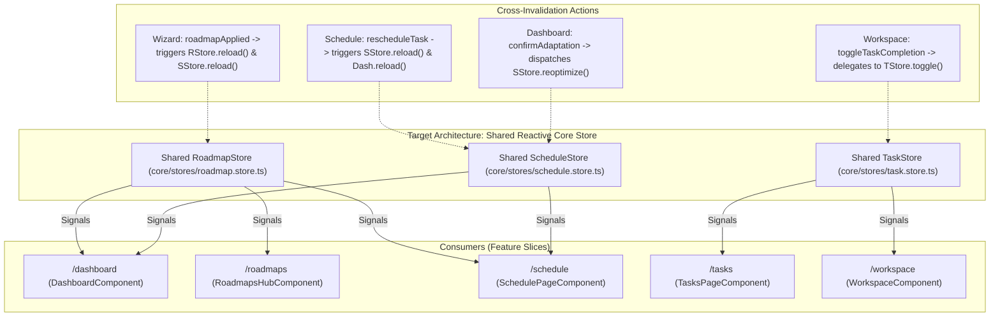

# Cross-Page Data Consistency & State Synchronization Audit — FocusFlow

> **Audit Target**: FocusFlow State Management & Data Consistency  
> **Auditor**: Principal Fullstack Engineer & Software Architecture Auditor  
> **Date**: 2026-11-20  
> **Scope**: Frontend Signal Stores, Services, Cross-Context Entities, Backend Event Streams  
> **Standards**: SRS v1.3 (Zimmerman SRL Feedback Loops), ADR-002, ADR-003, ADR-008

---

## 1. Executive Summary

In a personalized learning intelligence system operating across the 6-step loop (*Understand -> Plan -> Schedule -> Adapt -> Learn -> Improve*), data consistency across views is vital. When a student completes a task in the study studio, shifts a deadline on the schedule, or confirms an AI adaptation proposal, all dependent views (Dashboard, Calendar, Tasks queue, Progress bars) must reflect this state reliably.

This audit evaluated how shared entities flow across the application, identified single sources of truth, evaluated cache invalidation strategies, and uncovered 6 major state desynchronization issues in the frontend client and cross-context event flows.

---

## 2. Shared Entity Matrix

The following matrix documents all entities referenced or mutated across multiple pages, their canonical single source of truth, state ownership, and required synchronization mechanism:

| Entity Name | Pages / Slices Sharing Entity | Single Source of Truth | Current State Ownership | Current Sync Mechanism | Consistency Requirement |
|---|---|---|---|---|---|
| **Roadmap** | `/dashboard`, `/roadmaps`, `/schedule`, `/tasks`, `/analytics` | PostgreSQL `roadmaps` table (Planning Context) | 4 independent signals in `RoadmapService`, `TaskService`, `ScheduleService`, `AnalyticsService` | ❌ None (Independent HTTP fetch per page) | **Eventual / On Navigation** (Needs shared reactive store) |
| **Milestone** | `/roadmaps/:id`, `/roadmaps/new`, `/tasks` | PostgreSQL `milestones` table (Planning Context) | `RoadmapService.currentRoadmap().milestones` | Component input props / route fetch | **Strict** within roadmap session |
| **Task** | `/tasks`, `/schedule`, `/workspace`, `/dashboard` | PostgreSQL `tasks` table (Execution Context) | Isolated in `TaskService`, `ScheduleService.weeklySchedule`, and `WorkspaceSessionService` | ❌ Disconnected private signals | **Immediate Sync** (Completing in Workspace must update Task list & Dashboard) |
| **Schedule Block** | `/schedule`, `/dashboard` (Today queue), `/workspace` | PostgreSQL `schedule_blocks` table (Planning Context) | `ScheduleService.weeklySchedule` vs `DashboardService.summary.scheduleBlocks` | ❌ None (Rescheduling in Schedule leaves Dashboard stale) | **Immediate Sync** |
| **Study Session** | `/workspace`, `/dashboard`, `/analytics` | PostgreSQL `study_sessions` table (Execution Context) | `WorkspaceSessionService` (Active session) | Re-fetched on page entry via `DashboardService` | **Eventual** (Sync on session finalization) |
| **User Profile** | `/profile`, `/settings`, App Header/Navbar | PostgreSQL `users` + `learner_profiles` (Account Context) | `AuthService.currentUser` & `ProfileService.profile` | Partially synced via `AuthService.setUser()` | **Immediate Sync** for name/avatar; **Eventual** for preferences |
| **AI Quota** | `/settings`, `/roadmaps/new` (Wizard check) | PostgreSQL `ai_quotas` table (Account Context) | `SettingsService.quota` (Local signal) | ❌ Injects fake numbers on error | **Immediate Sync** before dispatching AI jobs |
| **Schedule Proposal (DRAFT)** | `/roadmaps/new`, `/roadmaps/:id` (Wizard Host) | PostgreSQL `schedule_proposals` table (Planning Context) | `RoadmapService.currentProposal` | SSE Stream -> Apply -> Transitions to `OfficialSchedule` | **Strict Barrier** (Draft is ephemeral until Applied) |
| **Google Calendar** | `/availability`, `/settings`, External Google Calendar | PostgreSQL `calendar_connections` table (Account Context) | `CalendarIntegrationService.connection` | OAuth callback + Webhook sync | **Eventual / 2-Way Idempotent** |

---

## 3. Detailed Cross-Page Synchronization Findings

### [FE-SYNC-01] Quadruple Redundant Roadmap Signals Without Cross-Service Sync
- **Severity**: **HIGH**
- **Category**: State Desynchronization / Duplicated Source of Truth
- **Affected Pages/Modules**: `/roadmaps`, `/tasks`, `/schedule`, `/analytics`, `/dashboard`
- **File Path + Line Numbers**:
  - [frontend/src/app/features/roadmaps/services/roadmap.service.ts#L975](file:///Users/vuthang/Documents/FocusFlow/frontend/src/app/features/roadmaps/services/roadmap.service.ts#L975) (`roadmaps = signal<RoadmapResponse[]>([])`)
  - [frontend/src/app/features/tasks/services/task.service.ts#L56](file:///Users/vuthang/Documents/FocusFlow/frontend/src/app/features/tasks/services/task.service.ts#L56) (`roadmaps = signal<RoadmapResponse[]>([])`)
  - [frontend/src/app/features/schedule/services/schedule.service.ts#L132](file:///Users/vuthang/Documents/FocusFlow/frontend/src/app/features/schedule/services/schedule.service.ts#L132) (`roadmaps = signal<RoadmapResponse[]>([])`)
  - [frontend/src/app/features/analytics/services/analytics.service.ts#L63](file:///Users/vuthang/Documents/FocusFlow/frontend/src/app/features/analytics/services/analytics.service.ts#L63) (`roadmaps = signal<RoadmapResponse[]>([])`)
- **Expected Behavior**: A single shared state or reactive entity store should maintain the learner's active roadmaps across all feature slices. Mutating roadmap status (pause, resume, archive, rename) in one page should instantly update dropdowns and status badges across all other pages.
- **Actual Behavior**: Four separate services each declare an independent `roadmaps = signal<RoadmapResponse[]>([])` and an identical `loadRoadmaps()` method calling `GET /api/v1/roadmaps`. When a user pauses or resumes a roadmap in `RoadmapsHubComponent`, only `RoadmapService.roadmaps` changes. The roadmaps signals in `TaskService`, `ScheduleService`, and `AnalyticsService` remain unchanged and stale until their respective pages are visited and trigger a manual reload.
- **Root Cause**: Over-isolation of feature slices without a shared entity cache or event broker in `core/`.
- **Impact**: Inconsistent roadmap lists and status indicators when learners navigate between Roadmaps Hub, Schedule quick drawer, and Task filtering views.
- **Recommended Fix**: Consolidate roadmap list management into a single `RoadmapStore` in `core/` or `shared/` that all slices inject, or dispatch a shared invalidation signal.
- **Validation Steps**: Pause a roadmap in Roadmaps Hub; navigate immediately to Schedule and check the Quick Drawer roadmap dropdown; verify status reflects PAUSED.
- **Confidence Level**: 100%

---

### [FE-SYNC-02] Dashboard and RoadmapsHub Ignore Roadmap Wizard Application
- **Severity**: **HIGH**
- **Category**: Broken Event Binding / Missing Reactive Sync
- **Affected Pages/Modules**: `/dashboard`, `/roadmaps`
- **File Path + Line Numbers**:
  - [frontend/src/app/features/dashboard/dashboard.component.html#L66-L73](file:///Users/vuthang/Documents/FocusFlow/frontend/src/app/features/dashboard/dashboard.component.html#L66-L73)
  - [frontend/src/app/features/roadmaps/components/roadmaps-hub/roadmaps-hub.component.html#L284-L290](file:///Users/vuthang/Documents/FocusFlow/frontend/src/app/features/roadmaps/components/roadmaps-hub/roadmaps-hub.component.html#L284-L290)
  - [frontend/src/app/features/roadmaps/components/dialogs/roadmap-wizard-host/roadmap-wizard-host.component.ts#L335-L339](file:///Users/vuthang/Documents/FocusFlow/frontend/src/app/features/roadmaps/components/dialogs/roadmap-wizard-host/roadmap-wizard-host.component.ts#L335-L339)
- **Expected Behavior**: When the user creates and applies an official schedule proposal in `RoadmapWizardHostComponent`, the host page (`DashboardComponent` or `RoadmapsHubComponent`) should receive the `(roadmapApplied)` event, refresh the active roadmaps, and re-fetch dashboard KPIs and upcoming blocks.
- **Actual Behavior**:
  - In `roadmap-wizard-host.component.ts`:
    ```typescript
    this.roadmapService.applyProposal(roadmapId, proposalId, confirmSoftOverflow, () => {
      this.roadmapApplied.emit(roadmapId);
      this.closeWizard.emit();
    });
    ```
  - In `dashboard.component.html`:
    ```html
    <app-roadmap-wizard-host
      [open]="wizardOpen()"
      (closeWizard)="closeCreateWizard()"
    />
    ```
    `DashboardComponent` completely ignores `roadmapApplied`! `closeCreateWizard()` only executes `this.wizardOpen.set(false)`. It does NOT call `dashboardService.loadSummary()`.
  - In `roadmaps-hub.component.html`, the identical omission exists: only `(closeWizard)="closeCreateWizard()"` is bound, with no reload of `roadmapService.loadRoadmaps()`.
- **Root Cause**: The developer implemented `@Output() roadmapApplied` in the wizard host but failed to add the event listener binding in the host templates.
- **Impact**: After creating and applying a roadmap via the 5-step wizard, the modal closes and the user is left looking at the exact same empty dashboard or stale list as before. The learner assumes the generation failed unless they manually refresh the page.
- **Recommended Fix**: Add `(roadmapApplied)="onRoadmapApplied($event)"` to both host component templates and invoke `dashboardService.loadSummary()` and `roadmapService.loadRoadmaps()`.
- **Validation Steps**: Create and apply a new roadmap from the dashboard wizard; verify upon modal close that the dashboard immediately displays the newly created active roadmap and schedule blocks.
- **Confidence Level**: 100%

---

### [FE-SYNC-03] Task Completion State Divergence Between Workspace and Task Queue
- **Severity**: **MEDIUM**
- **Category**: Cross-Feature State Desynchronization
- **Affected Pages/Modules**: `/workspace`, `/tasks`
- **File Path + Line Numbers**:
  - [frontend/src/app/core/services/workspace-session.service.ts#L700-L728](file:///Users/vuthang/Documents/FocusFlow/frontend/src/app/core/services/workspace-session.service.ts#L700-L728)
  - [frontend/src/app/features/tasks/services/task.service.ts#L198-L220](file:///Users/vuthang/Documents/FocusFlow/frontend/src/app/features/tasks/services/task.service.ts#L198-L220)
- **Expected Behavior**: Marking a task as completed or reopening a task in the Workspace study studio should instantly update `TaskService.tasks()` and `TaskService.backlogTasks()`.
- **Actual Behavior**: `WorkspaceSessionService.toggleTaskCompletion` updates only its internal private signals (`_todayQueue`, `_focusTask`, `_preselectedTask`). It does not notify or invalidate `TaskService`. If the user leaves `/workspace` and navigates to `/tasks`, `TaskService.tasks()` retains the old task state unless `refreshAll()` is manually called.
- **Root Cause**: Independent state silos between Execution Studio and Task Backlog slices.
- **Impact**: Outdated task status when switching between tabs during Pomodoro breaks.
- **Recommended Fix**: Have `WorkspaceSessionService` delegate task status mutations to `TaskService`, or inject a shared `TaskStore`.
- **Validation Steps**: Complete a task in the Workspace left panel; switch to `/tasks` and verify the task displays as completed without page reload.
- **Confidence Level**: 95%

---

### [FE-SYNC-04] Rescheduling Tasks Does Not Update Dashboard Upcoming Blocks
- **Severity**: **MEDIUM**
- **Category**: Cross-Feature State Desynchronization
- **Affected Pages/Modules**: `/schedule`, `/dashboard`
- **File Path + Line Numbers**:
  - [frontend/src/app/features/schedule/components/schedule-page.component.ts#L909-L932](file:///Users/vuthang/Documents/FocusFlow/frontend/src/app/features/schedule/components/schedule-page.component.ts#L909-L932)
  - [frontend/src/app/features/dashboard/services/dashboard.service.ts#L305-L325](file:///Users/vuthang/Documents/FocusFlow/frontend/src/app/features/dashboard/services/dashboard.service.ts#L305-L325)
- **Expected Behavior**: Moving today's tasks to backlog or rescheduling task blocks on the Schedule page should update the upcoming schedule blocks and today queue on the Dashboard.
- **Actual Behavior**: `schedule-page.component.ts` calls `this.reloadCurrentWeek()` which only refreshes `ScheduleService.weeklySchedule`. It does not notify `DashboardService`.
- **Root Cause**: Absence of a cross-feature cache invalidation strategy.
- **Impact**: A student reschedules a conflicting task on the Schedule page, then returns to Dashboard to find the old task block still showing in "Hàng đợi hôm nay".
- **Recommended Fix**: Re-fetch dashboard summary on router navigation or emit a shared refresh signal.
- **Confidence Level**: 90%

---

### [FE-SYNC-05] Adaptation Confirmation is a No-Op on Dashboard
- **Severity**: **MEDIUM**
- **Category**: Broken Business Flow / Dead Callback
- **Affected Pages/Modules**: `/dashboard`
- **File Path + Line Numbers**: [frontend/src/app/features/dashboard/dashboard.component.html#L76-L80](file:///Users/vuthang/Documents/FocusFlow/frontend/src/app/features/dashboard/dashboard.component.html#L76-L80)
- **Expected Behavior**: Confirming adaptation (Domino Shift or Compact Rebalance) in `AdaptationModalDialogComponent` from the dashboard alert should invoke the backend re-optimization API (`POST /api/v1/roadmaps/{id}/reoptimize-schedule`) and refresh the dashboard.
- **Actual Behavior**:
  ```html
  <app-adaptation-modal-dialog
    [open]="adaptationModalOpen()"
    (closeModal)="closeAdaptationModal()"
    (confirmAdaptation)="closeAdaptationModal()"
  />
  ```
  `confirmAdaptation` merely executes `closeAdaptationModal()`. Zero business logic is executed.
- **Root Cause**: Placeholder callback wired during UI prototyping.
- **Impact**: Clicking "Xác nhận thích ứng" in the dashboard alert dialog does nothing to resolve the schedule conflict.
- **Recommended Fix**: Wire `(confirmAdaptation)="onConfirmAdaptation($event)"` in `DashboardComponent` to dispatch `scheduleService.reoptimizeRoadmapSchedule()` or trigger Domino shift.
- **Validation Steps**: Click "Xác nhận thích ứng" on dashboard; verify backend request is dispatched.
- **Confidence Level**: 100%

---

### [FE-SYNC-06] LocalStorage Token Check Bypassing Server Auth in Route Guard
- **Severity**: **HIGH**
- **Category**: Security / Session Desynchronization
- **Affected Pages/Modules**: `app.routes.ts`, `auth.guard.ts`
- **File Path + Line Numbers**: [frontend/src/app/guards/auth.guard.ts#L9-L14](file:///Users/vuthang/Documents/FocusFlow/frontend/src/app/guards/auth.guard.ts#L9-L14)
- **Expected Behavior**: Following ADR-008, authentication status must be verified via server session check (`AuthService.checkSession()` calling `GET /api/v1/auth/me` with HttpOnly cookies).
- **Actual Behavior**: `frontend/src/app/guards/auth.guard.ts` permits route navigation simply if a string exists in `localStorage`:
  ```typescript
  const token = localStorage.getItem('access_token') || '';
  if (authService.isAuthenticated() || token.length > 0) {
    return true;
  }
  ```
  Even if the server session has expired, been revoked, or the HttpOnly cookie is gone, any non-empty string in `localStorage` allows entry to protected routes.
- **Root Cause**: Legacy token-based guard was retained while `core/guards/auth.guard.ts` was created but not imported in `app.routes.ts`.
- **Impact**: Route guard allows unauthorized access to views until subsequent API calls fail with 401.
- **Recommended Fix**: Update `app.routes.ts` to import `core/guards/auth.guard.ts` which uses `authService.isAuthenticated()` and server session checks without touching `localStorage`.
- **Validation Steps**: Clear browser cookies but keep `access_token` in `localStorage`; attempt to navigate to `/dashboard`; verify redirect to `/sign-in`.
- **Confidence Level**: 100%

---

## 4. Google Calendar Two-Way Synchronization Analysis

FocusFlow supports external calendar integration via Google Calendar OAuth2 (UC-13):

1. **State Ownership**: `calendar_connections` in Account context tracks OAuth refresh tokens (encrypted with Fernet) and webhook channel IDs.
2. **One-Way Push (FocusFlow -> Google Calendar)**:
   - When an `OfficialSchedule` is applied or updated, `sync_schedule_blocks_to_google` background task pushes schedule blocks as Google Calendar events.
   - Identified Issue (`BE-DUP-01`): `sync_schedule_blocks_to_google` is registered on the Taskiq broker twice (in both `account/presentation/tasks.py` and `execution/presentation/tasks.py`), causing non-deterministic task execution.
3. **Inbound Webhook (Google Calendar -> FocusFlow)**:
   - Handled via `POST /api/v1/calendar/webhooks/google` with HMAC-SHA256 signature verification.
   - Converts external busy blocks into Mode B blackout intervals to prevent schedule block collisions.
4. **OAuth Security Invariant Breach (`BE-SEC-01` — CRITICAL)**:
   - In `backend/src/account/presentation/calendar_router.py:53-95`, `GET /api/v1/account/calendar/google/callback` does not authenticate the user or verify an HMAC signature on the `state` query parameter. An attacker can hijack calendar connections by forging the base64 `user_id` payload.

---

## 5. Master Remediation Strategy for State Consistency


