# Master Remediation Plan (Reconciled) — FocusFlow

> **Plan Target**: Complete, Source-Verified Remediation Roadmap Across Frontend, Backend & Database  
> **Role**: Principal Software Architect & Lead Remediation Engineer  
> **Last Reconciled**: 2026-11-21 (see [09-audit-reconciliation.md](file:///Users/vuthang/Documents/FocusFlow/docs/audits/fullstack-integration/09-audit-reconciliation.md))  
> **Prioritization Order**: Security → Data Corruption → Business Correctness → Functional Completeness → Consistency → Performance → Cleanup

---

## 1. Master Dependency Roadmap

```mermaid
flowchart TD
    subgraph P0["P0: Security & Critical Business Correctness (Current Batch)"]
        direction TB
        T01["TASK-01: Cookie-Only Auth, Guard & 401 Queue Fix (FE-API-04, FE-SYNC-06, FE-DUP-01/02)"]
        T02["TASK-02: Google Calendar OAuth State HMAC+Nonce & Open-Redirect Fix (BE-SEC-01)"]
        T03["TASK-03: RoadmapsHub Error Handling — Resume/Pause/Archive (FE-API-03)"]
        T04["TASK-04: Remove Settings AI Quota Mock Fallback & Add States (FE-MOCK-01)"]
    end

    subgraph P1["P1: Reliability, Architecture Boundaries & Contracts"]
        direction TB
        T11["TASK-11: Transactional Outbox Relay Dispatch (BE-INT-02)"]
        T12["TASK-12: Wire AI Quota Expiration Sweeper (BE-MOCK-01)"]
        T13["TASK-13: Replace Raw SQL in Execution Sweeper with Ports (BE-ARCH-01)"]
        T14["TASK-14: Map ValueError/UnsafeUrlError to 400 in Knowledge Routes (BE-API-03)"]
        T15["TASK-15: Bind roadmapApplied in Dashboard & RoadmapsHub (FE-SYNC-02)"]
        T16["TASK-16: GDPR Account Deletion Endpoint or Honest Gate (FE-MOCK-04)"]
        T17["TASK-17: Reconcile api-endpoints.ts with OpenAPI 3.1 (FE-API-01/02, BE-API-01)"]
        T18["TASK-18: Host Dev Redis Config Portability (QA-GATE-01)"]
        T19["TASK-19: Remove Plaintext OTP Print on SMTP Fallback (BE-SEC-02)"]
    end

    subgraph P2["P2: Functional Completeness, Data Integrity & Consistency"]
        direction TB
        T21["TASK-21: Implement Prove Mode UI for UC-12 (FE-FUNC-01)"]
        T22["TASK-22: Shared RoadmapStore Across 4 Slices (FE-SYNC-01, FE-DUP-07)"]
        T23["TASK-23: Backend WebCal Token Endpoints & FE Integration (FE-MOCK-02, BE-API-02)"]
        T24["TASK-24: Gate or Implement Admin Portal (FE-MOCK-06)"]
        T25["TASK-25: PauseRecordORM & Pause/Resume Persistence (BE-INT-01, DB-CONSIST-01, DB-SCHEMA-01)"]
        T26["TASK-26: Migration 0014 for 5 Missing updated_at Triggers (DB-CONSIST-02)"]
        T27["TASK-27: Workspace-Tasks & Schedule-Dashboard Sync (FE-SYNC-03, FE-SYNC-04)"]
        T28["TASK-28: Billing Checkout & Payment Webhook Integration (FE-API-05, BE-API-02)"]
        T29["TASK-29: Wire Dashboard Adaptation Modal & Bindings (FE-SYNC-05, FE-MOCK-07)"]
        T30["TASK-30: Real GDPR Data Export or Accurate Label (FE-MOCK-03)"]
        T31["TASK-31: Backend SRL Aggregator & Profile SRL Binding (BE-MOCK-02, FE-MOCK-05)"]
        T32["TASK-32: Navbar Notification Bell Popover / Gate (FE-MOCK-08)"]
        T33["TASK-33: Server-Backed Workspace Daily Pomodoro Count (FE-MOCK-09)"]
    end

    subgraph P3["P3: Performance, Deduplication & Cleanup"]
        direction TB
        T34["TASK-34: Backward-Compatible Pagination on List Endpoints (BE-API-04)"]
        T35["TASK-35: Consolidate Duplicate Taskiq Tasks & Dead Stub (BE-DUP-01, BE-MOCK-03)"]
        T36["TASK-36: Remove Orphaned FE Components & Re-Export Facades (FE-DUP-03..06)"]
        T37["TASK-37: Deduplicate Reschedule & Monday Date Utilities (FE-DUP-08, FE-DUP-09)"]
        T38["TASK-38: Optional Shared Interval Overlap Helper (BE-DUP-02)"]
        T39["TASK-39: Optional GET /api/v1/tasks/{task_id} on Demand (BE-API-05)"]
        T40["TASK-40: Optional Schedule CDK Drag-and-Drop (FE-FUNC-03)"]
        T41["TASK-41: Sync database-schema-design.md with DDL (DB-SCHEMA-02)"]
        T42["TASK-42: Merge styles.scss into styles.css Safely (QA-VERIF-01)"]
    end

    P0 --> P1 --> P2 --> P3
    T11 --> T31
    T15 --> T22
    T22 --> T27
```

---

## 2. P0 — Security & Critical Business Correctness ✅ COMPLETED (2026-11-21)

> **Status**: All 4 P0 tasks (`TASK-01`..`TASK-04`) **RESOLVED & CLOSED** — see [10-p0-implementation-report.md](file:///Users/vuthang/Documents/FocusFlow/docs/audits/fullstack-integration/10-p0-implementation-report.md) and [11-p0-closure-and-p1a-report.md](file:///Users/vuthang/Documents/FocusFlow/docs/audits/fullstack-integration/11-p0-closure-and-p1a-report.md).

### TASK-01: Enforce Cookie-Only Authentication, Fix Route Guard & 401 Refresh Queue
- **Findings Resolved**: `FE-API-04`, `FE-SYNC-06`, `FE-DUP-01`, `FE-DUP-02` (+ backend cookie `secure` flag, logout Redis revocation, `evaluation/deps.py` token type check)
- **Dependencies**: None
- **Impacted Files**:
  - Backend: `backend/src/account/presentation/auth_router.py`, `backend/src/evaluation/presentation/deps.py`
  - Frontend: `frontend/src/app/core/services/auth.service.ts`, `frontend/src/app/core/interceptors/auth.interceptor.ts`, `frontend/src/app/core/guards/auth.guard.ts`, `frontend/src/app/app.routes.ts`, delete `frontend/src/app/guards/auth.guard.ts` (+ spec) & `frontend/src/app/interceptors/auth.interceptor.ts` (+ spec), update `auth.service.spec.ts` & `frontend/e2e/availability.spec.ts`
- **Implementation Plan**:
  1. **Backend**: Extract cookie helper setting `secure=settings.environment not in ("development", "test")` on `access_token`/`refresh_token`; revoke `refresh_token` in Redis on `POST /api/v1/auth/logout` when cookie is present; verify `payload.get("type") == "access"` in `evaluation/presentation/deps.py`. Keep JSON `access_token` field for backward compatibility with API tests.
  2. **Frontend AuthService**: Remove `localStorage.setItem/removeItem('access_token')`; add `shareReplay(1)` + `finalize` to `checkSession()` to deduplicate cold-reload `/api/v1/auth/me` calls.
  3. **Frontend Interceptor**: Remove `localStorage` reads and `Authorization: Bearer` header injection; keep `withCredentials: true`; fix `refreshTokenSubject` (`Subject<boolean>`) so queued requests error cleanly instead of hanging if refresh fails.
  4. **Frontend Guard**: Rewrite `core/guards/auth.guard.ts` to allow immediately if `authService.isAuthenticated()`, otherwise await `authService.checkSession()` and redirect to `/sign-in` on failure. Point `app.routes.ts` to `core/guards/auth.guard.ts`, delete legacy guard & interceptor.
- **Acceptance Criteria**:
  - Zero `localStorage` reads/writes for `access_token` in production frontend code.
  - Cold reload on `/dashboard` with valid HttpOnly cookie succeeds; with missing/expired cookie redirects to `/sign-in` even if `localStorage` contains a fake `access_token`.
  - Concurrent 401 responses trigger a single refresh and either retry cleanly or fail cleanly without hanging.
  - SSE `EventSource` continues authenticating via `withCredentials: true`.
- **Validation**: `pytest` auth tests, `ng lint`, `ng test`, `ng build --configuration production`, Playwright `e2e/auth.spec.ts`.
- **Rollback**: Revert commits on `fix/p0-audit-remediation`; backend remains backward-compatible with Bearer headers throughout.

### TASK-02: Harden Google Calendar OAuth State (HMAC + Redis Nonce + TTL + User Binding + Open-Redirect Fix)
- **Findings Resolved**: `BE-SEC-01`
- **Dependencies**: None (uses existing `settings.secret_key` and `account/infrastructure/caching/redis_client.py`)
- **Impacted Files**:
  - `backend/src/account/application/ports/oauth_state_store_port.py` (new port)
  - `backend/src/account/infrastructure/caching/oauth_state_store.py` (new Redis adapter)
  - `backend/src/account/application/use_cases/calendar/initiate_google_calendar_auth_use_case.py`
  - `backend/src/account/application/use_cases/calendar/handle_google_calendar_oauth_callback_use_case.py`
  - `backend/src/account/presentation/calendar_router.py`
  - `backend/src/account/presentation/deps.py`
  - `backend/tests/unit/account/test_calendar_sync.py`
- **Implementation Plan**:
  1. Create `OAuthStateStorePort` (`store_nonce(nonce, user_id, ttl_seconds=300)`, `consume_nonce(nonce) -> UUID | None` atomic `GETDEL`) and `RedisOAuthStateStore`.
  2. Sign `state` payload (`user_id`, `sync_type`, `redirect_uri`, `return_to`, `nonce`, `exp`) with HMAC-SHA256 using `settings.secret_key` (constant-time `hmac.compare_digest`).
  3. Require `GET /api/v1/account/calendar/google/callback` to authenticate current user via `CurrentLearnerIdDep` (cookie sent on top-level `SameSite=Lax` redirect); verify `session_user_id == verified_state.user_id` AND `consume_nonce(nonce) == session_user_id`.
  4. Remove silent `except (...): pass` in `HandleGoogleCalendarOAuthCallbackUseCase` — fail closed on malformed, unsigned, tampered, expired, or replayed `state`.
  5. Harden `return_to` validation: must start with `/` and NOT start with `//` and contain no `\`.
- **Acceptance Criteria**:
  - Tampered, unsigned, expired, replayed, or cross-user `state` is rejected (403/400 or error redirect, never binds calendar).
  - Unauthenticated `GET /google/callback` is rejected (401).
  - `return_to="//evil.com"` falls back safely to `/settings`.
  - Valid OAuth flow completes cleanly and redirects to `{frontend_url}{return_to}?calendar_connected=success`.
- **Validation**: `ruff`, `mypy --strict src`, `lint-imports`, `pytest tests/unit/account/test_calendar_sync.py` (with negative security tests).
- **Rollback**: Revert commit; no DB schema changes required.

### TASK-03: Fix RoadmapsHub Inverted Error Handling (Resume, Pause, Archive)
- **Findings Resolved**: `FE-API-03`
- **Dependencies**: None
- **Impacted Files**:
  - `frontend/src/app/features/roadmaps/components/roadmaps-hub/roadmaps-hub.component.ts`
  - `frontend/src/app/features/roadmaps/components/roadmaps-hub/roadmaps-hub.component.spec.ts`
  - `frontend/src/app/features/roadmaps/services/roadmap.service.ts` (for `archiveRoadmap` callback/Observable)
- **Implementation Plan**:
  1. In `executeResume(id)` and `executePause(id)`: remove status mutation and success/warn toast from the `error` callback; show `severity: 'error'` toast with parsed HTTP error message and keep existing server state untouched (or refetch).
  2. In `onArchiveRoadmap(id)`: wait for HTTP completion (via `archiveRoadmap` callbacks or Observable) before showing `'Đã lưu trữ'` toast; show `severity: 'error'` toast on HTTP failure.
- **Acceptance Criteria**:
  - HTTP 500/409/0 on resume, pause, or archive never mutates roadmap status and always displays an error toast.
  - HTTP 200 updates status and displays success toast.
- **Validation**: Regression unit tests in `roadmaps-hub.component.spec.ts`, `ng lint`, `ng test`, `ng build`.
- **Rollback**: Single-file revert.

### TASK-04: Remove Settings AI Quota Mock Fallback & Add Explicit UI States
- **Findings Resolved**: `FE-MOCK-01`
- **Dependencies**: None
- **Impacted Files**:
  - `frontend/src/app/features/settings/services/settings.service.ts`
  - `frontend/src/app/features/settings/services/settings.service.spec.ts`
  - `frontend/src/app/features/settings/components/settings-page.component.ts`
  - `frontend/src/app/features/settings/components/settings-page.component.spec.ts`
- **Implementation Plan**:
  1. In `SettingsService`: add `readonly quotaError = signal<string | null>(null)`. In `loadQuota()`, clear `quotaError` before request; on catch set `quota.set(null)` and `quotaError.set('Không thể tải thông tin hạn ngạch AI. Vui lòng thử lại.')`.
  2. In `SettingsPageComponent`: remove hardcoded fallbacks (`2`, `10`, `3450`, `defaultCycleEnd`) from quota display; render distinct `@if (quotaLoading())` loading state, `@else if (quotaError())` error banner with retry button calling `loadQuota()`, `@else if (quota(); as q)` real data state, `@else` empty state.
- **Acceptance Criteria**:
  - When `/api/v1/account/quota` fails, `quota()` is `null`, `quotaError()` is non-null, UI shows error + Retry button, and zero fake numbers (`3450`, `10`, `2`) appear.
  - Clicking Retry re-invokes `GET /api/v1/account/quota`.
- **Validation**: Updated `settings.service.spec.ts` & new `settings-page.component.spec.ts` tests, `ng lint`, `ng test`, `ng build`.
- **Rollback**: Revert 2 frontend files.

---

## 3. P1 — Reliability, Architecture Boundaries & Contracts ✅ COMPLETED (2026-11-21)

> **Status**: All 9 P1 tasks (`TASK-11`..`TASK-19`: P1A Reliability + P1B Architecture/Contracts/Sync) **RESOLVED** — see [11-p0-closure-and-p1a-report.md](file:///Users/vuthang/Documents/FocusFlow/docs/audits/fullstack-integration/11-p0-closure-and-p1a-report.md) and [12-p1b-implementation-report.md](file:///Users/vuthang/Documents/FocusFlow/docs/audits/fullstack-integration/12-p1b-implementation-report.md). Next batch: **P2 (`TASK-21`..`TASK-33`)**.

| Task | Findings | Scope & Acceptance Criteria | Validation & Rollback |
|---|---|---|---|
| **TASK-11** | `BE-INT-02` | Wire `relay_pending_outbox_events` (`shared_kernel/infrastructure/outbox/relay.py`) to dispatch registered Taskiq handlers before marking `PUBLISHED`; keep failed dispatches retryable with max-attempt guard. | Integration test for `OverdueTaskAlertEvent`; rollback via feature flag or revert. |
| **TASK-12** | `BE-MOCK-01` | Wire `sweep_expired_ai_quota_reservations` (`account/presentation/tasks.py`) to `QuotaFacadeAdapter.expire_stale_reservations(now)` within DB session + commit. | Unit test verifying expired `RESERVED` → `EXPIRED` & credit refund; 1-file revert. |
| **TASK-13** | `BE-ARCH-01` | Replace all 5 raw SQL blocks (`execution/presentation/tasks.py:204-427`) touching `roadmaps`/`users`/`outbox_events` with `PlanningExecutionBridgePort` & `UserQueryPort`. | `lint-imports` + sweeper integration tests; revert single PR. |
| **TASK-14** | `BE-API-03` | Catch `(ValueError, UnsafeUrlError)` in `planning/presentation/routers.py:464-516` and return HTTP 400/422 instead of 500. | API negative tests for `.exe` upload & private IP URL; 1-file revert. |
| **TASK-15** | `FE-SYNC-02` | Bind `(roadmapApplied)` in `dashboard.component.html:66-73` and `roadmaps-hub.component.html:284-291` to reload summary and roadmaps. | Component unit tests verifying reload on emit; 2-file revert. |
| **TASK-16** | `FE-MOCK-04` | Either implement `DELETE /api/v1/account` + wire `SettingsService.deleteAccount()` + signOut, or disable the misleading toast button until backend endpoint is approved (requires product confirmation per `AGENTS.md` §3.4). | Backend + FE integration test; revertable. |
| **TASK-17** | `FE-API-01`, `FE-API-02`, `BE-API-01` | Fix `SETTINGS.PROFILE`/`QUOTA` to `/api/v1/account/*` in `api-endpoints.ts`; remove/mark ghost `ADMIN`/`BILLING`/`ROADMAPS.ACTIVE` constants; update `ProfileService`/`SettingsService` to use constants. | `ng test` + `ng build`; 3-file revert. |
| **TASK-18** | `QA-GATE-01` | Set `REDIS_HOST=localhost` in `backend/.env` and ensure `docker-compose.yml` explicitly overrides `REDIS_HOST=redis` in container env. | Host `pytest tests/test_auth.py tests/test_otp_auth.py` passes without env vars. |
| **TASK-19** | `BE-SEC-02` | Remove `print(... otp_code ...)` at `email_service.py:122`; log redacted error via structured logger. | Unit test capturing stdout/logs on SMTP error. |

---

## 4. P2 — Functional Completeness, Data Integrity & Consistency ✅ ALL COMPLETED (2026-11-21)

> **P2A Completed (2026-11-21)**: `TASK-22` (`FE-SYNC-01`, `FE-DUP-07`), `TASK-27` (`FE-SYNC-03`, `FE-SYNC-04`), and `TASK-29` (`FE-SYNC-05`, `FE-MOCK-07`) — see [13-p2a-data-consistency-report.md](file:///Users/vuthang/Documents/FocusFlow/docs/audits/fullstack-integration/13-p2a-data-consistency-report.md).  
> **P2B1 Completed (2026-11-21)**: `TASK-25` (`BE-INT-01`, `DB-CONSIST-01`, `DB-SCHEMA-01`), `TASK-26` (`DB-CONSIST-02`), `TASK-31` (`BE-MOCK-02`, `FE-MOCK-05`), and `TASK-33` (`FE-MOCK-09`) — see [14-p2b1-data-integrity-report.md](file:///Users/vuthang/Documents/FocusFlow/docs/audits/fullstack-integration/14-p2b1-data-integrity-report.md).  
> **P2B2A Completed (2026-11-21)**: `TASK-21` (`FE-FUNC-01`), `TASK-23` (`FE-MOCK-02`, `BE-API-02` WebCal), and `TASK-24` (`FE-MOCK-06`) — see [15-p2b2a-functional-completeness-report.md](file:///Users/vuthang/Documents/FocusFlow/docs/audits/fullstack-integration/15-p2b2a-functional-completeness-report.md).  
> **P2B2B Completed (2026-11-21)**: `TASK-28` (`FE-API-05`, `BE-API-02` Billing — live provider `NOT VERIFIED`), `TASK-30` (`FE-MOCK-03`), and `TASK-32` (`FE-MOCK-08` — Table #36 `notifications`) — see [16-p2b2b-functional-integration-report.md](file:///Users/vuthang/Documents/FocusFlow/docs/audits/fullstack-integration/16-p2b2b-functional-integration-report.md).  
> **Next Batch**: **P3 (`TASK-34`..`TASK-42`)**.

| Task | Findings | Scope & Acceptance Criteria | Validation & Rollback |
|---|---|---|---|
| **TASK-21** | `FE-FUNC-01` | Build `ProveModeDialogComponent` & service calling `/api/v1/evaluation/milestones/{id}/proofs/generate-jobs` & `.../submit` (UC-12). | Vitest + Playwright E2E; additive feature, safe revert. |
| **TASK-22** | `FE-SYNC-01`, `FE-DUP-07` | Centralize `roadmaps` signal in `RoadmapService` (or shared `core/stores/roadmap.store.ts`) and inject into `TaskService`, `ScheduleService`, `AnalyticsService`. | Unit tests verifying cross-slice update on pause/create; revertable. |
| **TASK-23** | `FE-MOCK-02`, `BE-API-02` | Implement Account WebCal token endpoints (SHA-256 hashed per ADR-008) backed by `webcal_tokens` and bind `SettingsPageComponent` calendar tab. | Backend integration + FE tests; OpenAPI `check-api-contract.sh`. |
| **TASK-24** | `FE-MOCK-06` | Gate `/admin` route behind admin role guard + feature flag until backend admin telemetry APIs exist (avoid fake 0s & in-memory `+5` mutation). | Route guard test; 2-file revert. |
| **TASK-25** | `BE-INT-01`, `DB-CONSIST-01`, `DB-SCHEMA-01` | Add `PauseRecordORM` (bringing `Base.metadata` to 35/35 tables) and record pause/resume rows alongside `schedule_change_logs` (with fallback for already-paused rows). | ORM metadata test + pause/resume integration test; no destructive migration. |
| **TASK-26** | `DB-CONSIST-02` | Add Alembic migration `0014_add_missing_updated_at_triggers.py` (with `downgrade()`) attaching `fn_set_updated_at()` to `knowledge_sources`, `learning_concepts`, `workflow_runs`, `learner_memory_items`, `learner_concept_masteries`. | Verify 25 triggers in PostgreSQL + `alembic downgrade -1` & `upgrade head`. |
| **TASK-27** | `FE-SYNC-03`, `FE-SYNC-04` | Delegate `WorkspaceSessionService.toggleTaskCompletion` through `TaskService` and invalidate `DashboardService` summary on schedule mutations. | Cross-service unit tests. |
| **TASK-28** | `FE-API-05`, `BE-API-02` | Implement Billing Checkout & HMAC webhook endpoints (`payment_transactions`, `PAYMENT_PROVIDER=local_mock`) + Pricing checkout modal. | Backend webhook idempotency test + FE checkout test. |
| **TASK-29** | `FE-SYNC-05`, `FE-MOCK-07` | Bind real active roadmap metrics to `<app-adaptation-modal-dialog>` on Dashboard, remove hardcoded course defaults, wire `(confirmAdaptation)` to `reoptimize-schedule`. | Dashboard unit test. |
| **TASK-30** | `FE-MOCK-03` | Implement backend GDPR data export endpoint or relabel button accurately to "Xuất cấu hình giao diện" until full export API is built. | Settings component test. |
| **TASK-31** | `BE-MOCK-02`, `FE-MOCK-05` | Implement `aggregate_learner_srl_profile` (depends on `TASK-11`) and bind `ProfileService.srlMetrics` to backend learner profile / analytics data. | Backend + FE unit tests. |
| **TASK-32** | `FE-MOCK-08` | Wire navbar notification bell to alerts popover or hide inert icon until notification feed exists. | Navbar component test. |
| **TASK-33** | `FE-MOCK-09` | Source daily Pomodoro count from `today_focus.pomodoros_completed_today` and refresh on session finalize; remove `focusflow_pomodoros_today_v1` localStorage dependency. | `workspace-session.service.spec.ts` updated. |

---

## 5. P3 — Performance, Deduplication & Cleanup

| Task | Findings | Scope & Acceptance Criteria | Validation & Rollback |
|---|---|---|---|
| **TASK-34** | `BE-API-04` | Add optional `limit: int = Query(50, ge=1, le=200)` & `offset: int = Query(0, ge=0)` to list endpoints while preserving array response format (backward-compatible). | Integration test + `check-api-contract.sh`. |
| **TASK-35** | `BE-DUP-01`, `BE-MOCK-03` | Remove duplicate `@broker.task` wrappers in `execution` (`sync_schedule_blocks_to_google`, `sync_external_google_calendar`) and `evaluation` (`sweep_overdue_tasks_and_anti_loop`). | Verify `broker.get_all_tasks()` + `pytest`. |
| **TASK-36** | `FE-DUP-03..06` | Confirm 0 consumers via grep, then delete orphaned `shared/components/footer`, `header`, `LoginPageComponent`, `auth.routes.ts`, `DashboardPageComponent`, and 3 re-export facades. | `ng lint`, `ng test`, `ng build`. |
| **TASK-37** | `FE-DUP-08`, `FE-DUP-09` | Delegate `ScheduleService.rescheduleTask` to `TaskService`; extract Monday date helper into `core/utils/date.util.ts`. | `ng test`. |
| **TASK-38** | `BE-DUP-02` | Extract pure interval-overlap helper into `shared_kernel/domain/` only if it reduces duplication without violating Bounded Context rules. | `lint-imports` + unit tests. |
| **TASK-39** | `BE-API-05` | Add `GET /api/v1/tasks/{task_id}` only when an actual frontend/API consumer requires single-task fetch. | Integration test + OpenAPI sync. |
| **TASK-40** | `FE-FUNC-03` | Optional UX enhancement: add `@angular/cdk/drag-drop` to `SchedulePageComponent`. | Component + E2E test. |
| **TASK-41** | `DB-SCHEMA-02` | Update `docs/database/database-schema-design.md` to match physical DDL (`concept_key VARCHAR(160)`, `mastery_score NUMERIC(5,4)`, `milestone_proofs`). | Diff against `docs/database/schema.sql`. |
| **TASK-42** | `QA-VERIF-01` | Merge `frontend/src/styles.scss` and existing `frontend/src/styles.css` safely (do NOT overwrite `styles.css`), move all `@import` rules above `@theme`, update `angular.json`. | `ng build --configuration production` completes with 0 Sass deprecation warnings. |
