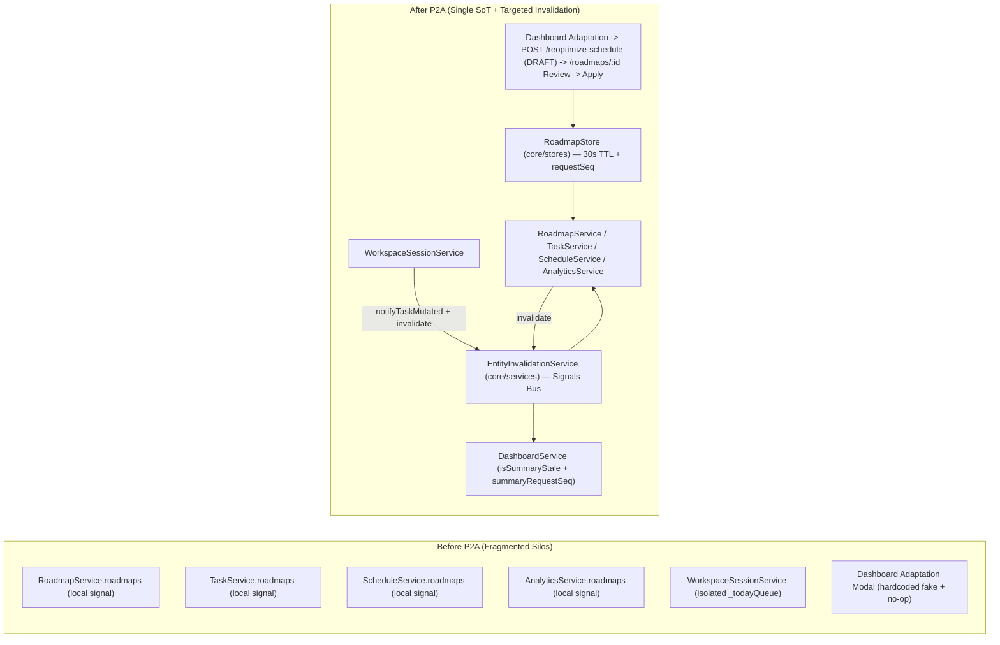

# P2A Cross-Page Data Consistency & Shared State Implementation Report — FocusFlow

> **Role**: Principal Frontend Architect & Fullstack Integration Engineer  
> **Branch**: `fix/p0-audit-remediation`  
> **Date**: 2026-11-21  
> **Scope**: P2A — Cross-Page Data Consistency, Shared State & API Reusability (`FE-SYNC-01`, `FE-DUP-07`, `FE-SYNC-03`, `FE-SYNC-04`, `FE-SYNC-05`, `FE-MOCK-07`)

---

## 1. Updated Finding Registry (P2A & Cumulative Status)

| Finding ID | Severity | Previous Status | P2A Status | Root Cause Resolved |
|---|---|---|---|---|
| **FE-SYNC-01** | **HIGH** | OPEN | **RESOLVED** | Consolidated 4 independent `WritableSignal<RoadmapResponse[]>` signals (`RoadmapService`, `TaskService`, `ScheduleService`, `AnalyticsService`) onto a single `RoadmapStore` in `core/stores/roadmap.store.ts` with 30s freshness TTL, in-flight deduplication, and `requestSeq` stale-response protection. Fixed `pauseRoadmap`/`resumeRoadmap` to update shared state immediately. |
| **FE-DUP-07** | **MEDIUM** | OPEN | **RESOLVED** | Eliminated quadruple `loadRoadmaps()` HTTP logic; all 4 services delegate to `RoadmapStore.loadRoadmaps()`. |
| **FE-SYNC-03** | **MEDIUM** | OPEN | **RESOLVED** | Introduced zero-coupling `EntityInvalidationService` in `core/services/`; `WorkspaceSessionService.toggleTaskCompletion` & `finalizeSession` emit `notifyTaskMutated(task)` + targeted invalidation; `TaskService` reacts via `effect()` + `untracked()` to update in-memory tasks immediately without `core -> features` circular dependency. |
| **FE-SYNC-04** | **LOW** | OPEN | **RESOLVED** | Added monotonic request sequence guards (`weeklyRequestSeq`, `tasksRequestSeq`, `backlogRequestSeq`, `summaryRequestSeq`, `fetchSeq`, `detailRequestSeq`) across `ScheduleService`, `TaskService`, `DashboardService`, `AvailabilityService`, and `RoadmapService`; wired targeted invalidations on reschedule, backlog move, task CRUD, roadmap pause/resume/apply, and availability update. |
| **FE-SYNC-05** | **MEDIUM** | OPEN | **RESOLVED** | Wired `DashboardComponent.onConfirmAdaptation()` to `POST /api/v1/roadmaps/{id}/reoptimize-schedule` (creating a `ScheduleProposal(DRAFT)` without touching `OfficialSchedule`), navigating to `/roadmaps/{id}` Step 3 for Human-in-the-loop Review → Apply. On error, keeps modal open with error banner and zero false-success. |
| **FE-MOCK-07** | **LOW** | OPEN | **RESOLVED** | Removed all hardcoded defaults (`'Master FastAPI & Hexagonal Architecture'`, `2`, `100`, `'30/11/2026'`, `'02/12/2026'`, `'+2 ngày'`, `'AWS Certified Solutions Architect'`) from `AdaptationModalDialogComponent` & `RoadmapsHubComponent`; bound real `DashboardService.summary()` data into Dashboard's modal. |
| **FE-SYNC-02 / FE-SYNC-06** | **HIGH / CRIT** | RESOLVED (P0/P1B) | **VERIFIED** | Confirmed intact and re-verified in P2A Playwright E2E Workflow 1 & Workflow 10. |

---

## 2. Shared Entity Dependency Matrix

| Entity | Canonical Backend SoT | Read Consumers (FE) | Write Producers (FE) | Frontend State Owner | Consistency Model |
|---|---|---|---|---|---|
| **Roadmap** | PostgreSQL `roadmaps` (`planning`) | Dashboard, RoadmapsHub, RoadmapPage, Tasks, Schedule, Analytics | `RoadmapService` (`create`, `apply`, `pause`, `resume`, `archive`), `ScheduleService.pauseRoadmap` | `RoadmapStore` (`core/stores/roadmap.store.ts`) | **Immediate** (in-memory `upsertRoadmap`) + 30s TTL cache |
| **Milestone** | PostgreSQL `milestones` (`planning`) | RoadmapPage, WizardHost | `RoadmapService` (`generate`, `update`, `approve`) | `RoadmapService.selectedRoadmapDetail` | **Immediate** within roadmap detail (`detailRequestSeq`) |
| **Task** | PostgreSQL `tasks` (`execution`) | TasksPage, SchedulePage, Workspace, Dashboard | `TaskService`, `WorkspaceSessionService`, `ScheduleService` | Feature services + `EntityInvalidationService.lastTaskMutation` | **Immediate** (Workspace ↔ Tasks via `notifyTaskMutated`) + targeted refetch |
| **ScheduleBlock** | PostgreSQL `schedule_blocks` (`planning`) | SchedulePage, Dashboard | `RoadmapService.applyProposal`, `ScheduleService`, `TaskService`, `WorkspaceSessionService` | `ScheduleService.weeklySchedule` (`weeklyRequestSeq`) | **Immediate** on active page + targeted invalidation on navigation |
| **StudySession** | PostgreSQL `study_sessions` (`execution`) | Workspace, Dashboard, Analytics | `WorkspaceSessionService` (`start`, `heartbeat`, `finalize`) | `WorkspaceSessionService` (`core/services/`) | **Immediate** in Workspace; **Eventual** on Dashboard/Analytics via invalidation |
| **DashboardSummary** | Live PostgreSQL join (`GET /evaluation/dashboard-summary`, no server cache) | Dashboard | Indirectly mutated by Roadmaps, Tasks, Schedule, Sessions, Availability | `DashboardService` (`summaryRequestSeq` + `isSummaryStale`) | **Targeted refetch** on mount/apply/invalidation |
| **Analytics** | Live PostgreSQL aggregation (`GET /analytics/summary`, `/weekly`) | AnalyticsPage | Indirectly mutated by Tasks & StudySessions | `AnalyticsService` | **Eventual** (refetched on route entry / invalidation) |
| **UserProfile** | PostgreSQL `users` + `learner_profiles` (`account`) | Navbar, ProfilePage, SettingsPage | `ProfileService`, `AuthService` | `AuthService.currentUser` + `ProfileService` | **Immediate** for identity; **Eventual** for preferences |
| **AIQuota** | PostgreSQL `ai_quotas` (`account`) | SettingsPage, Wizard | Backend `AIExecutionManager` (`RESERVE -> COMMIT/RELEASE`) | `SettingsService.quota` (explicit loading/error/empty/success) | **On-demand fresh fetch** |

---

## 3. Before / After Data Flow

---

## 4. State Ownership Decisions & Cache Invalidation Rules

1. **Global Store Only Where Justified**: Only `RoadmapStore` was elevated to `core/stores/` because `roadmaps` was identically duplicated across 4 feature services. Feature-specific entities (`weeklySchedule`, `tasks`, `dashboardSummary`, `analytics`) remain owned by their feature services to avoid unnecessary global coupling.
2. **Zero Circular Dependencies**: `core/services/entity-invalidation.service.ts` and `core/stores/roadmap.store.ts` live strictly in `core/` and never import from `features/`.
3. **Cache Freshness & Stale-Response Rules**:
   - `RoadmapStore`: Serves cached list while `Date.now() - lastFetchedAt < 30_000` and no `force`/`statusFilter` is passed; deduplicates concurrent calls via `inFlight$`; ignores out-of-order responses via monotonic `requestSeq`.
   - `TaskService`, `ScheduleService`, `DashboardService`, `AvailabilityService`, `RoadmapService.loadRoadmapDetail`: Each tracks a monotonic request sequence ID so rapid navigation or filter changes never overwrite newer state with older responses.
4. **Targeted Invalidation Matrix**:
   - `WorkspaceSessionService.toggleTaskCompletion` / `finalizeSession` → `tasks`, `schedule`, `dashboard`, `analytics`
   - `TaskService` CRUD/complete/reopen/reschedule → `schedule`, `dashboard`, `workspace`, `analytics`
   - `ScheduleService` reschedule/backlog/pause → `tasks`, `dashboard`, `workspace`, `analytics` (+ `RoadmapStore.upsertRoadmap` on pause)
   - `RoadmapService` create/apply/pause/resume/archive → `RoadmapStore` + `dashboard`, `schedule`, `tasks`, `workspace`, `analytics`
   - `AvailabilityService.saveMyAvailability` → `schedule`, `dashboard`
5. **Duplicate API Calls Eliminated**:
   - Navigating across `/roadmaps` → `/tasks` → `/schedule` → `/analytics` within 30s now issues **1** `GET /api/v1/roadmaps` instead of **4**.
   - Concurrent `loadRoadmaps()` calls share a single `inFlight$` HTTP observable.

---

## 5. Files Changed

- **Created**:
  - [entity-invalidation.service.ts](file:///Users/vuthang/Documents/FocusFlow/frontend/src/app/core/services/entity-invalidation.service.ts) & [entity-invalidation.service.spec.ts](file:///Users/vuthang/Documents/FocusFlow/frontend/src/app/core/services/entity-invalidation.service.spec.ts)
  - [roadmap.store.ts](file:///Users/vuthang/Documents/FocusFlow/frontend/src/app/core/stores/roadmap.store.ts) & [roadmap.store.spec.ts](file:///Users/vuthang/Documents/FocusFlow/frontend/src/app/core/stores/roadmap.store.spec.ts)
  - [p2a-data-consistency.spec.ts](file:///Users/vuthang/Documents/FocusFlow/frontend/e2e/p2a-data-consistency.spec.ts) (10 cross-feature Playwright E2E workflows)
- **Modified**:
  - [roadmap.service.ts](file:///Users/vuthang/Documents/FocusFlow/frontend/src/app/features/roadmaps/services/roadmap.service.ts)
  - [task.service.ts](file:///Users/vuthang/Documents/FocusFlow/frontend/src/app/features/tasks/services/task.service.ts) & [task.service.spec.ts](file:///Users/vuthang/Documents/FocusFlow/frontend/src/app/features/tasks/services/task.service.spec.ts)
  - [schedule.service.ts](file:///Users/vuthang/Documents/FocusFlow/frontend/src/app/features/schedule/services/schedule.service.ts) & [schedule.service.spec.ts](file:///Users/vuthang/Documents/FocusFlow/frontend/src/app/features/schedule/services/schedule.service.spec.ts)
  - [analytics.service.ts](file:///Users/vuthang/Documents/FocusFlow/frontend/src/app/features/analytics/services/analytics.service.ts)
  - [dashboard.service.ts](file:///Users/vuthang/Documents/FocusFlow/frontend/src/app/features/dashboard/services/dashboard.service.ts) & [dashboard.service.spec.ts](file:///Users/vuthang/Documents/FocusFlow/frontend/src/app/features/dashboard/services/dashboard.service.spec.ts)
  - [workspace-session.service.ts](file:///Users/vuthang/Documents/FocusFlow/frontend/src/app/core/services/workspace-session.service.ts) & [workspace-session.service.spec.ts](file:///Users/vuthang/Documents/FocusFlow/frontend/src/app/core/services/workspace-session.service.spec.ts)
  - [availability.service.ts](file:///Users/vuthang/Documents/FocusFlow/frontend/src/app/core/services/availability.service.ts)
  - [adaptation-modal-dialog.component.ts](file:///Users/vuthang/Documents/FocusFlow/frontend/src/app/features/roadmaps/components/dialogs/adaptation-modal-dialog/adaptation-modal-dialog.component.ts), [.html](file:///Users/vuthang/Documents/FocusFlow/frontend/src/app/features/roadmaps/components/dialogs/adaptation-modal-dialog/adaptation-modal-dialog.component.html), [.spec.ts](file:///Users/vuthang/Documents/FocusFlow/frontend/src/app/features/roadmaps/components/dialogs/adaptation-modal-dialog/adaptation-modal-dialog.component.spec.ts)
  - [dashboard.component.ts](file:///Users/vuthang/Documents/FocusFlow/frontend/src/app/features/dashboard/dashboard.component.ts), [.html](file:///Users/vuthang/Documents/FocusFlow/frontend/src/app/features/dashboard/dashboard.component.html), [.spec.ts](file:///Users/vuthang/Documents/FocusFlow/frontend/src/app/features/dashboard/dashboard.component.spec.ts)
  - [roadmaps-hub.component.ts](file:///Users/vuthang/Documents/FocusFlow/frontend/src/app/features/roadmaps/components/roadmaps-hub/roadmaps-hub.component.ts)

---

## 6. Test & Quality Gate Evidence

| Quality Gate | Command | Result |
|---|---|---|
| **Frontend Lint** | `cd frontend && pnpm exec ng lint` | **PASS** (0 errors) |
| **Frontend Unit & Regression Tests** | `cd frontend && pnpm exec ng test --watch=false` | **PASS** (**80/80 suites, 613/613 tests passed**) |
| **Frontend Production Build** | `cd frontend && pnpm exec ng build --configuration production` | **PASS** (0 errors; Initial `878.05 kB` / `184.02 kB` transfer) |
| **Playwright Cross-Feature E2E (Real Backend + PG)** | `cd frontend && pnpm exec playwright test e2e/p2a-data-consistency.spec.ts` | **PASS** (**10/10 workflows passed** in 31.6s) |
| **API Contract Check** | `bash scripts/check-api-contract.sh` | **PASS** (0 schema drift) |
| **Backend Static Gates** | `ruff check .`, `mypy --strict src`, `lint-imports` | **PASS** (0 errors, 5/5 contracts kept, 0 backend changes in P2A) |

### All 10 Playwright Workflows Verified (Real Backend + PostgreSQL Readback)
1. Create Roadmap → Apply → Dashboard updates immediately (`2.1s`) — **PASS**
2. Pause / Resume Roadmap → Tasks & Schedule consistency (`5.4s`) — **PASS**
3. Complete Task in Workspace → Tasks Page reflects `COMPLETED` (`1.2s`) — **PASS**
4. Complete Study Session → Dashboard & Analytics reflect DB (`1.9s`) — **PASS**
5. Reschedule Task → Schedule & Dashboard match backend week schedule (`1.3s`) — **PASS**
6. Adaptation → Proposal Review (`DRAFT`) → Apply (Human-in-the-loop) (`1.6s`) — **PASS**
7. API failure (`HTTP 500`) → UI error & rollback, DB unchanged (`1.1s`) — **PASS**
8. Browser refresh (`F5`) → State restored from PostgreSQL (`2.5s`) — **PASS**
9. Rapid navigation & week switching → Zero console errors / stale overwrites (`1.4s`) — **PASS**
10. Two independent authenticated browser contexts → Consistent persisted state after refresh (`3.2s`) — **PASS**

---

## 7. Remaining Consistency Risks & Recommendations for P2B

### Residual Risks
1. **Cross-Tab Real-Time Push**: Two open browser tabs synchronize on refresh or route entry (verified in Workflow 10); live cross-tab push without refresh (`BroadcastChannel` / SSE) is deferred to P2B notification stream work.
2. **RoadmapCard Progress on `/roadmaps` Hub**: `GET /api/v1/roadmaps` (`RoadmapResponse`) does not include `completed_tasks`/`total_tasks`, so `RoadmapCardComponent` displays `0/0 Tasks` unless enriched by backend (candidate for P2B/P3 contract enhancement).
3. **Paused Roadmap `schedule_blocks` on Dashboard**: `PlanningDashboardAdapter.get_week_schedule_blocks` does not filter `RoadmapORM.status == "ACTIVE"` (while `active_roadmaps` and `today_queue` do).

### Recommended Next Batch: **P2B — Functional Completeness & Database Integrity**
1. **TASK-21 (`FE-FUNC-01`)**: Build Prove Mode UI (UC-12) for existing milestone proof endpoints.
2. **TASK-25 (`BE-INT-01`, `DB-CONSIST-01`, `DB-SCHEMA-01`)**: Add `PauseRecordORM` (35/35 ORM tables) & persist pause/resume records.
3. **TASK-26 (`DB-CONSIST-02`)**: Alembic migration `0014` adding `fn_set_updated_at()` triggers to the 5 remaining tables.
4. **TASK-23 / TASK-24 / TASK-28 / TASK-30..33**: WebCal endpoints, Admin gate, Billing mock checkout, GDPR export label/endpoint, SRL aggregator, Notification bell, server-backed Pomodoro count.
