# FocusFlow — Thiết kế Cơ sở Dữ liệu Quan hệ & Sơ đồ Lược đồ (Database Schema Diagram & Design Document)
## Phiên bản: v3.0 — Chuẩn Cơ sở Dữ liệu Vật lý Đầy đủ 24 Bảng (4 Bounded Contexts + Shared Kernel)
**Dự án:** FocusFlow — Hệ thống hỗ trợ lập kế hoạch và thực thi lộ trình tự học thích ứng tích hợp AI  
**Hệ quản trị CSDL:** PostgreSQL 16 (vận hành qua Docker Compose, kết nối bất đồng bộ qua `SQLAlchemy 2.0 Async + asyncpg`)  
**Kiến trúc Hệ thống:** Context-First Modular Monolith + Hexagonal Architecture (`account`, `planning`, `execution`, `evaluation`, `shared_kernel`)  
**Tiêu chuẩn thiết kế:** ISO/IEC 9075:2023 (SQL Standard), Chuẩn hóa 3NF/BCNF, DB Diagram Physical Specification, Transactional Outbox Pattern  
**Căn cứ đánh giá học thuật:** Khung Rubric Đồ án Tốt nghiệp CNTT — Tiêu chí TC2.1 (Phân tích thiết kế) & TC2.3 (Hiện thực hóa kỹ thuật) — Mức 5  
**Tài liệu liên kết:** [`docs/srs/srs-v1.0.md`](file:///Users/vuthang/Documents/FocusFlow/docs/srs/srs-v1.0.md), [`docs/database/data-dictionary.md`](file:///Users/vuthang/Documents/FocusFlow/docs/database/data-dictionary.md), [`docs/database/schema.sql`](file:///Users/vuthang/Documents/FocusFlow/docs/database/schema.sql), [`docs/uml/class-diagrams.md`](file:///Users/vuthang/Documents/FocusFlow/docs/uml/class-diagrams.md)

---

## MỤC LỤC

1. [Tổng quan & Phương pháp luận Thiết kế Dữ liệu](#1-tổng-quan--phương-pháp-luận-thiết-kế-dữ-liệu)
   - 1.1 [Yêu cầu từ Giảng viên Hướng dẫn (DB Diagram Vật lý 24 Bảng thay vì Conceptual ERD)](#11-yêu-cầu-từ-giảng-viên-hướng-dẫn-db-diagram-vật-lý-24-bảng-thay-vì-conceptual-erd)
   - 1.2 [Chiến lược Khóa chính Tuần tự Thời gian (UUIDv7 - RFC 9562)](#12-chiến-lược-khóa-chính-tuần-tự-thời-gian-uuidv7---rfc-9562)
   - 1.3 [Quy tắc Modular Monolith: Bảo toàn FK Vật lý tại DB nhưng Cấm ORM JOIN Chéo Context](#13-quy-tắc-modular-monolith-bảo-toàn-fk-vật-lý-tại-db-nhưng-cấm-orm-join-chéo-context)
   - 1.4 [Chiến lược Đa người dùng (Multi-tenant Isolation), Quy ước Định danh & Quản lý Thời gian](#14-chiến-lược-đa-người-dùng-multi-tenant-isolation-quy-ước-định-danh--quản-lý-thời-gian)
2. [Sơ đồ Lược đồ Cơ sở Dữ liệu Vật lý (Physical Database Schema Diagram - 24 Bảng)](#2-sơ-đồ-lược-đồ-cơ-sở-dữ-liệu-vật-lý-physical-database-schema-diagram---24-bảng)
   - 2.1 [Sơ đồ Mermaid Database Schema (Chuẩn Crow's Foot - 24 Bảng)](#21-sơ-đồ-mermaid-database-schema-chuẩn-crows-foot---24-bảng)
   - 2.2 [Mã nguồn DBML (Database Markup Language cho dbdiagram.io)](#22-mã-nguồn-dbml-database-markup-language-cho-dbdiagramio)
3. [Đặc tả Chi tiết 24 Bảng Dữ liệu Vật lý theo 4 Bounded Contexts + Shared Kernel (`9 / 5 / 5 / 3 / 2`)](#3-đặc-tả-chi-tiết-24-bảng-dữ-liệu-vật-lý-theo-4-bounded-contexts--shared-kernel)
   - 3.1 [Bounded Context 1 (`account` — 9 Bảng): Định danh, Hồ sơ SRL, Thời gian rảnh, Quota 2 Pha & Thanh toán](#31-bounded-context-1-account--9-bảng-định-danh-hồ-sơ-srl-thời-gian-rảnh-quota-2-pha--thanh-toán)
   - 3.2 [Bounded Context 2 (`planning` — 5 Bảng): Mục tiêu, Lộ trình, Cột mốc, Lịch chính thức & Đề xuất Lịch](#32-bounded-context-2-planning--5-bảng-mục-tiêu-lộ-trình-cột-mốc-lịch-chính-thức--đề-xuất-lịch)
   - 3.3 [Bounded Context 3 (`execution` — 5 Bảng): Nhiệm vụ, Tiên quyết DAG, Phiên học Pomodoro, Liên kết Nhiệm vụ & Ghi chép](#33-bounded-context-3-execution--5-bảng-nhiệm-vụ-tiên-quyết-dag-phiên-học-pomodoro-liên-kết-nhiệm-vụ--ghi-chép)
   - 3.4 [Bounded Context 4 (`evaluation` — 3 Bảng): Lịch sử Tạm dừng, Báo cáo Đánh giá AI & Nhật ký Biến động Lịch học](#34-bounded-context-4-evaluation--3-bảng-lịch-sử-tạm-dừng-báo-cáo-đánh-giá-ai--nhật-ký-biến-động-lịch-học)
   - 3.5 [Shared Kernel (`shared_kernel` — 2 Bảng): Hàng đợi Sự kiện Giao dịch Outbox & Sổ cái Idempotent Consumer](#35-shared-kernel-shared_kernel--2-bảng-hàng-đợi-sự-kiện-giao-dịch-outbox--sổ-cái-idempotent-consumer)
4. [Phân tích Chuẩn hóa Dữ liệu (Database Normalization Analysis - 3NF / BCNF)](#4-phân-tích-chuẩn-hóa-dữ-liệu-database-normalization-analysis---3nf--bcnf)
   - 4.1 [Chứng minh Dạng Chuẩn 1 (1NF), 2 (2NF), 3 (3NF) & Boyce-Codd (BCNF) trên 24 Bảng](#41-chứng-minh-dạng-chuẩn-1-1nf-2-2nf-3-3nf--boyce-codd-bcnf-trên-24-bảng)
   - 4.2 [Cơ chế Ánh xạ Repository giữa Bảng 3NF `availability_slots` và Domain Value Objects (`WeeklySchedule`, `TimeSlot`)](#42-cơ-chế-ánh-xạ-repository-giữa-bảng-3nf-availability_slots-và-domain-value-objects-weeklyschedule-timeslot)
   - 4.3 [Tính Hợp thức của Frozen Baseline (`official_schedules`) và Audit Snapshots trong Lý thuyết Chuẩn hóa](#43-tính-hợp-thức-của-frozen-baseline-official_schedules-và-audit-snapshots-trong-lý-thuyết-chuẩn-hóa)
5. [Thiết kế Chỉ mục Hiệu năng & Ràng buộc Toàn vẹn (Indexing & Constraints Strategy)](#5-thiết-kế-chỉ-mục-hiệu-năng--ràng-buộc-toàn-vẹn-indexing--constraints-strategy)
   - 5.1 [Chiến lược B-Tree & Partial Unique Indexes (37 Chỉ mục chuyên biệt)](#51-chiến-lược-b-tree--partial-unique-indexes-37-chỉ-mục-chuyên-biệt)
   - 5.2 [Ràng buộc Toàn vẹn Tham chiếu Lai (Hybrid Cascading & Deletion Protection)](#52-ràng-buộc-toàn-vẹn-tham-chiếu-lai)
6. [Quản trị Giao dịch, Khóa Đồng thời & Transactional Outbox](#6-quản-trị-giao-dịch-khóa-đồng-thời--transactional-outbox)
   - 6.1 [Giao dịch Giữ chỗ Hạn ngạch AI 2 Pha (2-Phase ACID Quota Reservation)](#61-giao-dịch-giữ-chỗ-hạn-ngạch-ai-2-pha-2-phase-acid-quota-reservation)
   - 6.2 [Giao dịch Phê duyệt Lịch Xem trước & Phát Sự kiện Outbox (`OfficialScheduleAppliedEvent`)](#62-giao-dịch-phê-duyệt-lịch-xem-trước--phát-sự-kiện-outbox-officialscheduleappliedevent)
   - 6.3 [Giao dịch Tịnh tiến Tất định Domino Shift & Ghi Nhật ký `schedule_change_logs` (`BUSR-07`)](#63-giao-dịch-tịnh-tiến-tất-định-domino-shift--ghi-nhật-ký-schedule_change_logs-busr-07)
   - 6.4 [Giao dịch Giám sát Heartbeat & Chốt Phiên Gián đoạn qua Taskiq Scheduler (`BUSR-09`, `OS-01`, `OS-07`)](#64-giao-dịch-giám-sát-heartbeat--chốt-phiên-gián-đoạn-qua-taskiq-scheduler-busr-09-os-01-os-07)
7. [Tập lệnh SQL DDL Khởi tạo Cơ sở Dữ liệu Hoàn chỉnh (PostgreSQL 16 DDL Script)](#7-tập-lệnh-sql-ddl-khởi-tạo-cơ-sở-dữ-liệu-hoàn-chỉnh-postgresql-16-ddl-script)
8. [Ma trận Truy vết từ Yêu cầu SRS v1.2 & Kiến trúc v2.0 sang 24 Bảng Cơ sở Dữ liệu](#8-ma-trận-truy-vết-từ-yêu-cầu-srs-v12--kiến-trúc-v20-sang-24-bảng-cơ-sở-dữ-liệu)

---

## 1. Tổng quan & Phương pháp luận Thiết kế Dữ liệu

### 1.1. Yêu cầu từ Giảng viên Hướng dẫn (DB Diagram Vật lý 24 Bảng thay vì Conceptual ERD)
Theo yêu cầu trực tiếp từ Giảng viên Hướng dẫn Đồ án Tốt nghiệp CNTT:
> **Định hướng Học thuật:** Không sử dụng biểu đồ ERD khái niệm hình thoi (Chen notation) mang tính trừu tượng sơ lược. Bắt buộc xây dựng **Sơ đồ Lược đồ Cơ sở Dữ liệu Vật lý (Physical Database Schema Diagram / DB Diagram)** phản ánh chính xác cấu trúc **24 bảng thực tế** trong hệ quản trị PostgreSQL 16, thể hiện rõ tên bảng, tên cột, kiểu dữ liệu vật lý chuẩn (`UUID`, `VARCHAR`, `TIMESTAMPTZ`, `JSONB`, `BOOLEAN`, `SMALLINT`, `INTEGER`, `BIGINT`, `NUMERIC`), chỉ định Khóa chính (`PK`), Khóa ngoại (`FK`), Ràng buộc duy nhất (`UQ`), Ràng buộc kiểm tra (`CHECK`) và các quan hệ 1:1, 1:N, N:M với ký hiệu Crow's Foot chuẩn mực.

### 1.2. Chiến lược Khóa chính Tuần tự Thời gian (UUIDv7 - RFC 9562)
Toàn bộ các bảng thực thể trong hệ thống FocusFlow sử dụng kiểu dữ liệu `UUID` cho khóa chính (riêng bảng sổ cái chống lặp `processed_events` sử dụng khóa chính kép `(event_id, handler_name)`):
* **Sinh khóa tại Tầng Backend:** Giá trị khóa chính được sinh trực tiếp tại tầng Backend Application (Python FastAPI sử dụng thư viện `uuid_utils` theo chuẩn **RFC 9562 - UUIDv7 Time-Ordered Monotonic**) trước khi thực hiện câu lệnh `INSERT` xuống CSDL.
* **Fallback an toàn tại CSDL:** Tại tầng CSDL PostgreSQL 16, các bảng khai báo `id UUID PRIMARY KEY DEFAULT gen_random_uuid()` đóng vai trò Fallback an toàn khi thao tác chèn trực tiếp bằng SQL script ngoài tầng Application.
* **Luận cứ Kỹ thuật & Học thuật (Rubric TC2.3 Mức 5):**
  1. *Khắc phục nhược điểm phân mảnh trang của UUIDv4:* UUIDv4 ngẫu nhiên hoàn toàn làm cho các chỉ mục B-Tree Primary Key bị phân mảnh trang dữ liệu (B-Tree Page Splitting), làm suy giảm nghiêm trọng hiệu năng bộ đệm (Buffer Cache) và I/O khi dữ liệu tăng trưởng.
  2. *Ưu điểm vượt trội của UUIDv7:* Chứa 48-bit timestamp ở phần đầu (Time-Ordered Monotonic), UUIDv7 tự động sắp xếp tăng dần theo thời gian, giúp cây B-Tree luôn được ghi tuần tự vào các trang cuối (Append-only behavior), triệt tiêu phân mảnh trang và tăng tốc độ tra cứu clustered index.
  3. *Bảo mật cao:* Vẫn chứa 74 bits ngẫu nhiên mã hóa mạnh, loại bỏ 100% rủi ro tấn công đoán số thứ tự (ID Enumeration Attack) như khóa tự tăng `SERIAL`/`BIGINT`.

### 1.3. Quy tắc Modular Monolith: Bảo toàn FK Vật lý tại DB nhưng Cấm ORM JOIN Chéo Context
Trong kiến trúc **Context-First Modular Monolith** của FocusFlow v2.0, toàn bộ **24 bảng vật lý** cùng cư trú trong schema `public` của một cụm PostgreSQL 16 nhưng được phân định quyền sở hữu nghiêm ngặt về **4 Bounded Contexts + 1 Shared Kernel (`9 / 5 / 5 / 3 / 2`)**:
1. **Tại tầng Cơ sở Dữ liệu Vật lý (Physical DB Level):** Giữ nguyên đầy đủ các ràng buộc **Foreign Key (`FK`) vật lý** giữa các bảng (kể cả các Cross-Context FK như từ `planning.roadmaps` về `account.users`, từ `execution.tasks` về `planning.roadmaps`/`planning.milestones`/`planning.official_schedules`, từ `evaluation.pause_records` về `planning.roadmaps`, hay các Intra-Context FK như `execution.session_tasks` về `execution.tasks` với `ON DELETE RESTRICT`). Điều này đảm bảo tính toàn vẹn tham chiếu 100% ở mức hệ quản trị CSDL (Defense-in-Depth) và đáp ứng trọn vẹn tiêu chí chuẩn hóa 3NF/BCNF của Hội đồng Chấm Đồ án.
2. **Tại tầng Mã nguồn Ứng dụng (Application & ORM Code Level):** Nghiêm cấm viết các câu lệnh SQLAlchemy ORM `JOIN` hoặc `relationship()` nối trực tiếp giữa các ORM Model thuộc hai Bounded Context khác nhau (được kiểm soát tự động bởi công cụ `import-linter`).
   - Khi một Context cần **đọc dữ liệu** từ Context khác: Bắt buộc gọi qua giao diện truy vấn công khai `public_api.py` (ví dụ: `AvailabilityQueryPort`, `QuotaFacadePort`, `RoadmapTaskQueryPort`).
   - Khi một Context cần **kích hoạt hiệu ứng phụ (side-effect)** sang Context khác: Bắt buộc phát sự kiện miền bất đồng bộ qua bảng **`outbox_events`** (Transactional Outbox), được tiếp vận qua **Taskiq Worker (Redis Streams)** và kiểm tra chống xử lý trùng tại bảng **`processed_events`**.

### 1.4. Chiến lược Đa người dùng (Multi-tenant Isolation), Quy ước Định danh & Quản lý Thời gian
* **Cô lập Dữ liệu Đa người dùng:** Sử dụng Single Surrogate FK chuẩn, `user_id` hiện diện tại các bảng gốc (`users`, `learner_profiles`, `webcal_tokens`, `availabilities`, `ai_quotas`, `ai_quota_reservations`, `ai_usage_logs`, `payment_transactions`, `goals`, `roadmaps`, `schedule_proposals`, `study_sessions`, `study_notes`, `ai_reviews`). Việc kiểm tra quyền sở hữu được thực hiện nghiêm ngặt ở Application Service Layer (`WHERE user_id = current_user.id`).
* **Quy ước Định danh (Naming Conventions):**
  * Tên bảng: Chữ thường, số nhiều, nối bằng dấu gạch dưới (`snake_case`).
  * Khóa ngoại: `{tên_bảng_số_ít}_id`, ví dụ: `user_id`, `roadmap_id`, `session_id`, `task_id`.
  * Tiền tố ràng buộc: Khóa chính `pk_`, khóa ngoại `fk_`, duy nhất `uq_`, kiểm tra `chk_`, chỉ mục `idx_`.
  * Trạng thái (Enum/Status): Sử dụng `VARCHAR(...)` kết hợp ràng buộc `CHECK (status IN (...))` thân thiện với công cụ migration Alembic, loại bỏ nguy cơ khóa bảng (Table Lock) của kiểu `CREATE TYPE ... AS ENUM`.
* **Quản lý Thời gian Chuẩn hóa (TIMESTAMPTZ UTC & Timezone):**
  * Toàn bộ các cột mốc thời gian được lưu trữ dưới kiểu `TIMESTAMPTZ` theo giờ phối hợp quốc tế (UTC).
  * Bảng `users` lưu cột `timezone VARCHAR(50) NOT NULL DEFAULT 'Asia/Ho_Chi_Minh'` để chuyển đổi biểu diễn trên giao diện người dùng và tính toán chu kỳ chuyển giao ngày trong tác vụ nền **Taskiq Scheduler**.
  * Hàm trigger `fn_set_updated_at()` tự động cập nhật `updated_at = NOW()` trước mỗi thao tác `UPDATE` trên tất cả 18 bảng có cột `updated_at` (bao gồm cả `availability_slots`).

---

## 2. Sơ đồ Lược đồ Cơ sở Dữ liệu Vật lý (Physical Database Schema Diagram - 24 Bảng)

> **Tệp mã nguồn DBML độc lập (tương thích 100% dbdiagram.io):** [`docs/database/schema.dbml`](schema.dbml)  
> **Tệp mã nguồn PlantUML ERD:** [`docs/database/database-schema.puml`](database-schema.puml)  
> **Hình ảnh sơ đồ CSDL vật lý (24 bảng):**  
> 

### 2.1. Sơ đồ Mermaid Database Schema (Chuẩn Crow's Foot - 24 Bảng)

```mermaid
erDiagram
    users ||--o| learner_profiles : "has profile (1:1)"
    users ||--o| webcal_tokens : "owns token (1:1)"
    users ||--o| availabilities : "configures"
    availabilities ||--o{ availability_slots : "contains slots (1:N)"
    users ||--|| ai_quotas : "allocates quota (1:1)"
    ai_quotas ||--o{ ai_quota_reservations : "reserves (1:N)"
    users ||--o{ ai_quota_reservations : "initiates (1:N)"
    users ||--o{ ai_usage_logs : "logs usage (1:N)"
    users ||--o{ payment_transactions : "pays (1:N RESTRICT)"
    users ||--o{ goals : "defines (1:N)"
    users ||--o{ roadmaps : "owns (1:N)"
    goals ||--o{ roadmaps : "originates (1:N)"
    roadmaps ||--o{ milestones : "contains (1:N)"
    roadmaps ||--o| official_schedules : "activates (1:1)"
    roadmaps ||--o{ tasks : "aggregates (1:N)"
    milestones ||--o{ tasks : "decomposes into (1:N)"
    official_schedules ||--o{ tasks : "allocates (1:N)"
    tasks ||--o{ task_dependencies : "is predecessor (1:N)"
    tasks ||--o{ task_dependencies : "is successor (1:N)"
    roadmaps ||--o{ task_dependencies : "scopes (1:N)"
    roadmaps ||--o{ schedule_proposals : "generates (1:N)"
    users ||--o{ schedule_proposals : "receives (1:N)"
    users ||--o{ study_sessions : "performs (1:N)"
    roadmaps ||--o{ study_sessions : "tracks (1:N)"
    study_sessions ||--o{ session_tasks : "includes (1:N)"
    tasks ||--o{ session_tasks : "participates in (1:N RESTRICT)"
    users ||--o{ study_notes : "writes (1:N)"
    study_sessions ||--o{ study_notes : "contains notes (1:N)"
    tasks ||--o{ study_notes : "annotates (1:N)"
    roadmaps ||--o{ pause_records : "records pauses (1:N)"
    roadmaps ||--o{ ai_reviews : "receives reviews (1:N)"
    users ||--o{ ai_reviews : "gets reviews (1:N)"
    milestones ||--o{ ai_reviews : "evaluates (1:N)"
    roadmaps ||--o{ schedule_change_logs : "audits shifts (1:N)"
    official_schedules ||--o{ schedule_change_logs : "tracks schedule (1:N)"
    tasks ||--o{ schedule_change_logs : "affects task (1:N)"
    outbox_events ||--o{ processed_events : "acknowledged by (1:N)"

    users {
        uuid id PK
        varchar email UK
        varchar password_hash
        varchar full_name
        varchar timezone
        varchar role
        varchar tier
        boolean is_locked
        timestamptz created_at
        timestamptz updated_at
    }

    learner_profiles {
        uuid id PK
        uuid user_id FK,UK
        integer optimal_focus_duration_mins
        jsonb peak_productivity_slots
        numeric estimation_bias_factor
        numeric weekly_completion_rate
        integer total_completed_sessions
        boolean is_cold_start
        timestamptz last_aggregated_at
        timestamptz created_at
        timestamptz updated_at
    }

    webcal_tokens {
        uuid id PK
        uuid user_id FK,UK
        varchar token_hash UK
        text oauth_refresh_token_encrypted
        varchar external_calendar_id
        boolean is_active
        timestamptz last_used_at
        timestamptz rotated_at
        timestamptz created_at
        timestamptz updated_at
    }

    availabilities {
        uuid id PK
        uuid user_id FK,UK
        varchar mode
        varchar calendar_integration_mode
        jsonb daily_quotas
        integer min_session_minutes
        timestamptz created_at
        timestamptz updated_at
    }

    availability_slots {
        uuid id PK
        uuid availability_id FK
        smallint day_of_week
        time start_time
        time end_time
        smallint end_day_offset
        varchar slot_type
        boolean is_active
        timestamptz created_at
        timestamptz updated_at
    }

    ai_quotas {
        uuid id PK
        uuid user_id FK,UK
        integer monthly_limit
        integer used_calls
        integer reserved_calls
        bigint tokens_consumed
        timestamptz cycle_start
        timestamptz cycle_end
        timestamptz created_at
        timestamptz updated_at
    }

    ai_quota_reservations {
        uuid id PK
        uuid quota_id FK
        uuid user_id FK
        varchar operation_type
        varchar status
        integer tokens_reserved
        timestamptz expires_at
        timestamptz created_at
        timestamptz resolved_at
    }

    ai_usage_logs {
        uuid id PK
        uuid user_id FK
        varchar action_type
        varchar model_name
        integer prompt_tokens
        integer completion_tokens
        integer total_tokens
        integer latency_ms
        varchar status
        text error_message
        timestamptz created_at
    }

    payment_transactions {
        uuid id PK
        uuid user_id FK
        varchar transaction_ref UK
        varchar gateway_provider
        integer amount_vnd
        varchar currency
        varchar status
        text qr_code_url
        boolean webhook_signature_verified
        timestamptz paid_at
        timestamptz created_at
        timestamptz updated_at
    }

    goals {
        uuid id PK
        uuid user_id FK
        text title
        text raw_description
        date target_date
        varchar status
        timestamptz created_at
        timestamptz updated_at
    }

    roadmaps {
        uuid id PK
        uuid user_id FK
        uuid goal_id FK
        varchar title
        text description
        varchar status
        date start_date
        date target_date
        timestamptz created_at
        timestamptz updated_at
    }

    milestones {
        uuid id PK
        uuid roadmap_id FK
        integer sequence_order
        varchar title
        text description
        varchar status
        timestamptz created_at
        timestamptz updated_at
    }

    official_schedules {
        uuid id PK
        uuid roadmap_id FK,UK
        integer total_sessions
        integer total_planned_minutes
        timestamptz activated_at
        timestamptz created_at
        timestamptz updated_at
    }

    tasks {
        uuid id PK
        uuid roadmap_id FK
        uuid milestone_id FK
        uuid official_schedule_id FK
        varchar title
        text description
        integer estimated_minutes
        date scheduled_date
        timestamptz scheduled_start
        timestamptz scheduled_end
        varchar status
        timestamptz completed_at
        integer reschedule_count
        timestamptz created_at
        timestamptz updated_at
    }

    task_dependencies {
        uuid id PK
        uuid predecessor_id FK
        uuid successor_id FK
        uuid roadmap_id FK
        boolean is_mandatory
        timestamptz created_at
    }

    schedule_proposals {
        uuid id PK
        uuid roadmap_id FK
        uuid user_id FK
        jsonb proposal_data
        varchar status
        timestamptz applied_at
        timestamptz created_at
        timestamptz updated_at
    }

    study_sessions {
        uuid id PK
        uuid user_id FK
        uuid roadmap_id FK
        timestamptz started_at
        timestamptz ended_at
        integer planned_minutes
        integer actual_minutes
        varchar status
        timestamptz last_heartbeat_at
        timestamptz created_at
        timestamptz updated_at
    }

    session_tasks {
        uuid id PK
        uuid session_id FK
        uuid task_id FK
        integer allocated_minutes
        integer actual_minutes
        varchar status_after_session
        text notes
        timestamptz created_at
        timestamptz updated_at
    }

    study_notes {
        uuid id PK
        uuid user_id FK
        uuid session_id FK
        uuid task_id FK
        varchar note_type
        text content
        timestamptz created_at
        timestamptz updated_at
    }

    pause_records {
        uuid id PK
        uuid roadmap_id FK
        date pause_start_date
        date pause_end_date
        integer shifted_days
        text reason
        varchar status
        timestamptz created_at
        timestamptz updated_at
    }

    ai_reviews {
        uuid id PK
        uuid roadmap_id FK
        uuid user_id FK
        uuid milestone_id FK
        varchar review_cycle
        date period_start
        date period_end
        jsonb quantitative_summary
        text strengths_feedback
        text bottlenecks_feedback
        text action_recommendations
        varchar model_used
        timestamptz generated_at
        timestamptz created_at
        timestamptz updated_at
    }

    schedule_change_logs {
        uuid id PK
        uuid roadmap_id FK
        uuid schedule_id FK
        uuid task_id FK
        varchar trigger_type
        text reason
        integer affected_tasks_count
        integer total_shifted_minutes
        jsonb diff_payload
        timestamptz created_at
    }

    outbox_events {
        uuid id PK
        varchar aggregate_type
        uuid aggregate_id
        varchar event_type
        jsonb payload
        varchar status
        integer retry_count
        varchar correlation_id
        timestamptz created_at
        timestamptz published_at
    }

    processed_events {
        uuid event_id PK,FK
        varchar handler_name PK
        timestamptz processed_at
    }
```



---

### 2.2. Mã nguồn DBML (Database Markup Language cho dbdiagram.io)

```dbml
Project FocusFlow_v3 {
  database_type: 'PostgreSQL 16'
  Note: 'Physical Database Schema v3.0 (24 Tables across 4 Bounded Contexts + Shared Kernel: 9 / 5 / 5 / 3 / 2)'
}

// ==========================================
// BOUNDED CONTEXT 1: ACCOUNT (9 TABLES)
// ==========================================
Table users {
  id uuid [pk, default: `gen_random_uuid()`]
  email varchar(255) [not null, unique]
  password_hash varchar(255) [not null]
  full_name varchar(100) [not null]
  timezone varchar(50) [not null, default: 'Asia/Ho_Chi_Minh']
  role varchar(20) [not null, default: 'LEARNER']
  tier varchar(20) [not null, default: 'FREE']
  is_locked boolean [not null, default: false]
  created_at timestamptz [not null, default: `now()`]
  updated_at timestamptz [not null, default: `now()`]
}

Table learner_profiles {
  id uuid [pk, default: `gen_random_uuid()`]
  user_id uuid [not null, unique, ref: - users.id]
  optimal_focus_duration_mins integer [not null, default: 25]
  peak_productivity_slots jsonb [not null, default: '["MORNING", "EVENING"]']
  estimation_bias_factor numeric(4,2) [not null, default: 1.00]
  weekly_completion_rate numeric(5,2) [not null, default: 0.00]
  total_completed_sessions integer [not null, default: 0]
  is_cold_start boolean [not null, default: true]
  last_aggregated_at timestamptz [default: `now()`]
  created_at timestamptz [not null, default: `now()`]
  updated_at timestamptz [not null, default: `now()`]
}

Table webcal_tokens {
  id uuid [pk, default: `gen_random_uuid()`]
  user_id uuid [not null, unique, ref: - users.id]
  token_hash varchar(64) [not null, unique]
  oauth_refresh_token_encrypted text
  external_calendar_id varchar(255)
  is_active boolean [not null, default: true]
  last_used_at timestamptz
  rotated_at timestamptz
  created_at timestamptz [not null, default: `now()`]
  updated_at timestamptz [not null, default: `now()`]
}

Table availabilities {
  id uuid [pk, default: `gen_random_uuid()`]
  user_id uuid [not null, unique, ref: - users.id]
  mode varchar(20) [not null, default: 'MODE_A']
  calendar_integration_mode varchar(20) [not null, default: 'NONE']
  daily_quotas jsonb [not null, default: '{}']
  min_session_minutes integer [not null, default: 30]
  created_at timestamptz [not null, default: `now()`]
  updated_at timestamptz [not null, default: `now()`]
}

Table availability_slots {
  id uuid [pk, default: `gen_random_uuid()`]
  availability_id uuid [not null, ref: > availabilities.id]
  day_of_week smallint [not null]
  start_time time [not null]
  end_time time [not null]
  end_day_offset smallint [not null, default: 0]
  slot_type varchar(20) [not null, default: 'ALLOWED']
  is_active boolean [not null, default: true]
  created_at timestamptz [not null, default: `now()`]
  updated_at timestamptz [not null, default: `now()`]
}

Table ai_quotas {
  id uuid [pk, default: `gen_random_uuid()`]
  user_id uuid [not null, unique, ref: - users.id]
  monthly_limit integer [not null, default: 30]
  used_calls integer [not null, default: 0]
  reserved_calls integer [not null, default: 0]
  tokens_consumed bigint [not null, default: 0]
  cycle_start timestamptz [not null]
  cycle_end timestamptz [not null]
  created_at timestamptz [not null, default: `now()`]
  updated_at timestamptz [not null, default: `now()`]
}

Table ai_quota_reservations {
  id uuid [pk, default: `gen_random_uuid()`]
  quota_id uuid [not null, ref: > ai_quotas.id]
  user_id uuid [not null, ref: > users.id]
  operation_type varchar(50) [not null]
  status varchar(20) [not null, default: 'RESERVED']
  tokens_reserved integer [not null, default: 0]
  expires_at timestamptz [not null]
  created_at timestamptz [not null, default: `now()`]
  resolved_at timestamptz
}

Table ai_usage_logs {
  id uuid [pk, default: `gen_random_uuid()`]
  user_id uuid [not null, ref: > users.id]
  action_type varchar(50) [not null]
  model_name varchar(100) [not null, default: 'gpt-4o-mini']
  prompt_tokens integer [not null, default: 0]
  completion_tokens integer [not null, default: 0]
  total_tokens integer [not null, default: 0]
  latency_ms integer [not null, default: 0]
  status varchar(20) [not null, default: 'SUCCESS']
  error_message text
  created_at timestamptz [not null, default: `now()`]
}

Table payment_transactions {
  id uuid [pk, default: `gen_random_uuid()`]
  user_id uuid [not null, ref: > users.id]
  transaction_ref varchar(100) [not null, unique]
  gateway_provider varchar(20) [not null, default: 'PAYOS']
  amount_vnd integer [not null]
  currency varchar(10) [not null, default: 'VND']
  status varchar(20) [not null, default: 'PENDING']
  qr_code_url text
  webhook_signature_verified boolean [not null, default: false]
  paid_at timestamptz
  created_at timestamptz [not null, default: `now()`]
  updated_at timestamptz [not null, default: `now()`]
}

// ==========================================
// BOUNDED CONTEXT 2: PLANNING (5 TABLES)
// ==========================================
Table goals {
  id uuid [pk, default: `gen_random_uuid()`]
  user_id uuid [not null, ref: > users.id]
  title text [not null]
  raw_description text [not null]
  target_date date
  status varchar(20) [not null, default: 'ACTIVE']
  created_at timestamptz [not null, default: `now()`]
  updated_at timestamptz [not null, default: `now()`]
}

Table roadmaps {
  id uuid [pk, default: `gen_random_uuid()`]
  user_id uuid [not null, ref: > users.id]
  goal_id uuid [not null, ref: > goals.id]
  title varchar(255) [not null]
  description text
  status varchar(20) [not null, default: 'INITIALIZED']
  start_date date
  target_date date
  created_at timestamptz [not null, default: `now()`]
  updated_at timestamptz [not null, default: `now()`]
}

Table milestones {
  id uuid [pk, default: `gen_random_uuid()`]
  roadmap_id uuid [not null, ref: > roadmaps.id]
  sequence_order integer [not null]
  title varchar(255) [not null]
  description text
  status varchar(20) [not null, default: 'PENDING']
  created_at timestamptz [not null, default: `now()`]
  updated_at timestamptz [not null, default: `now()`]
}

Table official_schedules {
  id uuid [pk, default: `gen_random_uuid()`]
  roadmap_id uuid [not null, unique, ref: - roadmaps.id]
  total_sessions integer [not null, default: 0]
  total_planned_minutes integer [not null, default: 0]
  activated_at timestamptz [not null, default: `now()`]
  created_at timestamptz [not null, default: `now()`]
  updated_at timestamptz [not null, default: `now()`]
}

Table schedule_proposals {
  id uuid [pk, default: `gen_random_uuid()`]
  roadmap_id uuid [not null, ref: > roadmaps.id]
  user_id uuid [not null, ref: > users.id]
  proposal_data jsonb [not null]
  status varchar(20) [not null, default: 'DRAFT']
  applied_at timestamptz
  created_at timestamptz [not null, default: `now()`]
  updated_at timestamptz [not null, default: `now()`]
}

// ==========================================
// BOUNDED CONTEXT 3: EXECUTION (5 TABLES)
// ==========================================
Table tasks {
  id uuid [pk, default: `gen_random_uuid()`]
  roadmap_id uuid [not null, ref: > roadmaps.id]
  milestone_id uuid [not null, ref: > milestones.id]
  official_schedule_id uuid [ref: > official_schedules.id]
  title varchar(255) [not null]
  description text
  estimated_minutes integer [not null]
  scheduled_date date
  scheduled_start timestamptz
  scheduled_end timestamptz
  status varchar(20) [not null, default: 'TODO']
  completed_at timestamptz
  reschedule_count integer [not null, default: 0]
  created_at timestamptz [not null, default: `now()`]
  updated_at timestamptz [not null, default: `now()`]
}

Table task_dependencies {
  id uuid [pk, default: `gen_random_uuid()`]
  predecessor_id uuid [not null, ref: > tasks.id]
  successor_id uuid [not null, ref: > tasks.id]
  roadmap_id uuid [not null, ref: > roadmaps.id]
  is_mandatory boolean [not null, default: true]
  created_at timestamptz [not null, default: `now()`]
}

Table study_sessions {
  id uuid [pk, default: `gen_random_uuid()`]
  user_id uuid [not null, ref: > users.id]
  roadmap_id uuid [not null, ref: > roadmaps.id]
  started_at timestamptz [not null, default: `now()`]
  ended_at timestamptz
  planned_minutes integer [not null]
  actual_minutes integer [not null, default: 0]
  status varchar(20) [not null, default: 'IN_PROGRESS']
  last_heartbeat_at timestamptz [not null, default: `now()`]
  created_at timestamptz [not null, default: `now()`]
  updated_at timestamptz [not null, default: `now()`]
}

Table session_tasks {
  id uuid [pk, default: `gen_random_uuid()`]
  session_id uuid [not null, ref: > study_sessions.id]
  task_id uuid [not null, ref: > tasks.id]
  allocated_minutes integer [not null, default: 0]
  actual_minutes integer [not null, default: 0]
  status_after_session varchar(20) [not null, default: 'IN_PROGRESS']
  notes text
  created_at timestamptz [not null, default: `now()`]
  updated_at timestamptz [not null, default: `now()`]
}

Table study_notes {
  id uuid [pk, default: `gen_random_uuid()`]
  user_id uuid [not null, ref: > users.id]
  session_id uuid [ref: > study_sessions.id]
  task_id uuid [ref: > tasks.id]
  note_type varchar(20) [not null]
  content text [not null, default: '']
  created_at timestamptz [not null, default: `now()`]
  updated_at timestamptz [not null, default: `now()`]
}

// ==========================================
// BOUNDED CONTEXT 4: EVALUATION (3 TABLES)
// ==========================================
Table pause_records {
  id uuid [pk, default: `gen_random_uuid()`]
  roadmap_id uuid [not null, ref: > roadmaps.id]
  pause_start_date date [not null]
  pause_end_date date [not null]
  shifted_days integer [not null]
  reason text
  status varchar(20) [not null, default: 'ACTIVE']
  created_at timestamptz [not null, default: `now()`]
  updated_at timestamptz [not null, default: `now()`]
}

Table ai_reviews {
  id uuid [pk, default: `gen_random_uuid()`]
  roadmap_id uuid [not null, ref: > roadmaps.id]
  user_id uuid [not null, ref: > users.id]
  milestone_id uuid [ref: > milestones.id]
  review_cycle varchar(20) [not null]
  period_start date
  period_end date
  quantitative_summary jsonb [not null, default: '{}']
  strengths_feedback text [not null]
  bottlenecks_feedback text [not null]
  action_recommendations text [not null]
  model_used varchar(100) [not null]
  generated_at timestamptz [not null, default: `now()`]
  created_at timestamptz [not null, default: `now()`]
  updated_at timestamptz [not null, default: `now()`]
}

Table schedule_change_logs {
  id uuid [pk, default: `gen_random_uuid()`]
  roadmap_id uuid [not null, ref: > roadmaps.id]
  schedule_id uuid [ref: > official_schedules.id]
  task_id uuid [ref: > tasks.id]
  trigger_type varchar(30) [not null]
  reason text
  affected_tasks_count integer [not null, default: 1]
  total_shifted_minutes integer [not null, default: 0]
  diff_payload jsonb [not null, default: '{}']
  created_at timestamptz [not null, default: `now()`]
}

// ==========================================
// SHARED KERNEL (2 TABLES)
// ==========================================
Table outbox_events {
  id uuid [pk, default: `gen_random_uuid()`]
  aggregate_type varchar(100) [not null]
  aggregate_id uuid [not null]
  event_type varchar(120) [not null]
  payload jsonb [not null]
  status varchar(20) [not null, default: 'PENDING']
  retry_count integer [not null, default: 0]
  correlation_id varchar(64)
  created_at timestamptz [not null, default: `now()`]
  published_at timestamptz
}

Table processed_events {
  event_id uuid [not null, ref: > outbox_events.id]
  handler_name varchar(120) [not null]
  processed_at timestamptz [not null, default: `now()`]

  indexes {
    (event_id, handler_name) [pk]
  }
}
```

---

## 3. Đặc tả Chi tiết 24 Bảng Dữ liệu Vật lý theo 4 Bounded Contexts + Shared Kernel (`9 / 5 / 5 / 3 / 2`)

| STT Module | Bounded Context | Số lượng Bảng | Danh sách Bảng Vật lý (`schema.sql`) |
| :--- | :--- | :---: | :--- |
| **1** | `account` | **9 bảng** | `users`, `learner_profiles`, `webcal_tokens`, `availabilities`, `availability_slots`, `ai_quotas`, `ai_quota_reservations`, `ai_usage_logs`, `payment_transactions` |
| **2** | `planning` | **5 bảng** | `goals`, `roadmaps`, `milestones`, `official_schedules`, `schedule_proposals` |
| **3** | `execution` | **5 bảng** | `tasks`, `task_dependencies`, `study_sessions`, `session_tasks`, `study_notes` |
| **4** | `evaluation` | **3 bảng** | `pause_records`, `ai_reviews`, `schedule_change_logs` |
| **5** | `shared_kernel` | **2 bảng** | `outbox_events`, `processed_events` |
| **Tổng cộng** | **4 Contexts + Shared Kernel** | **24 bảng** | **Chuẩn hóa 3NF/BCNF, đồng bộ 100% với `class-diagram.puml` v5.0** |

### 3.1. Bounded Context 1 (`account` — 9 Bảng): Định danh, Hồ sơ SRL, Thời gian rảnh, Quota 2 Pha & Thanh toán
1. `users`: Định danh gốc người học và quản trị viên (`LEARNER`, `ADMIN`), gói dịch vụ (`FREE`, `PREMIUM`), trạng thái khóa tài khoản (`is_locked`), mật khẩu băm Argon2id và múi giờ IANA.
2. `learner_profiles`: Hồ sơ năng lực 1:1 theo lý thuyết Tự điều chỉnh học tập Zimmerman SRL, lưu trữ thời lượng tập trung tối ưu (`optimal_focus_duration_mins`), hệ số chệch ước lượng (`estimation_bias_factor`), và tỷ lệ hoàn thành tuần.
3. `webcal_tokens`: Token đồng bộ lịch bảo mật (bản băm SHA-256 của CSPRN 32-byte hex) và siêu dữ liệu đồng bộ lịch OAuth2 mã hóa Fernet (`oauth_refresh_token_encrypted`, `external_calendar_id`).
4. `availabilities`: Cấu hình thời gian rảnh tổng thể (`MODE_A`: quỹ giờ/ngày lưu tại `daily_quotas`, `MODE_B`: khung giờ cố định; thời lượng phiên tối thiểu `min_session_minutes`; trạng thái kết nối lịch ngoài; quan hệ `0..1` với `users`).
5. `availability_slots`: Chuẩn hóa 100% 3NF lưu từng khung giờ rảnh theo ngày trong tuần (`day_of_week` 0–6, `start_time`, `end_time`, `end_day_offset` 0/1, `slot_type` `ALLOWED`/`FIXED`, `is_active`).
6. `ai_quotas`: Quản trị hạn ngạch gọi AI trong chu kỳ tháng (`FREE`: 30, `PREMIUM`: 300), bộ đếm lượt đang giữ chỗ `reserved_calls` (`used_calls + reserved_calls <= monthly_limit`) và tổng số token tiêu thụ (`BIGINT`).
7. **`ai_quota_reservations` (MỚI v3.0)**: Sổ cái giữ chỗ hạn ngạch AI 2 pha (`id`, `quota_id`, `user_id`, `operation_type`, `status` `IN ('RESERVED', 'COMMITTED', 'RELEASED', 'EXPIRED')`, `tokens_reserved`, `expires_at` với TTL mặc định **120s (2 phút)**, `created_at`, `resolved_at`), đảm bảo 0% race condition và tự động hoàn trả hạn ngạch khi luồng LLM bị treo quá hạn.
8. `ai_usage_logs`: Nhật ký kiểm toán chi tiết từng lần gọi LLM qua `LLMProviderPort` (loại tác vụ, tên model, prompt/completion/total tokens, độ trễ mili-giây, trạng thái).
9. **`payment_transactions` (MỚI v3.0)**: Lưu vết giao dịch thanh toán nâng cấp gói `PREMIUM` (`id`, `user_id`, `transaction_ref` UNIQUE, `gateway_provider` `IN ('PAYOS', 'VNPAY', 'MOCK')`, `amount_vnd > 0`, `currency`, `status` `IN ('PENDING', 'PAID', 'FAILED', 'CANCELLED', 'REFUNDED')`, `qr_code_url`, `webhook_signature_verified`, `paid_at`), bảo vệ lịch sử tài chính với `ON DELETE RESTRICT` trên `user_id`.

### 3.2. Bounded Context 2 (`planning` — 5 Bảng): Mục tiêu, Lộ trình, Cột mốc, Lịch chính thức & Đề xuất Lịch
10. `goals`: Mục tiêu tự học tổng quát của người dùng (`title`, `raw_description`, `target_date`, `status`).
11. `roadmaps`: Lộ trình học tập chi tiết được phân rã từ Goal, quản lý trạng thái máy (`INITIALIZED`, `ACTIVE`, `PAUSED`, `COMPLETED`, `ARCHIVED`).
12. `milestones`: Các mốc kiến thức tuần tự Cấp 1 trong lộ trình (`sequence_order`), trang bị ràng buộc `DEFERRABLE INITIALLY DEFERRED` cho phép hoán đổi thứ tự linh hoạt trong cùng giao dịch.
13. `official_schedules`: Bản lịch chính thức đang kích hoạt (**Frozen Baseline Planned Schedule**) đóng băng `total_sessions` và `total_planned_minutes` tại thời điểm duyệt lịch để đối soát độ lệch kế hoạch (KPI 3 - Plan Adherence Rate).
14. `schedule_proposals`: Đề xuất lịch xem trước do AI sinh (`proposal_data` JSONB), chỉ được lưu sau khi vượt qua **3-Tier Hybrid Validation Gate** và bảo đảm nguyên tắc **Strict Apply Policy**.

#### Ma trận Phân loại Intra-Context FK vs Cross-Context FK (Theo Phân rã `9 / 5 / 5 / 3 / 2`)

| Khóa ngoại Vật lý (`Child.column -> Parent(id)`) | Context Nguồn -> Context Đích | Phân loại FK | Hành vi `ON DELETE` | Quy tắc Giao tiếp Kiến trúc (`import-linter`) |
| :--- | :---: | :---: | :---: | :--- |
| `learner_profiles.user_id -> users(id)` | `account` -> `account` | **Intra-Context FK** | `CASCADE` | Cho phép truy vấn nội bộ trong `account`. |
| `webcal_tokens.user_id -> users(id)` | `account` -> `account` | **Intra-Context FK** | `CASCADE` | Cho phép truy vấn nội bộ trong `account`. |
| `availabilities.user_id -> users(id)` | `account` -> `account` | **Intra-Context FK** | `CASCADE` | Cho phép truy vấn nội bộ trong `account`. |
| `availability_slots.availability_id -> availabilities(id)` | `account` -> `account` | **Intra-Context FK** | `CASCADE` | Mapper 3NF <-> `WeeklySchedule` / `TimeSlot`. |
| `ai_quotas.user_id -> users(id)` | `account` -> `account` | **Intra-Context FK** | `CASCADE` | Cho phép truy vấn nội bộ trong `account`. |
| `ai_quota_reservations.quota_id -> ai_quotas(id)` | `account` -> `account` | **Intra-Context FK** | `CASCADE` | Giao dịch ACID 2 pha nội bộ `account`. |
| `ai_quota_reservations.user_id -> users(id)` | `account` -> `account` | **Intra-Context FK** | `CASCADE` | Cho phép truy vấn nội bộ trong `account`. |
| `ai_usage_logs.user_id -> users(id)` | `account` -> `account` | **Intra-Context FK** | `CASCADE` | Cho phép truy vấn nội bộ trong `account`. |
| `payment_transactions.user_id -> users(id)` | `account` -> `account` | **Intra-Context FK** | `RESTRICT` | Bảo vệ chứng từ thanh toán nội bộ `account`. |
| `goals.user_id -> users(id)` | `planning` -> `account` | **Cross-Context FK** | `CASCADE` | Chỉ truyền `user_id` (UUID), cấm ORM JOIN sang `account`. |
| `roadmaps.user_id -> users(id)` | `planning` -> `account` | **Cross-Context FK** | `CASCADE` | Chỉ truyền `user_id` (UUID), cấm ORM JOIN sang `account`. |
| `roadmaps.goal_id -> goals(id)` | `planning` -> `planning` | **Intra-Context FK** | `CASCADE` | Cho phép truy vấn nội bộ trong `planning`. |
| `milestones.roadmap_id -> roadmaps(id)` | `planning` -> `planning` | **Intra-Context FK** | `CASCADE` | Cho phép truy vấn nội bộ trong `planning`. |
| `official_schedules.roadmap_id -> roadmaps(id)` | `planning` -> `planning` | **Intra-Context FK** | `CASCADE` | Cho phép truy vấn nội bộ trong `planning`. |
| `schedule_proposals.roadmap_id -> roadmaps(id)` | `planning` -> `planning` | **Intra-Context FK** | `CASCADE` | Cho phép truy vấn nội bộ trong `planning`. |
| `schedule_proposals.user_id -> users(id)` | `planning` -> `account` | **Cross-Context FK** | `CASCADE` | Chỉ truyền `user_id` (UUID), cấm ORM JOIN sang `account`. |
| `tasks.roadmap_id -> roadmaps(id)` | `execution` -> `planning` | **Cross-Context FK** | `CASCADE` | Giao tiếp qua `public_api.py` / `outbox_events`, cấm ORM JOIN. |
| `tasks.milestone_id -> milestones(id)` | `execution` -> `planning` | **Cross-Context FK** | `CASCADE` | Giao tiếp qua `public_api.py` / `outbox_events`, cấm ORM JOIN. |
| `tasks.official_schedule_id -> official_schedules(id)` | `execution` -> `planning` | **Cross-Context FK** | `SET NULL` | Giao tiếp qua `public_api.py` / `outbox_events`, cấm ORM JOIN. |
| `task_dependencies.predecessor_id -> tasks(id)` | `execution` -> `execution` | **Intra-Context FK** | `CASCADE` | Đồ thị DAG nội bộ trong `execution`. |
| `task_dependencies.successor_id -> tasks(id)` | `execution` -> `execution` | **Intra-Context FK** | `CASCADE` | Đồ thị DAG nội bộ trong `execution`. |
| `task_dependencies.roadmap_id -> roadmaps(id)` | `execution` -> `planning` | **Cross-Context FK** | `CASCADE` | Tham chiếu định danh lộ trình, cấm ORM JOIN sang `planning`. |
| `study_sessions.user_id -> users(id)` | `execution` -> `account` | **Cross-Context FK** | `CASCADE` | Chỉ truyền `user_id` (UUID), cấm ORM JOIN sang `account`. |
| `study_sessions.roadmap_id -> roadmaps(id)` | `execution` -> `planning` | **Cross-Context FK** | `CASCADE` | Chỉ truyền `roadmap_id` (UUID), cấm ORM JOIN sang `planning`. |
| `session_tasks.session_id -> study_sessions(id)` | `execution` -> `execution` | **Intra-Context FK** | `CASCADE` | Liên kết phiên học và nhiệm vụ nội bộ `execution`. |
| `session_tasks.task_id -> tasks(id)` | `execution` -> `execution` | **Intra-Context FK** | `RESTRICT` | Bảo vệ lịch sử học tập nội bộ trong `execution`. |
| `study_notes.user_id -> users(id)` | `execution` -> `account` | **Cross-Context FK** | `CASCADE` | Chỉ truyền `user_id` (UUID), cấm ORM JOIN sang `account`. |
| `study_notes.session_id -> study_sessions(id)` | `execution` -> `execution` | **Intra-Context FK** | `CASCADE` | Liên kết ghi chú với phiên học nội bộ `execution`. |
| `study_notes.task_id -> tasks(id)` | `execution` -> `execution` | **Intra-Context FK** | `SET NULL` | Liên kết ghi chú với nhiệm vụ nội bộ `execution`. |
| `pause_records.roadmap_id -> roadmaps(id)` | `evaluation` -> `planning` | **Cross-Context FK** | `CASCADE` | Giao tiếp qua `public_api.py` / `outbox_events`, cấm ORM JOIN. |
| `ai_reviews.roadmap_id -> roadmaps(id)` | `evaluation` -> `planning` | **Cross-Context FK** | `CASCADE` | Truy xuất dữ liệu qua Query Port, cấm ORM JOIN. |
| `ai_reviews.user_id -> users(id)` | `evaluation` -> `account` | **Cross-Context FK** | `CASCADE` | Chỉ truyền `user_id` (UUID), cấm ORM JOIN sang `account`. |
| `ai_reviews.milestone_id -> milestones(id)` | `evaluation` -> `planning` | **Cross-Context FK** | `CASCADE` | Truy xuất dữ liệu qua Query Port, cấm ORM JOIN. |
| `schedule_change_logs.roadmap_id -> roadmaps(id)` | `evaluation` -> `planning` | **Cross-Context FK** | `CASCADE` | Ghi nhật ký kiểm toán qua sự kiện/command, cấm ORM JOIN. |
| `schedule_change_logs.schedule_id -> official_schedules(id)` | `evaluation` -> `planning` | **Cross-Context FK** | `SET NULL` | Ghi nhật ký kiểm toán qua sự kiện/command, cấm ORM JOIN. |
| `schedule_change_logs.task_id -> tasks(id)` | `evaluation` -> `execution` | **Cross-Context FK** | `SET NULL` | Ghi nhật ký kiểm toán qua sự kiện/command, cấm ORM JOIN. |
| `processed_events.event_id -> outbox_events(id)` | `shared_kernel` -> `shared_kernel` | **Intra-Context FK** | `CASCADE` | Đối soát Idempotent Consumer nội bộ `shared_kernel`. |

### 3.3. Bounded Context 3 (`execution` — 5 Bảng): Nhiệm vụ, Tiên quyết DAG, Phiên học Pomodoro, Liên kết Nhiệm vụ & Ghi chép
15. `tasks`: Đầu việc học tập chi tiết Cấp 2 (15–240 phút), lên lịch trực tiếp qua `scheduled_date`, `scheduled_start`, `scheduled_end`, liên kết với `official_schedule_id`, và bảo vệ thứ tự thời gian qua `chk_tasks_scheduled_time_order`.
16. `task_dependencies`: Đồ thị có hướng không chu trình (DAG) quản lý quan hệ tiên quyết giữa các nhiệm vụ (`predecessor_id -> successor_id`, `is_mandatory`), kiểm định bởi `DagCycleValidator`.
17. `study_sessions`: Phiên thực thi học tập Pomodoro/Stopwatch, lưu trữ thời gian thực học (`actual_minutes`), mốc Heartbeat ping 60s gần nhất, và ràng buộc bất biến chỉ duy nhất 1 phiên `IN_PROGRESS` cho mỗi người dùng.
18. `session_tasks`: Bảng liên kết quan hệ Nhiều - Nhiều nội bộ Context `execution` giữa phiên học (`study_sessions`) và nhiệm vụ (`tasks`). Khóa ngoại `ON DELETE RESTRICT` trên `task_id` bảo vệ 100% lịch sử học tập.
19. `study_notes`: Ghi chép học tập phân loại rõ ràng: Bản nháp (`SCRATCHPAD`), Đúc kết cốt lõi (`TAKEAWAY`), và Ghi chú chung (`GENERAL`), liên kết nội bộ với `study_sessions` và `tasks`.

### 3.4. Bounded Context 4 (`evaluation` — 3 Bảng): Lịch sử Tạm dừng, Báo cáo Đánh giá AI & Nhật ký Biến động Lịch học
20. `pause_records`: Lưu trữ lịch sử các đợt tạm dừng lộ trình và số ngày tịnh tiến tự động của thuật toán **Domino Shift** (`shifted_days = pause_end_date - pause_start_date + 1`).
21. `ai_reviews`: Báo cáo đánh giá tiến độ định kỳ tuần (`WEEKLY`) hoặc sau mỗi cột mốc (`MILESTONE`) đồng bộ 100% với lớp `AIReview` & Value Object `QuantitativeMetrics` (`class-diagram.puml` v5.0 & `FR-REPORT-001/002`), bao gồm:
    - `quantitative_summary JSONB NOT NULL DEFAULT '{}'::jsonb`: Lưu 5 chỉ số định lượng của `QuantitativeMetrics` (`completion_rate`, `planned_minutes`, `actual_minutes`, `adherence_rate`, `overdue_task_count`).
    - `strengths_feedback TEXT NOT NULL`: Phân tích định tính về điểm mạnh học tập.
    - `bottlenecks_feedback TEXT NOT NULL`: Phân tích điểm nghẽn và nguyên nhân trễ hạn.
    - `action_recommendations TEXT NOT NULL`: Khuyến nghị hành động điều chỉnh lộ trình tiếp theo.
    - `model_used VARCHAR(100) NOT NULL`: Định danh mô hình LLM đã sinh báo cáo đánh giá.
    - Ràng buộc `chk_ai_reviews_period_order` bảo đảm tính chặt chẽ giữa chu kỳ `WEEKLY` và `MILESTONE`.
22. **`schedule_change_logs` (MỚI v3.0)**: Sổ nhật ký kiểm toán bất biến ghi nhận mọi đợt biến động lịch học (`id`, `roadmap_id`, `schedule_id`, `task_id`, `trigger_type` `IN ('DOMINO_SHIFT', 'MANUAL_EDIT', 'AI_REPLAN', 'CALENDAR_SYNC')`, `reason`, `affected_tasks_count`, `total_shifted_minutes`, `diff_payload` JSONB, `created_at`).

### 3.5. Shared Kernel (`shared_kernel` — 2 Bảng): Hàng đợi Sự kiện Giao dịch Outbox & Sổ cái Idempotent Consumer
23. **`outbox_events` (MỚI v3.0)**: Bảng triển khai mẫu **Transactional Outbox Pattern** (`id`, `aggregate_type`, `aggregate_id`, `event_type`, `payload` JSONB, `status` `IN ('PENDING', 'PUBLISHED', 'FAILED')`, `retry_count`, `correlation_id`, `created_at`, `published_at`). Khi một Use Case thay đổi trạng thái Aggregate Root cần thông báo cho Bounded Context khác, sự kiện được `INSERT` vào `outbox_events` trong cùng một giao dịch ACID của PostgreSQL, sau đó `OutboxRelayTask` đẩy sang **Taskiq Redis Streams**.
24. **`processed_events` (MỚI v3.0)**: Bảng triển khai mẫu **Idempotent Consumer Pattern** (`event_id`, `handler_name`, `processed_at`, với khóa chính kép `PRIMARY KEY (event_id, handler_name)`). Đảm bảo mỗi Taskiq Event Handler chỉ thực thi đúng một lần duy nhất cho mỗi sự kiện Outbox, chống xử lý trùng lặp khi Redis Streams phát lại thông điệp (At-least-once delivery).

---

## 4. Phân tích Chuẩn hóa Dữ liệu (Database Normalization Analysis - 3NF / BCNF)

### 4.1. Chứng minh Dạng Chuẩn 1 (1NF), 2 (2NF), 3 (3NF) & Boyce-Codd (BCNF) trên 24 Bảng

1. **Dạng chuẩn 1 (1NF - First Normal Form):**
   * *Định nghĩa:* Mọi thuộc tính trong bảng đều có tính nguyên tử (Atomic Values). Không tồn tại các cột mảng đa trị lặp lại lồng nhau cần truy vấn quan hệ.
   * *Hiện thực:* Mọi cột nghiệp vụ quan hệ trong cả 24 bảng đều mang giá trị đơn lẻ. Toàn bộ cấu trúc khung giờ rảnh Mode B đã được phân rã 100% thành các hàng độc lập trong bảng `availability_slots`. Các trường JSONB (`proposal_data` trong `schedule_proposals`, `quantitative_summary` trong `ai_reviews`, `diff_payload` trong `schedule_change_logs`, `payload` trong `outbox_events`) đóng vai trò lưu trữ tải trọng sự kiện/bản chụp Value Object bất biến (Immutable Document / Value Object Payload) theo đúng chuẩn Hybrid Relational-Document của PostgreSQL 16.
2. **Dạng chuẩn 2 (2NF - Second Normal Form):**
   * *Định nghĩa:* Bảng đạt 1NF và mọi thuộc tính không khóa đều phụ thuộc hàm toàn phần (Full Functional Dependency) vào toàn bộ khóa chính, không có phụ thuộc một phần vào một bộ phận của khóa chính.
   * *Hiện thực:* 23/24 bảng sử dụng Khóa chính đơn thuộc tính Surrogate Key (`id UUID`), triệt tiêu hoàn toàn phụ thuộc hàm bộ phận. Riêng bảng thứ 24 (`processed_events`) có khóa chính kép `(event_id, handler_name)` và thuộc tính không khóa duy nhất là `processed_at` — thời điểm xử lý phụ thuộc toàn phần vào cả sự kiện `event_id` lẫn trình xử lý `handler_name`. Do đó 100% (24/24) bảng đạt chuẩn 2NF.
3. **Dạng chuẩn 3 (3NF - Third Normal Form):**
   * *Định nghĩa:* Bảng đạt 2NF và không có thuộc tính không khóa nào phụ thuộc bắc cầu (Transitive Dependency) vào khóa chính ($X \to Y \to Z$).
   * *Hiện thực:*
     * Trong bảng `tasks`, thông tin của mốc kiến thức (`sequence_order`, `title`) không lưu trùng mà chỉ liên kết qua `milestone_id`.
     * Trong bảng `session_tasks`, thông tin chi tiết của task (`title`, `estimated_minutes`) không lưu lại mà chỉ lưu dữ liệu thực thi phát sinh trong phiên (`allocated_minutes`, `actual_minutes`, `status_after_session`).
     * Trong bảng `ai_quota_reservations`, giới hạn tháng `monthly_limit` không lưu lặp lại mà thuộc về bảng `ai_quotas` qua `quota_id`.
4. **Dạng chuẩn Boyce-Codd (BCNF):**
   * *Định nghĩa:* Một lược đồ quan hệ đạt BCNF nếu với mọi phụ thuộc hàm không tầm thường $X \to Y$, $X$ bắt buộc phải là một Siêu khóa (Superkey / Candidate Key).
   * *Hiện thực:* Trong toàn bộ 24 bảng vật lý, mọi vế trái của các phụ thuộc hàm nghiệp vụ xác định đều là Khóa chính hoặc Khóa ứng viên được bảo vệ bằng ràng buộc `UNIQUE` (`email` trong `users`, `transaction_ref` trong `payment_transactions`, `user_id` trong `learner_profiles`/`availabilities`/`ai_quotas`, `(roadmap_id, sequence_order)` trong `milestones`, `(session_id, task_id)` trong `session_tasks`). Do đó, hệ thống đạt chuẩn BCNF toàn diện.

### 4.2. Cơ chế Ánh xạ Repository giữa Bảng 3NF `availability_slots` và Domain Value Objects (`WeeklySchedule`, `TimeSlot`)
Để hòa giải trọn vẹn giữa **Mô hình Miền Phong phú (Rich Domain Model)** trong Sơ đồ Lớp UML v5.0 và **Lược đồ Quan hệ Chuẩn hóa 3NF** trong PostgreSQL 16:
* **Tại tầng Domain (`account/domain/`):** Thực thể `AvailabilityProfile` sở hữu đối tượng giá trị bất biến `WeeklySchedule` (`dailyQuotas`, `allowedWindows`, `fixedSlots`, `minSessionMinutes`), bên trong chứa danh sách các đối tượng giá trị `TimeSlot` (`dayOfWeek`, `startTime`, `endTime`, `endDayOffset`). Điều này giúp Domain Service `HybridAvailabilityRuleEngine` thực thi các phép toán kiểm tra trần giờ Mode A và giao cắt khung giờ Mode B hoàn toàn trong bộ nhớ (in-memory pure Python) mà không phụ thuộc SQL.
* **Tại tầng Cơ sở Dữ liệu (`availabilities` + `availability_slots`):** Thay vì lưu cả `allowedWindows` và `fixedSlots` vào một cột JSONB lớn gây mất khả năng lập chỉ mục B-Tree, lớp hạ tầng `SqlAvailabilityRepository` thực hiện ánh xạ 2 chiều (Data Mapper Pattern):
  1. Khi `save(availability_profile)`: Lưu cấu hình tổng thể (`mode`, `calendar_integration_mode`, `daily_quotas`, `min_session_minutes`) vào bảng `availabilities`, đồng thời trải phẳng (flatten) các phần tử `TimeSlot` trong `allowedWindows` (`slot_type = 'ALLOWED'`) và `fixedSlots` (`slot_type = 'FIXED'`) thành các dòng chuẩn hóa 3NF trong bảng `availability_slots`.
  2. Khi `get_by_user_id(user_id)`: Nạp bảng `availabilities` cùng các dòng `availability_slots` qua chỉ mục `idx_avail_slots_availability_day`, sau đó tái cấu trúc (rehydrate) thành Value Object `WeeklySchedule` và `TimeSlot[]` trả về cho tầng Domain.

### 4.3. Tính Hợp thức của Frozen Baseline (`official_schedules`) và Audit Snapshots trong Lý thuyết Chuẩn hóa
* Trong bảng `official_schedules`, hai trường `total_sessions` và `total_planned_minutes` **không phải là dữ liệu suy diễn trùng lặp vi phạm 3NF**, mà là **Frozen Baseline Snapshot (Chỉ số kế hoạch cơ sở đóng băng tại thời điểm người học duyệt lịch)** phục vụ tính toán chỉ số KPI 3 (*Plan Adherence Rate*).
* Tương tự, trường `quantitative_summary` trong `ai_reviews` (đóng gói 5 chỉ số của Value Object `QuantitativeMetrics`: `completion_rate`, `planned_minutes`, `actual_minutes`, `adherence_rate`, `overdue_task_count`) và các trường trong `schedule_change_logs` (`affected_tasks_count`, `total_shifted_minutes`, `diff_payload`) là các **Historical Audit Snapshots** bất biến tại thời điểm phát sinh sự kiện lịch sử, đảm bảo báo cáo quá khứ không bị sai lệch khi dữ liệu nhiệm vụ hiện tại thay đổi.

---

## 5. Thiết kế Chỉ mục Hiệu năng & Ràng buộc Toàn vẹn (Indexing & Constraints Strategy)

### 5.1. Chiến lược B-Tree & Partial Unique Indexes (37 Chỉ mục chuyên biệt)
Hệ thống thiết kế bộ chỉ mục chuyên biệt nhằm thỏa mãn yêu cầu hiệu năng **ASR-03** (phản hồi API CRUD $\le 250\text{ms}$ P95):

1. **Bảo vệ Bất biến Đồng thời bằng Partial Unique Index:**
   * `uq_study_sessions_user_active`: `CREATE UNIQUE INDEX ... ON study_sessions(user_id) WHERE status = 'IN_PROGRESS';` — Bảo đảm mỗi người dùng tại một thời điểm chỉ có tối đa 1 phiên học đang diễn ra.
   * `uq_schedule_proposals_roadmap_draft`: `CREATE UNIQUE INDEX ... ON schedule_proposals(roadmap_id) WHERE status = 'DRAFT';` — Đảm bảo mỗi lộ trình chỉ có duy nhất 1 bản nháp đề xuất lịch chờ duyệt.
   * `uq_ai_reviews_weekly` & `uq_ai_reviews_milestone`: Bảo vệ tính Idempotency khi Taskiq Worker retry tác vụ sinh đánh giá AI.
2. **Tối ưu hóa Tác vụ Quét Định kỳ (Taskiq Scheduler) & Transactional Outbox Relay:**
   * `idx_quota_reservations_cleanup`: `ON ai_quota_reservations(expires_at) WHERE status = 'RESERVED'` — Giúp `QuotaSweeper` quét và thu hồi các lượt giữ chỗ AI bị treo quá hạn (TTL 120s) trong $< 5\text{ms}$.
   * `idx_outbox_events_pending`: `ON outbox_events(created_at ASC) WHERE status = 'PENDING'` — Giúp `OutboxRelayTask` lấy các sự kiện chờ phát sang Redis Streams mà không cần quét các sự kiện `PUBLISHED` trong quá khứ.
   * `idx_study_sessions_heartbeat`: `ON study_sessions(last_heartbeat_at) WHERE status = 'IN_PROGRESS'` — Giúp `AbandonedSessionSweeper` phát hiện phiên học đứt kết nối quá 5 phút (`OS-07`).

### 5.2. Ràng buộc Toàn vẹn Tham chiếu Lai (Hybrid Cascading & Deletion Protection)
* **Xóa Tự động (`ON DELETE CASCADE`):** Áp dụng cho các nhánh sở hữu phụ thuộc (Composition). Khi xóa một `Roadmap`, toàn bộ `milestones`, `tasks`, `official_schedules`, `pause_records`, `schedule_change_logs` liên thuộc sẽ bị xóa theo.
* **Bảo vệ Lịch sử Học tập & Giao dịch Tài chính (`ON DELETE RESTRICT`):**
  * Trên `session_tasks.task_id` (Intra-Context FK `execution -> execution`): Chặn xóa cứng (`HARD DELETE`) nhiệm vụ đã từng tham gia phiên học Pomodoro.
  * Trên `payment_transactions.user_id` (Intra-Context FK `account -> account`): Bảo vệ tuyệt đối sổ cái chứng từ giao dịch thanh toán nâng cấp gói cước.
* **Ngắt liên kết An toàn (`ON DELETE SET NULL`):** Áp dụng trên `tasks.official_schedule_id` (Cross-Context FK `execution -> planning`), `study_notes.task_id` (Intra-Context FK `execution -> execution`), `schedule_change_logs.schedule_id` (`evaluation -> planning`) và `schedule_change_logs.task_id` (`evaluation -> execution`).

---

## 6. Quản trị Giao dịch, Khóa Đồng thời & Transactional Outbox

### 6.1. Giao dịch Giữ chỗ Hạn ngạch AI 2 Pha (2-Phase ACID Quota Reservation - ASR-02)
```sql
-- PHA 1: RESERVE QUOTA (Trước khi mở luồng gọi External LLM Provider, TTL = 120s / 2 phút)
BEGIN TRANSACTION ISOLATION LEVEL READ COMMITTED;

SELECT id, monthly_limit, used_calls, reserved_calls
FROM ai_quotas
WHERE user_id = :user_id
FOR UPDATE;

-- Kiểm tra used_calls + reserved_calls < monthly_limit tại Domain Entity AIQuota
UPDATE ai_quotas
SET reserved_calls = reserved_calls + 1
WHERE id = :quota_id;

INSERT INTO ai_quota_reservations (id, quota_id, user_id, operation_type, status, tokens_reserved, expires_at)
VALUES (:reservation_id, :quota_id, :user_id, :operation_type, 'RESERVED', :estimated_tokens, NOW() + INTERVAL '120 seconds');

COMMIT;

-- PHA 2A: COMMIT QUOTA (Khi LLM trả về kết quả hợp lệ qua 3-Tier Validation Gate)
BEGIN TRANSACTION ISOLATION LEVEL READ COMMITTED;

UPDATE ai_quota_reservations
SET status = 'COMMITTED', resolved_at = NOW()
WHERE id = :reservation_id AND status = 'RESERVED';

UPDATE ai_quotas
SET used_calls = used_calls + 1,
    reserved_calls = GREATEST(0, reserved_calls - 1),
    tokens_consumed = tokens_consumed + :actual_tokens
WHERE id = :quota_id;

INSERT INTO ai_usage_logs (id, user_id, action_type, model_name, prompt_tokens, completion_tokens, total_tokens, latency_ms, status)
VALUES (:log_id, :user_id, :operation_type, :model_name, :prompt_tokens, :completion_tokens, :actual_tokens, :latency_ms, 'SUCCESS');

COMMIT;
```

### 6.2. Giao dịch Phê duyệt Lịch Xem trước & Phát Sự kiện Outbox (`OfficialScheduleAppliedEvent`)
```sql
BEGIN TRANSACTION ISOLATION LEVEL READ COMMITTED;

-- 1. Khóa bi quan bản ghi đề xuất lịch kiểm tra trạng thái DRAFT
SELECT id, roadmap_id, proposal_data
FROM schedule_proposals
WHERE id = :proposal_id AND status = 'DRAFT'
FOR UPDATE;

-- 2. Đóng băng hoặc cập nhật bảng official_schedules (Frozen Baseline)
INSERT INTO official_schedules (id, roadmap_id, total_sessions, total_planned_minutes, activated_at)
VALUES (:schedule_id, :roadmap_id, :total_sessions, :total_planned_minutes, NOW())
ON CONFLICT (roadmap_id) DO UPDATE SET
    total_sessions = EXCLUDED.total_sessions,
    total_planned_minutes = EXCLUDED.total_planned_minutes,
    activated_at = NOW();

-- 3. Cập nhật ngày giờ bắt đầu và kết thúc cho từng task thuộc đề xuất
UPDATE tasks
SET scheduled_date = :scheduled_date,
    scheduled_start = :scheduled_start,
    scheduled_end = :scheduled_end,
    official_schedule_id = :schedule_id,
    status = 'TODO'
WHERE id = :task_id AND roadmap_id = :roadmap_id;

-- 4. Chốt trạng thái đề xuất sang APPLIED và kích hoạt Roadmap sang ACTIVE
UPDATE schedule_proposals SET status = 'APPLIED', applied_at = NOW() WHERE id = :proposal_id;
UPDATE roadmaps SET status = 'ACTIVE' WHERE id = :roadmap_id;

-- 5. Ghi sự kiện liên Context vào Transactional Outbox trong cùng giao dịch ACID
INSERT INTO outbox_events (id, aggregate_type, aggregate_id, event_type, payload, status, correlation_id)
VALUES (:event_id, 'Roadmap', :roadmap_id, 'OfficialScheduleAppliedEvent', :event_payload, 'PENDING', :correlation_id);

COMMIT;
```

### 6.3. Giao dịch Tịnh tiến Tất định Domino Shift & Ghi Nhật ký `schedule_change_logs` (`BUSR-07`)
```sql
BEGIN TRANSACTION ISOLATION LEVEL READ COMMITTED;

-- 1. Ghi nhận đợt tạm dừng vào pause_records
INSERT INTO pause_records (id, roadmap_id, pause_start_date, pause_end_date, shifted_days, reason, status)
VALUES (:pause_id, :roadmap_id, :start_date, :end_date, :shifted_days, :reason, 'ACTIVE');

-- 2. Tịnh tiến các nhiệm vụ chưa hoàn thành theo kết quả tính toán của DominoShiftEngine
UPDATE tasks
SET scheduled_date = :new_scheduled_date,
    scheduled_start = :new_scheduled_start,
    scheduled_end = :new_scheduled_end,
    reschedule_count = reschedule_count + 1
WHERE id = :task_id AND roadmap_id = :roadmap_id;

-- 3. Cập nhật ngày đích dự kiến của lộ trình
UPDATE roadmaps
SET target_date = target_date + :shifted_days,
    status = 'PAUSED'
WHERE id = :roadmap_id;

-- 4. Ghi nhật ký kiểm toán biến động lịch vào schedule_change_logs
INSERT INTO schedule_change_logs (id, roadmap_id, schedule_id, trigger_type, reason, affected_tasks_count, total_shifted_minutes, diff_payload)
VALUES (:log_id, :roadmap_id, :schedule_id, 'DOMINO_SHIFT', :reason, :affected_count, :shifted_minutes, :diff_payload);

COMMIT;
```

### 6.4. Giao dịch Giám sát Heartbeat & Chốt Phiên Gián đoạn qua Taskiq Scheduler (`BUSR-09`, `OS-01`, `OS-07`)
Được vận hành định kỳ mỗi 60 giây bởi **Taskiq Scheduler (`replicas: 1`)** đẩy qua **Taskiq Worker (Redis Streams)**:
```sql
BEGIN TRANSACTION ISOLATION LEVEL READ COMMITTED;

-- Quét các phiên học mất tín hiệu Heartbeat quá 5 phút mà không khóa chéo worker khác
SELECT id, user_id, roadmap_id, started_at, last_heartbeat_at, planned_minutes
FROM study_sessions
WHERE status = 'IN_PROGRESS'
  AND last_heartbeat_at < NOW() - INTERVAL '5 minutes'
FOR UPDATE SKIP LOCKED;

-- Chốt trạng thái PARTIAL_COMPLETED hoặc CANCELLED theo quy tắc OS-01 tại StudySession.resolveInterruption()
UPDATE study_sessions
SET status = :resolved_status,
    ended_at = last_heartbeat_at,
    actual_minutes = GREATEST(0, EXTRACT(EPOCH FROM (last_heartbeat_at - started_at)) / 60)
WHERE id = :session_id;

-- Phát sự kiện StudySessionAbandonedEvent vào Transactional Outbox
INSERT INTO outbox_events (id, aggregate_type, aggregate_id, event_type, payload, status)
VALUES (:event_id, 'StudySession', :session_id, 'StudySessionAbandonedEvent', :payload, 'PENDING');

COMMIT;
```

---

## 7. Tập lệnh SQL DDL Khởi tạo Cơ sở Dữ liệu Hoàn chỉnh (PostgreSQL 16 DDL Script)

Tập lệnh SQL DDL hoàn chỉnh (24 bảng 3NF/BCNF, phân nhóm theo 4 Bounded Contexts + Shared Kernel với tỷ lệ `9 / 5 / 5 / 3 / 2`, đầy đủ ràng buộc, 18 triggers `fn_set_updated_at()` bao gồm `trg_availability_slots_updated_at` và 37 chỉ mục) được quản lý tập trung tại tệp:  
👉 **[`docs/database/schema.sql`](file:///Users/vuthang/Documents/FocusFlow/docs/database/schema.sql)**

---

## 8. Ma trận Truy vết từ Yêu cầu SRS v1.2 & Kiến trúc v2.0 sang 24 Bảng Cơ sở Dữ liệu

| STT | Bounded Context | Tên Bảng Vật lý (`schema.sql`) | Thực thể / Value Object Miền (`class-diagrams.md`) | Mã Yêu cầu SRS / ASR Chi phối |
| :--- | :--- | :--- | :--- | :--- |
| **1** | `account` | `users` | `User` | `FR-AUTH-001`, `FR-ADM-002`, `BUSR-01`, `BUSR-11`, `OS-02` |
| **2** | `account` | `learner_profiles` | `LearnerProfile` | `FR-PROFILE-001` (Zimmerman SRL Memory) |
| **3** | `account` | `webcal_tokens` | `WebCalToken` | `FR-CALENDAR-002`, `FR-CALENDAR-003`, `BUSR-08`, `OS-05` |
| **4** | `account` | `availabilities` | `AvailabilityProfile` + `WeeklySchedule` | `FR-AVAIL-001`, `BUSR-03`, `OS-06` |
| **5** | `account` | `availability_slots` | `WeeklySchedule` + `TimeSlot` (3NF Mapper) | `FR-AVAIL-002`, `BUSR-03`, `BUSR-04` |
| **6** | `account` | `ai_quotas` | `AIQuota` | `FR-QUOTA-001`, `BUSR-10`, `OS-02`, `ASR-02` |
| **7** | `account` | `ai_quota_reservations` | `AIQuotaReservation` | `FR-QUOTA-001`, `BUSR-10`, `ASR-02` (2-Phase ACID Quota, TTL 120s) |
| **8** | `account` | `ai_usage_logs` | `AIUsageLog` | `FR-QUOTA-001`, `FR-ADM-003`, `NFR-SEC-003` |
| **9** | `account` | `payment_transactions` | `PaymentTransaction` | `FR-QUOTA-002`, `UC-04`, `UC-05`, `UC-18`, `ASR-06` |
| **10** | `planning` | `goals` | `Goal` | `FR-GOAL-001`, `FR-GOAL-002`, `NFR-SEC-003` |
| **11** | `planning` | `roadmaps` | `Roadmap` | `FR-PLAN-001`, `BUSR-01`, `BUSR-05`, `OS-04` |
| **12** | `planning` | `milestones` | `Milestone` | `FR-PLAN-002`, `BUSR-02` (Human-in-the-Loop Gate Cấp 1) |
| **13** | `planning` | `official_schedules` | `OfficialSchedule` | `FR-PLAN-003`, `BUSR-02`, `BUSR-08`, `OS-03` |
| **14** | `planning` | `schedule_proposals` | `ScheduleProposal` | `FR-PLAN-002`, `FR-PLAN-005`, `BUSR-02`, `ASR-04` |
| **15** | `execution` | `tasks` | `Task` | `FR-TASK-001`, `FR-ADAPT-003`, `BUSR-06`, `BUSR-07` |
| **16** | `execution` | `task_dependencies` | `TaskDependency` | `FR-TASK-003`, `ASR-04` (`DagCycleValidator`) |
| **17** | `execution` | `study_sessions` | `StudySession` | `FR-SESSION-001..003`, `BUSR-09`, `OS-01`, `OS-07`, `ASR-05` |
| **18** | `execution` | `session_tasks` | `SessionTask` (Association Class) | `FR-SESSION-002`, `BUSR-09`, `OS-01` (`ON DELETE RESTRICT`) |
| **19** | `execution` | `study_notes` | `StudyNote` | `FR-SESSION-002`, `NFR-SEC-003` |
| **20** | `evaluation` | `pause_records` | `PauseRecord` | `FR-PAUSE-001`, `FR-PAUSE-002`, `BUSR-07`, `EVAL-03` |
| **21** | `evaluation` | `ai_reviews` | `AIReview` + `QuantitativeMetrics` | `FR-REPORT-001`, `FR-REPORT-002`, `BUSR-12` |
| **22** | `evaluation` | `schedule_change_logs` | `ScheduleChangeLog` | `FR-ADAPT-001`, `BUSR-07`, `UC-10`, `UC-16`, `UC-17` |
| **23** | `shared_kernel` | `outbox_events` | `OutboxEvent` | `ASR-01`, `ASR-02` (Transactional Outbox Pattern) |
| **24** | `shared_kernel` | `processed_events` | `ProcessedEvent` | `ASR-01`, `ASR-02` (Idempotent Taskiq Consumer) |
