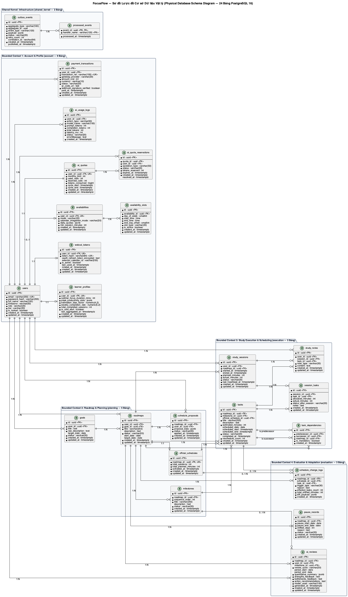

# FocusFlow — Thiết kế Cơ sở Dữ liệu Quan hệ & Sơ đồ Lược đồ (Database Schema Diagram & Design Document)
## Phiên bản: v3.2 — Chuẩn Cơ sở Dữ liệu Vật lý Đầy đủ 35 Bảng 3NF/BCNF kết hợp Controlled JSONB Value Objects + `pgvector` (4 Bounded Contexts + Shared Kernel: 12 / 10 / 5 / 4 / 4)
**Dự án:** FocusFlow — Hệ thống hỗ trợ lập kế hoạch và thực thi lộ trình tự học thích ứng tích hợp AI (FocusFlow Learning Intelligence Harness)  
**Hệ quản trị CSDL:** PostgreSQL 16 + `pgvector` (vận hành qua Docker Compose, kết nối bất đồng bộ qua `SQLAlchemy 2.0 Async + asyncpg`)  
**Kiến trúc Hệ thống:** Context-First Modular Monolith + Hexagonal Architecture (`account`, `planning`, `execution`, `evaluation`, `shared_kernel`)  
**Tiêu chuẩn thiết kế:** ISO/IEC 9075:2023 (SQL Standard), Chuẩn hóa 3NF/BCNF kết hợp Controlled JSONB Value Objects có ràng buộc `CHECK` kiểm định miền giá trị (`daily_quotas`, `learning_resources_json`, `mistake_taxonomy_json`), DB Diagram Physical Specification, Hybrid RAG (`tsvector` GIN + `pgvector` HNSW), Transactional Outbox Pattern  
**Căn cứ đánh giá học thuật:** Khung Rubric Đồ án Tốt nghiệp CNTT — Tiêu chí TC2.1 (Phân tích thiết kế) & TC2.3 (Hiện thực hóa kỹ thuật) — Mức 5  
**Tài liệu liên kết:** [`docs/srs/srs-v1.3.md`](../srs/srs-v1.3.md), [`docs/database/data-dictionary.md`](data-dictionary.md), [`docs/database/schema.sql`](schema.sql), [`docs/decisions/ADR-007-database-schema-and-persistence.md`](../decisions/ADR-007-database-schema-and-persistence.md), [`docs/uml/class-diagrams.md`](../uml/class-diagrams.md)

---

## MỤC LỤC

1. [Tổng quan & Phương pháp luận Thiết kế Dữ liệu](#1-tổng-quan--phương-pháp-luận-thiết-kế-dữ-liệu)
   - 1.1 [Yêu cầu từ Giảng viên Hướng dẫn (DB Diagram Vật lý 35 Bảng thay vì Conceptual ERD)](#11-yêu-cầu-từ-giảng-viên-hướng-dẫn-db-diagram-vật-lý-35-bảng-thay-vì-conceptual-erd)
   - 1.2 [Chiến lược Khóa chính Tuần tự Thời gian (UUIDv7 - RFC 9562) & Extension `pgvector`](#12-chiến-lược-khóa-chính-tuần-tự-thời-gian-uuidv7---rfc-9562--extension-pgvector)
   - 1.3 [Quy tắc Modular Monolith: Bảo toàn FK Vật lý tại DB nhưng Cấm ORM JOIN Chéo Context](#13-quy-tắc-modular-monolith-bảo-toàn-fk-vật-lý-tại-db-nhưng-cấm-orm-join-chéo-context)
   - 1.4 [Chiến lược Đa người dùng (Multi-tenant Isolation), Quy ước Định danh & Quản lý Thời gian](#14-chiến-lược-đa-người-dùng-multi-tenant-isolation-quy-ước-định-danh--quản-lý-thời-gian)
2. [Sơ đồ Lược đồ Cơ sở Dữ liệu Vật lý (Physical Database Schema Diagram - 35 Bảng)](#2-sơ-đồ-lược-đồ-cơ-sở-dữ-liệu-vật-lý-physical-database-schema-diagram---35-bảng)
   - 2.1 [Sơ đồ Mermaid Database Schema (Chuẩn Crow's Foot - 35 Bảng)](#21-sơ-đồ-mermaid-database-schema-chuẩn-crows-foot---35-bảng)
   - 2.2 [Mã nguồn DBML (Database Markup Language cho dbdiagram.io - 35 Bảng)](#22-mã-nguồn-dbml-database-markup-language-cho-dbdiagramio---35-bảng)
3. [Đặc tả Chi tiết 35 Bảng Dữ liệu Vật lý theo 4 Bounded Contexts + Shared Kernel (`12 / 10 / 5 / 4 / 4`)](#3-đặc-tả-chi-tiết-35-bảng-dữ-liệu-vật-lý-theo-4-bounded-contexts--shared-kernel-12--10--5--4--4)
   - 3.1 [Bounded Context 1 (`account` — 12 Bảng): Định danh, Hồ sơ SRL, Trí nhớ Cấu trúc hóa 4×3, Thành thạo Khái niệm, Thời gian rảnh, Quota 2 Pha, Đồng bộ Lịch & Thanh toán](#31-bounded-context-1-account--12-bảng-định-danh-hồ-sơ-srl-trí-nhớ-cấu-trúc-hóa-43-thành-thạo-khái-niệm-thời-gian-rảnh-quota-2-pha-đồng-bộ-lịch--thanh-toán)
   - 3.2 [Bounded Context 2 (`planning` — 10 Bảng): Mục tiêu, Lộ trình, Cột mốc, Lịch chính thức (Resilience Policy), Đề xuất Lịch (What-If), Đồ thị Tri thức, Knowledge Engine (RAG) & Khối Lịch Học (`schedule_blocks`)](#32-bounded-context-2-planning--10-bảng-mục-tiêu-lộ-trình-cột-mốc-lịch-chính-thức-resilience-policy-đề-xuất-lịch-what-if-đồ-thị-tri-thức-knowledge-engine-rag--khối-lịch-học-schedule_blocks)
   - 3.3 [Bounded Context 3 (`execution` — 5 Bảng): Nhiệm vụ (kèm Trích dẫn RAG), Tiên quyết DAG, Phiên học Pomodoro (kèm Daily Check-in), Liên kết Nhiệm vụ & Ghi chép](#33-bounded-context-3-execution--5-bảng-nhiệm-vụ-kèm-trích-dẫn-rag-tiên-quyết-dag-phiên-học-pomodoro-kèm-daily-check-in-liên-kết-nhiệm-vụ--ghi-chép)
   - 3.4 [Bounded Context 4 (`evaluation` — 4 Bảng): Lịch sử Tạm dừng, Báo cáo Đánh giá AI (kèm Phản tư Tuần), Nhật ký Biến động Lịch học & Bằng chứng Khảo sát Mốc (kèm Mistake Intelligence)](#34-bounded-context-4-evaluation--4-bảng-lịch-sử-tạm-dừng-báo-cáo-đánh-giá-ai-kèm-phản-tư-tuần-nhật-ký-biến-động-lịch-học--bằng-chứng-khảo-sát-mốc-kèm-mistake-intelligence)
   - 3.5 [Shared Kernel (`shared_kernel` — 4 Bảng): Hàng đợi Sự kiện Giao dịch Outbox, Sổ cái Idempotent Consumer & Điều phối Workflow Bền vững (`workflow_runs`, `workflow_step_executions`)](#35-shared-kernel-shared_kernel--4-bảng-hàng-đợi-sự-kiện-giao-dịch-outbox-sổ-cái-idempotent-consumer--điều-phối-workflow-bền-vững-workflow_runs-workflow_step_executions)
   - 3.6 [Ma trận Ánh xạ 11 Khái niệm Logic của FocusFlow Learning Intelligence Harness sang 35 Bảng Vật lý](#36-ma-trận-ánh-xạ-11-khái-niệm-logic-của-focusflow-learning-intelligence-harness-sang-35-bảng-vật-lý)
4. [Phân tích Chuẩn hóa Dữ liệu (Database Normalization Analysis - 3NF / BCNF)](#4-phân-tích-chuẩn-hóa-dữ-liệu-database-normalization-analysis---3nf--bcnf)
   - 4.1 [Chứng minh Dạng Chuẩn 1 (1NF), 2 (2NF), 3 (3NF) & Boyce-Codd (BCNF) trên 35 Bảng](#41-chứng-minh-dạng-chuẩn-1-1nf-2-2nf-3-3nf--boyce-codd-bcnf-trên-35-bảng)
   - 4.2 [Cơ chế Ánh xạ Repository giữa Bảng 3NF `availability_slots` và Domain Value Objects (`WeeklySchedule`, `TimeSlot`)](#42-cơ-chế-ánh-xạ-repository-giữa-bảng-3nf-availability_slots-và-domain-value-objects-weeklyschedule-timeslot)
   - 4.3 [Tính Hợp thức của Frozen Baseline (`official_schedules`) và Audit Snapshots trong Lý thuyết Chuẩn hóa](#43-tính-hợp-thức-của-frozen-baseline-official_schedules-và-audit-snapshots-trong-lý-thuyết-chuẩn-hóa)
   - 4.4 [Luận cứ Chuẩn hóa 3NF/BCNF cho 7 Bảng Mới của Learning Intelligence Harness & Sự Tách biệt Khối Lịch Học](#44-luận-cứ-chuẩn-hóa-3nfbcnf-cho-7-bảng-mới-của-learning-intelligence-harness--sự-tách-biệt-khối-lịch-học)
5. [Thiết kế Chỉ mục Hiệu năng & Ràng buộc Toàn vẹn (Indexing & Constraints Strategy)](#5-thiết-kế-chỉ-mục-hiệu-năng--ràng-buộc-toàn-vẹn-indexing--constraints-strategy)
   - 5.1 [Chiến lược B-Tree, Partial Unique, GIN `tsvector` & HNSW `pgvector` Indexes (74 Chỉ mục chuyên biệt)](#51-chiến-lược-b-tree-partial-unique-gin-tsvector--hnsw-pgvector-indexes-74-chỉ-mục-chuyên-biệt)
   - 5.2 [Ràng buộc Toàn vẹn Tham chiếu Lai (Hybrid Cascading & Deletion Protection)](#52-ràng-buộc-toàn-vẹn-tham-chiếu-lai-hybrid-cascading--deletion-protection)
6. [Quản trị Giao dịch, Khóa Đồng thời & Transactional Outbox](#6-quản-trị-giao-dịch-khóa-đồng-thời--transactional-outbox)
   - 6.1 [Giao dịch Giữ chỗ Hạn ngạch AI 2 Pha (2-Phase ACID Quota Reservation)](#61-giao-dịch-giữ-chỗ-hạn-ngạch-ai-2-pha-2-phase-acid-quota-reservation---asr-02)
   - 6.2 [Giao dịch Phê duyệt Lịch Xem trước, Ghi `schedule_blocks` & Phát Sự kiện Outbox (`OfficialScheduleAppliedEvent`)](#62-giao-dịch-phê-duyệt-lịch-xem-trước-ghi-schedule_blocks--phát-sự-kiện-outbox-officialscheduleappliedevent)
   - 6.3 [Giao dịch Tịnh tiến Tất định Domino Shift & Ghi Nhật ký `schedule_change_logs` (`BUSR-07`)](#63-giao-dịch-tịnh-tiến-tất-định-domino-shift--ghi-nhật-ký-schedule_change_logs-busr-07)
   - 6.4 [Giao dịch Giám sát Heartbeat & Chốt Phiên Gián đoạn qua Taskiq Scheduler (`BUSR-09`, `OS-01`, `OS-07`)](#64-giao-dịch-giám-sát-heartbeat--chốt-phiên-gián-đoạn-qua-taskiq-scheduler-busr-09-os-01-os-07)
7. [Tập lệnh SQL DDL Khởi tạo Cơ sở Dữ liệu Hoàn chỉnh (PostgreSQL 16 DDL Script)](#7-tập-lệnh-sql-ddl-khởi-tạo-cơ-sở-dữ-liệu-hoàn-chỉnh-postgresql-16-ddl-script)
8. [Ma trận Truy vết từ Yêu cầu SRS v1.3 & Learning Intelligence Harness sang 35 Bảng Cơ sở Dữ liệu](#8-ma-trận-truy-vết-từ-yêu-cầu-srs-v13--learning-intelligence-harness-sang-35-bảng-cơ-sở-dữ-liệu)

---

## 1. Tổng quan & Phương pháp luận Thiết kế Dữ liệu

### 1.1. Yêu cầu từ Giảng viên Hướng dẫn (DB Diagram Vật lý 35 Bảng thay vì Conceptual ERD)
Theo yêu cầu trực tiếp từ Giảng viên Hướng dẫn Đồ án Tốt nghiệp CNTT:
> **Định hướng Học thuật:** Không sử dụng biểu đồ ERD khái niệm hình thoi (Chen notation) mang tính trừu tượng sơ lược. Bắt buộc xây dựng **Sơ đồ Lược đồ Cơ sở Dữ liệu Vật lý (Physical Database Schema Diagram / DB Diagram)** phản ánh chính xác cấu trúc **35 bảng thực tế** trong hệ quản trị PostgreSQL 16 (theo phân rã 4 Bounded Contexts + Shared Kernel: `12 / 10 / 5 / 4 / 4`), thể hiện rõ tên bảng, tên cột, kiểu dữ liệu vật lý chuẩn (`UUID`, `VARCHAR`, `TIMESTAMPTZ`, `JSONB`, `BOOLEAN`, `SMALLINT`, `INTEGER`, `BIGINT`, `NUMERIC`, `TSVECTOR`, `vector(768)`), chỉ định Khóa chính (`PK`), Khóa ngoại (`FK`), Ràng buộc duy nhất (`UQ`), Ràng buộc kiểm tra (`CHECK`) và các quan hệ 1:1, 1:N, N:M với ký hiệu Crow's Foot chuẩn mực.

### 1.2. Chiến lược Khóa chính Tuần tự Thời gian (UUIDv7 - RFC 9562) & Extension `pgvector`
Toàn bộ các bảng thực thể trong hệ thống FocusFlow sử dụng kiểu dữ liệu `UUID` cho khóa chính (riêng bảng sổ cái chống lặp `processed_events` sử dụng khóa chính kép `(event_id, handler_name)`, bảng `learning_concepts` dùng `concept_id VARCHAR(120)` và `concept_prerequisites` dùng `(source_concept_id, prerequisite_concept_id)`):
* **Sinh khóa tại Tầng Backend:** Giá trị khóa chính được sinh trực tiếp tại tầng Backend Application (Python FastAPI sử dụng thư viện `uuid_utils` theo chuẩn **RFC 9562 - UUIDv7 Time-Ordered Monotonic**) trước khi thực hiện câu lệnh `INSERT` xuống CSDL.
* **Fallback an toàn tại CSDL:** Tại tầng CSDL PostgreSQL 16, các bảng khai báo `id UUID PRIMARY KEY DEFAULT gen_random_uuid()` đóng vai trò Fallback an toàn khi thao tác chèn trực tiếp bằng SQL script ngoài tầng Application.
* **Tích hợp `pgvector` cho Hybrid RAG ngay trong PostgreSQL 16:** Kích hoạt `CREATE EXTENSION IF NOT EXISTS vector;` ở đầu tệp `schema.sql`. Bảng `knowledge_chunks` kết hợp cột `search_vector TSVECTOR` (chỉ mục GIN) và cột `embedding vector(768)` (chỉ mục HNSW `vector_cosine_ops`) để thực hiện truy xuất ngữ nghĩa lai (Hybrid Keyword + Semantic Retrieval) mà không cần triển khai thêm container Vector DB riêng biệt, giữ vững kiến trúc 4 container Docker Compose.
* **Luận cứ Kỹ thuật & Học thuật (Rubric TC2.3 Mức 5):**
  1. *Khắc phục nhược điểm phân mảnh trang của UUIDv4:* UUIDv4 ngẫu nhiên hoàn toàn làm cho các chỉ mục B-Tree Primary Key bị phân mảnh trang dữ liệu (B-Tree Page Splitting), làm suy giảm nghiêm trọng hiệu năng bộ đệm (Buffer Cache) và I/O khi dữ liệu tăng trưởng.
  2. *Ưu điểm vượt trội của UUIDv7:* Chứa 48-bit timestamp ở phần đầu (Time-Ordered Monotonic), UUIDv7 tự động sắp xếp tăng dần theo thời gian, giúp cây B-Tree luôn được ghi tuần tự vào các trang cuối (Append-only behavior), triệt tiêu phân mảnh trang và tăng tốc độ tra cứu clustered index.
  3. *Bảo mật cao:* Vẫn chứa 74 bits ngẫu nhiên mã hóa mạnh, loại bỏ 100% rủi ro tấn công đoán số thứ tự (ID Enumeration Attack) như khóa tự tăng `SERIAL`/`BIGINT`.

### 1.3. Quy tắc Modular Monolith: Bảo toàn FK Vật lý tại DB nhưng Cấm ORM JOIN Chéo Context
Trong kiến trúc **Context-First Modular Monolith** của FocusFlow, toàn bộ **35 bảng vật lý** cùng cư trú trong schema `public` của một cụm PostgreSQL 16 nhưng được phân định quyền sở hữu nghiêm ngặt về **4 Bounded Contexts + 1 Shared Kernel (`12 / 10 / 5 / 4 / 4`)**:
1. **Tại tầng Cơ sở Dữ liệu Vật lý (Physical DB Level):** Giữ nguyên đầy đủ các ràng buộc **Foreign Key (`FK`) vật lý** giữa các bảng (kể cả các Cross-Context FK như từ `planning.roadmaps` về `account.users`, từ `account.learner_concept_masteries` về `planning.learning_concepts`, từ `planning.schedule_blocks` về `execution.tasks`, từ `execution.tasks` về `planning.roadmaps`/`planning.milestones`/`planning.official_schedules`, từ `evaluation.pause_records` về `planning.roadmaps`, hay các Intra-Context FK như `execution.session_tasks` về `execution.tasks` với `ON DELETE RESTRICT`). Điều này đảm bảo tính toàn vẹn tham chiếu 100% ở mức hệ quản trị CSDL (Defense-in-Depth) và đáp ứng trọn vẹn tiêu chí chuẩn hóa 3NF/BCNF của Hội đồng Chấm Đồ án.
2. **Tại tầng Mã nguồn Ứng dụng (Application & ORM Code Level):** Nghiêm cấm viết các câu lệnh SQLAlchemy ORM `JOIN` hoặc `relationship()` nối trực tiếp giữa các ORM Model thuộc hai Bounded Context khác nhau (được kiểm soát tự động bởi công cụ `import-linter`).
   - Khi một Context cần **đọc dữ liệu** từ Context khác: Bắt buộc gọi qua giao diện truy vấn công khai `public_api.py` (ví dụ: `AvailabilityQueryPort`, `QuotaFacadePort`, `RoadmapTaskQueryPort`, `KnowledgeRetrievalPort`, `LearnerMemoryQueryPort`).
   - Khi một Context cần **kích hoạt hiệu ứng phụ (side-effect)** sang Context khác: Bắt buộc phát sự kiện miền bất đồng bộ qua bảng **`outbox_events`** (Transactional Outbox), được tiếp vận qua **Taskiq Worker (Redis Streams)** và kiểm tra chống xử lý trùng tại bảng **`processed_events`**.

### 1.4. Chiến lược Đa người dùng (Multi-tenant Isolation), Quy ước Định danh & Quản lý Thời gian
* **Cô lập Dữ liệu Đa người dùng:** Sử dụng Single Surrogate FK chuẩn, `user_id` hiện diện tại các bảng gốc (`users`, `learner_profiles`, `webcal_tokens`, `calendar_connections`, `availabilities`, `ai_quotas`, `ai_quota_reservations`, `ai_usage_logs`, `payment_transactions`, `learner_memory_items`, `learner_concept_masteries`, `goals`, `roadmaps`, `schedule_proposals`, `knowledge_sources`, `study_sessions`, `study_notes`, `ai_reviews`, `milestone_proofs`, `workflow_runs`). Việc kiểm tra quyền sở hữu được thực hiện nghiêm ngặt ở Application Service Layer (`WHERE user_id = current_user.id`).
* **Quy ước Định danh (Naming Conventions):**
  * Tên bảng: Chữ thường, số nhiều, nối bằng dấu gạch dưới (`snake_case`).
  * Khóa ngoại: `{tên_bảng_số_ít}_id`, ví dụ: `user_id`, `roadmap_id`, `session_id`, `task_id`, `milestone_id`, `source_id`, `workflow_run_id`.
  * Tiền tố ràng buộc: Khóa chính `pk_`, khóa ngoại `fk_`, duy nhất `uq_`, kiểm tra `chk_`, chỉ mục `idx_`, trigger `trg_`.
  * Trạng thái (Enum/Status): Sử dụng `VARCHAR(...)` kết hợp ràng buộc `CHECK (status IN (...))` thân thiện với công cụ migration Alembic, loại bỏ nguy cơ khóa bảng (Table Lock) của kiểu `CREATE TYPE ... AS ENUM`.
* **Quản lý Thời gian Chuẩn hóa (TIMESTAMPTZ UTC & Timezone):**
  * Toàn bộ các cột mốc thời gian được lưu trữ dưới kiểu `TIMESTAMPTZ` theo giờ phối hợp quốc tế (UTC).
  * Bảng `users` lưu cột `timezone VARCHAR(50) NOT NULL DEFAULT 'Asia/Ho_Chi_Minh'` để chuyển đổi biểu diễn trên giao diện người dùng và tính toán chu kỳ chuyển giao ngày trong tác vụ nền **Taskiq Scheduler**.
  * Hàm trigger `fn_set_updated_at()` tự động cập nhật `updated_at = NOW()` trước mỗi thao tác `UPDATE` trên tất cả **26 bảng** có cột `updated_at`.

---

## 2. Sơ đồ Lược đồ Cơ sở Dữ liệu Vật lý (Physical Database Schema Diagram - 35 Bảng)

> **Tệp mã nguồn DBML độc lập (tương thích 100% dbdiagram.io):** [`docs/database/schema.dbml`](schema.dbml)  
> **Tệp mã nguồn PlantUML ERD:** [`docs/database/database-schema.puml`](database-schema.puml)  
> **Hình ảnh sơ đồ CSDL vật lý:**  
> 

### 2.1. Sơ đồ Mermaid Database Schema (Chuẩn Crow's Foot - 35 Bảng)

```mermaid
erDiagram
    users ||--o| learner_profiles : "has profile (1:1)"
    users ||--o| webcal_tokens : "owns token (1:1)"
    users ||--o{ calendar_connections : "syncs calendar (1:N)"
    users ||--o| availabilities : "configures (1:1)"
    availabilities ||--o{ availability_slots : "contains slots (1:N)"
    users ||--|| ai_quotas : "allocates quota (1:1)"
    ai_quotas ||--o{ ai_quota_reservations : "reserves (1:N)"
    users ||--o{ ai_quota_reservations : "initiates (1:N)"
    ai_quota_reservations ||--o{ ai_usage_logs : "records usage (0..1:N)"
    users ||--o{ ai_usage_logs : "logs usage (1:N)"
    users ||--o{ payment_transactions : "pays (1:N RESTRICT)"
    users ||--o{ learner_memory_items : "stores memory (1:N)"
    users ||--o{ learner_concept_masteries : "tracks mastery (1:N)"
    learning_concepts ||--o{ learner_concept_masteries : "assessed in (1:N)"
    users ||--o{ goals : "defines (1:N)"
    users ||--o{ roadmaps : "owns (1:N)"
    goals ||--o| roadmaps : "originates (1:0..1)"
    roadmaps ||--o{ milestones : "contains (1:N)"
    roadmaps ||--o| official_schedules : "activates (1:1)"
    roadmaps ||--o{ schedule_proposals : "generates (1:N)"
    users ||--o{ schedule_proposals : "receives (1:N)"
    learning_concepts ||--o{ concept_prerequisites : "is source (1:N)"
    learning_concepts ||--o{ concept_prerequisites : "is prereq (1:N)"
    users ||--o{ knowledge_sources : "uploads (1:N)"
    goals ||--o{ knowledge_sources : "grounds (1:N)"
    knowledge_sources ||--o{ knowledge_chunks : "splits into (1:N)"
    goals ||--o{ knowledge_chunks : "indexes (1:N)"
    roadmaps ||--o{ schedule_blocks : "schedules (1:N)"
    official_schedules ||--o{ schedule_blocks : "contains blocks (1:N)"
    tasks ||--o{ schedule_blocks : "allocated to (0..1:N)"
    roadmaps ||--o{ tasks : "aggregates (1:N)"
    milestones ||--o{ tasks : "decomposes into (1:N)"
    official_schedules ||--o{ tasks : "allocates (1:N)"
    learning_concepts ||--o{ tasks : "mastered via (0..1:N)"
    tasks ||--o{ tasks : "has subtasks (1:N)"
    tasks ||--o{ task_dependencies : "is predecessor (1:N)"
    tasks ||--o{ task_dependencies : "is successor (1:N)"
    roadmaps ||--o{ task_dependencies : "scopes (1:N)"
    users ||--o{ study_sessions : "performs (1:N)"
    roadmaps ||--o{ study_sessions : "tracks (1:N)"
    study_sessions ||--o{ session_tasks : "includes (1:N)"
    tasks ||--o{ session_tasks : "participates in (1:N RESTRICT)"
    users ||--o{ study_notes : "writes (1:N)"
    study_sessions ||--o{ study_notes : "contains notes (1:N)"
    tasks ||--o{ study_notes : "annotates (1:N)"
    roadmaps ||--o{ pause_records : "records pauses (1:N)"
    roadmaps ||--o{ ai_reviews : "receives reviews (1:N)"
    users ||--o{ ai_reviews : "gets reviews (1:N)"
    milestones ||--o{ ai_reviews : "evaluates (1:N)"
    roadmaps ||--o{ schedule_change_logs : "audits shifts (1:N)"
    official_schedules ||--o{ schedule_change_logs : "tracks schedule (1:N)"
    tasks ||--o{ schedule_change_logs : "affects task (1:N)"
    milestones ||--o{ milestone_proofs : "verifies competence (1:N)"
    roadmaps ||--o{ milestone_proofs : "tracks competence (1:N)"
    users ||--o{ milestone_proofs : "submits proof (1:N)"
    tasks ||--o{ milestone_proofs : "corrective task (0..1:N)"
    outbox_events ||--o{ processed_events : "acknowledged by (1:N)"
    users ||--o{ workflow_runs : "triggers workflow (1:N)"
    goals ||--o{ workflow_runs : "runs for goal (0..1:N)"
    roadmaps ||--o{ workflow_runs : "runs for roadmap (0..1:N)"
    workflow_runs ||--o{ workflow_step_executions : "executes steps (1:N)"
    ai_usage_logs ||--o{ workflow_step_executions : "traces llm call (0..1:N)"

    users {
        uuid id PK
        varchar email UK
        varchar password_hash
        varchar full_name
        varchar timezone
        varchar role
        varchar tier
        boolean is_locked
        timestamptz premium_expires_at
        timestamptz last_login_at
        timestamptz created_at
        timestamptz updated_at
    }

    learner_profiles {
        uuid id PK
        uuid user_id FK,UK
        integer optimal_focus_duration_mins
        jsonb peak_productivity_slots
        numeric estimation_bias_factor
        numeric weekly_completion_rate
        integer total_completed_sessions
        boolean is_cold_start
        timestamptz last_aggregated_at
        timestamptz created_at
        timestamptz updated_at
    }

    webcal_tokens {
        uuid id PK
        uuid user_id FK,UK
        varchar token_hash UK
        boolean is_active
        timestamptz last_used_at
        timestamptz rotated_at
        timestamptz created_at
        timestamptz updated_at
    }

    calendar_connections {
        uuid id PK
        uuid user_id FK
        varchar provider
        varchar external_calendar_id
        text oauth_refresh_token_encrypted
        varchar sync_status
        timestamptz last_synced_at
        text error_detail
        timestamptz created_at
        timestamptz updated_at
    }

    availabilities {
        uuid id PK
        uuid user_id FK,UK
        varchar mode
        varchar calendar_integration_mode
        jsonb daily_quotas
        integer min_session_minutes
        timestamptz created_at
        timestamptz updated_at
    }

    availability_slots {
        uuid id PK
        uuid availability_id FK
        smallint day_of_week
        time start_time
        time end_time
        smallint end_day_offset
        varchar slot_type
        varchar energy_level
        boolean is_active
        timestamptz created_at
        timestamptz updated_at
    }

    ai_quotas {
        uuid id PK
        uuid user_id FK,UK
        integer monthly_limit
        integer used_calls
        integer reserved_calls
        bigint tokens_consumed
        timestamptz cycle_start
        timestamptz cycle_end
        timestamptz created_at
        timestamptz updated_at
    }

    ai_quota_reservations {
        uuid id PK
        uuid quota_id FK
        uuid user_id FK
        varchar operation_type
        varchar status
        integer tokens_reserved
        timestamptz expires_at
        timestamptz created_at
        timestamptz resolved_at
    }

    ai_usage_logs {
        uuid id PK
        uuid user_id FK
        uuid reservation_id FK
        varchar action_type
        varchar model_name
        smallint attempt_no
        integer prompt_tokens
        integer completion_tokens
        integer total_tokens
        integer latency_ms
        numeric estimated_cost_usd
        varchar status
        text error_message
        timestamptz created_at
    }

    payment_transactions {
        uuid id PK
        uuid user_id FK
        varchar transaction_ref UK
        varchar gateway_provider
        integer amount_vnd
        varchar currency
        varchar status
        text qr_code_url
        boolean webhook_signature_verified
        timestamptz paid_at
        timestamptz expires_at
        timestamptz created_at
        timestamptz updated_at
    }

    learner_memory_items {
        uuid id PK
        uuid user_id FK
        varchar memory_category
        varchar epistemic_type
        varchar memory_key
        jsonb claim_value
        text source_evidence
        integer sample_size
        integer observation_window_days
        numeric confidence_score
        varchar confirmation_status
        timestamptz confirmed_at
        timestamptz created_at
        timestamptz updated_at
    }

    learner_concept_masteries {
        uuid id PK
        uuid user_id FK
        varchar concept_id FK
        numeric mastery_score
        varchar mastery_level
        integer evidence_count
        jsonb mistake_pattern_summary
        timestamptz last_practiced_at
        timestamptz next_review_at
        timestamptz created_at
        timestamptz updated_at
    }

    goals {
        uuid id PK
        uuid user_id FK
        text title
        text raw_description
        date target_date
        varchar status
        varchar prior_knowledge_level
        text clarification_context
        timestamptz created_at
        timestamptz updated_at
    }

    roadmaps {
        uuid id PK
        uuid user_id FK
        uuid goal_id FK,UK
        varchar title
        text description
        varchar status
        date start_date
        date target_date
        smallint weekly_reschedule_budget
        smallint weekly_reschedule_used
        date budget_week_start
        timestamptz last_study_activity_at
        smallint reset_ritual_count
        timestamptz created_at
        timestamptz updated_at
    }

    milestones {
        uuid id PK
        uuid roadmap_id FK
        integer sequence_order
        varchar title
        text description
        varchar status
        varchar proof_status
        timestamptz created_at
        timestamptz updated_at
    }

    official_schedules {
        uuid id PK
        uuid roadmap_id FK,UK
        integer version_number
        varchar strategy
        integer total_sessions
        integer total_planned_minutes
        integer buffer_minutes_per_week
        smallint recovery_window_days
        integer daily_workload_cap_minutes
        numeric stability_weight
        timestamptz activated_at
        timestamptz created_at
        timestamptz updated_at
    }

    schedule_proposals {
        uuid id PK
        uuid roadmap_id FK
        uuid user_id FK
        jsonb proposal_data
        jsonb original_proposal_data
        varchar status
        varchar proposal_type
        integer user_edit_count
        timestamptz applied_at
        timestamptz created_at
        timestamptz updated_at
    }

    learning_concepts {
        varchar concept_id PK
        varchar title
        text summary
        varchar domain
        varchar difficulty_level
        integer estimated_effort_minutes
        jsonb keywords
        jsonb learning_outcomes
        varchar verification_status
        varchar version
        timestamptz created_at
        timestamptz updated_at
    }

    concept_prerequisites {
        varchar source_concept_id PK,FK
        varchar prerequisite_concept_id PK,FK
        varchar relation_type
        text rationale
        timestamptz created_at
    }

    knowledge_sources {
        uuid id PK
        uuid user_id FK
        uuid goal_id FK
        varchar source_type
        varchar title
        text source_uri
        varchar content_hash
        varchar ingestion_status
        integer chunk_count
        jsonb provenance_metadata
        text error_detail
        timestamptz created_at
        timestamptz updated_at
    }

    knowledge_chunks {
        uuid id PK
        uuid source_id FK
        uuid goal_id FK
        integer chunk_index
        varchar section_title
        integer page_number
        text content
        integer token_count
        tsvector search_vector
        vector embedding
        jsonb provenance_json
        timestamptz created_at
    }

    schedule_blocks {
        uuid id PK
        uuid roadmap_id FK
        uuid official_schedule_id FK
        uuid task_id FK
        smallint sequence_in_task
        varchar block_type
        date block_date
        timestamptz start_time
        timestamptz end_time
        integer scheduled_duration_minutes
        boolean is_protected
        varchar status
        varchar external_calendar_event_id
        text placement_rationale
        timestamptz created_at
        timestamptz updated_at
    }

    tasks {
        uuid id PK
        uuid roadmap_id FK
        uuid milestone_id FK
        uuid official_schedule_id FK
        uuid parent_task_id FK
        varchar concept_id FK
        varchar title
        text description
        integer estimated_minutes
        jsonb learning_resources_json
        date scheduled_date
        timestamptz scheduled_start
        timestamptz scheduled_end
        varchar status
        timestamptz completed_at
        integer reschedule_count
        timestamptz created_at
        timestamptz updated_at
    }

    task_dependencies {
        uuid id PK
        uuid predecessor_id FK
        uuid successor_id FK
        uuid roadmap_id FK
        boolean is_mandatory
        timestamptz created_at
    }

    study_sessions {
        uuid id PK
        uuid user_id FK
        uuid roadmap_id FK
        varchar session_mode
        varchar timer_mode
        timestamptz started_at
        timestamptz ended_at
        integer planned_minutes
        integer actual_minutes
        varchar status
        boolean pending_takeaway
        varchar checkin_time_sufficiency
        varchar checkin_perceived_difficulty
        smallint checkin_focus_level
        timestamptz last_heartbeat_at
        timestamptz created_at
        timestamptz updated_at
    }

    session_tasks {
        uuid id PK
        uuid session_id FK
        uuid task_id FK
        integer allocated_minutes
        integer actual_minutes
        varchar status_after_session
        text notes
        timestamptz created_at
        timestamptz updated_at
    }

    study_notes {
        uuid id PK
        uuid user_id FK
        uuid session_id FK
        uuid task_id FK
        varchar note_type
        text content
        smallint self_confidence
        numeric ai_evidence_score
        varchar alignment_flag
        varchar verification_status
        timestamptz created_at
        timestamptz updated_at
    }

    pause_records {
        uuid id PK
        uuid roadmap_id FK
        date pause_start_date
        date pause_end_date
        integer shifted_days
        text reason
        varchar status
        timestamptz created_at
        timestamptz updated_at
    }

    ai_reviews {
        uuid id PK
        uuid roadmap_id FK
        uuid user_id FK
        uuid milestone_id FK
        varchar review_cycle
        date period_start
        date period_end
        jsonb quantitative_summary
        jsonb user_reflection_payload
        text strengths_feedback
        text bottlenecks_feedback
        text action_recommendations
        varchar model_used
        timestamptz generated_at
        timestamptz created_at
        timestamptz updated_at
    }

    schedule_change_logs {
        uuid id PK
        uuid roadmap_id FK
        uuid schedule_id FK
        uuid task_id FK
        varchar trigger_type
        varchar disruption_category
        boolean counts_toward_budget
        text reason
        integer affected_tasks_count
        integer total_shifted_minutes
        jsonb diff_payload
        timestamptz created_at
    }

    milestone_proofs {
        uuid id PK
        uuid milestone_id FK
        uuid roadmap_id FK
        uuid user_id FK
        smallint attempt_no
        jsonb recall_exchanges_payload
        jsonb mistake_taxonomy_json
        numeric avg_self_confidence
        numeric ai_evidence_score
        numeric calibration_gap
        varchar proof_verdict
        text feedback_summary
        uuid corrective_task_id FK
        varchar model_used
        timestamptz evaluated_at
        timestamptz created_at
        timestamptz updated_at
    }

    outbox_events {
        uuid id PK
        varchar aggregate_type
        uuid aggregate_id
        varchar event_type
        jsonb payload
        varchar status
        integer retry_count
        varchar correlation_id
        timestamptz created_at
        timestamptz published_at
    }

    processed_events {
        uuid event_id PK,FK
        varchar handler_name PK
        timestamptz processed_at
    }

    workflow_runs {
        uuid id PK
        uuid user_id FK
        uuid goal_id FK
        uuid roadmap_id FK
        varchar workflow_type
        varchar current_step
        varchar status
        jsonb context_snapshot
        text error_detail
        timestamptz started_at
        timestamptz paused_at
        timestamptz completed_at
        timestamptz created_at
        timestamptz updated_at
    }

    workflow_step_executions {
        uuid id PK
        uuid workflow_run_id FK
        varchar step_name
        smallint step_order
        varchar status
        jsonb input_summary
        jsonb output_payload
        uuid ai_usage_log_id FK
        smallint retry_count
        timestamptz started_at
        timestamptz completed_at
    }
```



---

### 2.2. Mã nguồn DBML (Database Markup Language cho dbdiagram.io - 35 Bảng)

```dbml
Project FocusFlow_v3_2 {
  database_type: 'PostgreSQL 16'
  Note: 'Physical Database Schema v3.2 (35 Tables across 4 Bounded Contexts + Shared Kernel: 12 / 10 / 5 / 4 / 4 with pgvector)'
}

// ==========================================
// BOUNDED CONTEXT 1: ACCOUNT (12 TABLES)
// ==========================================
Table users {
  id uuid [pk, default: `gen_random_uuid()`]
  email varchar(255) [not null, unique]
  password_hash varchar(255) [not null]
  full_name varchar(100) [not null]
  timezone varchar(50) [not null, default: 'Asia/Ho_Chi_Minh']
  role varchar(20) [not null, default: 'LEARNER']
  tier varchar(20) [not null, default: 'FREE']
  is_locked boolean [not null, default: false]
  premium_expires_at timestamptz
  last_login_at timestamptz
  created_at timestamptz [not null, default: `now()`]
  updated_at timestamptz [not null, default: `now()`]
}

Table learner_profiles {
  id uuid [pk, default: `gen_random_uuid()`]
  user_id uuid [not null, unique, ref: - users.id]
  optimal_focus_duration_mins integer [not null, default: 25]
  peak_productivity_slots jsonb [not null, default: '["MORNING", "EVENING"]']
  estimation_bias_factor numeric(4,2) [not null, default: 1.00]
  weekly_completion_rate numeric(5,2) [not null, default: 0.00]
  total_completed_sessions integer [not null, default: 0]
  is_cold_start boolean [not null, default: true]
  last_aggregated_at timestamptz [default: `now()`]
  created_at timestamptz [not null, default: `now()`]
  updated_at timestamptz [not null, default: `now()`]
}

Table webcal_tokens {
  id uuid [pk, default: `gen_random_uuid()`]
  user_id uuid [not null, unique, ref: - users.id]
  token_hash varchar(64) [not null, unique]
  is_active boolean [not null, default: true]
  last_used_at timestamptz
  rotated_at timestamptz
  created_at timestamptz [not null, default: `now()`]
  updated_at timestamptz [not null, default: `now()`]
}

Table calendar_connections {
  id uuid [pk, default: `gen_random_uuid()`]
  user_id uuid [not null, ref: > users.id]
  provider varchar(30) [not null, default: 'GOOGLE']
  external_calendar_id varchar(255) [not null, default: 'primary']
  oauth_refresh_token_encrypted text [not null]
  sync_status varchar(20) [not null, default: 'ACTIVE']
  last_synced_at timestamptz
  error_detail text
  created_at timestamptz [not null, default: `now()`]
  updated_at timestamptz [not null, default: `now()`]
}

Table availabilities {
  id uuid [pk, default: `gen_random_uuid()`]
  user_id uuid [not null, unique, ref: - users.id]
  mode varchar(20) [not null, default: 'MODE_A']
  calendar_integration_mode varchar(20) [not null, default: 'NONE']
  daily_quotas jsonb [not null, default: '{}', note: 'Controlled JSONB Value Object validated by fn_validate_daily_quotas(daily_quotas, mode): keys in MON..SUN, numeric hours 0.5..14.0']
  min_session_minutes integer [not null, default: 30]
  created_at timestamptz [not null, default: `now()`]
  updated_at timestamptz [not null, default: `now()`]
}

Table availability_slots {
  id uuid [pk, default: `gen_random_uuid()`]
  availability_id uuid [not null, ref: > availabilities.id]
  day_of_week smallint [not null]
  start_time time [not null]
  end_time time [not null]
  end_day_offset smallint [not null, default: 0]
  slot_type varchar(20) [not null, default: 'ALLOWED']
  energy_level varchar(10) [not null, default: 'MEDIUM']
  is_active boolean [not null, default: true]
  created_at timestamptz [not null, default: `now()`]
  updated_at timestamptz [not null, default: `now()`]
}

Table ai_quotas {
  id uuid [pk, default: `gen_random_uuid()`]
  user_id uuid [not null, unique, ref: - users.id]
  monthly_limit integer [not null, default: 30]
  used_calls integer [not null, default: 0]
  reserved_calls integer [not null, default: 0]
  tokens_consumed bigint [not null, default: 0]
  cycle_start timestamptz [not null]
  cycle_end timestamptz [not null]
  created_at timestamptz [not null, default: `now()`]
  updated_at timestamptz [not null, default: `now()`]
}

Table ai_quota_reservations {
  id uuid [pk, default: `gen_random_uuid()`]
  quota_id uuid [not null, ref: > ai_quotas.id]
  user_id uuid [not null, ref: > users.id]
  operation_type varchar(50) [not null]
  status varchar(20) [not null, default: 'RESERVED']
  tokens_reserved integer [not null, default: 0]
  expires_at timestamptz [not null]
  created_at timestamptz [not null, default: `now()`]
  resolved_at timestamptz
}

Table ai_usage_logs {
  id uuid [pk, default: `gen_random_uuid()`]
  user_id uuid [not null, ref: > users.id]
  reservation_id uuid [null, ref: > ai_quota_reservations.id]
  action_type varchar(50) [not null]
  model_name varchar(100) [not null, default: 'gemini-2.5-flash']
  attempt_no smallint [not null, default: 1]
  prompt_tokens integer [not null, default: 0]
  completion_tokens integer [not null, default: 0]
  total_tokens integer [not null, default: 0]
  latency_ms integer [not null, default: 0]
  estimated_cost_usd numeric(10,6) [not null, default: 0]
  status varchar(20) [not null, default: 'SUCCESS']
  error_message text
  created_at timestamptz [not null, default: `now()`]
}

Table payment_transactions {
  id uuid [pk, default: `gen_random_uuid()`]
  user_id uuid [not null, ref: > users.id]
  transaction_ref varchar(100) [not null, unique]
  gateway_provider varchar(20) [not null, default: 'PAYOS']
  amount_vnd integer [not null]
  currency varchar(10) [not null, default: 'VND']
  status varchar(20) [not null, default: 'PENDING']
  qr_code_url text
  webhook_signature_verified boolean [not null, default: false]
  paid_at timestamptz
  expires_at timestamptz
  created_at timestamptz [not null, default: `now()`]
  updated_at timestamptz [not null, default: `now()`]
}

Table learner_memory_items {
  id uuid [pk, default: `gen_random_uuid()`]
  user_id uuid [not null, ref: > users.id]
  memory_category varchar(30) [not null]
  epistemic_type varchar(20) [not null]
  memory_key varchar(120) [not null]
  claim_value jsonb [not null]
  source_evidence text [not null, default: '']
  sample_size integer [not null, default: 1]
  observation_window_days integer
  confidence_score numeric(4,3) [not null, default: 1.000]
  confirmation_status varchar(25) [not null, default: 'UNCONFIRMED']
  confirmed_at timestamptz
  created_at timestamptz [not null, default: `now()`]
  updated_at timestamptz [not null, default: `now()`]

  indexes {
    (user_id, memory_category, memory_key) [unique]
  }
}

Table learner_concept_masteries {
  id uuid [pk, default: `gen_random_uuid()`]
  user_id uuid [not null, ref: > users.id]
  concept_id varchar(120) [not null, ref: > learning_concepts.concept_id]
  mastery_score numeric(5,2) [not null, default: 0.00]
  mastery_level varchar(20) [not null, default: 'NOVICE']
  evidence_count integer [not null, default: 0]
  mistake_pattern_summary jsonb [not null, default: '[]']
  last_practiced_at timestamptz
  next_review_at timestamptz
  created_at timestamptz [not null, default: `now()`]
  updated_at timestamptz [not null, default: `now()`]

  indexes {
    (user_id, concept_id) [unique]
  }
}

// ==========================================
// BOUNDED CONTEXT 2: PLANNING (10 TABLES)
// ==========================================
Table goals {
  id uuid [pk, default: `gen_random_uuid()`]
  user_id uuid [not null, ref: > users.id]
  title text [not null]
  raw_description text [not null]
  target_date date
  status varchar(20) [not null, default: 'ACTIVE']
  prior_knowledge_level varchar(50) [not null, default: 'BEGINNER']
  clarification_context text
  created_at timestamptz [not null, default: `now()`]
  updated_at timestamptz [not null, default: `now()`]
}

Table roadmaps {
  id uuid [pk, default: `gen_random_uuid()`]
  user_id uuid [not null, ref: > users.id]
  goal_id uuid [not null, unique, ref: - goals.id]
  title varchar(255) [not null]
  description text
  status varchar(20) [not null, default: 'INITIALIZED']
  start_date date
  target_date date
  weekly_reschedule_budget smallint [not null, default: 3]
  weekly_reschedule_used smallint [not null, default: 0]
  budget_week_start date [not null, default: `CURRENT_DATE`]
  last_study_activity_at timestamptz
  reset_ritual_count smallint [not null, default: 0]
  created_at timestamptz [not null, default: `now()`]
  updated_at timestamptz [not null, default: `now()`]
}

Table milestones {
  id uuid [pk, default: `gen_random_uuid()`]
  roadmap_id uuid [not null, ref: > roadmaps.id]
  sequence_order integer [not null]
  title varchar(255) [not null]
  description text
  status varchar(20) [not null, default: 'PENDING']
  proof_status varchar(20) [not null, default: 'UNVERIFIED']
  created_at timestamptz [not null, default: `now()`]
  updated_at timestamptz [not null, default: `now()`]
}

Table official_schedules {
  id uuid [pk, default: `gen_random_uuid()`]
  roadmap_id uuid [not null, unique, ref: - roadmaps.id]
  version_number integer [not null, default: 1]
  strategy varchar(20) [not null, default: 'MERGE_EXISTING']
  total_sessions integer [not null, default: 0]
  total_planned_minutes integer [not null, default: 0]
  buffer_minutes_per_week integer [not null, default: 60]
  recovery_window_days smallint [not null, default: 7]
  daily_workload_cap_minutes integer [not null, default: 180]
  stability_weight numeric(3,2) [not null, default: 0.80]
  activated_at timestamptz [not null, default: `now()`]
  created_at timestamptz [not null, default: `now()`]
  updated_at timestamptz [not null, default: `now()`]
}

Table schedule_proposals {
  id uuid [pk, default: `gen_random_uuid()`]
  roadmap_id uuid [not null, ref: > roadmaps.id]
  user_id uuid [not null, ref: > users.id]
  proposal_data jsonb [not null]
  status varchar(20) [not null, default: 'DRAFT']
  proposal_type varchar(30) [not null, default: 'INITIAL_SCHEDULE']
  original_proposal_data jsonb
  user_edit_count integer [not null, default: 0]
  applied_at timestamptz
  created_at timestamptz [not null, default: `now()`]
  updated_at timestamptz [not null, default: `now()`]
}

Table learning_concepts {
  concept_id varchar(120) [pk]
  title varchar(255) [not null]
  summary text [not null]
  domain varchar(100) [not null]
  difficulty_level varchar(50) [not null, default: 'BEGINNER']
  estimated_effort_minutes integer [not null, default: 60]
  keywords jsonb [not null, default: '[]']
  learning_outcomes jsonb [not null, default: '[]']
  verification_status varchar(30) [not null, default: 'VERIFIED']
  version varchar(20) [not null, default: '1.0.0']
  created_at timestamptz [not null, default: `now()`]
  updated_at timestamptz [not null, default: `now()`]
}

Table concept_prerequisites {
  source_concept_id varchar(120) [not null, ref: > learning_concepts.concept_id]
  prerequisite_concept_id varchar(120) [not null, ref: > learning_concepts.concept_id]
  relation_type varchar(30) [not null, default: 'REQUIRES']
  rationale text [not null, default: '']
  created_at timestamptz [not null, default: `now()`]

  indexes {
    (source_concept_id, prerequisite_concept_id) [pk]
  }
}

Table knowledge_sources {
  id uuid [pk, default: `gen_random_uuid()`]
  user_id uuid [not null, ref: > users.id]
  goal_id uuid [not null, ref: > goals.id]
  source_type varchar(20) [not null]
  title varchar(255) [not null]
  source_uri text
  content_hash varchar(64) [not null]
  ingestion_status varchar(20) [not null, default: 'PENDING']
  chunk_count integer [not null, default: 0]
  provenance_metadata jsonb [not null, default: '{}']
  error_detail text
  created_at timestamptz [not null, default: `now()`]
  updated_at timestamptz [not null, default: `now()`]
}

Table knowledge_chunks {
  id uuid [pk, default: `gen_random_uuid()`]
  source_id uuid [not null, ref: > knowledge_sources.id]
  goal_id uuid [not null, ref: > goals.id]
  chunk_index integer [not null]
  section_title varchar(255)
  page_number integer
  content text [not null]
  token_count integer [not null]
  search_vector tsvector
  embedding vector(768)
  provenance_json jsonb [not null, default: '{}']
  created_at timestamptz [not null, default: `now()`]

  indexes {
    (source_id, chunk_index) [unique]
  }
}

Table schedule_blocks {
  id uuid [pk, default: `gen_random_uuid()`]
  roadmap_id uuid [not null, ref: > roadmaps.id]
  official_schedule_id uuid [not null, ref: > official_schedules.id]
  task_id uuid [null, ref: > tasks.id]
  sequence_in_task smallint [not null, default: 1]
  block_type varchar(20) [not null, default: 'STUDY']
  block_date date [not null]
  start_time timestamptz [not null]
  end_time timestamptz [not null]
  scheduled_duration_minutes integer [not null]
  is_protected boolean [not null, default: false]
  status varchar(20) [not null, default: 'PLANNED']
  external_calendar_event_id varchar(255)
  placement_rationale text
  created_at timestamptz [not null, default: `now()`]
  updated_at timestamptz [not null, default: `now()`]
}

// ==========================================
// BOUNDED CONTEXT 3: EXECUTION (5 TABLES)
// ==========================================
Table tasks {
  id uuid [pk, default: `gen_random_uuid()`]
  roadmap_id uuid [not null, ref: > roadmaps.id]
  milestone_id uuid [not null, ref: > milestones.id]
  official_schedule_id uuid [ref: > official_schedules.id]
  parent_task_id uuid [ref: > tasks.id]
  concept_id varchar(120) [ref: > learning_concepts.concept_id]
  title varchar(255) [not null]
  description text
  estimated_minutes integer [not null]
  learning_resources_json jsonb [not null, default: '[]']
  scheduled_date date
  scheduled_start timestamptz
  scheduled_end timestamptz
  status varchar(20) [not null, default: 'TODO']
  completed_at timestamptz
  reschedule_count integer [not null, default: 0]
  created_at timestamptz [not null, default: `now()`]
  updated_at timestamptz [not null, default: `now()`]
}

Table task_dependencies {
  id uuid [pk, default: `gen_random_uuid()`]
  predecessor_id uuid [not null, ref: > tasks.id]
  successor_id uuid [not null, ref: > tasks.id]
  roadmap_id uuid [not null, ref: > roadmaps.id]
  is_mandatory boolean [not null, default: true]
  created_at timestamptz [not null, default: `now()`]
}

Table study_sessions {
  id uuid [pk, default: `gen_random_uuid()`]
  user_id uuid [not null, ref: > users.id]
  roadmap_id uuid [not null, ref: > roadmaps.id]
  session_mode varchar(20) [not null, default: 'STANDARD']
  timer_mode varchar(20) [not null, default: 'POMODORO']
  started_at timestamptz [not null, default: `now()`]
  ended_at timestamptz
  planned_minutes integer [not null]
  actual_minutes integer [not null, default: 0]
  status varchar(20) [not null, default: 'IN_PROGRESS']
  pending_takeaway boolean [not null, default: false]
  checkin_time_sufficiency varchar(20)
  checkin_perceived_difficulty varchar(20)
  checkin_focus_level smallint
  last_heartbeat_at timestamptz [not null, default: `now()`]
  created_at timestamptz [not null, default: `now()`]
  updated_at timestamptz [not null, default: `now()`]
}

Table session_tasks {
  id uuid [pk, default: `gen_random_uuid()`]
  session_id uuid [not null, ref: > study_sessions.id]
  task_id uuid [not null, ref: > tasks.id]
  allocated_minutes integer [not null, default: 0]
  actual_minutes integer [not null, default: 0]
  status_after_session varchar(20) [not null, default: 'IN_PROGRESS']
  notes text
  created_at timestamptz [not null, default: `now()`]
  updated_at timestamptz [not null, default: `now()`]
}

Table study_notes {
  id uuid [pk, default: `gen_random_uuid()`]
  user_id uuid [not null, ref: > users.id]
  session_id uuid [ref: > study_sessions.id]
  task_id uuid [ref: > tasks.id]
  note_type varchar(20) [not null]
  content text [not null, default: '']
  self_confidence smallint
  ai_evidence_score numeric(3,2)
  alignment_flag varchar(25) [not null, default: 'UNCHECKED']
  verification_status varchar(25) [not null, default: 'PENDING_PROVE']
  created_at timestamptz [not null, default: `now()`]
  updated_at timestamptz [not null, default: `now()`]
}

// ==========================================
// BOUNDED CONTEXT 4: EVALUATION (4 TABLES)
// ==========================================
Table pause_records {
  id uuid [pk, default: `gen_random_uuid()`]
  roadmap_id uuid [not null, ref: > roadmaps.id]
  pause_start_date date [not null]
  pause_end_date date
  shifted_days integer
  reason text
  status varchar(20) [not null, default: 'ACTIVE']
  created_at timestamptz [not null, default: `now()`]
  updated_at timestamptz [not null, default: `now()`]
}

Table ai_reviews {
  id uuid [pk, default: `gen_random_uuid()`]
  roadmap_id uuid [not null, ref: > roadmaps.id]
  user_id uuid [not null, ref: > users.id]
  milestone_id uuid [ref: > milestones.id]
  review_cycle varchar(20) [not null]
  period_start date
  period_end date
  quantitative_summary jsonb [not null, default: '{}']
  user_reflection_payload jsonb [not null, default: '{}']
  strengths_feedback text [not null]
  bottlenecks_feedback text [not null]
  action_recommendations text [not null]
  model_used varchar(100) [not null, default: 'gemini-2.5-flash']
  generated_at timestamptz [not null, default: `now()`]
  created_at timestamptz [not null, default: `now()`]
  updated_at timestamptz [not null, default: `now()`]
}

Table schedule_change_logs {
  id uuid [pk, default: `gen_random_uuid()`]
  roadmap_id uuid [not null, ref: > roadmaps.id]
  schedule_id uuid [ref: > official_schedules.id]
  task_id uuid [ref: > tasks.id]
  trigger_type varchar(30) [not null]
  disruption_category varchar(30) [not null, default: 'UNSPECIFIED']
  counts_toward_budget boolean [not null, default: false]
  reason text
  affected_tasks_count integer [not null, default: 1]
  total_shifted_minutes integer [not null, default: 0]
  diff_payload jsonb [not null, default: '{}']
  created_at timestamptz [not null, default: `now()`]
}

Table milestone_proofs {
  id uuid [pk, default: `gen_random_uuid()`]
  milestone_id uuid [not null, ref: > milestones.id]
  roadmap_id uuid [not null, ref: > roadmaps.id]
  user_id uuid [not null, ref: > users.id]
  attempt_no smallint [not null, default: 1]
  recall_exchanges_payload jsonb [not null, default: '[]']
  mistake_taxonomy_json jsonb [not null, default: '[]']
  avg_self_confidence numeric(3,2) [not null]
  ai_evidence_score numeric(3,2) [not null]
  calibration_gap numeric(4,2)
  proof_verdict varchar(25) [not null, default: 'PENDING']
  feedback_summary text [not null, default: '']
  corrective_task_id uuid [ref: > tasks.id]
  model_used varchar(100) [not null, default: 'gemini-2.5-flash']
  evaluated_at timestamptz [not null, default: `now()`]
  created_at timestamptz [not null, default: `now()`]
  updated_at timestamptz [not null, default: `now()`]

  indexes {
    (milestone_id, attempt_no) [unique]
  }
}

// ==========================================
// SHARED KERNEL (4 TABLES)
// ==========================================
Table outbox_events {
  id uuid [pk, default: `gen_random_uuid()`]
  aggregate_type varchar(100) [not null]
  aggregate_id uuid [not null]
  event_type varchar(120) [not null]
  payload jsonb [not null]
  status varchar(20) [not null, default: 'PENDING']
  retry_count integer [not null, default: 0]
  correlation_id varchar(64)
  created_at timestamptz [not null, default: `now()`]
  published_at timestamptz
}

Table processed_events {
  event_id uuid [not null, ref: > outbox_events.id]
  handler_name varchar(120) [not null]
  processed_at timestamptz [not null, default: `now()`]

  indexes {
    (event_id, handler_name) [pk]
  }
}

Table workflow_runs {
  id uuid [pk, default: `gen_random_uuid()`]
  user_id uuid [not null, ref: > users.id]
  goal_id uuid [null, ref: > goals.id]
  roadmap_id uuid [null, ref: > roadmaps.id]
  workflow_type varchar(40) [not null]
  current_step varchar(60) [not null]
  status varchar(25) [not null, default: 'RUNNING']
  context_snapshot jsonb [not null, default: '{}']
  error_detail text
  started_at timestamptz [not null, default: `now()`]
  paused_at timestamptz
  completed_at timestamptz
  created_at timestamptz [not null, default: `now()`]
  updated_at timestamptz [not null, default: `now()`]
}

Table workflow_step_executions {
  id uuid [pk, default: `gen_random_uuid()`]
  workflow_run_id uuid [not null, ref: > workflow_runs.id]
  step_name varchar(60) [not null]
  step_order smallint [not null]
  status varchar(25) [not null, default: 'RUNNING']
  input_summary jsonb [not null, default: '{}']
  output_payload jsonb [not null, default: '{}']
  ai_usage_log_id uuid [null, ref: > ai_usage_logs.id]
  retry_count smallint [not null, default: 0]
  started_at timestamptz [not null, default: `now()`]
  completed_at timestamptz
}
```

---

## 3. Đặc tả Chi tiết 35 Bảng Dữ liệu Vật lý theo 4 Bounded Contexts + Shared Kernel (`12 / 10 / 5 / 4 / 4`)

| STT Module | Bounded Context | Số lượng Bảng | Danh sách Bảng Vật lý (`schema.sql`) |
| :--- | :--- | :---: | :--- |
| **1** | `account` | **12 bảng** | `users`, `learner_profiles`, `webcal_tokens`, `calendar_connections`, `availabilities`, `availability_slots`, `ai_quotas`, `ai_quota_reservations`, `ai_usage_logs`, `payment_transactions`, `learner_memory_items` *(Mới v3.2)*, `learner_concept_masteries` *(Mới v3.2)* |
| **2** | `planning` | **10 bảng** | `goals`, `roadmaps`, `milestones`, `official_schedules`, `schedule_proposals`, `learning_concepts`, `concept_prerequisites`, `knowledge_sources` *(Mới v3.2)*, `knowledge_chunks` *(Mới v3.2)*, `schedule_blocks` *(Mới v3.2)* |
| **3** | `execution` | **5 bảng** | `tasks`, `task_dependencies`, `study_sessions`, `session_tasks`, `study_notes` |
| **4** | `evaluation` | **4 bảng** | `pause_records`, `ai_reviews`, `schedule_change_logs`, `milestone_proofs` |
| **5** | `shared_kernel` | **4 bảng** | `outbox_events`, `processed_events`, `workflow_runs` *(Mới v3.2)*, `workflow_step_executions` *(Mới v3.2)* |
| **Tổng cộng** | **4 Contexts + Shared Kernel** | **35 bảng** | **Chuẩn hóa 3NF/BCNF, tích hợp `pgvector`, đồng bộ 100% với Learning Intelligence Harness** |

### 3.1. Bounded Context 1 (`account` — 12 Bảng): Định danh, Hồ sơ SRL, Trí nhớ Cấu trúc hóa 4×3, Thành thạo Khái niệm, Thời gian rảnh, Quota 2 Pha, Đồng bộ Lịch & Thanh toán
1. `users`: Định danh gốc người học và quản trị viên (`LEARNER`, `ADMIN`), gói dịch vụ (`FREE`, `PREMIUM`), trạng thái khóa tài khoản (`is_locked`), hạn gói dịch vụ (`premium_expires_at`), mốc đăng nhập gần nhất (`last_login_at`), mật khẩu băm Argon2id và múi giờ IANA.
2. `learner_profiles`: Hồ sơ năng lực 1:1 theo lý thuyết Tự điều chỉnh học tập Zimmerman SRL, lưu trữ thời lượng tập trung tối ưu (`optimal_focus_duration_mins`), hệ số chệch ước lượng (`estimation_bias_factor`), và tỷ lệ hoàn thành tuần.
3. `webcal_tokens`: Token đồng bộ lịch 1 chiều xuất feed `.ics` bảo mật (bản băm SHA-256 của CSPRN 32-byte hex, `token_hash` UNIQUE, `is_active`, `last_used_at`, `rotated_at`).
4. `calendar_connections`: Lưu trữ kết nối đồng bộ 2 chiều qua OAuth2 với Google Calendar / Outlook Calendar (`provider IN ('GOOGLE', 'OUTLOOK', 'LOCAL_MOCK')`, mã hóa Fernet cho `oauth_refresh_token_encrypted`, `external_calendar_id`, `sync_status`, `last_synced_at`, `error_detail`).
5. `availabilities`: Cấu hình thời gian rảnh tổng thể (`MODE_A`: quỹ giờ/ngày lưu tại `daily_quotas` dưới dạng Controlled JSONB Value Object được kiểm định miền giá trị nghiêm ngặt bởi `chk_availabilities_quotas_json` / `fn_validate_daily_quotas(daily_quotas, mode)` — chỉ chấp nhận khóa ngày thuộc `MON..SUN` / `MONDAY..SUNDAY`, giá trị số trong khoảng `[0.5, 14.0]` giờ/ngày và bắt buộc ít nhất 1 ngày khi `mode = 'MODE_A'`; `MODE_B`: khung giờ cố định; thời lượng phiên tối thiểu `min_session_minutes`; trạng thái kết nối lịch ngoài; quan hệ `0..1` với `users`).
6. `availability_slots`: Chuẩn hóa 3NF lưu từng khung giờ rảnh theo ngày trong tuần (`day_of_week` 0–6, `start_time`, `end_time`, `end_day_offset` 0/1, `slot_type` `ALLOWED`/`FIXED`, `energy_level` `HIGH`/`MEDIUM`/`LOW`, `is_active`). Trang bị Partial Unique Index `uq_availability_slots_active_time` chống xung đột khung giờ rảnh đồng thời.
7. `ai_quotas`: Quản trị hạn ngạch gọi AI trong chu kỳ tháng (`FREE`: 30, `PREMIUM`: 300), bộ đếm lượt đang giữ chỗ `reserved_calls` (`used_calls + reserved_calls <= monthly_limit`) và tổng số token tiêu thụ (`BIGINT`).
8. `ai_quota_reservations`: Sổ cái giữ chỗ hạn ngạch AI 2 pha (`id`, `quota_id`, `user_id`, `operation_type`, `status` `IN ('RESERVED', 'COMMITTED', 'RELEASED', 'EXPIRED')`, `tokens_reserved`, `expires_at` với TTL mặc định **5 phút (300 giây)**, `created_at`, `resolved_at`).
9. `ai_usage_logs`: Nhật ký kiểm toán chi tiết từng lần gọi LLM qua `LLMProviderPort` (`model_name` mặc định `'gemini-2.5-flash'`, hỗ trợ 11 loại nghiệp vụ `action_type` bao gồm `'KNOWLEDGE_INGESTION'` và `'WHAT_IF_SIMULATION'`).
10. `payment_transactions`: Lưu vết giao dịch thanh toán nâng cấp gói `PREMIUM`, bảo vệ lịch sử tài chính với `ON DELETE RESTRICT` trên `user_id`.
11. **`learner_memory_items` (MỚI v3.2)**: Lưu trữ **Trí nhớ Người học Cấu trúc hóa (Structured Learner Memory)** theo ma trận **4 Categories** (`PROFILE`, `BEHAVIORAL`, `KNOWLEDGE`, `INTERACTION`) × **3 Epistemic Levels** (`EXPLICIT`, `OBSERVED`, `INFERRED`). Mỗi nhận định (`memory_key`) gắn với giá trị cấu trúc `claim_value JSONB`, bằng chứng nguồn `source_evidence`, kích thước mẫu `sample_size`, cửa sổ quan sát `observation_window_days`, điểm tin cậy `confidence_score` (`0.000..1.000`) và trạng thái xác nhận của người học (`confirmation_status IN ('UNCONFIRMED', 'CONFIRMED', 'REJECTED', 'EDITED')`). Khóa duy nhất `UNIQUE (user_id, memory_category, memory_key)`.
12. **`learner_concept_masteries` (MỚI v3.2)**: Theo dõi mức độ thành thạo khái niệm học thuật và lịch ôn tập thông minh xuyên suốt các lộ trình (`user_id`, `concept_id`, `mastery_score` `0.00..100.00`, `mastery_level IN ('NOVICE', 'DEVELOPING', 'PROFICIENT', 'MASTERED')`, `evidence_count`, `mistake_pattern_summary JSONB`, `last_practiced_at`, `next_review_at`). Khóa duy nhất `UNIQUE (user_id, concept_id)`.

### 3.2. Bounded Context 2 (`planning` — 10 Bảng): Mục tiêu, Lộ trình, Cột mốc, Lịch chính thức (Resilience Policy), Đề xuất Lịch (What-If), Đồ thị Tri thức, Knowledge Engine (RAG) & Khối Lịch Học (`schedule_blocks`)
13. `goals`: Mục tiêu tự học tổng quát của người dùng (`title`, `raw_description`, `target_date`, `status` `IN ('DRAFT', 'CLARIFIED', 'ACTIVE', 'PAUSED', 'COMPLETED', 'ABANDONED')`, `prior_knowledge_level`, `clarification_context`).
14. `roadmaps`: Lộ trình học tập chi tiết được phân rã từ Goal, liên kết 1:1 qua `goal_id UNIQUE`, quản lý trạng thái máy (`INITIALIZED`, `ACTIVE`, `PAUSED`, `COMPLETED`, `ARCHIVED`), ngân sách dời lịch (`weekly_reschedule_budget`, `weekly_reschedule_used`, `budget_week_start`), mốc hoạt động gần nhất (`last_study_activity_at`) và `reset_ritual_count`.
15. `milestones`: Các mốc kiến thức tuần tự Cấp 1 trong lộ trình (`sequence_order`), trang bị ràng buộc `DEFERRABLE INITIALLY DEFERRED`, kèm cờ trạng thái thẩm định năng lực `proof_status` (`UNVERIFIED`, `PENDING_REVIEW`, `PROVEN`, `NEEDS_REVIEW`).
16. `official_schedules`: Bản lịch chính thức đang kích hoạt (**Frozen Baseline Planned Schedule** kèm **Resilience Policy**): quản lý `version_number`, `strategy`, đóng băng `total_sessions` và `total_planned_minutes` cho KPI 3, đồng thời lưu cấu hình chống đứt gãy lịch trình: `buffer_minutes_per_week` (mặc định 60 phút), `recovery_window_days` (mặc định 7 ngày, `1..30`), `daily_workload_cap_minutes` (mặc định 180 phút, `15..720`), và trọng số ổn định `stability_weight` (mặc định `0.80`, `0.00..1.00`).
17. `schedule_proposals`: Đề xuất lịch xem trước do AI/Scheduler sinh (`proposal_data` JSONB), mở rộng `proposal_type` hỗ trợ 5 chế độ: `'INITIAL_SCHEDULE'`, `'AI_RECOVERY'`, `'POST_FAILURE_RESET'`, `'WHAT_IF_SIMULATION'`, `'SCHEDULE_ONLY_REOPTIMIZE'`.
18. `learning_concepts`: Cơ sở Tri thức Toàn cục (Global Knowledge Base) chuẩn hóa (`concept_id VARCHAR(120) PRIMARY KEY`, `title`, `summary`, `domain`, `difficulty_level`, `estimated_effort_minutes`, `keywords`, `learning_outcomes`, `verification_status`, `version`).
19. `concept_prerequisites`: Quản lý đồ thị tri thức có hướng biểu diễn quan hệ phụ thuộc tiên quyết giữa các khái niệm (`source_concept_id`, `prerequisite_concept_id`, `relation_type IN ('REQUIRES', 'RECOMMENDED_BEFORE')`, `rationale`).
20. **`knowledge_sources` (MỚI v3.2)**: Quản lý các nguồn tài liệu học tập đầu vào do người học cung cấp cho từng mục tiêu (`user_id`, `goal_id`, `source_type IN ('PDF', 'DOCX', 'TXT', 'URL')`, `title`, `source_uri`, bản băm nội dung SHA-256 `content_hash`, trạng thái bóc tách `ingestion_status IN ('PENDING', 'PROCESSING', 'INDEXED', 'FAILED', 'QUARANTINED')`, `chunk_count`, `provenance_metadata JSONB`, `error_detail`).
21. **`knowledge_chunks` (MỚI v3.2)**: Lưu trữ từng phân đoạn văn bản bóc tách từ `knowledge_sources` phục vụ truy xuất lai Hybrid RAG (`source_id`, `goal_id`, `chunk_index`, `section_title`, `page_number`, `content`, `token_count`, `search_vector TSVECTOR` cho tìm kiếm từ khóa GIN, `embedding vector(768)` cho tìm kiếm ngữ nghĩa HNSW, và `provenance_json JSONB`). Khóa duy nhất `UNIQUE (source_id, chunk_index)`.
22. **`schedule_blocks` (MỚI v3.2)**: Lưu trữ các **Khối Lịch Học Thực thi & Ánh xạ Sự kiện Lịch Ngoại vi**. Cho phép 1 `Task` (`tasks.estimated_minutes` = nỗ lực ước tính bởi AI, ví dụ 120 phút) được Bộ lập lịch tất định chia thành nhiều khối lịch (`scheduled_duration_minutes`, ví dụ 2 khối 60 phút với `sequence_in_task = 1, 2`), hoặc tạo các khối không gắn task cố định như `BUFFER`, `REVISION`, `RECOVERY` (`block_type IN ('STUDY', 'BUFFER', 'REVISION', 'RECOVERY')`), đồng thời lưu `external_calendar_event_id` để đồng bộ 2 chiều với Google/Outlook Calendar và `is_protected` để khóa các khối lịch ưu tiên.

#### Ma trận Phân loại Intra-Context FK vs Cross-Context FK (Theo Phân rã `12 / 10 / 5 / 4 / 4`)

| Khóa ngoại Vật lý (`Child.column -> Parent(id)`) | Context Nguồn -> Context Đích | Phân loại FK | Hành vi `ON DELETE` | Quy tắc Giao tiếp Kiến trúc (`import-linter`) |
| :--- | :---: | :---: | :---: | :--- |
| `learner_profiles.user_id -> users(id)` | `account` -> `account` | **Intra-Context FK** | `CASCADE` | Cho phép truy vấn nội bộ trong `account`. |
| `webcal_tokens.user_id -> users(id)` | `account` -> `account` | **Intra-Context FK** | `CASCADE` | Cho phép truy vấn nội bộ trong `account`. |
| `calendar_connections.user_id -> users(id)` | `account` -> `account` | **Intra-Context FK** | `CASCADE` | Cho phép truy vấn nội bộ trong `account`. |
| `availabilities.user_id -> users(id)` | `account` -> `account` | **Intra-Context FK** | `CASCADE` | Cho phép truy vấn nội bộ trong `account`. |
| `availability_slots.availability_id -> availabilities(id)` | `account` -> `account` | **Intra-Context FK** | `CASCADE` | Mapper 3NF <-> `WeeklySchedule` / `TimeSlot`. |
| `ai_quotas.user_id -> users(id)` | `account` -> `account` | **Intra-Context FK** | `CASCADE` | Cho phép truy vấn nội bộ trong `account`. |
| `ai_quota_reservations.quota_id -> ai_quotas(id)` | `account` -> `account` | **Intra-Context FK** | `CASCADE` | Giao dịch ACID 2 pha nội bộ `account`. |
| `ai_quota_reservations.user_id -> users(id)` | `account` -> `account` | **Intra-Context FK** | `CASCADE` | Cho phép truy vấn nội bộ trong `account`. |
| `ai_usage_logs.user_id -> users(id)` | `account` -> `account` | **Intra-Context FK** | `CASCADE` | Cho phép truy vấn nội bộ trong `account`. |
| `ai_usage_logs.reservation_id -> ai_quota_reservations(id)` | `account` -> `account` | **Intra-Context FK** | `SET NULL` | Liên kết giữ chỗ hạn ngạch AI kiểm toán nội bộ `account`. |
| `payment_transactions.user_id -> users(id)` | `account` -> `account` | **Intra-Context FK** | `RESTRICT` | Bảo vệ chứng từ thanh toán nội bộ `account`. |
| `learner_memory_items.user_id -> users(id)` | `account` -> `account` | **Intra-Context FK** | `CASCADE` | Quản lý trí nhớ người học cấu trúc hóa nội bộ `account`. |
| `learner_concept_masteries.user_id -> users(id)` | `account` -> `account` | **Intra-Context FK** | `CASCADE` | Quản lý thành thạo khái niệm theo người dùng trong `account`. |
| `learner_concept_masteries.concept_id -> learning_concepts(concept_id)` | `account` -> `planning` | **Cross-Context FK** | `CASCADE` | Liên kết mã khái niệm `concept_id`, cấm ORM JOIN sang `planning`. |
| `goals.user_id -> users(id)` | `planning` -> `account` | **Cross-Context FK** | `CASCADE` | Chỉ truyền `user_id` (UUID), cấm ORM JOIN sang `account`. |
| `roadmaps.user_id -> users(id)` | `planning` -> `account` | **Cross-Context FK** | `CASCADE` | Chỉ truyền `user_id` (UUID), cấm ORM JOIN sang `account`. |
| `roadmaps.goal_id -> goals(id)` | `planning` -> `planning` | **Intra-Context FK** | `CASCADE` | Cho phép truy vấn nội bộ trong `planning`. |
| `milestones.roadmap_id -> roadmaps(id)` | `planning` -> `planning` | **Intra-Context FK** | `CASCADE` | Cho phép truy vấn nội bộ trong `planning`. |
| `official_schedules.roadmap_id -> roadmaps(id)` | `planning` -> `planning` | **Intra-Context FK** | `CASCADE` | Cho phép truy vấn nội bộ trong `planning`. |
| `schedule_proposals.roadmap_id -> roadmaps(id)` | `planning` -> `planning` | **Intra-Context FK** | `CASCADE` | Cho phép truy vấn nội bộ trong `planning`. |
| `schedule_proposals.user_id -> users(id)` | `planning` -> `account` | **Cross-Context FK** | `CASCADE` | Chỉ truyền `user_id` (UUID), cấm ORM JOIN sang `account`. |
| `concept_prerequisites.source_concept_id -> learning_concepts(concept_id)` | `planning` -> `planning` | **Intra-Context FK** | `CASCADE` | Cho phép truy vấn nội bộ trong `planning`. |
| `concept_prerequisites.prerequisite_concept_id -> learning_concepts(concept_id)` | `planning` -> `planning` | **Intra-Context FK** | `CASCADE` | Cho phép truy vấn nội bộ trong `planning`. |
| `knowledge_sources.user_id -> users(id)` | `planning` -> `account` | **Cross-Context FK** | `CASCADE` | Chỉ truyền `user_id` (UUID), cấm ORM JOIN sang `account`. |
| `knowledge_sources.goal_id -> goals(id)` | `planning` -> `planning` | **Intra-Context FK** | `CASCADE` | Cho phép truy vấn nội bộ trong `planning`. |
| `knowledge_chunks.source_id -> knowledge_sources(id)` | `planning` -> `planning` | **Intra-Context FK** | `CASCADE` | Cho phép truy vấn nội bộ trong `planning`. |
| `knowledge_chunks.goal_id -> goals(id)` | `planning` -> `planning` | **Intra-Context FK** | `CASCADE` | Cho phép truy vấn Hybrid RAG nội bộ trong `planning`. |
| `schedule_blocks.roadmap_id -> roadmaps(id)` | `planning` -> `planning` | **Intra-Context FK** | `CASCADE` | Cho phép truy vấn nội bộ trong `planning`. |
| `schedule_blocks.official_schedule_id -> official_schedules(id)` | `planning` -> `planning` | **Intra-Context FK** | `CASCADE` | Cho phép truy vấn nội bộ trong `planning`. |
| `schedule_blocks.task_id -> tasks(id)` | `planning` -> `execution` | **Cross-Context FK** | `CASCADE` | Liên kết khối lịch với `task_id` (nullable cho `BUFFER`), cấm ORM JOIN. |
| `tasks.roadmap_id -> roadmaps(id)` | `execution` -> `planning` | **Cross-Context FK** | `CASCADE` | Giao tiếp qua `public_api.py` / `outbox_events`, cấm ORM JOIN. |
| `tasks.milestone_id -> milestones(id)` | `execution` -> `planning` | **Cross-Context FK** | `CASCADE` | Giao tiếp qua `public_api.py` / `outbox_events`, cấm ORM JOIN. |
| `tasks.official_schedule_id -> official_schedules(id)` | `execution` -> `planning` | **Cross-Context FK** | `SET NULL` | Giao tiếp qua `public_api.py` / `outbox_events`, cấm ORM JOIN. |
| `tasks.parent_task_id -> tasks(id)` | `execution` -> `execution` | **Intra-Context FK** | `SET NULL` | Cây phân cấp subtask nội bộ `execution` (`FR-EXEC-005`). |
| `tasks.concept_id -> learning_concepts(concept_id)` | `execution` -> `planning` | **Cross-Context FK** | `SET NULL` | Liên kết khái niệm tri thức, cấm ORM JOIN sang `planning`. |
| `task_dependencies.predecessor_id -> tasks(id)` | `execution` -> `execution` | **Intra-Context FK** | `CASCADE` | Đồ thị DAG nội bộ trong `execution`. |
| `task_dependencies.successor_id -> tasks(id)` | `execution` -> `execution` | **Intra-Context FK** | `CASCADE` | Đồ thị DAG nội bộ trong `execution`. |
| `task_dependencies.roadmap_id -> roadmaps(id)` | `execution` -> `planning` | **Cross-Context FK** | `CASCADE` | Tham chiếu định danh lộ trình, cấm ORM JOIN sang `planning`. |
| `study_sessions.user_id -> users(id)` | `execution` -> `account` | **Cross-Context FK** | `CASCADE` | Chỉ truyền `user_id` (UUID), cấm ORM JOIN sang `account`. |
| `study_sessions.roadmap_id -> roadmaps(id)` | `execution` -> `planning` | **Cross-Context FK** | `CASCADE` | Chỉ truyền `roadmap_id` (UUID), cấm ORM JOIN sang `planning`. |
| `session_tasks.session_id -> study_sessions(id)` | `execution` -> `execution` | **Intra-Context FK** | `CASCADE` | Liên kết phiên học và nhiệm vụ nội bộ `execution`. |
| `session_tasks.task_id -> tasks(id)` | `execution` -> `execution` | **Intra-Context FK** | `RESTRICT` | Bảo vệ lịch sử học tập nội bộ trong `execution`. |
| `study_notes.user_id -> users(id)` | `execution` -> `account` | **Cross-Context FK** | `CASCADE` | Chỉ truyền `user_id` (UUID), cấm ORM JOIN sang `account`. |
| `study_notes.session_id -> study_sessions(id)` | `execution` -> `execution` | **Intra-Context FK** | `CASCADE` | Liên kết ghi chú với phiên học nội bộ `execution`. |
| `study_notes.task_id -> tasks(id)` | `execution` -> `execution` | **Intra-Context FK** | `SET NULL` | Liên kết ghi chú với nhiệm vụ nội bộ `execution`. |
| `pause_records.roadmap_id -> roadmaps(id)` | `evaluation` -> `planning` | **Cross-Context FK** | `CASCADE` | Giao tiếp qua `public_api.py` / `outbox_events`, cấm ORM JOIN. |
| `ai_reviews.roadmap_id -> roadmaps(id)` | `evaluation` -> `planning` | **Cross-Context FK** | `CASCADE` | Truy xuất dữ liệu qua Query Port, cấm ORM JOIN. |
| `ai_reviews.user_id -> users(id)` | `evaluation` -> `account` | **Cross-Context FK** | `CASCADE` | Chỉ truyền `user_id` (UUID), cấm ORM JOIN sang `account`. |
| `ai_reviews.milestone_id -> milestones(id)` | `evaluation` -> `planning` | **Cross-Context FK** | `CASCADE` | Truy xuất dữ liệu qua Query Port, cấm ORM JOIN. |
| `schedule_change_logs.roadmap_id -> roadmaps(id)` | `evaluation` -> `planning` | **Cross-Context FK** | `CASCADE` | Ghi nhật ký kiểm toán qua sự kiện/command, cấm ORM JOIN. |
| `schedule_change_logs.schedule_id -> official_schedules(id)` | `evaluation` -> `planning` | **Cross-Context FK** | `SET NULL` | Ghi nhật ký kiểm toán qua sự kiện/command, cấm ORM JOIN. |
| `schedule_change_logs.task_id -> tasks(id)` | `evaluation` -> `execution` | **Cross-Context FK** | `SET NULL` | Ghi nhật ký kiểm toán qua sự kiện/command, cấm ORM JOIN. |
| `milestone_proofs.milestone_id -> milestones(id)` | `evaluation` -> `planning` | **Cross-Context FK** | `CASCADE` | Khảo sát năng lực mốc kiến thức, cấm ORM JOIN. |
| `milestone_proofs.roadmap_id -> roadmaps(id)` | `evaluation` -> `planning` | **Cross-Context FK** | `CASCADE` | Liên kết lộ trình học tập, cấm ORM JOIN. |
| `milestone_proofs.user_id -> users(id)` | `evaluation` -> `account` | **Cross-Context FK** | `CASCADE` | Chỉ truyền `user_id` (UUID), cấm ORM JOIN sang `account`. |
| `milestone_proofs.corrective_task_id -> tasks(id)` | `evaluation` -> `execution` | **Cross-Context FK** | `SET NULL` | Liên kết nhiệm vụ khắc phục lỗ hổng kiến thức (`UC-20`). |
| `processed_events.event_id -> outbox_events(id)` | `shared_kernel` -> `shared_kernel` | **Intra-Context FK** | `CASCADE` | Đối soát Idempotent Consumer nội bộ `shared_kernel`. |
| `workflow_runs.user_id -> users(id)` | `shared_kernel` -> `account` | **Cross-Context FK** | `CASCADE` | Lưu định danh người học khởi chạy workflow. |
| `workflow_runs.goal_id -> goals(id)` | `shared_kernel` -> `planning` | **Cross-Context FK** | `CASCADE` | Liên kết mục tiêu đang chạy workflow (nullable). |
| `workflow_runs.roadmap_id -> roadmaps(id)` | `shared_kernel` -> `planning` | **Cross-Context FK** | `CASCADE` | Liên kết lộ trình đang chạy workflow (nullable). |
| `workflow_step_executions.workflow_run_id -> workflow_runs(id)` | `shared_kernel` -> `shared_kernel` | **Intra-Context FK** | `CASCADE` | Liên kết bước thực thi với phiên chạy workflow cha. |
| `workflow_step_executions.ai_usage_log_id -> ai_usage_logs(id)` | `shared_kernel` -> `account` | **Cross-Context FK** | `SET NULL` | Đối chiếu chi phí token/độ trễ của bước gọi LLM. |

### 3.3. Bounded Context 3 (`execution` — 5 Bảng): Nhiệm vụ (kèm Trích dẫn RAG), Tiên quyết DAG, Phiên học Pomodoro (kèm Daily Check-in), Liên kết Nhiệm vụ & Ghi chép
23. `tasks`: Đầu việc học tập chi tiết Cấp 2 (15–240 phút). Cột `estimated_minutes` đại diện cho **nỗ lực ước tính bởi AI (`estimated_effort`)**, trong khi thời lượng phân bổ lịch cụ thể theo từng buổi được quản lý tại `schedule_blocks.scheduled_duration_minutes`. Bổ sung cột `learning_resources_json JSONB NOT NULL DEFAULT '[]'::jsonb` lưu danh sách trích dẫn nguồn từ Knowledge Engine (`source_id`, `chunk_id`, `section`, `page`, `relevance`).
24. `task_dependencies`: Đồ thị có hướng không chu trình (DAG) quản lý quan hệ tiên quyết giữa các nhiệm vụ (`predecessor_id -> successor_id`, `is_mandatory`), kiểm định bởi `DagCycleValidator`.
25. `study_sessions`: Phiên thực thi học tập Pomodoro/Stopwatch, hỗ trợ `session_mode` (`STANDARD`, `MVS`), `timer_mode` (`POMODORO`, `STOPWATCH`), lưu trữ thời gian thực học (`actual_minutes`), cờ nợ đúc kết `pending_takeaway`, mốc Heartbeat ping 60s gần nhất, và tích hợp 3 cột **Daily Learning Check-in** cuối phiên:
    - `checkin_time_sufficiency VARCHAR(20) NULL` (`'ENOUGH'`, `'TIGHT'`, `'INSUFFICIENT'`)
    - `checkin_perceived_difficulty VARCHAR(20) NULL` (`'EASY'`, `'AS_EXPECTED'`, `'HARDER'`)
    - `checkin_focus_level SMALLINT NULL` (`1..5`)
26. `session_tasks`: Bảng liên kết quan hệ Nhiều - Nhiều nội bộ Context `execution` giữa phiên học (`study_sessions`) và nhiệm vụ (`tasks`). Khóa ngoại `ON DELETE RESTRICT` trên `task_id` bảo vệ 100% lịch sử học tập.
27. `study_notes`: Ghi chép học tập phân loại rõ ràng: Bản nháp (`SCRATCHPAD`), Đúc kết cốt lõi (`TAKEAWAY`), và Ghi chú chung (`GENERAL`), tích hợp các trường thẩm định năng lực (`self_confidence`, `ai_evidence_score`, `alignment_flag`, `verification_status`).

### 3.4. Bounded Context 4 (`evaluation` — 4 Bảng): Lịch sử Tạm dừng, Báo cáo Đánh giá AI (kèm Phản tư Tuần), Nhật ký Biến động Lịch học & Bằng chứng Khảo sát Mốc (kèm Mistake Intelligence)
28. `pause_records`: Lưu trữ lịch sử các đợt tạm dừng lộ trình và số ngày tịnh tiến tự động của thuật toán **Domino Shift** (`shifted_days = pause_end_date - pause_start_date` khi `status = 'COMPLETED'`).
29. `ai_reviews`: Báo cáo đánh giá tiến độ định kỳ tuần (`WEEKLY`) hoặc sau mỗi cột mốc (`MILESTONE`). Bổ sung cột `user_reflection_payload JSONB NOT NULL DEFAULT '{}'::jsonb` lưu trữ 2–3 câu hỏi & câu trả lời **Weekly Reflection** chủ quan của người học trước khi AI tổng hợp báo cáo; cập nhật `model_used` mặc định thành `'gemini-2.5-flash'`.
30. `schedule_change_logs`: Sổ nhật ký kiểm toán bất biến ghi nhận mọi đợt biến động lịch học (`trigger_type`, `disruption_category`, `counts_toward_budget`, `affected_tasks_count`, `total_shifted_minutes`, `diff_payload` JSONB).
31. `milestone_proofs`: Lưu trữ bằng chứng khảo sát năng lực (Prove Mode) khi hoàn thành mốc kiến thức. Bổ sung cột `mistake_taxonomy_json JSONB NOT NULL DEFAULT '[]'::jsonb` phục vụ **Mistake Intelligence** (phân loại lỗi sai vào 4 nhóm chuẩn: `MISSING_FOUNDATION`, `CONCEPT_MISCONCEPTION`, `PROCESS_ERROR`, `LACK_OF_PRACTICE`); cập nhật `model_used` mặc định thành `'gemini-2.5-flash'`.

### 3.5. Shared Kernel (`shared_kernel` — 4 Bảng): Hàng đợi Sự kiện Giao dịch Outbox, Sổ cái Idempotent Consumer & Điều phối Workflow Bền vững (`workflow_runs`, `workflow_step_executions`)
32. `outbox_events`: Bảng triển khai mẫu **Transactional Outbox Pattern** (`id`, `aggregate_type`, `aggregate_id`, `event_type`, `payload` JSONB, `status` `IN ('PENDING', 'PUBLISHED', 'FAILED')`, `retry_count`, `correlation_id`, `created_at`, `published_at`).
33. `processed_events`: Bảng triển khai mẫu **Idempotent Consumer Pattern** (`event_id`, `handler_name`, `processed_at`, với khóa chính kép `PRIMARY KEY (event_id, handler_name)`).
34. **`workflow_runs` (MỚI v3.2)**: Quản lý trạng thái điều phối bền vững (Durable Workflow State) cho 5 luồng nghiệp vụ trọng tâm: `'PLAN_CREATION'`, `'SCHEDULE_GENERATION'`, `'OVERDUE_RECOVERY'`, `'WEEKLY_REVIEW'`, `'CONTINUOUS_LEARNING'`. Hỗ trợ tạm dừng chờ người dùng xác nhận (`status IN ('RUNNING', 'PAUSED_WAITING_USER', 'COMPLETED', 'FAILED', 'CANCELLED')`) và lưu ảnh chụp ngữ cảnh tại `context_snapshot JSONB`.
35. **`workflow_step_executions` (MỚI v3.2)**: Lưu vết checkpoint chi tiết của từng bước thực thi bên trong một `workflow_run` (`workflow_run_id`, `step_name`, `step_order`, `status IN ('PENDING', 'RUNNING', 'WAITING_USER', 'COMPLETED', 'FAILED', 'SKIPPED')`, `input_summary JSONB`, `output_payload JSONB`, `ai_usage_log_id`, `retry_count`, `started_at`, `completed_at`).

---

### 3.6. Ma trận Ánh xạ 11 Khái niệm Logic của FocusFlow Learning Intelligence Harness sang 35 Bảng Vật lý

> [!IMPORTANT]
> **Nguyên tắc Ranh giới Ngữ nghĩa Cốt lõi:** Hệ thống tách biệt tuyệt đối giữa **`AI Execution Run`** (nhật ký điều phối workflow và tiêu thụ tài nguyên LLM tại `workflow_runs`, `workflow_step_executions`, `ai_usage_logs`) và **`Learning Event`** (bằng chứng hành vi học tập thực tế của người học tại `study_sessions`, `study_notes`, `milestone_proofs`, `schedule_change_logs`). Sự tách biệt này đảm bảo các thuật toán phân tích hành vi người học không bao giờ bị làm nhiễu bởi các lần retry kỹ thuật hoặc các lượt chạy mô phỏng What-If của AI.

| STT | Khái niệm Logic (Learning Intelligence Harness) | Bảng Vật lý Ánh xạ (`schema.sql` v3.2) | Bounded Context | Vai trò Kỹ thuật & Chuẩn hóa 3NF/BCNF |
| :---: | :--- | :--- | :---: | :--- |
| **1** | **AI Execution Run** | `workflow_runs`, `ai_usage_logs`, `ai_quota_reservations` | `shared_kernel`, `account` | Quản lý vòng đời phiên chạy Workflow đa bước, giữ chỗ hạn ngạch 2 pha và kiểm toán chi phí/độ trễ của từng lệnh gọi LLM (`gemini-2.5-flash`). **Tách biệt hoàn toàn khỏi `Learning Event`.** |
| **2** | **Workflow Step Execution** | `workflow_step_executions` | `shared_kernel` | Lưu vết từng bước (step-by-step checkpoint) trong `workflow_runs` (`step_order`, `input_summary`, `output_payload`, `ai_usage_log_id`). |
| **3** | **Knowledge Source** | `knowledge_sources`, `learning_concepts`, `concept_prerequisites` | `planning` | Lưu trữ nguồn tài liệu học tập đầu vào (`PDF`, `DOCX`, `TXT`, `URL` kèm `content_hash` SHA-256 và `provenance_metadata`) cùng đồ thị khái niệm học thuật chuẩn hóa. |
| **4** | **Knowledge Chunk** | `knowledge_chunks` | `planning` | Lưu phân đoạn văn bản bóc tách từ `knowledge_sources`, tích hợp tìm kiếm lai Hybrid RAG (`search_vector TSVECTOR` GIN + `embedding vector(768)` HNSW) và thông tin trích dẫn (`section_title`, `page_number`). |
| **5** | **Learning Event** | `study_sessions`, `session_tasks`, `study_notes`, `milestone_proofs`, `schedule_change_logs` | `execution`, `evaluation` | Ghi nhận sự kiện học tập thực tế của người học: phiên Pomodoro + Daily Check-in (`study_sessions`), đúc kết Takeaway (`study_notes`), kiểm chứng Prove Mode + phân loại lỗi sai (`milestone_proofs.mistake_taxonomy_json`), và biến động lịch (`schedule_change_logs`). |
| **6** | **Learner Profile** | `users`, `learner_profiles`, `learner_concept_masteries` | `account` | Hồ sơ năng lực tổng hợp 1:1 (`learner_profiles`) và bảng theo dõi mức độ thành thạo từng khái niệm 1:N (`learner_concept_masteries`). |
| **7** | **Learner Feature Snapshot** | `learner_memory_items` | `account` | Lưu trữ trí nhớ người học cấu trúc hóa theo **4 Categories × 3 Epistemic Levels** kèm `confidence_score`, `sample_size` và trạng thái xác nhận `confirmation_status`. |
| **8** | **Availability Snapshot** | `availabilities`, `availability_slots` | `account` | Cấu hình quỹ thời gian rảnh Mode A (`daily_quotas`) và khung giờ rảnh kèm mức năng lượng Mode B chuẩn 3NF (`availability_slots`). |
| **9** | **Schedule Revision** | `official_schedules`, `schedule_proposals`, `pause_records` | `planning`, `evaluation` | Quản lý lịch chính thức đóng băng kèm chính sách chống đứt gãy (`buffer_minutes_per_week`, `recovery_window_days`, `daily_workload_cap_minutes`, `stability_weight`), bản nháp What-If (`schedule_proposals`) và lịch sử tạm dừng (`pause_records`). |
| **10** | **Calendar Event Mapping** | `schedule_blocks`, `calendar_connections`, `webcal_tokens` | `planning`, `account` | Bảng `schedule_blocks` phân bổ các khối lịch thực thi (`STUDY`, `BUFFER`, `REVISION`, `RECOVERY`) và ánh xạ `external_calendar_event_id` sang Google/Outlook Calendar (`calendar_connections`). |
| **11** | **Weekly Review** | `ai_reviews` | `evaluation` | Báo cáo đánh giá định kỳ kết hợp chỉ số định lượng (`quantitative_summary`), phản tư chủ quan của người học (`user_reflection_payload`) và khuyến nghị thích ứng từ AI. |

---

## 4. Phân tích Chuẩn hóa Dữ liệu (Database Normalization Analysis - 3NF / BCNF)

### 4.1. Chứng minh Dạng Chuẩn 1 (1NF), 2 (2NF), 3 (3NF) & Boyce-Codd (BCNF) Kết hợp Controlled JSONB Value Objects trên 35 Bảng

1. **Dạng chuẩn 1 (1NF - First Normal Form) & Controlled JSONB Value Objects:**
   * *Định nghĩa:* Mọi thuộc tính quan hệ trong bảng đều có tính nguyên tử (Atomic Values); các cấu trúc tập hợp cần truy vấn/ràng buộc khóa ngoại quan hệ được tách thành bảng con độc lập, trong khi các cấu trúc giá trị bất biến nội tại (Self-contained Value Objects / Audit Payloads) sử dụng kiểu `JSONB` kèm ràng buộc `CHECK` kiểm định kiểu và miền giá trị ở cấp CSDL.
   * *Hiện thực:* Mọi thực thể và tập hợp quan hệ trong cả 35 bảng đều được phân rã chuẩn hóa: khung giờ rảnh Mode B tách thành `availability_slots`, phân đoạn tài liệu RAG tách thành `knowledge_chunks`, khối lịch học chia nhỏ từ một nhiệm vụ tách thành `schedule_blocks`, nhận định trí nhớ người học và mức độ thành thạo khái niệm tách thành `learner_memory_items` và `learner_concept_masteries`, bước thực thi workflow tách thành `workflow_step_executions`. Đối với các **Controlled JSONB Value Objects** (`availabilities.daily_quotas`, `tasks.learning_resources_json`, `milestone_proofs.mistake_taxonomy_json`), hệ thống áp đặt ràng buộc `CHECK` nghiêm ngặt tại PostgreSQL (đặc biệt hàm `IMMUTABLE` `fn_validate_daily_quotas(daily_quotas, mode)` trong `chk_availabilities_quotas_json` kiểm tra mọi khóa ngày thuộc `MON..SUN` / `MONDAY..SUNDAY`, giá trị số trong khoảng `[0.5, 14.0]` giờ/ngày và không rỗng khi `mode = 'MODE_A'`; cùng `chk_tasks_learning_resources_json` và `chk_milestone_proofs_mistake_taxonomy`).
2. **Dạng chuẩn 2 (2NF - Second Normal Form):**
   * *Định nghĩa:* Bảng đạt 1NF và mọi thuộc tính không khóa đều phụ thuộc hàm toàn phần (Full Functional Dependency) vào toàn bộ khóa chính, không có phụ thuộc một phần vào một bộ phận của khóa chính.
   * *Hiện thực:* 33/35 bảng sử dụng Khóa chính đơn thuộc tính Surrogate Key (`id UUID` hoặc `concept_id VARCHAR(120)`), triệt tiêu hoàn toàn phụ thuộc hàm bộ phận. Hai bảng có khóa chính kép là `processed_events (event_id, handler_name)` và `concept_prerequisites (source_concept_id, prerequisite_concept_id)` — trong đó mọi thuộc tính không khóa đều phụ thuộc toàn phần vào cả cặp khóa chính. Do đó cả 35/35 bảng đạt chuẩn 2NF.
3. **Dạng chuẩn 3 (3NF - Third Normal Form):**
   * *Định nghĩa:* Bảng đạt 2NF và không có thuộc tính không khóa nào phụ thuộc bắc cầu (Transitive Dependency) vào khóa chính ($X \to Y \to Z$).
   * *Hiện thực:*
     * Trong bảng `tasks`, thông tin của mốc kiến thức (`sequence_order`, `title`) không lưu trùng mà chỉ liên kết qua `milestone_id`; nỗ lực ước tính tổng (`estimated_minutes`) thuộc về `tasks`, trong khi từng khung giờ phân bổ lịch cụ thể (`scheduled_duration_minutes`, `external_calendar_event_id`) được tách sang `schedule_blocks`.
     * Trong bảng `knowledge_chunks`, thông tin cấp tài liệu (`title`, `source_type`, `source_uri`, `content_hash`) thuộc về `knowledge_sources`, không lặp lại ở từng chunk.
     * Trong bảng `workflow_step_executions`, thông tin chi phí token/độ trễ LLM không lưu trùng lặp mà tham chiếu qua `ai_usage_log_id -> ai_usage_logs(id)`.
4. **Dạng chuẩn Boyce-Codd (BCNF):**
   * *Định nghĩa:* Một lược đồ quan hệ đạt BCNF nếu với mọi phụ thuộc hàm không tầm thường $X \to Y$, $X$ bắt buộc phải là một Siêu khóa (Superkey / Candidate Key).
   * *Hiện thực:* Trong toàn bộ 35 bảng vật lý, mọi vế trái của các phụ thuộc hàm nghiệp vụ xác định đều là Khóa chính hoặc Khóa ứng viên được bảo vệ bằng ràng buộc `UNIQUE` (`email` trong `users`, `transaction_ref` trong `payment_transactions`, `user_id` trong `learner_profiles`/`availabilities`/`ai_quotas`, `(user_id, memory_category, memory_key)` trong `learner_memory_items`, `(user_id, concept_id)` trong `learner_concept_masteries`, `(source_id, chunk_index)` trong `knowledge_chunks`, `(roadmap_id, sequence_order)` trong `milestones`, `(session_id, task_id)` trong `session_tasks`, `(milestone_id, attempt_no)` trong `milestone_proofs`). Do đó, hệ thống đạt chuẩn BCNF toàn diện.

### 4.2. Cơ chế Ánh xạ Repository giữa Bảng 3NF `availability_slots` và Domain Value Objects (`WeeklySchedule`, `TimeSlot`)
Để hòa giải trọn vẹn giữa **Mô hình Miền Phong phú (Rich Domain Model)** và **Lược đồ Quan hệ Chuẩn hóa 3NF** trong PostgreSQL 16:
* **Tại tầng Domain (`account/domain/`):** Thực thể `AvailabilityProfile` sở hữu đối tượng giá trị bất biến `WeeklySchedule` (`dailyQuotas`, `allowedWindows`, `fixedSlots`, `minSessionMinutes`), bên trong chứa danh sách các đối tượng giá trị `TimeSlot` (`dayOfWeek`, `startTime`, `endTime`, `endDayOffset`, `energyLevel`).
* **Tại tầng Cơ sở Dữ liệu (`availabilities` + `availability_slots`):** Lớp hạ tầng `SqlAvailabilityRepository` thực hiện ánh xạ 2 chiều (Data Mapper Pattern) giữa Value Object và các dòng chuẩn hóa 3NF trong `availability_slots`.

### 4.3. Tính Hợp thức của Frozen Baseline (`official_schedules`) và Audit Snapshots trong Lý thuyết Chuẩn hóa
* Trong bảng `official_schedules`, hai trường `total_sessions` và `total_planned_minutes` là **Frozen Baseline Snapshot (Chỉ số kế hoạch cơ sở đóng băng tại thời điểm người học duyệt lịch)** phục vụ tính toán chỉ số KPI 3 (*Plan Adherence Rate*), cùng 4 cột cấu hình chính sách chống đứt gãy (`buffer_minutes_per_week`, `recovery_window_days`, `daily_workload_cap_minutes`, `stability_weight`).
* Tương tự, trường `quantitative_summary` và `user_reflection_payload` trong `ai_reviews`, `context_snapshot` trong `workflow_runs`, và `diff_payload` trong `schedule_change_logs` là các **Historical Audit Snapshots** bất biến tại thời điểm phát sinh sự kiện lịch sử.

### 4.4. Luận cứ Chuẩn hóa 3NF/BCNF cho 7 Bảng Mới của Learning Intelligence Harness & Sự Tách biệt Khối Lịch Học
1. **Tách `schedule_blocks` khỏi `tasks` (Chuẩn hóa 1NF/3NF & Đồng bộ Lịch Ngoại vi):**
   * *Bản chất kỹ thuật:* Cột `tasks.estimated_minutes` biểu diễn tổng nỗ lực ước tính (`estimated_effort`) do AI phân tích từ độ phức tạp của khái niệm. Khi xếp lịch vào các khung giờ rảnh thực tế của người học, Bộ lập lịch tất định có thể chia một Task 120 phút thành hai buổi học 60 phút ở hai ngày khác nhau (`sequence_in_task = 1, 2`), hoặc chèn thêm các khối dự phòng (`BUFFER`), ôn tập (`REVISION`) và phục hồi (`RECOVERY`). Ngoài ra, mỗi khối lịch học trên lịch chính thức tương ứng với đúng một sự kiện trên Google/Outlook Calendar (`external_calendar_event_id`).
   * *Luận cứ 3NF/BCNF:* Việc tách bảng `schedule_blocks` giúp chuẩn hóa hoàn toàn quan hệ `1 Task : N Schedule Blocks`, hỗ trợ các khối `BUFFER` không gắn với task cụ thể (`task_id IS NULL`), và lưu trữ `external_calendar_event_id` đúng tại đơn vị sự kiện lịch mà không làm phình hay lặp dữ liệu trong bảng `tasks`.
2. **Tách `knowledge_sources` và `knowledge_chunks` (Chuẩn hóa 3NF cho Knowledge Engine & Hybrid RAG):**
   * Cấp độ tài liệu (`knowledge_sources`) quản lý vòng đời bóc tách (`ingestion_status`), kiểm tra trùng lặp nội dung qua `content_hash` SHA-256 và kiểm duyệt an toàn SSRF.
   * Cấp độ phân đoạn (`knowledge_chunks`) quản lý từng đoạn văn bản nhỏ kèm số trang/tiêu đề mục, vector ngữ nghĩa `embedding vector(768)` và vector từ khóa `search_vector TSVECTOR`, đạt chuẩn 3NF với khóa ứng viên `UNIQUE (source_id, chunk_index)`.
3. **Tách `learner_memory_items` và `learner_concept_masteries` (Chuẩn hóa 3NF/BCNF cho Learner Intelligence):**
   * Thay vì nhồi nhét toàn bộ nhận định về người học và điểm thành thạo hàng chục khái niệm vào một cột JSONB trong `learner_profiles`, việc tách thành `learner_memory_items` (`UNIQUE (user_id, memory_category, memory_key)`) và `learner_concept_masteries` (`UNIQUE (user_id, concept_id)`) cho phép truy vấn, xác nhận (`CONFIRMED`/`REJECTED`/`EDITED`) và lập lịch ôn tập (`next_review_at`) bằng chỉ mục B-Tree trong $O(\log N)$.
4. **Tách `workflow_runs` và `workflow_step_executions` (Chuẩn hóa 3NF cho Durable Workflow Orchestration):**
   * Cho phép hệ thống tạm dừng workflow tại các cổng Human-in-the-Loop (`PAUSED_WAITING_USER`) và tiếp tục thực thi chính xác từ bước dừng mà không mất ngữ cảnh hay trộn lẫn với dữ liệu sự kiện học tập của người học.

---

## 5. Thiết kế Chỉ mục Hiệu năng & Ràng buộc Toàn vẹn (Indexing & Constraints Strategy)

### 5.1. Chiến lược B-Tree, Partial Unique, GIN `tsvector` & HNSW `pgvector` Indexes (74 Chỉ mục chuyên biệt)
Hệ thống thiết kế **74 chỉ mục chuyên biệt** nhằm thỏa mãn yêu cầu hiệu năng **ASR-03** (phản hồi API CRUD $\le 250\text{ms}$ P95 và truy xuất Hybrid RAG $< 50\text{ms}$):

1. **Bảo vệ Bất biến Đồng thời bằng Partial Unique Index (7 chỉ mục):**
   * `uq_users_lower_email`: Email duy nhất không phân biệt hoa thường.
   * `uq_study_sessions_user_active`: Bảo đảm mỗi người dùng tại một thời điểm chỉ có tối đa 1 phiên học `IN_PROGRESS`.
   * `uq_schedule_proposals_roadmap_draft`: Đảm bảo mỗi lộ trình chỉ có duy nhất 1 bản nháp đề xuất lịch `DRAFT`.
   * `uq_ai_reviews_weekly` & `uq_ai_reviews_milestone`: Bảo vệ tính Idempotency khi Taskiq Worker retry tác vụ sinh đánh giá AI.
   * `uq_availability_slots_active_time`: Chống xung đột khung giờ rảnh đồng thời (DEC-03).
   * `uq_study_notes_takeaway`: Duy nhất 1 ghi chép đúc kết `TAKEAWAY` cho mỗi cặp phiên học và nhiệm vụ (DEC-02).
2. **Chỉ mục Truy xuất Ngữ nghĩa Lai — Hybrid RAG Indexes (GIN + HNSW):**
   * `idx_knowledge_chunks_search_vector`: `CREATE INDEX ... ON knowledge_chunks USING GIN (search_vector);` — Tăng tốc tìm kiếm toàn văn bản theo từ khóa chuyên ngành (BM25 / Full-Text Search).
   * `idx_knowledge_chunks_embedding_hnsw`: `CREATE INDEX ... ON knowledge_chunks USING hnsw (embedding vector_cosine_ops);` — Chỉ mục đồ thị HNSW trên vector 768 chiều cho phép tìm kiếm các phân đoạn tài liệu tương đồng ngữ nghĩa nhanh gấp hàng chục lần so với quét tuần tự.
3. **Tối ưu hóa Truy vấn Lịch Học, Trí nhớ Người học, Ôn tập Khái niệm & Durable Workflows (58 chỉ mục B-Tree):**
   * `idx_learner_memory_items_user_cat`: Truy vấn nhanh các nhận định trí nhớ theo danh mục và trạng thái xác nhận của người học.
   * `idx_learner_concept_masteries_user_review`: Quét nhanh các khái niệm đến hạn cần ôn tập (`next_review_at`) của người học.
   * `idx_schedule_blocks_roadmap_date` & `idx_schedule_blocks_external_event`: Phục vụ hiển thị lịch học theo ngày và đối soát sự kiện đồng bộ 2 chiều với Google Calendar.
   * `idx_workflow_runs_user_status` & `idx_workflow_step_executions_run_order`: Phục vụ khôi phục trạng thái workflow đang tạm dừng chờ người học (`PAUSED_WAITING_USER`).
4. **Tối ưu hóa Hiệu năng Khóa ngoại & Thao tác Cascade/Join (7 chỉ mục B-Tree bổ sung - v3.3):**
   * `idx_ai_quota_reservations_quota_id`: Tối ưu hóa CASCADE DELETE và kiểm tra hạn ngạch giữ chỗ theo `quota_id`.
   * `idx_sched_change_logs_schedule_id` & `idx_sched_change_logs_task_id`: Tối ưu hóa tra cứu và cascade SET NULL theo phiên bản lịch chính thức (`WHERE schedule_id IS NOT NULL`) và bài học (`WHERE task_id IS NOT NULL`).
   * `idx_milestone_proofs_roadmap_id` & `idx_milestone_proofs_corrective_task_id`: Tối ưu hóa truy vấn lịch sử kiểm chứng Prove Mode theo lộ trình và bảo vệ khóa ngoại tới bài học bổ trợ (`WHERE corrective_task_id IS NOT NULL`).
   * `idx_workflow_runs_goal_id` & `idx_workflow_step_executions_ai_log_id`: Tối ưu hóa truy vấn luồng điều phối theo mục tiêu (`WHERE goal_id IS NOT NULL`) và liên kết bản ghi kiểm toán cuộc gọi LLM (`WHERE ai_usage_log_id IS NOT NULL`).

### 5.2. Ràng buộc Toàn vẹn Tham chiếu Lai (Hybrid Cascading & Deletion Protection)
* **Xóa Tự động (`ON DELETE CASCADE`):** Áp dụng cho các nhánh sở hữu phụ thuộc (Composition). Khi xóa một `Roadmap`, toàn bộ `milestones`, `tasks`, `official_schedules`, `schedule_blocks`, `pause_records`, `schedule_change_logs` liên thuộc sẽ bị xóa theo.
* **Bảo vệ Lịch sử Học tập & Giao dịch Tài chính (`ON DELETE RESTRICT`):**
  * Trên `session_tasks.task_id` (Intra-Context FK `execution -> execution`): Chặn xóa cứng (`HARD DELETE`) nhiệm vụ đã từng tham gia phiên học Pomodoro.
  * Trên `payment_transactions.user_id` (Intra-Context FK `account -> account`): Bảo vệ tuyệt đối sổ cái chứng từ giao dịch thanh toán nâng cấp gói cước.
* **Ngắt liên kết An toàn (`ON DELETE SET NULL`):** Áp dụng trên `tasks.official_schedule_id`, `tasks.parent_task_id`, `tasks.concept_id`, `study_notes.task_id`, `schedule_change_logs.schedule_id`, `schedule_change_logs.task_id`, `milestone_proofs.corrective_task_id`, `ai_usage_logs.reservation_id`, và `workflow_step_executions.ai_usage_log_id`.

---

## 6. Quản trị Giao dịch, Khóa Đồng thời & Transactional Outbox

### 6.1. Giao dịch Giữ chỗ Hạn ngạch AI 2 Pha (2-Phase ACID Quota Reservation - ASR-02)
```sql
-- PHA 1: RESERVE QUOTA (Trước khi mở luồng gọi External LLM Provider, TTL = 5 phút / 300 giây)
BEGIN TRANSACTION ISOLATION LEVEL READ COMMITTED;

SELECT id, monthly_limit, used_calls, reserved_calls
FROM ai_quotas
WHERE user_id = :user_id
FOR UPDATE;

-- Kiểm tra used_calls + reserved_calls < monthly_limit tại Domain Entity AIQuota
UPDATE ai_quotas
SET reserved_calls = reserved_calls + 1
WHERE id = :quota_id;

INSERT INTO ai_quota_reservations (id, quota_id, user_id, operation_type, status, tokens_reserved, expires_at)
VALUES (:reservation_id, :quota_id, :user_id, :operation_type, 'RESERVED', :estimated_tokens, NOW() + INTERVAL '300 seconds');

COMMIT;

-- PHA 2A: COMMIT QUOTA (Khi LLM trả về kết quả hợp lệ qua 3-Tier Validation Gate)
BEGIN TRANSACTION ISOLATION LEVEL READ COMMITTED;

UPDATE ai_quota_reservations
SET status = 'COMMITTED', resolved_at = NOW()
WHERE id = :reservation_id AND status = 'RESERVED';

UPDATE ai_quotas
SET used_calls = used_calls + 1,
    reserved_calls = GREATEST(0, reserved_calls - 1),
    tokens_consumed = tokens_consumed + :actual_tokens
WHERE id = :quota_id;

INSERT INTO ai_usage_logs (id, user_id, reservation_id, action_type, model_name, prompt_tokens, completion_tokens, total_tokens, latency_ms, status)
VALUES (:log_id, :user_id, :reservation_id, :operation_type, 'gemini-2.5-flash', :prompt_tokens, :completion_tokens, :actual_tokens, :latency_ms, 'SUCCESS');

COMMIT;
```

### 6.2. Giao dịch Phê duyệt Lịch Xem trước, Ghi `schedule_blocks` & Phát Sự kiện Outbox (`OfficialScheduleAppliedEvent`)
```sql
BEGIN TRANSACTION ISOLATION LEVEL READ COMMITTED;

-- 1. Khóa bi quan bản ghi đề xuất lịch kiểm tra trạng thái DRAFT
SELECT id, roadmap_id, proposal_data
FROM schedule_proposals
WHERE id = :proposal_id AND status = 'DRAFT'
FOR UPDATE;

-- 2. Đóng băng hoặc cập nhật bảng official_schedules (Frozen Baseline + Resilience Policy)
INSERT INTO official_schedules (
    id, roadmap_id, total_sessions, total_planned_minutes,
    buffer_minutes_per_week, recovery_window_days, daily_workload_cap_minutes, stability_weight, activated_at
)
VALUES (
    :schedule_id, :roadmap_id, :total_sessions, :total_planned_minutes,
    :buffer_minutes, :recovery_days, :daily_cap, :stability_weight, NOW()
)
ON CONFLICT (roadmap_id) DO UPDATE SET
    version_number = official_schedules.version_number + 1,
    total_sessions = EXCLUDED.total_sessions,
    total_planned_minutes = EXCLUDED.total_planned_minutes,
    buffer_minutes_per_week = EXCLUDED.buffer_minutes_per_week,
    recovery_window_days = EXCLUDED.recovery_window_days,
    daily_workload_cap_minutes = EXCLUDED.daily_workload_cap_minutes,
    stability_weight = EXCLUDED.stability_weight,
    activated_at = NOW();

-- 3. Ghi các khối lịch thực thi vào bảng schedule_blocks (STUDY, BUFFER, REVISION, RECOVERY)
INSERT INTO schedule_blocks (
    id, roadmap_id, official_schedule_id, task_id, sequence_in_task,
    block_type, block_date, start_time, end_time, scheduled_duration_minutes, placement_rationale
)
VALUES (
    :block_id, :roadmap_id, :schedule_id, :task_id, :seq_in_task,
    :block_type, :block_date, :start_time, :end_time, :duration_mins, :rationale
);

-- 4. Cập nhật ngày giờ bắt đầu và kết thúc trên bảng tasks
UPDATE tasks
SET scheduled_date = :scheduled_date,
    scheduled_start = :scheduled_start,
    scheduled_end = :scheduled_end,
    official_schedule_id = :schedule_id,
    status = 'TODO'
WHERE id = :task_id AND roadmap_id = :roadmap_id;

-- 5. Chốt trạng thái đề xuất sang APPLIED và kích hoạt Roadmap sang ACTIVE
UPDATE schedule_proposals SET status = 'APPLIED', applied_at = NOW() WHERE id = :proposal_id;
UPDATE roadmaps SET status = 'ACTIVE' WHERE id = :roadmap_id;

-- 6. Ghi sự kiện liên Context vào Transactional Outbox trong cùng giao dịch ACID
INSERT INTO outbox_events (id, aggregate_type, aggregate_id, event_type, payload, status, correlation_id)
VALUES (:event_id, 'Roadmap', :roadmap_id, 'OfficialScheduleAppliedEvent', :event_payload, 'PENDING', :correlation_id);

COMMIT;
```

### 6.3. Giao dịch Tịnh tiến Tất định Domino Shift & Ghi Nhật ký `schedule_change_logs` (`BUSR-07`)
```sql
BEGIN TRANSACTION ISOLATION LEVEL READ COMMITTED;

-- 1. Ghi nhận đợt tạm dừng vào pause_records
INSERT INTO pause_records (id, roadmap_id, pause_start_date, pause_end_date, shifted_days, reason, status)
VALUES (:pause_id, :roadmap_id, :start_date, :end_date, :shifted_days, :reason, 'COMPLETED');

-- 2. Tịnh tiến các nhiệm vụ và khối lịch chưa hoàn thành theo kết quả của DominoShiftEngine
UPDATE tasks
SET scheduled_date = :new_scheduled_date,
    scheduled_start = :new_scheduled_start,
    scheduled_end = :new_scheduled_end
WHERE id = :task_id AND roadmap_id = :roadmap_id;

UPDATE schedule_blocks
SET block_date = :new_block_date,
    start_time = :new_start_time,
    end_time = :new_end_time,
    status = 'RESCHEDULED'
WHERE official_schedule_id = :schedule_id AND status = 'PLANNED';

-- 3. Cập nhật ngày đích dự kiến của lộ trình
UPDATE roadmaps
SET target_date = target_date + :shifted_days,
    status = 'ACTIVE'
WHERE id = :roadmap_id;

-- 4. Ghi nhật ký kiểm toán biến động lịch vào schedule_change_logs
INSERT INTO schedule_change_logs (id, roadmap_id, schedule_id, trigger_type, reason, affected_tasks_count, total_shifted_minutes, diff_payload)
VALUES (:log_id, :roadmap_id, :schedule_id, 'DOMINO_SHIFT', :reason, :affected_count, :shifted_minutes, :diff_payload);

COMMIT;
```

### 6.4. Giao dịch Giám sát Heartbeat & Chốt Phiên Gián đoạn qua Taskiq Scheduler (`BUSR-09`, `OS-01`, `OS-07`)
Được vận hành định kỳ mỗi 60 giây bởi **Taskiq Scheduler (`replicas: 1`)** đẩy qua **Taskiq Worker (Redis Streams)**:
```sql
BEGIN TRANSACTION ISOLATION LEVEL READ COMMITTED;

-- Quét các phiên học mất tín hiệu Heartbeat quá 5 phút mà không khóa chéo worker khác
SELECT id, user_id, roadmap_id, started_at, last_heartbeat_at, planned_minutes
FROM study_sessions
WHERE status = 'IN_PROGRESS'
  AND last_heartbeat_at < NOW() - INTERVAL '5 minutes'
FOR UPDATE SKIP LOCKED;

-- Chốt trạng thái PARTIAL_COMPLETED hoặc CANCELLED theo quy tắc OS-01 tại StudySession.resolveInterruption()
UPDATE study_sessions
SET status = :resolved_status,
    ended_at = last_heartbeat_at,
    actual_minutes = GREATEST(0, EXTRACT(EPOCH FROM (last_heartbeat_at - started_at)) / 60)
WHERE id = :session_id;

-- Phát sự kiện StudySessionAbandonedEvent vào Transactional Outbox
INSERT INTO outbox_events (id, aggregate_type, aggregate_id, event_type, payload, status)
VALUES (:event_id, 'StudySession', :session_id, 'StudySessionAbandonedEvent', :payload, 'PENDING');

COMMIT;
```

---

## 7. Tập lệnh SQL DDL Khởi tạo Cơ sở Dữ liệu Hoàn chỉnh (PostgreSQL 16 DDL Script)

Tập lệnh SQL DDL hoàn chỉnh (35 bảng 3NF/BCNF + `pgvector`, phân nhóm theo 4 Bounded Contexts + Shared Kernel với tỷ lệ `12 / 10 / 5 / 4 / 4`, đầy đủ ràng buộc, 26 triggers `fn_set_updated_at()` và 74 chỉ mục) được quản lý tập trung tại tệp:  
👉 **[`docs/database/schema.sql`](schema.sql)**

---

## 8. Ma trận Truy vết từ Yêu cầu SRS v1.3 & Learning Intelligence Harness sang 35 Bảng Cơ sở Dữ liệu

| STT | Bounded Context | Tên Bảng Vật lý (`schema.sql`) | Thực thể / Value Object Miền (`class-diagrams.md`) | Mã Yêu cầu SRS / Harness Chi phối |
| :--- | :--- | :--- | :--- | :--- |
| **1** | `account` | `users` | `User` | `FR-AUTH-001`, `FR-ADM-002`, `BUSR-01`, `BUSR-11`, `OS-02` |
| **2** | `account` | `learner_profiles` | `LearnerProfile` | `FR-PROFILE-001` (Zimmerman SRL Memory) |
| **3** | `account` | `webcal_tokens` | `WebCalToken` | `FR-CALENDAR-002`, `FR-CALENDAR-003`, `BUSR-08`, `OS-05` |
| **4** | `account` | `calendar_connections` | `CalendarConnection` | `FR-CALENDAR-002`, `FR-CALENDAR-003`, `UC-17`, `ASR-06` |
| **5** | `account` | `availabilities` | `AvailabilityProfile` + `WeeklySchedule` | `FR-AVAIL-001`, `BUSR-03`, `OS-06` |
| **6** | `account` | `availability_slots` | `WeeklySchedule` + `TimeSlot` (3NF Mapper) | `FR-AVAIL-002`, `BUSR-03`, `BUSR-04` |
| **7** | `account` | `ai_quotas` | `AIQuota` | `FR-QUOTA-001`, `BUSR-10`, `OS-02`, `ASR-02` |
| **8** | `account` | `ai_quota_reservations` | `AIQuotaReservation` | `FR-QUOTA-001`, `BUSR-10`, `ASR-02` (2-Phase ACID Quota, TTL 5m / 300s) |
| **9** | `account` | `ai_usage_logs` | `AIUsageLog` | `FR-QUOTA-001`, `FR-ADM-003`, `NFR-SEC-003` (`gemini-2.5-flash`) |
| **10** | `account` | `payment_transactions` | `PaymentTransaction` | `FR-QUOTA-002`, `UC-04`, `UC-05`, `UC-27`, `ASR-06` |
| **11** | `account` | `learner_memory_items` | `LearnerMemoryItem` | `FR-PROFILE-001`, Structured Learner Memory (4 Categories × 3 Epistemic Levels) |
| **12** | `account` | `learner_concept_masteries` | `LearnerConceptMastery` | `FR-PROFILE-001`, `FR-EVAL-004`, Skill Mastery & Intelligent Revision |
| **13** | `planning` | `goals` | `Goal` | `FR-GOAL-001`, `FR-GOAL-002`, `NFR-SEC-003` |
| **14** | `planning` | `roadmaps` | `Roadmap` | `FR-PLAN-001`, `BUSR-01`, `BUSR-05`, `OS-04` |
| **15** | `planning` | `milestones` | `Milestone` | `FR-PLAN-002`, `BUSR-02` (Human-in-the-Loop Gate Cấp 1) |
| **16** | `planning` | `official_schedules` | `OfficialSchedule` | `FR-PLAN-003`, `BUSR-02`, `BUSR-08`, `OS-03` + Resilience Policy |
| **17** | `planning` | `schedule_proposals` | `ScheduleProposal` | `FR-PLAN-002`, `FR-PLAN-005`, `BUSR-02`, `ASR-04` + What-If Simulation |
| **18** | `planning` | `learning_concepts` | `LearningConcept` | `BUSR-01`, `FR-PLAN-001`, `FR-PLAN-004`, `UC-08`, `UC-20` |
| **19** | `planning` | `concept_prerequisites` | `ConceptPrerequisite` | `BUSR-01`, `FR-PLAN-001`, `FR-PLAN-004`, `UC-08` |
| **20** | `planning` | `knowledge_sources` | `KnowledgeSource` | `FR-PLAN-001`, `FR-PLAN-004`, Knowledge Engine Ingestion & SSRF Guard |
| **21** | `planning` | `knowledge_chunks` | `KnowledgeChunk` | `FR-PLAN-004`, Hybrid RAG (`tsvector` GIN + `pgvector` HNSW `vector(768)`) |
| **22** | `planning` | `schedule_blocks` | `ScheduleBlock` | `FR-PLAN-003`, `FR-CALENDAR-002`, Decoupled Schedule Blocks & External Calendar Sync |
| **23** | `execution` | `tasks` | `Task` | `FR-TASK-001`, `FR-ADAPT-003`, `BUSR-06`, `BUSR-07` + `learning_resources_json` |
| **24** | `execution` | `task_dependencies` | `TaskDependency` | `FR-TASK-003`, `ASR-04` (`DagCycleValidator`) |
| **25** | `execution` | `study_sessions` | `StudySession` | `FR-SESSION-001..003`, `BUSR-09`, `OS-01`, `OS-07` + Daily Learning Check-in |
| **26** | `execution` | `session_tasks` | `SessionTask` (Association Class) | `FR-SESSION-002`, `BUSR-09`, `OS-01` (`ON DELETE RESTRICT`) |
| **27** | `execution` | `study_notes` | `StudyNote` | `FR-SESSION-002`, `NFR-SEC-003` |
| **28** | `evaluation` | `pause_records` | `PauseRecord` | `FR-PAUSE-001`, `FR-PAUSE-002`, `BUSR-07`, `EVAL-03`, `UC-22` |
| **29** | `evaluation` | `ai_reviews` | `AIReview` + `QuantitativeMetrics` | `FR-REPORT-001`, `FR-REPORT-002`, `BUSR-12`, `UC-21` + Weekly Reflection |
| **30** | `evaluation` | `schedule_change_logs` | `ScheduleChangeLog` | `FR-ADAPT-001`, `BUSR-07`, `UC-13`, `UC-22`, `UC-23`, `UC-24` |
| **31** | `evaluation` | `milestone_proofs` | `MilestoneProof` | `BUSR-04`, `BUSR-11`, `FR-REPORT-003`, `UC-20` + Mistake Intelligence |
| **32** | `shared_kernel` | `outbox_events` | `OutboxEvent` | `ASR-01`, `ASR-02` (Transactional Outbox Pattern) |
| **33** | `shared_kernel` | `processed_events` | `ProcessedEvent` | `ASR-01`, `ASR-02` (Idempotent Taskiq Consumer) |
| **34** | `shared_kernel` | `workflow_runs` | `WorkflowRun` | `ASR-01`, `ASR-02`, Durable Workflow Orchestration State (5 Core Workflows) |
| **35** | `shared_kernel` | `workflow_step_executions` | `WorkflowStepExecution` | `ASR-01`, `ASR-02`, Step-by-Step Checkpoint & LLM Execution Trace |
