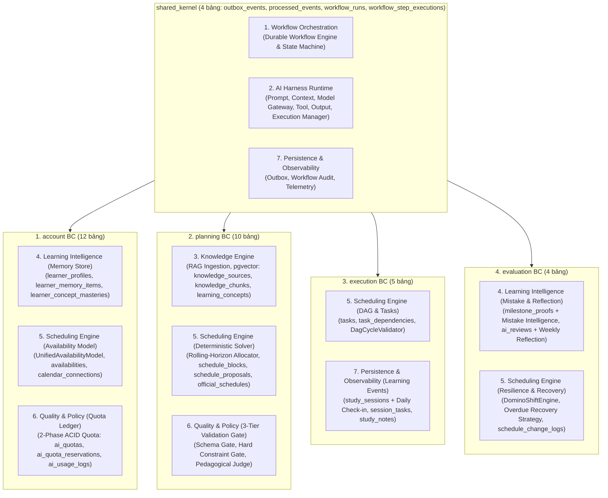

# ADR-001: Lựa chọn Kiến trúc Context-First Modular Monolith kết hợp Hexagonal Architecture (Ports & Adapters) & FocusFlow Learning Intelligence Harness

* **Trạng thái:** Được chấp thuận (Approved — Cập nhật Kiến trúc v2.2; Đồng bộ v3.2: 35 Bảng 3NF/BCNF, PostgreSQL 16 + `pgvector` & FocusFlow Learning Intelligence Harness)
* **Ngày quyết định:** 29/09/2026 (Cập nhật v2.0: 25/10/2026; Cập nhật v2.1: 03/11/2026; Cập nhật v2.2: 05/11/2026)
* **Người quyết định:** Vũ Toàn Thắng, Phan Đình Duẩn
* **Căn cứ đánh giá:** Khung Rubric Đồ án Tốt nghiệp CNTT — Tiêu chí TC2.1 & TC2.3 (Mức 5)
* **Yêu cầu liên quan:** `ASR-01`, `ASR-02`, `ASR-04`, `ASR-06`, Toàn bộ SRS v1.3 (`UC-01` đến `UC-28`), `BUSR-01` đến `BUSR-12`, `NFR-MAINT-001`

---

## 1. Ngữ cảnh & Đặt vấn đề (Context)
FocusFlow là hệ thống hỗ trợ lập kế hoạch và thực thi lộ trình tự học thích ứng tích hợp AI theo mô hình Học tập Tự điều chỉnh của Zimmerman (SRL: Forethought → Performance → Self-Reflection), được nâng cấp với kiến trúc **FocusFlow Learning Intelligence Harness**. Hệ thống chứa nhiều quy tắc nghiệp vụ phức tạp thuộc các miền con khác nhau:
* Quản lý tài khoản, hồ sơ năng lực người học (`LearnerProfile`), bộ nhớ cá nhân hóa có cấu trúc xuyên lộ trình (`LearnerMemoryItem`, `LearnerConceptMastery`), cấu hình quỹ thời gian rảnh lai Mode A/B và mô hình khả dụng thống nhất (`HybridAvailabilityRuleEngine` / `UnifiedAvailabilityModel`), hạn ngạch AI 2 pha (`AIQuota`, `AIQuotaReservation`) và thanh toán nâng cấp gói.
* Thu nạp nguồn tri thức & băm vector RAG (`KnowledgeSource`, `KnowledgeChunk` với `pgvector`), phân rã mục tiêu học tập thành lộ trình và cột mốc (`Roadmap`, `Milestone`), định tuyến qua bộ lập lịch tất định (`DeterministicSchedulingEngine` sinh các `ScheduleBlock` từ `Task` có `estimated_effort`), cổng kiểm duyệt chất lượng 3 tầng và phát hành lịch học chính thức (`OfficialSchedule`).
* Quản lý công việc và đồ thị phụ thuộc không chu trình (`Task`, `TaskDependency`, `DagCycleValidator`), vận hành không gian học tập tập trung (Pomodoro/Stopwatch) kèm khảo sát đầu/cuối phiên (Daily Learning Check-in), ghi nhận Heartbeat 60s, thu hồi phiên treo và đồng bộ lịch ngoại vi (Google Calendar OAuth2 `freeBusy`/`syncToken` & WebCal `.ics`).
* Quản lý bảo lưu/tạm dừng lộ trình (`PauseRecord`), khảo sát năng lực cột mốc kèm phân loại lỗi sai nhận thức (`MilestoneProof` & Mistake Intelligence), phân tích thống kê định lượng, sinh đánh giá AI định kỳ kết hợp phản tư chủ quan (`AIReview`), tịnh tiến lịch tất định (`DominoShiftEngine`), cảnh báo email quá hạn kèm chiến lược phục hồi thông minh và ngắt mạch chống lặp quá hạn (`reschedule_count >= 3`).
* Điều phối các luồng công việc đa bước bền vững (Durable Multi-Step Workflows: `WorkflowRun`, `WorkflowStepExecution`) và vận hành bộ khung **Shared AI Harness Runtime** thống nhất mà không làm phình to kiến trúc thành các dịch vụ phân tán hay tách thành nhiều AI Agent chồng chéo.

Trong phiên bản thiết kế ban đầu (v1.0), việc tổ chức thư mục theo kiểu **Layer-First Monolith** (`src/domain/`, `src/application/`, `src/infrastructure/` dùng chung cho toàn hệ thống) dẫn đến nguy cơ các module nghiệp vụ gọi chéo trực tiếp vào Repository và Entity của nhau, làm mờ ranh giới miền (Bounded Context) và khó bảo trì khi mở rộng lên 28 Use Cases và 35 bảng dữ liệu 3NF/BCNF.

Nhóm phát triển cần một phong cách kiến trúc đảm bảo:
1. **Cô lập miền nghiệp vụ ở cấp độ cao nhất (`ASR-01`):** Khi sửa đổi quy tắc trong một Bounded Context, không một file nội bộ nào của các Context khác bị ảnh hưởng.
2. **Bảo vệ sự tinh khiết của Domain (`Hexagonal Purity`):** Các thuật toán cốt lõi (`HybridAvailabilityRuleEngine`, `DeterministicSchedulingEngine`, `DagCycleValidator`, `DominoShiftEngine`) hoàn toàn độc lập với FastAPI, SQLAlchemy, Taskiq hay LLM SDK.
3. **Đảm bảo tính nhất quán dữ liệu liên module & điều phối bền vững (`ASR-02`):** Không mất sự kiện khi giao tiếp giữa các Bounded Context và không mất trạng thái các workflow đa bước ngay cả khi tiến trình worker gặp sự cố.
4. **Chi phí vận hành tối ưu & Tích hợp gọn gàng 7 Nhóm Trách nhiệm Logic của Learning Intelligence Harness:** Giữ nguyên đúng 4 Bounded Contexts + `shared_kernel`, không tạo Bounded Context thứ 5 và không tách thành 3 AI Agent độc lập gây lãng phí token/context.

---

## 2. Các phương án xem xét (Alternatives Considered)

### Phương án A: Layer-First Monolith truyền thống
* Tổ chức mã nguồn ở cấp cao nhất theo tầng kỹ thuật (`src/domain/`, `src/application/`, `src/infrastructure/`, `src/presentation/`), gom chung tất cả các miền nghiệp vụ vào cùng một thư mục tầng.
* *Ưu điểm:* Quen thuộc, dễ khởi tạo lúc dự án còn nhỏ.
* *Nhược điểm:* Độ gắn kết theo chiều ngang (Horizontal Coupling) cao; các Use Case dễ dàng import chéo ORM Model hoặc Repository của miền khác, vi phạm nguyên tắc đóng gói của Domain-Driven Design (DDD).

### Phương án B: Microservices Architecture hoặc Multi-Agent Mesh (5+ Services / 3 AI Agents riêng biệt)
* Tách vật lý thành nhiều dịch vụ độc lập (`account-service`, `planning-service`, `execution-service`, `evaluation-service`, `ai-agent-service`) hoặc thiết kế 3 AI Agent tự trị nói chuyện với nhau qua hội thoại tự do.
* *Ưu điểm:* Cô lập vật lý ở cấp tiến trình.
* *Nhược điểm:* Quá tải vận hành cho quy mô đồ án tốt nghiệp; mất khả năng kiểm chứng khóa ngoại vật lý 3NF/BCNF trên cùng PostgreSQL; mô hình Multi-Agent tự do gây trôi ngữ cảnh (context drift), nhân bản chi phí token, khó kiểm soát tính tất định của lịch học và làm tăng độ trễ vượt ngưỡng.

### Phương án C: Context-First Modular Monolith kết hợp Hexagonal Architecture (Ports & Adapters) với 4 Bounded Contexts + `shared_kernel` (35 Bảng 3NF/BCNF) (Được chọn)
* Ở **cấp độ 1 (Top-level Package)**, phân rã hệ thống theo **4 Bounded Contexts nghiệp vụ độc lập** (`account`, `planning`, `execution`, `evaluation`) cùng **`shared_kernel`** kỹ thuật — tổng cộng **35 bảng PostgreSQL 16 (`pgvector`) chuẩn 3NF/BCNF**:
  * `account` (**12 bảng**: `users`, `learner_profiles`, `learner_memory_items`, `learner_concept_masteries`, `webcal_tokens`, `calendar_connections`, `availabilities`, `availability_slots`, `ai_quotas`, `ai_quota_reservations`, `ai_usage_logs`, `payment_transactions`): Quản lý định danh, xác thực, hồ sơ SRL, bộ nhớ cá nhân hóa dài hạn & mức độ thành thạo khái niệm xuyên lộ trình, lịch rảnh Mode A/B, kết nối lịch ngoài OAuth2 hai chiều và WebCal một chiều, hạn ngạch AI 2 pha, nhật ký sử dụng AI và thanh toán (`UC-01..UC-06`, `UC-26`, `UC-27`).
  * `planning` (**10 bảng**: `goals`, `roadmaps`, `milestones`, `official_schedules`, `schedule_proposals`, `schedule_blocks`, `learning_concepts`, `concept_prerequisites`, `knowledge_sources`, `knowledge_chunks`): Quản lý mục tiêu, lộ trình, cột mốc, nguồn tài liệu học tập & đoạn văn bản nhúng vector RAG (`pgvector`), đồ thị tri thức (`learning_concepts`, `concept_prerequisites`), bộ lập lịch tất định phân bổ các khối phiên học (`schedule_blocks`), cổng kiểm duyệt chất lượng 3 tầng và lịch chính thức (`UC-07..UC-12`).
  * `execution` (**5 bảng**: `tasks`, `task_dependencies`, `study_sessions`, `session_tasks`, `study_notes`): Quản lý công việc (`estimated_effort`), đồ thị phụ thuộc DAG (`DagCycleValidator`), phiên học Pomodoro/Stopwatch kèm Daily Check-in, ghi chú đúc kết (Key Takeaway), Heartbeat 60s, thu hồi phiên treo và đồng bộ khoảng bận lịch ngoại vi (`UC-11`, `UC-13..UC-18`).
  * `evaluation` (**4 bảng**: `pause_records`, `ai_reviews`, `schedule_change_logs`, `milestone_proofs`): Quản lý bảo lưu lộ trình (`PauseRecord`), khảo sát năng lực cột mốc kèm phân tích lỗi sai (`MilestoneProof` & `mistake_taxonomy_json`), tính toán chỉ số định lượng, đánh giá AI định kỳ kèm phản tư tuần, dịch lịch Domino Shift, cảnh báo email quá hạn + phục hồi lộ trình thông minh, chống lặp quá hạn và giám sát hệ thống (`UC-19..UC-25`, `UC-28`).
  * `shared_kernel` (**4 bảng**: `outbox_events`, `processed_events`, `workflow_runs`, `workflow_step_executions`): Hạt nhân kỹ thuật dùng chung cho Transactional Outbox, Idempotent Consumer, Durable Workflow Orchestration (`workflow_runs`, `workflow_step_executions`), Unit of Work và **Shared AI Harness Runtime** xung quanh `LLMProviderPort`.
* Ở **cấp độ 2 (Bên trong mỗi Bounded Context)**, áp dụng nghiêm ngặt **Kiến trúc Lục giác (Hexagonal Architecture / Ports & Adapters)** với 4 tầng: `domain` ← `application` ← `infrastructure` ← `presentation`, kèm file giao diện công khai duy nhất `public_api.py`.

---

## 3. Quyết định (Decision)
**Chấp thuận Phương án C: Kiến trúc Context-First Modular Monolith kết hợp Hexagonal Architecture (Ports & Adapters)** với 5 quy tắc kiến trúc bắt buộc:

### 3.1. Ranh giới `public_api.py` Nghiêm ngặt cho Truy vấn Đọc Đồng bộ
* Các Bounded Context **tuyệt đối không được phép import** vào bên trong `domain/`, `application/`, `infrastructure/` hoặc `presentation/` của một Context khác.
* Mọi nhu cầu đọc dữ liệu đồng bộ liên Context (ví dụ: `planning` cần đọc `UnifiedAvailabilityModel`, `LearnerMemorySummary` hoặc yêu cầu giữ chỗ Quota từ `account`) bắt buộc phải gọi qua các **Read-Only Query Ports / Facade Protocols** và DTO bất biến được xuất bản tại `src/<context>/public_api.py`.

### 3.2. Hai Cơ chế Sự kiện Phân tầng: In-Process Domain Event Bus & Transactional Outbox
1. **Nội bộ Bounded Context (Intra-Context):** Sử dụng **In-Process Domain Event Bus** (`InProcessEventBus`) để xử lý các phản ứng tức thời trong cùng một giao dịch `AsyncUnitOfWork` của một Context.
2. **Liên Bounded Context (Cross-Context Eventual Consistency):** Sử dụng mẫu **Transactional Outbox (`outbox_events`) + Idempotent Consumer (`processed_events`)**:
   * Khi Aggregate Root phát sinh Domain Event liên Context (như `StudySessionCompletedEvent`, `MilestoneProofEvaluatedEvent`, `UserUpgradedToPremiumEvent`, `OfficialScheduleAppliedEvent`), `SqlAlchemyUnitOfWork` ghi nhận sự kiện vào bảng `outbox_events` trong **cùng một giao dịch ACID** với thay đổi nghiệp vụ.
   * Tiến trình **Outbox Relay Task** trên **Taskiq Worker** đọc các bản ghi `PENDING` (sử dụng `SELECT ... FOR UPDATE SKIP LOCKED`), đẩy vào **Redis Streams (`RedisStreamBroker`)** để Context đích tiêu thụ bất đồng bộ.
   * Context đích kiểm tra `event_id` trong bảng `processed_events` trước khi thực thi nhằm đảm bảo tính **Idempotency (Thực thi đúng 1 lần về mặt hiệu quả)** ngay cả khi thông điệp được gửi lại (At-least-once delivery).

### 3.3. Mô hình Miền Phong phú (Rich Aggregate Roots) & Pure Domain Services
* **Rich Aggregate Roots:** Các thực thể gốc (`User`, `AvailabilityProfile`, `AIQuota`, `Roadmap`, `OfficialSchedule`, `Task`, `StudySession`, `PauseRecord`, `AIReview`) tự đóng gói trạng thái và bảo vệ các bất biến nghiệp vụ (Domain Invariants) bên trong phương thức của mình thay vì dùng Anemic Data Model.
* **Pure Domain Services (100% Pure Python, 0 I/O):** Các giải thuật phức tạp liên thực thể được tách thành các Domain Service thuần khiết không phụ thuộc hạ tầng:
  * `HybridAvailabilityRuleEngine` (trong `account.domain`): Chuẩn hóa `UnifiedAvailabilityModel`, tính toán dung lượng rảnh Mode A (Hard Ceiling) và kiểm tra khe thời gian Mode B (bao gồm dung sai Soft Overflow $\le 30$ phút, khoảng bận ngoại vi và các khe vắt qua nửa đêm).
  * `DeterministicSchedulingEngine` (trong `planning.domain`): Phân bổ các `Task` (`estimated_effort`) vào các khối lịch trình cụ thể `ScheduleBlock` (`scheduled_duration_minutes`) theo cơ chế Rolling-Horizon, cưỡng chế ràng buộc cứng và tối ưu hóa độ bền lịch học (Buffer Time, Recovery Window, Protected Sessions, Schedule Stability).
  * `DagCycleValidator` (trong `execution.domain`): Kiểm định đồ thị phụ thuộc công việc (`tasks` & `task_dependencies`) bằng thuật toán sắp xếp tô-pô / DFS phát hiện chu trình.
  * `DominoShiftEngine` (trong `evaluation.domain`): Tính toán tịnh tiến ngày bắt đầu/kết thúc của các Task và Milestone khi tạm dừng/tiếp tục lộ trình (`pause_records`).

### 3.4. Kiểm chứng Kiến trúc Tự động bằng `import-linter` (Architectural Fitness Functions)
Cấu hình **`import-linter`** ngay trong `backend/pyproject.toml` làm cổng chặn CI/CD tự động với 2 hợp đồng:
* **Contract 1 — Context Isolation (`forbidden`):** Cấm tuyệt đối mọi import chéo giữa các gói nội bộ của `account`, `planning`, `execution`, `evaluation` (ngoại trừ `src.<context>.public_api` và `src.shared_kernel`).
* **Contract 2 — Hexagonal Layer Purity (`layers`):** Cưỡng chế chiều phụ thuộc một chiều `presentation -> infrastructure -> application -> domain` bên trong từng Bounded Context; tầng `domain` không được import bất kỳ thư viện hạ tầng nào (`fastapi`, `sqlalchemy`, `taskiq`, `redis`, `google-genai`).

### 3.5. Ánh xạ 7 Nhóm Trách nhiệm Logic của FocusFlow Learning Intelligence Harness vào 4 Bounded Contexts + `shared_kernel`
Kiến trúc **FocusFlow Learning Intelligence Harness** tổ chức hệ thống thành **7 Nhóm Trách nhiệm Logic (7 Logical Responsibility Groups)**. Thay vì tạo thêm Bounded Context thứ 5 hay tách thành 3 AI Agent rời rạc, cả 7 nhóm này được ánh xạ gọn gàng, rõ ràng vào đúng **4 Bounded Contexts + `shared_kernel`** hiện hữu:

| Nhóm Trách nhiệm Logic (Harness Group) | Vai trò Kiến trúc Cốt lõi | Vị trí trong 4 Bounded Contexts + `shared_kernel` | Bảng CSDL PostgreSQL 16 Liên quan |
| :--- | :--- | :--- | :--- |
| **1. `Workflow Orchestration`** | Điều phối trạng thái bền vững cho 5 luồng nghiệp vụ đa bước (`PLAN_CREATION`, `SCHEDULE_GENERATION`, `OVERDUE_RECOVERY`, `WEEKLY_REVIEW`, `CONTINUOUS_LEARNING`), cho phép tạm dừng chờ người học trả lời phỏng vấn chẩn đoán hoặc bấm duyệt và resume an toàn. | Điều phối viên cốt lõi đặt tại `shared_kernel/application/workflow/`; các trình thực thi bước nghiệp vụ (Step Handlers) nằm tại tầng `application` của `planning`, `execution`, `evaluation`, `account`. | `workflow_runs`, `workflow_step_executions` (`shared_kernel`) |
| **2. `AI Harness Runtime`** | Bộ khung thực thi AI dùng chung bọc quanh `LLMProviderPort`: `Prompt Engine` (`PromptSanitizer`), `Context Engine` (5 tầng ngữ cảnh & 3 tầng vòng đời), `Model Gateway` (`GeminiAdapter` + `MockLLMAdapter`), `Tool Registry` (read-only), `Output Engine` (Pydantic v2) và `Execution Manager`. | Đặt tại `shared_kernel/application/ai_harness/` và `shared_kernel/infrastructure/external_ai/`; được gọi thống nhất bởi mọi Use Case cần suy luận AI mà không tách thành 3 AI Agent độc lập. | `ai_quotas`, `ai_quota_reservations`, `ai_usage_logs` (`account`) |
| **3. `Knowledge Engine`** | Thu nạp tài liệu/giáo trình của người học, phân đoạn ngữ nghĩa, tạo vector embedding (`text-embedding-004` / `pgvector`), truy xuất lai (Hybrid RAG) và xây dựng đồ thị khái niệm tiên quyết có truy vết nguồn (`source_chunk_ids`). | Thuộc quyền sở hữu của Bounded Context **`planning`** (`planning/domain/` & `planning/infrastructure/knowledge/`). | `knowledge_sources`, `knowledge_chunks`, `learning_concepts`, `concept_prerequisites` (`planning`) |
| **4. `Learning Intelligence`** | Cá nhân hóa dài hạn xuyên nhiều lộ trình: quản lý 6 nhóm mô hình người học, 4 loại bộ nhớ, 3 cấp độ nhận thức luận (Explicit/Observed/Inferred), theo dõi độ thành thạo khái niệm (`Skill Mastery`), phân tích lỗi sai (`Mistake Intelligence`) và phản tư định kỳ. | Lưu trữ & tổng hợp bộ nhớ dài hạn tại **`account`** (`learner_profiles`, `learner_memory_items`, `learner_concept_masteries`); thu thập tín hiệu thực thi tại **`execution`** (`study_sessions`, `study_notes`) và thẩm định chuyên sâu tại **`evaluation`** (`milestone_proofs`, `ai_reviews`). | `learner_profiles`, `learner_memory_items`, `learner_concept_masteries` (`account`); `milestone_proofs`, `ai_reviews` (`evaluation`) |
| **5. `Scheduling Engine`** | Tách bạch hoàn toàn việc **AI sinh Lộ trình/Chiến lược** với việc **Giải thuật tất định xếp Lịch học**: hợp nhất quỹ thời gian rảnh (`UnifiedAvailabilityModel`), cắt nhỏ `Task` (`estimated_effort`) thành các `ScheduleBlock` (`scheduled_duration_minutes`) theo Rolling-Horizon, bảo đảm Schedule Resilience (Buffer Time, Recovery Window, Protected Sessions) và Domino Shift. | Моhình khả dụng tại **`account`** (`HybridAvailabilityRuleEngine`); bộ giải lập lịch tất định & Rolling-Horizon tại **`planning`** (`DeterministicSchedulingEngine`); kiểm định DAG tại **`execution`** (`DagCycleValidator`); dịch lịch bảo lưu tại **`evaluation`** (`DominoShiftEngine`). | `availabilities`, `availability_slots`, `calendar_connections` (`account`); `official_schedules`, `schedule_proposals`, `schedule_blocks` (`planning`); `tasks`, `task_dependencies` (`execution`); `pause_records`, `schedule_change_logs` (`evaluation`) |
| **6. `Quality & Policy`** | Thực thi Cổng Kiểm duyệt 3 Tầng (`ProposalValidationGateOrchestrator`), Guard chống Fake Takeaway, hạn ngạch AI ACID 2 pha, ngân sách dời lịch hàng tuần và bộ khung đánh giá thực nghiệm 10 chỉ số (`AI Evaluation Harness`). | Cổng kiểm duyệt lịch trình tại **`planning`**; Takeaway Guard tại **`execution`**; chính sách chống trì hoãn & Prove Mode tại **`evaluation`**; chính sách hạn ngạch tại **`account`**. | `schedule_proposals` (`planning`); `ai_quotas`, `ai_quota_reservations` (`account`); `study_notes` (`execution`); `milestone_proofs` (`evaluation`) |
| **7. `Persistence & Observability`** | Lưu trữ bền vững 35 bảng 3NF/BCNF, phân biệt rạch ròi giữa `AI Execution Run` và `Learning Event`, đảm bảo Transactional Outbox và cung cấp telemetry toàn diện. | Phân bổ xuyên suốt 4 Bounded Contexts + `shared_kernel` theo đúng ranh giới sở hữu bảng. | Toàn bộ **35 bảng** (`12 account` + `10 planning` + `5 execution` + `4 evaluation` + `4 shared_kernel`) |

---

## 4. Lý do & Đánh đổi (Rationale & Trade-Offs)
* **Cô lập Mô-đun Tuyệt đối & Không Phình To Kiến trúc (`ASR-01`):** Tổ chức Context-First kết hợp ánh xạ 7 nhóm trách nhiệm của Learning Intelligence Harness vào đúng 4 Bounded Contexts + `shared_kernel` giúp hệ thống đạt năng lực cá nhân hóa và lập lịch thích ứng sâu sắc mà không phải tạo thêm Bounded Context thứ 5 hay quản lý nhiều AI Agent rời rạc.
* **Khả năng Kiểm thử Đơn vị Tối đa (Testability):** Toàn bộ `HybridAvailabilityRuleEngine`, `DeterministicSchedulingEngine`, `DagCycleValidator`, `DominoShiftEngine` và các Aggregate Roots có thể được kiểm thử bằng `pytest` trong vài mili-giây mà không cần khởi tạo PostgreSQL, Redis hay gọi LLM thật.
* **Đánh đổi Chấp nhận được:** Cần định nghĩa các DTO tại `public_api.py` và mapper giữa ORM Model với Domain Entity (35 bảng). Chi phí viết code tăng nhẹ ở giai đoạn đầu nhưng đổi lại sự an toàn kiểu dữ liệu và không bao giờ bị rò rỉ ORM Session chéo module.

---

## 5. Hệ quả & Kiểm chứng (Consequences & Verification)
* **Tích cực:** Giải quyết triệt để mâu thuẫn giữa kiến trúc phân tầng cũ và mô hình DDD; đồng bộ 100% với lược đồ 35 bảng PostgreSQL 16 (`pgvector`) chuẩn 3NF/BCNF và thiết kế FocusFlow Learning Intelligence Harness; đạt chuẩn mực cao nhất của Tiêu chí Rubric TC2.1.
* **Kiểm chứng Tự động:** Lệnh `lint-imports` (`import-linter`) phải trả về `0 broken contracts` trước khi hợp nhất bất kỳ nhánh mã nguồn nào.
