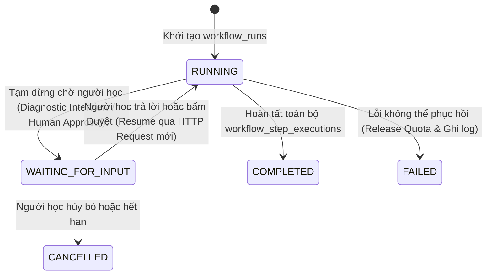

# ADR-004: Lựa chọn Giải pháp Hàng đợi Tác vụ Nền, Lịch Định kỳ Thuần Async (Taskiq + Redis Streams) & Điều phối Luồng Công việc Bền vững (Durable Workflow Orchestration)

* **Trạng thái:** Được chấp thuận (Approved — Cập nhật Kiến trúc v2.2: Tích hợp Durable Workflow Orchestration trên `workflow_runs` & `workflow_step_executions`)
* **Ngày quyết định:** 29/09/2026 (Cập nhật v2.0: 25/10/2026; Cập nhật v2.2: 05/11/2026)
* **Người quyết định:** Vũ Toàn Thắng, Phan Đình Duẩn
* **Căn cứ đánh giá:** Khung Rubric Đồ án Tốt nghiệp CNTT — Tiêu chí TC2.1 & TC2.3 (Mức 5)
* **Yêu cầu liên quan:** `ASR-01`, `ASR-02`, `ASR-05`, `FR-SESSION-003`, `FR-ADAPT-001`, `FR-ADAPT-003`, `FR-REPORT-001`, `UC-06`, `UC-07`, `UC-08`, `UC-12`, `UC-16`, `UC-17`, `UC-18`, `UC-21`, `UC-23`, `UC-24`, `UC-25`, `OS-01`, `OS-07`, `BUSR-02`, `BUSR-03`, `BUSR-06`, `BUSR-09`, `NFR-PERF-002`, `NFR-AVAIL-001`

---

## 1. Ngữ cảnh & Đặt vấn đề (Context)
Hệ thống FocusFlow sở hữu nhiều luồng xử lý nền, công việc định kỳ và đặc biệt là các **luồng công việc thông minh đa bước (Multi-Step Learning Intelligence Workflows)** không được phép làm nghẽn chu kỳ HTTP Request-Response hoặc mất trạng thái khi tiến trình khởi động lại:
1. **Điều phối Luồng Công việc Đa bước Bền vững (Durable Workflow Orchestration — `ASR-02`):** Các luồng nghiệp vụ cốt lõi như `PLAN_CREATION` (Phỏng vấn chẩn đoán $\to$ Thu nạp RAG $\to$ Sinh Lộ trình $\to$ Chờ duyệt Milestones), `SCHEDULE_GENERATION` (Chuẩn hóa lịch rảnh $\to$ Lập lịch tất định Rolling-Horizon $\to$ Cổng kiểm duyệt 3 tầng $\to$ Chờ duyệt `ScheduleProposal`), `OVERDUE_RECOVERY`, `WEEKLY_REVIEW` và `CONTINUOUS_LEARNING` kéo dài qua nhiều HTTP requests và có thể **tạm dừng nhiều giờ hoặc nhiều ngày** để chờ tương tác của người học (ví dụ: trả lời câu hỏi phỏng vấn chẩn đoán hoặc bấm nút phê duyệt Human-in-the-Loop).
2. **Chuyển tiếp Sự kiện Liên Bounded Context (Transactional Outbox Relay - `ASR-02`):** Đọc các sự kiện miền từ bảng `outbox_events` và phát tới các trình xử lý bất đồng bộ của Context đích mà không được phép làm mất sự kiện.
3. **Ghi nhận Heartbeat 60s & Quét Phiên học Treo sau 5 phút (`ASR-05`, `OS-01`, `OS-07`):** Tự động thu hồi các phiên học `IN_PROGRESS` mất kết nối quá 5 phút, bảo toàn tiến độ của người học với độ lệch $\le 60\text{s}$.
4. **Thu hồi Giữ chỗ Hạn ngạch AI Hết hạn (`Quota Sweeper` - `ASR-02`):** Quét bảng `ai_quota_reservations` để giải phóng các lượt `RESERVED` bị quá hạn `expires_at` do sự cố mạng hoặc đứt kết nối SSE.
5. **Quét Nhiệm vụ Quá hạn, Thông báo Email & Ngắt mạch Chống lặp (`Overdue Scanner / Overdue Anti-Loop Sweeper` - `FR-ADAPT-001`, `FR-ADAPT-003`):** Chạy định kỳ lúc `00:05 UTC+7` để phát hiện các nhiệm vụ quá hạn (`scheduled_date < CURRENT_DATE` và `status != 'COMPLETED'`), gửi thông báo Email tới người học (không tự ý sửa ngầm `scheduled_date`), hiển thị cảnh báo trong mục `Needs Attention` kèm luồng phục hồi `OVERDUE_RECOVERY` và kích hoạt trạng thái `STALLED` khi `reschedule_count >= 3`.
6. **Tổng hợp Bộ nhớ & Hồ sơ Năng lực Người học (`Learner Intelligence & Memory Aggregator` - `FR-PROFILE-001`):** Chạy luồng `CONTINUOUS_LEARNING` để cập nhật các chỉ số SRL ($D_{opt}$, $\beta_{bias}$, khung giờ đỉnh) và suy diễn bộ nhớ cá nhân hóa có cấu trúc (`learner_profiles`, `learner_memory_items`, `learner_concept_masteries`).
7. **Đồng bộ Lịch Ngoại vi 2 Chiều & Xuất Lịch (`Calendar Sync` - `UC-17`, `UC-18`):** Đồng bộ gia tăng các khoảng bận (`freeBusy` & `syncToken`) với Google Calendar OAuth2 (`UC-17`) và phát xuất WebCal Feed (`UC-18`).

### Lý do Loại bỏ Celery + Celery Beat (từ bản v1.0)
Trong bản thiết kế v1.0, nhóm từng lựa chọn **Celery 5.6 + Celery Beat**. Tuy nhiên, quá trình rà soát kiến trúc sâu cho thấy Celery có **độ lệch pha nghiêm trọng (Impedance Mismatch)** với ngăn xếp bất đồng bộ `FastAPI + SQLAlchemy 2.0 Async (asyncpg)` của FocusFlow (`ADR-002`):
* Celery được thiết kế trên nền tảng **đồng bộ (Synchronous/Threaded/Prefork)**. Để gọi các Use Case `async def` và `AsyncUnitOfWork` (`asyncpg`) bên trong Celery task, lập trình viên buộc phải bọc qua `asyncio.run(...)` hoặc tự quản lý vòng lặp sự kiện mỗi lần chạy task, đồng thời phải cấu hình `NullPool` cho SQLAlchemy để tránh lỗi *`Task attached to a different loop`*.
* Celery không thể chia sẻ trực tiếp hệ thống Dependency Injection bất đồng bộ của FastAPI, dẫn đến mã nguồn khởi tạo Use Case bị nhân bản ở hai nơi.

---

## 2. Các phương án xem xét (Alternatives Considered)

### Phương án A: FastAPI `BackgroundTasks` Nội bộ + Lưu trạng thái Workflow trong RAM/Redis tạm thời
* *Ưu điểm:* Có sẵn trong FastAPI, không cần tiến trình riêng.
* *Nhược điểm:* Chạy chung tiến trình với API server; nếu container `backend` hoặc `redis` khởi động lại, toàn bộ tác vụ đang chạy và trạng thái workflow đa bước đang chờ người học duyệt bị mất trắng; không có cơ chế lưu trữ bền vững, không có ACK hay bộ lập lịch định kỳ độc lập.

### Phương án B: Celery 5.6 + Celery Beat (Đã bác bỏ ở v2.0)
* *Ưu điểm:* Phổ biến trong các ứng dụng Python đồng bộ truyền thống (Django/Flask).
* *Nhược điểm:* Bất tương thích gốc với `asyncio` và `SQLAlchemy AsyncSession`; tốn bộ nhớ; không chia sẻ được DI với FastAPI; gây lỗi vòng lặp sự kiện khi tái sử dụng connection pool của `asyncpg`.

### Phương án C: Taskiq + Redis Streams (`RedisStreamBroker`, `TaskiqScheduler`) kết hợp Điều phối Luồng Công việc Bền vững trên PostgreSQL (`workflow_runs` & `workflow_step_executions`) (Được chọn)
* Sử dụng **Taskiq** — bộ khung hàng đợi tác vụ phân tán **thuần `async/await` (Async-Native)** hiện đại nhất cho Python 3.12+.
* Sử dụng **Redis Streams (`RedisStreamBroker` từ `taskiq-redis`)** với cơ chế Consumer Group (`XREADGROUP`) và xác nhận hoàn tất tường minh (`XACK`) để vận chuyển tín hiệu thực thi bước công việc.
* Tích hợp **`taskiq-fastapi`** để dùng chung 100% hệ thống Dependency Injection (`TaskiqDepends`) và `AsyncSession` pool với FastAPI.
* Sử dụng **`TaskiqScheduler`** chạy trong container độc lập (`replicas: 1`) cho toàn bộ các tác vụ định kỳ (Cron/Interval).
* **Nguyên lý Bền vững Cốt lõi:** Lưu trữ toàn bộ trạng thái nghiệp vụ của các workflow đa bước trong 2 bảng PostgreSQL chuẩn 3NF/BCNF thuộc `shared_kernel` (**`workflow_runs`** và **`workflow_step_executions`**), tách biệt hoàn toàn với hàng đợi vận chuyển tạm thời trong Redis.

---

## 3. Quyết định (Decision)
**Chấp thuận Phương án C: Chuẩn hóa toàn bộ hệ thống tác vụ nền, lập lịch định kỳ và điều phối workflow đa bước sang Taskiq + Redis Streams kết hợp Durable Workflow State trên PostgreSQL 16:**

### 3.1. Tại sao Taskiq + Redis Streams Vượt trội
1. **Thuần `async def` 100%:** Mọi task là hàm `async def` chạy trên cùng một `asyncio` event loop liên tục của worker, sử dụng trực tiếp connection pool của `SQLAlchemy 2.0 AsyncEngine` (`asyncpg`) mà không cần `asyncio.run()` hay `NullPool`.
2. **Chia sẻ Dependency Injection với FastAPI (`taskiq-fastapi`):** Cho phép tiêm `AsyncUnitOfWork` và các Use Cases vào task thông qua `TaskiqDepends` ngay tại Composition Root (`presentation/deps.py`).
3. **Độ tin cậy Chuẩn Công nghiệp với Redis Streams (`XREADGROUP` / `XACK`):** Khác với Redis Pub/Sub hay List (`LPUSH`/`BRPOP`) dễ mất message khi worker chết giữa chừng, `RedisStreamBroker` giữ message trong Pending Entries List (PEL) cho đến khi worker xử lý xong và gửi lệnh `XACK`.
4. **Dễ dàng Hoán đổi Broker:** Tuân thủ triệt để kiến trúc Hexagonal, cấu hình broker nằm gọn trong `shared_kernel/infrastructure/worker/`.

### 3.2. Nguyên lý Kiến trúc: Điều phối Luồng Công việc Đa bước Bền vững (Durable Workflow Orchestration)
Để vận hành **FocusFlow Learning Intelligence Harness** một cách tin cậy, hệ thống áp dụng kiến trúc **Durable Workflow Orchestration** với 3 nguyên tắc bất biến:

1. **Năm Luồng Công việc Đa bước Cốt lõi (5 Multi-Step Workflows):**
   * `PLAN_CREATION` (**Workflow A — Khởi tạo Lộ trình**): Thu thập mục tiêu & phỏng vấn chẩn đoán (Diagnostic Interview) $\to$ Truy xuất tri thức RAG từ `Knowledge Engine` (`knowledge_sources`, `knowledge_chunks`) $\to$ AI sinh `Milestones`, `Tasks` (`estimated_effort`), `TaskDependency` DAG & tài liệu tham khảo có nguồn gốc $\to$ Tạm dừng ở trạng thái `WAITING_FOR_INPUT` để chờ người học duyệt Milestones.
   * `SCHEDULE_GENERATION` (**Phân bổ Lịch học Tất định**): Nhận danh sách Tasks đã duyệt $\to$ Tổng hợp `UnifiedAvailabilityModel` (Mode A/B + Google Calendar `freeBusy`) $\to$ Chạy `DeterministicSchedulingEngine` (Rolling-Horizon) cắt Tasks thành các khối phiên học `schedule_blocks` (`scheduled_duration_minutes`) $\to$ Kiểm duyệt qua Cổng 3 Tầng $\to$ Lưu `ScheduleProposal(DRAFT)` và tạm dừng chờ người học bấm `Apply`.
   * `OVERDUE_RECOVERY` (**Workflow B — Phục hồi Quá hạn Thích ứng**): Phân tích nguyên nhân gốc rễ các task bị trễ $\to$ AI đề xuất chiến lược tái lập lịch (`Replanning Strategy`: dời lịch, chia nhỏ task, thu hẹp phạm vi, sắp xếp lại thứ tự) kèm giải thích `placement_rationale` $\to$ Chạy `DeterministicSchedulingEngine` với cơ chế bảo vệ các phiên học ổn định (`Protected Sessions` & `Schedule Stability`) $\to$ Kiểm duyệt qua Cổng 3 Tầng $\to$ Chờ người học duyệt trên bảng đối chiếu `Recovery Proposal Diff`.
   * `WEEKLY_REVIEW` (**Workflow C — Phản tư & Điều chỉnh Hàng tuần**): Thu thập chỉ số thực thi tuần và 2–3 câu hỏi tự phản tư của người học (`user_reflection_payload`) $\to$ AI phân tích điểm nghẽn và đề xuất điều chỉnh chiến lược cho tuần kế tiếp.
   * `CONTINUOUS_LEARNING` (**Workflow D — Học tập & Cập nhật Bộ nhớ Liên tục**): Chạy bất đồng bộ sau mỗi phiên học hoặc bài kiểm tra Prove Mode để trích xuất tín hiệu, cập nhật độ thành thạo khái niệm (`learner_concept_masteries`), phân loại lỗi sai (`mistake_taxonomy_json`) và hợp nhất bộ nhớ dài hạn (`learner_memory_items`).
2. **Trạng thái Nghiệp vụ Bền vững trên PostgreSQL (`workflow_runs` & `workflow_step_executions`):**
   * Một luồng công việc có thể trải dài qua nhiều HTTP requests và **tạm dừng nhiều ngày** chờ quyết định của con người (`WAITING_FOR_INPUT`). Do đó, trạng thái luồng công việc **TUYỆT ĐỐI KHÔNG bao giờ được coi là trạng thái tạm thời (ephemeral state) nằm trong hàng đợi Redis của Taskiq**.
   * Mọi phiên chạy workflow được định danh và lưu bền vững tại bảng **`workflow_runs`** (`workflow_type`, `status`, `current_step_name`, `context_snapshot_json`, `correlation_id`), và từng bước thực thi tuần tự được ghi nhật ký ACID tại bảng **`workflow_step_executions`** (`step_name`, `step_order`, `status`, `input_payload`, `output_payload`, `error_details`, `attempt_count`).
   * **Phục hồi Sau Sự cố (Crash Recovery & Resumability):** Nếu tiến trình Taskiq Worker hoặc container Redis khởi động lại giữa chừng, điều phối viên sẽ đọc `workflow_runs` và tiếp tục thực thi chính xác từ bước chưa hoàn tất cuối cùng (`last uncommitted step`) trong `workflow_step_executions` mà không phải chạy lại các bước đã thành công trước đó.
3. **Phân biệt Tường minh giữa `AI Execution Run` và `Learning Event`:**
   * **`AI Execution Run` (`workflow_runs`, `workflow_step_executions`, `ai_usage_logs`):** Phản ánh vết thực thi kỹ thuật của hệ thống điều phối và bộ khung AI (trạng thái bước chạy, thời gian phản hồi, số lượng token tiêu thụ, chi phí mô hình, mã lỗi retry).
   * **`Learning Event` (`study_sessions`, `study_notes`, `milestone_proofs`, `schedule_change_logs`):** Phản ánh sự kiện học tập và hành vi sư phạm thực tế của người học (thời gian tập trung thực tế, trạng thái tâm lý check-in đầu/cuối buổi, nội dung đúc kết kiến thức, kết quả kiểm chứng năng lực và lịch sử thay đổi cam kết). Hai nhóm dữ liệu này được lưu trữ tách biệt rõ ràng để đảm bảo tính minh bạch khi kiểm toán và đánh giá thực nghiệm.

### 3.3. Năm Quy tắc Vận hành Bắt buộc (5 Production Rules)
1. **Quy tắc 1 — `scheduler` bắt buộc chạy Đơn bản (`replicas: 1`):** Container `scheduler` (`taskiq scheduler`) chỉ có nhiệm vụ phát lệnh kích hoạt theo lịch vào Redis Stream nên **bắt buộc cấu hình `replicas: 1`** để không bao giờ phát trùng sự kiện cron. Ngược lại, container `worker` (`taskiq worker`) có thể mở rộng nhiều bản sao (`replicas: N`) tùy theo tải.
2. **Quy tắc 2 — Tác vụ & Bước Workflow Bắt buộc có Tính Lũy đẳng (Idempotent Tasks & Steps):** Mọi task xử lý sự kiện liên Context phải kiểm tra `event_id` trong bảng `processed_events` trước khi thực thi; mọi bước trong `workflow_step_executions` kiểm tra khóa `(workflow_run_id, step_name)` và mọi task quét định kỳ (Sweeper) phải sử dụng khóa hàng **`SELECT ... FOR UPDATE SKIP LOCKED`** trong PostgreSQL để chống race condition tuyệt đối.
3. **Quy tắc 3 — Chỉ truyền Định danh Nguyên thủy (Pass Primitive UUIDv7 IDs Only):** Payload đẩy vào Redis Streams chỉ chứa các kiểu nguyên thủy nhẹ (chuỗi `UUIDv7` như `workflow_run_id`, `step_execution_id`, `event_id`), tuyệt đối không serialize đối tượng ORM hay dữ liệu ngữ cảnh lớn vào message broker; worker sẽ tự nạp trạng thái mới nhất từ PostgreSQL thông qua `AsyncUnitOfWork`.
4. **Quy tắc 4 — Kiểm soát Timeout, Exponential Backoff & Redis AOF:** Mọi task gọi dịch vụ ngoài (LLM, Google Calendar) phải gắn giới hạn thời gian chạy (timeout) và chính sách thử lại lũy thừa (Exponential Backoff + Jitter) qua `SimpleRetryMiddleware`; dịch vụ Redis 7 bắt buộc bật chế độ lưu trữ bền vững **`--appendonly yes` (AOF)**.
5. **Quy tắc 5 — Tách tải Tác vụ Nặng CPU (Offload Heavy CPU Work):** Vì Taskiq worker chạy trên `asyncio` event loop, bất kỳ bước tính toán đồng bộ nặng CPU nào (như bộ giải tối ưu hóa lịch trình `DeterministicSchedulingEngine` / CP-SAT hoặc phân đoạn tài liệu RAG) phải được đẩy sang `asyncio.to_thread()` để không làm nghẽn vòng lặp sự kiện của các task I/O khác.

### 3.4. Danh mục 6 Nhóm Tác vụ Nền & Định kỳ Cốt lõi
1. **Outbox Relay & Durable Workflow Step Runner (`shared_kernel`):** Quét bảng `outbox_events` (`status = 'PENDING'`) với `SELECT ... FOR UPDATE SKIP LOCKED`, phát sự kiện sang các Taskiq handlers của Context đích và điều phối việc thực thi/khôi phục các bước trong `workflow_runs` / `workflow_step_executions`.
2. **60s Heartbeat & 5-Minute Abandoned Session Sweeper (`execution` - `ASR-05`, `OS-01`, `OS-07`):**
   * Client gửi Heartbeat mỗi 60s qua `POST /api/v1/sessions/{id}/heartbeat` ghi trực tiếp `actual_minutes` và `last_heartbeat_at = NOW()` xuống bảng `study_sessions` (PostgreSQL).
   * `TaskiqScheduler` kích hoạt `AbandonedSessionSweeperTask` mỗi 60 giây để quét các phiên `status = 'IN_PROGRESS'` có `last_heartbeat_at < NOW() - INTERVAL '5 minutes'` (tận dụng Partial Index `idx_study_sessions_in_progress` và `FOR UPDATE SKIP LOCKED`). Áp dụng quy tắc `OS-01` để chốt `PARTIAL_COMPLETED` hoặc `CANCELLED` và phát sự kiện ra Outbox.
3. **AI Quota Reservation Sweeper (`account` - `ASR-02`, `FR-QUOTA-001`, `UC-06`):** Định kỳ mỗi 60 giây quét bảng `ai_quota_reservations` có `status = 'RESERVED'` và `expires_at < NOW()` (quá hạn TTL **5 phút (300 giây)** theo `SRS v1.3` Mục 16, `FR-QUOTA-001`, `schema.sql` `INTERVAL '300 seconds'` và `ADR-009`), tự động hoàn trả số lượt giữ chỗ (`reserved_calls`) về bảng `ai_quotas` và chuyển trạng thái sang `'EXPIRED'`.
4. **Overdue Scanner & Anti-Loop Sweeper (`evaluation` - `00:05 UTC+7`, `FR-ADAPT-001`, `FR-ADAPT-003`, `UC-25`):** Quét các nhiệm vụ quá hạn (`scheduled_date < CURRENT_DATE` và `status != 'COMPLETED'`) định kỳ lúc `00:05 UTC+7`. Tác vụ **tuyệt đối KHÔNG tự động thay đổi ngầm `scheduled_date` (does NOT silently mutate `scheduled_date`)**; thay vào đó, hệ thống gửi **Email Notification** tới địa chỉ email đăng ký của người dùng (qua `EmailNotificationPort` / SMTP Adapter) và đưa các task quá hạn vào khu vực **`Needs Attention`** kèm nút kích hoạt luồng **`OVERDUE_RECOVERY` ("AI Reschedule - Dời lịch hợp lý")** (`UC-23`) khi người học đăng nhập ứng dụng Web. Khi người học kích hoạt phục hồi trên một lộ trình quá hạn, AI phân tích nguyên nhân trễ và đề xuất chiến lược phục hồi (`Replanning Strategy` kèm `placement_rationale`), sau đó **`DeterministicSchedulingEngine`** phân bổ lại các khối lịch học (`schedule_blocks`) vào thời gian trống tương lai của riêng lộ trình đó và đi qua **Cổng Kiểm duyệt 3 Tầng (`UC-12`)** để lưu bản nháp `ScheduleProposal(DRAFT)`. Chỉ khi người học chủ động phê duyệt (`Apply`), hệ thống mới cập nhật vào lịch chính thức `OfficialSchedule` và tăng `reschedule_count` thêm 1 (nếu chạm ngưỡng `reschedule_count >= 3` thì kích hoạt cơ chế leo thang chống lặp `STALLED`).
5. **Continuous Learning & Learner Memory Aggregator (`account` - `FR-PROFILE-001`, `UC-03`):** Thực thi workflow `CONTINUOUS_LEARNING` khi nhận sự kiện `StudySessionCompletedEvent` hoặc `MilestoneProofEvaluatedEvent` từ Outbox để tính toán lại các tham số năng lực SRL ($D_{opt}$, $\beta_{bias}$, khung giờ tập trung đỉnh) trong `learner_profiles`, cập nhật mức độ thành thạo khái niệm trong `learner_concept_masteries`, và suy diễn có kiểm chứng các mục nhớ cá nhân hóa trong `learner_memory_items`.
6. **External Calendar Incremental Sync Task (`execution` / `account` - `UC-17`, `UC-18`):** Thực thi đồng bộ bất đồng bộ 2 chiều có kiểm soát với Google Calendar OAuth2 API (`UC-17` - đọc khoảng bận `freeBusy` & đồng bộ gia tăng qua `syncToken` để chuẩn hóa thành `UnifiedAvailabilityModel`, đồng thời đẩy lịch học mới khi `OfficialScheduleAppliedEvent` được phát ra) và đồng bộ xuất lịch WebCal Feed (`UC-18`).

---

## 4. Lý do & Đánh đổi (Rationale & Trade-Offs)
* **Đồng nhất Kiến trúc 100% (`ASR-01`, `ASR-02`):** Loại bỏ hoàn toàn sự chắp vá giữa Sync (Celery) và Async (FastAPI/SQLAlchemy 2.0), giúp toàn bộ codebase dùng chung một mô hình lập trình `async/await` và `AsyncUnitOfWork`.
* **Độ bền Luồng Công việc Tuyệt đối (Durable Workflows):** Lưu trữ trạng thái workflow trong `workflow_runs` và `workflow_step_executions` trên PostgreSQL đảm bảo các quy trình tương tác nhiều bước (có tạm dừng chờ người dùng) không bao giờ bị mất dấu hay phải chạy lại từ đầu khi worker restart.
* **Bảo vệ Nỗ lực Người học (`ASR-05`):** Ghi nhận Heartbeat 60s trực tiếp xuống PostgreSQL kết hợp quét `FOR UPDATE SKIP LOCKED` qua Taskiq đảm bảo không mất quá 60s tiến độ học tập ngay cả khi mất mạng hoặc sập trình duyệt.
* **Đánh đổi:** Cần ghi nhận trạng thái bước chạy vào bảng `workflow_step_executions`, làm tăng nhẹ số lượng thao tác ghi DB nhưng đổi lại khả năng quan sát (observability), kiểm toán và tự phục hồi (crash recovery) đạt chuẩn công nghiệp.

---

## 5. Hệ quả & Kiểm chứng (Consequences & Verification)
* **Tích cực:** Hệ thống xử lý tác vụ nền nhẹ nhàng, tiêu thụ ít RAM hơn Celery, hỗ trợ đầy đủ Transactional Outbox, Idempotent Consumer và Durable Multi-Step Workflows.
* **Kiểm chứng Tự động:** Các task của Taskiq và trình điều phối `WorkflowOrchestrator` được kiểm thử trực tiếp trong `pytest-asyncio` bằng `InMemoryBroker` (kiểm chứng kịch bản worker bị ngắt giữa bước $k$ và tự động resume từ bước $k$ trong `workflow_step_executions`).
