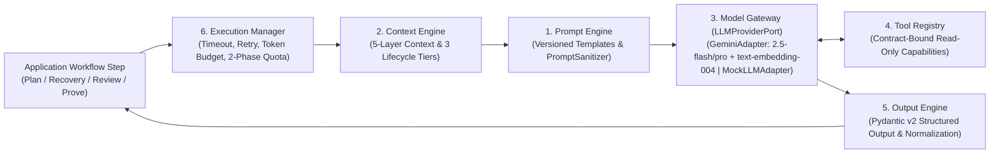

# ADR-005: Kiến trúc Shared AI Harness Runtime quanh `LLMProviderPort`, Giao thức SSE 2 Chặng Đồng nhất & Giữ chỗ Quota ACID 2 Pha

* **Trạng thái:** Được chấp thuận (Approved — Cập nhật Kiến trúc v2.2: Tích hợp Shared AI Harness Runtime 6 Thành phần lấy cảm hứng từ Hermes & Claude Architecture)
* **Ngày quyết định:** 29/09/2026 (Cập nhật v2.0: 25/10/2026; Cập nhật v2.2: 05/11/2026)
* **Người quyết định:** Vũ Toàn Thắng, Phan Đình Duẩn
* **Căn cứ đánh giá:** Khung Rubric Đồ án Tốt nghiệp CNTT — Tiêu chí TC2.1 & TC2.3 (Mức 5)
* **Yêu cầu liên quan:** `ASR-02`, `ASR-03`, `ASR-06`, `FR-PLAN-001`, `FR-PLAN-002`, `FR-PLAN-003`, `FR-QUOTA-001`, `NFR-PERF-001`, `NFR-AI-001`, `NFR-SEC-003`, `BUSR-02`, `BUSR-10`

---

## 1. Ngữ cảnh & Đặt vấn đề (Context)
Trong FocusFlow, trí tuệ nhân tạo (LLM) tham gia vào các luồng công việc cốt lõi của **FocusFlow Learning Intelligence Harness**: phỏng vấn chẩn đoán và phân rã mục tiêu thành lộ trình học tập (`PLAN_CREATION` — `UC-07`), thẩm định sư phạm (`Tier 3 Judge` — `UC-12`), chẩn đoán nguyên nhân trễ hạn và đề xuất chiến lược phục hồi (`OVERDUE_RECOVERY` — `UC-23`, `UC-24`), kiểm chứng bằng chứng học tập kèm phân loại lỗi sai (`Prove Mode & Mistake Intelligence` — `UC-20`) và sinh báo cáo phản tư định kỳ (`WEEKLY_REVIEW` — `UC-21`). Hệ thống phải giải quyết đồng thời 4 bài toán kiến trúc lớn:
1. **Kiểm soát Ngữ cảnh, Chống Prompt Injection & Tránh Phình To Multi-Agent:** Nếu nhồi nhét toàn bộ lịch sử phiên học thô vào prompt hoặc cho phép nhiều AI Agent tự do gọi công cụ không kiểm soát, hệ thống sẽ bị tràn cửa sổ ngữ cảnh (context bloat), tốn kém chi phí token và dễ bị tấn công Indirect Prompt Injection từ tài liệu/URL người dùng tải lên.
2. **Ưu tiên Google Gemini Chuẩn Hóa qua Cổng Lục giác & Bảo vệ Offline (`ASR-06`):** Thay vì xây dựng bộ định tuyến đa mô hình phức tạp ngay ở Phase 1, hệ thống cần ưu tiên tối ưu hóa sâu cho **Google Gemini (`GeminiAdapter` — `gemini-2.5-flash` / `gemini-2.5-pro` + `text-embedding-004`)** kết hợp **`MockLLMAdapter`** cho kiểm thử CI/CD và chế độ bảo vệ khóa luận Offline, trong khi vẫn giữ nguyên cổng trừu tượng `LLMProviderPort`.
3. **Phản hồi Thời gian thực kết hợp Cổng Duyệt Con người 2 Cấp độ (`ASR-03`, `BUSR-02`):** Quá trình suy luận của LLM kéo dài 8–20 giây. Người học cần thấy token đầu tiên xuất hiện trong $\le 2.5\text{s}$ (TTFT P95) và phải được quyền kiểm duyệt/chỉnh sửa ở cả cấp độ vĩ mô (Milestones & Tasks) lẫn vi mô (`ScheduleProposal(DRAFT)`) trước khi áp dụng.
4. **Toàn vẹn Hạn ngạch AI & Chống Trừ Kép khi Mất kết nối (`ASR-02`, `BUSR-10`):** Khi nhiều request đồng thời được gửi lên hoặc khi luồng SSE bị ngắt giữa chừng, hệ thống phải đảm bảo **0% race condition** vượt trần hạn ngạch và tự động hoàn trả lượt gọi nếu LLM gặp lỗi.

---

## 2. Các phương án xem xét (Alternatives Considered)

### Phương án A: Gọi trực tiếp SDK rời rạc trong từng Use Case + Nhồi lịch sử thô vào Prompt + Đếm Quota trên Redis
* *Ưu điểm:* Dễ cài đặt ban đầu cho bản thử nghiệm nhỏ.
* *Nhược điểm:* Prompt nằm rải rác, không có cơ chế bọc cô lập dữ liệu không tin cậy (`PromptSanitizer`), ngữ cảnh phình to theo thời gian; gọi HTTP đồng bộ mất 15–30s gây Gateway Timeout; quản lý quota trên Redis dễ lệch trạng thái với PostgreSQL.

### Phương án B: Kiến trúc 3 AI Agents Tự trị với Vòng lặp Công cụ Mở (Unconstrained Agentic Tool Loops) + WebSocket
* *Ưu điểm:* Linh hoạt theo trào lưu agentic tự do.
* *Nhược điểm:* Các agent tự gọi nhau gây bão token và độ trễ không tất định; vòng lặp gọi công cụ mở tiềm ẩn rủi ro bảo mật; vi phạm nguyên tắc **Human-in-the-Loop 2 cấp độ (`BUSR-02`)**.

### Phương án C: Kiến trúc Shared AI Harness Runtime (6 Thành phần quanh `LLMProviderPort`) + Giao thức SSE 2 Chặng Đồng nhất + Giữ chỗ Quota ACID 2 Pha trên PostgreSQL (Được chọn)
* Xây dựng bộ khung **Shared AI Harness Runtime** dùng chung tại `shared_kernel` (lấy cảm hứng từ kiến trúc ngữ cảnh phân tầng của **Hermes** và kỷ luật thực thi an toàn của **Claude**), bao gồm 6 thành phần chuẩn hóa: `Prompt Engine`, `Context Engine`, `Model Gateway`, `Tool Registry`, `Output Engine`, và `Execution Manager`.
* Ưu tiên **`GeminiAdapter`** (`gemini-2.5-flash`, `gemini-2.5-pro`, `text-embedding-004`) và **`MockLLMAdapter`** phía sau cổng lục giác `LLMProviderPort`.
* Áp dụng giao thức **Uniform 2-Stage SSE Protocol** (`POST` khởi tạo & giữ chỗ Quota trả về `202 Accepted` / `job_id` $\to$ `GET` `EventSource` SSE stream gắn với Angular 21 Signals qua `toSignal()`).
* Chuẩn hóa cơ chế **2-Phase ACID Quota Reservation** ngay trong PostgreSQL 16 trên 3 bảng `ai_quotas`, `ai_quota_reservations` và `ai_usage_logs` với khóa hàng `SELECT ... FOR UPDATE`.

---

## 3. Quyết định (Decision)
**Chấp thuận Phương án C với 3 trụ cột kiến trúc chi tiết sau:**

### 3.1. Kiến trúc Shared AI Harness Runtime Quanh `LLMProviderPort` (6 Thành phần Cốt lõi)
Thay vì tạo nhiều AI Agent riêng biệt, mọi tác vụ suy luận trong FocusFlow đều đi qua bộ khung **Shared AI Harness Runtime** đặt tại `shared_kernel/application/ai_harness/` và `shared_kernel/infrastructure/external_ai/`:

1. **`Prompt Engine` (Quản lý Mẫu Prompt Có Phiên bản & `PromptSanitizer`):**
   * Quản lý tập trung các mẫu prompt có đánh số phiên bản (`prompt_version`, ví dụ `plan_creation.v2.2`) để phục vụ truy vết trong `workflow_step_executions` và đối sánh trên bộ `AI Evaluation Harness`.
   * **Tách biệt Chỉ thị Hệ thống và Dữ liệu (`Instruction Separation` & `PromptSanitizer`):** Tự động lọc bỏ ký tự điều khiển độc hại, bọc toàn bộ nội dung tài liệu/URL thu nạp từ người dùng trong thẻ cô lập **`<untrusted_knowledge_context>...</untrusted_knowledge_context>`** và bọc nội dung nhập liệu trực tiếp của người học trong thẻ **`<user_input>...</user_input>`**, kèm chỉ thị hệ thống nghiêm cấm thực thi bất kỳ mệnh lệnh nào nằm bên trong hai thẻ dữ liệu này (chống Indirect Prompt Injection — `NFR-SEC-003`).
2. **`Context Engine` (Kiến trúc Ngữ cảnh 5 Tầng & 3 Vòng đời Lấy cảm hứng từ Hermes):**
   * Thay vì đổ toàn bộ lịch sử phiên học thô (raw history dumps) vào prompt, `Context Engine` tổng hợp các **bản tóm tắt đặc trưng JSON gọn nhẹ (Compact JSON Feature Summaries)** theo **5 Tầng Ngữ cảnh (5 Context Layers)**:
     1. **`System Layer`:** Vai trò sư phạm, hiến pháp an toàn, quy tắc bất biến của FocusFlow và định dạng đầu ra bắt buộc.
     2. **`Workflow Layer`:** Mục tiêu của bước workflow hiện tại (`workflow_type`, `step_name`, kết quả các bước liền trước trong `workflow_step_executions`).
     3. **`User Layer`:** Các thuộc tính cá nhân hóa ổn định từ `account` (`Explicit Preferences` và các `Inferred Preferences` đã đủ độ tin cậy từ `learner_memory_items`, quỹ thời gian `UnifiedAvailabilityModel`).
     4. **`Learning Layer`:** Trạng thái lộ trình hiện tại, các đoạn tri thức RAG truy xuất từ `knowledge_chunks`, bản đồ độ thành thạo khái niệm (`learner_concept_masteries`) và phân loại lỗi sai gần nhất (`mistake_taxonomy_json`).
     5. **`Runtime Layer`:** Ngân sách token còn lại, phản hồi lỗi cấu trúc từ vòng retry trước (`ConstraintViolationDTO`), và thời gian hệ thống hiện tại (truyền từ tầng Application).
   * Quản lý bộ nhớ đệm ngữ cảnh theo **3 Tầng Vòng đời (3 Lifecycle Tiers)**:
     * **`Stable Tier` (Ổn định):** Chỉ thị hệ thống, cấu trúc lược đồ và hồ sơ sở thích tường minh (thay đổi rất ít, tối ưu hóa Context Caching).
     * **`Historical Tier` (Lịch sử Nén):** Tóm tắt hành vi học tập 14 ngày, điểm thành thạo khái niệm và nhật ký dời lịch đã nén thành JSON đặc trưng.
     * **`Volatile Tier` (Biến động Tức thời):** Đầu vào hiện tại của người học, trạng thái bước workflow đang chạy và thông báo lỗi retry tức thời.
3. **`Model Gateway` (`LLMProviderPort` — Ưu tiên Google Gemini & `MockLLMAdapter`):**
   * Giữ nguyên giao diện lục giác **`LLMProviderPort`** tại `shared_kernel/application/` (`stream_structured_output`, `generate_structured_output`, `embed_texts`).
   * **Chiến lược Phase 1 (Tập trung & Thực dụng):** Ưu tiên triển khai chính thức **`GeminiAdapter`** sử dụng SDK chuẩn của Google Gemini:
     * **`gemini-2.5-flash`:** Mô hình mặc định tốc độ cao cho phỏng vấn chẩn đoán, phân rã lộ trình, thẩm định sư phạm Tier 3 và sinh câu hỏi Prove Mode.
     * **`gemini-2.5-pro`:** Mô hình suy luận sâu cho các trường hợp phân tích phục hồi lộ trình phức tạp hoặc tổng hợp báo cáo phản tư tuần.
     * **`text-embedding-004`:** Mô hình sinh vector nhúng 768 chiều cho `Knowledge Engine` (`knowledge_chunks` trên PostgreSQL `pgvector`).
   * **`MockLLMAdapter`:** Trả về luồng dữ liệu kịch bản tất định ngay lập tức phục vụ kiểm thử tự động (`pytest`), chạy CI/CD và chế độ **Bảo vệ Khóa luận Offline (Offline Defense Mode)**.
   * Loại bỏ sự phụ thuộc vào các bộ định tuyến đa mô hình nặng nề trong Phase 1, nhưng nhờ `LLMProviderPort`, hệ thống vẫn sẵn sàng cắm thêm adapter khác trong tương lai mà không chạm tới tầng Domain/Application.
4. **`Tool Registry` (Danh mục Công cụ Chỉ đọc Ràng buộc Hợp đồng):**
   * Cung cấp các năng lực truy vấn chỉ đọc (Contract-Bound Read-Only Capabilities) có kiểm soát chặt chẽ bằng Pydantic schema (ví dụ: tra cứu `knowledge_chunks` theo khái niệm, đọc tóm tắt `learner_concept_masteries`, kiểm tra dung lượng trống trên `UnifiedAvailabilityModel`).
   * **Cấm tuyệt đối** các vòng lặp agent tự ý gọi shell, sửa trực tiếp CSDL hoặc tự động ghi đè `OfficialSchedule`.
5. **`Output Engine` (Bộ Phân tích & Chuẩn hóa Đầu ra Có Cấu trúc):**
   * Ép kiểu nghiêm ngặt mọi phản hồi của LLM qua **Pydantic v2 Structured Output**, chuẩn hóa đơn vị thời lượng (`estimated_effort`), kiểm tra tính toàn vẹn của trích dẫn nguồn (`source_chunk_ids`) và chuyển đổi thành các DTO miền sạch trước khi bàn giao cho bước kiểm duyệt tiếp theo.
6. **`Execution Manager` (Quản lý Thực thi, Ngân sách Token & Hạn ngạch ACID 2 Pha):**
   * Điều phối timeout cho từng bước gọi mô hình, quản lý vòng lặp tự sửa lỗi có cấu trúc (`max_retries = 2`), kiểm soát ngân sách token đầu vào/đầu ra (`token_budget`), ghi nhận telemetry vào `workflow_step_executions` / `ai_usage_logs` và thực thi nghiêm ngặt vòng đời hạn ngạch ACID 2 pha (`RESERVE -> COMMIT/RELEASE/EXPIRE`).

### 3.2. Giao thức SSE Hai Chặng Đồng nhất (Uniform 2-Stage SSE Protocol) & Cổng Duyệt 2 Cấp độ
Mỗi cấp độ trong quy trình lập kế hoạch Human-in-the-Loop (`UC-07` Sinh & Duyệt Lộ trình/Milestones $\to$ `UC-08` Chạy Bộ lập lịch tất định & Duyệt `ScheduleProposal`) đều tuân theo mẫu **2 Chặng Đồng nhất**:
1. **Chặng 1 — Khởi tạo Lệnh, Ghi nhận `workflow_runs` & Giữ chỗ Hạn ngạch (`POST` Command):**
   * Client gửi request `POST` (kèm `Idempotency-Key`).
   * Backend khởi tạo hoặc tiếp tục bản ghi trong `workflow_runs`, tạm giữ 1 lượt gọi AI trong giao dịch ACID (xem Mục 3.3) và trả về ngay mã **`202 Accepted`** kèm `{ "job_id": "...", "workflow_run_id": "..." }` trong $< 150\text{ms}$.
2. **Chặng 2 — Nhận Luồng Tiến trình Thời gian thực (`GET` SSE Stream):**
   * Frontend Angular 21+ mở kết nối `EventSource` tới endpoint `GET .../jobs/{job_id}/stream` (`withCredentials: true`).
   * Luồng sự kiện SSE (`stage`, `chunk`, `validation_retry`, `completed`, `failed`) được bọc trong RxJS `Observable` và chuyển đổi sang **Angular 21 Signal** qua **`toSignal()`**, giúp giao diện cập nhật mượt mà với $\text{TTFT} \le 2.5\text{s}$ (`ASR-03`).
   * Sau khi kết thúc Cấp độ 1 (Lộ trình & Milestones), `workflow_runs` chuyển sang `WAITING_FOR_INPUT` để người học xem xét, chỉnh sửa và bấm **"Approve Milestones"** trước khi kích hoạt Cấp độ 2 (Phân bổ `schedule_blocks` & tạo `ScheduleProposal(DRAFT)`).

### 3.3. Cơ chế Giữ chỗ Hạn ngạch ACID 2 Pha trên PostgreSQL (2-Phase ACID Quota Reservation)
Thay vì đếm quota tạm bợ trên Redis dễ mất đồng bộ, `Execution Manager` chuẩn hóa quản trị hạn ngạch bằng giao dịch ACID trên PostgreSQL 16 với 3 bảng thuộc Bounded Context `account`:
1. **Pha 1 — `RESERVE` (Trước khi gọi LLM):**
   * Thực thi `SELECT ... FROM ai_quotas WHERE user_id = :uid FOR UPDATE` để khóa hàng hạn ngạch của người học, chặn đứng 100% race condition khi người dùng bấm đúp hoặc mở nhiều tab.
   * Kiểm tra điều kiện: `used_calls + reserved_calls < max_calls`. Nếu hợp lệ, tăng `reserved_calls = reserved_calls + 1` và tạo bản ghi mới trong bảng **`ai_quota_reservations`** với `status = 'RESERVED'` và TTL **`5 phút (300 giây)`** (`expires_at = NOW() + INTERVAL '300 seconds'` theo `SRS v1.3` FR-QUOTA-001 và `schema.sql`).
2. **Pha 2a — `COMMIT` (Khi workflow bước AI sinh kết quả và vượt qua cổng kiểm duyệt thành công):**
   * Trong cùng giao dịch lưu kết quả: giảm `reserved_calls = reserved_calls - 1`, tăng `used_calls = used_calls + 1`, cộng dồn `tokens_consumed`, cập nhật bản ghi `ai_quota_reservations.status = 'COMMITTED'`, và ghi nhật ký chi tiết vào bảng **`ai_usage_logs`** (model, prompt/completion tokens, latency, status, `workflow_run_id`).
3. **Pha 2b — `RELEASE` / `EXPIRE` (Khi LLM lỗi, vi phạm cổng kiểm duyệt sau khi hết số lần retry, hoặc quá hạn TTL 5 phút / 300 giây):**
   * Giảm `reserved_calls = reserved_calls - 1` (không tăng `used_calls`), chuyển trạng thái `ai_quota_reservations` sang `'RELEASED'` (hoặc `'EXPIRED'` thông qua `QuotaSweeperTask` của Taskiq chạy mỗi 60s), đồng thời ghi nhận lỗi vào `ai_usage_logs`. Người học không bao giờ bị mất oan lượt gọi AI.

---

## 4. Lý do & Đánh đổi (Rationale & Trade-Offs)
* **Kiểm soát Ngữ cảnh & Chi phí Token Vượt trội:** `Context Engine` 5 tầng nén lịch sử thành JSON đặc trưng giúp giảm $>60\%$ lượng token đầu vào so với việc truyền lịch sử thô, đồng thời ngăn chặn hiện tượng suy giảm sự chú ý ở giữa prompt (Lost-in-the-Middle).
* **Tập trung Chất lượng vào Google Gemini & Giữ Kiến trúc Mở (`ASR-06`):** Tập trung tối ưu hóa `GeminiAdapter` (`gemini-2.5-flash` / `gemini-2.5-pro` + `text-embedding-004`) và `MockLLMAdapter` giúp giảm độ phức tạp cấu hình ở Phase 1 trong khi vẫn bảo toàn ranh giới Hexagonal `LLMProviderPort`.
* **Độ tin cậy Tài chính & Hạn ngạch (`ASR-02`):** Kết hợp `SELECT ... FOR UPDATE` trên `ai_quotas` và sổ cái `ai_quota_reservations` đảm bảo tính toàn vẹn toán học tuyệt đối (`used_calls + reserved_calls <= max_calls`).
* **Trải nghiệm Người dùng Tối ưu (`ASR-03`, `BUSR-02`):** Tách `POST` (Command) và `GET` (SSE Stream) giúp trình duyệt tự động kết nối lại (`EventSource`) nếu mạng chập chờn mà không bao giờ kích hoạt trừ quota lần hai.

---

## 5. Hệ quả & Kiểm chứng (Consequences & Verification)
* **Tích cực:** Đáp ứng trọn vẹn `ASR-02`, `ASR-03`, `ASR-06` và các quy tắc `BUSR-02`, `BUSR-10`; bảo vệ hệ thống khỏi Indirect Prompt Injection nhờ `PromptSanitizer`; cung cấp đầy đủ dữ liệu telemetry trong `ai_usage_logs` và `workflow_step_executions` cho cổng Admin Monitoring (`UC-28`).
* **Kiểm chứng Tự động:**
  * Unit test kiểm chứng `PromptSanitizer` bọc đúng thẻ `<untrusted_knowledge_context>` và `<user_input>`, vô hiệu hóa chuỗi giả mạo chỉ thị hệ thống.
  * Kiểm thử đồng thời (Concurrency Test) gửi 10 requests song song khi người dùng chỉ còn 1 lượt quota phải chứng minh đúng 1 request thành công và 9 requests nhận mã `429 Too Many Requests / Quota Exhausted`.
