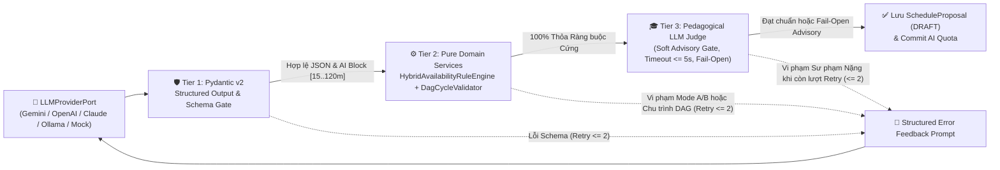

# ADR-009: Cổng Kiểm duyệt AI Đa tầng 3 Lớp (3-Tier Hybrid Validation Gate) qua `LLMProviderPort` & Bộ khung AI Evaluation Harness

* **Trạng thái:** Được chấp thuận (Approved — Cập nhật Kiến trúc v2.0)
* **Ngày quyết định:** 16/10/2026 (Cập nhật v2.0: 25/10/2026)
* **Người quyết định:** Vũ Toàn Thắng, Phan Đình Duẩn
* **Căn cứ đánh giá:** Khung Rubric Đồ án Tốt nghiệp CNTT — Tiêu chí TC2.1, TC2.3 & TC2.7 (Mức 5)
* **Yêu cầu liên quan:** `ASR-04`, `ASR-06`, `FR-PLAN-002`, `FR-PLAN-003`, `FR-PLAN-005`, `UC-06`, `UC-07`, `NFR-AI-001`, `NFR-AI-003`, `EVAL-06`, `EVAL-07`, `EVAL-08`, `BUSR-02`, `BUSR-03`, `BUSR-04`, `BUSR-05`

---

## 1. Ngữ cảnh & Đặt vấn đề (Context)
Khi ứng dụng các Mô hình Ngôn ngữ Lớn (LLM) vào bài toán lập kế hoạch và xếp lịch học tập cá nhân hóa trong FocusFlow (`UC-06`, `UC-07`), hệ thống đối mặt với hai thách thức cốt lõi (`ASR-04`, `ASR-06`):
1. **Ảo giác Lập lịch & Vi phạm Ràng buộc Toán học/Đồ thị (`ASR-04`):** LLM có thế mạnh về phân rã ngữ nghĩa sư phạm nhưng lại thường mắc sai lầm trong tính toán số học và ràng buộc tổ hợp:
   * Xếp tổng thời lượng nhiệm vụ trong ngày vượt quá trần giờ rảnh của người học ở **Mode A (Hard Ceiling - `BUSR-03`)**.
   * Xếp nhiệm vụ rơi ra ngoài các khung giờ rảnh cụ thể hoặc vượt quá dung sai tràn biên cho phép ở **Mode B (Time Slots & Soft Overflow $\le 30\text{ phút}$ - `BUSR-04`)**, hoặc xếp chồng chéo 2 nhiệm vụ trong cùng một khoảng thời gian (Time Overlap).
   * Tạo ra các mối quan hệ tiên quyết bị lặp vòng (**Chu trình đồ thị DAG - `BUSR-05`**) hoặc xếp nhiệm vụ hậu kế diễn ra trước nhiệm vụ tiên quyết.
2. **Yêu cầu Đánh giá Thực nghiệm Đa Mô hình Khoa học (`ASR-06`, `EVAL-06..08`):** Để bảo vệ luận văn tốt nghiệp ở mức Xuất sắc (Rubric TC2.3 & TC2.7 Mức 5), hệ thống cần chứng minh bằng số liệu định lượng khả năng chặn 100% lịch trình vi phạm và so sánh tỷ lệ thành công (Pass@1 vs Pass sau Retry) giữa nhiều nhà cung cấp mô hình khác nhau thông qua một cổng trừu tượng thống nhất.

---

## 2. Các phương án xem xét (Alternatives Considered)

### Phương án A: Chỉ Kiểm tra Cú pháp JSON bằng Pydantic Schema
* *Ưu điểm:* Cài đặt đơn giản, độ trễ thấp.
* *Nhược điểm:* Pydantic chỉ xác thực được kiểu dữ liệu cú pháp (chuỗi, số nguyên, định dạng ngày giờ) mà không thể kiểm tra quy tắc miền phức tạp như chu trình đồ thị DAG (`task_dependencies`) hay kiểm tra chồng lấn khung giờ rảnh Mode A/B của từng người học.

### Phương án B: Dùng LLM-as-a-Judge Duyệt Toàn bộ Ràng buộc Toán học và Lịch trình
* *Ưu điểm:* Không cần viết giải thuật kiểm tra ràng buộc bằng code.
* *Nhược điểm:* Bản thân LLM Judge cũng tính toán số học không chính xác, tốn gấp đôi chi phí token, tăng độ trễ vượt ngưỡng và không đảm bảo cam kết **100% Zero Overbooking (`ASR-04`)**.

### Phương án C: Kiến trúc LLM Đa nhà cung cấp (`LLMProviderPort`) kết hợp Cổng Kiểm duyệt Lai 3 Tầng (3-Tier Hybrid Validation Gate) & Bộ khung Offline AI Evaluation Harness (Được chọn)
* Mọi lệnh gọi sinh kế hoạch và thẩm định đều đi qua cổng trừu tượng **`LLMProviderPort`** (`ADR-005`).
* Kết quả đầu ra của LLM khi khởi tạo lộ trình/lịch học mới (`UC-06`, `UC-07`) bắt buộc đi qua **Cổng Kiểm duyệt Lai 3 Tầng (3-Tier Hybrid Validation Gate)** kết hợp chặt chẽ giữa:
  * **Tier 1:** Kiểm định cấu trúc JSON bằng **Pydantic v2 Structured Output** (khối thời lượng liên tục do AI sinh nằm trong `[15, 120]` phút, trong khi CSDL cho phép người học tự chỉnh thủ công trong `[15, 240]` phút).
  * **Tier 2:** Kiểm định ràng buộc cứng tất định 100% bằng **Pure Domain Services** (`HybridAvailabilityRuleEngine` thuộc `account` và `DagCycleValidator` thuộc `execution`).
  * **Tier 3:** Kiểm định chất lượng sư phạm bằng **Pedagogical LLM Judge** với vai trò **Cổng Tư vấn Mềm (Soft Advisory Gate)** có timeout độc lập $\le 5\text{s}$ và ngữ nghĩa **Fail-Open**, kèm cơ chế **Structured Feedback Retry (tối đa 2 vòng tự sửa lỗi)**.
* Đối với luồng **Tái lập lịch AI Đơn Lộ trình khi Quá hạn (`AI Reschedule` từ mục `Needs Attention`)**, hệ thống **bỏ qua Cổng Kiểm duyệt 3 Tầng (bypasses the 3-Tier Hybrid Validation Gate)** để phản hồi nhanh và tránh gián đoạn trải nghiệm người dùng.
* Xây dựng bộ công cụ **Offline AI Evaluation Harness** độc lập để chạy benchmark tự động trên 100+ kịch bản chuẩn.

---

## 3. Quyết định (Decision)
**Chấp thuận Phương án C với kiến trúc chi tiết của Cổng Kiểm duyệt 3 Tầng, Luồng Tái lập lịch AI Đơn Lộ trình và Bộ khung Đánh giá như sau:**

### 3.1. Kiến trúc Cổng Kiểm duyệt Lai 3 Tầng (3-Tier Hybrid Validation Gate — `ASR-04`)
Bộ điều phối `ProposalValidationGateOrchestrator` (tại tầng Application của Bounded Context `planning`) kiểm duyệt mọi đề xuất lịch học mới từ `LLMProviderPort` qua 3 tầng tuần tự trước khi cho phép lưu bản nháp `ScheduleProposal` (`status = 'DRAFT'`):

1. **Tier 1 — Cổng Cú pháp & Lược đồ (`Pydantic v2 Structured Output`):**
   * Ép kiểu và kiểm tra tính hợp lệ của cấu trúc JSON trả về (`MilestoneListSchema`, `ProposalPlanSchema`): giới hạn độ dài chuỗi, định dạng ngày giờ ISO 8601 và tính hợp lệ của khóa tham chiếu `milestone_id`.
   * **Phân biệt Giới hạn Thời lượng AI vs Thủ công:** Tại Tier 1, mọi khối học tập liên tục (continuous block) do AI sinh ra bắt buộc nằm trong khoảng **`[15, 120]` phút** để tránh quá tải nhận thức; trong khi đó ở tầng CSDL (`tasks.estimated_minutes`) và khi người học tự tạo/chỉnh sửa thủ công (`UC-09`), hệ thống cho phép khoảng rộng hơn là **`[15, 240]` phút**.
2. **Tier 2 — Cổng Ràng buộc Cứng Tất định (`Pure Domain Services` — 100% Deterministic Python):**
   * **`HybridAvailabilityRuleEngine` (thuộc `account.domain`, truy cập qua `AvailabilityQueryPort`):**
     * **Mode A (Capacity / Hard Ceiling - `BUSR-03`):** Kiểm tra tổng số phút học tập được xếp trong mỗi ngày không bao giờ vượt quá trần dung lượng `max_daily_minutes` của ngày đó.
     * **Mode B (Explicit Time Slots & Soft Overflow - `BUSR-04`):** Đối chiếu từng task với danh sách `TimeSlot` thực tế (đã nạp từ bảng `availability_slots` và trừ đi các khoảng bận từ Google Calendar OAuth2 hoặc các lộ trình khác nếu có). Cho phép dung sai tràn biên mềm (**Soft Overflow $\le 30\text{ phút}$**) nếu không đụng độ khung bận kế tiếp, đồng thời chặn tuyệt đối mọi sự chồng lấn giờ giữa các task (**Zero Overlap**).
   * **`DagCycleValidator` (thuộc `execution.domain` — `modules/execution/`, truy cập qua `StudyExecutionQueryPort` - `BUSR-05`):**
     * Kiểm tra đồ thị phụ thuộc `TaskDependency` bằng thuật toán phát hiện chu trình (Topological Sort / Kahn's Algorithm & DFS), đảm bảo đồ thị là **DAG thuần khiết (0 chu trình)** và mọi task tiên quyết đều được xếp lịch hoàn thành trước task phụ thuộc.
3. **Tier 3 — Cổng Tư vấn Sư phạm Mềm (`PedagogicalJudgeAdapter` — Soft Advisory Gate với Timeout $\le 5\text{s}$ & Fail-Open):**
   * Đánh giá tính hợp lý về mặt sư phạm và lý thuyết tải nhận thức (Cognitive Load): kiến thức nền tảng phải đặt trước kiến thức nâng cao, không dồn các nhiệm vụ độ khó cao liên tiếp nhau trong cùng một buổi.
   * **Ngữ nghĩa Soft Advisory Gate, Timeout Độc lập $\le 5\text{s}$ & Fail-Open:** Trong khi Tier 1 và Tier 2 áp dụng chính sách **Fail-Closed tuyệt đối** (chặn 100% nếu vi phạm), Tier 3 hoạt động như một **Cổng Tư vấn Mềm (Soft Advisory Gate)** với **timeout độc lập $\le 5\text{s}$**. Nếu đề xuất đã vượt qua 100% kiểm định toán học ở Tier 1 & Tier 2 nhưng Tier 3 bị quá thời gian ($\text{timeout} > 5\text{s}$), gặp lỗi kết nối LLM hoặc chỉ đưa ra cảnh báo sư phạm, hệ thống áp dụng ngữ nghĩa **Fail-Open**: vẫn cho phép lưu bản nháp `DRAFT` kèm nhãn khuyến nghị sư phạm (advisory warnings) để người học xem xét quyết định tại cổng Human-in-the-Loop (`BUSR-02`).

### 3.1.1. Ngoại lệ Có Chủ đích: Tái lập lịch AI Đơn Lộ trình khi Quá hạn (Single-Roadmap AI Reschedule Bypasses 3-Tier Gate)
* Khi tác vụ `Overdue Scanner` (`00:05 UTC+7`) phát hiện các task quá hạn (`scheduled_date < CURRENT_DATE` và `status != 'COMPLETED'`), hệ thống gửi thông báo Email và hiển thị các task quá hạn trong mục `Needs Attention` kèm nút **"AI Reschedule (Dời lịch hợp lý)"** trên ứng dụng Web.
* Khi người học bấm **"AI Reschedule"** trên một lộ trình quá hạn, AI quét các task chưa hoàn thành của **riêng Lộ trình đó (that specific Roadmap)** cùng lịch học tương lai của người dùng (trừ đi các khung giờ đã bị chiếm dụng bởi các lộ trình khác hoặc lịch ngoại vi) để sắp xếp lại **chỉ các task của Lộ trình đó** (tuyệt đối không chạm tới các lộ trình hay công việc khác của người dùng).
* Vì các task này vốn đã được thẩm định sư phạm và DAG từ lúc tạo lộ trình, luồng tái lập lịch này **bỏ qua Cổng Kiểm duyệt 3 Tầng (bypassing the 3-Tier Hybrid Validation Gate — bỏ qua hoàn toàn Tier 3 Pedagogical Judge**, chỉ kiểm tra định dạng JSON Schema và ràng buộc dung lượng/tránh xung đột cơ bản cho lộ trình đó), đồng thời tăng `reschedule_count` thêm 1 (nếu `reschedule_count >= 3` sẽ kích hoạt leo thang chống lặp `STALLED` theo `ADR-010`).

### 3.2. Cơ chế Tự sửa lỗi có Cấu trúc (Structured Feedback Self-Correction Loop)
* Khi phát hiện bất kỳ vi phạm nào ở Tier 1 hoặc Tier 2, hệ thống không trả về thông báo chung chung mà đóng gói danh sách đối tượng lỗi chi tiết (`ConstraintViolationDTO`: mã lỗi, ngày vi phạm, số phút vượt trần hoặc cặp task tạo chu trình DAG) vào prompt phản hồi để `LLMProviderPort` tự sửa lỗi (**tối đa 2 vòng retry**).
* Nếu sau 2 vòng retry vẫn vi phạm ràng buộc cứng, hệ thống hủy thao tác, kích hoạt **`RELEASE` hạn ngạch AI** (`ADR-005`) để không trừ lượt của người học, và trả về thông báo hướng dẫn người học nới lỏng quỹ thời gian rảnh hoặc điều chỉnh mục tiêu.

### 3.3. Bộ khung Đánh giá Thực nghiệm Độc lập (Offline AI Evaluation Harness — `backend/tests/ai_evals/`)
* Xây dựng bộ công cụ đánh giá tự động chạy trên tập dữ liệu chuẩn gồm **100+ kịch bản kiểm thử đa dạng (JSONL)** (bao gồm các ca biên: quỹ thời gian cực hẹp, lịch rảnh vắt qua nửa đêm Mode B, đồ thị phụ thuộc nhiều nhánh, hồ sơ người học có $\beta_{bias}$ cao).
* Nhờ kiến trúc **`LLMProviderPort`**, bộ Harness có thể chạy đối chứng cùng một tập kịch bản trên nhiều mô hình (ví dụ: `Gemini 2.5 Flash`, `GPT-4o-mini`, `Claude 3.5 Haiku`, `Local Ollama Qwen2.5`) để xuất bảng thống kê khoa học cho Chương Thực nghiệm của Khóa luận:
  * **Metric 1:** Tỷ lệ đạt chuẩn Schema & Ràng buộc cứng ngay lần đầu (**Raw Pass@1 Rate**).
  * **Metric 2:** Tỷ lệ khôi phục thành công sau vòng lặp tự sửa lỗi (**Post-Retry Recovery Rate**).
  * **Metric 3:** Cam kết **0% lịch trình vi phạm lọt qua cổng Tier 2 (`Zero Hallucinated Overbooking`)**.

---

## 4. Lý do & Đánh đổi (Rationale & Trade-Offs)
* **Kết hợp Thế mạnh của AI Tạo sinh và Giải thuật Tất định (`ASR-04`):** Để LLM làm công việc sáng tạo nội dung học tập và để Pure Domain Services (`HybridAvailabilityRuleEngine`, `DagCycleValidator`) làm công việc kiểm chứng toán học/đồ thị, giúp đạt độ tin cậy 100% trên các ràng buộc cứng.
* **Giá trị Học thuật & Thực nghiệm Cao (`TC2.3`, `TC2.7`):** Bộ khung AI Evaluation Harness kết hợp `LLMProviderPort` mang lại bằng chứng thực nghiệm định lượng rõ ràng, khách quan khi bảo vệ đồ án.
* **Đánh đổi:** Khi LLM vi phạm ở lần sinh đầu tiên, vòng lặp retry có thể làm tăng thời gian chờ thêm 3–5 giây; hệ thống giải quyết bằng cách phát sự kiện SSE `validation_retry` trực tiếp lên giao diện Angular 21+ để người dùng nắm bắt tiến trình minh bạch.

---

## 5. Hệ quả & Kiểm chứng (Consequences & Verification)
* **Tích cực:** Chặn đứng 100% lịch trình vượt trần giờ rảnh hoặc chứa chu trình DAG trước khi lưu xuống bảng `schedule_proposals`.
* **Kiểm chứng Tự động:** Bộ Unit Test cho `HybridAvailabilityRuleEngine` và `DagCycleValidator` đạt độ phủ nhánh (branch coverage) $\ge 95\%$ và chạy độc lập 100% không cần mạng hay CSDL.
