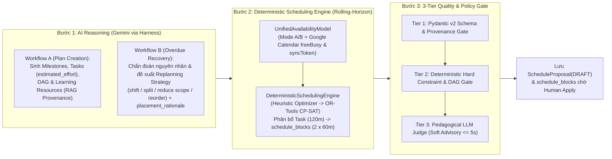

# ADR-009: Tách bạch Suy luận Lộ trình AI với Bộ Lập lịch Tất định (`DeterministicSchedulingEngine`), Cổng Kiểm duyệt 3 Tầng, Mistake Intelligence & Bộ khung AI Evaluation Harness 10 Chỉ số

* **Trạng thái:** Được chấp thuận (Approved — Cập nhật Kiến trúc v2.2: Tách bạch Roadmap vs. Schedule, Rolling-Horizon Deterministic Scheduling Engine, Mistake Intelligence & 10 Workflow Evaluation Metrics)
* **Ngày quyết định:** 16/10/2026 (Cập nhật v2.0: 25/10/2026; Cập nhật v2.1: 03/11/2026; Cập nhật v2.2: 05/11/2026)
* **Người quyết định:** Vũ Toàn Thắng, Phan Đình Duẩn
* **Căn cứ đánh giá:** Khung Rubric Đồ án Tốt nghiệp CNTT — Tiêu chí TC2.1, TC2.3 & TC2.7 (Mức 5)
* **Yêu cầu liên quan:** `ASR-04`, `ASR-06`, `FR-PLAN-002`, `FR-PLAN-003`, `FR-PLAN-005`, `FR-ADAPT-001`, `FR-ADAPT-002`, `FR-SESSION-002`, `FR-REPORT-003`, `UC-07`, `UC-08`, `UC-12`, `UC-14`, `UC-20`, `UC-23`, `UC-24`, `NFR-AI-001`, `NFR-AI-003`, `EVAL-06`, `EVAL-07`, `EVAL-08`, `BUSR-02`, `BUSR-03`, `BUSR-04`, `BUSR-05`

---

## 1. Ngữ cảnh & Đặt vấn đề (Context)
Khi ứng dụng các Mô hình Ngôn ngữ Lớn (LLM) vào bài toán lập kế hoạch học tập (`UC-07`, `UC-08`), phục hồi lộ trình khi trễ hạn (`UC-23`, `UC-24`), và kiểm chứng bằng chứng học tập cuối cột mốc (`FR-REPORT-003` / `UC-20`) trong FocusFlow, hệ thống đối mặt với ba thách thức cốt lõi (`ASR-04`, `ASR-06`):
1. **Sai lầm khi Bắt LLM Trực tiếp Tính toán Ngày Giờ Lịch học (`ASR-04`):** Trong thiết kế cũ, LLM vừa phải phân rã nội dung sư phạm vừa phải tự tính toán ngày giờ (`scheduled_date`, `start_time`, `end_time`). Thực tế cho thấy LLM rất mạnh về suy luận sư phạm, thiết kế cấu trúc lộ trình và chẩn đoán nguyên nhân trễ hạn, nhưng lại yếu kém khi giải bài toán tổ hợp lịch trình có nhiều ràng buộc:
   * Dễ vi phạm trần giờ học mỗi ngày ở **Mode A (Hard Ceiling - `BUSR-03`)** hoặc xếp đè lên khoảng bận ngoại vi ở **Mode B (Time Slots & Soft Overflow $\le 30\text{ phút}$ - `BUSR-04`)**.
   * Không biết cách cắt một `Task` lớn (`estimated_effort`, ví dụ 120 phút) thành nhiều khối phiên học (`schedule_blocks` với `scheduled_duration_minutes`, ví dụ 2 buổi 60 phút) phù hợp với thời lượng tập trung tối ưu $D_{opt}$ của người học.
   * Khi dời lịch quá hạn, LLM dễ xáo trộn toàn bộ các phiên học đang ổn định trong tương lai (thiếu tính **Schedule Stability** và **Protected Sessions**).
2. **Nguy cơ Gian lận, Ảo tưởng Năng lực & Thiếu Phân loại Bản chất Lỗi sai (Fake Takeaways, Illusion of Competence & Blind Remediation):** Khi người học tự phản tư hoặc làm bài kiểm tra Prove Mode, họ có thể gõ đối phó, copy-paste đề bài hoặc trả lời sai do nhiều nguyên nhân khác nhau (hổng kiến thức nền tảng, hiểu sai khái niệm, sai quy trình làm bài hay thiếu luyện tập). Nếu hệ thống không phân loại chính xác bản chất lỗi sai (**Mistake Intelligence**), task ôn tập bổ trợ sẽ chung chung và kém hiệu quả.
3. **Yêu cầu Đo lường Chất lượng Toàn diện trên 10 Chỉ số Thực nghiệm (`ASR-06`, `EVAL-06..08`):** Để đánh giá khách quan toàn bộ hệ thống **FocusFlow Learning Intelligence Harness**, việc chỉ đo tỷ lệ JSON hợp lệ là chưa đủ; cần một bộ khung đánh giá thực nghiệm trên tập dữ liệu chuẩn (**Golden Dataset**) đo lường trọn vẹn 10 chỉ số chất lượng từ độ khả thi của lịch học, độ ổn định khi phục hồi, mức độ chấp nhận của người học cho tới chi phí trên mỗi lượt thực thi thành công.

---

## 2. Các phương án xem xét (Alternatives Considered)

### Phương án A: Để LLM Trực tiếp Sinh Lịch Học Ngày/Giờ + Chỉ Kiểm tra Cú pháp JSON bằng Pydantic Schema
* *Ưu điểm:* Cài đặt đơn giản ở giai đoạn đầu.
* *Nhược điểm:* LLM liên tục tính sai ngày giờ, gây tỷ lệ retry cao; không thể tách bạch giữa **Lộ trình học tập (`Roadmap` / `Tasks`)** và **Lịch phân bổ thời gian (`Schedule` / `schedule_blocks`)**; không bảo vệ được tính ổn định của lịch học khi tái lập lịch.

### Phương án B: Dùng LLM-as-a-Judge Duyệt Toàn bộ Ràng buộc Toán học và Lịch trình
* *Ưu điểm:* Không cần viết bộ giải lập lịch bằng thuật toán.
* *Nhược điểm:* Bản thân LLM Judge cũng tính toán số học không chính xác, tốn gấp đôi chi phí token, tăng độ trễ vượt ngưỡng và không đảm bảo cam kết **100% Zero Overbooking (`ASR-04`)**.

### Phương án C: Kiến trúc Tách bạch Lộ trình vs. Lịch học (AI Reasoning vs. Deterministic Scheduling Engine) + Cổng Kiểm duyệt 3 Tầng + Mistake Intelligence + Bộ khung AI Evaluation Harness 10 Chỉ số (Được chọn)
* **Tách bạch hoàn toàn Suy luận Sư phạm của AI và Giải thuật Lập lịch Tất định:**
  * **Bước 1 — AI Reasoning (Google Gemini qua `LLMProviderPort`):** Chỉ tập trung sinh **Lộ trình học tập (`Learning Roadmap`)** trong `Workflow A` (`PLAN_CREATION`) và đề xuất **Chiến lược Phục hồi (`Replanning Strategy`)** kèm giải thích `placement_rationale` trong `Workflow B` (`OVERDUE_RECOVERY`). LLM **không trực tiếp tính toán ngày giờ lịch cụ thể**.
  * **Bước 2 — Deterministic Scheduling Engine (Rolling-Horizon & Schedule Resilience):** Nhận `UnifiedAvailabilityModel` và phân bổ các `Tasks` (`estimated_effort`) thành các khối phiên học cụ thể trong bảng **`schedule_blocks`** (`scheduled_duration_minutes`), cưỡng chế 100% ràng buộc cứng và tối ưu hóa ràng buộc mềm / độ bền lịch học, có lộ trình nâng cấp từ **Heuristic Optimizer** lên **Google OR-Tools CP-SAT**.
  * **Bước 3 — 3-Tier Quality & Policy Gate:** Kiểm định toàn diện cả cấu trúc Lộ trình/DAG lẫn `ScheduleProposal` trước khi lưu `ScheduleProposal(DRAFT)` chờ người học phê duyệt (`Apply`).
* Nâng cấp trục kiểm chứng bằng chứng 2 tầng với **Mistake Intelligence** (`mistake_taxonomy_json`).
* Xây dựng bộ công cụ **Offline AI Evaluation Harness** đo lường **10 Chỉ số Chất lượng Workflow (10 Workflow Quality & Evaluation Metrics)** trên tập **Golden Dataset** cố định.

---

## 3. Quyết định (Decision)
**Chấp thuận Phương án C với kiến trúc chi tiết gồm 4 trụ cột sau:**

### 3.1. Kiến trúc 3 Bước: Tách bạch Suy luận AI, Bộ Lập lịch Tất định (`DeterministicSchedulingEngine`) & Cổng Kiểm duyệt 3 Tầng (`ASR-04` / `UC-07`, `UC-08`, `UC-12`, `UC-23`)
FocusFlow loại bỏ hoàn toàn giả định cũ để LLM tự nhẩm tính ngày giờ lịch học. Quy trình lập kế hoạch và phục hồi lịch trình tuân thủ nghiêm ngặt kiến trúc 3 bước tách biệt:

#### Bước 1 — Suy luận Sư phạm & Chiến lược bằng AI (`AI Reasoning — Google Gemini`)
* **Trong `Workflow A` (`PLAN_CREATION` — `UC-07`, `UC-08`):** Dựa trên kết quả phỏng vấn chẩn đoán, hồ sơ bộ nhớ người học (`learner_memory_items`, `learner_concept_masteries`) và các đoạn kiến thức truy xuất từ `Knowledge Engine` (`knowledge_sources`, `knowledge_chunks`), AI sinh ra **Lộ trình Học tập (`Learning Roadmap`)** bao gồm:
  * Danh sách `Milestones` theo trình tự nhận thức.
  * Danh sách `Tasks` với tổng thời lượng nỗ lực ước tính **`estimated_effort`** (ví dụ: `120 phút`) và độ khó nhận thức.
  * Đồ thị phụ thuộc công việc **`Task Dependencies` (DAG)**.
  * Tài liệu học tập tham khảo (`Learning Resources`) kèm mã định danh trích dẫn nguồn (`source_chunk_ids` provenance từ RAG).
* **Trong `Workflow B` (`OVERDUE_RECOVERY` — `UC-23`, `UC-24`):** Khi lộ trình có task quá hạn, AI phân tích nguyên nhân gốc rễ (từ lịch sử check-in, độ lệch ước lượng $\beta_{bias}$, lý do gián đoạn) và đề xuất **Chiến lược Tái lập lịch (`Replanning Strategy`)**: dời lịch (`shift`), chia nhỏ công việc (`split`), thu hẹp phạm vi (`reduce_scope`) hoặc sắp xếp lại thứ tự ưu tiên (`reorder`), đồng thời sinh lời giải thích dễ hiểu cho người học (`placement_rationale`).

#### Bước 2 — Bộ Lập lịch Tất định theo Cửa sổ Cuốn & Độ bền Lịch học (`Deterministic Scheduling Engine — Rolling-Horizon & Schedule Resilience`)
* Nhận đầu vào là các `Tasks` (cùng chiến lược từ Bước 1) và **`UnifiedAvailabilityModel`** (được chuẩn hóa thống nhất từ cấu hình lịch rảnh Mode A/B trong `availabilities`/`availability_slots`, lịch của các lộ trình đang hoạt động khác, và các khoảng bận ngoại vi từ Google Calendar `freeBusy` & `syncToken`).
* **Tách biệt `Task.estimated_effort` và `schedule_blocks.scheduled_duration_minutes`:** Bộ giải thực hiện cắt và phân bổ một `Task` có `estimated_effort` lớn (ví dụ: 120 phút) thành một hoặc nhiều khối phiên học cụ thể lưu trong bảng **`schedule_blocks`** với `scheduled_duration_minutes` tối ưu theo $D_{opt}$ của người học (ví dụ: hai khối 60 phút vào Thứ Ba và Thứ Năm), nằm trong ngưỡng `[30, 120]` phút cho các khối tự động (và `[15, 240]` phút khi chỉnh tay).
* **Cưỡng chế Ràng buộc Cứng Tất định (Hard Constraints — 100% Satisfaction):**
  1. **Zero Overlap:** Không có bất kỳ 2 khối `schedule_blocks` nào chồng lấn thời gian trên toàn bộ các lộ trình của người học.
  2. **DAG Precedence Order:** Mọi khối học của task tiên quyết phải hoàn tất trước khi bắt đầu khối đầu tiên của task phụ thuộc (`DagCycleValidator`).
  3. **Daily Workload Cap (`BUSR-03`):** Tổng `scheduled_duration_minutes` trong một ngày không bao giờ vượt quá trần dung lượng `max_daily_minutes` (Mode A).
  4. **Busy Interval Exclusion (`BUSR-04`):** Không xếp đè lên các khoảng bận ngoại vi từ Google Calendar; tuân thủ khe thời gian Mode B (kèm dung sai tràn biên mềm có kiểm soát `Soft Overflow <= 30 phút` nếu không chạm khung bận kế tiếp).
* **Tối ưu hóa Ràng buộc Mềm & Độ bền Lịch học (Soft Constraints & Schedule Resilience):**
  1. **Buffer Time (Thời gian đệm):** Tự động chèn khoảng nghỉ đệm giữa các khối học tập liên tiếp và trước hạn chót cột mốc.
  2. **Recovery Window (Khung giờ dự phòng phục hồi):** Giữ lại một tỷ lệ dung lượng rảnh dự phòng trong tuần theo phương pháp **Rolling-Horizon** (lập lịch chi tiết cho cửa sổ gần 7–14 ngày và giữ linh hoạt cho các tuần xa) để dễ dàng hấp thụ biến động khi người học bận đột xuất.
  3. **Protected Sessions (Bảo vệ phiên học đã cam kết):** Trong luồng `OVERDUE_RECOVERY`, khóa bảo vệ các phiên học sắp diễn ra trong 24–48 giờ tới hoặc các phiên người học đã ghim cố định để không làm đảo lộn kế hoạch ngắn hạn.
  4. **Schedule Stability (Tối thiểu hóa xáo trộn lịch trình):** Hàm mục tiêu phạt nặng việc di chuyển các task không liên quan khi tái lập lịch, đảm bảo tỷ lệ xáo trộn lịch trình (`Schedule Disruption Rate`) ở mức thấp nhất.
* **Lộ trình Giải thuật (Solver Upgrade Path):** Triển khai qua cổng Domain Service thống nhất, sử dụng **Greedy / Heuristic Constructive Optimizer** tốc độ cao (chạy trong $< 50\text{ms}$) làm mặc định và hỗ trợ nâng cấp liền mạch lên bộ giải quy hoạch ràng buộc nguyên **Google OR-Tools CP-SAT** cho các đồ thị DAG lớn và đa lộ trình phức tạp.

#### Bước 3 — Cổng Kiểm duyệt Chất lượng & Chính sách 3 Tầng (`3-Tier Quality & Policy Gate — UC-12`)
Bộ điều phối `ProposalValidationGateOrchestrator` kiểm định toàn diện cả cấu trúc Lộ trình lẫn đề xuất lịch trình (`ScheduleProposal` + `schedule_blocks`) qua 3 tầng trước khi lưu trạng thái `DRAFT`:
1. **Tier 1 — Cổng Lược đồ, Phạm vi & Truy vết Nguồn (`Pydantic v2 Schema & Provenance Gate`):**
   * Xác thực cấu trúc JSON của Roadmap (`Milestones`, `Tasks`, `TaskDependencies`) và `ScheduleProposal`, kiểm tra tính hợp lệ của `source_chunk_ids` (RAG provenance) và đảm bảo luồng `OVERDUE_RECOVERY` chỉ tác động lên đúng `roadmap_id` đang xét.
2. **Tier 2 — Cổng Ràng buộc Cứng & Đồ thị Tất định (`Deterministic Hard Constraint & DAG Gate`):**
   * Chạy kiểm chứng độc lập bằng `HybridAvailabilityRuleEngine` và `DagCycleValidator` trên danh sách `schedule_blocks` để cam kết **100% Zero Overbooking** và **0 chu trình DAG**.
3. **Tier 3 — Cổng Tư vấn Sư phạm Mềm (`PedagogicalJudgeAdapter` — Soft Advisory Gate, Timeout $\le 5\text{s}$, Fail-Open):**
   * Đánh giá tải nhận thức (Cognitive Load) và tính hợp lý sư phạm của chuỗi bài học. Trong khi Tier 1 và Tier 2 là **Fail-Closed tuyệt đối**, Tier 3 hoạt động với ngữ nghĩa **Fail-Open** ($\text{timeout} \le 5\text{s}$): nếu quá thời gian hoặc chỉ có khuyến nghị sư phạm nhẹ, hệ thống vẫn lưu `ScheduleProposal(DRAFT)` kèm nhãn tư vấn để người học quyết định tại cổng **Human-in-the-Loop (`BUSR-02`)**.
   * **Chỉ khi người học bấm nút "Áp dụng (Apply)"**, hệ thống mới ghi nhận các `schedule_blocks` vào `OfficialSchedule`, khấu trừ `weekly_reschedule_used`, tăng `reschedule_count` (nếu là dời lịch quá hạn) và ghi nhật ký bất biến vào `schedule_change_logs`.

### 3.2. Cơ chế Tự sửa lỗi có Cấu trúc (Structured Feedback Self-Correction Loop)
* Khi phát hiện vi phạm ở cấu trúc Lộ trình/DAG (Tier 1/Tier 2) hoặc mâu thuẫn sư phạm nghiêm trọng, hệ thống đóng gói đối tượng lỗi chi tiết (`ConstraintViolationDTO`) vào `Runtime Layer` của `Context Engine` để yêu cầu mô hình tự sửa lỗi (**tối đa 2 vòng retry**).
* Nếu không thể tìm ra phương án khả thi do quỹ thời gian rảnh quá hẹp so với khối lượng mục tiêu, hệ thống hủy thao tác, kích hoạt **`RELEASE` hạn ngạch AI** (`ADR-005`) và hướng dẫn người học mở rộng quỹ thời gian hoặc giảm phạm vi mục tiêu (`reduce_scope`).

### 3.3. Bộ khung Đánh giá Thực nghiệm Độc lập với 10 Chỉ số Chất lượng (`Offline AI Evaluation Harness` — `backend/tests/ai_evals/`)
Để đánh giá toàn diện và khách quan chất lượng của **FocusFlow Learning Intelligence Harness**, hệ thống xây dựng bộ công cụ đánh giá tự động chạy trên tập dữ liệu chuẩn cố định (**Fixed Golden Dataset** gồm 100+ kịch bản đa dạng: sinh viên bận rộn, lịch rảnh Mode B vắt qua nửa đêm, đồ thị DAG phức tạp, người học có $\beta_{bias}$ cao, kịch bản trễ hạn liên hoàn) và đo lường chính xác **10 Chỉ số Chất lượng & Đánh giá Workflow (10 Workflow Quality & Evaluation Metrics)**:

| STT | Tên Chỉ số (Metric Name) | Định nghĩa & Công thức Đo lường trên Golden Dataset / Telemetry | Ngưỡng Mục tiêu |
| :---: | :--- | :--- | :---: |
| **1** | **`Schema Pass Rate`** | Tỷ lệ phần trăm các đầu ra từ AI Harness vượt qua cổng kiểm định lược đồ Pydantic v2 và ràng buộc cấu trúc ngay từ lần sinh đầu tiên (Pass@1) và sau tối đa 2 vòng retry. | $\ge 98.0\%$ (sau retry) |
| **2** | **`User Acceptance Rate`** | Tỷ lệ đề xuất lộ trình (`Roadmap`) và lịch học (`ScheduleProposal(DRAFT)`) được người học bấm `Approve / Apply` mà không bị hủy bỏ (`DISCARDED`). | $\ge 80.0\%$ |
| **3** | **`Task Actionability`** | Điểm đánh giá mức độ cụ thể, khả thi, có đầu ra rõ ràng và gắn đúng tài liệu nguồn (`source_chunk_ids`) của các `Tasks` do AI sinh ra (chấm trên rubric chuẩn hóa). | $\ge 4.2 / 5.0$ |
| **4** | **`Schedule Feasibility`** | Tỷ lệ lịch học sinh ra bởi `DeterministicSchedulingEngine` thỏa mãn 100% trần dung lượng ngày, tôn trọng thời lượng tập trung $D_{opt}$ và có đủ `Buffer Time` / `Recovery Window`. | $100\%$ |
| **5** | **`Calendar Conflict Rate`** | Tỷ lệ khối lịch học (`schedule_blocks`) bị chồng lấn nhau hoặc đè lên khoảng bận Google Calendar `freeBusy` / ngoài khung giờ Mode B sau khi qua cổng Tier 2. | **$0.0\%$ (Zero Conflict)** |
| **6** | **`Recovery Success Rate`** | Tỷ lệ người học hoàn thành được ít nhất 1 phiên học thực tế trong vòng 48 giờ sau khi áp dụng chiến lược phục hồi quá hạn (`OVERDUE_RECOVERY` / Reset Ritual). | $\ge 75.0\%$ |
| **7** | **`Schedule Disruption Rate`** | Tỷ lệ phần trăm các khối phiên học không bị quá hạn trong tương lai bị xáo trộn vị trí khi chạy tái lập lịch `OVERDUE_RECOVERY` (đo lường hiệu quả của `Schedule Stability` & `Protected Sessions`). | $\le 15.0\%$ |
| **8** | **`Insight Acceptance Rate`** | Tỷ lệ các khuyến nghị chiến lược trong báo cáo phản tư tuần (`WEEKLY_REVIEW`) và gợi ý điều chỉnh lịch được người học chấp thuận áp dụng cho tuần kế tiếp. | $\ge 75.0\%$ |
| **9** | **`Profile Correction Rate`** | Tỷ lệ các mục bộ nhớ suy diễn (`Inferred Preferences` trong `learner_memory_items`) bị người học bác bỏ hoặc phải sửa lại thủ công (càng thấp chứng tỏ suy diễn càng chuẩn xác). | $\le 10.0\%$ |
| **10** | **`Cost per Successful Execution`** | Tổng số lượng token và chi phí quy đổi trung bình (bao gồm cả các vòng retry và embedding) để hoàn tất thành công 1 lượt chạy workflow (`workflow_runs.status = 'COMPLETED'`). | Tối ưu trong ngân sách gói |

### 3.4. Kiến trúc Kiểm chứng Bằng chứng 2 Tầng kết hợp Trí tuệ Phân tích Lỗi sai (`2-Tier Evidence Verification & Mistake Intelligence` — `FR-SESSION-002`, `FR-REPORT-003` / `UC-14`, `UC-20`)
Để đảm bảo triết lý **Evidence-based Learning (Học tập Thực chứng)** và cá nhân hóa việc khắc phục lỗ hổng kiến thức, FocusFlow thiết lập trục kiểm chứng 2 tầng tích hợp **Mistake Intelligence**:

1. **Tier 1 — Deterministic Takeaway Guard (Tại Phiên học — `FR-SESSION-002` / `UC-14`, `UC-15`):**
   * Hoạt động 100% bằng logic tất định phía Backend (Pure Python Domain Service — **0 Token AI Quota**).
   * Kiểm tra tính hợp lệ của Key Takeaway khi kết thúc phiên học: độ dài $\ge 30$ ký tự và $\ge 6$ từ có nghĩa, bộ lọc Entropy chặn chuỗi spam bàn phím, kiểm tra độ trùng lặp từ vựng (Token Overlap $< 85\%$ so với đề bài `tasks.title`/`tasks.description` để chống copy-paste), và bắt buộc người học chấm mức tự tin `self_confidence (1..5)`.
2. **Tier 2 — AI Recall, Blind-Spot Probing & Mistake Intelligence (Tại Prove Mode Cuối Milestone — `FR-REPORT-003` / `UC-20`):**
   * Kích hoạt khi người học thực hiện kiểm chứng cột mốc (`milestone_proofs`). Hệ thống đối chiếu **(A) Ground Truth Concept Spec** (`learning_concepts` & `knowledge_chunks`) với **(B) Learner Evidence** (Key Takeaways & câu trả lời truy hồi của người học).
   * **Semantic Alignment & Blind-Spot Probing:** Chấm điểm `ai_evidence_score (1.00..5.00)`, gán nhãn `alignment_flag` (`ALIGNED`, `SUPERFICIAL`, `OFF_TOPIC`, `CONTRADICTORY`), và đo độ lệch nhận thức:
     $$\text{calibration\_gap} = \text{avg\_self\_confidence} - \text{ai\_evidence\_score}$$
   * **Trí tuệ Phân tích Lỗi sai (`Mistake Intelligence` — cột `mistake_taxonomy_json` trong `milestone_proofs`):** Khi phát hiện câu trả lời sai, thiếu sót hoặc có $\text{calibration\_gap} \ge +1.5$ (Ảo tưởng năng lực), AI không chỉ chấm điểm mà còn phân loại chính xác từng lỗi sai vào **4 Nhóm Nguyên nhân Nhận thức Chuẩn hóa** trong `mistake_taxonomy_json`:
     1. **`MISSING_FOUNDATION` (Hổng kiến thức nền tảng tiên quyết):** Người học chưa nắm được khái niệm gốc ở bậc tiên quyết (`concept_prerequisites`) $\to$ Sinh task ôn tập quay lại củng cố khái niệm nền tảng.
     2. **`CONCEPT_MISCONCEPTION` (Hiểu sai bản chất khái niệm):** Người học nhầm lẫn định nghĩa hoặc cơ chế hoạt động giữa hai khái niệm $\to$ Sinh task giải thích đối chiếu phản ví dụ (Counter-example Micro-Task).
     3. **`PROCESS_ERROR` (Sai quy trình / các bước thực hiện):** Người học hiểu lý thuyết nhưng áp dụng sai trình tự bước giải hoặc cú pháp thực hành $\to$ Sinh bài tập rèn luyện từng bước có hướng dẫn (Step-by-step Guided Drill).
     4. **`LACK_OF_PRACTICE` (Thiếu luyện tập / quên cục bộ):** Người học nắm ý chính nhưng diễn đạt lúng túng, thiếu tốc độ và độ trôi chảy $\to$ Sinh phiên ôn tập truy hồi ngắt quãng ngắn (Spaced Retrieval Flash Session 15–20 phút).
   * Kết quả phân loại lỗi sai từ `mistake_taxonomy_json` được phát qua Outbox để cập nhật trực tiếp điểm thành thạo trong bảng **`learner_concept_masteries`** và tạo các **Targeted Remedial Micro-Tasks** trúng đích trước khi cấp chứng nhận `milestones.proof_status = 'PROVEN'`.

---

## 4. Lý do & Đánh đổi (Rationale & Trade-Offs)
* **Giải quyết Triệt để Điểm yếu Toán học của LLM (`ASR-04`):** Tách bạch hoàn toàn việc **AI sinh Lộ trình/Chiến lược** và **Bộ lập lịch tất định (`DeterministicSchedulingEngine`) phân bổ `schedule_blocks`** giúp đạt đồng thời 2 mục tiêu: nội dung học tập giàu tính sư phạm và lịch trình chính xác toán học 100% (`Calendar Conflict Rate = 0%`).
* **Bảo vệ Độ bền và Sự ổn định của Lịch học (Schedule Resilience):** Cơ chế Rolling-Horizon kết hợp `Buffer Time`, `Recovery Window`, `Protected Sessions` và `Schedule Stability` giúp người học thích ứng nhẹ nhàng khi có sự cố trễ hạn mà không bị hiệu ứng domino phá vỡ toàn bộ tuần học.
* **Khắc phục Lỗ hổng Kiến thức Trúng đích với Mistake Intelligence:** Phân loại lỗi sai thành 4 nhóm (`MISSING_FOUNDATION`, `CONCEPT_MISCONCEPTION`, `PROCESS_ERROR`, `LACK_OF_PRACTICE`) giúp các task bổ trợ đi thẳng vào gốc rễ nhận thức thay vì bắt học lại từ đầu một cách máy móc.
* **Giá trị Học thuật & Thực nghiệm Xuất sắc (`TC2.3`, `TC2.7`):** Bộ 10 chỉ số đánh giá trên tập Golden Dataset cung cấp thước đo định lượng toàn diện cho khóa luận tốt nghiệp.
* **Đánh đổi:** Cần duy trì bảng `schedule_blocks` tách biệt với `tasks` để biểu diễn mối quan hệ 1 Task (`estimated_effort`) $\to$ $N$ khối phiên học (`scheduled_duration_minutes`), nhưng sự tách biệt này hoàn toàn chuẩn hóa 3NF/BCNF và phản ánh đúng thực tế học tập.

---

## 5. Hệ quả & Kiểm chứng (Consequences & Verification)
* **Tích cực:** Chặn đứng 100% xung đột lịch trình và chu trình DAG; giữ tỷ lệ xáo trộn lịch khi phục hồi ở mức tối thiểu; chuẩn hóa quy trình đánh giá chất lượng AI qua 10 chỉ số định lượng.
* **Kiểm chứng Tự động:** Bộ Unit Test cho `DeterministicSchedulingEngine`, `HybridAvailabilityRuleEngine` và `DagCycleValidator` đạt độ phủ nhánh $\ge 95\%$ và chạy độc lập 100% không cần mạng hay CSDL. Bộ AI Evaluation Harness chạy tự động trên Golden Dataset kiểm chứng toàn bộ 10 chỉ số chất lượng.
