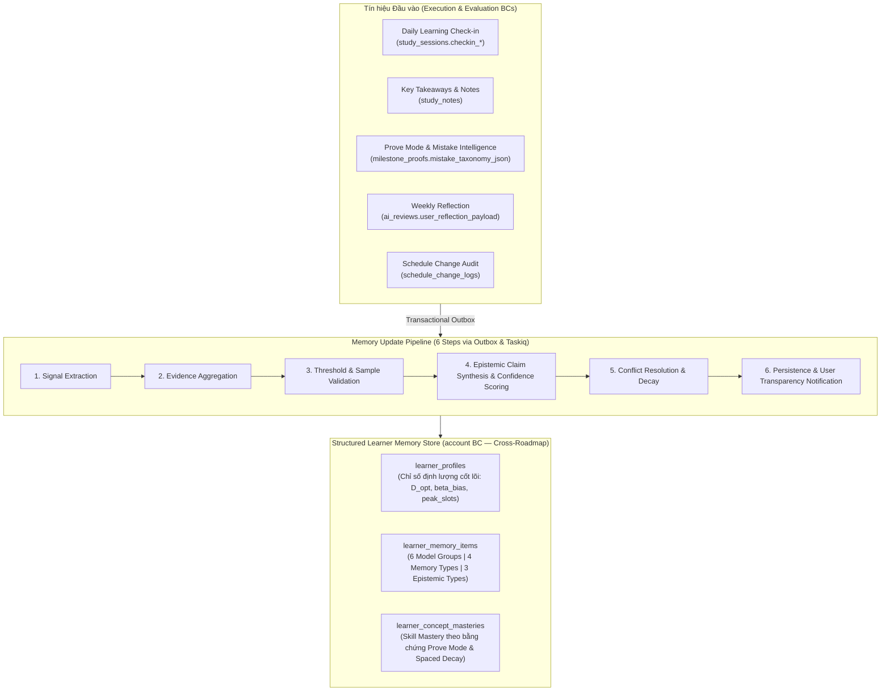

# ADR-010: Kiến trúc Bộ nhớ Người học Có Cấu trúc (`Structured Learner Memory & Learner Intelligence`), Theo dõi Thành thạo Khái niệm, Phản tư Đa tầng & Cơ chế Chống Trì hoãn 2 Cấp độ

* **Trạng thái:** Được chấp thuận (Approved — Cập nhật Kiến trúc v2.2: Nâng cấp lên Structured Learner Memory & Learner Intelligence xuyên Lộ trình với `learner_memory_items` & `learner_concept_masteries`)
* **Ngày quyết định:** 16/10/2026 (Cập nhật v2.0: 25/10/2026; Cập nhật v2.1: 03/11/2026; Cập nhật v2.2: 05/11/2026)
* **Người quyết định:** Vũ Toàn Thắng, Phan Đình Duẩn
* **Căn cứ đánh giá:** Khung Rubric Đồ án Tốt nghiệp CNTT — Tiêu chí TC2.1 & TC2.3 (Mức 5)
* **Yêu cầu liên quan:** `ASR-01`, `ASR-02`, `FR-ADAPT-001`, `FR-ADAPT-002`, `FR-ADAPT-003`, `FR-PAUSE-001`, `FR-PAUSE-002`, `FR-PROFILE-001`, `FR-SESSION-002`, `FR-REPORT-003`, `UC-03`, `UC-06`, `UC-12`, `UC-14`, `UC-15`, `UC-16`, `UC-20`, `UC-21`, `UC-22`, `UC-23`, `UC-24`, `UC-25`, `UC-26`, `BUSR-02`, `BUSR-03`, `BUSR-06`, `BUSR-07`, `BUSR-09`

---

## 1. Ngữ cảnh & Đặt vấn đề (Context)
Nền tảng lý thuyết cốt lõi của FocusFlow là mô hình **Học tập Tự điều chỉnh của Zimmerman (Self-Regulated Learning — SRL, 2002)** gồm 3 pha khép kín: *Forethought (Hoạch định)* $\to$ *Performance (Thực thi)* $\to$ *Self-Reflection (Phản tư & Thích ứng)*. Trong kiến trúc **FocusFlow Learning Intelligence Harness**, việc chỉ lưu vài con số trung bình trong một bảng `learner_profiles` duy nhất là không đủ để cá nhân hóa sâu sắc. Hệ thống cần giải quyết ba bài toán cốt lõi:
1. **Cá nhân hóa Dài hạn Xuyên Nhiều Lộ trình với Bộ nhớ Có Cấu trúc & Nhận thức Luận Rõ ràng (`Structured Learner Memory`):**
   * Khi người học hoàn thành hoặc chuyển sang một lộ trình học tập mới, các hiểu biết về phong cách học tập, hành vi thực thi, mức độ thành thạo từng khái niệm nền tảng và những rào cản tâm lý không được phép mất đi mà phải được tích lũy bền vững **xuyên suốt nhiều Roadmaps** tại Bounded Context **`account`** (`learner_profiles`, `learner_memory_items`, `learner_concept_masteries`).
   * Hệ thống phải phân biệt rõ ràng về mặt nhận thức luận (Epistemology) giữa **Sở thích do người học tự khai báo (`Explicit Preferences`)**, **Hành vi thực tế đo đếm được (`Observed Behaviors`)** và **Nhận định do AI suy diễn (`Inferred Preferences`)** — đi kèm siêu dữ liệu kiểm chứng (`confidence_score`, `sample_size`, `source_evidence`, `confirmation_status`) và quyền minh bạch để người học xem, xác nhận, chỉnh sửa hoặc xóa bỏ bất kỳ suy diễn nào.
2. **Đo lường Thành thạo Thực chất (`Skill Mastery`) & Thu thập Tín hiệu Phản tư Đa tầng (`Daily Check-in` & `Weekly Reflection`):**
   * Hoàn thành một `Task` trên giao diện (`status = 'COMPLETED'`) không đồng nghĩa với việc người học đã thực sự làm chủ khái niệm. Điểm thành thạo khái niệm (`learner_concept_masteries`) phải được cập nhật dựa trên **bằng chứng kiểm tra năng lực thực tế** (kết quả Prove Mode, điểm `ai_evidence_score`, và phân loại lỗi sai `mistake_taxonomy_json`).
   * Cần kết hợp tín hiệu định lượng với tín hiệu cảm xúc/nhận thức chủ quan thông qua **Daily Learning Check-in** ngay tại phiên học (`study_sessions.checkin_*`) và **Weekly Reflection** (2–3 câu hỏi tự phản tư trong `ai_reviews.user_reflection_payload`).
3. **Ngăn chặn Hiện tượng "Tuyết lăn Trì hoãn" (Procrastination Snowball) & Ghi nhận Kiểm toán Lịch trình (`FR-ADAPT-001..003`, `BUSR-06`, `BUSR-07`):**
   * Phân định rạch ròi 2 cấp độ trì hoãn: Cấp độ Task (`STALLED` khi `reschedule_count >= 3`) và Cấp độ Roadmap (`DORMANT` khi $\ge 7$ ngày không có hoạt động học), đi kèm cơ chế quản trị **Ngân sách Dời lịch Hàng tuần (`Weekly Reschedule Budget` — 3 lượt/tuần)**, giao diện **Anti-Procrastination Mode** và nghi thức phục hồi **Post-Failure Reset Ritual 4 bước**.

---

## 2. Các phương án xem xét (Alternatives Considered)

### Hạng mục 1: Kiến trúc Bộ nhớ Cá nhân hóa & Cập nhật Liên Context
* **Phương án A — Lưu bộ nhớ dạng văn bản tự do (Unstructured Text Blob) hoặc Vector Chat History gắn cứng vào từng Roadmap:**
  * *Nhược điểm:* Không phân biệt được đâu là sở thích người học khai báo và đâu là suy diễn của AI; mất toàn bộ tri thức cá nhân hóa khi sang lộ trình mới; người học không thể kiểm chứng hay sửa các suy diễn sai lệch.
* **Phương án B — Tính toán Đồng bộ Trực tiếp trong HTTP Request Kết thúc Phiên học:**
  * *Nhược điểm:* Tăng độ trễ API kết thúc phiên học và tạo sự phụ thuộc ghi trực tiếp từ Context `execution` sang Context `account`, vi phạm `ADR-001`.
* **Phương án C — Kiến trúc Bộ nhớ Người học Có Cấu trúc 3 Bảng (`learner_profiles`, `learner_memory_items`, `learner_concept_masteries`) tại `account` BC + Đường ống Cập nhật Bộ nhớ 6 Bước qua Transactional Outbox / Taskiq (Được chọn):**
  * Mô hình hóa đầy đủ **6 Nhóm Mô hình Người học**, **4 Loại Bộ nhớ** và **3 Kiểu Dữ liệu Nhận thức Luận** chuẩn 3NF/BCNF xuyên suốt nhiều lộ trình.
  * Đảm bảo cô lập tuyệt đối giữa `execution`/`evaluation` và `account` nhờ mẫu Transactional Outbox (`outbox_events`) + Idempotent Consumer (`processed_events`) kích hoạt luồng `CONTINUOUS_LEARNING` trên **Taskiq Worker**.

### Hạng mục 2: Cơ chế Kiểm soát Quá hạn & Dịch lịch Thích ứng
* **Phương án A — Tự động Dời lịch Vô hạn hoặc Cho phép Dời Lịch Tự Do Bỏ qua Cổng Kiểm định:**
  * *Nhược điểm:* Gây hiệu ứng tuyết lăn trì hoãn, phá vỡ trần thời gian cứng (`BUSR-03`, `EVAL-06`) và làm mất hoàn toàn tính tôn trọng cam kết học tập.
* **Phương án B — Mô hình Chống Trì hoãn 2 Cấp độ (`STALLED` vs `DORMANT`), Quản trị Ngân sách Tuần, Tái lập lịch qua `DeterministicSchedulingEngine` + Cổng 3 Tầng (`UC-12`) & Bảng Kiểm toán `schedule_change_logs` (Được chọn):**
  * Giới hạn dời lịch quá hạn bằng **Weekly Reschedule Budget (3 lượt/tuần)**.
  * Mọi đề xuất phục hồi lịch trình (`OVERDUE_RECOVERY`) đều kết hợp chiến lược AI với `DeterministicSchedulingEngine` và đi qua **Cổng Kiểm định 3 Tầng (`UC-12`)**, tạo bản nháp `ScheduleProposal(DRAFT)` và chỉ cập nhật vào `OfficialSchedule` khi người học bấm **Apply** (`BUSR-02`, `BUSR-03`).

---

## 3. Quyết định (Decision)
**Chấp thuận Phương án C cho cả hai hạng mục với kiến trúc chi tiết v2.2 như sau:**

### 3.1. Kiến trúc Bộ nhớ Người học Có Cấu trúc & Trí tuệ Người học (`Structured Learner Memory & Learner Intelligence`)
Toàn bộ bộ nhớ cá nhân hóa dài hạn được lưu trữ tại Bounded Context **`account`** trên 3 bảng chuẩn 3NF/BCNF (**`learner_profiles`**, **`learner_memory_items`**, **`learner_concept_masteries`**) để tồn tại độc lập và tái sử dụng **xuyên suốt nhiều Roadmaps** của cùng một người học:

#### 3.1.1. Sáu Nhóm Mô hình Người học (`6 Learner Model Groups`)
Mọi thuộc tính trong `learner_profiles`, `learner_memory_items` và `learner_concept_masteries` được phân hoạch vào 6 nhóm năng lực:
1. **`Learning Preferences` (Sở thích học tập):** Định dạng học liệu ưa thích (video, tài liệu đọc, bài tập thực hành code), độ dài phiên học mong muốn, phong cách hướng dẫn (từng bước chi tiết hay gợi mở Socratic).
2. **`Learning Behavior` (Hành vi thực thi):** Thời lượng tập trung thực tế tối ưu ($D_{opt}$ — `optimal_focus_duration_mins`), khung giờ năng suất đỉnh (`peak_productivity_slots`), mức năng lượng và độ tập trung ghi nhận qua check-in hàng ngày.
3. **`Learning Performance` (Hiệu suất học tập):** Tỷ lệ hoàn thành hàng tuần (`weekly_completion_rate`), tốc độ hấp thụ kiến thức thực tế so với dự kiến, điểm số bằng chứng trung bình (`ai_evidence_score`).
4. **`Knowledge Mastery` (Mức độ thành thạo tri thức):** Bản đồ làm chủ từng khái niệm (`learning_concepts`) xuyên lộ trình được lưu tại bảng **`learner_concept_masteries`**.
5. **`Scheduling Behavior` (Hành vi lập lịch & cam kết):** Hệ số chệch ước lượng thời gian ($\beta_{bias}$ — `estimation_bias_factor`), tần suất dời lịch theo ngày trong tuần, mức độ tuân thủ các khối `schedule_blocks`.
6. **`Learning Challenges` (Rào cản & điểm nghẽn thường gặp):** Các mẫu lỗi sai nhận thức lặp lại (`MISSING_FOUNDATION`, `CONCEPT_MISCONCEPTION`, `PROCESS_ERROR`, `LACK_OF_PRACTICE`), nguyên nhân gián đoạn phổ biến (`disruption_category`) và ngưỡng tải nhận thức gây quá tải.

#### 3.1.2. Bốn Loại Bộ nhớ (`4 Memory Types`) & Ba Kiểu Dữ liệu Nhận thức Luận (`3 Epistemic Data Types`)
Trong bảng **`learner_memory_items`**, mỗi mục bộ nhớ được phân loại chặt chẽ theo 2 chiều:
* **Chiều 1 — 4 Loại Bộ nhớ (`memory_type`):**
  1. **`Profile Memory`:** Đặc điểm nền tảng, mục tiêu dài hạn và sở thích học tập của người học.
  2. **`Behavioral Memory`:** Các quy luật thói quen về khung giờ, nhịp độ tập trung và xu hướng trì hoãn.
  3. **`Knowledge Memory`:** Ghi nhận các thế mạnh kiến thức hoặc các lỗ hổng khái niệm đặc thù cần lưu ý khi thiết kế lộ trình mới.
  4. **`Interaction Memory`:** Phản hồi của người học đối với các đề xuất AI trước đây (lý do từ chối lịch trình, phong cách giải thích người học đánh giá cao).
* **Chiều 2 — 3 Kiểu Dữ liệu Nhận thức Luận (`epistemic_type`) & Siêu dữ liệu Kiểm chứng Bắt buộc:**
  1. **`1. Explicit Preferences` (Sở thích tường minh):** Do người học trực tiếp khai báo hoặc thiết lập trong cài đặt / phỏng vấn chẩn đoán (độ ưu tiên cao nhất, `confidence_score = 1.00`, `confirmation_status = 'CONFIRMED'`).
  2. **`2. Observed Behaviors` (Hành vi quan sát thực nghiệm):** Các chỉ số thống kê khách quan tính toán trực tiếp từ nhật ký phiên học và lịch trình (ví dụ: tỷ lệ hoàn thành buổi sáng đạt $88\%$ trên $N=16$ phiên).
  3. **`3. Inferred Preferences` (Nhận định suy diễn bởi AI/Hệ thống):** Các kết luận suy diễn từ hành vi và phản tư (ví dụ: *"Người học tiếp thu tốt hơn khi chia bài thực hành thành các khối 45 phút thay vì lý thuyết dài 90 phút"*). Mọi bản ghi `Inferred Preferences` trong `learner_memory_items` **bắt buộc phải lưu đầy đủ 7 trường siêu dữ liệu kiểm chứng**:
     * `claim_value`: Nội dung khẳng định / giá trị cấu trúc của suy diễn.
     * `source_evidence`: Danh sách mã định danh hoặc tóm tắt bằng chứng gốc (`study_session_ids`, `milestone_proof_ids`, `schedule_change_log_ids`).
     * `sample_size`: Số lượng mẫu quan sát làm cơ sở cho suy diễn (ví dụ: `sample_size >= 5`).
     * `observation_window_days`: Độ rộng cửa sổ thời gian quan sát (ví dụ: `14` hoặc `30` ngày).
     * `confidence_score`: Độ tin cậy định lượng nằm trong đoạn `[0.00, 1.00]` (chỉ đưa vào `Context Engine` khi `confidence_score >= 0.70` hoặc đã được người học xác nhận).
     * `updated_at`: Mốc thời gian cập nhật gần nhất.
     * `confirmation_status`: Trạng thái minh bạch với người học (`UNCONFIRMED`, `CONFIRMED`, `REJECTED`, `EDITED_BY_USER`).

#### 3.1.3. Đường ống Cập nhật Bộ nhớ 6 Bước (`6-Step Memory Update Pipeline`) & Quyền Minh bạch của Người học (`UC-03`, `UC-26`)
Khi luồng `CONTINUOUS_LEARNING` trên Taskiq Worker nhận sự kiện từ `outbox_events` (kiểm tra lũy đẳng qua `processed_events`), hệ thống thực thi đường ống 6 bước:
1. **`Step 1 — Signal Extraction` (Trích xuất tín hiệu):** Thu thập dữ liệu từ phiên học vừa kết thúc (`study_sessions` + `checkin_*`), ghi chú (`study_notes`), bài kiểm tra cột mốc (`milestone_proofs` + `mistake_taxonomy_json`), hoặc phản tư tuần (`ai_reviews`).
2. **`Step 2 — Evidence Aggregation` (Tổng hợp bằng chứng):** Gom nhóm dữ liệu theo cửa sổ trượt 14–30 ngày qua các Read-Only Query Ports (`execution/public_api.py`, `evaluation/public_api.py`).
3. **`Step 3 — Threshold & Sample Validation` (Kiểm tra ngưỡng mẫu tối thiểu):** Chặn suy diễn vội vàng khi chưa đủ mẫu (`is_cold_start = TRUE` khi $< 5$ phiên học cho $D_{opt}$ hoặc $< 8$ tasks cho $\beta_{bias}$).
4. **`Step 4 — Epistemic Claim Synthesis & Confidence Scoring` (Tổng hợp nhận định & chấm điểm tin cậy):** Cập nhật các chỉ số định lượng trong `learner_profiles` ($D_{opt} \in [15, 120]$, $\beta_{bias} \in [0.50, 2.00]$) và tính toán `confidence_score`, `sample_size`, `observation_window_days` cho các mục trong `learner_memory_items`.
5. **`Step 5 — Conflict Resolution & Temporal Decay` (Giải quyết mâu thuẫn & suy giảm theo thời gian):** Không bao giờ để một `Inferred Preference` tự động ghi đè lên `Explicit Preference` của người học; giảm dần trọng số của các suy diễn cũ không còn bằng chứng mới củng cố.
6. **`Step 6 — Persistence & User Transparency` (Lưu trữ & Minh bạch với Người học):** Lưu ACID vào `learner_profiles` / `learner_memory_items` / `learner_concept_masteries`. Trên giao diện Hồ sơ Năng lực (`UC-03`), người học có toàn quyền **xem giải thích nguồn gốc (`source_evidence`), bấm Xác nhận (`CONFIRMED`), Chỉnh sửa (`EDITED_BY_USER`), Từ chối (`REJECTED`) từng suy diễn hoặc bấm Reset Profile** về trạng thái Cold Start bất cứ lúc nào.

### 3.2. Theo dõi Độ Thành thạo Khái niệm (`Skill Mastery`), Check-in Hàng ngày & Phản tư Tuần
1. **`Skill Mastery Tracking` dựa trên Bằng chứng Thực tế (Bảng `learner_concept_masteries`):**
   * Điểm thành thạo (`mastery_level`, `mastery_score` trong `learner_concept_masteries` thuộc `account` BC) **không tăng chỉ vì đánh dấu hoàn thành Task**, mà chỉ được xác lập và nâng cấp dựa trên **bằng chứng kiểm chứng thực chất** từ bài khảo sát Prove Mode (`milestone_proofs.ai_evidence_score`), độ lệch tự tin (`calibration_gap`), và kết quả khắc phục lỗi sai trong `mistake_taxonomy_json`.
   * Lưu trữ `last_practiced_at`, `evidence_count` và `next_review_due_at` để hỗ trợ ôn tập ngắt quãng (Spaced Retrieval) và giúp `PLAN_CREATION` tự động rút gọn các khái niệm người học đã thành thạo ở các lộ trình trước.
2. **`Daily Learning Check-in` tại Phiên học (Các cột `study_sessions.checkin_*` — `UC-14`, `UC-15`):**
   * Tích hợp khảo sát vi mô siêu nhẹ ($\le 10$ giây) ngay trong bảng `study_sessions` thông qua các trường `checkin_*` (như mức năng lượng đầu buổi `checkin_energy_level`, mức độ tập trung / tải nhận thức và rào cản gặp phải `checkin_mood` / `checkin_blocker_note`).
   * Dữ liệu `checkin_*` cung cấp tín hiệu thực tế để đối chiếu với khung giờ sinh học (`availability_slots.energy_level`) và phát hiện sớm dấu hiệu kiệt sức (burnout).
3. **`Weekly Reflection` Kết hợp Định lượng & Chủ quan (Cột `ai_reviews.user_reflection_payload` — `UC-21`):**
   * Trong nghi thức Chốt tuần (`WEEKLY_REVIEW` — `UC-21`), trước khi AI sinh báo cáo đánh giá tuần, người học trả lời **2–3 câu hỏi tự phản tư ngắn gọn** (ví dụ: *"Điều gì giúp bạn tập trung tốt nhất tuần qua?"*, *"Trở ngại lớn nhất khiến bạn trễ kế hoạch là gì?"*, *"Tuần tới bạn muốn điều chỉnh nhịp độ thế nào?"*) được lưu có cấu trúc tại cột **`ai_reviews.user_reflection_payload`**.
   * AI kết hợp `user_reflection_payload` với số liệu định lượng tuần để đưa ra khuyến nghị sát thực tế nhất (nâng cao `Insight Acceptance Rate`).

### 3.3. Cơ chế Quản trị Ngân sách Tuần, Tái lập lịch Đi qua Cổng 3 Tầng & Mô hình Chống Trì hoãn 2 Cấp độ
1. **Quét Nhiệm vụ Quá hạn lúc `00:05` IANA & Cảnh báo Email (`FR-ADAPT-001`, `UC-25`):**
   * `TaskiqScheduler` kích hoạt `OverdueAntiLoopSweeperTask` lúc **`00:05`** hàng ngày theo múi giờ `User.timezone` với cú pháp `SELECT ... FOR UPDATE SKIP LOCKED` để phát hiện các task quá hạn (`scheduled_date < CURRENT_DATE` và `status != 'COMPLETED'`).
   * Tác vụ nền **tuyệt đối KHÔNG tự ý sửa ngầm `scheduled_date`**. Hệ thống gửi Email Notification cảnh báo và hiển thị task quá hạn trên mục **"Task Cần Chú Ý (`OVERDUE`)"** kèm số lượt dời lịch còn lại trong tuần (`weekly_reschedule_budget - weekly_reschedule_used`).
2. **Phục hồi Lộ trình Quá hạn (`OVERDUE_RECOVERY`) qua `DeterministicSchedulingEngine`, Cổng 3 Tầng & Recovery Proposal Diff (`FR-ADAPT-002`, `UC-23`):**
   * Khi người học bấm **"Dời lịch hợp lý bằng AI"** (`UC-23`), AI phân tích nguyên nhân và đề xuất chiến lược phục hồi (`Replanning Strategy` kèm `placement_rationale`), sau đó `DeterministicSchedulingEngine` phân bổ lại các khối `schedule_blocks` cho riêng lộ trình đó (tôn trọng `Protected Sessions` và `Schedule Stability`).
   * **Bắt buộc đi qua Cổng Kiểm định 3 Tầng (`ProposalValidationGateOrchestrator` — `UC-12`)**, lưu thành **`ScheduleProposal(DRAFT)`** và hiển thị **Bảng đối chiếu phục hồi (Recovery Proposal Diff)** gồm 6 tham số minh bạch.
   * **Chỉ khi người học bấm nút "Áp dụng (Apply)"**: cập nhật `OfficialSchedule`, tăng `reschedule_count = reschedule_count + 1`, khấu trừ `weekly_reschedule_used = weekly_reschedule_used + 1` và ghi nhận vào `schedule_change_logs`.
3. **Mô hình Can thiệp Chống Trì hoãn 2 Cấp độ (`FR-ADAPT-003`):**
   * **Cấp 1 — Task `STALLED` (`reschedule_count >= 3`):**
     * Khóa tính năng dời lịch tự do đối với task này và bắt buộc người học chọn 1 trong 3 nhánh xử lý tận gốc: (1) *AI Micro-Stepping* (chia nhỏ thành 2–3 task con $\le 30$ phút), (2) *Commitment Contract* (cam kết học tối thiểu $\ge 15$ phút để reset `reschedule_count = 0`), hoặc (3) *Chuyển vào Backlog Recovery Queue*.
   * **Cấp 2a — Anti-Procrastination Mode (Khi Cạn Ngân sách Tuần hoặc $\ge 5$ Ngày Không Học):**
     * Thu gọn Dashboard, chỉ hiển thị duy nhất **1 Task ưu tiên cao nhất** kèm lựa chọn **"Bắt đầu MVS 10 phút (Giữ nhịp học)"** (`UC-15`) hoặc **"Chia nhỏ thành bước 15 phút"**.
   * **Cấp 2b — Post-Failure Reset Ritual (Khi Roadmap `DORMANT >= 7 ngày` — `UC-24`):**
     * Mở quy trình phục hồi 4 bước (Giải tỏa tâm lý $\to$ Phân loại nguyên nhân `disruption_category` $\to$ Chọn hướng tái thiết 7-Day Light Reboot / Re-scope / Archive $\to$ Sinh `ScheduleProposal` qua `UC-12` và bấm Apply để xóa cờ `DORMANT`, tăng `reset_ritual_count`).
4. **Phân lập Tuyệt đối với `DominoShiftEngine` (`pause_records`) & Kiểm toán trong `schedule_change_logs` (`BUSR-07`, `UC-22`):**
   * Khi người học chủ động **Tạm dừng và Tiếp tục Lộ trình (`Pause / Resume Roadmap` - `UC-22`, lưu tại bảng `pause_records`)**, Pure Domain Service **`DominoShiftEngine`** thực hiện tịnh tiến toàn bộ các nhiệm vụ chưa hoàn thành theo số ngày tạm dừng mà **KHÔNG làm tăng `reschedule_count`** và **KHÔNG trừ vào ngân sách tuần**.
   * Mọi thao tác dịch lịch đều ghi nhận bản ghi kiểm toán bất biến vào bảng **`schedule_change_logs`**.

---

## 4. Lý do & Đánh đổi (Rationale & Trade-Offs)
* **Cá nhân hóa Bền vững & Minh bạch Nhận thức Luận:** Tách biệt `Explicit`, `Observed` và `Inferred Preferences` kèm 7 trường siêu dữ liệu kiểm chứng trong `learner_memory_items` giúp AI hiểu sâu về người học qua nhiều lộ trình mà không bao giờ rơi vào trạng thái "hộp đen áp đặt" (người học luôn kiểm soát và chỉnh sửa được suy diễn).
* **Đánh giá Năng lực Thực chất:** Bảng `learner_concept_masteries` gắn chặt với bằng chứng Prove Mode và `mistake_taxonomy_json` ngăn chặn hoàn toàn tình trạng học đối phó chỉ bấm nút hoàn thành task.
* **Khép kín Vòng lặp Lý thuyết Zimmerman SRL một cách Bền vững (`ASR-02`):** Kết hợp `study_sessions.checkin_*`, `ai_reviews.user_reflection_payload`, Transactional Outbox và Taskiq Worker đảm bảo mọi tín hiệu thực thi và phản tư đều được chuyển hóa thành trí tuệ lập kế hoạch cho chu kỳ tiếp theo mà không làm chậm HTTP API.
* **Đánh đổi:** Bộ nhớ người học được cập nhật theo mô hình **Nhất quán Cuối cùng (Eventual Consistency)** qua luồng `CONTINUOUS_LEARNING` trên Taskiq Worker với độ trễ vài giây sau phiên học — hoàn toàn phù hợp với bản chất tích lũy của hồ sơ năng lực.

---

## 5. Hệ quả & Kiểm chứng (Consequences & Verification)
* **Tích cực:** Hoàn thiện kiến trúc **Structured Learner Memory & Learner Intelligence** của FocusFlow v2.2, đồng bộ 100% giữa `ADR-001` (Outbox & 35 bảng), `ADR-004` (Durable Workflows & Taskiq), `ADR-005` (Context Engine) và `ADR-009` (Deterministic Scheduling & Mistake Intelligence).
* **Kiểm chứng Tự động:**
  * Unit test kiểm chứng `MemoryUpdatePipeline` không bao giờ ghi đè `Explicit Preferences` bằng `Inferred Preferences`, tính toán đúng `confidence_score` và tôn trọng trạng thái `REJECTED` / `EDITED_BY_USER`.
  * Unit test kiểm chứng `SkillMasteryCalculator` chỉ nâng cấp độ thành thạo trong `learner_concept_masteries` khi có bằng chứng `milestone_proofs` hợp lệ.
  * Integration test kiểm chứng `DominoShiftEngine`, ngắt mạch `STALLED` (`reschedule_count >= 3`), Anti-Procrastination Mode và Reset Ritual 4 bước.
