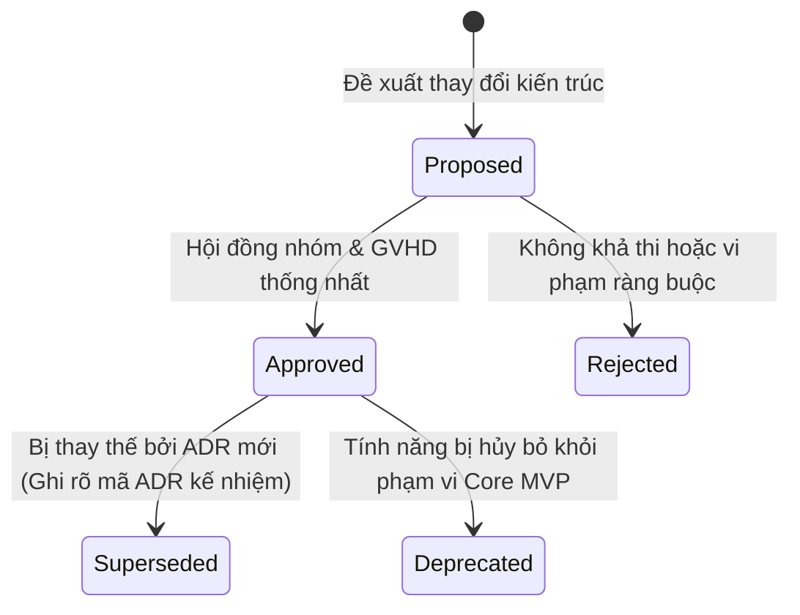

# FocusFlow — Sổ tay Quyết định Kiến trúc (Architecture Decision Log - ADL v2.2)

## Thông tin Hồ sơ Kiến trúc
* **Dự án:** FocusFlow — Hệ thống hỗ trợ lập kế hoạch và thực thi lộ trình tự học thích ứng tích hợp AI
* **Phiên bản Kiến trúc:** v2.2 (Đồng bộ toàn diện theo **FocusFlow Learning Intelligence Harness** & Master Architecture Blueprint v2.2: **35 Bảng CSDL PostgreSQL 16 (`pgvector`) chuẩn 3NF/BCNF** & 28 Use Cases)
* **Tiêu chuẩn tài liệu:** Markdown Architectural Decision Records (MADR v3.0), ISO/IEC/IEEE 42010 & arc42 Section 9
* **Căn cứ đánh giá học thuật:** Khung Rubric Đồ án Tốt nghiệp CNTT — Tiêu chí TC2.1, TC2.3 & TC2.7 (Mức 5)
* **Người chịu trách nhiệm kiến trúc:** Vũ Toàn Thắng, Phan Đình Duẩn
* **Giảng viên Hướng dẫn:** ThS. Vũ Đình Bảo (Khoa Công nghệ Thông tin, HCMUTE)

---

## 1. Giới thiệu & Mục đích (Introduction & Purpose)
Hồ sơ Quyết định Kiến trúc (Architecture Decision Records - ADR) ghi lại các quyết định kỹ thuật cốt lõi có tầm ảnh hưởng lớn tới cấu trúc, tính mô-đun, độ tin cậy dữ liệu, hiệu năng và khả năng bảo trì của hệ thống FocusFlow v2.2. Mỗi bản ghi ADR giải trình tường minh:
* **Ngữ cảnh & Vấn đề (Context):** Lý do phải đưa ra quyết định kỹ thuật và các yêu cầu có ý nghĩa kiến trúc (ASR) liên quan.
* **Các phương án xem xét (Alternatives Considered):** So sánh khách quan ít nhất 2–3 giải pháp công nghệ/mô hình khả thi.
* **Quyết định (Decision):** Giải pháp được phê duyệt chính thức và đồng bộ 100% giữa SRS v1.3, 28 Use Cases, FocusFlow Learning Intelligence Harness, Class Diagram, Database Schema (**35 bảng 3NF/BCNF** với `pgvector`) và Codebase.
* **Lý do & Đánh đổi (Rationale & Trade-Offs):** Cân nhắc kỹ lưỡng giữa lợi ích thu được và chi phí/độ phức tạp kỹ thuật phải đánh đổi.
* **Hệ quả & Kiểm chứng (Consequences & Verification):** Ảnh hưởng tích cực, biện pháp giảm thiểu rủi ro và cơ chế kiểm chứng tự động (Architectural Fitness Functions).

---

## 2. Bảng Tổng mục Quyết định Kiến trúc (ADR Summary Matrix — v2.2)

| Mã ADR | Tên Quyết định Kiến trúc | Trạng thái | Ngày Duyệt / Cập nhật v2.2 | Phân vùng Kiến trúc | Yêu cầu Truy vết (Traceability) |
|---|---|---|---|---|---|
| [`ADR-001`](ADR-001-architectural-style.md) | Kiến trúc Context-First Modular Monolith kết hợp Hexagonal (4 BCs + `shared_kernel`, 35 Bảng 3NF/BCNF), Ánh xạ 7 Nhóm Learning Intelligence Harness, Transactional Outbox & `import-linter` | Approved (v3.2) | 05/11/2026 | Backend Architectural Style, DDD & Harness Mapping | `ASR-01`, `ASR-02`, `FR-PLAN-001..005`, `UC-01..UC-28`, `NFR-MAINT-001`, `TC2.1` |
| [`ADR-002`](ADR-002-backend-tech-stack.md) | Ngăn xếp Backend: Python 3.12+, FastAPI, Pydantic v2, SQLAlchemy 2.0 Async, Composition Root DI & `AsyncUnitOfWork` | Approved (v2.0) | 25/10/2026 | Backend Framework, DI & Observability | `ASR-01`, `ASR-03`, `FR-AUTH-001`, `NFR-PERF-002`, `TC2.3` |
| [`ADR-003`](ADR-003-frontend-tech-stack.md) | Ngăn xếp Frontend: Angular 21+ Zoneless Signals, Tailwind CSS v4, PrimeNG v21, `openapi-typescript` & 9 Feature Slices | Approved (v2.1) | 03/11/2026 | Frontend Framework, State & UI | `ASR-03`, `FR-PLAN-003`, `FR-SESSION-001`, `UC-01..UC-28`, `NFR-UX-002`, `TC2.1` |
| [`ADR-004`](ADR-004-worker-and-scheduled-jobs.md) | Hàng đợi Tác vụ Nền Thuần Async (Taskiq + Redis Streams), `TaskiqScheduler` (`replicas: 1`) & Điều phối Luồng Công việc Bền vững (`workflow_runs`, `workflow_step_executions`) | Approved (v2.2) | 05/11/2026 | Async Background Workers & Durable Workflow Orchestration | `ASR-02`, `ASR-05`, `FR-SESSION-003`, `FR-ADAPT-001..003`, `UC-07..08`, `UC-12`, `UC-17..18`, `UC-21`, `UC-23`, `UC-25`, `OS-01`, `OS-07`, `TC2.3` |
| [`ADR-005`](ADR-005-ai-streaming-protocol.md) | Kiến trúc Shared AI Harness Runtime 6 Thành phần quanh `LLMProviderPort` (`GeminiAdapter` + `MockLLMAdapter`), Giao thức SSE 2 Chặng Đồng nhất & Giữ chỗ Quota ACID 2 Pha | Approved (v2.2) | 05/11/2026 | Shared AI Harness Runtime, Streaming & Quota Ledger | `ASR-02`, `ASR-03`, `ASR-06`, `FR-PLAN-001..002`, `FR-QUOTA-001`, `UC-07..08`, `UC-12`, `UC-23`, `UC-28`, `BUSR-02`, `BUSR-10`, `TC2.3` |
| [`ADR-006`](ADR-006-deployment-strategy.md) | Chiến lược Triển khai 6-Container Docker Compose, Chế độ Bảo vệ Offline (`MockAdapters`) & Cloud PaaS UAT | Approved (v2.1) | 03/11/2026 | Infrastructure, Deployment & Defense Mode | `ASR-05`, `ASR-06`, `UC-04..05`, `UC-17..18`, `NFR-AVAIL-001`, `TC2.1`, `TC2.7` |
| [`ADR-007`](ADR-007-database-schema-and-persistence.md) | Kiến trúc CSDL PostgreSQL 16 + `pgvector` (35 Bảng 3NF/BCNF: `12/10/5/4/4`), Khóa Ngoại Đơn (Single Surrogate FK) & Cấm ORM JOIN Chéo Context | Approved (v3.2) | 05/11/2026 | Database Persistence, `pgvector` & 3NF/BCNF Integrity | `ASR-01`, `ASR-02`, `FR-TASK-001`, `UC-01..UC-28`, `BUSR-01..12`, `TC2.3` |
| [`ADR-008`](ADR-008-security-architecture-and-tokens.md) | Kiến trúc Bảo mật Đa tầng: `PyJWT`, `pwdlib` (Argon2id), Cookie JWT, Google Calendar OAuth2 (Fernet), WebCal SHA-256 & Webhook `HMAC-SHA256` | Approved (v2.1) | 03/11/2026 | Security, OAuth2, Webhook & PII Hygiene | `FR-AUTH-001..002`, `FR-EXT-001`, `UC-04..05`, `UC-17..18`, `UC-26..28`, `BUSR-08`, `OS-05`, `NFR-SEC-001..004` |
| [`ADR-009`](ADR-009-ai-constraint-validation-and-evaluation-harness.md) | Tách bạch Suy luận Lộ trình AI với Bộ Lập lịch Tất định (`DeterministicSchedulingEngine` Rolling-Horizon), Cổng Kiểm duyệt 3 Tầng, Mistake Intelligence & AI Evaluation Harness 10 Chỉ số | Approved (v2.2) | 05/11/2026 | Deterministic Scheduling, 3-Tier Gate, Mistake Intelligence & 10-Metric Eval | `ASR-04`, `ASR-06`, `FR-PLAN-005`, `UC-07..08`, `UC-12`, `UC-14`, `UC-20`, `UC-23..24`, `NFR-AI-003`, `EVAL-06..08`, `BUSR-03..05`, `TC2.3` |
| [`ADR-010`](ADR-010-learner-profile-memory-and-anti-loop.md) | Bộ nhớ Người học Có Cấu trúc (`Structured Learner Memory & Learner Intelligence` Xuyên Lộ trình), Skill Mastery, Daily Check-in, Weekly Reflection & Chống Trì hoãn 2 Cấp độ | Approved (v2.2) | 05/11/2026 | Learner Memory, Skill Mastery, Reflection & Anti-Loop | `ASR-02`, `FR-PROFILE-001`, `FR-ADAPT-001..003`, `UC-03`, `UC-12`, `UC-14..16`, `UC-20..26`, `BUSR-02..03`, `BUSR-06..07`, `TC2.3` |

---

## 3. Ma trận Truy vết Đồ án & Khung Đánh giá Rubric HCMUTE

Hồ sơ ADR v2.2 của FocusFlow được thiết kế gắn liền với **6 Yêu cầu Có Ý nghĩa Kiến trúc (`ASR-01`..`ASR-06`)**, kiến trúc **FocusFlow Learning Intelligence Harness** và **Khung Rubric Đồ án Tốt nghiệp CNTT — HCMUTE (Mức 5 - Xuất sắc)**:

```mermaid
flowchart TD
    subgraph Rubric["Khung Rubric Đồ án Tốt nghiệp (Mức 5)"]
        TC21["TC2.1: Phân tích & Thiết kế Kiến trúc"]
        TC23["TC2.3: Công nghệ, CSDL & Tích hợp AI"]
        TC27["TC2.7: Thử nghiệm UAT & Đo lường KPI"]
    end

    subgraph ADRs["Bộ 10 Quyết định Kiến trúc v2.2 (ADRs)"]
        A1["ADR-001: Context-First Modular Monolith, Hexagonal & 7 Harness Groups (35 Bảng)"]
        A2["ADR-002: FastAPI Async, Composition Root DI & UoW"]
        A3["ADR-003: Angular 21+ Zoneless Signals & PrimeNG v21"]
        A4["ADR-004: Taskiq + Redis Streams & Durable Workflow Orchestration"]
        A5["ADR-005: Shared AI Harness Runtime (GeminiAdapter), 2-Stage SSE & ACID Quota"]
        A6["ADR-006: 6-Container Docker, Offline Mode & Cloud UAT"]
        A7["ADR-007: PostgreSQL 16 + pgvector (35 Bảng 3NF/BCNF & Single FK)"]
        A8["ADR-008: PyJWT, pwdlib Argon2id, OAuth2 Fernet & HMAC"]
        A9["ADR-009: Deterministic Scheduling Engine, 3-Tier Gate, Mistake Intelligence & 10-Metric Eval"]
        A10["ADR-010: Structured Learner Memory, Skill Mastery, Reflection & Anti-Loop"]
    end

    TC21 --> A1
    TC21 --> A3
    TC21 --> A6
    TC21 --> A8
    TC21 --> A9
    TC23 --> A2
    TC23 --> A4
    TC23 --> A5
    TC23 --> A7
    TC23 --> A9
    TC23 --> A10
    TC27 --> A6
    TC27 --> A9
```

### 3.1. Đối chiếu Tiêu chí Rubric TC2.1 (Kiến trúc Hệ thống & Tính Mô-đun)
* **ADR-001:** Tổ chức Backend theo mô hình **Context-First Modular Monolith** gồm 4 Bounded Contexts độc lập (`account`, `planning`, `execution`, `evaluation`) và `shared_kernel` (**35 bảng 3NF/BCNF**), bên trong mỗi Context áp dụng **Hexagonal Architecture (Ports & Adapters)**. Toàn bộ **7 Nhóm Trách nhiệm Logic của FocusFlow Learning Intelligence Harness** (`Workflow Orchestration`, `AI Harness Runtime`, `Knowledge Engine`, `Learning Intelligence`, `Scheduling Engine`, `Quality & Policy`, `Persistence & Observability`) được ánh xạ gọn gàng vào 4 Bounded Contexts + `shared_kernel` mà không sinh thêm Bounded Context thứ 5 hay tách thành 3 AI Agent rời rạc. Mọi giao tiếp đồng bộ liên Context bắt buộc đi qua `public_api.py`, giao tiếp bất đồng bộ đi qua **Transactional Outbox (`outbox_events`, `processed_events`)**, và được kiểm chứng tự động bằng **`import-linter`**.
* **ADR-003:** Kiến trúc Frontend **Angular 21+** với `standalone: true`, `provideZonelessChangeDetection()` và `ChangeDetectionStrategy.OnPush`. Quản lý trạng thái bằng **Native Angular Signals (`signal`, `computed`, `linkedSignal`, `rxResource`)** kết hợp **Tailwind CSS v4 + PrimeNG v21**, đồng bộ hợp đồng tự động qua **`openapi-typescript`** trên 9 Feature Slices (bao gồm cả `admin` và `billing`).
* **ADR-008:** Kiến trúc bảo mật Defense-in-Depth sử dụng `PyJWT` (`pyjwt[crypto]`), `pwdlib[argon2]` (Argon2id), Cookie JWT (`HttpOnly`, `Secure`, `SameSite=Lax`), mã hóa `Fernet` (`AES-256-GCM`) cho Google Calendar OAuth2 Refresh Token, băm `SHA-256` cho WebCal `.ics`, và xác thực chữ ký `HMAC-SHA256` cho Payment Gateway Webhook.

### 3.2. Đối chiếu Tiêu chí Rubric TC2.3 (Giải pháp Công nghệ, CSDL & Tích hợp AI)
* **ADR-002, ADR-004 & ADR-007:** Hợp nhất hoàn toàn ngăn xếp bất đồng bộ Python (`FastAPI` + `SQLAlchemy 2.0 Async` + **`Taskiq` trên `RedisStreamBroker`**) kết hợp **Điều phối Luồng Công việc Bền vững (`Durable Workflow Orchestration`)** lưu trạng thái trong `workflow_runs` và `workflow_step_executions` (tách biệt rõ `AI Execution Run` và `Learning Event`). CSDL **PostgreSQL 16 + `pgvector`** chuẩn hóa **35 bảng đạt 3NF/BCNF** (`12 account`, `10 planning`, `5 execution`, `4 evaluation`, `4 shared_kernel`) với khóa ngoại đơn (Single Surrogate FK) và cấm tuyệt đối ORM JOIN chéo Context.
* **ADR-005, ADR-009 & ADR-010:** Xây dựng **Shared AI Harness Runtime** 6 thành phần quanh `LLMProviderPort` (`Prompt Engine` với `PromptSanitizer`, `Context Engine` 5 tầng, `Model Gateway` ưu tiên Google Gemini `gemini-2.5-flash`/`pro` + `text-embedding-004` & `MockLLMAdapter`, `Tool Registry` chỉ đọc, `Output Engine` Pydantic v2, `Execution Manager` giữ chỗ hạn ngạch ACID 2 pha). **Tách bạch hoàn toàn việc AI sinh Lộ trình/Chiến lược** với **Bộ lập lịch tất định (`DeterministicSchedulingEngine`)** phân bổ `Tasks` (`estimated_effort`) vào `schedule_blocks` (`scheduled_duration_minutes`) theo Rolling-Horizon & Schedule Resilience, đi qua **Cổng Kiểm duyệt 3 Tầng**, tích hợp **Mistake Intelligence** (`mistake_taxonomy_json`) và **Structured Learner Memory** xuyên lộ trình (`learner_profiles`, `learner_memory_items`, `learner_concept_masteries`).

### 3.3. Đối chiếu Tiêu chí Rubric TC2.7 (Đánh giá Thực nghiệm, Bảo vệ Offline & Đo lường KPI)
* **ADR-006 & ADR-009:** Đóng gói 6 containers chuẩn mực (`postgres`, `redis`, `backend`, `worker`, `scheduler` với `replicas: 1`, `frontend`). Hỗ trợ **Offline/Local Defense Mode** chuyển đổi sang `MockLLMAdapter`, `LocalMockPaymentAdapter`, `LocalCalendarAdapter` chỉ qua `.env` để bảo vệ khóa luận an toàn tuyệt đối khi không có Internet, đồng thời chạy bộ khung **AI Evaluation Harness** đo lường **10 Chỉ số Chất lượng Workflow** trên tập **Golden Dataset** cố định.

---

## 4. Vòng đời & Quy trình Quản trị ADR (ADR Lifecycle Governance)

Mọi quyết định kiến trúc trong FocusFlow đều trải qua vòng đời nghiêm ngặt:

### Nguyên tắc Bất biến:
1. **Truy vết đa chiều (End-to-End Traceability):** Mọi quyết định trong ADR phải khớp 100% với SRS v1.3, 28 Use Cases, thiết kế FocusFlow Learning Intelligence Harness, Class Diagram và **35 bảng PostgreSQL 16 (`pgvector`) chuẩn 3NF/BCNF**.
2. **Tính khả chứng thực tiễn (Executable Verification):** Mỗi quyết định kiến trúc đều đi kèm cơ chế kiểm chứng tự động (`import-linter`, `mypy --strict`, `pytest-asyncio`, `vitest`, `playwright`, hoặc `schema.sql` constraints).
