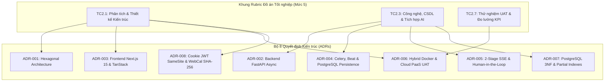
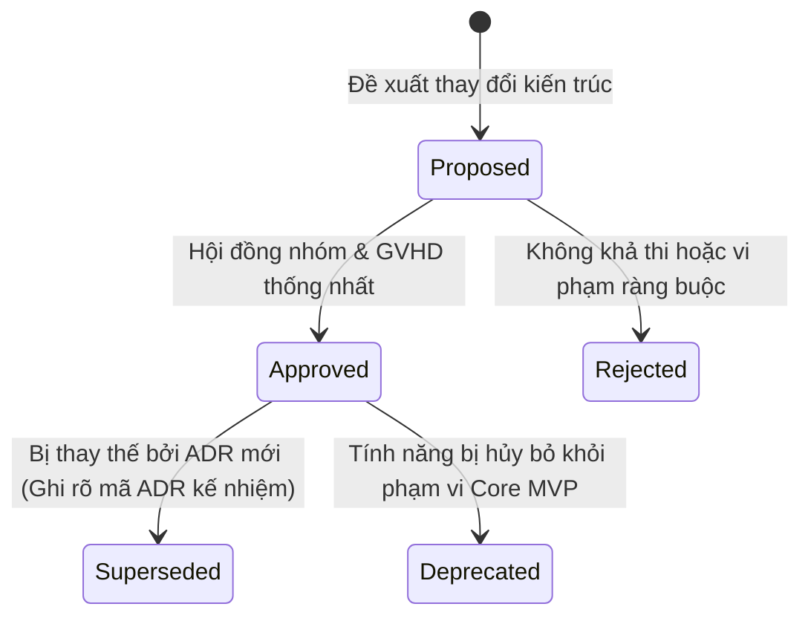

# FocusFlow — Sổ tay Quyết định Kiến trúc (Architecture Decision Log - ADL)

## Thông tin Hồ sơ Kiến trúc
* **Dự án:** FocusFlow — Hệ thống hỗ trợ lập kế hoạch và thực thi lộ trình tự học thích ứng tích hợp AI
* **Tiêu chuẩn tài liệu:** Markdown Architectural Decision Records (MADR v3.0) & arc42 Section 9
* **Căn cứ đánh giá học thuật:** Khung Rubric Đồ án Tốt nghiệp CNTT — Tiêu chí TC2.1 & TC2.3 (Mức 5)
* **Người chịu trách nhiệm kiến trúc:** Vũ Toàn Thắng (Lead BA / System Architect), Phan Đình Duẩn (Senior BA / Quality Lead)
* **Giảng viên Hướng dẫn:** ThS. Vũ Đình Bảo (Khoa Công nghệ Thông tin, HCMUTE)

---

## 1. Giới thiệu & Mục đích (Introduction & Purpose)
Hồ sơ Quyết định Kiến trúc (Architecture Decision Records - ADR) ghi lại các quyết định kỹ thuật cốt lõi có tầm ảnh hưởng lớn tới cấu trúc, tính bền vững, hiệu năng và khả năng bảo trì của hệ thống FocusFlow. Mỗi bản ghi ADR giải trình tường minh:
* **Ngữ cảnh & Vấn đề (Context):** Lý do phải đưa ra quyết định kỹ thuật và các ràng buộc liên quan.
* **Các phương án xem xét (Alternatives Considered):** So sánh khách quan ít nhất 2–3 giải pháp công nghệ/mô hình khả thi.
* **Quyết định (Decision):** Giải pháp được phê duyệt chính thức.
* **Lý do & Đánh đổi (Rationale & Trade-Offs):** Cân nhắc kỹ lưỡng giữa lợi ích thu được và chi phí/độ phức tạp kỹ thuật phải đánh đổi.
* **Hệ quả (Consequences):** Ảnh hưởng tích cực và các biện pháp giảm thiểu rủi ro phát sinh.

---

## 2. Bảng Tổng mục Quyết định Kiến trúc (ADR Summary Matrix)

| Mã ADR | Tên Quyết định Kiến trúc | Trạng thái | Ngày Duyệt | Phân vùng Kiến trúc | Yêu cầu Truy vết (Traceability) |
|---|---|---|---|---|---|
| [`ADR-001`](ADR-001-architectural-style.md) | Kiến trúc Lục giác (Hexagonal Architecture / Ports & Adapters) cho Backend | Approved | 29/09/2026 | Backend Architectural Style | `FR-PLAN-001`, `FR-PLAN-002`, `NFR-MAINT-001`, `TC2.1` |
| [`ADR-002`](ADR-002-backend-tech-stack.md) | Ngăn xếp Công nghệ Backend: Python 3.12, FastAPI, SQLAlchemy 2.0 Async, Pydantic v2 | Approved | 29/09/2026 | Backend Framework & Data Access | `FR-AUTH-001`, `NFR-PERF-002`, `TC2.3` |
| [`ADR-003`](ADR-003-frontend-tech-stack.md) | Ngăn xếp Công nghệ Frontend: Next.js 15 App Router, React 19, TypeScript, Tailwind v4, TanStack Query | Approved | 29/09/2026 | Frontend Framework & State Management | `FR-PLAN-003`, `FR-SESSION-001`, `NFR-UX-002`, `TC2.1` |
| [`ADR-004`](ADR-004-worker-and-scheduled-jobs.md) | Giải pháp Tác vụ Nền & Tác vụ Định kỳ: Celery 5.6, Redis 7 (Broker & Backend), Celery Beat | Approved | 29/09/2026 | Background Workers & Persistent Heartbeat | `FR-SESSION-003`, `FR-ADAPT-001`, `OS-01`, `OS-07`, `TC2.3` |
| [`ADR-005`](ADR-005-ai-streaming-protocol.md) | Giao thức Tương tác AI: Quy trình SSE Hai Chặng kết hợp Cổng Duyệt Con người 2 Cấp độ | Approved | 30/09/2026 | AI Integration & Streaming Protocol | `FR-PLAN-001`, `FR-PLAN-002`, `BUSR-02`, `BUSR-10`, `TC2.3` |
| [`ADR-006`](ADR-006-deployment-strategy.md) | Chiến lược Triển khai Hybrid: Docker Compose Local cho Bảo vệ & Cloud PaaS cho UAT | Approved | 29/09/2026 | Infrastructure & Deployment | `NFR-AVAIL-001`, `TC2.1`, `TC2.7` |
| [`ADR-007`](ADR-007-database-schema-and-persistence.md) | Kiến trúc Cơ sở Dữ liệu Quan hệ, Chuẩn hóa 3NF/BCNF và Ràng buộc Toàn vẹn ACID (PostgreSQL 16) | Approved | 30/09/2026 | Database Persistence & Integrity | `FR-TASK-001`, `BUSR-02`, `BUSR-06`, `BUSR-07`, `TC2.3` |
| [`ADR-008`](ADR-008-security-architecture-and-tokens.md) | Kiến trúc Bảo mật Đa tầng: Xác thực Cookie JWT SameSite, Băm Mật khẩu Argon2id và Bảo mật WebCal Token SHA-256 | Approved | 30/09/2026 | Security & Data Protection | `FR-AUTH-001`, `FR-EXT-001`, `BUSR-08`, `OS-05`, `NFR-SEC-001..004` |

---

## 3. Ma trận Truy vết Đồ án & Khung Đánh giá Rubric HCMUTE

Hồ sơ ADR của FocusFlow được thiết kế gắn liền với **Khung Rubric Đồ án Tốt nghiệp CNTT — HCMUTE (Mức 5 - Xuất sắc)**:

### 3.1. Đối chiếu Tiêu chí Rubric TC2.1 (Kiến trúc Hệ thống)
* **ADR-001:** Kiến trúc Lục giác phân tách Domain nghiệp vụ (Lập kế hoạch, Học tập, Thích ứng) khỏi Adapter công nghệ bên ngoài (FastAPI Router, PostgreSQL, Google Gemini API). Cho phép viết Unit Test cô lập 100% không phụ thuộc database hay network.
* **ADR-003:** Kiến trúc Next.js App Router phân chia rạch ròi giữa Server Components (tối ưu tải trang và SEO cho Dashboard) và Client Components (quản lý trạng thái phiên học tương tác cao trong Study Workspace).
* **ADR-008:** Mô hình chia sẻ chung Root Domain `.focusflow.vn` bảo vệ xác thực phiên trước các cuộc tấn công XSS/CSRF mà không gặp rào cản Cross-Site Cookies.

### 3.2. Đối chiếu Tiêu chí Rubric TC2.3 (Giải pháp Công nghệ & CSDL)
* **ADR-002, ADR-004 & ADR-007:** Kết hợp bất đồng bộ toàn diện giữa FastAPI async, SQLAlchemy 2.0 Async, Celery Worker độc lập và PostgreSQL 16 bền vững. Bảo vệ CSDL bằng Partial Indexes và ràng buộc Foreign Key Composite, giữ cam kết phản hồi $\le 200$ms (`NFR-PERF-002`).
* **ADR-005:** Cơ chế SSE 2 chặng kết hợp Human-in-the-Loop Gate (Duyệt Milestones -> Duyệt Tasks). Áp dụng mô hình Quota 2 Pha (Reserve trước khi gọi LLM -> Commit khi stream thành công), bảo vệ quyền lợi người học và kiểm soát chi phí API nghiêm ngặt.

### 3.3. Đối chiếu Tiêu chí Rubric TC2.7 (Đánh giá Thực nghiệm & Đo lường KPI)
* **ADR-006:** Kiến trúc triển khai kết hợp (Hybrid): Vừa đảm bảo khởi chạy độc lập bằng Docker Compose không cần internet tại buổi bảo vệ tốt nghiệp, vừa có môi trường Cloud PaaS công khai để $U = 10 \sim 15$ người học dùng thử trong 7–14 ngày, thu thập số liệu chứng minh đạt 5 KPIs định lượng (`TSR \ge 90\%`, `SUS \ge 80`).

---

## 4. Vòng đời & Quy trình Quản trị ADR (ADR Lifecycle Governance)

Mọi quyết định kiến trúc trong FocusFlow đều trải qua vòng đời nghiêm ngặt:

### Nguyên tắc Bất biến:
1. **Không sửa đổi lịch sử quyết định đã đóng băng (Immutability):** Nếu có thay đổi công nghệ hoặc mô hình, tạo ADR mới với trạng thái `Supersedes ADR-xxx`, cập nhật ADR cũ sang trạng thái `Superseded by ADR-yyy`.
2. **Tính khả chứng thực tiễn:** Mỗi quyết định phải có giải pháp kiểm chứng (Compliance / Verification Strategy) bằng automated test, benchmark hoặc log giám sát thực tế.
