# BÁO CÁO DOMAIN CLASS DIAGRAM REVIEW — DỰ ÁN FOCUSFLOW (v10.0)

**Phạm vi:** Sơ đồ lớp miền v10.0 (`class-diagrams.md` v10.0 + `class-diagram.puml` v10.0, Profile A, 1 sơ đồ tổng quan duy nhất) ↔ SRS v1.4 (CCB 05/11/2026, 43 FR, 9 actors, §12 35 thực thể) ↔ Đặc tả UC v5.1 (47 UC miền) ↔ database-schema-design.md v3.2 (chỉ làm bằng chứng phụ cấp 2)
**Ngày review:** 06/11/2026 — **Reviewer:** Principal BA & Senior Domain Model Architect (độc lập, background)
**Kết quả: NEEDS REVISION — 0 Critical, 3 High, 13 Medium, 11 Low, 3 Info (tổng 30 findings)**
**Không mặc định bản sửa này đúng chỉ vì nó nói đã theo IBM guidance hay đã sửa theo review trước** — mọi kết luận dưới đây được kiểm chứng độc lập bằng script/diff/grep trên chính các file nguồn.

---

## 13.1. EXECUTIVE SUMMARY

### Loại mô hình & mức trừu tượng
Mô hình là **Conceptual Domain Model** vẽ bằng UML 2.5.1 Class Diagram (PlantUML, Profile A — Domain Overview): 1 sơ đồ tổng quan duy nhất, không có operation, không có trường khóa kỹ thuật (`id`, `*_id`, UUID, hash), 4 Bounded Context + `shared_kernel` thể hiện bằng UML Package, stereotypes DDD hiển thị trên 100% class. Mức trừu tượng nhìn chung được giữ đúng: không có Controller/Repository/DTO/API endpoint nào lọt vào sơ đồ. Hai ngoại lệ về ranh giới sẽ nêu ở §13.9/§13.8 (ma trận tích hợp C.2 mang nặng kiến trúc Hexagonal/Redis Streams; `PasswordResetToken` mang thuộc tính kỹ thuật `tokenHash`).

### Số đếm đã kiểm chứng bằng script (không đếm bằng mắt)

| Hạng mục | Đếm được | Tuyên bố của v10.0 | Khớp? |
|---|---|---|---|
| Class (classifier) | **33** | 33 | ✓ |
| Thuộc tính | **83** (83/83 có kiểu) | 83/83 (100%) | ✓ |
| Association (`--`, gồm 3 Composition `*--`) | **25** (22 thường + 3 Composition) | 25 (22 + 3) | ✓ |
| Generalization (`<\|--`) | **1** (`StudyNote <\|-- KeyTakeaway`) | 1 | ✓ |
| Association Class | **1** (`SessionTask`) + 1 đường nối `(StudySession, Task) .. SessionTask` | 1 | ✓ |
| Dependency (`..>`) | **16** (14 `«by id»` + 1 `«create» Apply` + 1 `«issues»`) | 16 | ✓ |
| Self-association (reflexive) | **3** (Task cha/con, Task DAG, LearningConcept tiên quyết) | 3 | ✓ |
| Note (chú thích invariant) | **3** (`PasswordResetToken`, `AIQuota`, `Roadmap`) | — | — |
| Constraint `{acyclic}` | **2** (Task DAG, LearningConcept) | 2 | ✓ |
| Stereotype | `<<AggregateRoot>>` 15, `<<Entity>>` 13, `<<ValueObject>>` 4, `<<AssociationClass>>` 1 | 100% class có stereotype | ✓ (hình thức) |
| Enum dùng làm kiểu thuộc tính | **37** loại | Mục G.2 ghi "36 kiểu" | ✗ sai số đếm (xem D-L02) |
| Tổng số quan hệ (mọi loại) | **43** (25 assoc + 1 gen + 1 assoc-class link + 16 dep) | — | — |
| Phần tử đã review / chưa xác minh | **33/33 class, 83/83 thuộc tính, 43/43 quan hệ đã review; 0 unverified về mặt đếm** — chỉ có 2 điểm không kiểm chứng được bằng file giao: ảnh render PNG (không có trong bộ file) và cú pháp render PlantUML (không có Java/PlantUML trên máy review) | — | — |

### Đánh giá tổng quan
v10.0 là **bước tiến thật so với v9.0** (xem bảng regression ở Phụ lục A): 9/22 findings lần 1 đã sửa hẳn (SessionTask thành Association Class, legend sửa đúng, OfficialSchedule có 4 tham số resilience, AvailabilitySlot xuất hiện, 100% thuộc tính có kiểu, package thay màu nền, User có `status`/`is_active`, Q-01..Q-09 và bảng đối chiếu 2 phía enum được khôi phục), 5 sửa một phần. Nhưng **mô hình vẫn chưa đủ điều kiện chốt baseline**, vì 3 nhóm vấn đề còn nguyên:

1. **14 quan hệ nghiệp vụ thật vẫn bị vẽ thành Dependency `«by id»`** (D-H01): Task–Roadmap, Goal–User, StudySession–Roadmap… đều là association về mặt miền (sở hữu/thuộc về), nhưng sơ đồ vẽ chúng thành dependency kèm multiplicity — mà multiplicity trên dependency không có ngữ nghĩa trong UML 2.5.1, và `«by id»` không phải stereotype chuẩn, không có profile nào định nghĩa. Đây là lỗi kế thừa từ v1 (C-02) và là lý do lớn nhất khiến sơ đồ không đọc được trực tiếp.
2. **Bản sửa C-06 tạo ra mâu thuẫn mới** (D-H02): `ScheduleProposal *-- ScheduleBlock 1..*` khẳng định bản nháp DRAFT sở hữu các khối lịch dưới dạng đối tượng, trong khi chính tài liệu (F.2 Q-07) ghi bản nháp lưu dưới dạng JSONB và khối chỉ vật chất hóa khi Apply. Đồng thời `ScheduleBlock` bị hai aggregate cùng nhận (Proposal composition + OfficialSchedule association).
3. **Thuộc tính kiểu sai và thuộc tính nội dung bị lược** (D-H03, D-M03–D-M07): `KeyTakeaway.alignmentFlag` vẽ thành `Boolean` trong khi SRS quy định enum 5 giá trị; 3 class mang nội dung (`LearnerMemoryItem`, `KnowledgeChunk`, `AIReview`) được vẽ mà không có thuộc tính nội dung của chúng (`claim_value`, `content_text`, `quantitative_summary`/`user_reflection_payload`); ngân sách dời lịch tuần, `is_protected`, `energy_level`, chu kỳ quota đều không có chỗ bám.

### Findings theo severity + confidence

| Severity | Số lượng | Định nghĩa theo brief |
|---|---|---|
| **Critical** | **0** | Mô hình không còn sai lệch nền tảng nào tới mức không thể hiện được khái niệm cốt lõi — mọi khái niệm cốt lõi đều có chỗ đứng |
| **High** | **3** | Quan hệ quan trọng sai loại/sai bội số; kiểu thuộc tính sai làm mất ngữ nghĩa nghiệp vụ cốt lõi |
| **Medium** | **13** | Stereotype sai, lược thuộc tính định nghĩa, trùng lặp biểu diễn, trích dẫn sai, ranh giới aggregate không xác định |
| **Low** | **11** | Thiếu thuộc tính phụ, sai số đếm trong tài liệu, convention, câu hỏi mở còn tồn |
| **Info** | **3** | Quyết định đúng được ghi nhận; ghi chú về ranh giới và khái niệm ứng viên |
| **Tổng** | **30** | |

### Những vấn đề quan trọng nhất
1. **D-H01** — 14 quan hệ `«by id»` thay association (C-02 từ lần 1, chưa sửa).
2. **D-H02** — Composition `ScheduleProposal *-- ScheduleBlock 1..*` mâu thuẫn Q-07 (bản nháp lưu JSONB) và xung đột aggregate với `OfficialSchedule`.
3. **D-H03** — `alignmentFlag : Boolean` thay vì enum 5 giá trị của SRS (mất khả năng phân biệt ALIGNED/SUPERFICIAL/OFF_TOPIC).
4. **D-M03** — `LearnerMemoryItem` không có `claim_value`, `KnowledgeChunk` không có `content_text`, `AIReview` không có nội dung phản tư — 3 class rỗng ruột.
5. **D-M04** — Ngân sách dời lịch tuần (3 lượt/tuần) không thể hiện được: `Roadmap` thiếu 3 thuộc tính ngân sách, `ScheduleChangeLog` thiếu `counts_toward_budget`.
6. **D-M09** — Trích dẫn không tồn tại: `BUSR-14` (SRS chỉ có BUSR-01..12), `FR-STUDY-004` (không có trong 43 FR), `DEC-04` (không có ở bất kỳ file nguồn nào), `AGENTS.md §4` (không có trong bộ file giao).
7. **D-M10** — 15 `<<AggregateRoot>>` nhưng không có ranh giới/membership của aggregate nào được định nghĩa — stereotype mang tính trang trí.

### Regression v2 → v10.0 (tóm tắt; chi tiết ở Phụ lục A)
- 22 findings lần 1: **9 FIXED, 5 PARTIALLY FIXED, 8 NOT FIXED**.
- 6 findings mới lần 2 (R-): **5 FIXED, 1 NOT FIXED** (R-m02 — ảnh PNG vẫn không có trong bộ file giao).
- Tổng: **14/28 findings cũ đã sửa hẳn, 5 sửa một phần, 9 còn nguyên** — và bản sửa tạo thêm các finding mới (D-H02, D-H03, D-M01, D-M08…).

### Verdict
**NEEDS REVISION** — còn 3 High chưa xử lý (xem §13.14).

---

## 13.2. DOMAIN CONTEXT SUMMARY (Phase 1)

### Mục đích hệ thống
FocusFlow là hệ điều hành học tập thích ứng tích hợp AI (Learning Intelligence Harness) cho người tự học: biến một mục tiêu học tập (Goal) thành lộ trình (Roadmap) gồm các cột mốc (Milestone) và nhiệm vụ (Task), xếp lịch học (OfficialSchedule) theo giờ rảnh (Availability) và lịch ngoại vi, thực thi qua phiên học tập trung (StudySession) có kiểm chứng (Prove Mode, KeyTakeaway), và thích ứng khi trễ hạn/tạm dừng (AI Reschedule, Domino Shift, Post-Failure Reset). Ba trụ cột tách biệt: **Roadmap (học gì) ≠ Schedule (học khi nào) ≠ Learner Model (học như thế nào)**.

### Ranh giới miền (System Boundary)
- **Bên trong:** 4 Bounded Context — `account` (người dùng, bộ nhớ, quota, thanh toán), `planning` (mục tiêu, tri thức RAG, lộ trình, lịch), `execution` (nhiệm vụ, phiên học, ghi chú), `evaluation` (tạm dừng, kiểm chứng, AI Review, nhật ký thay đổi lịch) — và `shared_kernel` (WorkflowRun).
- **Bên ngoài (actor, SRS §3.1, 9 actors ACT-00..ACT-08):** Guest, Registered User (abstract), Learner, Administrator, Time `<<temporal>>`, External LLM Provider, Payment Gateway, External Calendar Service, Email Notification Service. Các hệ ngoài **không** được mô hình thành class miền — đúng; chỉ các khái niệm kết nối của chính hệ thống được mô hình (`CalendarConnection`, `WebCalLink`, `PaymentOrder`, `PasswordResetToken`).
- **Scope exclusions (SRS §2.5):** OAuth Social Login không triển khai; AI không tự ghi OfficialSchedule (BUSR-02).

### Stakeholders & quy trình chính
Learner (lập kế hoạch → thực thi phiên → kiểm chứng → thích ứng); Administrator (quản trị tier/quota/đối soát); các hệ ngoài (LLM, Payment, Calendar, Email). Quy trình lõi: Onboarding → Goal → AI Clarification → Milestone (Cấp 1) → ScheduleProposal (DRAFT) → Gate UC-12 → Apply → OfficialSchedule → StudySession → Takeaway/Prove Mode → AI Review → Reschedule/Pause khi trễ hạn.

### Business rules lõi (đầy đủ ở §13.9)
BUSR-01 Onboarding First; BUSR-02 Human-in-the-Loop (chỉ Apply mới ghi OfficialSchedule); BUSR-03 Hard Ceiling giờ rảnh; BUSR-04 Soft Overflow ≤30 phút (Mode B, task cuối ngày); BUSR-05 đa lộ trình 3/15 + EDF; BUSR-06 OVERDUE dẫn xuất + email 00:05, không tự dời; BUSR-07 Domino Shift; BUSR-08 đồng bộ lịch 2 chiều + WebCal; BUSR-09 MVS ≥10 phút + Takeaway = PARTIAL_COMPLETED; BUSR-10 quota 2 pha nguyên tử; BUSR-11 RBAC ADMIN + audit stream; BUSR-12 AI Review không tự thay đổi lịch. OS-01..OS-08: ngưỡng MVS/50%, định mức 30/300 lượt, Merge/Future Shift, EDF, WebCal token 32-byte hex SHA-256, Mode A 0.5–14h/ngày, heartbeat 60s/chốt sau 5 phút, backoff 2s/4s tối đa 10s.

### Tài liệu thiếu / mâu thuẫn (ghi nhận ở Phase 1)
- **Thiếu:** ảnh render PNG tuyên bố ở C.1/H.1 không có trong bộ file giao (R-m02, còn mở); file `AGENTS.md` được trích dẫn 3 lần (B#10, C.2, R-08) nhưng không có trong bộ file giao — không xác minh được; các ADR (ADR-001..010) được trích dẫn nhưng không giao file (chỉ có database-schema-design.md làm bằng chứng phụ).
- **Mâu thuẫn trong chính SRS (không phải lỗi của sơ đồ, nhưng ảnh hưởng review):** FR-AUTH-002/004 dùng `is_locked == false` trong khi §12 #1 dùng `status`/`is_active` (cùng một khái niệm khóa tài khoản, hai tên gọi); `energy_level` vừa gán cho `Availability` (SRS dòng 192) vừa gán cho `AvailabilitySlot` (§12 #8); `premium_expires_at` được Q-05 nhắc tới nhưng 0 lần xuất hiện trong SRS; `Streak` được C.2 nhắc tới nhưng 0 lần xuất hiện trong SRS.
- **Mâu thuẫn SRS ↔ DB (đã có ở DB review, chỉ ghi nhận):** `MasteryLevel` BEGINNER (SRS) vs DEVELOPING (DB); `IngestionStatus` READY vs INDEXED; `BlockStatus` SKIPPED vs CANCELLED; `NoteType` 2 vs 3 giá trị — v10.0 đã đối chiếu 2 phía ở mục G.1 (R-M03 FIXED).

### Evidence hierarchy áp dụng
1. SRS v1.4 (baseline CCB) → 2. UC spec v5.1 → 3. Business rules BUSR/OS → 4. database-schema-design.md (bằng chứng phụ cấp 2 — **không** coi bảng DB là bằng chứng bắt buộc phải có class) → 5. Sơ đồ v10.0 tự thân. Khi SRS và DB xung đột, báo cáo xung đột thay vì chọn ngầm một phía (xem D-M09, G.1).

---

## PHASE 2 — DIAGRAM INVENTORY (trích xuất 100%)

Định dạng nguồn: **PlantUML** (`.puml`, 335 dòng) + tài liệu Markdown đi kèm (359 dòng). Mọi phần tử dưới đây được đếm bằng script trên chính file `.puml`.

## 13.3. MODEL INVENTORY

#### A. Class Inventory (33 class — 100% đã review)

| # | Class | Stereotype | Package | Thuộc tính (đếm) | Ý nghĩa nghiệp vụ (theo SRS §12) |
|---|---|---|---|---|---|
| 1 | User | AggregateRoot | account | 5 | Người dùng nền tảng (SRS #1) |
| 2 | LearnerProfile | Entity | account | 3 | Hồ sơ thói quen SRL (SRS #2) |
| 3 | LearnerMemoryItem | Entity | account | 3 | Mục bộ nhớ cấu trúc 4×3 (SRS #3) |
| 4 | ConceptMastery | Entity | account | 3 | Mức làm chủ khái niệm (SRS #4; SRS gọi LearnerConceptMastery) |
| 5 | AvailabilityProfile | AggregateRoot | account | 1 | Cấu hình giờ rảnh (SRS #7; SRS gọi Availability) |
| 6 | AvailabilitySlot | Entity | account | 3 | Khung giờ rảnh Mode B (SRS #8) |
| 7 | CalendarConnection | Entity | account | 2 | Liên kết OAuth lịch ngoài (SRS #6) |
| 8 | WebCalLink | Entity | account | 1 | Luồng WebCal .ics (SRS #5; SRS gọi WebCalToken) |
| 9 | AIQuota | AggregateRoot | account | 2 | Hạn ngạch AI theo tháng (SRS #9) |
| 10 | QuotaReservation | Entity | account | 1 | Giữ chỗ quota 2 pha (SRS #10; SRS gọi AIQuotaReservation) |
| 11 | PaymentOrder | AggregateRoot | account | 2 | Đơn thanh toán Premium (SRS #12; SRS gọi PaymentTransaction) |
| 12 | PasswordResetToken | ValueObject | account | 3 | Token reset mật khẩu (FR-AUTH-004; **không** phải thực thể SRS §12) |
| 13 | Goal | AggregateRoot | planning | 3 | Ý định học tập ban đầu (SRS #13) |
| 14 | KnowledgeSource | AggregateRoot | planning | 2 | Nguồn học liệu RAG (SRS #14) |
| 15 | KnowledgeChunk | ValueObject | planning | 1 | Đoạn tri thức RAG (SRS #15) |
| 16 | LearningConcept | AggregateRoot | planning | 2 | Khái niệm Ground Truth (SRS #21) |
| 17 | Roadmap | AggregateRoot | planning | 3 | Lộ trình học tập (SRS #16) |
| 18 | Milestone | Entity | planning | 2 | Cột mốc Cấp 1 (SRS #17) |
| 19 | ScheduleProposal | AggregateRoot | planning | 2 | Bản đề xuất lịch DRAFT (SRS #19) |
| 20 | OfficialSchedule | AggregateRoot | planning | 4 | Lịch chính thức + 4 tham số resilience (SRS #18) |
| 21 | ScheduleBlock | Entity | planning | 3 | Khối thời gian biểu (SRS #20) |
| 22 | Task | AggregateRoot | execution | 5 | Nhiệm vụ Cấp 2 (SRS #23) |
| 23 | StudySession | AggregateRoot | execution | 4 | Phiên học tập trung (SRS #25) |
| 24 | SessionTask | AssociationClass | execution | 3 | Kết quả task trong phiên (SRS #26) |
| 25 | DailyCheckin | ValueObject | execution | 3 | 3 tín hiệu check-in cuối phiên (SRS #25, trường của StudySession) |
| 26 | StudyNote | Entity | execution | 1 | Ghi chú học tập (SRS #27) |
| 27 | KeyTakeaway | Entity | execution | 4 | Đúc kết cốt lõi, chuyên biệt hóa StudyNote (SRS #27) |
| 28 | MilestoneProof | AggregateRoot | evaluation | 4 | Hồ sơ kiểm chứng Prove Mode (SRS #31) |
| 29 | MistakeTaxonomy | ValueObject | evaluation | 1 | Phân loại lỗi 4 nhóm (SRS #31, trường JSON của MilestoneProof) |
| 30 | AIReview | AggregateRoot | evaluation | 1 | Đánh giá định kỳ của AI (SRS #29) |
| 31 | PauseRecord | AggregateRoot | evaluation | 2 | Bản ghi tạm dừng lộ trình (SRS #28) |
| 32 | ScheduleChangeLog | Entity | evaluation | 2 | Nhật ký biến động lịch (SRS #30) |
| 33 | WorkflowRun | Entity | shared_kernel | 2 | Phiên workflow bền vững (SRS #34) |

Tổng: 33 class = 15 `<<AggregateRoot>>` + 13 `<<Entity>>` + 4 `<<ValueObject>>` + 1 `<<AssociationClass>>`.

#### B. Attribute Inventory (83 thuộc tính — 100% đã review, 83/83 có kiểu)
Xem chi tiết từng thuộc tính ở §13.5. Phân bổ: 2 class có 5 thuộc tính (User, Task), 4 class có 4 (OfficialSchedule, StudySession, KeyTakeaway, MilestoneProof), 10 class có 3, 10 class có 2, 7 class có 1 (AvailabilityProfile, WebCalLink, QuotaReservation, KnowledgeChunk, StudyNote, MistakeTaxonomy, AIReview).

#### C. Relationship Inventory (43 quan hệ — 100% đã review; chi tiết từng quan hệ ở §13.6)
- Association thường: 22 (gồm 3 tự liên kết) + Composition: 3 = **25** (mã R-01..R-31 trong tài liệu).
- Generalization: **1** (R-29).
- Association Class link: **1** (R-22ac).
- Dependency: **16** (X-00, X-01..X-16 trừ X-11 — tài liệu đánh số X-01..X-16 nhưng X-11 vắng mặt, xem §13.6).

#### D. Generalization Inventory
| Parent | Child | Business Justification (theo tài liệu) |
|---|---|---|
| StudyNote | KeyTakeaway | Takeaway là ghi chú loại TAKEAWAY có thêm selfConfidence/verificationStatus/alignmentFlag/aiEvidenceScore (SRS §12 #27) |

#### E. Enumerations (37 loại dùng làm kiểu thuộc tính; xem §13.5/§13.10)
UserRole, SubscriptionTier, UserStatus, MemoryCategory, EpistemicType, ConfirmationStatus, MasteryLevel, AvailabilityMode, DayOfWeek, CalendarProvider, ConnectionStatus, ReservationStatus, PaymentStatus, SkillLevel, SourceType, IngestionStatus, ConceptVerification, RoadmapStatus, ProofStatus, ProposalPurpose, ProposalStatus, BlockType, BlockStatus, TaskStatus, SessionMode, TimerMode, SessionStatus, NoteType, TakeawayVerification, ProofVerdict, MistakeCause, ReviewCycle, PauseStatus, ChangeTriggerType, DisruptionCategory, WorkflowType, WorkflowStatus.

#### F. Constraints & Notes trên sơ đồ
- `{acyclic}`: 2 (Task DAG, LearningConcept prerequisite). Không có `{acyclic}` trên quan hệ cha/con của Task (cũng phải không chu trình).
- Note: 3 — `PasswordResetToken` (token Redis TTL 15', Family Revocation qua Auth), `AIQuota` (invariant `usedCalls <= monthlyLimit`, giữ chỗ 2 pha), `Roadmap` (duy nhất 1 Roadmap ACTIVE cho mỗi Goal).
- Không có constraint nào khác: không có OCL, không có `{unique}`, `{ordered}`, `{xor}` hay GeneralizationSet.

---

## PHASE 3 — INDEPENDENT DOMAIN RECONSTRUCTION

Tái dựng độc lập từ SRS/UC trước khi so với sơ đồ. (Chỉ liệt kê các khái niệm có ý nghĩa phân biệt; danh từ đơn lẻ không tự thành class.)

| Business Concept | Evidence Source | Existing Class | Assessment |
|---|---|---|---|
| Người dùng / tài khoản | SRS §12 #1, FR-PROFILE-002 | User | Correct |
| Hồ sơ thói quen SRL | SRS §12 #2, ADR-010 | LearnerProfile | Correct (thiếu 1/4 chỉ số — D-L09) |
| Bộ nhớ người học 4×3 | SRS §12 #3, UC-ACC-11 | LearnerMemoryItem | Correct về hình thức; thiếu `claim_value` — D-M03 |
| Mức làm chủ khái niệm | SRS §12 #4 | ConceptMastery | Correct (đổi tên khỏi SRS — D-L10) |
| Cấu hình giờ rảnh Mode A/B | SRS §12 #7 | AvailabilityProfile | Correct (đổi tên — D-L10) |
| Khung giờ rảnh Mode B | SRS §12 #8, FR-AVAIL-002 | AvailabilitySlot | Correct (thiếu `energy_level` — D-M06) |
| Kết nối lịch OAuth | SRS §12 #6, UC-EXEC-07/08 | CalendarConnection | Correct |
| Luồng WebCal .ics | SRS §12 #5, OS-05, UC-EXEC-09 | WebCalLink | Correct (đổi tên — D-L10; gần như rỗng, chỉ có `active`) |
| Hạn ngạch AI tháng | SRS §12 #9, BUSR-10, OS-02 | AIQuota | Correct (thiếu chu kỳ — D-M07) |
| Giữ chỗ quota 2 pha | SRS §12 #10, FR-QUOTA-001 | QuotaReservation | Correct (đổi tên — D-L10) |
| Nhật ký tiêu thụ AI | SRS §12 #11, UC-ADM-06 | (không có — E.1 loại) | Needs Clarification — loại vì "kỹ thuật" nhưng phục vụ giám sát admin |
| Đơn/giao dịch thanh toán | SRS §12 #12, UC-ACC-04/05 | PaymentOrder | Correct (đổi tên Order≠Transaction — D-L10; thiếu orderCode/TTL — D-L06) |
| Token reset mật khẩu | FR-AUTH-004 | PasswordResetToken | Correct về sự tồn tại; **sai stereotype VO** — D-M01 |
| Mục tiêu học tập | SRS §12 #13, FR-GOAL-001 | Goal | Correct |
| Nguồn học liệu RAG | SRS §12 #14, FR-GOAL-003 | KnowledgeSource | Correct |
| Đoạn tri thức RAG | SRS §12 #15 | KnowledgeChunk | Correct về hình thức; thiếu `content_text` — D-M03 |
| Lộ trình học tập | SRS §12 #16, §6.1 | Roadmap | Correct (thiếu ngân sách tuần — D-M04) |
| Cột mốc Cấp 1 | SRS §12 #17 | Milestone | Correct (thiếu `sequence_order` — D-L09) |
| Lịch chính thức | SRS §12 #18, BUSR-02 | OfficialSchedule | Correct (đã bổ sung 4 tham số resilience) |
| Bản đề xuất lịch DRAFT | SRS §12 #19, §6.4 | ScheduleProposal | Correct (quan hệ khối mâu thuẫn Q-07 — D-H02) |
| Khối thời gian biểu | SRS §12 #20 | ScheduleBlock | Correct (thiếu `is_protected` + mốc thời gian — D-M05) |
| Khái niệm tri thức | SRS §12 #21 | LearningConcept | Correct |
| Quan hệ tiên quyết khái niệm | SRS §12 #22 | (quan hệ tự liên kết R-20) | Correct |
| Nhiệm vụ Cấp 2 | SRS §12 #23, FR-TASK-001..003 | Task | Correct |
| Phụ thuộc tiên quyết task (DAG) | SRS §12 #24, FR-TASK-003 | (quan hệ tự liên kết R-26) | Correct |
| Phiên học tập trung | SRS §12 #25, §6.3 | StudySession | Correct |
| Kết quả task trong phiên | SRS §12 #26 | SessionTask (Association Class) | Correct (thuộc tính `sequenceOrder` chưa xác minh — D-L03) |
| Ghi chú & đúc kết | SRS §12 #27 | StudyNote, KeyTakeaway | Correct (generalization thiếu discriminator — D-M13; `alignmentFlag` sai kiểu — D-H03) |
| 3 tín hiệu check-in cuối phiên | SRS §12 #25 | DailyCheckin (VO) | Correct (tách VO là lựa chọn hợp lệ; vốn là trường của StudySession) |
| Bản ghi tạm dừng | SRS §12 #28, FR-PAUSE-001/002 | PauseRecord | Correct (thiếu khoảng ngày — D-L08) |
| Đánh giá định kỳ của AI | SRS §12 #29, UC-ADAPT-03 | AIReview | Correct về hình thức; thiếu nội dung — D-M03 |
| Nhật ký biến động lịch | SRS §12 #30 | ScheduleChangeLog | Correct (thiếu `counts_toward_budget` — D-M04) |
| Hồ sơ kiểm chứng Prove Mode | SRS §12 #31, UC-ADAPT-02 | MilestoneProof | Correct |
| Phân loại lỗi 4 nhóm | SRS §12 #31 | MistakeTaxonomy (VO) | **Incorrect** — trùng lặp với thuộc tính `mistakeTaxonomyJson` — D-M02 |
| Sự kiện Outbox / Consumer lũy đẳng | SRS §12 #32/#33 | (không có — E.1 loại) | Correct — hạ tầng, loại đúng |
| Phiên workflow bền vững | SRS §12 #34 | WorkflowRun | Correct (thiếu `currentStep` — D-L09) |
| Nhật ký từng bước workflow | SRS §12 #35 | (không có — E.1 loại) | Needs Clarification — giữ cha mà bỏ con là thiếu nhất quán |
| Cam kết ngày (Commitment Contract) | SRS §6.2 (can thiệp STALLED, 4 lần nhắc) | (không có) | **Potentially Missing** — NEEDS CLARIFICATION (xem §13.8) |
| Hàng đợi Backlog (Backlog Recovery Queue) | SRS §6.2/§6.3, BUSR-09 | (không có — view dẫn xuất) | Correct — view dẫn xuất từ Task TODO + `scheduled_date = NULL`, không cần class |
| Chuỗi ngày học liên tục (Streak) | C.2 nhắc tới; **0 lần trong SRS** | (không có) | Needs Clarification — khái niệm không có căn cứ SRS |
| Gói đăng ký định kỳ (Subscription) | Q-05 | (không có — `User.tier`) | Needs Clarification — SRS không có thực thể Subscription; giữ `tier` là đủ cho MVP |
| Luồng kiểm toán tập trung (Audit Stream) | BUSR-11, ADR-008 | (không có) | Correct — hạ tầng, loại đúng khỏi mô hình miền |

**Kết luận Phase 3:** Tái dựng độc lập cho thấy sơ đồ bao phủ đúng các khái niệm cốt lõi; không có khái niệm miền lớn nào bị bỏ sót hoàn toàn ngoại trừ Commitment Contract (ứng viên, cần quyết định). Các vấn đề nằm ở **cách thể hiện** (kiểu quan hệ, kiểu thuộc tính, stereotype, thuộc tính bị lược) chứ không phải ở danh mục class.

---

## 13.4. CLASS-BY-CLASS REVIEW

Disposition: KEEP / REMOVE / MERGE / SPLIT / REDEFINE / NEEDS CLARIFICATION. Mọi class đều được xét.

| ID | Class | Current Meaning | Finding | Severity | Evidence | Recommendation / Disposition |
|---|---|---|---|---|---|---|
| CL-01 | User | Người dùng nền tảng | Đúng Entity/AR. Thiếu `email` (định danh nghiệp vụ, FR-AUTH-004 gửi về email đăng ký) — D-L07. Còn lại đủ: role/tier/timezone/status/is_active. | Low | SRS §12 #1 (email, full_name); FR-AUTH-004 | **KEEP** + bổ sung `email : String` |
| CL-02 | LearnerProfile | Hồ sơ thói quen SRL | Đúng Entity. Thiếu `beta_bias` (1/4 chỉ số) — D-L09. | Low | SRS §12 #2 (4 chỉ số) | **KEEP** + bổ sung `betaBias : Decimal` |
| CL-03 | LearnerMemoryItem | Mục bộ nhớ 4×3 | Đúng Entity. Thiếu `claim_value` — chính nội dung bộ nhớ — D-M03. | Medium | SRS §12 #3 (7 trường kiểm chứng, `claim_value` đầu tiên) | **KEEP** + bổ sung `claimValue : String` |
| CL-04 | ConceptMastery | Mức làm chủ khái niệm | Đúng Entity; đủ 3 thuộc tính lõi. Tên lệch SRS (`LearnerConceptMastery`) — D-L10. `masteryScore` trong tài liệu ghi thang 0.00..1.00, SRS quy định 0..100 — D-L01. | Low | SRS §12 #4; B#4 | **KEEP** (xem xét đổi tên về SRS) |
| CL-05 | AvailabilityProfile | Cấu hình giờ rảnh | Đúng AR. Chỉ 1 thuộc tính `mode`; ngày áp dụng (SRS #7) vắng; tên lệch SRS (`Availability`) — D-L10. | Low | SRS §12 #7 | **KEEP** |
| CL-06 | AvailabilitySlot | Khung giờ Mode B | Đúng Entity; mới bổ sung ở v10. Thiếu `energy_level` — D-M06. | Medium | SRS §12 #8 | **KEEP** + bổ sung `energyLevel : EnergyLevel` |
| CL-07 | CalendarConnection | Kết nối OAuth | Đúng Entity. Đủ cho miền (provider/syncStatus); `external_calendar_id`/`syncToken` là chi tiết tích hợp, lược hợp lý. | Info | SRS §12 #6 | **KEEP** |
| CL-08 | WebCalLink | Luồng WebCal | Đúng Entity về hình thức nhưng gần như rỗng (chỉ `active : Boolean`); bản chất của nó là token (hash đã lược đúng vì kỹ thuật). Tên lệch SRS (`WebCalToken`) — D-L10. | Low | SRS §12 #5, OS-05 | **KEEP** (xem xét đổi tên về SRS) |
| CL-09 | AIQuota | Hạn ngạch tháng | Đúng AR. Thiếu chu kỳ (`cycle_start`/`cycle_end`) và `reserved_calls`; invariant trong note yếu hơn thực tế — D-M07. | Medium | SRS §12 #9; schema `ai_quotas` | **KEEP** + bổ sung `cycleStart : Date`, `reservedCalls : Integer` |
| CL-10 | QuotaReservation | Giữ chỗ 2 pha | Đúng Entity. Chỉ có `status`; thiếu `expires_at` (TTL 5 phút theo schema design) — Low. Tên lệch SRS — D-L10. | Low | SRS §12 #10 | **KEEP** + bổ sung `expiresAt : Timestamp` |
| CL-11 | PaymentOrder | Đơn thanh toán | Đúng AR về hình thức. Tên gây nhầm: "Order" ≠ "Transaction" của SRS (đơn là chỉ thị, giao dịch là bản ghi đã thực thi) — D-L10. Thiếu `orderCode`, `expiresAt` (TTL 15') — D-L06. | Low | SRS §12 #12 | **KEEP** (xem xét đổi tên về SRS) + bổ sung 2 thuộc tính |
| CL-12 | PasswordResetToken | Token reset mật khẩu | **Sai stereotype**: có định danh (`tokenHash`), trạng thái thay đổi (`used` false→true), vòng đời (phát hành→dùng/hết hạn) — đó là Entity, không phải Value Object (VO bất biến, không định danh, bằng nhau theo giá trị). `tokenHash` là thuộc tính kỹ thuật bảo mật trong mô hình khái niệm. — D-M01. | Medium | FR-AUTH-004; Evans DDD Ch.5 (VO vs Entity) | **REDEFINE** → `<<Entity>>` (hoặc decision record nếu coi là transient) |
| CL-13 | Goal | Mục tiêu học tập | Đúng AR. Thiếu `clarificationContext` (SRS #13) — D-L09. | Low | SRS §12 #13 | **KEEP** + bổ sung |
| CL-14 | KnowledgeSource | Nguồn học liệu | Đúng AR (gốc của aggregate gồm các chunk VO). `content_hash` lược — chống trùng lặp, chấp nhận được ở mức khái niệm. | Info | SRS §12 #14 | **KEEP** |
| CL-15 | KnowledgeChunk | Đoạn tri thức RAG | Đúng VO về phân loại (không định danh riêng, bằng nhau theo nội dung), nhưng **chỉ có `provenance`** — thiếu `content_text` là nội dung của đoạn — D-M03. | Medium | SRS §12 #15 | **KEEP** + bổ sung `contentText : String` (+ `chunkIndex : Integer`) |
| CL-16 | LearningConcept | Khái niệm Ground Truth | Đúng AR. Thiếu `description`, `learningOutcomes` (SRS #21) — D-L09. | Low | SRS §12 #21 | **KEEP** + bổ sung |
| CL-17 | Roadmap | Lộ trình | Đúng AR. Thiếu 3 thuộc tính ngân sách tuần + `last_study_activity_at` (đầu vào để tính DORMANT dẫn xuất) — D-M04. | Medium | SRS §12 #16 | **KEEP** + bổ sung ngân sách tuần |
| CL-18 | Milestone | Cột mốc Cấp 1 | Đúng Entity. Thiếu `sequence_order` (các mốc "tuần tự") — D-L09. | Low | SRS §12 #17 | **KEEP** + bổ sung |
| CL-19 | ScheduleProposal | Bản đề xuất DRAFT | Đúng AR. Quan hệ với ScheduleBlock mâu thuẫn Q-07 — D-H02 (xem §13.6). | High | SRS §12 #19; F.2 Q-07 | **KEEP** (sửa quan hệ, không sửa class) |
| CL-20 | OfficialSchedule | Lịch chính thức | Đúng AR; v10 đã bổ sung đủ 4 tham số resilience (C-06 FIXED). | Info | SRS §12 #18 | **KEEP** |
| CL-21 | ScheduleBlock | Khối thời gian biểu | Đúng Entity. Thiếu `is_protected` + mốc bắt đầu/kết thúc — D-M05. Bị hai aggregate cùng nhận — D-H02/D-M10. | Medium | SRS §12 #20; BUSR-07 | **KEEP** + bổ sung thuộc tính |
| CL-22 | Task | Nhiệm vụ Cấp 2 | Đúng AR; đủ 5 thuộc tính lõi. Ràng buộc khoảng thời lượng (AI 30–120', thủ công 15–240') chưa thể hiện — ghi chú constraint (xem §13.9). | Info | SRS §12 #23; FR-TASK-001 | **KEEP** |
| CL-23 | StudySession | Phiên học | Đúng AR; đủ 4 thuộc tính lõi. Thiếu `actualDurationMinutes` (đầu vào của OS-01: ≥10 phút / ≥50%) — Low. | Low | SRS §12 #25; §6.3 | **KEEP** + bổ sung |
| CL-24 | SessionTask | Kết quả task trong phiên | Đúng **Association Class** (quan hệ mang thuộc tính riêng, có vòng đời gắn với cặp session–task). Thuộc tính `sequenceOrder` chưa xác minh — D-L03. | Low | SRS §12 #26; OMG UML 2.5.1 §11.5 | **KEEP** (xem xét thay `sequenceOrder` bằng `allocatedMinutes`) |
| CL-25 | DailyCheckin | 3 tín hiệu check-in | VO là lựa chọn hợp lệ (nhóm 3 giá trị, không định danh, gắn với phiên). Vốn là 3 trường của StudySession (SRS #25) — tách thành VO không sai, chỉ là quy ước trình bày. | Info | SRS §12 #25 | **KEEP** |
| CL-26 | StudyNote | Ghi chú học tập | Đúng Entity. Chỉ 1 thuộc tính `noteType`; `content` (nội dung ghi chú!) vắng — ghi chú mà không có nội dung là rỗng ruột (cùng họ D-M03, mức Low vì `content` hiển nhiên là text). Thiếu liên kết tới Task — D-L05. | Low | SRS §12 #27; schema `study_notes.content` | **KEEP** + bổ sung `content : String` + liên kết Task |
| CL-27 | KeyTakeaway | Đúc kết cốt lõi | Đúng Entity chuyên biệt hóa StudyNote. **`alignmentFlag : Boolean` sai kiểu** (SRS: enum 5 giá trị) — D-H03. Generalization thiếu discriminator — D-M13. | High | SRS §12 #27 | **KEEP** (sửa kiểu + discriminator) |
| CL-28 | MilestoneProof | Hồ sơ kiểm chứng | Đúng AR; đủ 4 thuộc tính lõi. Trùng lặp `mistakeTaxonomyJson` + VO MistakeTaxonomy — D-M02. | Medium | SRS §12 #31 | **KEEP** (bỏ một trong hai biểu diễn) |
| CL-29 | MistakeTaxonomy | Phân loại lỗi | **Trùng lặp biểu diễn**: vừa là thuộc tính JSON trên MilestoneProof, vừa là VO composed 0..* — D-M02. Nếu giữ VO thì bỏ thuộc tính JSON; nếu giữ JSON thì bỏ class. | Medium | SRS §12 #31 | **REDEFINE** (chọn 1 biểu diễn) hoặc **REMOVE** |
| CL-30 | AIReview | Đánh giá của AI | Đúng AR về hình thức nhưng chỉ có `cycle` — thiếu `quantitative_summary` và `user_reflection_payload` (nội dung phản tư là lý do tồn tại của class) — D-M03. | Medium | SRS §12 #29 | **KEEP** + bổ sung nội dung |
| CL-31 | PauseRecord | Bản ghi tạm dừng | Đúng AR. Thiếu khoảng ngày [bắt đầu, kết thúc] — Domino Shift cần đúng khoảng này — D-L08. | Low | SRS §12 #28 | **KEEP** + bổ sung 2 ngày |
| CL-32 | ScheduleChangeLog | Nhật ký biến động lịch | Đúng Entity. Thiếu `counts_toward_budget` — cờ quyết định biến động có trừ ngân sách tuần — D-M04. | Medium | SRS §12 #30 | **KEEP** + bổ sung |
| CL-33 | WorkflowRun | Phiên workflow | Đúng Entity (shared_kernel). Thiếu `currentStep` (SRS #34) — D-L09. Hai dependency tùy chọn song song, không ràng buộc loại trừ — D-L04. | Low | SRS §12 #34 | **KEEP** + bổ sung |

**Không có class nào cần REMOVE/MERGE/SPLIT.** Vấn đề nằm ở stereotype (CL-12), trùng lặp biểu diễn (CL-29), thuộc tính bị lược (CL-03/06/09/15/17/21/26/30/32) và quan hệ (CL-19/21) — không phải ở danh mục class.

---

## 13.5. ATTRIBUTE-BY-ATTRIBUTE REVIEW

### 5.1. Nguyên tắc áp dụng
Profile A giới hạn 2–5 thuộc tính "tiêu biểu" mỗi class — giới hạn trình bày này **không** biện minh cho việc lược thuộc tính **định nghĩa** của khái niệm (thuộc tính mà không có nó thì class mất lý do tồn tại: `claim_value` của bộ nhớ, `content_text` của chunk, `email` của User). Thuộc tính kỹ thuật (`id`, `*_id`, hash, token thô, timestamp kiểm toán) lược là đúng. Thuộc tính dẫn xuất (OVERDUE/BLOCKED/STALLED/DORMANT, `is_dormant`) loại đúng theo SRS §6.2.

### 5.2. Bảng findings thuộc tính (chỉ các thuộc tính có vấn đề; 83 thuộc tính còn lại: CORRECT)

| ID | Class | Attribute | Problem | Severity | Evidence | Recommendation |
|---|---|---|---|---|---|---|
| AT-01 | KeyTakeaway | `alignmentFlag : Boolean` | Sai kiểu: SRS quy định enum 5 giá trị (`UNCHECKED`, `ALIGNED`, `SUPERFICIAL`, `OFF_TOPIC`, `CONTRADICTORY`); Boolean chỉ phân biệt được 2 trạng thái, mất khả năng phân biệt takeaway "đối phó" (`SUPERFICIAL`) với "lạc đề" (`OFF_TOPIC`) — đúng tín hiệu mà Anti-Gaming Guard cần. | **High** (D-H03) | SRS §12 #27; SRS dòng 1497/1939 | Đổi thành `alignmentFlag : AlignmentFlag` + thêm enum 5 giá trị vào mục G |
| AT-02 | LearnerMemoryItem | (thiếu) `claim_value` | Thiếu nội dung bộ nhớ — class chỉ còn 3 thuộc tính phân loại (category/epistemicType/confirmationStatus) mà không có thứ được nhớ. | Medium (D-M03) | SRS §12 #3 | Thêm `claimValue : String` |
| AT-03 | KnowledgeChunk | (thiếu) `content_text` | Thiếu nội dung đoạn tri thức; class chỉ còn `provenance` (siêu dữ liệu trích dẫn). | Medium (D-M03) | SRS §12 #15 | Thêm `contentText : String` (+ `chunkIndex : Integer`) |
| AT-04 | AIReview | (thiếu) `quantitative_summary`, `user_reflection_payload` | Thiếu toàn bộ nội dung: số liệu khách quan và câu trả lời phản tư (Weekly Reflection) là lý do tồn tại của AI Review. | Medium (D-M03) | SRS §12 #29 | Thêm 2 thuộc tính |
| AT-05 | Roadmap | (thiếu) `weekly_reschedule_budget`, `weekly_reschedule_used`, `budget_week_start` | Thiếu ngân sách dời lịch tuần — business invariant có thuộc tính riêng trong SRS. | Medium (D-M04) | SRS §12 #16; §16 AC (3 lượt/tuần) | Thêm 3 thuộc tính |
| AT-06 | ScheduleChangeLog | (thiếu) `counts_toward_budget` | Thiếu cờ quyết định biến động có trừ ngân sách tuần hay không — không có cờ này thì D-M04 không thể thực thi. | Medium (D-M04) | SRS §12 #30 | Thêm `countsTowardBudget : Boolean` |
| AT-07 | ScheduleBlock | (thiếu) `is_protected` | Thiếu cờ khóa bảo vệ khỏi Domino Shift (BUSR-07); DB review DB-H06 cũng nêu. | Medium (D-M05) | SRS §12 #20; BUSR-07 | Thêm `isProtected : Boolean` |
| AT-08 | ScheduleBlock | (thiếu) mốc bắt đầu/kết thúc | Khối lịch mà không có thời điểm bắt đầu thì không thể hiện "học khi nào"; chỉ có `scheduledDuration`. | Medium (D-M05) | SRS §12 #20 (ngày/giờ bắt đầu và kết thúc) | Thêm `startAt : Timestamp` (`endAt` dẫn xuất = startAt + scheduledDuration) |
| AT-09 | AvailabilitySlot | (thiếu) `energy_level` | Thiếu mức năng lượng tự khai báo (LOW/MEDIUM/HIGH) phục vụ Energy-Aware Scheduling. | Medium (D-M06) | SRS §12 #8 | Thêm `energyLevel : EnergyLevel` |
| AT-10 | AIQuota | (thiếu) chu kỳ | Hạn ngạch "theo tháng" mà không có thuộc tính chu kỳ (`cycle_start`/`cycle_end`) thì không phân biệt được các tháng. | Medium (D-M07) | SRS §12 #9; OS-02; schema `ai_quotas.cycle_start/cycle_end` | Thêm `cycleStart : Date` |
| AT-11 | AIQuota | (thiếu) `reserved_calls` | Thiếu số lượt đang giữ chỗ; note invariant `usedCalls <= monthlyLimit` yếu hơn bất biến thật `used + reserved <= limit`. | Medium (D-M07) | Schema `ai_quotas.reserved_calls`; BUSR-10 | Thêm `reservedCalls : Integer`, sửa note |
| AT-12 | PasswordResetToken | `tokenHash : String` | Thuộc tính kỹ thuật bảo mật (băm HMAC) nằm trong mô hình khái niệm; cùng với stereotype VO sai (D-M01). | Medium (D-M01) | FR-AUTH-004 | Đổi stereotype thành Entity; giữ `tokenHash` chỉ khi chấp nhận nó là định danh của token |
| AT-13 | SessionTask | `sequenceOrder : Integer` | Không xác minh được: 0 lần trong SRS §12 #26 và 0 lần trong bảng `session_tasks` của schema design (bảng này có `allocated_minutes`, `notes` thay vào đó). | Low (D-L03) | SRS §12 #26; schema design dòng 1063 | Bỏ hoặc ghi rõ nguồn; thêm `allocatedMinutes : Integer` |
| AT-14 | StudyNote | (thiếu) `content` | Ghi chú không có nội dung. | Low | Schema `study_notes.content` | Thêm `content : String` |
| AT-15 | User | (thiếu) `email` | Thiếu định danh nghiệp vụ (đăng nhập + nhận email FR-AUTH-004). | Low (D-L07) | SRS §12 #1 | Thêm `email : String` |
| AT-16 | PauseRecord | (thiếu) `pause_start_date`, `pause_end_date` | Thiếu khoảng tạm dừng — Domino Shift cần đúng khoảng [Start, End]. | Low (D-L08) | SRS §12 #28; schema `pause_records` | Thêm 2 thuộc tính Date |
| AT-17 | PaymentOrder | (thiếu) `order_code`, `expires_at` | Thiếu mã đơn và TTL 15 phút (SRS #12). | Low (D-L06) | SRS §12 #12 | Thêm 2 thuộc tính |
| AT-18 | Milestone | (thiếu) `sequence_order` | Các mốc "tuần tự" mà không có thứ tự. | Low (D-L09) | SRS §12 #17 | Thêm `sequenceOrder : Integer` |
| AT-19 | WorkflowRun | (thiếu) `current_step` | Thiếu bước hiện tại của workflow bền vững. | Low (D-L09) | SRS §12 #34 | Thêm `currentStep : String` |
| AT-20 | Goal | (thiếu) `clarification_context` | Thiếu ngữ cảnh làm rõ mục tiêu (đầu vào của AI Clarification). | Low (D-L09) | SRS §12 #13 | Thêm `clarificationContext : String` |
| AT-21 | LearnerProfile | (thiếu) `beta_bias` | Thiếu 1/4 chỉ số SRL. | Low (D-L09) | SRS §12 #2 | Thêm `betaBias : Decimal` |
| AT-22 | LearningConcept | (thiếu) `description`, `learning_outcomes` | Thiếu mô tả và chuẩn đầu ra — Ground Truth mà không có nội dung. | Low (D-L09) | SRS §12 #21 | Thêm 2 thuộc tính |
| AT-23 | StudySession | (thiếu) `actual_duration_minutes` | Thiếu thời lượng thực học — đầu vào của OS-01 (≥10 phút MVS / ≥50% Standard). | Low | SRS §12 #25; §6.3 | Thêm `actualDurationMinutes : Integer` |
| AT-24 | QuotaReservation | (thiếu) `expires_at` | Thiếu thời điểm hết hạn giữ chỗ (TTL 5 phút). | Low | SRS §12 #10; schema design | Thêm `expiresAt : Timestamp` |
| AT-25 | ConceptMastery | `masteryScore : Decimal` | Tài liệu B#4 ghi thang 0.00..1.00, SRS quy định 0..100 — **lỗi ở văn bản tài liệu, không phải ở sơ đồ** (sơ đồ chỉ ghi `Decimal`). | Low (D-L01) | SRS §12 #4 (0..100); B#4 | Sửa B#4 thành 0..100 |

### 5.3. Thuộc tính kỹ thuật — lược đúng, ghi nhận
`id`/`user_id`/`*_id`, mật khẩu băm, refresh token, `token_hash` của WebCal (đã lược), `created_at`/`updated_at`, `search_vector`, `embedding vector(768)`, `content_hash`, `syncToken` — lược khỏi sơ đồ tổng quan là **đúng** Profile A và đúng ranh giới khái niệm. Không yêu cầu khôi phục.

---

## 13.6. RELATIONSHIP-BY-RELATIONSHIP REVIEW (ƯU TIÊN CAO NHẤT)

Quy ước đọc bội số: "1 User → 0..1 LearnerProfile" nghĩa là một User có tối đa 1 LearnerProfile; chiều ngược lại đọc riêng. Verdict: CORRECT / INCORRECT / REDUNDANT / MISSING / WRONG MULTIPLICITY / WRONG RELATIONSHIP TYPE / NEEDS CLARIFICATION.

### A. Association trong cùng ngữ cảnh (25 — gồm 3 Composition, 3 tự liên kết)

| ID | Source → Target | Hiện tại | Chiều thuận / Chiều ngược (business rule) | Verdict | Evidence |
|---|---|---|---|---|---|
| R-01 | User → LearnerProfile | `1 -- 0..1` | 1 User có 0..1 hồ sơ (Q-06: Eager hay Lazy Init còn mở); 1 hồ sơ thuộc đúng 1 User. | CORRECT (Q-06 ghi nhận) | SRS §12 #2 |
| R-02 | User → LearnerMemoryItem | `1 -- 0..*` | 1 User có 0..* mục bộ nhớ; 1 mục thuộc đúng 1 User. | CORRECT | SRS §12 #3 |
| R-03 | User → ConceptMastery | `1 -- 0..*` | 1 User có 0..* mức làm chủ (mỗi khái niệm 1 mức, unique theo (user, concept)); 1 mức thuộc đúng 1 User. | CORRECT | SRS §12 #4 |
| R-04 | User → AvailabilityProfile | `1 -- 0..1` | 1 User có 0..1 cấu hình rảnh; 1 cấu hình thuộc đúng 1 User. | CORRECT | SRS §12 #7 |
| R-04b | AvailabilityProfile → AvailabilitySlot | `1 *-- 0..*` | 1 cấu hình có 0..* slot (Mode A: 0 slot; Mode B: nhiều); 1 slot thuộc đúng 1 cấu hình, slot chết cùng cấu hình. | CORRECT | SRS §12 #8; FR-AVAIL-002 |
| R-05 | User → CalendarConnection | `1 -- 0..*` | 1 User có 0..* kết nối (Google, Outlook…); 1 kết nối thuộc đúng 1 User. | CORRECT | SRS §12 #6 |
| R-06 | User → WebCalLink | `1 -- 0..1` | 1 User có 0..1 luồng WebCal; 1 luồng thuộc đúng 1 User (quan hệ 1-1, OS-05). | CORRECT | SRS §12 #5; OS-05 |
| R-07 | User → AIQuota | `1 -- 0..1` | 1 User có 0..1 hạn ngạch hiện hành; 1 hạn ngạch thuộc đúng 1 User. | CORRECT | SRS §12 #9 |
| R-08 | AIQuota → QuotaReservation | `1 -- 0..*` | 1 quota có 0..* lần giữ chỗ; 1 lần giữ chỗ thuộc đúng 1 quota. | CORRECT | SRS §12 #10 |
| R-09 | User → PaymentOrder | `1 -- 0..*` | 1 User có 0..* đơn thanh toán; 1 đơn thuộc đúng 1 User. | CORRECT | SRS §12 #12 |
| R-12 | Goal → Roadmap | `1 -- 0..1` | 1 Goal có 0..1 Roadmap; 1 Roadmap thuộc đúng 1 Goal. Bội số 0..1 là **đúng với DB hiện tại** (`uq_roadmaps_goal`) nhưng **chưa được SRS quyết định**: SRS §12 #13/#16 không giới hạn số Roadmap theo thời gian; học lại mục tiêu cần Roadmap mới. | NEEDS CLARIFICATION (Q-01 OPEN) | SRS §12 #13/#16; F.2 Q-01 |
| R-13 | Goal → KnowledgeSource | `1 -- 0..*` | 1 Goal có 0..* nguồn học liệu; 1 nguồn thuộc đúng 1 Goal. | CORRECT | SRS §12 #14 |
| R-14 | KnowledgeSource → KnowledgeChunk | `1 -- 0..*` | 1 nguồn có 0..* chunk (PENDING/PROCESSING: 0 chunk; READY: nhiều); 1 chunk thuộc đúng 1 nguồn. | CORRECT | SRS §12 #15 |
| R-15 | Roadmap → Milestone | `1 -- 0..*` | 1 Roadmap có 0..* cột mốc; 1 mốc thuộc đúng 1 Roadmap. Bội số tối thiểu 0 hay 1 khi Roadmap mới INITIALIZED chưa được quyết định. | NEEDS CLARIFICATION (Q-03 OPEN) | SRS §12 #17; F.2 Q-03 |
| R-16 | Roadmap → OfficialSchedule | `1 -- 0..1` | 1 Roadmap có 0..1 lịch chính thức; 1 lịch thuộc đúng 1 Roadmap. | CORRECT | SRS §12 #18 |
| R-17 | Roadmap → ScheduleProposal | `1 -- 0..*` | 1 Roadmap có 0..* bản đề xuất theo thời gian (mỗi lần sinh/dời lịch); 1 đề xuất thuộc đúng 1 Roadmap. | CORRECT | SRS §12 #19 |
| R-18 | OfficialSchedule → ScheduleBlock | `1 -- 0..*` | 1 lịch chính thức có 0..* khối; 1 khối thuộc đúng 1 lịch chính thức. Tối thiểu 0 hay 1 chưa rõ (lịch mới Apply luôn có ≥1 khối? sau Archive thì giải phóng slot — xem SRS §6.1). | CORRECT (ghi chú: min chưa xác minh) | SRS §12 #20; §6.1 |
| R-18b | ScheduleProposal → ScheduleBlock | `1 *-- 1..*` | 1 đề xuất **sở hữu** 1..* khối; 1 khối thuộc đúng 1 đề xuất, chết cùng đề xuất. **Mâu thuẫn trực tiếp với F.2 Q-07**: bản nháp lưu dưới dạng JSONB (`proposal_data`), khối chỉ vật chất hóa thành bản ghi khi Apply. Nếu khối chỉ tồn tại sau Apply thì đề xuất DRAFT có **0** khối, không phải 1..*. Đồng thời khối này cũng là thành viên của OfficialSchedule (R-18) — một phần tử không thể thuộc hai aggregate. | **WRONG RELATIONSHIP TYPE + WRONG MULTIPLICITY** (D-H02) | SRS §12 #19; F.2 Q-07; schema design (proposal JSONB) |
| R-20 | LearningConcept → LearningConcept (prerequisite) | `0..* -right-> 0..* {acyclic}` | 1 khái niệm có 0..* tiên quyết; 1 khái niệm là tiên quyết của 0..* khái niệm khác; không chu trình. Role name 2 đầu rõ ràng. | CORRECT | SRS §12 #22 |
| R-22 | StudySession → Task (+ SessionTask) | `0..* -- 0..*` + assoc. class | 1 phiên học 0..* task; 1 task xuất hiện trong 0..* phiên. Association Class `SessionTask` mang `statusAfterSession`/`actualMinutes`/`sequenceOrder` cho từng cặp (session, task) — đúng chuẩn UML §11.5. Bội số tối thiểu phía phiên (0 hay 1) chưa quyết: SRS §6.3 yêu cầu chọn ≥1 task khi Start Session, nhưng Q-08 cho phép phiên Pomodoro tự do 0 task. | CORRECT (Q-08 OPEN về min) | SRS §12 #26; §6.3; F.2 Q-08 |
| R-25 | Task → Task (parent/child) | `0..1 -up-> 0..*` | 1 task con có 0..1 task cha (Micro-Stepping); 1 task cha có 0..* task con. Role name rõ ràng. Thiếu `{acyclic}` trên đường này (cây phân rã cũng không được chu trình). | CORRECT (thiếu `{acyclic}` — Low) | SRS §12 #23 |
| R-26 | Task → Task (DAG) | `0..* -down-> 0..* {acyclic}` | 1 task có 0..* tiền đề; 1 task là tiền đề của 0..* task khác; không chu trình (FR-TASK-003, chặn 100%). | CORRECT | SRS §12 #24; FR-TASK-003 |
| R-27 | StudySession → DailyCheckin | `1 -- 0..1` | 1 phiên có 0..1 bộ check-in (phiên đang chạy/chưa kết thúc: 0; phiên đã kết thúc: 1); 1 bộ check-in thuộc đúng 1 phiên. | CORRECT | SRS §12 #25 |
| R-28 | StudySession → StudyNote | `0..1 -- 0..*` | 1 phiên có 0..* ghi chú; 1 ghi chú thuộc 0..1 phiên (ghi chú GENERAL ngoài phiên: 0 phiên — đúng với DB `session_id NULL`). | CORRECT | SRS §12 #27; schema `study_notes` |
| R-29 | StudyNote → KeyTakeaway (generalization) | `<\|--` | KeyTakeaway IS-A StudyNote loại TAKEAWAY. Xem §13.7 (thiếu discriminator). | NEEDS CLARIFICATION (D-M13) | SRS §12 #27 |
| R-31 | MilestoneProof → MistakeTaxonomy | `1 *-- 0..*` | 1 bản kiểm chứng có 0..* phân loại lỗi; 1 phân loại thuộc đúng 1 bản kiểm chứng, chết cùng nó. **Sai loại quan hệ**: các "phân loại" này là giá trị trong trường JSON `mistake_taxonomy_json` của chính MilestoneProof (SRS #31) — giá trị trong một trường JSON không có vòng đời độc lập để "chết cùng cha", và cùng một khái niệm đã được biểu diễn bằng thuộc tính `mistakeTaxonomyJson : JSON` trên MilestoneProof (trùng lặp). | **WRONG RELATIONSHIP TYPE + REDUNDANT** (D-M02) | SRS §12 #31 |

### B. Dependency chéo ngữ cảnh (16 — vấn đề hệ thống, xem D-H01)

Tất cả 16 đường đều mang multiplicity ở cả hai đầu — **multiplicity không phải là thuộc tính của Dependency trong UML 2.5.1** (multiplicity thuộc về Association End, §11.5/§9.5). PlantUML chỉ vẽ chúng thành nhãn chữ; về mặt ngữ nghĩa UML, các con số này không gắn với đầu quan hệ nào. Ngoài ra `«by id»` không phải stereotype chuẩn và không có profile nào được công bố trong tài liệu (UML §12 Profiles yêu cầu profile định nghĩa stereotype).

| ID | Source → Target | Hiện tại | Quan hệ miền thật | Verdict |
|---|---|---|---|---|
| X-00 | User → PasswordResetToken | `1 ..> 0..* «issues»` | User **có** 0..* token reset (sở hữu); "issues" cũng sai chủ ngữ — người dùng *yêu cầu*, hệ thống *phát hành* token. `«issues»` không phải stereotype chuẩn. | WRONG RELATIONSHIP TYPE |
| X-01 | Goal → User | `0..* ..> 1 «by id»` | Goal **thuộc về** 1 User (sở hữu, BUSR-01). Đây là association, không phải dependency. | WRONG RELATIONSHIP TYPE (D-H01) |
| X-02 | Task → Roadmap | `0..* ..> 1 «by id»` | Task **thuộc** 1 Roadmap. Association. | WRONG RELATIONSHIP TYPE (D-H01) |
| X-03 | Task → Milestone | `0..* ..> 1 «by id»` | Task **thuộc** 1 Milestone. Association. | WRONG RELATIONSHIP TYPE (D-H01) |
| X-04 | Task → LearningConcept | `0..* ..> 0..1 «by id»` | Task **gắn với** 0..1 khái niệm. Association. | WRONG RELATIONSHIP TYPE (D-H01) |
| X-05 | ScheduleBlock → Task | `0..* ..> 0..1 «by id»` | Khối **xếp lịch cho** 0..1 task (khối BUFFER không gắn task). Association. | WRONG RELATIONSHIP TYPE (D-H01) |
| X-06 | StudySession → Roadmap | `0..* ..> 1 «by id»` | Phiên **thuộc** 1 Roadmap. Association. | WRONG RELATIONSHIP TYPE (D-H01) |
| X-07 | ConceptMastery → LearningConcept | `0..* ..> 1 «by id»` | Mức làm chủ **đo lường** 1 khái niệm. Association. | WRONG RELATIONSHIP TYPE (D-H01) |
| X-08 | MilestoneProof → Milestone | `0..* ..> 1 «by id»` | Bản kiểm chứng **kiểm chứng** 1 cột mốc. Association. | WRONG RELATIONSHIP TYPE (D-H01) |
| X-09 | MilestoneProof → Task | `0..* ..> 0..1 «by id»` | Bản kiểm chứng **gắn bài ôn bù** 0..1 task (`corrective_task_id`). Association. | WRONG RELATIONSHIP TYPE (D-H01) |
| X-10 | AIReview → Roadmap | `0..* ..> 1 «by id»` | Đánh giá **đánh giá** 1 Roadmap. Association. | WRONG RELATIONSHIP TYPE (D-H01) |
| X-12 | PauseRecord → Roadmap | `0..* ..> 1 «by id»` | Bản tạm dừng **tạm dừng** 1 Roadmap. Association. | WRONG RELATIONSHIP TYPE (D-H01) |
| X-13 | ScheduleChangeLog → Roadmap | `0..* ..> 1 «by id»` | Nhật ký **ghi biến động của** 1 Roadmap. Association. | WRONG RELATIONSHIP TYPE (D-H01) |
| X-14 | ScheduleProposal → OfficialSchedule | `0..* ..> 1 «create» Apply` | Apply **tạo/cập nhật** lịch chính thức. `«create»` là stereotype chuẩn UML, nhưng OS-03 quy định Apply vừa tạo (chưa có lịch) vừa **cập nhật/merge** (đã có lịch) — `«create»` chỉ đúng một nửa. | NEEDS CLARIFICATION (nửa đúng) |
| X-15 | WorkflowRun → Goal | `0..* ..> 0..1 «by id»` | Workflow **điều phối** 0..1 Goal. Association. | WRONG RELATIONSHIP TYPE (D-H01) |
| X-16 | WorkflowRun → Roadmap | `0..* ..> 0..1 «by id»` | Workflow **điều phối** 0..1 Roadmap. Association. | WRONG RELATIONSHIP TYPE (D-H01) |

**Nhận xét chung về X-01..X-16:** Lý do tài liệu đưa ra — "không có Association cắt ngang Bounded Context" (A.3.2, ADR-001) — là một quy tắc **kiến trúc triển khai** (tránh JOIN/FK cứng giữa context trong Modular Monolith), không phải quy tắc của **mô hình miền khái niệm**. Trong DDD, Bounded Context là ranh giới của *mô hình ngôn ngữ*, không phải lệnh cấm vẽ association trên một sơ đồ tổng quan duy nhất vốn đã bao gồm cả 4 context trong cùng một hình. Việc dùng dependency để "né" association làm mất đúng thứ mà sơ đồ miền cần truyền đạt: ai sở hữu ai, cái gì thuộc về cái gì, và với bội số nào — người đọc buộc phải tra bảng đăng ký D.2 mới biết. **Các bội số ghi trong bảng D.2 tự thân là đúng** (đối chiếu SRS đều khớp); lỗi nằm ở **loại quan hệ được vẽ**, không nằm ở con số. Đánh số X-11 vắng mặt trong tài liệu (nhảy từ X-10 sang X-12) — lỗi đánh số nhỏ (Low).

### C. Quan hệ còn thiếu (MISSING)
| Quan hệ thiếu | Evidence | Mức |
|---|---|---|
| StudyNote → Task (ghi chú gắn với task, kể cả GENERAL ngoài phiên) | Schema `study_notes.task_id` (nullable); F.2 Q-02 OPEN | Low (D-L05) — đã có câu hỏi mở, chưa vẽ |
| (Không thiếu quan hệ nào khác ở mức khái niệm) | Mọi liên kết sở hữu/thuộc về còn lại đều đã có — dù dưới dạng dependency | — |

### D. Association vs Attribute — kiểm tra
- `Task.concept_id` không vẽ thành thuộc tính mà thành X-04 — **đúng** (liên kết tới khái niệm là association, không phải thuộc tính).
- `ScheduleBlock` không có thuộc tính `taskId` — **đúng** (X-05).
- `User.tier` là thuộc tính enum — **đúng** (phân tầng là giá trị, không phải class; Q-05 về Subscription vẫn mở nhưng SRS không có thực thể Subscription).
- `Roadmap.targetDate` và `Goal.targetDate` cùng tồn tại — **NEEDS CLARIFICATION** (m-04 từ lần 1, chưa sửa): hai ngày đích có đồng bộ không, cái nào là nguồn chuẩn? Không có constraint `{derived}` hay ghi chú nào.
- `DailyCheckin` tách thành VO thay vì 3 thuộc tính của StudySession — **lựa chọn hợp lệ**, nhất quán (nhóm 3 tín hiệu cùng vòng đời).

---

## 13.7. INHERITANCE AND COMPOSITION REVIEW

### Generalization
| Parent | Child | IS-A Valid? | Business Evidence | Recommendation |
|---|---|---|---|---|
| StudyNote | KeyTakeaway | **Đúng về bản chất** (Takeaway là ghi chú loại TAKEAWAY có thêm 4 thuộc tính) nhưng **thiếu discriminator**: không có `{noteType = TAKEAWAY}`, không có GeneralizationSet, không có ràng buộc disjoint/complete. Một StudyNote loại SCRATCHPAD có thể bị đọc nhầm thành KeyTakeaway nếu chỉ nhìn sơ đồ. | SRS §12 #27 (`note_type = 'TAKEAWAY'` + 4 thuộc tính bổ sung) | Thêm constraint `{noteType = TAKEAWAY}` (note hoặc nhãn trên đường kế thừa) + ghi rõ disjoint (một ghi chú không thể vừa là SCRATCHPAD vừa là KeyTakeaway). — D-M13, Medium |

Không có abstract class nào trong sơ đồ — **đúng**: không class nào là khái niệm trừu tượng cần cấm khởi tạo (Task/LearningConcept đều khởi tạo trực tiếp; không có superclass giả tạo). Không có generalization nào khác — **đúng**, không ép kế thừa để chia sẻ thuộc tính.

### Composition (3 quan hệ `*--`)
| Quan hệ | Lifecycle semantics có thật? | Verdict |
|---|---|---|
| AvailabilityProfile `*--` AvailabilitySlot | Có: slot là một phần cấu hình, không có ý nghĩa ngoài profile; xóa profile thì slot vô nghĩa. | CORRECT |
| ScheduleProposal `*--` ScheduleBlock | **Không chứng minh được; mâu thuẫn Q-07** (bản nháp lưu JSONB, khối chỉ vật chất hóa khi Apply). Ngoài ra khối còn thuộc OfficialSchedule. | WRONG (D-H02) |
| MilestoneProof `*--` MistakeTaxonomy | **Không**: các phân loại lỗi là giá trị trong trường JSON của chính Proof; không có vòng đời độc lập để "chết cùng cha". | WRONG (D-M02) |

Không dùng Shared Aggregation (`o--`) ở đâu — **đúng** (UML không gán ngữ nghĩa chính xác cho shared aggregation; tránh dùng là đúng).

---

## 13.8. MISSING AND UNNECESSARY CONCEPTS

### Missing Concepts
| Concept | Evidence | Why Missing | Recommendation |
|---|---|---|---|
| Commitment Contract (cam kết ngày khi STALLED) | SRS §6.2 (4 lần nhắc): can thiệp STALLED nhánh 2 — "Commitment Contract chọn ngày cam kết" | Không có class/VO/thuộc tính nào lưu ngày cam kết; không rõ cam kết được lưu ở đâu (thuộc tính của Task? VO riêng?) | NEEDS CLARIFICATION — ghi vào F.2 dưới dạng câu hỏi mở, hoặc thêm `committedDate : Date` (tùy chọn) lên Task. Không tự bịa class khi chưa có quyết định. |
| (Không có khái niệm miền lớn nào khác bị thiếu) | Phase 3 | — | — |

### Unnecessary Concepts
| Class | Evidence | Reason | Recommendation |
|---|---|---|---|
| (Không có class thừa hoàn toàn) | — | Mọi class đều có căn cứ SRS §12 hoặc FR mới (PasswordResetToken ← FR-AUTH-004) | — |
| MistakeTaxonomy (dạng hiện tại) | SRS §12 #31 | Trùng lặp với thuộc tính `mistakeTaxonomyJson` — không phải thừa khái niệm, mà thừa **một trong hai biểu diễn** | REDEFINE (D-M02): giữ 1 biểu diễn |
| Các sự kiện trong ma trận C.2 (`StudySessionCompletedEvent`, `UserUpgradedToPremiumEvent`…) | ADR-001 §3.2 | Là domain event hợp lệ về mặt khái niệm, nhưng chỉ xuất hiện trong ma trận tích hợp, không phải class trên sơ đồ — **không yêu cầu** thêm class cho chúng (sự kiện là thông điệp, không phải thực thể lưu trữ trong mô hình này) | Ghi nhận, không thêm class |

### Over-modeling / Under-modeling
- **Over-modeling:** nhẹ — 15 `<<AggregateRoot>>` (D-M10); tách `DailyCheckin` thành VO (chấp nhận được); ma trận C.2 đưa cơ chế tích hợp (Query Port/Outbox/Redis Streams) vào tài liệu miền (kiến trúc, không phải miền — xem D-I02).
- **Under-modeling:** thuộc tính định nghĩa bị lược ở 8 class (D-M03..D-M07, D-L06..D-L09); 3 bội số còn là câu hỏi mở (D-M11); 14 association bị hạ cấp thành dependency (D-H01).

### Domain Boundary (§9.4)
- **Đúng:** LLM Provider, Payment Gateway, Calendar Service, Email Service **không** được vẽ thành class miền; chỉ các khái niệm kết nối của hệ thống được vẽ. `CalendarConnection` ≠ hệ lịch ngoài; `PaymentOrder` ≠ cổng thanh toán.
- **Lưu ý:** `PasswordResetToken` mang ghi chú "Redis TTL 15'" — chi tiết hạ tầng lưu trữ lọt vào mô hình miền (Low, một phần của D-M01). Ma trận C.2 mô tả cơ chế Query Port/Outbox Event/Redis Streams — là kiến trúc tích hợp, không phải khái niệm miền; đặt trong tài liệu miền là chấp nhận được **nếu** ghi rõ đó là tài liệu hỗ trợ, nhưng C.2 hiện trình bày chúng như một phần của mô hình (D-I02).

---

## 13.9. BUSINESS RULE VALIDATION

| Rule ID | Business Rule | Related Classes | Represented? | Gap |
|---|---|---|---|---|
| BUSR-01 | Onboarding First; mọi dữ liệu gắn với User | User, Goal, StudySession, AIQuota | **PARTIAL** — sở hữu User chỉ thể hiện qua dependency X-01 (Goal→User); các thực thể khác không có đường nào về User trên sơ đồ (theo A.3.4 "chỉ biểu diễn đại diện") | Sở hữu không đọc được trực tiếp; chấp nhận được ở mức tổng quan nếu ghi rõ quy ước |
| BUSR-02 | Chỉ Apply mới ghi OfficialSchedule; Proposal là DRAFT | ScheduleProposal, OfficialSchedule | **PARTIAL** — có `status : ProposalStatus` + `«create» Apply`; nhưng không có constraint nào cấm AI ghi trực tiếp OfficialSchedule, và `«create»` chỉ đúng một nửa (OS-03: vừa tạo vừa merge) | Thêm note/constraint trên X-14 |
| BUSR-03 | Hard Ceiling giờ rảnh (Backend chặn cuối) | AvailabilityProfile, ScheduleBlock, OfficialSchedule | **NOT REPRESENTED** — không có constraint/note nào | Cần note/constraint (OCL hoặc ghi chú) |
| BUSR-04 | Soft Overflow ≤30 phút, task cuối ngày Mode B | ScheduleBlock, AvailabilitySlot | **NOT REPRESENTED** — không có thuộc tính/constraint nào | Cần constraint trên ScheduleBlock |
| BUSR-05 | Đa lộ trình 3/15 + EDF | User, Roadmap | **PARTIAL** — note "1 Roadmap ACTIVE/Goal" + `tier`; EDF không thể hiện | EDF là thuật toán — thuộc về hành vi, ghi chú là đủ |
| BUSR-06 | OVERDUE dẫn xuất + email 00:05, không tự dời | Task | **CORRECT (by omission)** — OVERDUE không phải trạng thái lưu trữ (SRS §6.2); `scheduledDate` + `status` đủ để suy diễn | — |
| BUSR-07 | Domino Shift | PauseRecord, ScheduleBlock | **PARTIAL** — `shiftedDays` có; `is_protected` vắng nên khía cạnh "bỏ qua khối được bảo vệ" không thể hiện được | D-M05 |
| BUSR-08 | Đồng bộ lịch 2 chiều + WebCal | CalendarConnection, WebCalLink, OfficialSchedule | **PARTIAL** — kết nối có; "chỉ xuất OfficialSchedule ra lịch ngoài" không thể hiện | Thêm note trên WebCalLink |
| BUSR-09 | MVS ≥10 phút + Takeaway = PARTIAL_COMPLETED | StudySession, KeyTakeaway | **PARTIAL** — `mode`, `pendingTakeaway` có; ngưỡng 10 phút/50% là hành vi (§6.3), không thuộc sơ đồ lớp | — (thuộc state machine) |
| BUSR-10 | Quota 2 pha nguyên tử | AIQuota, QuotaReservation | **PARTIAL** — note invariant **sai/thiếu**: `usedCalls <= monthlyLimit` bỏ qua `reservedCalls`; `reservedCalls` không có trên sơ đồ | D-M07 |
| BUSR-11 | RBAC ADMIN + audit stream | User | **PARTIAL** — `role` có; audit stream là hạ tầng, loại đúng | — |
| BUSR-12 | AI Review không tự thay đổi lịch | AIReview | **NOT REPRESENTED** — quy tắc hành vi, không thể hiện bằng class diagram | Ghi chú là đủ; thuộc về hành vi |
| OS-01 | Ngưỡng MVS/50%/CANCELLED | StudySession | NOT REPRESENTED — thuộc §6.3 state machine | — |
| OS-02 | Định mức 3/15 roadmap, 30/300 lượt | User, AIQuota, Roadmap | **PARTIAL** — `monthlyLimit`, `tier` có; không có giá trị/ràng buộc nào | Note là đủ |
| OS-03 | Merge/Future Shift khi Apply | ScheduleProposal, OfficialSchedule | **PARTIAL** — `«create»` không diễn tả merge | Đổi nhãn X-14 hoặc thêm note |
| OS-04 | EDF | Roadmap | NOT REPRESENTED — thuật toán xếp lịch | — (hành vi) |
| OS-05 | WebCal token 32-byte hex SHA-256 | WebCalLink | **PARTIAL** — `token_hash` lược đúng (kỹ thuật); WebCalLink chỉ còn `active` | Chấp nhận được |
| OS-06 | Mode A 0.5–14h/ngày | AvailabilityProfile | **NOT REPRESENTED** — không có constraint khoảng giá trị nào | Thêm `{0.5h ≤ quota ≤ 14h}` dạng note |
| OS-07 | Heartbeat 60s, chốt sau 5 phút | StudySession | **PARTIAL** — `pendingTakeaway` có | — |
| OS-08 | Backoff 2s/4s, tối đa 10s | (hạ tầng AI) | NOT REPRESENTED — ngoài miền | — |
| FR-TASK-003 | DAG, chặn chu trình 100% | Task, LearningConcept | **PARTIAL** — `{acyclic}` có trên 2 đường; không có cơ chế/constraint nào khác; thiếu `{acyclic}` trên quan hệ cha/con | Thêm `{acyclic}` cho R-25 |
| FR-PLAN-005 / UC-12 | Cổng kiểm định 3 tầng | ScheduleProposal | **NOT REPRESENTED** — cổng kiểm định là hành vi/quy trình, không phải class | — (thuộc về UC-12) |
| Weekly Budget 3/tuần | Roadmap, ScheduleChangeLog | **NOT REPRESENTED** | Không có thuộc tính ngân sách nào trên sơ đồ | D-M04 |
| STALLED ≥3 (reschedule_count) | Task | **PARTIAL** — `rescheduleCount` có; ngưỡng ≥3 không ghi | Thêm note `{STALLED khi rescheduleCount ≥ 3}` |
| DORMANT ≥7 ngày | Roadmap | **PARTIAL** — cờ dẫn xuất loại đúng; nhưng `last_study_activity_at` (đầu vào tính toán) vắng | Thêm `lastStudyActivityAt : Timestamp` hoặc ghi chú |
| FR-AUTH-004 | Reset token TTL 15', 1 lần, HMAC, thu hồi phiên | PasswordResetToken | **PARTIAL** — `expiresAt`, `used`, `tokenHash` có; HMAC + thu hồi phiên chỉ có trong note; điều kiện `LOCKED` không được reset không thể hiện | Thêm constraint note |
| FR-PROFILE-002 | Xóa tài khoản GDPR, status DELETED | User | **REPRESENTED** — `status : UserStatus`, `is_active` có (R-M01 FIXED) | — |

---

## 13.10. UML 2.5.1 COMPLIANCE REPORT

Căn cứ: OMG UML 2.5.1 (formal/17-12-01), §7.5 Multiplicity, §7.6 Constraints, §9.5 Property, §9.7 GeneralizationSet, §11.5 Associations, §12 Profiles. Lưu ý: không render được PlantUML trên máy review (không có Java/PlantUML) — kiểm tra cú pháp bằng đọc tay + script; ảnh PNG tuyên bố không có trong bộ file giao nên không đối chiếu được hình render.

### Syntax errors (lỗi cú pháp — 0 lỗi chặn render theo đọc tay)
- Không phát hiện lỗi cú pháp PlantUML nào: package, class, note, legend, association class `(StudySession, Task) .. SessionTask` đều đúng cú pháp PlantUML. **Chưa xác minh bằng render thật** (giới hạn).

### Semantic errors (lỗi ngữ nghĩa UML)
| # | Vấn đề | Mức |
|---|---|---|
| U-01 | **Multiplicity trên Dependency** (16 đường): UML không định nghĩa multiplicity cho Dependency; multiplicity thuộc về Association End. Các con số "0..* ..> 1" chỉ là nhãn chữ trong PlantUML, không phải đầu quan hệ. | High (D-H01) |
| U-02 | **Stereotype `«by id»` không chuẩn, không có profile**: UML §12 yêu cầu stereotype phải được định nghĩa trong một Profile; tài liệu không công bố profile nào. `«issues»` cũng không phải stereotype chuẩn. (`«create»` là chuẩn — OK.) | High (D-H01) |
| U-03 | **Composition mâu thuẫn**: `ScheduleBlock` vừa là phần tử được compose bởi `ScheduleProposal`, vừa là thành viên association của `OfficialSchedule` — một phần tử không thể đồng thời thuộc hai aggregate với ngữ nghĩa sở hữu vòng đời khác nhau; đồng thời mâu thuẫn với Q-07 (JSONB). | High (D-H02) |
| U-04 | **Association Class đúng chuẩn**: `(StudySession, Task) .. SessionTask` nối đúng vào giữa association, class mang thuộc tính của quan hệ — đúng UML §11.5. | ✓ Đúng |
| U-05 | **`{acyclic}` đặt trong nhãn quan hệ**: trong PlantUML nó render thành một phần của nhãn chữ, không phải phần tử Constraint gắn với association theo UML §7.6. Chấp nhận được ở mức tổng quan, nhưng không phải constraint hình thức. | Low |
| U-06 | **Generalization không có GeneralizationSet/discriminator** (StudyNote/KeyTakeaway). | Medium (D-M13) |
| U-07 | **Package với stereotype `<<Rectangle>>`**: `<<Rectangle>>` là quy ước hiển thị của PlantUML (`packageStyle rectangle`), không phải stereotype UML; ghi nó như stereotype trong tài liệu là nhầm lẫn PlantUML-ism với UML. Không ảnh hưởng ngữ nghĩa. | Low |
| U-08 | **Không có visibility trên thuộc tính** (không `+`/`-`/`#`, kèm `skinparam classAttributeIconSize 0`): UML cho phép bỏ visibility trong ký hiệu, nhưng ở sơ đồ miền việc không ghi visibility là chấp nhận được — không tính là lỗi, chỉ ghi nhận (m-01 từ lần 1, nay phần lớn đã moot vì không còn class rỗng). | Info |

### Notation inconsistencies (quy ước không nhất quán)
- Association có tên quan hệ bằng tiếng Việt ("có hồ sơ thói quen", "được phân rã thành") nhưng role name chỉ có ở 3 quan hệ tự liên kết; các association còn lại không có role name và không có dấu chiều đọc.
- Đánh số quan hệ nhảy cóc: X-11 vắng mặt (X-10 → X-12).
- Legend đã sửa đúng về navigability (C-05 FIXED): đường liền không còn bị gọi là "association 2 chiều". Legend vẫn mô tả `«by id»` như một quy ước chuẩn — không đúng (xem U-02).
- `hide empty members` vẫn bật trong `.puml` — hiện không còn class rỗng nên vô hại, nhưng là tàn dư của lần trước (che class rỗng thay vì sửa nó).

### Valid but potentially confusing (lựa chọn hợp lệ nhưng dễ gây nhầm)
- Dùng UML Package để phân định Bounded Context: hợp lệ về mặt ký hiệu (package là namespace), nhưng package ≠ Bounded Context trong DDD — tài liệu nên ghi rõ đây là quy ước trực quan, không phải ngữ nghĩa DDD đầy đủ.
- 15 `<<AggregateRoot>>`: ký hiệu đúng, nhưng không có aggregate nào được định nghĩa ranh giới/thành viên (D-M10).

---

## 13.11. CROSS-DOCUMENT CONSISTENCY (Traceability 2 chiều)

### Forward: SRS §12 (35 thực thể) → Class

| Context | Thực thể SRS | Trên sơ đồ | Trạng thái |
|---|---|---|---|
| account (12) | User, LearnerProfile, LearnerMemoryItem, LearnerConceptMastery, WebCalToken, CalendarConnection, Availability, AIQuota, AIQuotaReservation, PaymentTransaction | 11 class (đổi tên 4: ConceptMastery, AvailabilityProfile, WebCalLink, PaymentOrder, QuotaReservation — thực tế 5 tên lệch) | 10/12 thành class (1 tên lệch không tính là thiếu); **User thiếu `email`** (D-L07) |
| account | AvailabilitySlot (#8) | AvailabilitySlot | ✓ (thiếu `energy_level` — D-M06) |
| account | AIUsageLog (#11) | Vắng (E.1 loại: "kỹ thuật quan sát") | NEEDS CLARIFICATION — phục vụ UC-ADM-06 |
| planning (10) | Goal, KnowledgeSource, KnowledgeChunk, Roadmap, Milestone, OfficialSchedule, ScheduleProposal, ScheduleBlock, LearningConcept | 9 class | ✓ |
| planning | ConceptPrerequisite (#22) | Quan hệ tự liên kết R-20 | ✓ (thiếu constraint thực thi — C-03 một phần) |
| execution (5) | Task, StudySession, StudyNote | 3 class (+ DailyCheckin, KeyTakeaway không phải thực thể SRS) | ✓ |
| execution | TaskDependency (#24) | Quan hệ tự liên kết R-26 | ✓ |
| execution | SessionTask (#26) | SessionTask (Association Class) | ✓ (C-01 FIXED) |
| evaluation (4) | PauseRecord, AIReview, ScheduleChangeLog, MilestoneProof | 4 class (+ MistakeTaxonomy) | ✓ |
| shared_kernel (4) | WorkflowRun | WorkflowRun | ✓ |
| shared_kernel | OutboxEvent (#32), ProcessedEvent (#33), WorkflowStepExecution (#35) | Vắng (E.1 loại) | Outbox/Processed: loại đúng (hạ tầng). WorkflowStepExecution: thiếu nhất quán |
| **Tổng** | **35** | **29 thành class + 2 thành quan hệ + 4 vắng** | **4 vắng: AIUsageLog, OutboxEvent, ProcessedEvent, WorkflowStepExecution** |

### Reverse: Class → SRS
- 29/33 class có thực thể SRS tương ứng. 4 class không có thực thể SRS: `PasswordResetToken` (có căn cứ FR-AUTH-004 — hợp lệ), `DailyCheckin` (trường của SRS #25 — hợp lệ dưới dạng VO), `KeyTakeaway` (một phía của SRS #27 — hợp lệ), `MistakeTaxonomy` (trường JSON của SRS #31 — **trùng lặp**, D-M02).
- Tuyên bố "33 khái niệm khớp 100% với 35 bảng" (B, dòng 66) và "29 bảng + 6 bảng lược = 35" (E.1) là **sai số học**: 2 trong 6 bảng "lược" (`concept_prerequisites`, `task_dependencies`) thực ra **được thể hiện** dưới dạng quan hệ; 4 class không phải bảng; 4 thực thể không được thể hiện. Công thức đúng: 29 class ↔ bảng + 2 quan hệ + 4 class phi-bảng = 33 classifier; 4 thực thể vắng. — D-M12, Medium.

### FR (43) → Class (trích yếu)
| FR | Cần trên sơ đồ | Trạng thái |
|---|---|---|
| FR-AUTH-004 (reset password) | Vòng đời token | ✓ có class (D-M01 về stereotype) |
| FR-PROFILE-002 (xóa tài khoản GDPR) | `User.status`/`is_active` | ✓ (R-M01 FIXED) |
| FR-AVAIL-002 (Mode B) | AvailabilitySlot | ✓ (thiếu `energy_level` — D-M06) |
| FR-AVAIL-001 (Mode A) | AvailabilityProfile.mode + bounds OS-06 | Partial (bounds không thể hiện) |
| FR-TASK-003 (DAG) | `{acyclic}` | Partial (nhãn chữ, không cơ chế) |
| FR-PLAN-005 / UC-12 (Gate 3 tầng) | (hành vi) | N/A — không thuộc sơ đồ lớp |
| FR-SESSION-001..003 | StudySession, SessionTask, Takeaway | ✓ (thiếu `actualDurationMinutes` — Low) |
| FR-PAUSE-001/002 (Domino Shift) | PauseRecord + `is_protected` | Partial (D-M05, D-L08) |
| FR-ADAPT-001 (Weekly Budget) | Thuộc tính ngân sách | ✗ vắng (D-M04) |
| FR-REPORT-003 (Prove Mode) | MilestoneProof, calibrationGap | ✓ |
| FR-QUOTA-001/002 | AIQuota, QuotaReservation | Partial (D-M07) |
| FR-CALENDAR-002/003 | CalendarConnection, WebCalLink | ✓ |
| FR-GOAL-003 (RAG ingestion) | KnowledgeSource, KnowledgeChunk | Partial (D-M03) |
| FR-ADM-001..003 (quản trị) | User.role | ✓ (RBAC) |

### UC → Class (trích yếu)
UC-ACC-01..11, UC-PLAN-01..10, UC-EXEC-01..09, UC-ADAPT-01..10, UC-ADM-01..07 đều có khái niệm tương ứng trên sơ đồ (đối chiếu qua UC spec v5.1). Hai điểm lưu ý: UC-ACC-03 (reset password) nay có PasswordResetToken; UC-ADM-07 (quản lý kho khái niệm, trạng thái UNVERIFIED/VERIFIED/REJECTED/DEPRECATED) — enum `ConceptVerification` của sơ đồ thiếu `REJECTED` (UC-ADM-07 nêu REJECTED; G#23 chỉ có VERIFIED/UNVERIFIED/DEPRECATED) — Low.

### Terminology
- 5 tên lệch khỏi SRS không có quyết định đổi tên nào được ghi: `LearnerConceptMastery`→`ConceptMastery`, `Availability`→`AvailabilityProfile`, `WebCalToken`→`WebCalLink`, `PaymentTransaction`→`PaymentOrder`, `AIQuotaReservation`→`QuotaReservation` (D-L10). Nghiêm trọng nhất là `PaymentTransaction`→`PaymentOrder` (Order ≠ Transaction về mặt miền).

---

## PHỤ LỤC A — REGRESSION v2 → v10.0 (22 findings lần 1 + 6 findings R-)

### A.1. 22 findings lần 1

| ID (v1) | Finding | Trạng thái v10 | Bằng chứng |
|---|---|---|---|
| C-01 | SessionTask bị làm phẳng thành M:N | **FIXED** | `SessionTask <<AssociationClass>>` + `(StudySession, Task) .. SessionTask`, 3 thuộc tính. Tàn dư: `sequenceOrder` chưa xác minh (D-L03) |
| C-02 | Dependency `«by id»` thay association | **NOT FIXED** | Vẫn 14 `«by id»` + 1 Apply + 1 `«issues»` = 16 dependency; không có profile (D-H01) |
| C-03 | Không có constraint nào; DAG chỉ là chữ | **PARTIALLY FIXED** | `{acyclic}` đã có trên 2 đường + 3 note invariant; nhưng phần lớn bất biến (BUSR-03/04, weekly budget, EDF) vẫn không có constraint nào |
| C-04 | VO bị ẩn stereotype; MistakeTaxonomy vật chất hóa nhầm JSON | **PARTIALLY FIXED** | `hide stereotypes` đã gỡ (0 lần trong v10); MistakeTaxonomy vẫn vừa là thuộc tính JSON vừa là VO composed (D-M02) |
| C-05 | Legend sai ("đường liền = association 2 chiều") | **FIXED** | Legend nay ghi "Association trong cùng ngữ cảnh; kèm Multiplicity" |
| C-06 | ScheduleProposal không nối Block; OfficialSchedule 0 thuộc tính | **FIXED** (với tàn dư mới) | OfficialSchedule có 4 tham số resilience; `ScheduleProposal *-- ScheduleBlock`; `«create» Apply`. Tàn dư: composition mâu thuẫn Q-07 (D-H02) |
| M-01 | Task thiếu `scheduledDate`, `rescheduleCount` | **FIXED** | Task nay có đủ 5 thuộc tính |
| M-02 | StudySession thiếu `pendingTakeaway`/`timerMode`; KeyTakeaway thiếu `alignmentFlag`/`aiEvidenceScore` | **FIXED** (với tàn dư mới) | Đủ 4 thuộc tính; tàn dư: `alignmentFlag` sai kiểu Boolean (D-H03) |
| M-03 | Generalization StudyNote→KeyTakeaway không discriminator | **NOT FIXED** | Vẫn trơ trụi, không `{noteType = TAKEAWAY}` (D-M13) |
| M-04 | ConceptMastery mất `masteryScore` | **FIXED** | Có `masteryScore : Decimal` (lưu ý thang trong B#4 sai — D-L01) |
| M-05 | AvailabilitySlot vắng mặt | **FIXED** | AvailabilitySlot là class, có R-04b composition (thiếu `energy_level` — D-M06) |
| M-06 | Thuộc tính định nghĩa bị cắt vì trần "3 thuộc tính" | **PARTIALLY FIXED** | Trần nâng lên 2–5, 83 thuộc tính (từ 60); nhưng nhiều thuộc tính định nghĩa vẫn thiếu (D-M03..D-M07, D-L09) |
| M-07 | Đổi tên 5 khái niệm khỏi SRS | **NOT FIXED** | Vẫn 5 tên lệch (D-L10) |
| M-08 | 26/60 thuộc tính không có kiểu | **FIXED** | 83/83 có kiểu (đếm bằng script) |
| M-09 | Bounded Context chỉ mã hóa bằng màu nền | **FIXED** | UML Package `<<Rectangle>>` cho 4 context + shared_kernel |
| m-01 | Không visibility; `hide empty members` che class rỗng | **PARTIALLY FIXED** | Không còn class rỗng nên `hide empty members` vô hại; visibility vẫn không ghi (chấp nhận được ở mức miền) |
| m-02 | Association không role name, không dấu chiều đọc | **NOT FIXED** | Chỉ 3 quan hệ tự liên kết có role name (D-L11) |
| m-03 | PaymentOrder thiếu `orderCode`, TTL 15 phút | **NOT FIXED** | Vẫn `{amount, status}` (D-L06) |
| m-04 | Goal/Roadmap `targetDate` trùng nhau | **NOT FIXED** | Cả hai vẫn có `targetDate`, không constraint đồng bộ/dẫn xuất |
| m-05 | WorkflowRun 2 dependency tùy chọn song song | **NOT FIXED** | Vẫn 2 `«by id»` 0..1, không ràng buộc loại trừ (D-L04) |
| m-06 | StudyNote không có liên kết tới Task | **NOT FIXED** | Vẫn chỉ nối StudySession (D-L05); Q-02 đã được khôi phục thành OPEN |
| m-07 | Enum chỉ là tên kiểu; 4 mâu thuẫn literal vô hình | **PARTIALLY FIXED** | Mục G nay liệt kê literal + G.1 đối chiếu 2 phía (R-M03 FIXED); tàn dư: G.2 ghi "36" nhưng có 37 dòng (D-L02) |

**Tổng 22: 9 FIXED, 5 PARTIALLY FIXED, 8 NOT FIXED.**

### A.2. 6 findings R- (lần 2)

| ID | Finding | Trạng thái v10 |
|---|---|---|
| R-M01 | User thiếu `status`/`is_active` | **FIXED** — `status : UserStatus`, `is_active : Boolean` đã có |
| R-M02 | Vòng đời reset token không có chỗ đứng | **FIXED** (hình thức) — `PasswordResetToken` VO đã thêm; tàn dư: sai stereotype (D-M01) |
| R-M03 | Mục G chọn ngầm một phía cho enum lệch | **FIXED** — G.1 đối chiếu 2 phía SRS vs DB cho cả 4 enum, gắn OPEN |
| R-M04 | Q-01..Q-09 bị xóa | **FIXED** — F.2 khôi phục đủ 9 câu hỏi OPEN |
| R-m01 | Toàn bộ gói trích dẫn SRS v1.3 | **FIXED** — nay trích SRS v1.4 (chỉ còn 1 lần tên file `srs-v1.3.md` ở A.2 — tên file trên đĩa, không phải phiên bản) |
| R-m02 | Ảnh render PNG không có trong bộ file giao | **NOT FIXED** — PNG vẫn không có trong `source/`; không kiểm chứng được hình render |

**Tổng R-: 5 FIXED, 1 NOT FIXED. Tổng toàn bộ 28 findings cũ: 14 FIXED, 5 PARTIALLY FIXED, 9 NOT FIXED.**

---

## 13.12. PRIORITIZED FINDINGS

Mỗi finding: ID, Severity, Confidence, Affected elements, Current modeling, Evidence, Technical reasoning, Business impact, Recommended correction, Trade-offs. Phân loại: **Confirmed Defect** / **Potential Issue** / **Design Improvement** / **Business Decision Required**.

### MUST FIX (chặn baseline — 3 High)

**D-H01 — [High | HIGH | Confirmed Defect] 14 quan hệ nghiệp vụ thật bị vẽ thành Dependency `«by id»`**
- Affected: X-01..X-16 (trừ X-14): Goal–User, Task–Roadmap, Task–Milestone, Task–LearningConcept, ScheduleBlock–Task, StudySession–Roadmap, ConceptMastery–LearningConcept, MilestoneProof–Milestone, MilestoneProof–Task, AIReview–Roadmap, PauseRecord–Roadmap, ScheduleChangeLog–Roadmap, WorkflowRun–Goal, WorkflowRun–Roadmap.
- Current: đường đứt nét `..>` gắn nhãn `«by id»` kèm multiplicity chữ.
- Evidence: `class-diagram.puml` dòng 295–308; tài liệu A.3.2 ("không có Association cắt ngang Bounded Context"); OMG UML 2.5.1 §11.5 (multiplicity thuộc về Association End), §12 (stereotype phải có Profile).
- Reasoning: sở hữu/thuộc về là association về mặt miền; dependency diễn tả "một phần tử phụ thuộc vào phần tử khác" (thay đổi ở đích có thể ảnh hưởng nguồn) — không phải quan hệ sở hữu. Multiplicity trên dependency không có ngữ nghĩa UML nên các con số 0..*/1 trên sơ đồ không gắn với đầu quan hệ nào theo chuẩn.
- Impact: người đọc mới không thể trả lời "một Task thuộc về mấy Roadmap?" từ sơ đồ mà phải tra bảng D.2; dev/DBA dễ hiểu nhầm đây là quan hệ yếu/tùy chọn; review lần 1 đã nêu (C-02) và vẫn nguyên.
- Correction: vẽ lại 14 đường thành Association thường (giữ nguyên multiplicity trong bảng D.2, vốn đã đúng), giữ package làm ranh giới trực quan; ghi chú rõ "association trên sơ đồ tổng quan không đồng nghĩa với FK/JOIN vật lý giữa context — tích hợp chạy qua Query Port/Outbox (C.2)".
- Trade-off: sơ đồ sẽ có nhiều đường cắt ngang package hơn (xấu hơn về mặt thị giác); đánh đổi này xứng đáng vì tính đúng đắn của miền quan trọng hơn tính gọn của hình.

**D-H02 — [High | HIGH | Confirmed Defect] Composition `ScheduleProposal *-- ScheduleBlock 1..*` mâu thuẫn với Q-07 và xung đột aggregate**
- Affected: ScheduleProposal, ScheduleBlock, OfficialSchedule.
- Current: `ScheduleProposal "1" *-- "1..*" ScheduleBlock : đề xuất` (puml dòng 192).
- Evidence: F.2 Q-07 — "bản nháp lưu JSON để phản hồi nhanh… khi Apply, các khối mới được chuyển hóa thành các bản ghi vật lý `schedule_blocks`"; schema design: `proposal_data JSONB`.
- Reasoning: composition khẳng định khối tồn tại dưới dạng đối tượng thuộc đề xuất và chết cùng đề xuất; Q-07 khẳng định khối không tồn tại dưới dạng bản ghi trước Apply. Cả hai không thể cùng đúng. Đồng thời ScheduleBlock cũng là thành viên của OfficialSchedule (R-18) — một phần tử không thể thuộc hai aggregate.
- Impact: dev implement theo sơ đồ sẽ tạo bảng/đối tượng khối cho bản nháp — trái thiết kế lưu trữ đã quyết; hoặc implement theo Q-07 thì sơ đồ sai. Apply (copy hay move khối?) không có đáp án.
- Correction: đổi thành Association thường `ScheduleProposal "1" -- "0..*" ScheduleBlock` + note "{Q-07 OPEN: khối vật chất hóa khi Apply}"; hoặc giữ composition nhưng đổi bội số thành 0..* và ghi rõ khối nháp là bản sao tạm. Đồng thời quyết định: khối nháp và khối chính thức là cùng instance (move) hay khác instance (copy) — ghi vào F.2.
- Trade-off: mất đi tuyên bố "Proposal sở hữu khối" — nhưng tuyên bố đó hiện tại là sai, nên bỏ là đúng.

**D-H03 — [High | HIGH | Confirmed Defect] `KeyTakeaway.alignmentFlag : Boolean` thay vì enum 5 giá trị**
- Affected: KeyTakeaway.alignmentFlag.
- Current: `alignmentFlag : Boolean` (puml dòng KeyTakeaway).
- Evidence: SRS §12 #27 — `alignment_flag`: `'UNCHECKED'`, `'ALIGNED'`, `'SUPERFICIAL'`, `'OFF_TOPIC'`, `'CONTRADICTORY'`; SRS dòng 1497/1939 (Semantic Alignment Check).
- Reasoning: Boolean chỉ có 2 trạng thái; miền cần 5. Việc gộp SUPERFICIAL/OFF_TOPIC/CONTRADICTORY thành "false" phá đúng tín hiệu mà Anti-Gaming Guard Tầng 1 dùng để phân biệt takeaway đối phó với takeaway lạc đề.
- Impact: Prove Mode và AI Review không thể phân biệt các loại lệch mục tiêu; test case cho guard sẽ thiếu.
- Correction: `alignmentFlag : AlignmentFlag` + thêm enum `AlignmentFlag` (5 giá trị) vào mục G.
- Trade-off: không có — sửa kiểu là thuần túy đúng hơn.

### SHOULD FIX (13 Medium)

**D-M01 — [Medium | HIGH | Confirmed Defect] `PasswordResetToken` gắn sai stereotype `<<ValueObject>>`**
- Evidence: FR-AUTH-004 (token có vòng đời phát hành→dùng/hết hạn; `used` đổi false→true; định danh bằng token hash). Evans DDD Ch.5: VO bất biến, không định danh, bằng nhau theo giá trị.
- Correction: đổi thành `<<Entity>>` (định danh = token hash) + constraint note `{single-use, TTL 15'}`; hoặc giữ VO chỉ khi bỏ `used` và coi mỗi lần dùng là một giá trị mới — không khuyến nghị. Ghi chú "lưu trữ Redis" thuộc về hạ tầng, tách khỏi mô hình miền.
- Trade-off: Entity thì phải trả lời câu hỏi vòng đời/xóa token hết hạn — đúng câu hỏi cần trả lời.

**D-M02 — [Medium | HIGH | Confirmed Defect] `MistakeTaxonomy` trùng lặp biểu diễn**
- Evidence: SRS §12 #31 định nghĩa phân loại lỗi là trường `mistake_taxonomy_json` của MilestoneProof; sơ đồ vừa giữ thuộc tính `mistakeTaxonomyJson : JSON` vừa vẽ VO `MistakeTaxonomy` composed 0..*.
- Correction: chọn **một** biểu diễn — khuyến nghị giữ VO `MistakeTaxonomy {cause : MistakeCause}` với association thường (không composition) và **bỏ** thuộc tính JSON khỏi MilestoneProof (JSON là cách lưu trữ, không phải khái niệm miền).
- Trade-off: bỏ thuộc tính JSON làm sơ đồ xa DB hơn một chút; nhưng sơ đồ miền không có nhiệm vụ sao chép schema.

**D-M03 — [Medium | HIGH | Confirmed Defect] 3 class mang nội dung nhưng không có thuộc tính nội dung**
- LearnerMemoryItem thiếu `claim_value`; KnowledgeChunk thiếu `content_text`; AIReview thiếu `quantitative_summary` + `user_reflection_payload`. (StudyNote thiếu `content` — mức Low, D-L09.)
- Evidence: SRS §12 #3/#15/#29.
- Correction: bổ sung các thuộc tính trên (xem §13.13). Trần "2–5 thuộc tính" là quy ước trình bày, không phải luật — thuộc tính định nghĩa được phép vượt trần.
- Trade-off: class sẽ nhiều thuộc tính hơn; chấp nhận được vì đó là nội dung của khái niệm.

**D-M04 — [Medium | HIGH | Confirmed Defect] Ngân sách dời lịch tuần không thể hiện được**
- Evidence: SRS §12 #16 (`weekly_reschedule_budget`, `weekly_reschedule_used`, `budget_week_start`); §12 #30 (`counts_toward_budget`); §16 AC (3 lượt/tuần).
- Correction: thêm 3 thuộc tính vào Roadmap + `countsTowardBudget : Boolean` vào ScheduleChangeLog.
- Trade-off: không có.

**D-M05 — [Medium | HIGH | Confirmed Defect] `ScheduleBlock` thiếu `is_protected` và mốc thời gian**
- Evidence: SRS §12 #20; BUSR-07 (Domino Shift phải bỏ qua khối được bảo vệ); DB-H06.
- Correction: thêm `isProtected : Boolean`, `startAt : Timestamp` (`endAt` dẫn xuất).
- Trade-off: không có.

**D-M06 — [Medium | HIGH | Confirmed Defect] `AvailabilitySlot` thiếu `energy_level`**
- Evidence: SRS §12 #8 (LOW/MEDIUM/HIGH, phục vụ Energy-Aware Scheduling). Lưu ý SRS cũng gán `energy_level` cho `Availability` (dòng 192) — vị trí chính xác cần CCB chốt, nhưng ít nhất một trong hai class phải có nó.
- Correction: thêm `energyLevel : EnergyLevel` vào AvailabilitySlot + thêm enum vào mục G.
- Trade-off: không có.

**D-M07 — [Medium | HIGH | Confirmed Defect] `AIQuota` thiếu chu kỳ và `reserved_calls`; invariant trong note yếu hơn thực tế**
- Evidence: SRS §12 #9; OS-02; schema `ai_quotas` (`cycle_start`, `cycle_end`, `reserved_calls`).
- Correction: thêm `cycleStart : Date`, `reservedCalls : Integer`; sửa note thành `{usedCalls + reservedCalls ≤ monthlyLimit}`.
- Trade-off: không có.

**D-M08 — [Medium | HIGH | Confirmed Defect] Enum `TimerMode` chứa giá trị bịa `FLOWMODORO`**
- Evidence: `FLOWMODORO` 0 lần trong SRS và UC spec; SRS dòng 1171 chỉ nêu `POMODORO` hoặc `STOPWATCH`; trích dẫn "DEC-04" 0 lần trong toàn bộ file nguồn.
- Correction: bỏ `FLOWMODORO` khỏi TimerMode (hoặc bổ sung căn cứ: quyết định nào, ngày nào, ai phê duyệt); bỏ trích dẫn DEC-04.
- Trade-off: không có.

**D-M09 — [Medium | HIGH | Confirmed Defect] Trích dẫn không tồn tại trong tài liệu**
- `BUSR-14` (B#32) — SRS chỉ có BUSR-01..12; `FR-STUDY-004` (B#27) — không có trong 43 FR; `AGENTS.md §4` (3 lần) — file không có trong bộ giao; `premium_expires_at` (Q-05) — 0 lần trong SRS.
- Impact: làm giảm độ tin cậy của toàn bộ bảng truy vết — nếu 4 trích dẫn sai lọt qua thì các trích dẫn khác cũng phải kiểm lại.
- Correction: sửa/xóa từng trích dẫn; quy tắc ngân sách tuần trích đúng nguồn (FR-ADAPT-001 + SRS §12 #16/#30); `AGENTS.md` thì giao file hoặc bỏ trích dẫn.
- Trade-off: không có.

**D-M10 — [Medium | MEDIUM | Potential Issue] 15 `<<AggregateRoot>>` nhưng không có aggregate nào được định nghĩa**
- Evidence: đếm script (15 AR); không có ranh giới/thành viên aggregate nào trong tài liệu; `ScheduleBlock` bị hai aggregate cùng nhận (xem D-H02).
- Correction: hoặc định nghĩa membership cho từng aggregate (ghi rõ thành viên), hoặc hạ stereotype của các AR "một mình" (AIReview, PauseRecord…) xuống `<<Entity>>` và chỉ giữ AR cho các aggregate thật sự có thành viên (User, KnowledgeSource, OfficialSchedule…).
- Trade-off: định nghĩa aggregate là công việc DDD thật sự, cần Lead Architect quyết — ghi vào F.2 nếu chưa làm được ngay.

**D-M11 — [Medium | HIGH | Business Decision Required] 3 bội số được khẳng định trên sơ đồ trong khi chính tài liệu ghi chúng là câu hỏi mở**
- Goal–Roadmap `0..1` (Q-01), Roadmap–Milestone `0..*` (Q-03), StudySession–Task `0..*` (Q-08). Một baseline không thể vừa khẳng định vừa để mở cùng một bội số.
- Correction: CCB chốt 3 bội số (khuyến nghị: Goal–Roadmap giữ 0..1 ở hiện tại + Partial Unique Index khi học lại; Milestone 1..* khi INITIALIZED xong phân rã; Session–Task 1..* khi Start Session, 0..* chỉ cho phiên tự do) rồi cập nhật sơ đồ + đóng Q-01/Q-03/Q-08.
- Trade-off: quyết định thuộc về PO/CCB, không phải reviewer.

**D-M12 — [Medium | HIGH | Confirmed Defect] Tuyên bố "khớp 100% với 35 bảng" sai số học**
- Evidence: B dòng 66 + E.1 ("29 + 6 = 35"); thực tế: 2/6 bảng "lược" được thể hiện dưới dạng quan hệ; 4 class không phải bảng; 4 thực thể vắng.
- Correction: viết lại thành "29/35 thực thể thành class, 2 thành quan hệ, 4 vắng có lý do (hạ tầng/kỹ thuật)" + bảng truy vết đầy đủ.
- Trade-off: không có — chỉ cần trung thực với số liệu.

**D-M13 — [Medium | HIGH | Confirmed Defect] Generalization StudyNote → KeyTakeaway thiếu discriminator**
- Evidence: SRS §12 #27 (`note_type = 'TAKEAWAY'`); puml không có GeneralizationSet hay `{noteType = TAKEAWAY}`.
- Correction: thêm constraint `{noteType = TAKEAWAY}` (note gắn với đường kế thừa) + ghi disjoint.
- Trade-off: không có.

### OPTIONAL (11 Low)

| ID | Finding | Severity | Evidence | Fix |
|---|---|---|---|---|
| D-L01 | B#4 ghi `masteryScore` thang 0.00..1.00, SRS quy định 0..100 (lỗi ở văn bản, sơ đồ chỉ ghi `Decimal` nên đúng) | Low / HIGH | SRS §12 #4 | Sửa B#4 |
| D-L02 | Mục G.2 ghi "36 kiểu" nhưng bảng có 37 dòng; `NoteType` trong G.2 không ghi chú phía SRS (G.1 đã có) | Low / HIGH | Đếm script | Sửa tiêu đề thành 37 |
| D-L03 | `SessionTask.sequenceOrder` không xác minh được (0 lần trong SRS §12 #26 và bảng `session_tasks`); bảng này có `allocated_minutes` + `notes` mà sơ đồ thiếu | Low / HIGH | SRS §12 #26; schema design dòng 1063 | Bỏ `sequenceOrder` hoặc ghi nguồn; thêm `allocatedMinutes` |
| D-L04 | WorkflowRun 2 dependency tùy chọn song song (Goal 0..1, Roadmap 0..1), không ràng buộc loại trừ | Low / HIGH | puml dòng 307–308 | Thêm note `{XOR — cần quyết định CCB}` |
| D-L05 | StudyNote không có liên kết tới Task (Q-02) | Low / HIGH | Schema `study_notes.task_id`; F.2 Q-02 | Thêm association `StudyNote -- 0..1 Task` khi Q-02 chốt |
| D-L06 | PaymentOrder thiếu `orderCode`, `expiresAt` (TTL 15') | Low / HIGH | SRS §12 #12 | Thêm 2 thuộc tính |
| D-L07 | User thiếu `email` (định danh nghiệp vụ) | Low / HIGH | SRS §12 #1; FR-AUTH-004 | Thêm `email : String` |
| D-L08 | PauseRecord thiếu khoảng ngày [bắt đầu, kết thúc] | Low / HIGH | SRS §12 #28 | Thêm 2 thuộc tính Date |
| D-L09 | Thuộc tính phụ còn thiếu: Milestone.`sequence_order`, WorkflowRun.`currentStep`, Goal.`clarificationContext`, LearnerProfile.`beta_bias`, LearningConcept.`description`/`learningOutcomes` | Low / HIGH | SRS §12 #2/#13/#17/#21/#34 | Bổ sung theo §13.13 |
| D-L10 | 5 tên lệch khỏi SRS không có quyết định đổi tên: LearnerConceptMastery, Availability, WebCalToken, PaymentTransaction, AIQuotaReservation | Low / HIGH | SRS §12 | Đổi tên về SRS hoặc ghi quyết định đổi tên vào F.1 |
| D-L11 | Role name chỉ có ở 3 quan hệ tự liên kết; các association còn lại không có role name/dấu chiều đọc; đánh số X-11 vắng mặt | Low / HIGH | puml | Bổ sung role name cho các association chính; sửa đánh số |

### INFO (3)
- **D-I01 — Quyết định đúng, ghi nhận:** quan hệ tự liên kết của Task tách đúng cha/con và DAG (không tách class cha/con riêng, không thêm abstract); không dùng Composition khi chưa chứng minh lifecycle (trừ 2 trường hợp sai ở D-H02/D-M02); cờ dẫn xuất OVERDUE/BLOCKED/STALLED/DORMANT loại đúng khỏi enum trạng thái (SRS §6.2); Admin không thành class riêng (role trên User); không vẽ FK `xxxId` song song với đường nối; `«create»` là stereotype chuẩn.
- **D-I02 — Ma trận tích hợp C.2 là kiến trúc, không phải miền:** Query Port/Outbox Event/Redis Streams là cơ chế tích hợp — chấp nhận được trong tài liệu hỗ trợ nhưng không phải khái niệm miền. `UnifiedAvailabilityModel` là ứng viên Value Object chưa được mô hình; `Streak` được C.2 nhắc tới nhưng 0 lần trong SRS — cần căn cứ trước khi mô hình hóa.
- **D-I03 — Enum `ConceptVerification` thiếu `REJECTED`:** UC-ADM-07 nêu trạng thái REJECTED cho khái niệm; G#23 chỉ có VERIFIED/UNVERIFIED/DEPRECATED. Kiểm tra và bổ sung nếu UC-ADM-07 là căn cứ đúng.

---

## 13.13. RECOMMENDED DOMAIN MODEL

### Thay đổi được đề xuất (mọi thay đổi đều có lý do miền ở §13.12)
- **Giữ nguyên:** 33 class (không thêm/bớt class nào ngoại trừ việc **không** thêm class mới; Commitment Contract giữ ở dạng câu hỏi mở).
- **Đổi stereotype:** `PasswordResetToken` `<<ValueObject>>` → `<<Entity>>` (D-M01).
- **Bỏ một biểu diễn trùng lặp:** bỏ thuộc tính `mistakeTaxonomyJson` khỏi `MilestoneProof`, giữ VO `MistakeTaxonomy` với association thường (không composition) (D-M02).
- **Sửa kiểu:** `KeyTakeaway.alignmentFlag : AlignmentFlag` (enum 5 giá trị) (D-H03); bỏ `FLOWMODORO` khỏi `TimerMode` (D-M08).
- **Bổ sung thuộc tính** (xem PlantUML dưới): User.email; LearnerProfile.betaBias; LearnerMemoryItem.claimValue; KnowledgeChunk.contentText + chunkIndex; Roadmap 3 thuộc tính ngân sách; ScheduleBlock.isProtected + startAt; AvailabilitySlot.energyLevel; AIQuota.cycleStart + reservedCalls; ScheduleChangeLog.countsTowardBudget; PauseRecord 2 ngày; Milestone.sequenceOrder; Goal.clarificationContext; LearningConcept.description + learningOutcomes; PaymentOrder.orderCode + expiresAt; WorkflowRun.currentStep; StudySession.actualDurationMinutes; QuotaReservation.expiresAt; StudyNote.content.
- **Sửa quan hệ:** 14 dependency `«by id»` → Association thường (giữ nguyên multiplicity trong bảng D.2); `User «issues» PasswordResetToken` → Association `User 1 -- 0..* PasswordResetToken`; `ScheduleProposal *-- ScheduleBlock 1..*` → Association `0..*` + note Q-07; thêm `StudyNote -- 0..1 Task`; thêm constraint note `{noteType = TAKEAWAY}` cho generalization, `{acyclic}` cho quan hệ cha/con của Task, `{usedCalls + reservedCalls ≤ monthlyLimit}` cho AIQuota, `{STALLED khi rescheduleCount ≥ 3}` cho Task.
- **Đổi tên về SRS** (hoặc ghi quyết định đổi tên): LearnerConceptMastery, Availability, WebCalToken, PaymentTransaction, AIQuotaReservation (D-L10).
- **Không sửa thầm:** mọi association còn lại, mọi bội số đã đúng, mọi enum đã đúng giữ nguyên.

### PlantUML đề xuất (đầy đủ, UML 2.5.1)

```plantuml
@startuml FocusFlow_Domain_Model_Proposed
title FocusFlow — Domain Model (Proposed, SRS v1.4 Baseline)

hide circle
hide empty members
skinparam packageStyle rectangle
skinparam classAttributeIconSize 0

package "Account Context" <<Rectangle>> {
  class User <<AggregateRoot>> {
    email : String
    role : UserRole
    tier : SubscriptionTier
    timezone : String
    status : UserStatus
    is_active : Boolean
  }
  class LearnerProfile <<Entity>> {
    optimalFocusDuration : Integer
    peakProductivitySlots : String
    weeklyCompletionRate : Decimal
    betaBias : Decimal
  }
  class LearnerMemoryItem <<Entity>> {
    claimValue : String
    category : MemoryCategory
    epistemicType : EpistemicType
    confirmationStatus : ConfirmationStatus
  }
  class LearnerConceptMastery <<Entity>> {
    masteryLevel : MasteryLevel
    masteryScore : Decimal
    nextReviewAt : Timestamp
  }
  class Availability <<AggregateRoot>> {
    mode : AvailabilityMode
  }
  class AvailabilitySlot <<Entity>> {
    dayOfWeek : DayOfWeek
    startTime : Time
    endTime : Time
    energyLevel : EnergyLevel
  }
  class CalendarConnection <<Entity>> {
    provider : CalendarProvider
    syncStatus : ConnectionStatus
  }
  class WebCalToken <<Entity>> {
    active : Boolean
  }
  class AIQuota <<AggregateRoot>> {
    monthlyLimit : Integer
    usedCalls : Integer
    reservedCalls : Integer
    cycleStart : Date
  }
  class AIQuotaReservation <<Entity>> {
    status : ReservationStatus
    expiresAt : Timestamp
  }
  class PaymentTransaction <<AggregateRoot>> {
    orderCode : String
    amount : Decimal
    status : PaymentStatus
    expiresAt : Timestamp
  }
  class PasswordResetToken <<Entity>> {
    tokenHash : String
    expiresAt : Timestamp
    used : Boolean
  }
  note bottom of PasswordResetToken
    {single-use, TTL 15'}
    FR-AUTH-004
  end note
  note right of AIQuota
    {usedCalls + reservedCalls <= monthlyLimit}
  end note

  User "1" -- "0..1" LearnerProfile
  User "1" -- "0..*" LearnerMemoryItem
  User "1" -- "0..*" LearnerConceptMastery
  User "1" -- "0..1" Availability
  Availability "1" *-- "0..*" AvailabilitySlot
  User "1" -- "0..*" CalendarConnection
  User "1" -- "0..1" WebCalToken
  User "1" -- "0..1" AIQuota
  AIQuota "1" -- "0..*" AIQuotaReservation
  User "1" -- "0..*" PaymentTransaction
  User "1" -- "0..*" PasswordResetToken
}

package "Planning Context" <<Rectangle>> {
  class Goal <<AggregateRoot>> {
    description : String
    currentLevel : SkillLevel
    targetDate : Date
    clarificationContext : String
  }
  class KnowledgeSource <<AggregateRoot>> {
    sourceType : SourceType
    ingestionStatus : IngestionStatus
  }
  class KnowledgeChunk <<ValueObject>> {
    chunkIndex : Integer
    contentText : String
    provenance : String
  }
  class LearningConcept <<AggregateRoot>> {
    name : String
    description : String
    learningOutcomes : String
    verificationStatus : ConceptVerification
  }
  class Roadmap <<AggregateRoot>> {
    title : String
    status : RoadmapStatus
    targetDate : Date
    weeklyRescheduleBudget : Integer
    weeklyRescheduleUsed : Integer
    budgetWeekStart : Date
  }
  class Milestone <<Entity>> {
    name : String
    sequenceOrder : Integer
    proofStatus : ProofStatus
  }
  class ScheduleProposal <<AggregateRoot>> {
    purpose : ProposalPurpose
    status : ProposalStatus
  }
  class OfficialSchedule <<AggregateRoot>> {
    bufferMinutesPerWeek : Integer
    recoveryWindowDays : Integer
    dailyWorkloadCapMinutes : Integer
    stabilityWeight : Decimal
  }
  class ScheduleBlock <<Entity>> {
    blockType : BlockType
    scheduledDuration : Integer
    status : BlockStatus
    isProtected : Boolean
    startAt : Timestamp
  }
  note bottom of Roadmap
    {1 active Roadmap per Goal}
    {Q-01 OPEN: multiple roadmaps over time?}
  end note

  Goal "1" -- "0..1" Roadmap
  Goal "1" -- "0..*" KnowledgeSource
  KnowledgeSource "1" -- "0..*" KnowledgeChunk
  Roadmap "1" -- "0..*" Milestone
  Roadmap "1" -- "0..1" OfficialSchedule
  Roadmap "1" -- "0..*" ScheduleProposal
  OfficialSchedule "1" -- "0..*" ScheduleBlock
  ScheduleProposal "1" -- "0..*" ScheduleBlock : proposes
  ScheduleProposal "0..*" ..> "1" OfficialSchedule : «create» Apply
  LearningConcept "0..*\n+prerequisites" --> "0..*\n+advancedConcepts" LearningConcept : requires {acyclic}
}

package "Execution Context" <<Rectangle>> {
  class Task <<AggregateRoot>> {
    title : String
    estimatedEffort : Integer
    status : TaskStatus
    scheduledDate : Date
    rescheduleCount : Integer
  }
  class StudySession <<AggregateRoot>> {
    mode : SessionMode
    status : SessionStatus
    pendingTakeaway : Boolean
    timerMode : TimerMode
    actualDurationMinutes : Integer
  }
  class SessionTask <<AssociationClass>> {
    allocatedMinutes : Integer
    statusAfterSession : TaskStatus
    actualMinutes : Integer
  }
  class DailyCheckin <<ValueObject>> {
    timeSufficiency : Integer
    perceivedDifficulty : Integer
    focusLevel : Integer
  }
  class StudyNote <<Entity>> {
    noteType : NoteType
    content : String
  }
  class KeyTakeaway <<Entity>> {
    selfConfidence : Integer
    verificationStatus : TakeawayVerification
    alignmentFlag : AlignmentFlag
    aiEvidenceScore : Decimal
  }
  note bottom of Task
    {STALLED when rescheduleCount >= 3}
    {estimatedEffort: AI 30..120, manual 15..240}
  end note

  StudySession "0..*" -- "0..*" Task
  (StudySession, Task) .. SessionTask
  StudySession "1" -- "0..1" DailyCheckin
  StudySession "0..1" -- "0..*" StudyNote
  StudyNote "0..*" -- "0..1" Task : about
  StudyNote <|-- KeyTakeaway : {noteType = TAKEAWAY}
  Task "0..1\n+parentTask" --> "0..*\n+subTasks" Task : parent of {acyclic}
  Task "0..*\n+predecessors" --> "0..*\n+successors" Task : precedes {acyclic}
}

package "Evaluation Context" <<Rectangle>> {
  class MilestoneProof <<AggregateRoot>> {
    attemptNo : Integer
    verdict : ProofVerdict
    calibrationGap : Decimal
  }
  class MistakeTaxonomy <<ValueObject>> {
    cause : MistakeCause
  }
  class AIReview <<AggregateRoot>> {
    cycle : ReviewCycle
    quantitativeSummary : String
    userReflection : String
  }
  class PauseRecord <<AggregateRoot>> {
    pauseStartDate : Date
    pauseEndDate : Date
    status : PauseStatus
    shiftedDays : Integer
  }
  class ScheduleChangeLog <<Entity>> {
    trigger : ChangeTriggerType
    disruptionCategory : DisruptionCategory
    countsTowardBudget : Boolean
  }
  MilestoneProof "1" -- "0..*" MistakeTaxonomy
}

package "Shared Kernel" <<Rectangle>> {
  class WorkflowRun <<Entity>> {
    type : WorkflowType
    status : WorkflowStatus
    currentStep : String
  }
}

' Cross-context associations (replacing «by id» dependencies).
' Associations on this overview do NOT imply physical FK/JOIN
' between contexts; integration runs via Query Port / Outbox (C.2).
Goal "0..*" -- "1" User : owned by
Task "0..*" -- "1" Roadmap : belongs to
Task "0..*" -- "1" Milestone : belongs to
Task "0..*" -- "0..1" LearningConcept : covers
ScheduleBlock "0..*" -- "0..1" Task : schedules
StudySession "0..*" -- "1" Roadmap : belongs to
LearnerConceptMastery "0..*" -- "1" LearningConcept : measures
MilestoneProof "0..*" -- "1" Milestone : proves
MilestoneProof "0..*" -- "0..1" Task : remedial task
AIReview "0..*" -- "1" Roadmap : reviews
PauseRecord "0..*" -- "1" Roadmap : pauses
ScheduleChangeLog "0..*" -- "1" Roadmap : logs changes of
WorkflowRun "0..*" -- "0..1" Goal : orchestrates
WorkflowRun "0..*" -- "0..1" Roadmap : orchestrates

legend bottom
  **Conventions**
  --
  • Association (—) with multiplicity at both ends; navigability arrow (-->) on reflexive associations.
  • «create» Apply: creates a new OfficialSchedule or merges into the existing one (OS-03).
  • {acyclic}: directed acyclic graph (DAG) constraint on Task and LearningConcept relations.
  • Cross-context associations show domain ownership only, not physical FK/JOIN.
end legend
@enduml
```

**Lưu ý về mô hình đề xuất:** PlantUML trên chưa được render kiểm chứng trên máy review (không có Java/PlantUML); cú pháp đã được rà bằng đọc tay theo đúng cú pháp v10.0 đang dùng. Các bội số Q-01/Q-03/Q-08 được giữ nguyên như v10.0 kèm ghi chú OPEN — không tự chốt thay CCB.

---

## 13.14. FINAL VERDICT

**NEEDS REVISION.**

Lý do: còn **3 High chưa xử lý** (D-H01: 14 quan hệ `«by id»` thay association; D-H02: composition ScheduleProposal–ScheduleBlock mâu thuẫn Q-07; D-H03: `alignmentFlag` sai kiểu). Theo brief, APPROVED không được cấp khi còn Critical hoặc High chưa xử lý — và ở đây không có Critical nhưng có 3 High có bằng chứng trực tiếp từ SRS.

Mô hình v10.0 đã **tiến bộ thật và đáng ghi nhận** so với v9.0 (14/28 findings cũ sửa hẳn, 5 sửa một phần — đặc biệt SessionTask, legend, OfficialSchedule, AvailabilitySlot, User.status, Q-01..Q-09, bảng đối chiếu enum 2 phía). Phần lớn công việc còn lại là **sửa loại quan hệ và bổ sung thuộc tính định nghĩa** — không cần vẽ lại mô hình từ đầu, không cần thêm class mới.

**Điều kiện để đạt APPROVED WITH CONDITIONS / APPROVED ở lần review sau:**
1. MUST FIX: đóng cả 3 High (D-H01, D-H02, D-H03).
2. SHOULD FIX: đóng các Medium D-M01..D-M13, hoặc ghi quyết định bằng văn bản (số CCB/ngày) cho từng điểm được giữ nguyên có chủ đích.
3. Đóng các câu hỏi mở Q-01/Q-03/Q-08 bằng quyết định (không bằng cách xóa khỏi danh mục) và bổ sung ảnh render PNG vào bộ file giao để kiểm chứng hình render.
4. Sửa các trích dẫn sai (D-M09) và số đếm sai (D-L02) — đây là lỗi rẻ tiền nhưng làm giảm độ tin cậy của toàn bộ tài liệu.

---

## TÀI LIỆU THAM CHIẾU
- OMG, *Unified Modeling Language* v2.5.1 (formal/17-12-01) — §7.5 Multiplicity, §7.6 Constraints, §9.5 Property, §9.7 GeneralizationSet, §11.5 Associations, §12 Profiles, §18 Use Cases.
- Larman, C., *Applying UML and Patterns*, 3rd ed. — Ch. 9–10 (conceptual vs design class diagram; association class; derived elements).
- Fowler, M., *UML Distilled*, 3rd ed. — Ch. 3 (associations, association classes, generalization, navigability).
- Evans, E., *Domain-Driven Design* (2003) — Ch. 5 (Entities, Value Objects, Aggregates), Ubiquitous Language. Vernon, V., *Implementing Domain-Driven Design* (2013).
- ISO/IEC/IEEE 29148:2018 — tính nhất quán và truy vết của thông tin yêu cầu.
- IBM, *Rational Application Developer* documentation (radfws 10.0.0) — Classes/Attributes/Associations/Generalization in UML modeling (dùng đúng ngữ cảnh khái niệm, không chuyển quy tắc implementation sang mô hình miền).
- Open University, OpenLearn — Domain modelling concepts (conceptual classes, attributes, associations).
- FocusFlow SRS v1.4 (CCB 05/11/2026): §3.1 (9 actors), §5 (BUSR-01..12), §6.1–6.4 (state machines), §7 (43 FR), §12.1–12.5 (#1–#35), §15 (OS-01..OS-08), §16 (RTM), §17.
- FocusFlow UC spec v5.1 (47 UC miền); database-schema-design.md v3.2 (bằng chứng phụ cấp 2); report re-review class lần 2 (28 findings, regression baseline).
