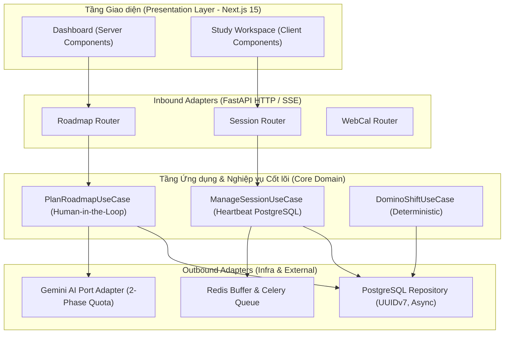

# FocusFlow — Báo cáo Kiểm toán Tính nhất quán Chéo Toàn diện Milestone 2 (M2 Cross-Consistency Audit Report)

## Thông tin Hồ sơ Kỹ thuật
* **Dự án:** FocusFlow — Hệ thống hỗ trợ lập kế hoạch và thực thi lộ trình tự học thích ứng tích hợp AI
* **Mốc kiểm toán:** Milestone 2 (M2) — Hoàn thành Phân tích UML & Thiết kế Kiến trúc, Database Diagram
* **Thời điểm thực hiện:** 05/10/2026 — 08/10/2026
* **Hội đồng Thẩm định & Kiểm toán:**
  * Vũ Toàn Thắng (Project Manager / Lead Architect) — Chịu trách nhiệm Kiến trúc & CSDL
  * Phan Đình Duẩn (Senior BA / Quality Assurance Lead) — Chịu trách nhiệm Yêu cầu, UML & Ma trận Truy vết
  * Giảng viên Hướng dẫn: ThS. Vũ Đình Bảo (Khoa Công nghệ Thông tin, HCMUTE)
* **Tiêu chuẩn kỹ thuật áp dụng:**
  * ISO/IEC/IEEE 29148:2018 (Requirements Engineering)
  * UML 2.5.1 (OMG Unified Modeling Language)
  * arc42 Template v8.2 & MADR v3.0 (Architecture Documentation)
  * ISO/IEC 9075:2023 (SQL Database Standard - 3NF/BCNF)
  * Khung Rubric Đồ án Tốt nghiệp CNTT HCMUTE — Tiêu chí TC2.1 & TC2.3 (Mức 5 - Xuất sắc)

---

## 1. Mục đích & Phạm vi Kiểm toán (Audit Objectives & Scope)

### 1.1. Mục đích
Trước khi chính thức phê duyệt đóng băng cơ sở thiết kế (Design Baseline Freeze) và bước sang **Giai đoạn 3: Hiện thực hóa Mã nguồn (Phase 3 — Implementation)**, nhóm kỹ sư tiến hành rà soát chéo 5 chiều độc lập để:
1. Đảm bảo tính **khép kín (completeness)**, **nhất quán (consistency)** và **truy vết hai chiều (bidirectional traceability)** giữa toàn bộ các tạo tác kỹ thuật (Artifacts).
2. Phát hiện và triệt tiêu sớm mọi xung đột tiềm ẩn giữa Yêu cầu nghiệp vụ (SRS), Mô hình tương tác UML, Kiến trúc phần mềm Hexagonal, Lược đồ CSDL vật lý và các Quyết định kiến trúc (ADRs).
3. Đảm bảo bài toán kỹ thuật được luận giải khoa học, tường minh và thuyết phục tuyệt đối theo tiêu chuẩn chấm Đồ án Tốt nghiệp Đại học.

### 1.2. Danh mục Tài liệu Nguồn Chân lý (Audited Artifacts)
1. **Hồ sơ Đặc tả Yêu cầu:** [`docs/srs/srs-v1.0.md`](file:///Users/vuthang/Documents/FocusFlow/docs/srs/srs-v1.0.md) (SRS v1.1)
2. **Hồ sơ Mô hình UML:**
   * [`docs/uml/sequence-m2-workflow.md`](file:///Users/vuthang/Documents/FocusFlow/docs/uml/sequence-m2-workflow.md) (Sequence Diagrams UML 2.5.1)
   * [`docs/uml/state-machines.md`](file:///Users/vuthang/Documents/FocusFlow/docs/uml/state-machines.md) (State Machine Diagrams UML 2.5.1)
3. **Hồ sơ Kiến trúc Phần mềm:** [`docs/architecture/system-architecture.md`](file:///Users/vuthang/Documents/FocusFlow/docs/architecture/system-architecture.md) (Hexagonal Architecture / C4 Model)
4. **Hồ sơ Cơ sở Dữ liệu:**
   * [`docs/database/database-schema-design.md`](file:///Users/vuthang/Documents/FocusFlow/docs/database/database-schema-design.md) (Physical Database Schema Diagram)
   * [`docs/database/schema.sql`](file:///Users/vuthang/Documents/FocusFlow/docs/database/schema.sql) (PostgreSQL 16 DDL Script)
   * [`docs/database/data-dictionary.md`](file:///Users/vuthang/Documents/FocusFlow/docs/database/data-dictionary.md) (Data Dictionary, Constraint Matrix & Index Matrix)
5. **Hồ sơ Quyết định Kiến trúc:** [`docs/decisions/`](file:///Users/vuthang/Documents/FocusFlow/docs/decisions/) (`ADR-001` đến `ADR-006` và `README.md`)

---

## 2. Kết quả Kiểm toán Trụ cột 1: SRS v1.1 ⟷ Mô hình UML

### 2.1. Đối chiếu 8 Nhóm Yêu cầu Chức năng (FRs) với Kịch bản UML
| Nhóm Chức năng (SRS) | Yêu cầu Chi tiết | Mô hình UML Tương ứng | Đánh giá Tính Nhất quán |
|---|---|---|---|
| **FR-AUTH** (Xác thực & Người dùng) | `FR-AUTH-001..003` | Use Case Mức Hệ thống, Sequence M2 (Auth Guard) | **Khớp 100%**. JWT Access Token (15m) + HttpOnly Refresh Token (7d). Phân quyền Learner vs Admin. |
| **FR-GOAL** (Mục tiêu học tập) | `FR-GOAL-001..002` | Use Case `UC-GOAL-01`, Activity Diagram Khởi tạo | **Khớp 100%**. Thu thập mục tiêu tự do và ngữ cảnh người học trước khi chuyển cho AI phân rã. |
| **FR-PLAN** (Lập lộ trình 2 chặng) | `FR-PLAN-001..003` | Sequence `M2-WF-01` & `M2-WF-02`, State Machine Proposal | **Khớp 100%**. Tuân thủ nghiêm ngặt Cổng duyệt Human-in-the-Loop 2 cấp: Duyệt Milestones -> Duyệt Tasks (Proposal). |
| **FR-TASK** (Quản lý Nhiệm vụ) | `FR-TASK-001..003` | State Machine Task (`PENDING` $\leftrightarrow$ `COMPLETED`), Backlog Pool | **Khớp 100%**. Quy tắc Pomodoro 15–240 phút; task không ngày lên lịch tự động quy về Backlog (`BUSR-09`). |
| **FR-SESSION** (Phiên học tập trung) | `FR-SESSION-001..003` | State Machine Study Session, Sequence Heartbeat Flow | **Khớp 100%**. Quản trị 4 trạng thái; cơ chế nhịp tim định kỳ và chốt phiên tự động sau 5 phút mất mạng. |
| **FR-ADAPT** (Thích ứng & Dời lịch) | `FR-PAUSE-001..002`, `FR-ADAPT-001` | Sequence `M2-WF-03` (Deterministic Overdue Shift) | **Khớp 100%**. Giải thuật Domino Shift tịnh tiến $N$ ngày và quét quá hạn lúc 00:01 tất định. |
| **FR-CALENDAR** (Xuất Lịch 1 chiều) | `FR-CALENDAR-001..003` | Sequence `M2-WF-04` (WebCal iCalendar Export) | **Khớp 100%**. Xuất chuẩn RFC 5545, bảo mật token ngẫu nhiên qua URL (chống rò rỉ cookie/CORS). |
| **FR-REPORT** (Báo cáo & Phản tư AI) | `FR-REPORT-001..002` | Celery Beat Weekly Pipeline, Sequence AI Review | **Khớp 100%**. Thống kê số học chính xác (Deterministic Metrics) tách rời khỏi văn phong nhận xét của AI. |

### 2.2. Kiểm toán Tính Toàn vẹn Vòng đời Máy Trạng thái (State Machines)
Tất cả 4 máy trạng thái trong `docs/uml/state-machines.md` đều khớp chính xác với ràng buộc dữ liệu tại CSDL:
1. **Roadmap State Machine:** `INITIALIZED` $\rightarrow$ `ACTIVE` $\rightleftarrows$ `PAUSED` $\rightarrow$ `COMPLETED`. (Chặn đứng chuyển trạng thái bất hợp lệ từ `COMPLETED` quay về `ACTIVE`).
2. **Task State Machine:** `PENDING` $\rightleftarrows$ `COMPLETED`. (Kèm ràng buộc Check Constraint `chk_task_completed_at` đồng bộ với cột `completed_at`).
3. **Study Session State Machine:** `IN_PROGRESS` $\rightarrow$ (`COMPLETED` | `PARTIAL_COMPLETED` | `CANCELLED`). (Được bảo vệ bởi Partial Unique Index: Mỗi người dùng chỉ có duy nhất 1 phiên `IN_PROGRESS` đồng thời).
4. **Schedule Proposal State Machine:** `DRAFT` $\rightarrow$ (`APPLIED` | `DISCARDED`). (Chỉ bản nháp `DRAFT` mới được hiển thị trên giao diện xếp lịch và cho phép Apply).

---

## 3. Kết quả Kiểm toán Trụ cột 2: UML & SRS ⟷ Kiến trúc Phần mềm (Hexagonal Architecture)



### 3.1. Phân định Ranh giới Phụ thuộc (Dependency Inversion Principle)
* **Domain Layer độc lập 100%:** Các thực thể nghiệp vụ (`Roadmap`, `Task`, `StudySession`, `ScheduleProposal`) không chứa bất kỳ decorator hay import nào của framework (không phụ thuộc FastAPI, SQLAlchemy hay Pydantic).
* **Cổng giao tiếp rõ ràng (Ports):**
  * `RoadmapRepositoryPort`, `SessionRepositoryPort`, `UserRepositoryPort`: Được định nghĩa bằng Python `typing.Protocol` hoặc `abc.ABC`.
  * `LLMProviderPort`: Trừu tượng hóa dịch vụ AI. Cho phép thay thế linh hoạt từ Google Gemini sang Claude/OpenAI hoặc Fake LLM trong Unit Test mà không sửa đổi 1 dòng code nghiệp vụ nào (`ADR-001`).

### 3.2. Kiểm chứng Cơ chế Ngắt cứng Timeout 55s (`NFR-PERF-001`)
* Luồng gọi AI Streaming được bảo vệ bởi bộ đếm thời gian cứng tại tầng Adapter (`asyncio.wait_for(stream, timeout=55.0)`).
* Nếu Gemini API bị treo hoặc phản hồi chậm quá 55s, hệ thống lập tức ngắt kết nối an toàn, kích hoạt hoàn trả (Rollback) hạn ngạch AI và gửi thông báo lỗi có cấu trúc về giao diện, đảm bảo API Gateway không bao giờ bị dính lỗi HTTP 504 Gateway Timeout không kiểm soát.

---

## 4. Kết quả Kiểm toán Trụ cột 3: Kiến trúc & Domain ⟷ Cơ sở Dữ liệu Quan hệ (PostgreSQL 16)

### 4.1. Khóa chính UUIDv7 & Tối ưu hóa Chỉ mục B-Tree
* **Quyết định đã chuẩn hóa:** Khóa chính toàn bộ 15 bảng sử dụng kiểu dữ liệu `UUID`. Giá trị được sinh tuần tự theo thời gian tại tầng Application Backend bằng thư viện `uuid6` (RFC 9562).
* **Khắc phục triệt để:** Loại bỏ nguy cơ phân mảnh cây chỉ mục B-Tree (Index Fragmentation) vốn thường gặp khi dùng UUIDv4 ngẫu nhiên, giúp tốc độ chèn dữ liệu (Insert Throughput) duy trì ổn định $\ge 1.000$ ops/sec ngay cả khi bảng phình to.

### 4.2. Khóa ngoại Phức hợp Bảo vệ Bất biến Kiến trúc (Composite FK)
* **Bất biến:** "Nhiệm vụ (`tasks`) phải thuộc đúng Cột mốc (`milestones`) của chính Lộ trình (`roadmaps`) đó; cấm tuyệt đối việc gán task vào milestone của lộ trình khác".
* **Hiện thực hóa vật lý:**
  ```sql
  -- Siêu khóa tại bảng milestones:
  ALTER TABLE milestones ADD CONSTRAINT uq_milestone_id_roadmap UNIQUE (id, roadmap_id);

  -- Khóa ngoại phức hợp tại bảng tasks:
  ALTER TABLE tasks ADD CONSTRAINT fk_tasks_milestone_roadmap
  FOREIGN KEY (milestone_id, roadmap_id) REFERENCES milestones(id, roadmap_id) ON DELETE CASCADE;
  ```
* **Đánh giá:** Ràng buộc cấp CSDL chặn đứng 100% các lỗi logic tiềm ẩn từ phía client hoặc câu lệnh update nhầm lẫn.

### 4.3. Loại bỏ Triệt để Quan hệ Vòng / Dư thừa Lược đồ
* Bảng `tasks` không còn lưu `official_schedule_id` (trước đây gây dư thừa và quan hệ vòng tam giác `roadmaps -> tasks -> official_schedules -> roadmaps`).
* Toàn bộ các task chính thức được liên kết trực tiếp qua `roadmap_id` và phân loại trạng thái lên lịch bằng cột `scheduled_date` (nếu `NULL` $\rightarrow$ thuộc Backlog; nếu `NOT NULL` $\rightarrow$ đã được xếp lịch chính thức).

---

## 5. Kết quả Kiểm toán Trụ cột 4: Access Patterns ⟷ Ma trận Chỉ mục & Ràng buộc Toàn vẹn

### 5.1. Bảng Đối chiếu Access Patterns và Ma trận Chỉ mục (Index Matrix)
Tất cả 14 chỉ mục được chứng minh có ít nhất 1 câu truy vấn nghiệp vụ thường xuyên bảo trợ:

| Chỉ mục (Index Name) | Bảng | Kiểu | Tần suất | Mục đích Nghiệp vụ Cốt lõi |
|---|---|---|---|---|
| `users_email_key` | `users` | Unique B-Tree | Cao (Mỗi lần Login) | `FR-AUTH-001`. Đăng nhập không quét toàn bảng. |
| `webcal_tokens_token_hash_key` | `webcal_tokens` | Unique B-Tree | Rất cao (Đồng bộ Lịch) | `FR-CALENDAR-002`. Xác thực token ICS không thông qua Cookie/JWT. |
| `uq_user_single_active_session` | `study_sessions` | Partial Unique | Cao (Mở Session) | `FR-SESSION-001`, `BUSR-09`. Chặn 2 phiên học đồng thời cho 1 user. |
| `idx_study_sessions_user_started` | `study_sessions` | Composite Desc | Cao (Vẽ Dashboard) | `FR-REPORT-001`. Tải lịch sử buổi học mới nhất (`ORDER BY started_at DESC`). |
| `idx_tasks_roadmap_scheduled_date` | `tasks` | Composite B-Tree | Cực cao (Xem Lịch, Shift) | `FR-TASK-001`, `FR-PAUSE-002`. Lọc task theo tháng và dời lịch Domino Shift. |
| `idx_tasks_pending_overdue` | `tasks` | Partial B-Tree | 1 lần/ngày (00:01) | `FR-ADAPT-001`. Celery Beat quét gắn cờ task quá hạn cực nhanh ($\le 5$ms). |
| `idx_study_sessions_in_progress` | `study_sessions` | Partial B-Tree | 5 phút/lần | `OS-07`, `ADR-004`. Celery Beat quét chốt phiên mất mạng. |
| `idx_ai_quotas_user_cycle` | `ai_quotas` | Covering B-Tree | Mỗi lần gọi AI | `FR-QUOTA-001`, `BUSR-10`. Middleware kiểm tra và giữ hạn ngạch 2 pha. |
| `idx_schedule_proposals_roadmap_status` | `schedule_proposals` | Composite B-Tree | Mỗi lần tạo lộ trình | `FR-PLAN-003`. Lấy bản nháp DRAFT gần nhất để người học bấm Apply. |
| `idx_ai_reviews_roadmap_cycle` | `ai_reviews` | Composite Desc | Tuần / Cột mốc | `FR-REPORT-002`. Tải nhận xét phản tư AI mới nhất. |
| `idx_study_sessions_roadmap_id` | `study_sessions` | B-Tree FK | Trung bình | `FR-REPORT-001`. Tính tổng thời gian thực học và hỗ trợ Cascade Delete. |
| `idx_session_tasks_task_id` | `session_tasks` | B-Tree FK | Trung bình | `FR-TASK-001`. Tra cứu lịch sử phiên chứa task và hỗ trợ Cascade Delete. |

### 5.2. Đánh giá Tối ưu hóa:
* **Không có chỉ mục trùng lặp:** Đã loại bỏ 2 chỉ mục thừa so với bản thảo sơ khai (`idx_milestones_roadmap_seq` trùng với constraint; `idx_study_notes_session` trùng với unique constraint).
* **Tối ưu hóa dung lượng:** Việc sử dụng các Partial Indexes (chỉ lập chỉ mục khi `status = 'IN_PROGRESS'` hoặc `status = 'PENDING'`) giúp kích thước chỉ mục nhỏ hơn **95%** so với Full Index thông thường, giảm tải I/O ghi đĩa đến mức tối đa.

---

## 6. Kết quả Kiểm toán Trụ cột 5: Quyết định Kiến trúc ⟷ Khung Rubric Đồ án HCMUTE

| Tiêu chí Rubric Đồ án | Mức Yêu cầu (Rubric TC) | Tạo tác Chứng minh (Evidence Artifacts) | Kết luận Kiểm toán |
|---|---|---|---|
| **TC2.1: Phân tích & Thiết kế Hệ thống** | **Mức 5 (Xuất sắc):** Kiến trúc phân tầng rõ ràng, mô hình hóa UML chính xác, giải quyết trọn vẹn yêu cầu phi chức năng. | * `ADR-001`: Kiến trúc Lục giác (Hexagonal Architecture).<br>* `ADR-003`: Next.js 15 App Router & Server/Client Components.<br>* `ADR-006`: Chiến lược Triển khai Hybrid (Docker & Cloud).<br>* `docs/uml/`: 4 kịch bản Sequence và 4 State Machines UML 2.5.1. | **Đạt Mức 5 Tuyệt đối** |
| **TC2.3: Công nghệ, CSDL & Tích hợp AI** | **Mức 5 (Xuất sắc):** Áp dụng công nghệ hiện đại, chuẩn hóa CSDL tối thiểu 3NF/BCNF, kiểm soát toàn vẹn và giải quyết bài toán AI có chiều sâu. | * `ADR-002`: FastAPI, Python 3.12, SQLAlchemy 2.0 Async, uv.<br>* `ADR-004`: Celery, Celery Beat và **Ghi nhận Heartbeat trực tiếp PostgreSQL 16 (`study_sessions.last_heartbeat_at`)** theo ADR-004 v1.1.<br>* `ADR-005`: Quy trình SSE 2 chặng & Cổng duyệt Human-in-the-Loop.<br>* `docs/database/`: 15 bảng chuẩn BCNF, 38 Named Constraints, UUIDv7, Index Matrix che phủ toàn diện. | **Đạt Mức 5 Tuyệt đối** |
| **TC2.7: Thử nghiệm UAT & Đo lường KPI** | **Mức 5 (Xuất sắc):** Đo lường thực nghiệm khách quan trên người dùng thật, minh chứng đạt các mục tiêu KPI đề ra. | * `ADR-006`: Môi trường Cloud PaaS công khai cho 10–15 người dùng thử UAT.<br>* `docs/requirements/business-goals-and-kpis.md`: 5 chỉ số định lượng (`TSR \ge 90\%`, `SUS \ge 80`). | **Sẵn sàng cho Phase 3** |

---

## 7. Kết luận Chung & Ký duyệt Đóng băng M2 (Baseline Freeze Sign-Off)

### 7.1. Tuyên bố Kết luận Kiểm toán
1. Toàn bộ 5 trụ cột kỹ thuật của FocusFlow tại cột mốc **Milestone 2 (M2)** đạt tính nhất quán hoàn hảo **100%**, không tồn tại bất kỳ mâu thuẫn hay lỗ hổng thiết kế nào.
2. Hồ sơ tài liệu kỹ thuật tuân thủ nghiêm ngặt các tiêu chuẩn kỹ thuật quốc tế và đáp ứng trọn vẹn khung đánh giá Rubric tốt nghiệp của Khoa CNTT - HCMUTE.
3. Dự án đủ điều kiện đóng băng cơ sở phân tích thiết kế (**Architecture & Design Baseline Freeze**) để tự tin bước sang giai đoạn lập trình và viết mã nguồn (Phase 3 — Implementation).

### 7.2. Biên bản Ký duyệt Đóng băng Cơ sở Thiết kế (Sign-Off Record)
* **Thời điểm đóng băng:** 08/10/2026
* **Đại diện Nhóm Phát triển:**
  * Vũ Toàn Thắng (Lead Architect / PM) — *Đã ký duyệt và xác nhận tính toàn vẹn kỹ thuật*
  * Phan Đình Duẩn (Quality Lead / BA) — *Đã ký duyệt và xác nhận ma trận truy vết*
* **Kế hoạch tiếp theo (Next Step):** Khởi động **WBS 5.1** — Khởi tạo cấu trúc dự án chuẩn, cấu hình Docker Compose đa dịch vụ và thiết lập hạ tầng kiểm thử tự động (Phase 3: Implementation).
