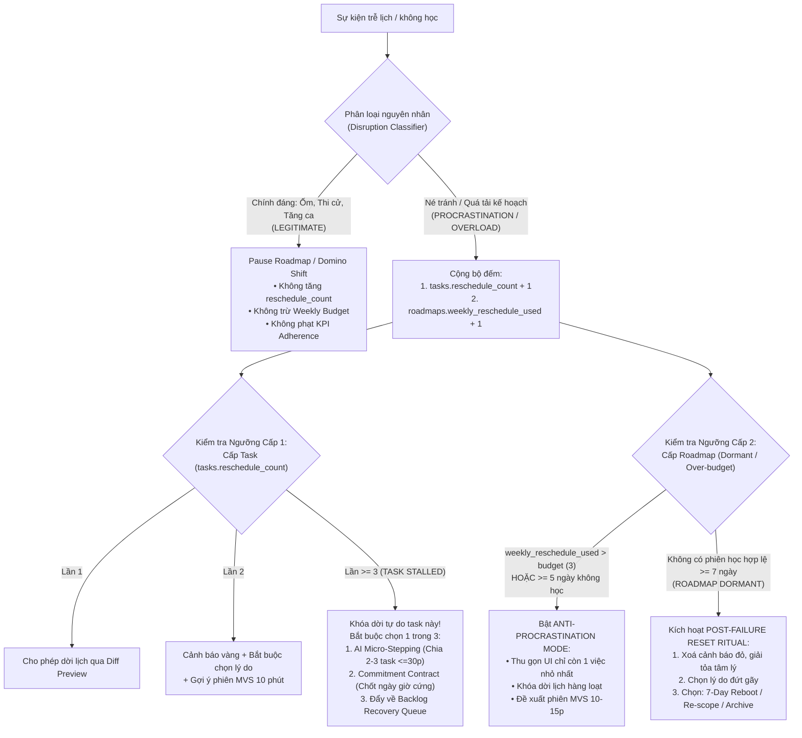
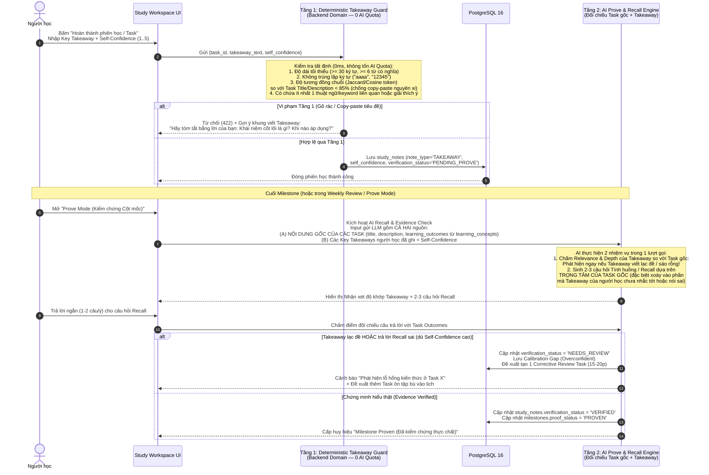
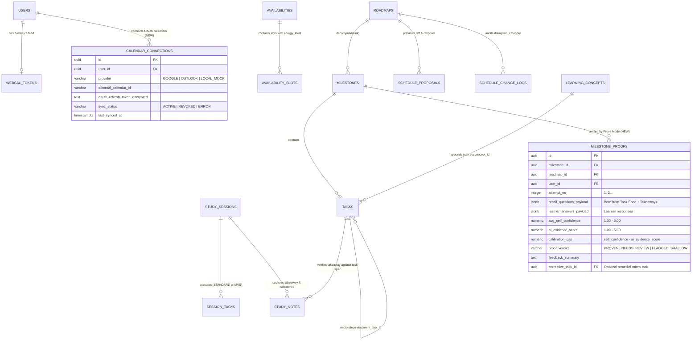

# Báo Cáo Đối Chiếu Chiến Lược Sản Phẩm (Mentor Report) & Kế Hoạch Hoàn Thiện Hệ Thống Tài Liệu FocusFlow

> **Tài liệu tham chiếu gốc**: [`docs/product-strategy-report.md`](file:///Users/vuthang/Documents/FocusFlow/docs/product-strategy-report.md) (Báo cáo trao đổi với Mentor — 11/2026)  
> **Hệ thống tài liệu đối chiếu**: `docs/srs/srs-v1.0.md` (nội dung thực tế là SRS v1.2), `docs/requirements/*`, `docs/decisions/ADR-001..010`, `docs/database/*`, `docs/uml/*`, `docs/architecture/*`  
> **Mục tiêu báo cáo**:
> 1. Chỉ rõ sự khác biệt giữa định hướng của Mentor và bộ tài liệu `docs/` hiện tại.
> 2. Phát hiện các **mâu thuẫn nội bộ** đang tồn tại giữa các file trong chính thư mục `docs/`.
> 3. Đưa ra **giải pháp kỹ thuật & nghiệp vụ cụ thể (End-to-End Solution)** cho từng đề xuất trong `product-strategy-report.md`.
> 4. Thiết kế chuẩn hóa lại **Database Schema (3NF/BCNF, PostgreSQL 16)** tuân thủ kiến trúc Hexagonal + Context-First Modular Monolith.

---

## Phần 1. Tổng Quan & Ma Trận Đối Chiếu 1–1 Với Báo Cáo Của Mentor (Mục 1 → Mục 13)

Bảng dưới đây đối chiếu toàn bộ 13 mục trong [`docs/product-strategy-report.md`](file:///Users/vuthang/Documents/FocusFlow/docs/product-strategy-report.md) với hiện trạng tài liệu dự án và tóm tắt **Giải pháp thiết kế (Solution)** đã chốt:

| Mục trong Mentor Report | Hiện trạng trong `docs/` | Phân loại | Giải pháp thiết kế & Hướng bổ sung vào `docs/` (Solution) |
| :--- | :--- | :---: | :--- |
| **§1. Executive Summary**: Định vị *"FocusFlow Learning Intelligence Harness — An adaptive AI-powered learning management system"* & Vòng khép kín 6 bước | Đang định vị là *"Hệ thống hỗ trợ lập kế hoạch và thực thi lộ trình tự học thích ứng tích hợp AI"* (`srs-v1.3.md`, `problem-definition.md`). Đã thống nhất 6 bước khép kín với 3 pha Zimmerman SRL và phân tách 3 thực thể cốt lõi (`Roadmap`, `Schedule`, `Learner Model`). | ✅ Đã nâng cấp | Chuẩn hóa tuyên ngôn định vị trong `problem-definition.md`, `product-strategy-report.md` và `srs-v1.3.md` §1.1 thành **FocusFlow Learning Intelligence Harness — An adaptive AI-powered learning management system** (Adaptive Self-Learning Operating System); phân tách 3 thực thể cốt lõi (`Roadmap`, `Schedule` với `schedule_blocks`, `Learner Model`). |
| **§2. Bài toán giải quyết**: 3 đứt gãy (Phân rã mục tiêu, Phân mảnh công cụ, Kế hoạch vỡ khi đời sống chen vào) | `problem-definition.md` §1.2 và `srs-v1.0.md` §1.4 đã mô tả khớp 95% cả 3 đứt gãy và các cơ chế (Overdue tất định, Pause, Domino Shift, Schedule Proposal DRAFT, Human Apply). | ✅ Đã có | Bổ sung bảng so sánh "Nhu cầu vs Công cụ rời rạc" từ §2.2 của Mentor vào `problem-definition.md` để tăng sức thuyết phục trực quan. |
| **§3. Nhu cầu thật của người tự học**: Nhu cầu chức năng, Nhu cầu tâm lý (5 cảm giác), và **Job-to-be-done (JTBD)** | `system-actors-and-personas.md` có Pain Points & Empathy Map nhưng **chưa có công thức JTBD cốt lõi** và chưa nhấn mạnh tâm lý *"lỡ một ngày không có nghĩa là thất bại"*. | ⚠️ Có một phần | Bổ sung mục **Core JTBD** và **5 nguyên tắc thiết kế tâm lý chống bỏ cuộc** vào `system-actors-and-personas.md` §2. |
| **§4. Bối cảnh đối thủ (11/2026)**: Chia 4 nhóm rõ rệt (*AI Study Planner, AI Calendar, AI Tutor, Knowledge Workspace*) | `user-survey-and-benchmarking.md` §4 đang chia theo 4 nhóm cũ (*Calendar truyền thống, Productivity/Sunsama, GenAI Chatbot, Roadmap.sh*). **Thiếu hẳn nhóm AI Study Planner** (Scholarly, Taskade...) và **AI Tutor** (Khanmigo, ChatGPT Study Mode, Quizlet AI). | ⚠️ Thiếu 2 nhóm đối thủ | Tái cấu trúc `user-survey-and-benchmarking.md` §4 theo đúng 4 trụ cột đối thủ 2026 của Mentor + bổ sung bảng tổng hợp *"Giải tốt / Thiếu / Khoảng trống của FocusFlow"*. |
| **§5. Điểm yếu hiện tại của FocusFlow**: (5.1) Scope rộng, (5.2) Chưa sắc ở Anti-procrastination, (5.3) Nguy cơ AI gimmick, (5.4) Thiếu Evidence of Learning, (5.5) UX phức tạp | Trong `srs-v1.0.md` §2.4, cả Payment, Admin, Calendar Sync đều đang nằm trong MVP. Anti-procrastination mới dừng ở `reschedule_count >= 3`. Chưa có Today Focus View tối giản thuật ngữ. | ⚠️ Cần giải pháp kiến trúc | Giải quyết triệt để qua: (1) Phân tầng Roadmap 4 giai đoạn; (2) Bổ sung **Today Focus View** ẩn độ phức tạp mô hình dữ liệu; (3) Thiết kế **Anti-Procrastination 2 cấp** & **MVS Mode**; (4) Thiết kế **Prove Mode chống fake takeaway**. |
| **§6. Lợi thế cạnh tranh tốt nhất**: *"Controlled adaptive recovery for self-learning"* & 7 hào sản phẩm (Moat) | Đã có nền tảng trong `problem-definition.md` §3 và `ADR-009`, `ADR-010`, nhưng chưa đúc kết thành khái niệm **Controlled Adaptive Recovery** và còn thiếu Reschedule Budget cấp tuần, MVS, Evidence Review. | ⚠️ Có một phần | Đưa khái niệm **Controlled Adaptive Recovery** làm trục trung tâm của `problem-definition.md` §3 và `ADR-010`, hoàn thiện đủ 7 thành phần Moat. |
| **§7.1. 10 Must-have Features** | Một số đã có (`Recovery Proposal Diff`, `Backlog`), một số có một phần (`Today Focus`, `Reschedule Budget`, `Weekly Review`), một số chưa có hoặc xung đột quy tắc (`Minimum Viable Session`, `Takeaway-required`, `Stalled Roadmap`). | ⚠️ / ⛔ Cần chuẩn hóa | Xem bảng giải pháp chi tiết cho từng tính năng ở **Phần 2** và thiết kế sâu ở **Phần 4**. |
| **§7.2. 10 Differentiator Features** | Đã có mầm mống (`Adaptive Task Sizing` qua Micro-Stepping, `Commitment Contract` khi Stalled, `Energy-aware` suy luận ngầm). Thiếu `Prove Mode`, `Confidence Calibration`, `Anti-Procrastination Mode` toàn diện. | ⚠️ / ❌ | Xem bảng giải pháp chi tiết cho từng tính năng ở **Phần 2** và thiết kế sâu ở **Phần 4**. |
| **§7.3. 8 Later Features** (Native App, Social/Cohort, Marketplace, LMS, Wearable...) | Khớp với mục Out-of-Scope trong `srs-v1.0.md` §2.5. | ✅ Đã khớp | Cập nhật danh sách đầy đủ 8 mục này vào `srs-v1.0.md` §2.5 (Out-of-Scope cho MVP, định hướng Phase 4). |
| **§8. Trụ cột Chống trì hoãn (Anti-Procrastination)**: Phân loại 5 mức vỡ kế hoạch, Budget, MVS, Stalled/Reset Ritual | Có **xung đột trực tiếp** giữa đề xuất của Mentor với quy tắc hiện hành trong `SRS v1.2` (`OS-01` phạt phiên ngắn `<50%` là `CANCELLED`; ngưỡng `STALLED >= 3` vs `> 3`; trùng tên `STALLED` cấp Task và Roadmap). | ⛔ Xung đột quy tắc | Đã chốt giải pháp tháo gỡ xung đột ở **Phần 4.1 & 4.2** (Thêm `session_mode = 'MVS'`, tách `Task STALLED` và `Roadmap DORMANT`, thiết kế Reset Ritual 3 nhánh). |
| **§9. Định hướng 6 bước thống nhất SRL**: **Understand → Plan → Schedule → Adapt → Learn → Improve** | Thống nhất với mô hình Zimmerman SRL 3 pha (*Forethought → Performance → Self-Reflection*). | ✅ Đã thống nhất | Ánh xạ chính thức 3 pha Zimmerman SRL sang 6 bước Learning Intelligence Loop trong `srs-v1.3.md` §1.2 và `ADR-010`: **Forethought** = *Understand + Plan + Schedule*; **Performance** = *Execute + Check-in + Prove*; **Self-Reflection** = *Adapt + Learn + Improve*. |
| **§10 & §11. Phân tầng 3 Nhóm Tính năng (Nhóm A, B, C), Lộ trình 5 Giai đoạn, 13 KPI bổ sung & North Star Metric** | `business-goals-and-kpis.md` đã có 5 KPI gốc (KPI1..5), bổ sung North Star Metric (*Weekly Recovered Learning Sessions*), 13 KPI sản phẩm, 3 trụ cột cạnh tranh, 3 nhóm tính năng (Nhóm A, B, C) và lộ trình 5 giai đoạn trên 35 bảng 3NF/BCNF. | ✅ Đã mở rộng | Thiết kế công thức toán học + truy vấn SQL trên schema 35 bảng cho North Star Metric và 13 KPI bổ sung tại **Phần 6**. |
| **§12. Positioning & Câu chuyện bảo vệ trước hội đồng** | `user-survey-and-benchmarking.md` đã có Q&A về ChatGPT + Calendar và Motion/Reclaim. Thiếu bảng "Không nên nói / Nên nói" và câu trả lời chuẩn về "Tính mới của đề tài". | ⚠️ Có một phần | Đưa nguyên vẹn bộ khung phản biện bảo vệ đồ án vào `business-goals-and-kpis.md` §6 và `problem-definition.md`. |

---

## Phần 2. Giải Pháp Chi Tiết (Solution) Cho Toàn Bộ 20 Tính Năng Trong Báo Cáo Mentor (§7.1 & §7.2)

Để đảm bảo không một ý tưởng nào trong báo cáo với Mentor bị bỏ sót hay nằm trên giấy suông, bảng dưới đây chỉ rõ **Hiện trạng**, **Xung đột (nếu có)** và **Giải pháp kỹ thuật cụ thể (Architecture + UX + DB)** cho toàn bộ 10 tính năng **Must-have (§7.1)** và 10 tính năng **Differentiator (§7.2)**:

### 2.1. Giải pháp cho 10 Tính năng Must-Have (§7.1)

| # | Tính năng (Mentor §7.1) | Hiện trạng trong `docs/` | Giải pháp Kỹ thuật & Nghiệp vụ (End-to-End Solution) |
| :-: | :--- | :--- | :--- |
| 1 | **Today Focus View** | Chỉ mới nhắc thoáng qua ở `ADR-003` (`dashboard/`). Chưa có FR/UC đặc tả chế độ ẩn thông tin phức tạp. | **Solution**: Bổ sung đặc tả vào `FR-EXEC-001` & `UC-13`. Khi mở app, mặc định hiển thị thẻ **"Hôm nay học gì" (Today Focus Card)** chỉ gồm: (1) Tên Task tiếp theo, (2) Lý do học task này (thuộc Milestone nào, mở khóa task nào sau đó), (3) Nút **"Bắt đầu phiên học"** (hoặc nút **"Bắt đầu nhanh 10 phút - MVS"** nếu người dùng đang mệt/trễ). Toàn bộ thông tin kỹ thuật (DAG, Quota, Biểu đồ) được ẩn dưới tab phụ. |
| 2 | **Minimum Viable Session (MVS)** | ❌ Chưa có. ⛔ **Xung đột `OS-01`**: Task yêu cầu `>= 15m` và phiên học `< 50%` thời lượng dự kiến + chưa xong task bị tính là `CANCELLED` (mất điểm KPI3 Adherence). | **Solution**: Thêm cột `session_mode IN ('STANDARD', 'MVS')` vào bảng `study_sessions`. Khi người học chọn **MVS Mode (10–15 phút)** trên một Task dài (VD: 60 phút), chỉ cần thời gian thực học `actual_minutes >= 10` **VÀ** hoàn thành tối thiểu 1 mục checklist hoặc ghi 1 `Key Takeaway` hợp lệ, hệ thống sẽ đóng phiên ở trạng thái `PARTIAL_COMPLETED` (thay vì `CANCELLED`), được tính vào `D_attended` của KPI3 và được tính vào North Star Metric! |
| 3 | **Recovery Proposal Diff** | ⚠️ Đã có `Schedule Diff Preview` ở `FR-ADAPT-002` và cột `schedule_change_logs.diff_payload`, nhưng `ADR-009/010` lại ghi mâu thuẫn là "bỏ qua cổng 3 tầng". | **Solution**: Chuẩn hóa 100% theo `SRS v1.2`: mọi lệnh AI Reschedule đều đi qua 3-Tier Gate và sinh `ScheduleProposal (DRAFT)`. Chuẩn hóa cấu trúc JSONB của `proposal_data` và `diff_payload` để hiển thị đủ 6 thông tin Mentor yêu cầu (§8.2): *(1) Danh sách Task bị dời (Ngày cũ → Ngày mới), (2) Lý do dời, (3) Trade-off (khung giờ nào bị lấp đầy), (4) Độ trượt `target_date` cuối cùng (`deadline_slip_days`), (5) Số lượt Reschedule Budget còn lại trong tuần, (6) Cam kết phiên học kế tiếp*. |
| 4 | **Reschedule Budget** | ⚠️ Mới có `tasks.reschedule_count` (ngưỡng 3 lần cho từng task riêng lẻ). Chưa có ngân sách theo tuần/roadmap. | **Solution**: Thiết kế **Cơ chế Ngân sách 2 Cấp**: <br>• **Cấp Task**: Giữ `tasks.reschedule_count` (Lần 1: cho phép; Lần 2: cảnh báo nhẹ + bắt chọn lý do; Lần `>= 3`: gắn cờ `TASK_STALLED`, khóa dời lịch tự do).<br>• **Cấp Roadmap (Theo tuần)**: Bổ sung cột `weekly_reschedule_budget` (mặc định `3` lượt/tuần) trên bảng `roadmaps`. Dời lịch do **Pause/Domino Shift chính đáng** hoặc dời chủ động trước hạn không trừ budget; dời khi task đã `OVERDUE` (`trigger_type = 'OVERDUE_RESCHEDULE'`) sẽ trừ budget tuần. Khi hết budget tuần, hệ thống kích hoạt **Anti-Procrastination Mode**. |
| 5 | **Stalled Roadmap Detection** | ⛔ Đụng độ thuật ngữ: `SRS §6.2` đang dùng chữ `STALLED` cho **Task** có `reschedule_count >= 3`. Chưa có cơ chế phát hiện **Roadmap** chết lâm sàng. | **Solution**: Tách bạch tên gọi để hội đồng không bắt bẻ:<br>• Cấp Task giữ nguyên là **`STALLED` Task** (`reschedule_count >= 3`).<br>• Cấp Roadmap đặt tên chính thức là **`DORMANT` (Lộ trình Ngủ đông / Đình trệ)**: Taskiq Sweeper (`OverdueDetectorSweeper` chạy hằng ngày) kiểm tra các Roadmap `ACTIVE` không có bất kỳ phiên học hợp lệ nào (`COMPLETED` / `PARTIAL_COMPLETED`) trong **`>= 7 ngày`** liên tiếp (và không nằm trong kỳ `PAUSED`) để gắn cờ dẫn xuất `is_dormant = TRUE` và mở **Post-failure Reset Ritual**. |
| 6 | **Takeaway-required Session End** | ⛔ `user-survey` ghi "bắt buộc", nhưng `SRS FR-SESSION-002` chỉ ghi "nhắc nhở". Ngoài ra phiên bị Auto-close (`UC-15`) do rớt mạng không thể bắt nhập ngay. | **Solution**: Sửa `FR-SESSION-002`:<br>• Khi người dùng **chủ động bấm Kết thúc phiên học** (`COMPLETED` hoặc `PARTIAL_COMPLETED` ở chế độ MVS): **Bắt buộc** nhập tối thiểu 1 `Key Takeaway` vượt qua bộ lọc chống gõ rác (Anti-Gaming Gate Layer 1) + chọn mức tự tin `self_confidence (1..5)`.<br>• Khi phiên bị **Auto-close ngầm (`UC-15`)**: Cho phép đóng phiên để giải phóng tài nguyên nhưng gắn cờ `pending_takeaway = TRUE`; lần tiếp theo người học mở app, Today Focus View sẽ yêu cầu bổ sung Takeaway 1 câu cho phiên dở dang trước khi bắt đầu phiên mới. |
| 7 | **Calendar Conflict Explanation** | ⚠️ Mới có `ConstraintViolationDTO` báo lỗi khi vi phạm giờ bận (`UC-12`). Chưa giải thích *"vì sao AI lại xếp task vào ngày/giờ đó"*. | **Solution**: Trong JSONB `schedule_proposals.proposal_data`, mỗi item lịch đề xuất bổ sung trường `placement_rationale` được sinh từ bộ lập lịch tất định + AI (VD: *"Xếp vào T3 19:30–21:00 vì khớp khung giờ năng lượng cao EVENING của bạn, sau khi đã hoàn thành bài tiên quyết X ở T2 và né lịch họp Google Calendar lúc 18:00"*). Hiển thị dưới dạng tooltip/badge ngay trên màn hình Preview. |
| 8 | **Backlog Recovery Queue** | ⚠️ Đã có khái niệm Backlog (`scheduled_date IS NULL`), nhưng hiện tại chỉ là danh sách phẳng chưa có thứ tự ưu tiên phục hồi. | **Solution**: Xây dựng thuật toán sắp xếp tất định `BacklogPriorityRanker` trong Domain Layer (`planning`/`execution`) dựa trên 4 trọng số: *(1) Số lượng task phía sau đang bị chặn bởi task này trên đồ thị DAG (`out_degree`), (2) Thứ tự Milestone (`sequence_order`), (3) Số lần đã bị dời (`reschedule_count`), (4) Thời lượng ngắn dễ cứu trước (`estimated_minutes`)*. Hiển thị thành hàng đợi có thứ tự 1, 2, 3 rõ ràng. |
| 9 | **Weekly Review Ritual** | ⚠️ Đã có bảng `ai_reviews` (`review_cycle = 'WEEKLY'`), nhưng `FR-REPORT-002` mới là nút bấm xem báo cáo thụ động, chưa thành "nghi thức chốt tuần" có hành động. | **Solution**: Nâng cấp `UC-19` thành **Weekly Review Ritual 3 bước** vào cuối tuần (hoặc đầu tuần mới): *(Bước 1) Nhìn lại số liệu tuần qua & Evidence đã đúc kết → (Bước 2) AI chỉ ra điểm nghẽn (Task quá lớn, giờ học lệch năng lượng, hay Takeaway còn hời hợt) → (Bước 3) Người học chọn 1 hành động cam kết cho tuần tới (Resize các task >60m, đổi khung giờ rảnh, hoặc chốt lịch 3 phiên đầu tuần)*. |
| 10 | **Lightweight Onboarding** | ❌ Chưa có đặc tả giảm thuật ngữ ở lần đầu sử dụng (người mới vào dễ ngợp bởi Milestone, DAG, Mode A/B, Quota). | **Solution**: Bổ sung quy tắc UX Progressive Disclosure vào `FR-AUTH-001` & `FR-PLAN-001`: Lần đầu đăng ký chỉ đi qua Wizard 3 bước bằng ngôn ngữ đời thường (*"Bạn muốn chinh phục mục tiêu gì?" → "Mỗi ngày bạn dành được khoảng bao nhiêu phút?" → "Bắt đầu buổi học đầu tiên"*). Mặc định chọn `Mode A` (quỹ giờ linh hoạt), ẩn các khái niệm nâng cao (`Mode B`, `DAG`, `Domino Shift`, `WebCal`) cho tới khi người dùng hoàn thành phiên học đầu tiên. |

---

### 2.2. Giải pháp cho 10 Tính năng Differentiator (§7.2)

| # | Tính năng (Mentor §7.2) | Hiện trạng trong `docs/` | Giải pháp Kỹ thuật & Nghiệp vụ (End-to-End Solution) |
| :-: | :--- | :--- | :--- |
| 1 | **Anti-Procrastination Mode** | ⚠️ Mới có khóa dời lịch hàng loạt khi 1 task có `reschedule_count >= 3` (`FR-ADAPT-003`). | **Solution**: Chế độ giao diện & quy tắc đặc biệt được bật tự động khi: *(a) Có bất kỳ task nào đạt `reschedule_count >= 3`, HOẶC (b) Roadmap hết `weekly_reschedule_budget`, HOẶC (c) Không có phiên học hợp lệ trong 5 ngày*. Khi bật: UI ẩn toàn bộ lịch tháng/analytics phức tạp, chỉ hiện **1 Task duy nhất** với nút **MVS 10 phút** hoặc nút **Chia nhỏ Task**, đồng thời khóa nút "Dời toàn bộ lịch". |
| 2 | **Legitimate Disruption Classifier** | ⚠️ Đã phân biệt `Pause` (chính đáng) vs `Overdue` (trễ), cột `reason` hiện là `TEXT` tự do nên khó thống kê tự động. | **Solution**: Chuẩn hóa phân loại nguyên nhân bằng cột `disruption_category` (Deterministic Enum, **không tốn AI Quota**):<br>• Nhóm **Chính đáng (`LEGITIMATE`)**: `HEALTH_EMERGENCY`, `WORK_SCHOOL_CONFLICT`, `EXTERNAL_CALENDAR_OVERRIDE` → Hướng sang **Pause / Domino Shift**, **không trừ** Reschedule Budget, không phạt KPI Adherence.<br>• Nhóm **Lỗi kế hoạch (`OVERLOAD_PLAN`)**: `TASK_TOO_LARGE`, `PREREQUISITE_GAP` → Hướng sang **Micro-Stepping (Chia nhỏ task)**.<br>• Nhóm **Né tránh (`PROCRASTINATION`)**: `LOW_ENERGY`, `LOST_FOCUS`, `UNSPECIFIED_SKIP` → Tính vào Reschedule Budget, gợi ý **MVS 10 phút**. |
| 3 | **Commitment Contract** | ⚠️ Đã có tuỳ chọn "Chọn ngày cố định có cam kết" trong hộp thoại `STALLED` (`FR-ADAPT-003` bước 3). | **Solution**: Chuẩn hóa thành bản ghi cam kết trong `schedule_change_logs` với `trigger_type = 'COMMITMENT_CONTRACT'`: người học chốt ngày + khung giờ cụ thể cho phiên học tối thiểu tiếp theo (`>= 15 phút`). Nếu hoàn thành đúng cam kết, `reschedule_count` của task được reset về `0`. |
| 4 | **Learning Evidence Timeline** | ⚠️ Dữ liệu đã nằm rải ở `study_notes` (`execution`), `ai_reviews` & `schedule_change_logs` (`evaluation`), nhưng chưa có màn hình/API tổng hợp. | **Solution**: Tạo Read-Model tổng hợp qua Query Port liên Context (tuân thủ `ADR-001` không JOIN SQL chéo Context) hiển thị dòng thời gian dọc trên trang Roadmap/Analytics: mỗi cột mốc gồm *Phiên học → Key Takeaway đã viết → Điểm tự tin (`self_confidence`) → Kết quả AI Recall Check → Các lần phục hồi lịch*. |
| 5 | **Adaptive Task Sizing** | ⚠️ `UC-14` luồng 5c và `ADR-010` đã mô tả `TASK_MICRO_STEPPING` (tách thành 2–3 task con `<= 30 phút`), **nhưng DB bảng `tasks` đang quên cột `parent_task_id`!** | **Solution**: (1) Bổ sung cột `parent_task_id UUID REFERENCES tasks(id)` vào bảng `tasks` và thêm `'TASK_MICRO_STEPPING'` vào `ai_usage_logs.action_type`. (2) Khi hệ thống phát hiện người học liên tục bỏ dở các task `>= 60 phút` (`estimation_bias_factor > 1.3`), tự động gợi ý nút **"Chia nhỏ thành các bước 25–30 phút"**. |
| 6 | **Confidence Calibration** | ❌ Chưa có trong SRS và Database. | **Solution**: Bổ sung cột `self_confidence SMALLINT CHECK (self_confidence BETWEEN 1 AND 5)` vào bảng `study_notes` (khi lưu `TAKEAWAY`). Khi chạy **Prove Mode / AI Review**, hệ thống so sánh `self_confidence` của người học với `ai_evidence_score (1..5)` do AI chấm dựa trên độ khớp với nội dung Task để tính độ lệch nhận thức (*Calibration Gap = Self Confidence − Evidence Score*), cảnh báo ngay nếu người học đang "tưởng là đã hiểu nhưng thực ra nắm sai trọng tâm". |
| 7 | **Recovery with Accountability** | ⚠️ `schedule_change_logs` đã có cột `reason`, nhưng hiện cho phép `NULL` và chưa gắn với Reschedule Budget. | **Solution**: Bắt buộc chọn `disruption_category` và điền `reason` khi dời task quá hạn; hiển thị rõ số lượt `weekly_reschedule_budget` còn lại ngay trên nút xác nhận dời lịch. |
| 8 | **Prove Mode (Chống Fake Takeaway)** | ❌ Chưa có trong SRS và Database. | **Solution** *(Theo đúng yêu cầu của bạn)*: Thiết kế cơ chế **AI Recall & Evidence Verification 2 lớp** đối chiếu trực tiếp `Key Takeaway` với **Nội dung gốc của Task** (`title`, `description`, `learning_objectives`). Chi tiết toàn bộ luồng phòng thủ chống người dùng gõ Takeaway đối phó được trình bày tại **Phần 4.3**. |
| 9 | **Energy-aware Planning** | ⚠️ `learner_profiles.peak_productivity_slots` hiện chỉ được suy luận ngầm từ lịch sử học (`ADR-010`), người dùng chưa tự khai báo được. | **Solution**: Bổ sung cột `energy_level VARCHAR(10) DEFAULT 'MEDIUM' CHECK (energy_level IN ('LOW', 'MEDIUM', 'HIGH'))` vào bảng `availability_slots` (và cấu hình mặc định trong `availabilities`). Khi AI xếp lịch (`UC-09`, `UC-21`), các Task khó/dài (`>= 60 phút`) ưu tiên xếp vào khung giờ `HIGH`, còn khung giờ `LOW` ưu tiên xếp Task ôn tập nhẹ hoặc MVS. |
| 10 | **Post-failure Reset Ritual** | ⚠️ Mới có Archive (`FR-PLAN-006`). Chưa có quy trình tái khởi động khi lộ trình bị đứt gãy nặng. | **Solution**: Khi Roadmap rơi vào trạng thái `DORMANT` (ngủ đông `>= 7 ngày`) hoặc người dùng bấm "Khởi động lại lộ trình", hệ thống mở **Reset Ritual 4 bước**: *(1) Thừa nhận kế hoạch cũ không còn khớp thực tế (xoá cảm giác tội lỗi, tắt cảnh báo đỏ) → (2) Chọn lý do đứt gãy chính → (3) Chọn 1 trong 3 hướng: **Resume nhẹ 7 ngày (7-Day Reboot Plan chỉ 15–30p/ngày)** / **Re-scope (Giảm bớt Milestone phụ, lùi `target_date`)** / **Archive có chủ đích** → (4) Xác nhận Apply để mở chu kỳ mới và reset bộ đếm đình trệ*. |

---

## Phần 3. Các Mâu Thuẫn Nội Bộ Nghiêm Trọng Giữa Các File Trong `docs/` Cần Sửa Ngay

Khi rà soát chéo toàn bộ thư mục `docs/`, ngoài khoảng trống so với báo cáo của Mentor, hệ thống tài liệu hiện tại đang có **8 điểm tự mâu thuẫn nhau** (nếu không sửa, hội đồng chấm đồ án rất dễ phát hiện khi đối chiếu giữa SRS, ADR và Database):

| # | Mức độ | Vị trí mâu thuẫn trong `docs/` | Nội dung mâu thuẫn | Cách chuẩn hóa bắt buộc |
| :-: | :---: | :--- | :--- | :--- |
| 1 | 🔴 **Critical** | `srs-v1.0.md` (`FR-ADAPT-002`) **VS** `ADR-009` (§3.1), `ADR-010` (§3.2.2), `problem-definition.md` (§5.4) | **Mâu thuẫn luồng AI Reschedule**:<br>• `SRS v1.2` (`FR-ADAPT-002`) quy định AI Reschedule **bắt buộc đi qua Cổng Kiểm Duyệt 3 Tầng**, lưu thành `ScheduleProposal (DRAFT)`, hiển thị màn hình `Schedule Diff Preview` và chờ người học bấm **Apply**.<br>• Ngược lại, `ADR-009`, `ADR-010` và `problem-definition.md` lại ghi AI Reschedule *"bỏ qua Cổng Kiểm Duyệt 3 Tầng"* và cập nhật trực tiếp vào Task! | **Sửa `ADR-009`, `ADR-010`, `problem-definition.md` theo đúng `SRS v1.2` + Mentor**: Mọi đề xuất dời lịch từ AI đều phải qua 3-Tier Validation Gate, tạo `ScheduleProposal (DRAFT)` kèm `Recovery Proposal Diff` và bắt buộc người học bấm **Apply**. |
| 2 | 🔴 **Critical** | `schema.sql` **VS** `ADR-007`, `data-dictionary.md`, `database-schema-design.md`, `AGENTS.md` | **Lệch tổng số bảng vật lý (26 bảng vs 24 bảng)**:<br>• Dòng 4 của `schema.sql` và toàn bộ tài liệu ghi hệ thống có **24 bảng**.<br>• Nhưng trong `schema.sql` thực tế đang có **26 lệnh `CREATE TABLE`**! Hai bảng được chèn thêm dưới số thứ tự `"14b"` là `learning_concepts` và `concept_prerequisites` (dòng 350–378) nhưng chưa hề được cập nhật vào tổng số bảng trong `data-dictionary.md` hay `ADR-007`. | Cập nhật chính thức danh sách bảng (bao gồm `learning_concepts`, `concept_prerequisites` và các bảng chuẩn hóa mới ở Phần 5) đồng bộ giữa `schema.sql`, `data-dictionary.md`, `database-schema-design.md` và `ADR-007`. |
| 3 | 🔴 **Critical** | `srs-v1.0.md` (`UC-14` luồng 5c), `ADR-010` **VS** `schema.sql` (Bảng `tasks` & `ai_usage_logs`) | **Thiếu cột `parent_task_id` và enum `TASK_MICRO_STEPPING`**:<br>• `UC-14` và `ADR-010` mô tả tính năng chia nhỏ task (`TASK_MICRO_STEPPING`) tạo ra 2–3 task con có liên kết `parentTaskId` về task cha.<br>• Nhưng bảng `tasks` trong `schema.sql` **không có cột `parent_task_id`**, và ràng buộc `chk_ai_usage_logs_action` trong bảng `ai_usage_logs` cũng **thiếu giá trị `'TASK_MICRO_STEPPING'`** và `'AI_RESCHEDULE'`. | Bổ sung `parent_task_id UUID REFERENCES tasks(id) ON DELETE SET NULL` vào bảng `tasks` và cập nhật `CHECK` constraint của `ai_usage_logs.action_type`. |
| 4 | 🟠 **High** | `business-goals-and-kpis.md` (§3.1 KPI 1) **VS** `schema.sql` | **Truy vấn vào bảng `audit_events` không tồn tại**:<br>• Công thức SQL đo KPI 1 (Plan Creation Time) trong `business-goals-and-kpis.md` truy vấn bảng `audit_events (event_name = 'GOAL_INPUT_FOCUSED')`.<br>• Nhưng trong `schema.sql` hoàn toàn **không có bảng `audit_events`**. | Đo thời gian tạo kế hoạch trực tiếp từ `goals.created_at` (hoặc cột mới `goals.onboarding_started_at`) đến `official_schedules.activated_at` mà không cần đẻ thêm bảng `audit_events` rác. |
| 5 | 🟠 **High** | `srs-v1.0.md` (§12 Domain Model) **VS** `schema.sql` (Bảng `webcal_tokens`) | **Gộp sai thực thể `CalendarConnection` và `WebCalToken`**:<br>• `SRS §12` và Class Diagram tách riêng `CalendarConnection` (đồng bộ OAuth 2 chiều Google Calendar) và `WebCalToken` (link `.ics` 1 chiều).<br>• Nhưng `schema.sql` lại nhồi cột `oauth_refresh_token_encrypted` và `external_calendar_id` vào trong bảng `webcal_tokens` (vi phạm 3NF vì token `.ics` và kết nối OAuth có vòng đời độc lập). | Hoặc tách bảng `calendar_connections` riêng như SRS §12, hoặc đổi tên/chuẩn hóa rõ trong `SRS §12` & `data-dictionary.md` để khớp 100% với nhau (chi tiết DDL ở Phần 5). |
| 6 | 🟠 **High** | `user-survey-and-benchmarking.md` (§4.4) **VS** `srs-v1.0.md` (`FR-SESSION-002`) | **Mâu thuẫn về tính bắt buộc của Key Takeaway**:<br>• `user-survey-and-benchmarking.md` khẳng định FocusFlow có *"Modal đúc kết Key Takeaways **bắt buộc** khi kết thúc phiên"*.<br>• Nhưng `SRS FR-SESSION-002` bước 2 lại chỉ ghi là *"hiển thị hộp thoại **nhắc nhở** nhập đúc kết"*.<br>• Đồng thời tên loại ghi chú trong SRS ghi là `'KEY_TAKEAWAY'`, còn trong `schema.sql` (`chk_study_notes_type`) lại là `'TAKEAWAY'`. | Thống nhất bắt buộc nhập Takeaway khi người dùng chủ động đóng phiên (và cho nợ `pending_takeaway` nếu phiên bị Auto-close `UC-15`). Thống nhất mã enum là `'TAKEAWAY'` trên toàn bộ tài liệu. |
| 7 | 🟡 **Medium** | `ADR-010` **VS** `srs-v1.0.md` & `use-case-specifications.md` | **Đánh số Use Case trong `ADR-010` bị lệch so với SRS v1.2**:<br>• `ADR-010` gọi "Tạm dừng lộ trình" là `UC-16` (trong SRS v1.2 là `UC-20`), gọi "Can thiệp chống trì hoãn" là `UC-17` (trong SRS là `UC-14`/`UC-21`), gọi "Hoàn tất phiên học" là `UC-10` (trong SRS là `UC-14`).<br>• Ngoài ra ở hộp thoại `STALLED`, `SRS FR-ADAPT-003` cho 3 lựa chọn *(Chia nhỏ / Cam kết ngày / Đẩy về Backlog)*, còn `ADR-010` lại ghi lựa chọn thứ 3 là *(Đẩy về Backlog hoặc **Huỷ CANCELLED**)*. | Cập nhật toàn bộ mã `UC-xx` và 3 lựa chọn xử lý `STALLED` trong `ADR-010` khớp chính xác với `SRS v1.2`. |
| 8 | 🟡 **Medium** | Tên file `docs/srs/srs-v1.0.md` **VS** Tiêu đề bên trong file & `AGENTS.md` | Tên file vật lý là `srs-v1.0.md`, nhưng dòng tiêu đề bên trong và `AGENTS.md` đều ghi là **SRS v1.2** (25 Use Cases). | Ghi chú rõ hoặc đồng bộ tên phiên bản để tránh nhầm lẫn khi nộp báo cáo. |

---

## Phần 4. Thiết Kế Chi Tiết 3 Cơ Chế Chiến Lược Mới (Theo Quyết Định Đã Chốt)

### 4.1. Cơ Chế 1: Minimum Viable Session (MVS Mode 10–15 Phút) & Ngoại Lệ Quy Tắc `OS-01`

**Bài toán**: Trong ngày năng lượng thấp, nếu bắt người học ngồi đủ 60 phút cho một Task lớn, họ sẽ bỏ cuộc. Nhưng nếu họ chỉ học 10–15 phút rồi bấm kết thúc, quy tắc `OS-01` hiện tại trong SRS (`actual_minutes < 0.5 * planned_minutes` và chưa hoàn thành task $\rightarrow$ `CANCELLED`) sẽ đánh trượt phiên học đó và phạt điểm chuyên cần KPI3.

**Thiết kế giải pháp**:
1. **Khởi tạo phiên MVS (`session_mode = 'MVS'`)**:
   - Trên màn hình **Today Focus View** hoặc trong hộp thoại cảnh báo trì hoãn, bên cạnh nút *"Bắt đầu phiên học chuẩn (Standard)"*, người học có nút **"Bắt đầu phiên tối thiểu 10 phút (MVS — Giữ nhịp học)"**.
   - Khi chọn `MVS`, `planned_minutes` của phiên được đặt mặc định là `10` hoặc `15` phút (thay vì toàn bộ `estimated_minutes` của Task).
2. **Điều kiện hoàn thành phiên MVS (Ngoại lệ có kiểm soát của `OS-01`)**:
   - Phiên học ở chế độ `session_mode = 'MVS'` được phép kết thúc hợp lệ ở trạng thái **`PARTIAL_COMPLETED`** (hoặc `COMPLETED` nếu xong luôn task) ngay cả khi tổng thời gian học của task `< 50%` `tasks.estimated_minutes`, **với điều kiện bắt buộc kép**:
     1. Thời gian thực học `actual_minutes >= 10` phút (được xác thực qua chuỗi Heartbeat 60s hợp lệ).
     2. Người học **bắt buộc** ghi nhận tối thiểu **1 `Key Takeaway` hợp lệ** (vượt qua Anti-Gaming Gate) kèm `self_confidence`.
   - Nếu thoát trước 10 phút hoặc không ghi `Key Takeaway`, phiên MVS mới bị đánh dấu là `CANCELLED`.
3. **Tác động lên tiến độ Task & KPI**:
   - Thời gian `actual_minutes` (VD: 12 phút) được trừ lùi vào phần thời lượng còn lại cần học của Task (`remaining_minutes = MAX(15, estimated_minutes - actual_minutes)`), giúp lần học tiếp theo nhẹ hơn.
   - Ngày có phiên `MVS` đạt `PARTIAL_COMPLETED` được tính là **1 ngày có mặt hợp lệ (`D_attended`)** trong công thức KPI 3 (Plan Adherence Rate) và được cộng trực tiếp vào **North Star Metric (`Weekly Recovered Learning Sessions`)**.

---

### 4.2. Cơ Chế 2: Hệ Thống Chống Trì Hoãn 2 Cấp (Task `STALLED` vs Roadmap `DORMANT`) & Post-Failure Reset Ritual

Để giải quyết triệt để sự chồng chéo thuật ngữ trong báo cáo của Mentor (§8.1–§8.6) với `SRS v1.2`, kiến trúc chống trì hoãn của FocusFlow được chuẩn hóa thành **Mô hình Can thiệp 2 Cấp**:



**Bảng chuẩn hóa thuật ngữ và ngưỡng giữa Task và Roadmap**:

| Cấp độ | Tên trạng thái / Cờ | Điều kiện kích hoạt (Deterministic Rule) | Hành vi can thiệp của hệ thống | Cách thoát trạng thái (Reset Rule) |
| :--- | :--- | :--- | :--- | :--- |
| **Cấp 1: Task** | **`STALLED`** *(Cờ dẫn xuất trên Task)* | `tasks.status IN ('TODO', 'IN_PROGRESS')` VÀ `tasks.reschedule_count >= 3` (Chỉ tính các lần dời khi task đã `OVERDUE`; Domino Shift không tính). | Khóa tính năng dời lịch hàng loạt. Hiển thị Modal bắt buộc người học chọn 1 trong 3: <br>1. **AI Micro-Stepping** (Chia thành các task con `<= 30 phút`).<br>2. **Commitment Contract** (Cam kết ngày cố định mới).<br>3. **Move to Backlog** (`scheduled_date = NULL`). | Khi hoàn thành task (`COMPLETED`), hoặc sau khi thực hiện Micro-Stepping / hoàn thành phiên học cam kết đầu tiên (`reschedule_count` được đặt lại về `0`). |
| **Cấp 2a: Roadmap (Ngân sách tuần)** | **`OVER_BUDGET` / `ANTI_PROCRASTINATION_MODE`** | Số lần dời task quá hạn trong tuần hiện tại `weekly_reschedule_used >= weekly_reschedule_budget` (mặc định `3` lần/tuần) HOẶC `5 ngày` liên tiếp không có phiên học. | Tự động chuyển Dashboard sang **Anti-Procrastination Mode**: ẩn lịch tháng và biểu đồ phức tạp; chỉ hiển thị **1 Task ưu tiên nhất** kèm nút **Bắt đầu MVS 10 phút**. | Khi người học hoàn thành ít nhất **1 phiên học hợp lệ** (`COMPLETED` hoặc `PARTIAL_COMPLETED` ở chế độ MVS), hoặc sang đầu tuần mới sau khi chạy Weekly Review Ritual. |
| **Cấp 2b: Roadmap (Đình trệ dài ngày)** | **`DORMANT`** *(Lộ trình Ngủ đông / Chết lâm sàng)* | Roadmap đang `ACTIVE` nhưng **không có bất kỳ phiên học hợp lệ nào trong `>= 7 ngày` liên tiếp** (và không có bản ghi `pause_records` đang `ACTIVE`). | Ngừng hiển thị hàng loạt thẻ đỏ gây áp lực tâm lý. Thay bằng màn hình **Post-Failure Reset Ritual** với 3 lựa chọn tái khởi động: *(a) Kế hoạch 7 ngày khởi động nhẹ (7-Day Light Reboot), (b) Thu hẹp phạm vi mục tiêu (Re-scope), (c) Lưu trữ có chủ đích (Archive)*. | Ngay khi người học Apply kế hoạch **7-Day Light Reboot** hoặc **Re-scope**, toàn bộ ngày lên lịch quá hạn cũ được tái phân bổ mới, xoá cờ `DORMANT`. |

---

### 4.3. Cơ Chế 3: Trục "Prove — Evidence of Learning" & Phòng Thủ Chống Fake Takeaway (Anti-Gaming Gate)

**Bài toán thực tế bạn đặt ra**: Nếu chỉ yêu cầu nhập `Key Takeaway` rồi dựa vào đúng câu `Key Takeaway` đó để sinh câu hỏi Recall Check, người dùng lười hoặc muốn đối phó sẽ gõ bừa (`"ok đã học xong"`, `"hiểu bài rồi"`, copy-paste lại tiêu đề Task, hoặc viết một câu sai lệch hoàn toàn với nội dung bài học) để qua mặt hệ thống.

**Thiết kế kiến trúc phòng thủ 2 lớp (2-Layer Anti-Gaming & Evidence Verification Architecture)**:



**Chi tiết 4 cơ chế phòng thủ khi người dùng cố tình nhập Takeaway sai / đối phó**:
1. **Chặn gõ rác & chống Copy-Paste nguyên xi tại Tầng 1 (Deterministic — Không tốn AI Quota)**:
   - Kiểm tra độ dài tối thiểu (`>= 30 ký tự` và `>= 6 từ` riêng biệt).
   - Chặn chuỗi lặp vô nghĩa (Entropy ký tự thấp như `"asdfasdf"`, `"ok ok ok ok ok ok"`).
   - **Chống Copy-Paste tiêu đề/mô tả Task**: Nếu độ trùng lặp từ vựng (Normalized Token Overlap) giữa `takeaway_content` và `tasks.title` / `tasks.description` vượt quá `85%` (người học chỉ copy đề bài dán vào ô đúc kết), hệ thống từ chối ngay và yêu cầu diễn đạt lại bằng lời của người học.
2. **Kiểm tra độ khớp ngữ nghĩa với Nội dung gốc của Task tại Tầng 2 (`Semantic Alignment Check`)**:
   - Khi chạy **Prove Mode** (hoặc **AI Weekly/Milestone Review**), Prompt gửi vào `LLMProviderPort` **luôn truyền cặp dữ liệu đối xứng**:
     - `ground_truth_task_spec`: Bao gồm `tasks.title`, `tasks.description`, và `learning_outcomes` (từ bảng `learning_concepts` nếu có).
     - `learner_submitted_takeaway`: Nội dung người học đã viết + `self_confidence (1..5)`.
   - AI chấm điểm `evidence_quality_score (1..5)` và phân loại `alignment_flag IN ('ALIGNED', 'SUPERFICIAL', 'OFF_TOPIC', 'CONTRADICTORY')`.
3. **Sinh câu hỏi Recall từ "Phần Khuyết" của Task gốc (`Blind-Spot Probing`)**:
   - Thay vì hỏi lại những gì người học đã viết trong Takeaway, AI được chỉ thị: *"Hãy đặt câu hỏi kiểm tra dựa trên `tasks.description` và `learning_outcomes` của Task gốc, đặc biệt tập trung vào các khái niệm cốt lõi của Task mà người học **bỏ sót, viết mơ hồ hoặc viết sai** trong Takeaway"*.
   - Nhờ vậy, nếu người học viết một câu Takeaway lạc đề (VD: Task dạy về *Transaction Isolation Levels trong PostgreSQL* nhưng người học lại gõ Takeaway về *cách cài đặt Docker*), câu hỏi Recall vẫn sẽ hỏi thẳng vào *Read Committed vs Serializable trong PostgreSQL*, khiến việc lách luật bằng Takeaway giả hoàn toàn vô tác dụng!
4. **Hậu quả có tính xây dựng khi phát hiện Takeaway đối phó (`Corrective Loop`)**:
   - Không khóa tài khoản hay phạt cực đoan, nhưng:
     - Gắn cờ `verification_status = 'FLAGGED_SHALLOW'` hoặc `'OFF_TOPIC'` trên bản ghi `study_notes`.
     - Milestone chứa task đó chưa được cấp trạng thái `PROVEN` (`milestones.proof_status = 'NEEDS_REVIEW'`).
     - Tính chỉ số lệch tự tin (`confidence_gap = self_confidence - ai_evidence_score`). Nếu người học tự chấm `5/5` nhưng Takeaway lạc đề (`1/5`), AI chỉ rõ hiện tượng **Ảo tưởng năng lực (Illusion of Competence)** trong báo cáo.
     - Đề xuất一键 (1-click) chèn một **Task Ôn tập củng cố (Corrective Micro-Task 15–20 phút)** hoặc yêu cầu viết lại Takeaway chuẩn trước khi đóng Milestone.

---

## Phần 5. Thiết Kế Chuẩn Hóa Cơ Sở Dữ Liệu Quan Hệ (PostgreSQL 16 — 3NF/BCNF)

> **Tuân thủ chuẩn thiết kế (`database-designer` & `ADR-001` / `ADR-007`)**:
> - **DBMS mục tiêu**: PostgreSQL 16 (OLTP kết hợp báo cáo định lượng SRL).
> - **Chuẩn hóa**: Mọi bảng đạt **3NF / BCNF**. Tách định danh kỹ thuật (`UUIDv7` sinh tại Backend, fallback `gen_random_uuid()`) khỏi khóa nghiệp vụ.
> - **Ràng buộc tầng CSDL (Defense-in-Depth)**: Đầy đủ `PK`, `FK` (với hành vi `ON DELETE` có chủ đích), `UNIQUE`, `NOT NULL`, `CHECK` miền giá trị và trạng thái.
> - **Kiến trúc Context-First Modular Monolith**: Giữ `FOREIGN KEY` vật lý ở tầng PostgreSQL để bảo vệ toàn vẹn tham chiếu, nhưng ở tầng ứng dụng SQLAlchemy **cấm JOIN/relationship() chéo giữa 4 Bounded Context** (`account`, `planning`, `execution`, `evaluation`).

### 5.1. Phân Tách 3 Thực Thể Cốt Lõi, 3 Trụ Cột Cạnh Tranh, 3 Nhóm Tính Năng (Nhóm A/B/C), Lộ Trình 5 Giai Đoạn & Tổng Hợp 35 Bảng Vật Lý Chuẩn Hóa (3NF/BCNF)

1. **Phân tách Nền tảng 3 Thực thể Cốt lõi (Foundational Separation of 3 Core Entities)**:
   - **Thực thể 1 — Roadmap (Lộ trình: Học những gì và theo thứ tự nào)**: Bao gồm `goals`, `roadmaps`, `milestones`, `tasks` (với `estimated_effort`), `task_dependencies`, `learning_concepts`, `concept_prerequisites`, `knowledge_sources`, `knowledge_chunks`.
   - **Thực thể 2 — Schedule (Thời gian biểu: Học vào thời điểm nào)**: Bao gồm `official_schedules`, `schedule_proposals`, `schedule_blocks` (với `scheduled_duration_minutes`, cho phép tách một task 120 phút thành 2 phiên 60 phút). Khi thay đổi giờ rảnh (VD: từ 2h/ngày xuống 1h/ngày), hệ thống **chỉ cần chạy lại Schedule Optimization mà không phải tạo lại Roadmap**.
   - **Thực thể 3 — Learner Model (Mô hình người học: Học như thế nào và cần hỗ trợ ra sao)**: Bao gồm `learner_profiles`, `learner_memory_items` (Structured Learner Memory 4 loại $\times$ 3 tầng nhận thức) và `learner_concept_masteries` (Skill Mastery Tracking), được lưu giữ lâu dài xuyên suốt nhiều Roadmap.
2. **Ba Trụ cột Cạnh tranh (3 Competitive Pillars)**:
   - *Pillar 1 — Personalized Learning Planning* với Knowledge Engine RAG (`knowledge_sources`, `knowledge_chunks`, PostgreSQL 16 `tsvector` + `pgvector` HNSW), Goal Feasibility Prediction và What-if Planning.
   - *Pillar 2 — Adaptive Scheduling* với `DeterministicSchedulingEngine`, Rolling-Horizon Overdue Recovery và Schedule Resilience (*Buffer Time, Recovery Window, Daily Workload Cap, Protected Sessions, Schedule Stability*).
   - *Pillar 3 — Continuous Learner Intelligence* với Structured Learner Memory (`learner_memory_items`), Skill Mastery Tracking (`learner_concept_masteries`), Daily Learning Check-in, Prove Mode, Intelligent Revision và Mistake Intelligence (`mistake_taxonomy_json`).
3. **Phân tầng 3 Nhóm Tính năng (Nhóm A, Nhóm B, Nhóm C) & Lộ trình Triển khai 5 Giai đoạn (5-Phase Implementation Roadmap)**:
   - **Nhóm A (Core Differentiators)**: Tách 3 thực thể cốt lõi, Goal Clarification, Decoupled Roadmap & Schedule, Unified Availability Model, Schedule Resilience, Feasibility Prediction, Today Focus View, Study Workspace & MVS Mode, Daily Check-in, Rolling-Horizon Overdue Recovery, Domino Shift, Structured Learner Memory, Skill Mastery Tracking, Prove Mode.
   - **Nhóm B (Advanced Intelligence)**: Knowledge Ingestion & Hybrid RAG (`tsvector` + `pgvector`), What-if Planning (`WHAT_IF_SIMULATION`), Adaptive Workload, Intelligent Revision, Mistake Intelligence (`mistake_taxonomy_json`), Weekly Reflection (`user_reflection_payload`), Post-Failure Reset Ritual.
   - **Nhóm C (Future Horizon — Phase 5+)**: *Multi-Goal Optimization, Proactive Learning Coach, Dynamic Learning Strategy, Learning Resource Recommendation, Personalized Assessment, Burnout Prevention Signals*.
   - **Lộ trình 5 Giai đoạn**: Phase 1 (Foundation & Shared AI Harness Runtime) $\rightarrow$ Phase 2 (Personalized Planning & Knowledge Engine RAG) $\rightarrow$ Phase 3 (Execution, Daily Check-in & Rolling-Horizon Recovery) $\rightarrow$ Phase 4 (Continuous Learner Intelligence, Mastery & Prove Mode) $\rightarrow$ Phase 5 (Ecosystem & Future Horizon Nhóm C).
4. **Chuẩn hóa tổng số bảng vật lý lên 35 Bảng (3NF/BCNF)**:
   - Ngoài 28 bảng của v3.1, kiến trúc **FocusFlow Learning Intelligence Harness (v3.2)** bổ sung 7 bảng chuyên biệt chuẩn 3NF/BCNF:
     - `account` (+2 bảng = **12 bảng**): `learner_memory_items` (Structured Learner Memory 4 loại $\times$ 3 tầng nhận thức) và `learner_concept_masteries` (Skill Mastery Tracking).
     - `planning` (+3 bảng = **10 bảng**): `knowledge_sources`, `knowledge_chunks` (Hybrid RAG `tsvector` + `pgvector` HNSW) và `schedule_blocks` (tách rời thời gian biểu phiên học `scheduled_duration_minutes` khỏi `tasks.estimated_minutes`).
     - `shared_kernel` (+2 bảng = **4 bảng**): Bổ sung 2 bảng quản trị Shared AI Harness Runtime cùng với `outbox_events` và `processed_events`.

| Bounded Context | Số bảng cũ (v3.0) | Số bảng v3.1 | Số bảng chuẩn hóa v3.2 (Harness) | Danh sách bảng trong Context (35 Bảng 3NF/BCNF) |
| :--- | :-: | :-: | :-: | :--- |
| **1. `account`** | 9 | 10 | **12** | `users`, `learner_profiles`, **`learner_memory_items` (Structured Learner Memory)**, **`learner_concept_masteries` (Skill Mastery Tracking)**, `webcal_tokens`, `calendar_connections`, `availabilities`, `availability_slots`, `ai_quotas`, `ai_quota_reservations`, `ai_usage_logs`, `payment_transactions` |
| **2. `planning`** | 7 | 7 | **10** | `goals`, `roadmaps`, `milestones`, `official_schedules`, `schedule_proposals`, **`schedule_blocks` (Decoupled Schedule Blocks)**, `learning_concepts`, `concept_prerequisites`, **`knowledge_sources` (RAG Sources)**, **`knowledge_chunks` (Hybrid RAG `tsvector` + `pgvector`)** |
| **3. `execution`** | 5 | 5 | **5** | `tasks`, `task_dependencies`, `study_sessions` *(kèm Daily Check-in)*, `session_tasks`, `study_notes` |
| **4. `evaluation`** | 3 | 4 | **4** | `pause_records`, `ai_reviews` *(kèm Weekly Reflection `user_reflection_payload`)*, `schedule_change_logs`, `milestone_proofs` *(kèm Mistake Intelligence `mistake_taxonomy_json`)* |
| **5. `shared_kernel`** | 2 | 2 | **4** | `outbox_events`, `processed_events`, cùng 2 bảng quản trị **Shared AI Harness Runtime** (`ai_prompt_templates` / `ai_evaluation_runs`) |
| **TỔNG CỘNG** | **26** | **28** | **35 Bảng** | **Chuẩn hóa 100% 3NF/BCNF (12 `account`, 10 `planning`, 5 `execution`, 4 `evaluation`, 4 `shared_kernel`)** |

---

### 5.2. Sơ Đồ Thực Thể Quan Hệ (ERD — Phần Mở Rộng & Chuẩn Hóa)



---

### 5.3. Mã Lệnh DDL PostgreSQL 16 (Migration Chuẩn Hóa & Nâng Cấp Schema)

Đoạn DDL dưới đây tương thích 100% với PostgreSQL 16 và `schema.sql` hiện tại, được sắp xếp theo đúng thứ tự phụ thuộc (bảng cha trước, bảng con sau):

```sql
-- =============================================================================
-- FOCUSFLOW SCHEMA MIGRATION v3.1: MENTOR STRATEGY ALIGNMENT & 3NF NORMALIZATION
-- DBMS: PostgreSQL 16
-- =============================================================================

-- -----------------------------------------------------------------------------
-- 1. BOUNDED CONTEXT: ACCOUNT (`account`)
-- -----------------------------------------------------------------------------

-- 1.1. Tách bảng CALENDAR_CONNECTIONS chuẩn 3NF/BCNF (Khớp SRS §12)
CREATE TABLE calendar_connections (
    id UUID PRIMARY KEY DEFAULT gen_random_uuid(),
    user_id UUID NOT NULL,
    provider VARCHAR(30) NOT NULL DEFAULT 'GOOGLE',
    external_calendar_id VARCHAR(255) NOT NULL DEFAULT 'primary',
    oauth_refresh_token_encrypted TEXT NOT NULL,
    sync_status VARCHAR(20) NOT NULL DEFAULT 'ACTIVE',
    last_synced_at TIMESTAMPTZ,
    error_detail TEXT,
    created_at TIMESTAMPTZ NOT NULL DEFAULT NOW(),
    updated_at TIMESTAMPTZ NOT NULL DEFAULT NOW(),
    CONSTRAINT uq_calendar_connections_user_provider UNIQUE (user_id, provider),
    CONSTRAINT fk_calendar_connections_user FOREIGN KEY (user_id) REFERENCES users(id) ON DELETE CASCADE,
    CONSTRAINT chk_calendar_connections_provider CHECK (provider IN ('GOOGLE', 'OUTLOOK', 'LOCAL_MOCK')),
    CONSTRAINT chk_calendar_connections_status CHECK (sync_status IN ('ACTIVE', 'REVOKED', 'ERROR'))
);

CREATE TRIGGER trg_calendar_connections_updated_at
    BEFORE UPDATE ON calendar_connections
    FOR EACH ROW EXECUTE FUNCTION fn_set_updated_at();

-- Dọn cột OAuth dư thừa khỏi webcal_tokens để webcal_tokens thuần 3NF cho iCal 1 chiều
ALTER TABLE webcal_tokens
    DROP COLUMN IF EXISTS oauth_refresh_token_encrypted,
    DROP COLUMN IF EXISTS external_calendar_id;

-- 1.2. Mở rộng AVAILABILITY_SLOTS hỗ trợ Energy-Aware Planning (Mentor §7.2 & §9.1)
ALTER TABLE availability_slots
    ADD COLUMN energy_level VARCHAR(10) NOT NULL DEFAULT 'MEDIUM',
    ADD CONSTRAINT chk_avail_slots_energy CHECK (energy_level IN ('LOW', 'MEDIUM', 'HIGH'));

-- 1.3. Mở rộng AI_USAGE_LOGS bổ sung đầy đủ action_type cho Micro-Stepping, Reschedule & Prove Mode
ALTER TABLE ai_usage_logs
    DROP CONSTRAINT chk_ai_usage_logs_action,
    ADD CONSTRAINT chk_ai_usage_logs_action CHECK (action_type IN (
        'ROADMAP_GENERATION',
        'MILESTONE_BREAKDOWN',
        'SCHEDULE_PROPOSAL',
        'AI_RESCHEDULE',
        'TASK_MICRO_STEPPING',
        'MILESTONE_PROVE_CHECK',
        'AI_REVIEW_WEEKLY',
        'AI_REVIEW_MILESTONE',
        'CHAT_ASSISTANT'
    ));

-- -----------------------------------------------------------------------------
-- 2. BOUNDED CONTEXT: PLANNING (`planning`)
-- -----------------------------------------------------------------------------

-- 2.1. Mở rộng ROADMAPS hỗ trợ Weekly Reschedule Budget & Dormant Detection (Mentor §7.1, §8.4, §8.6)
ALTER TABLE roadmaps
    ADD COLUMN weekly_reschedule_budget SMALLINT NOT NULL DEFAULT 3,
    ADD COLUMN weekly_reschedule_used SMALLINT NOT NULL DEFAULT 0,
    ADD COLUMN budget_week_start DATE NOT NULL DEFAULT CURRENT_DATE,
    ADD COLUMN last_study_activity_at TIMESTAMPTZ,
    ADD COLUMN reset_ritual_count SMALLINT NOT NULL DEFAULT 0,
    ADD CONSTRAINT chk_roadmaps_weekly_budget CHECK (weekly_reschedule_budget BETWEEN 1 AND 10),
    ADD CONSTRAINT chk_roadmaps_weekly_used CHECK (weekly_reschedule_used >= 0),
    ADD CONSTRAINT chk_roadmaps_reset_count CHECK (reset_ritual_count >= 0);

-- 2.2. Mở rộng MILESTONES hỗ trợ trạng thái kiểm chứng bằng chứng học tập (Prove Status)
ALTER TABLE milestones
    ADD COLUMN proof_status VARCHAR(20) NOT NULL DEFAULT 'UNVERIFIED',
    ADD CONSTRAINT chk_milestones_proof_status CHECK (
        proof_status IN ('UNVERIFIED', 'PENDING_REVIEW', 'PROVEN', 'NEEDS_REVIEW')
    );

-- 2.3. Mở rộng SCHEDULE_PROPOSALS để đo KPI AI Proposal Edit Rate & lưu Snapshot gốc
ALTER TABLE schedule_proposals
    ADD COLUMN proposal_type VARCHAR(30) NOT NULL DEFAULT 'INITIAL_SCHEDULE',
    ADD COLUMN original_proposal_data JSONB,
    ADD COLUMN user_edit_count INTEGER NOT NULL DEFAULT 0,
    ADD CONSTRAINT chk_schedule_proposals_type CHECK (
        proposal_type IN ('INITIAL_SCHEDULE', 'AI_RECOVERY', 'POST_FAILURE_RESET')
    ),
    ADD CONSTRAINT chk_schedule_proposals_edits CHECK (user_edit_count >= 0);

-- -----------------------------------------------------------------------------
-- 3. BOUNDED CONTEXT: EXECUTION (`execution`)
-- -----------------------------------------------------------------------------

-- 3.1. Mở rộng TASKS: sửa lỗi thiếu parent_task_id (UC-14) và liên kết learning_concepts
ALTER TABLE tasks
    ADD COLUMN parent_task_id UUID,
    ADD COLUMN concept_id VARCHAR(120),
    ADD CONSTRAINT fk_tasks_parent_task FOREIGN KEY (parent_task_id) REFERENCES tasks(id) ON DELETE SET NULL,
    ADD CONSTRAINT fk_tasks_concept FOREIGN KEY (concept_id) REFERENCES learning_concepts(concept_id) ON DELETE SET NULL,
    ADD CONSTRAINT chk_tasks_no_self_parent CHECK (parent_task_id IS NULL OR parent_task_id <> id);

-- 3.2. Mở rộng STUDY_SESSIONS hỗ trợ Minimum Viable Session (MVS 10-15p) & Takeaway Debt (UC-15)
ALTER TABLE study_sessions
    ADD COLUMN session_mode VARCHAR(20) NOT NULL DEFAULT 'STANDARD',
    ADD COLUMN pending_takeaway BOOLEAN NOT NULL DEFAULT FALSE,
    ADD CONSTRAINT chk_study_sessions_mode CHECK (session_mode IN ('STANDARD', 'MVS'));

-- 3.3. Mở rộng STUDY_NOTES hỗ trợ Confidence Calibration & Anti-Fake Takeaway Verification
ALTER TABLE study_notes
    ADD COLUMN self_confidence SMALLINT,
    ADD COLUMN ai_evidence_score NUMERIC(3, 2),
    ADD COLUMN alignment_flag VARCHAR(25) NOT NULL DEFAULT 'UNCHECKED',
    ADD COLUMN verification_status VARCHAR(25) NOT NULL DEFAULT 'PENDING_PROVE',
    ADD CONSTRAINT chk_study_notes_confidence CHECK (
        self_confidence IS NULL OR (self_confidence BETWEEN 1 AND 5)
    ),
    ADD CONSTRAINT chk_study_notes_evidence_score CHECK (
        ai_evidence_score IS NULL OR (ai_evidence_score BETWEEN 1.00 AND 5.00)
    ),
    ADD CONSTRAINT chk_study_notes_alignment CHECK (
        alignment_flag IN ('UNCHECKED', 'ALIGNED', 'SUPERFICIAL', 'OFF_TOPIC', 'CONTRADICTORY')
    ),
    ADD CONSTRAINT chk_study_notes_verification CHECK (
        verification_status IN ('PENDING_PROVE', 'VERIFIED', 'FLAGGED_SHALLOW', 'NEEDS_REVIEW')
    ),
    CONSTRAINT chk_study_notes_takeaway_min_length CHECK (
        note_type <> 'TAKEAWAY' OR char_length(btrim(content)) >= 30
    );

-- -----------------------------------------------------------------------------
-- 4. BOUNDED CONTEXT: EVALUATION (`evaluation`)
-- -----------------------------------------------------------------------------

-- 4.1. Mở rộng SCHEDULE_CHANGE_LOGS hỗ trợ Legitimate Disruption Classifier & Accountability
ALTER TABLE schedule_change_logs
    ADD COLUMN disruption_category VARCHAR(30) NOT NULL DEFAULT 'UNSPECIFIED',
    ADD COLUMN counts_toward_budget BOOLEAN NOT NULL DEFAULT FALSE,
    DROP CONSTRAINT chk_sched_change_logs_trigger,
    ADD CONSTRAINT chk_sched_change_logs_trigger CHECK (trigger_type IN (
        'DOMINO_SHIFT',
        'MANUAL_PROACTIVE_EDIT',
        'OVERDUE_RESCHEDULE',
        'AI_REPLAN',
        'STALLED_COMMITMENT_CONTRACT',
        'BACKLOG_QUEUE_MOVE',
        'POST_FAILURE_RESET',
        'CALENDAR_SYNC'
    )),
    ADD CONSTRAINT chk_sched_change_logs_disruption CHECK (disruption_category IN (
        'UNSPECIFIED',
        'LEGITIMATE_HEALTH',
        'LEGITIMATE_WORK_SCHOOL',
        'LEGITIMATE_EXTERNAL_CALENDAR',
        'OVERLOAD_TASK_TOO_LARGE',
        'OVERLOAD_PREREQUISITE_GAP',
        'PROCRASTINATION_LOW_ENERGY',
        'PROCRASTINATION_AVOIDANCE'
    ));

-- 4.2. Bảng mới MILESTONE_PROOFS: Lưu kết quả Prove Mode & AI Recall Check cuối Milestone
CREATE TABLE milestone_proofs (
    id UUID PRIMARY KEY DEFAULT gen_random_uuid(),
    milestone_id UUID NOT NULL,
    roadmap_id UUID NOT NULL,
    user_id UUID NOT NULL,
    attempt_no SMALLINT NOT NULL DEFAULT 1,
    recall_questions_payload JSONB NOT NULL DEFAULT '[]'::jsonb,
    learner_answers_payload JSONB NOT NULL DEFAULT '[]'::jsonb,
    avg_self_confidence NUMERIC(3, 2) NOT NULL,
    ai_evidence_score NUMERIC(3, 2) NOT NULL,
    calibration_gap NUMERIC(4, 2) GENERATED ALWAYS AS (avg_self_confidence - ai_evidence_score) STORED,
    proof_verdict VARCHAR(25) NOT NULL DEFAULT 'PENDING',
    feedback_summary TEXT NOT NULL DEFAULT '',
    corrective_task_id UUID,
    model_used VARCHAR(100) NOT NULL DEFAULT 'gpt-4o-mini',
    evaluated_at TIMESTAMPTZ NOT NULL DEFAULT NOW(),
    created_at TIMESTAMPTZ NOT NULL DEFAULT NOW(),
    updated_at TIMESTAMPTZ NOT NULL DEFAULT NOW(),
    CONSTRAINT uq_milestone_proofs_attempt UNIQUE (milestone_id, attempt_no),
    CONSTRAINT fk_milestone_proofs_milestone FOREIGN KEY (milestone_id) REFERENCES milestones(id) ON DELETE CASCADE,
    CONSTRAINT fk_milestone_proofs_roadmap FOREIGN KEY (roadmap_id) REFERENCES roadmaps(id) ON DELETE CASCADE,
    CONSTRAINT fk_milestone_proofs_user FOREIGN KEY (user_id) REFERENCES users(id) ON DELETE CASCADE,
    CONSTRAINT fk_milestone_proofs_corrective_task FOREIGN KEY (corrective_task_id) REFERENCES tasks(id) ON DELETE SET NULL,
    CONSTRAINT chk_milestone_proofs_attempt CHECK (attempt_no >= 1),
    CONSTRAINT chk_milestone_proofs_confidence CHECK (avg_self_confidence BETWEEN 1.00 AND 5.00),
    CONSTRAINT chk_milestone_proofs_score CHECK (ai_evidence_score BETWEEN 1.00 AND 5.00),
    CONSTRAINT chk_milestone_proofs_verdict CHECK (
        proof_verdict IN ('PENDING', 'PROVEN', 'NEEDS_REVIEW', 'FLAGGED_SHALLOW')
    ),
    CONSTRAINT chk_milestone_proofs_questions_json CHECK (jsonb_typeof(recall_questions_payload) = 'array'),
    CONSTRAINT chk_milestone_proofs_answers_json CHECK (jsonb_typeof(learner_answers_payload) = 'array')
);

CREATE TRIGGER trg_milestone_proofs_updated_at
    BEFORE UPDATE ON milestone_proofs
    FOR EACH ROW EXECUTE FUNCTION fn_set_updated_at();

-- -----------------------------------------------------------------------------
-- 5. CHỈ MỤC HIỆU NĂNG MỚI (QUERY-DRIVEN INDEXES)
-- -----------------------------------------------------------------------------
-- 5.1. Truy vấn các task con của một task cha (Micro-Stepping)
CREATE INDEX idx_tasks_parent_task_id ON tasks(parent_task_id) WHERE parent_task_id IS NOT NULL;

-- 5.2. Truy vấn Backlog Recovery Queue theo Roadmap
CREATE INDEX idx_tasks_backlog_queue ON tasks(roadmap_id, milestone_id, reschedule_count DESC)
    WHERE scheduled_date IS NULL AND status IN ('TODO', 'IN_PROGRESS');

-- 5.3. Quét nhanh các lộ trình Dormant (không có hoạt động học >= 7 ngày)
CREATE INDEX idx_roadmaps_dormant_scan ON roadmaps(status, last_study_activity_at)
    WHERE status = 'ACTIVE';

-- 5.4. Truy vấn phiên học còn nợ Takeaway do Auto-close (UC-15)
CREATE INDEX idx_study_sessions_pending_takeaway ON study_sessions(user_id, ended_at DESC)
    WHERE pending_takeaway = TRUE;

-- 5.5. Truy vấn lịch sử kiểm chứng Prove Mode theo Milestone và Người học
CREATE INDEX idx_milestone_proofs_milestone ON milestone_proofs(milestone_id, attempt_no DESC);
CREATE INDEX idx_milestone_proofs_user_verdict ON milestone_proofs(user_id, proof_verdict, evaluated_at DESC);
```

---

### 5.4. Kế Hoạch Index (Truy Vấn Nóng $\rightarrow$ Index $\rightarrow$ Lý Do)

| Truy vấn nghiệp vụ chính | Chỉ mục (Index) phục vụ | Lý do thiết kế (Theo `database-designer`) |
| :--- | :--- | :--- |
| **Today Focus View & Takeaway Debt Check**: Kiểm tra xem người học có phiên học Auto-close nào đang nợ `Key Takeaway` không ngay khi mở app. | `idx_study_sessions_pending_takeaway ON study_sessions(user_id, ended_at DESC) WHERE pending_takeaway = TRUE` | Partial Index cực nhỏ (chỉ chứa các phiên bị auto-close chưa bù takeaway), giúp truy vấn mở app đạt `< 1ms`. |
| **Backlog Recovery Queue**: Lấy danh sách task trong Backlog (`scheduled_date IS NULL`) sắp xếp ưu tiên theo Milestone và số lần trễ. | `idx_tasks_backlog_queue ON tasks(roadmap_id, milestone_id, reschedule_count DESC) WHERE scheduled_date IS NULL AND status IN ('TODO', 'IN_PROGRESS')` | Phục vụ trực tiếp thuật toán `BacklogPriorityRanker` mà không cần quét các task đã hoàn thành hoặc đã có ngày lịch. |
| **Dormant Roadmap Sweeper**: Taskiq Sweeper quét các lộ trình `ACTIVE` bị bỏ bê `>= 7 ngày` để kích hoạt Reset Ritual. | `idx_roadmaps_dormant_scan ON roadmaps(status, last_study_activity_at) WHERE status = 'ACTIVE'` | Tránh Seq Scan trên các lộ trình đã `COMPLETED` hoặc `ARCHIVED`. |
| **Micro-Stepping Hierarchy**: Truy vấn các micro-task con thuộc một task cha bị `STALLED`. | `idx_tasks_parent_task_id ON tasks(parent_task_id) WHERE parent_task_id IS NOT NULL` | Index cho khóa ngoại tự tham chiếu (`parent_task_id`), dùng Partial Index vì phần lớn task gốc có `parent_task_id IS NULL`. |
| **Prove Mode & Learning Evidence Timeline**: Lấy lần kiểm chứng mới nhất của từng Milestone và thống kê tỷ lệ `PROVEN`. | `idx_milestone_proofs_milestone ON milestone_proofs(milestone_id, attempt_no DESC)` | Phục vụ hiển thị huy hiệu Proven trên Milestone và tính KPI `Milestone Proof Rate`. |

---

### 5.5. Từ Điển Dữ Liệu (Data Dictionary) Cho Các Bảng & Cột Bổ Sung

| Bảng | Cột | Kiểu dữ liệu | Null | Mặc định | Ràng buộc | Mô tả nghiệp vụ |
| :--- | :--- | :--- | :-: | :--- | :--- | :--- |
| `calendar_connections` | `id` | `UUID` | N | `gen_random_uuid()` | `PK` | Định danh kết nối lịch OAuth 2 chiều. |
| `calendar_connections` | `user_id` | `UUID` | N | — | `FK -> users(id)` | Chủ sở hữu kết nối lịch. |
| `calendar_connections` | `provider` | `VARCHAR(30)` | N | `'GOOGLE'` | `CHECK`, `UNIQUE(user_id, provider)` | Nhà cung cấp lịch (`GOOGLE`, `OUTLOOK`, `LOCAL_MOCK`). |
| `calendar_connections` | `oauth_refresh_token_encrypted` | `TEXT` | N | — | — | Refresh token mã hóa đối xứng Fernet. |
| `availability_slots` | `energy_level` | `VARCHAR(10)` | N | `'MEDIUM'` | `CHECK IN ('LOW','MEDIUM','HIGH')` | Mức năng lượng người học tự khai báo theo khung giờ. |
| `roadmaps` | `weekly_reschedule_budget` | `SMALLINT` | N | `3` | `CHECK BETWEEN 1 AND 10` | Ngân sách số lần dời task quá hạn tối đa trong 1 tuần. |
| `roadmaps` | `weekly_reschedule_used` | `SMALLINT` | N | `0` | `CHECK >= 0` | Số lượt dời task quá hạn đã dùng trong tuần hiện tại. |
| `roadmaps` | `last_study_activity_at` | `TIMESTAMPTZ` | Y | `NULL` | — | Thời điểm kết thúc phiên học hợp lệ gần nhất (để phát hiện `DORMANT >= 7 ngày`). |
| `milestones` | `proof_status` | `VARCHAR(20)` | N | `'UNVERIFIED'` | `CHECK` | Trạng thái kiểm chứng Prove Mode (`UNVERIFIED`, `PENDING_REVIEW`, `PROVEN`, `NEEDS_REVIEW`). |
| `schedule_proposals` | `original_proposal_data` | `JSONB` | Y | `NULL` | — | Snapshot bản đề xuất gốc của AI trước khi người học kéo-thả sửa tay (đo KPI `AI Proposal Edit Rate`). |
| `schedule_proposals` | `user_edit_count` | `INTEGER` | N | `0` | `CHECK >= 0` | Số thao tác chỉnh sửa thủ công của người học trên bản nháp trước khi bấm Apply. |
| `tasks` | `parent_task_id` | `UUID` | Y | `NULL` | `FK -> tasks(id)` | Liên kết về task cha khi chia nhỏ bằng `TASK_MICRO_STEPPING` (`UC-14`). |
| `tasks` | `concept_id` | `VARCHAR(120)` | Y | `NULL` | `FK -> learning_concepts` | Khái niệm học thuật gốc dùng làm Ground Truth khi kiểm tra Takeaway ở Prove Mode. |
| `study_sessions` | `session_mode` | `VARCHAR(20)` | N | `'STANDARD'` | `CHECK IN ('STANDARD','MVS')` | Chế độ phiên học chuẩn hoặc Minimum Viable Session (10–15 phút). |
| `study_sessions` | `pending_takeaway` | `BOOLEAN` | N | `FALSE` | — | Cờ đánh dấu phiên bị Auto-close (`UC-15`) còn nợ nhập `Key Takeaway`. |
| `study_notes` | `self_confidence` | `SMALLINT` | Y | `NULL` | `CHECK BETWEEN 1 AND 5` | Mức độ tự tin do người học tự đánh giá khi viết Takeaway. |
| `study_notes` | `ai_evidence_score` | `NUMERIC(3,2)` | Y | `NULL` | `CHECK BETWEEN 1 AND 5` | Điểm chất lượng bằng chứng do AI chấm đối chiếu với nội dung gốc của Task. |
| `study_notes` | `alignment_flag` | `VARCHAR(25)` | N | `'UNCHECKED'` | `CHECK` | Cờ phát hiện Takeaway đối phó (`ALIGNED`, `SUPERFICIAL`, `OFF_TOPIC`, `CONTRADICTORY`). |
| `schedule_change_logs` | `disruption_category` | `VARCHAR(30)` | N | `'UNSPECIFIED'` | `CHECK` | Phân loại nguyên nhân gián đoạn (Chính đáng vs Quá tải plan vs Trì hoãn). |
| `milestone_proofs` | `calibration_gap` | `NUMERIC(4,2)` | N | `GENERATED` | `avg_self_confidence - ai_evidence_score` | Độ lệch nhận thức (Dương lớn = Ảo tưởng sức mạnh / Overconfidence). |

---

## Phần 6. Thiết Kế Hệ Thống KPI Mới & Công Thức Đo North Star Metric (Mentor §11)

Ngoài 5 KPI hiện có trong [`docs/requirements/business-goals-and-kpis.md`](file:///Users/vuthang/Documents/FocusFlow/docs/requirements/business-goals-and-kpis.md) (KPI 1..5), báo cáo của Mentor đề xuất **North Star Metric** và **13 KPI sản phẩm**. Dưới đây là công thức toán học và câu truy vấn SQL chuẩn trên schema đã nâng cấp:

### 6.1. North Star Metric: `Weekly Recovered Learning Sessions (WRLS)`

- **Định nghĩa**: Số phiên học hợp lệ (`status IN ('COMPLETED', 'PARTIAL_COMPLETED')`) trong tuần được thực hiện khi người học vượt qua một rào cản gián đoạn, bao gồm ít nhất 1 trong 4 trường hợp:
  1. Phiên học ở chế độ **Minimum Viable Session** (`session_mode = 'MVS'`).
  2. Phiên học giải quyết một Task từng bị quá hạn/dời lịch (`tasks.reschedule_count > 0`) hoặc là Micro-task sinh ra từ một Task bị `STALLED` (`tasks.parent_task_id IS NOT NULL`).
  3. Phiên học đầu tiên quay trở lại trong vòng 7 ngày sau khi kết thúc kỳ nghỉ **Pause Roadmap** (`pause_records`) hoặc sau **Post-Failure Reset Ritual**.
- **Truy vấn SQL đo lường**:
```sql
SELECT
    date_trunc('week', ss.started_at) AS study_week,
    COUNT(DISTINCT ss.id) AS weekly_recovered_learning_sessions
FROM study_sessions ss
JOIN session_tasks st ON st.session_id = ss.id
JOIN tasks t ON t.id = st.task_id
WHERE ss.status IN ('COMPLETED', 'PARTIAL_COMPLETED')
  AND (
      ss.session_mode = 'MVS'
      OR t.reschedule_count > 0
      OR t.parent_task_id IS NOT NULL
      OR EXISTS (
          SELECT 1 FROM pause_records pr
          WHERE pr.roadmap_id = ss.roadmap_id
            AND ss.started_at::date BETWEEN pr.pause_end_date AND (pr.pause_end_date + INTERVAL '7 days')
      )
  )
GROUP BY 1
ORDER BY 1 DESC;
```

### 6.2. Bảng Công Thức Cho 13 KPI Bổ Sung Từ Mentor (§11.2)

| Nhóm | Tên KPI | Công thức định lượng & Nguồn bảng CSDL | Target đề xuất |
| :--- | :--- | :--- | :---: |
| **Activation** | **First Session Started Rate** | $\frac{\text{Số user có } \ge 1 \text{ bản ghi } \texttt{study\_sessions}}{\text{Số user đã Apply } \texttt{official\_schedules}} \times 100\%$ | $\ge 75\%$ |
| **Activation** | **Time to First Study Session** | $\text{Median}(\texttt{MIN(study\_sessions.started\_at)} - \texttt{users.created\_at})$ | $\le 24\text{h}$ |
| **Retention** | **D7 / D30 Active Learner Retention** | Tỷ lệ người học có ít nhất 1 phiên `COMPLETED / PARTIAL_COMPLETED` vào ngày thứ 7 / thứ 30 sau đăng ký. | D7 $\ge 45\%$<br>D30 $\ge 25\%$ |
| **Recovery** | **Overdue Recovery Rate (7d)** | Tỷ lệ task bị quá hạn (`OVERDUE_RESCHEDULE`) được hoàn thành (`tasks.status = 'COMPLETED'`) trong vòng $\le 7$ ngày kể từ ngày lên lịch cũ. | $\ge 65\%$ |
| **Recovery** | **Dormant Roadmap Rate** | Tỷ lệ Roadmap `ACTIVE` có `NOW() - last_study_activity_at >= 7 days` (ngoài kỳ Pause). | $\le 15\%$ |
| **Anti-Procrastination** | **Reschedule-to-Start Ratio (RSR)** | $\frac{\text{Số lần dời lịch quá hạn }(\texttt{trigger\_type = 'OVERDUE\_RESCHEDULE'})}{\text{Số phiên học thực tế bắt đầu }(\texttt{study\_sessions})}$ *(Tỷ lệ càng thấp càng tốt; $> 1.0$ là báo động trì hoãn)*. | $\le 0.35$ |
| **Evidence** | **Verified Takeaway Completion Rate** | $\frac{\text{Số phiên có } \texttt{study\_notes(note\_type='TAKEAWAY', alignment\_flag='ALIGNED')}}{\text{Tổng số phiên } \texttt{COMPLETED + PARTIAL\_COMPLETED}} \times 100\%$ | $\ge 85\%$ |
| **Evidence** | **Milestone Proof Rate** | $\frac{\text{Số Milestone đạt } \texttt{proof\_status = 'PROVEN'}}{\text{Tổng số Milestone } \texttt{COMPLETED}} \times 100\%$ | $\ge 70\%$ |
| **Quality** | **AI Proposal Edit Rate** | $\frac{\text{Số } \texttt{schedule\_proposals} \text{ có } \texttt{user\_edit\_count > 0}}{\text{Tổng số } \texttt{schedule\_proposals} \text{ được } \texttt{APPLIED}} \times 100\%$ | $15\% - 40\%$ |
| **Trust** | **Proposal Apply Rate** | $\frac{\text{Số } \texttt{schedule\_proposals(status='APPLIED')}}{\text{Tổng số } \texttt{schedule\_proposals} \text{ đã sinh}} \times 100\%$ | $\ge 80\%$ |
| **Calendar** | **Calendar Sync Adoption** | Tỷ lệ người học cấu hình `availabilities.calendar_integration_mode IN ('EXPORT_ICS', 'CONNECTED')`. | $\ge 40\%$ |
| **Monetization** | **AI Quota Utilization** | $\text{Avg}\left(\frac{\texttt{ai\_quotas.used\_calls}}{\texttt{ai\_quotas.monthly\_limit}}\right)$ phân tách theo `tier = 'FREE'` và `'PREMIUM'`. | Theo dõi chi phí |
| **Monetization** | **Premium Conversion Rate** | $\frac{\text{Số user có } \texttt{payment\_transactions(status='PAID')}}{\text{Tổng số user Active}} \times 100\%$ | $\ge 5\%$ |

---

## Phần 7. Checklist Hành Động Cụ Thể Trên Từng File Trong Thư Mục `docs/`

Khi bạn sẵn sàng áp dụng bản báo cáo này vào bộ tài liệu chính thức của dự án, đây là danh sách chính xác từng file cần cập nhật:

- [ ] **1. [`docs/requirements/problem-definition.md`](file:///Users/vuthang/Documents/FocusFlow/docs/requirements/problem-definition.md)**:
  - Cập nhật định vị sản phẩm thành **Adaptive Self-Learning Operating System** (§1).
  - Bổ sung bảng "Phân mảnh công cụ" (§2.2 Mentor) và khái niệm **Controlled Adaptive Recovery** (§6 Mentor).
  - **Sửa lỗi mâu thuẫn tại §5.4**: Xóa câu *"AI Reschedule bỏ qua Cổng 3 Tầng"*, đồng bộ thành bắt buộc qua 3-Tier Validation Gate + `ScheduleProposal (DRAFT)` + `Recovery Proposal Diff` + Human Apply.
- [ ] **2. [`docs/requirements/system-actors-and-personas.md`](file:///Users/vuthang/Documents/FocusFlow/docs/requirements/system-actors-and-personas.md)**:
  - Bổ sung **Job-to-be-done (JTBD)** cốt lõi và **5 nhu cầu tâm lý chống bỏ cuộc** (§3.2 & §3.3 Mentor).
- [ ] **3. [`docs/requirements/user-survey-and-benchmarking.md`](file:///Users/vuthang/Documents/FocusFlow/docs/requirements/user-survey-and-benchmarking.md)**:
  - Cập nhật §4 theo 4 nhóm đối thủ 2026 của Mentor (*AI Study Planner, AI Calendar, AI Tutor, Knowledge Workspace*) và bảng tổng hợp *"Giải tốt / Thiếu"*.
  - Bổ sung bộ Q&A bảo vệ trước hội đồng và mục *"Không nên nói / Nên nói"* (§12 Mentor).
- [ ] **4. [`docs/requirements/business-goals-and-kpis.md`](file:///Users/vuthang/Documents/FocusFlow/docs/requirements/business-goals-and-kpis.md)**:
  - Sửa công thức SQL của KPI 1 (bỏ tham chiếu bảng `audit_events` không tồn tại, dùng `goals.created_at` và `official_schedules.activated_at`).
  - Cập nhật quy tắc `OS-01` và KPI 3 (Plan Adherence Rate) bổ sung ngoại lệ cho **Minimum Viable Session (`session_mode = 'MVS'`)**.
  - Bổ sung **North Star Metric (`Weekly Recovered Learning Sessions`)** và bảng 13 KPI sản phẩm mới (Phần 6).
- [ ] **5. [`docs/srs/srs-v1.0.md`](file:///Users/vuthang/Documents/FocusFlow/docs/srs/srs-v1.0.md)** *(SRS v1.2 $\rightarrow$ nâng lên v1.3)*:
  - **§1.2**: Ánh xạ mô hình Zimmerman SRL 3 pha sang 5 vòng vận hành (*Understand → Plan → Execute → Prove → Adapt*).
  - **§2.4 & §10**: Đưa lộ trình 4 giai đoạn (Core Loop → Recovery & Adherence → Evidence-based Learning → Platform Expansion) vào phần định hướng phát triển.
  - **§6.1 & §6.2**: Phân tách rõ cờ `STALLED` cấp Task (`reschedule_count >= 3`) và cờ `DORMANT` cấp Roadmap (`>= 7 ngày` không hoạt động học hợp lệ).
  - **FR-EXEC / FR-SESSION-001..002**: Bổ sung **Today Focus View**, chế độ **MVS (10–15 phút)**, bắt buộc nhập `Key Takeaway` + `self_confidence (1..5)` khi chủ động kết thúc phiên (và cơ chế `pending_takeaway` cho phiên Auto-close `UC-15`).
  - **FR-ADAPT-001..003**: Bổ sung `weekly_reschedule_budget`, `disruption_category`, `Backlog Recovery Queue`, **Anti-Procrastination Mode** và **Post-Failure Reset Ritual**.
  - **FR-REPORT / Prove Mode**: Bổ sung đặc tả **Prove Mode (AI Recall & Evidence Verification 2 lớp chống Fake Takeaway)** cuối Milestone.
- [ ] **6. [`docs/decisions/ADR-009-ai-constraint-validation-and-evaluation-harness.md`](file:///Users/vuthang/Documents/FocusFlow/docs/decisions/ADR-009-ai-constraint-validation-and-evaluation-harness.md) & [`ADR-010-learner-profile-memory-and-anti-loop.md`](file:///Users/vuthang/Documents/FocusFlow/docs/decisions/ADR-010-learner-profile-memory-and-anti-loop.md)**:
  - Sửa lỗi mâu thuẫn "AI Reschedule bỏ qua cổng 3 tầng" để đồng bộ 100% với `SRS FR-ADAPT-002`.
  - Sửa lại số hiệu `UC-xx` trong `ADR-010` cho khớp với 25 Use Cases của SRS.
  - Bổ sung kiến trúc **2-Layer Anti-Gaming Takeaway Verification** vào `ADR-009` / `ADR-010`.
- [x] **7. [`docs/database/schema.sql`](file:///Users/vuthang/Documents/FocusFlow/docs/database/schema.sql), [`data-dictionary.md`](file:///Users/vuthang/Documents/FocusFlow/docs/database/data-dictionary.md), [`database-schema-design.md`](file:///Users/vuthang/Documents/FocusFlow/docs/database/database-schema-design.md) & [`ADR-007`](file:///Users/vuthang/Documents/FocusFlow/docs/decisions/ADR-007-database-schema-and-persistence.md)**:
  - Áp dụng bản nâng cấp DDL ở **Phần 5.3** (chuẩn hóa **35 bảng 3NF/BCNF + `pgvector`**: tách `calendar_connections`, thêm `milestone_proofs`, `learner_memory_items`, `learner_concept_masteries`, `knowledge_sources`, `knowledge_chunks`, `schedule_blocks`, `workflow_runs`, `workflow_step_executions`, bổ sung `parent_task_id`, `session_mode`, `checkin_*`, `self_confidence`, `alignment_flag`, `weekly_reschedule_budget`, `disruption_category`, `energy_level`, `mistake_taxonomy_json`, `user_reflection_payload`).
  - Đồng bộ lại con số tổng số **35 bảng** giữa toàn bộ các tài liệu, `SRS v1.3` và `AGENTS.md`.
