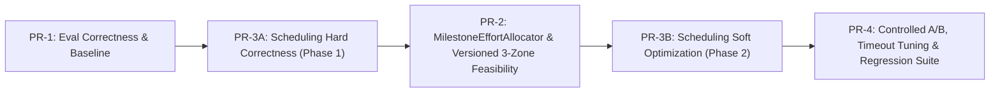

# Implementation Plan: Roadmap Generation Quality, Hybrid Effort Normalization & Two-Phase Scheduling Correctness (v2 — Post Conditional Approval)

- **Date:** `2026-11-17`
- **Status:** `Approved with Mandatory Architectural Revisions — Ready for Sequential Execution (PR-1 → PR-3A → PR-2 → PR-3B → PR-4)`
- **Scope:** Bounded Context `planning` (`domain`, `application`, `presentation`), `shared_kernel` configuration, and `tests/ai_evals` + `scripts/structural_audit.py`.
- **Non-Negotiable Invariants:**
  1. **Zero Prompt / Lockfile Drift in Stage 1:** `0` changes to `roadmap_skills.py`, `prompts.py`, `untrusted_context.py`, and `prompts.lock`. LLM output schemas (`MilestoneGenerationLLMOutput`, `TaskProposalLLMOutput`) remain untouched in Stage 1.
  2. **No Silent Task or Outcome Drops:** 100% of required tasks and outcomes are conserved; scope reductions (`FIT_CAPACITY`) halt at Milestone Review until the learner explicitly approves the versioned scope proposal.
  3. **Task Effort Integrity:** Never mutate `task.estimated_minutes` merely to make a task fit a slot.
  4. **Mathematical vs. Heuristic Unschedulability:** Never declare `EXPLICIT_UNSCHEDULABLE` merely because a greedy or bounded search failed to pack tasks; `EXPLICIT_UNSCHEDULABLE` requires a proven necessary-condition violation, whereas solver packing misses are reported as `HEURISTIC_ALLOCATION_INCOMPLETE`.
  5. **Preliminary vs. Verified Feasibility:** Milestone-stage checks produce `preliminary_feasibility` (with approximate date/capacity estimates); only post-Decomposer Phase 1 scheduling produces `verified_scheduling_feasibility`.

---

## 1. Verified Findings with File & Line References

### 1.1 Deterministic Scheduling Engine (`SpatioTemporalRuleEngine`)
- **Ignored Pacing & Recovery Parameters:** In [spatio_temporal_engine.py:972-977](file:///Users/vuthang/Documents/FocusFlow/backend/src/planning/domain/services/spatio_temporal_engine.py#L972-L977), `allocate_task_sessions` discards `peak_productivity_slots`, `daily_workload_cap_minutes`, `buffer_minutes_per_week`, and `include_weekly_buffers` (`_ = (...)`).
- **Blind Pre-Splitting Before Slot Inspection:**
  - At [spatio_temporal_engine.py:1009-1053](file:///Users/vuthang/Documents/FocusFlow/backend/src/planning/domain/services/spatio_temporal_engine.py#L1009-L1053), `allocate_task_sessions` computes a scalar `session_limit = min(max(10, preferred_session_minutes), 120, capacity)` and splits every task into `count = (effort + session_limit - 1) // session_limit` equal parts (`divmod(effort, count)`) before inspecting the actual slots on candidate dates.
  - **Same-Day Contiguous Splits:** In `R-03`, `90m` tasks with `preferred_session_minutes = 60` are split into `45m + 45m` and placed back-to-back in the same `90m` slot (`19:30–20:15`, `20:15–21:00`) at [spatio_temporal_engine.py:781-795, 1085-1095](file:///Users/vuthang/Documents/FocusFlow/backend/src/planning/domain/services/spatio_temporal_engine.py#L781-L795) (`12/12` tasks split in `R-03`, `26` tasks across `R-01..R-10`).
  - **Slot Tail Waste & False `CAPACITY_EXCEEDED`:** In `G5` (`90m` Mon/Wed/Fri slots, `180m` Sat slots, `preferred_session_minutes = 60`), `120m` tasks split into `60m + 60m`, stranding `30m` remainders in `90m` weekday slots and causing the last 1–3 tasks to fail placement even when `total_task_minutes (1,980m) <= available_capacity_minutes (2,250m)`.
  - **Non-Splittable Assessment Destruction:** Timed mock exams (`R-08 T29, T30`) and continuous load tests (`R-10 T8`, `R-06 T6, T9`) are split across two different calendar days.
- **Silent Block Stripping & Cascading Unplaced Tasks:**
  - At [spatio_temporal_engine.py:1081-1100](file:///Users/vuthang/Documents/FocusFlow/backend/src/planning/domain/services/spatio_temporal_engine.py#L1081-L1100), if any part of a split task is unplaced, all blocks for that task are dropped (`scheduled_date = None`).
  - At [spatio_temporal_engine.py:730-752](file:///Users/vuthang/Documents/FocusFlow/backend/src/planning/domain/services/spatio_temporal_engine.py#L730-L752), any successor of an unplaced task immediately aborts placement (`has_unplaced_predecessor = True`).
  - At [orchestrator.py:627-656](file:///Users/vuthang/Documents/FocusFlow/backend/src/planning/application/services/validation_gate/orchestrator.py#L627-L656) and [tier1_schema.py:180-197, 328-352](file:///Users/vuthang/Documents/FocusFlow/backend/src/planning/application/services/validation_gate/tier1_schema.py#L180-L197), unplaced tasks trigger `CAPACITY_EXCEEDED_BEFORE_TARGET_DATE` + `SCHEDULE_BLOCK_EFFORT_MISMATCH` even when gross capacity exceeds required minutes.
- **Greedy ASAP Front-Loading & Zero Recovery Days:**
  - At [spatio_temporal_engine.py:755-816](file:///Users/vuthang/Documents/FocusFlow/backend/src/planning/domain/services/spatio_temporal_engine.py#L755-L816), greedy placement from `start_date` schedules `11–43` consecutive study days without rest in `MODE_A` (`R-04`: `34d`, `R-07`: `32d`, `R-08`: `43d`).

### 1.2 Milestone Effort Allocation & Scope Feasibility
- **Uniform LLM Effort Division & Over-Capacity `FULL_SCOPE`:** In [structural_audit_results.json](file:///Users/vuthang/Documents/FocusFlow/docs/experiments/structural_audit_results.json), `8/12` plans in `exp_10` have `all_efforts_equal = True` (`4 × 540m` or `7 × 420m`), `9/12` have `utilization > 90%`, and `M-12` reaches `113.8%` (`3,960m / 3,480m`) while still claiming `FULL_SCOPE` (`deferred_scope = []`).
- **Missing Milestone-Stage Feasibility Assessment & Scope Versioning:** [milestone_use_cases.py:341-343](file:///Users/vuthang/Documents/FocusFlow/backend/src/planning/application/use_cases/milestone_use_cases.py#L341-L343) (`validate_ai_milestones_tier1` → [learning_quality.py:121-179](file:///Users/vuthang/Documents/FocusFlow/backend/src/planning/application/services/learning_quality.py#L121-L179)) does not assess capacity feasibility or version `FIT_CAPACITY` scope proposals for explicit learner confirmation in `ApproveMilestonesUseCase` ([milestone_use_cases.py:664-745](file:///Users/vuthang/Documents/FocusFlow/backend/src/planning/application/use_cases/milestone_use_cases.py#L664-L745)).

### 1.3 Evaluation Harness (`eval_runner.py` & `hard_planning_6_goals.jsonl`)
- **Conflated Invariants:** In [eval_runner.py:1097-1135](file:///Users/vuthang/Documents/FocusFlow/backend/tests/ai_evals/eval_runner.py#L1097-L1135), soft/diagnostic properties (`max_capacity_utilization <= 0.90`, `require_non_equal_milestone_effort`, `max_milestones = 6`) were wired as hard `VALIDATION_GATE` exceptions, rejecting valid 7-milestone plans (`H_E2E_04`) and conflating structural validity, scheduling feasibility, and pedagogical quality.
- **Fallback Audit Bug on Failed Stage 2:** In [eval_runner.py:1939-1948](file:///Users/vuthang/Documents/FocusFlow/backend/tests/ai_evals/eval_runner.py#L1939-L1948), when E2E Stage 2 (`_run_e2e_stage2_milestone_planner`) raises an error, `milestones` remains pointed at the static dataset fixture instead of the generated milestones.

---

## 2. Confirmed Root Causes vs. Unverified Hypotheses

| ID | Finding | Classification | Evidence |
|---|---|---|---|
| **RC-1** | Milestone Planner multi-turn tool loop wasted `20–32s` per goal; Server Prefetch (`0.9–2.4ms`) is `2.24x` faster and scored higher in blind human review (`19.50/25` vs `18.33/25`). | **CONFIRMED** | `exp_10_planner_tool_rounds_ab.json`, `blind_review_hard_6_milestones_key.json`, `hard_6_goals_e2e_prefetch_audit.json` (`0/6` Planner timeouts). |
| **RC-2** | Historical attempt-1 `CAPACITY_EXCEEDED` failures (`G4` at `80.39%`, `G5` at `90.67%`) were caused by `allocate_task_sessions` pre-splitting tasks into `45m`/`60m` chunks that stranded `15m`/`30m` slot tails — NOT by input `capacity_utilization > 95%` (`0/44` = `0.0%` across `506` runs). | **CONFIRMED** | `spatio_temporal_engine.py:1009-1053`, `exp_09_judge_and_quality_ab.json`, `exp_11_decomposer_budget_ab.json`. |
| **RC-3** | LLM Milestone Planner frequently divides total available time into equal milestone chunks (`8/12` plans) at `94.7–113.8%` utilization without transitioning `>100%` plans (`M-12`) to `FIT_CAPACITY`. | **CONFIRMED** | `structural_audit_results.json`. |
| **RC-4** | `ai_task_decomposer_timeout_seconds = 25.0s` clips valid 5–7 milestone hard goals whose attempt-1 generation takes `21.7–24.7s`. | **CONFIRMED** | `exp_11_decomposer_budget_ab.json` (`6/6` pass at `40.0s`, `p95 = 23.44s–24.56s`). |
| **HYP-1** | Outcome/concept count heuristics alone can determine exact minimum learning hours. | **REJECTED (Per Decision 1)** | Outcome/concept counts vary in granularity; heuristic floor is a **configurable baseline signal**, not sufficient proof of impossibility on its own. |
| **HYP-2** | Prompt wording edits are needed for `REVIEW` vs `PRACTICE` task-type precision and richer intra-milestone DAG branching. | **DEFERRED TO STAGE 2** | Kept out of Stage 1 to preserve `prompts.lock` and isolate deterministic improvements first. |

---

## 3. Revised Architecture (Incorporating Conditional Approval Decisions 1–3)

```mermaid
flowchart TD
    A["Stage 1: Goal Clarifier"] --> B["Server KB Prefetch (0.9–2.4ms)"]
    B --> C["Stage 2: Milestone Planner LLM (Stage 1 Schema Unchanged)"]
    C --> D["PR-2: MilestoneEffortAllocator (Hybrid 3-Effort Model + Preliminary Feasibility)"]
    D -->|Zone 1: FULL_SCOPE fits Hard Capacity (85% soft target)| E["ApproveMilestonesUseCase (Versioned Scope)"]
    D -->|Zone 2: FIT_CAPACITY (Hard Capacity Exceeded; Prerequisite-Closed Proposal)| F["STOP at Milestone Review: Explicit Learner Approval Required (Version-Checked)"]
    D -->|Zone 3: Preliminary Unschedulable Warning / Options| F
    E --> G["Stage 3: Task Decomposer LLM (Precomputed Slot-Packable Context)"]
    F -->|Learner Confirms Versioned Proposal or Adjusts Deadline/Capacity| G
    G --> H["PR-3A: SpatioTemporalRuleEngine Phase 1 (Hard Constraint Slot-Aware Solver)"]
    H -->|Verified Feasible Schedule| I["PR-3B: SpatioTemporalRuleEngine Phase 2 (Soft Pacing, Rest Days, End Buffer + Re-Validation)"]
    H -->|Necessary Condition Violated| J["EXPLICIT_UNSCHEDULABLE (Proven Hard Violation)"]
    H -->|Necessary Conditions Hold, Packing Incomplete| K["HEURISTIC_ALLOCATION_INCOMPLETE (Diagnostic / Self-Correction)"]
    I --> L["PR-1: 3-Layer Validation & Eval Reporting (structural_validity / scheduling_feasibility / pedagogical_quality)"]
```

### 3.1 `MilestoneEffortAllocator`: Three-Effort Model & Preliminary Feasibility (Decision 1 & Decision 2)

#### Three Distinct Effort Quantities per Milestone $M_i$
`MilestoneEffortAllocator` (`backend/src/planning/domain/services/milestone_effort_allocator.py`) never treats a single formula as ground truth. For each milestone $M_i$, it computes and records three distinct quantities (all rounded to `30m` increments, without modifying `MilestoneItemLLMOutput`):

1. **`estimated_effort_minutes` ($E_{\text{est}, i}$ — Hybrid Pedagogical Estimate):**
   - Combines:
     - `llm_effort`: LLM's raw `estimated_effort_minutes`,
     - `outcome_workload`: count and textual complexity (practical verbs, multi-component deliverables) of `learning_outcomes`,
     - `concept_workload`: count of `required_concepts` and `unverified_concepts`,
     - `practical_and_capstone_load`: presence of hands-on build/integration/benchmark deliverables in `title`, `description`, and `completion_criteria`,
     - `prior_knowledge_multiplier` ($\alpha_{\text{level}}$: configurable in `Settings`, default `BEGINNER=1.15, INTERMEDIATE=1.00, ADVANCED=1.10`).
   - Configurable baseline heuristic $H_{\text{est}, i}$:
     $$H_{\text{est}, i} = \text{round}_{30}\!\left(\alpha_{\text{level}} \cdot \left(b_{\text{outcome}} \cdot n_{\text{out}, i} + b_{\text{concept}} \cdot \min(6, n_{\text{con}, i}) + b_{\text{practical}} \cdot \mathbb{I}_{\text{practical}, i} + b_{\text{capstone}} \cdot \mathbb{I}_{\text{capstone}, i}\right)\right)$$
   - If the LLM emitted uniform efforts across all milestones (`all_efforts_equal == True`, e.g., `4 × 540m` or `7 × 420m`), $E_{\text{est}, i}$ distributes total LLM effort proportionally to $H_{\text{est}, i}$ (breaking artificial uniformity while respecting domain scale). Otherwise, $E_{\text{est}, i} = \text{round}_{30}(0.60 \cdot E_{\text{llm}, i} + 0.40 \cdot H_{\text{est}, i})$.
2. **`minimum_defensible_effort_minutes` ($E_{\text{min}, i}$ — Conservative Lower Bound, NOT an Arbitrary Hard Gate):**
   - Represents the lowest effort at which the milestone's outcomes and completion criteria remain pedagogically credible **without** using raw outcome/concept counts or arbitrary $\alpha$ multipliers alone to declare a goal impossible:
     $$E_{\text{min}, i} = \text{round}_{30}\!\left(\max\!\left(m_{\text{floor}},\; \min\!\left(E_{\text{llm}, i},\; H_{\text{est}, i}\right) \cdot \gamma_{\text{min}}\right)\right)$$
     where $m_{\text{floor}} = 60\text{m}$ (`90m` if capstone/project deliverable is explicitly required in `completion_criteria`) and $\gamma_{\text{min}} = 0.65$ (configurable).
   - **Crucial Safeguard (Decision 1):** $H_{\text{est}, i}$ alone **never** triggers `EXPLICIT_UNSCHEDULABLE`. A milestone plan is only flagged for scope reduction (`FIT_CAPACITY`) when **both** the LLM's own total estimate $\sum_i E_{\text{llm}, i} > P_{\text{hard}}$ **and** the conservative minimum defensible total $\sum_i E_{\text{min}, i} > P_{\text{hard}}$ (where $P_{\text{hard}}$ is the 100% hard slot-packable capacity).
3. **`normalized_planned_effort_minutes` ($E_{\text{plan}, i}$ — Planned Effort Sent to Decomposer):**
   - **85% is a Soft Planning Target, NOT a Hard Cap (Decision 2):**
     - Let $P_{\text{hard}}$ be `100%` of slot-packable capacity in $[d_{\text{start}}, d_{\text{target}}]$, and $B_{\text{soft}} = \lfloor P_{\text{hard}} \cdot \text{target\_utilization} \rfloor_{30}$ (default `target_utilization = 0.85`).
     - **Case 1A ($\sum_i E_{\text{est}, i} \le B_{\text{soft}}$):** Keep $E_{\text{plan}, i} = E_{\text{est}, i}$ (`FULL_SCOPE`; never inflate a short goal to fill 85% of a wide window).
     - **Case 1B ($B_{\text{soft}} < \sum_i E_{\text{est}, i} \le P_{\text{hard}}$, or $\sum_i E_{\text{min}, i} \le P_{\text{hard}}$):** **Keep `FULL_SCOPE`!** Never auto-truncate scope when `FULL_SCOPE` fits within `100%` hard packable capacity. Scale $E_{\text{plan}, i}$ smoothly into $[\max(E_{\text{min}, i}, \text{floor}),\; \min(\sum E_{\text{est}, i}, \max(B_{\text{soft}}, \sum E_{\text{min}, i}))]$ so that $\sum_i E_{\text{plan}, i} \le P_{\text{hard}}$, preserving relative weights $E_{\text{est}, i}$.
     - **Case 2 ($\sum_i E_{\text{min}, i} > P_{\text{hard}}$ AND $\sum_i E_{\text{llm}, i} > P_{\text{hard}}$ — `FIT_CAPACITY` Proposal):**
       - Select the largest **prerequisite-closed** subset $K_{\text{keep}} \subseteq \{1, \dots, k\}$ (`u \in K_{\text{keep}} \implies \text{deps}(u) \subseteq K_{\text{keep}}$) whose normalized effort fits within $B_{\text{soft}}$ (or $P_{\text{hard}}$ if needed for a single foundational milestone).
       - Construct a **Versioned Scope Proposal** (`scope_proposal_version`, `scope_proposal_hash`) on `Roadmap.planning_metadata`:
         - `kept_scope`: milestones in $K_{\text{keep}}$ with `normalized_planned_effort_minutes` and `expected_outcomes`,
         - `deferred_scope`: milestones in $\{1, \dots, k\} \setminus K_{\text{keep}}$ with their titles, outcomes, and prerequisite links preserved,
         - `feasibility_reasons`: structured explanation (`preliminary_feasibility = FIT_CAPACITY_REQUIRED`, `hard_packable_capacity_minutes`, `minimum_defensible_total_minutes`, `llm_estimated_total_minutes`),
         - `adjustment_options`: `extend_target_date_Option` (labeled **`estimated_earliest_target_date_range`**, `is_approximate=True` because tasks are not yet decomposed!) and `increase_weekly_capacity_option` (`+X phút/tuần`).
       - **Halt at Milestone Review (Decision 2):** Set `roadmap.planning_metadata["scope_approval_status"] = "PENDING_LEARNER_APPROVAL"`. `ProposalGenerationUseCase` / Task Decomposer refuses to run until `ApproveMilestonesUseCase` records explicit learner confirmation matching `scope_proposal_version`!
     - **Case 3 (Even foundational milestone $M_1$ has $\min(E_{\text{min}, 1}, E_{\text{llm}, 1}) > P_{\text{hard}}$ or `P_hard < 30m`):**
       - Emit `preliminary_feasibility = PRELIMINARY_UNSCHEDULABLE` at Milestone Review with `adjustment_options` (`is_approximate=True`), giving the learner the choice to adjust `target_date` / `availability` immediately without wasting a Task Decomposer LLM call.

---

### 3.2 `SpatioTemporalRuleEngine`: Two-Phase Architecture (PR-3A Hard Solver + PR-3B Soft Optimizer)

#### Phase 1 (PR-3A): Hard-Constraint Slot-Aware Solver & Proven vs. Heuristic Diagnostics
1. **`is_non_splittable` Provenance & Backward Compatibility:**
   - Every task dictionary / DTO carries optional `is_non_splittable: bool | None = None` and `non_splittable_source: Literal["EXPLICIT_DTO", "DETERMINISTIC_RULE", "DEFAULT_SPLITTABLE"]`:
     - If `task.get("is_non_splittable") is not None`: honor explicit value (`source = "EXPLICIT_DTO"`).
     - Else if `NonSplittableTaskClassifier.is_non_splittable(task)` matches timed exam / mock test / full load test / benchmark criteria (`source = "DETERMINISTIC_RULE"`): set `is_non_splittable = True`.
     - Else: `is_non_splittable = False` (`source = "DEFAULT_SPLITTABLE"`).
   - **Backward Compatibility:** Existing DB rows, API payloads, and `TaskItemLLMOutput` without `is_non_splittable` default cleanly via `NonSplittableTaskClassifier` with zero schema breaking changes.
2. **Task Effort Immutability & Slot-Aware Chunking:**
   - **Never mutate `task["estimated_minutes"]` to fit a slot.** (Note: `estimation_bias_beta` scaling is only applied when `abs(beta - 1.0) > 1e-6` before scheduling; the scheduler itself never shrinks or inflates `estimated_minutes`.)
   - For `is_non_splittable == True`: require a single contiguous free interval $[s, s + \text{effort}]$ on one day.
   - For `is_non_splittable == False`:
     - On candidate day $d$ (respecting `min_date` and `min_minute_on_min_date` from all mandatory predecessors $p \in \text{preds}(t)$), inspect free contiguous intervals in $d$ (after subtracting `existing_tasks` and already-placed tasks).
     - **Whole-Fit Preference:** If a free interval $w \ge \text{rem\_effort}$ (and $\text{rem\_effort} \le 120\text{m}$) exists on day $d$, place the entire `rem_effort` as a single block (`0` fragmentation).
     - **Slot-Boundary Splitting (No `<30m` Slivers):** Only when $w < \text{rem\_effort}$, choose chunk size $c \le \min(w, \text{preferred\_session\_minutes}, 120)$ such that $c \ge 30\text{m}$, $\text{rem\_effort} - c \ge 30\text{m}$, and $(w - c == 0 \text{ or } w - c \ge 30\text{m})$ so neither the remaining task effort nor the remaining slot tail becomes an unpackable `<30m` sliver!
3. **Adjacent Same-Day Block Coalescing (`_coalesce_adjacent_blocks`):**
   - Any two blocks of the same `task_id` on the same `block_date` with `b1.scheduled_end == b2.scheduled_start` and `b1.duration + b2.duration <= 120` are merged into a single `ScheduleBlock`, and `sequence_in_task` is renumbered `1..m`.
   - Total block minutes per task strictly equal `task["estimated_minutes"]`.
4. **Distinguishing Proven Mathematical Infeasibility vs. Heuristic Solver Incomplete Placement:**
   - Before/after Phase 1 allocation, compute **3 exact mathematical necessary conditions**:
     - **NC-1 (Total Hard Packable Capacity):** $\sum_{t} \text{effort}(t) \le \sum_{d \in [d_{\text{start}}, d_{\text{target}}]} \text{packable\_free\_minutes}(d)$
     - **NC-2 (Max Continuous Slot for Non-Splittable Tasks):** $\forall t \text{ with } \text{is\_non\_splittable}(t): \text{effort}(t) \le \max_{d \ge \text{earliest\_date}(t)} \text{max\_contiguous\_free\_window}(d)$
     - **NC-3 (DAG Critical Path Lower Bound):** For every task $t$, the cumulative effort along its ancestor chain in the prerequisite DAG must not exceed the cumulative packable capacity between $d_{\text{start}}$ and $d_{\text{target}}$.
   - **If NC-1, NC-2, or NC-3 is violated:** Emit **`EXPLICIT_UNSCHEDULABLE`** (`UNSCHEDULABLE_PROVEN_HARD_VIOLATION`) with exact violation code (`TOTAL_EFFORT_EXCEEDS_HARD_CAPACITY`, `TASK_EXCEEDS_CONTINUOUS_SLOT`, `CRITICAL_PATH_EXCEEDS_WINDOW`, `CALENDAR_CONFLICT_SATURATION`).
   - **If NC-1..3 all hold, yet Phase 1 greedy/slot-aware pass leaves $\ge 1$ task unplaced:**
     - Run a **bounded repair pass** (retrying placement with tasks ordered by critical-path slack / largest-non-splittable-first).
     - If still unplaced, **never claim `EXPLICIT_UNSCHEDULABLE`!** Emit **`HEURISTIC_ALLOCATION_INCOMPLETE`** with per-task `unscheduled_diagnostics` so the orchestrator/caller knows the schedule is likely packable via task granularity adjustment rather than telling the user their goal is impossible.

#### Phase 2 (PR-3B): Soft Optimization (`PACED_UNIFORM`, Recovery Days, End Buffer) + Mandatory Re-Validation
1. **Strictly Post-Phase-1:** Phase 2 only runs after Phase 1 has proven `verified_scheduling_feasibility = True` ( producing a valid baseline schedule $S_{\text{hard}}$).
2. **Soft Objectives Applied in Priority Order:**
   - **End Buffer (`end_buffer_ratio`, default `0.12`):** Hold back trailing active days $D_{\text{buf}}$ if tasks fit in $D_{\text{active}} \setminus D_{\text{buf}}$.
   - **Recovery Days (`max_consecutive_study_days`, default `5`):** Insert 1 rest day after every `5` consecutive study days when spare capacity allows.
   - **Paced Daily Soft Cap (`PACED_UNIFORM`):** Spread study load across active weeks by capping daily minutes at $Q_{\text{soft}}(d) = \min(Q_{\text{hard}}(d), \max(\text{preferred\_session}, \lceil \text{rem\_minutes} / \text{rem\_active\_days} \rceil_{30}))$, while preferring full-slot matches so pacing never introduces unnecessary cross-day task splits.
3. **Mandatory Post-Optimization Re-Validation & Safe Fallback:**
   - Run `run_tier1_gate` and `run_tier2_gate` (`validate_mode_a_quota` / `validate_mode_b_slots` + `DagCycleValidator` + `_validate_schedule_blocks`) on the Phase 2 candidate schedule $S_{\text{soft}}$.
   - If $S_{\text{soft}}$ leaves any task unplaced, splits a non-splittable task, or triggers any Tier 1 / Tier 2 hard violation, **progressive relaxation** releases (`daily_soft_cap` $\to$ `end_buffer` $\to$ `recovery_days`), and in the worst case **falls back atomically to the already-verified $S_{\text{hard}}$**! Phase 2 can never break a valid Phase 1 schedule.

---

### 3.3 Four-Category Evaluation Invariant Classification (PR-1)

Every evaluation run in `eval_runner.py` and `scripts/structural_audit.py` outputs **3 separate layer verdicts** (`structural_validity`, `scheduling_feasibility`, `pedagogical_quality`) with explicit failure reasons per layer, plus **4 invariant categories**:

| Category | Metrics / Invariants | Gate Behavior |
|---|---|---|
| **1. Hard Constraints** *(determine `structural_validity` & `scheduling_feasibility`)* | - Valid JSON schema & Tier 1 fields (`must_pass_tier1`)<br>- DAG acyclic & `predecessor.end <= successor.start`<br>- Task & required outcome conservation (`0` dropped tasks, `100%` required outcomes covered)<br>- Slot/quota/conflict compliance (`MODE_A`, `MODE_B`, `disabled_weekdays`, `existing_tasks`)<br>- `non_splittable_integrity` (`sensitive_tasks_split_across_days == 0`)<br>- `full_scope_hard_capacity` (`capacity_utilization <= 1.0` AND slot-feasible when `scope == FULL_SCOPE`) | **Hard FAIL** if violated (`structural_validity = False` or `scheduling_feasibility = False`). |
| **2. Conditional Constraints** *(enforced only when scenario/domain/user explicitly requires)* | - `min_milestones` / `max_milestones`<br>- `project_min_minutes >= 90`<br>- Weekly workload caps & mandatory recovery days | Only evaluated as hard when declared in `scenario["conditional_constraints"]`; otherwise reported as advisory. |
| **3. Soft Quality Metrics** *(scored `0.0..1.0` in `pedagogical_quality` / `soft_quality_report`)* | - Effort balance across milestones<br>- Target capacity utilization band (`~85%` soft target)<br>- Pacing uniformity (`PACED_UNIFORM`), rest days (`max_consecutive_study_days <= 6`), `end_buffer` (`days_idle_before_deadline`)<br>- Pedagogical workload progression | **Never flips `pass_at_1` to `False` on its own**; tracked against regression thresholds in A/B comparisons. |
| **4. Diagnostic Metrics Only** *(observability & root-cause analysis only)* | - `all_efforts_equal` (`effort_equal_ratio`)<br>- `linear_dependency_ratio`<br>- `milestone_vs_tasks_gap`<br>- Raw `capacity_utilization`<br>- `latency_ms` (`p50/p95`), `prompt_tokens`, `output_tokens` | **Never determines PASS/FAIL.** |

---

## 4. Backward-Compatible Schema, State & API Contracts

1. **Milestone Review & Versioned `FIT_CAPACITY` Approval Contract (`account` / `planning` API compatibility):**
   - `Roadmap.planning_metadata` stores:
     ```json
     {
       "preliminary_feasibility": {
         "status": "FULL_SCOPE_FEASIBLE | FIT_CAPACITY_REQUIRES_APPROVAL | PRELIMINARY_UNSCHEDULABLE",
         "scope_proposal_version": 1,
         "scope_proposal_hash": "sha256:...",
         "requires_learner_approval": true,
         "scope_approval_status": "NOT_REQUIRED | PENDING_LEARNER_APPROVAL | APPROVED_BY_LEARNER",
         "approved_scope_version": null,
         "kept_scope": [...],
         "deferred_scope": [...],
         "expected_outcomes": [...],
         "feasibility_reasons": [...],
         "adjustment_options": {
           "is_approximate": true,
           "estimated_earliest_target_date_range": {"min_date": "2026-12-15", "max_date": "2026-12-22"},
           "recommended_additional_weekly_minutes": 180
         }
       }
     }
     ```
   - **Backward-Compatible Approval Endpoint (`ApproveMilestonesRequestDTO`):**
     - Add optional `confirmed_scope_proposal_version: int | None = None` and `accept_fit_capacity: bool = False`.
     - When `preliminary_feasibility.requires_learner_approval == True`:
       - If `accept_fit_capacity` is `False` or `confirmed_scope_proposal_version != scope_proposal_version`, `ApproveMilestonesUseCase` raises a domain error (`ScopeApprovalRequiredError` / `409 Conflict` with the current proposal payload) and **does not transition milestones to `APPROVED` or trigger Task Decomposer**.
       - When the learner confirms the matching `confirmed_scope_proposal_version`, `ApproveMilestonesUseCase` records `scope_approval_status = "APPROVED_BY_LEARNER"`, `approved_scope_version = scope_proposal_version`, and only the approved `kept_scope` milestones proceed to Task Decomposer.
2. **Task & Schedule Diagnostics Contract:**
   - Optional `is_non_splittable: bool | None = None` and `non_splittable_source: str | None = None` on internal task dicts and `TaskProposalItemDTO`.
   - `ScheduleProposal` metadata includes `feasibility_verdict: "VERIFIED_FEASIBLE" | "EXPLICIT_UNSCHEDULABLE" | "HEURISTIC_ALLOCATION_INCOMPLETE"` and `unscheduled_diagnostics: list[dict]`.
   - All new fields on REST/SSE responses have defaults or are optional, ensuring **100% backward compatibility** with existing frontend consumers; `npm run api:gen` (`scripts/check-api-contract.sh`) keeps `schema.d.ts` synchronized.

---

## 5. Five-PR Sequential Implementation Plan (With Per-PR Acceptance Criteria, Rollback, API Compatibility & Regression Tests)



---

### PR-1: Evaluation Correctness, 4-Category Invariants & 3-Layer Reporting
- **Files:**
  - `[MODIFY]` [hard_planning_6_goals.jsonl](file:///Users/vuthang/Documents/FocusFlow/backend/tests/ai_evals/datasets/hard_planning_6_goals.jsonl)
  - `[MODIFY]` [eval_runner.py](file:///Users/vuthang/Documents/FocusFlow/backend/tests/ai_evals/eval_runner.py)
  - `[MODIFY]` [structural_audit.py](file:///Users/vuthang/Documents/FocusFlow/scripts/structural_audit.py)
  - `[MODIFY]` [test_eval_runner_and_dataset.py](file:///Users/vuthang/Documents/FocusFlow/backend/tests/ai_evals/test_eval_runner_and_dataset.py)
- **Implementation Tasks:**
  1. Re-structure `hard_planning_6_goals.jsonl` and `eval_runner.py` into the 4 invariant categories (Hard, Conditional, Soft Quality, Diagnostic). Remove `max_milestones=6`, `max_capacity_utilization=0.90`, and `require_non_equal_milestone_effort=True` from hard gate exceptions in `_run_e2e_stage2_milestone_planner`; enforce `capacity_utilization <= 1.0` for `FULL_SCOPE` as hard feasibility and record the rest in `soft_quality_metrics` and `diagnostic_metrics`.
  2. Emit three explicit per-case and aggregate layer verdicts: `structural_validity`, `scheduling_feasibility`, and `pedagogical_quality`, plus `failure_reasons_by_layer`.
  3. Fix E2E `structural_audit` in `eval_runner.py` so failed Stage 2 runs still audit the actual LLM-generated milestones rather than the static fixture milestones.
  4. Add support for explicit fixture field `simulated_learner_scope_decision` in `eval_runner.py` (default `None`; only simulates `FIT_CAPACITY` approval when explicitly declared in the scenario fixture, logging `simulated_scope_approval_used: True`).
- **API Compatibility:** Eval-only (`tests/ai_evals/` & `scripts/`); `0` production API changes.
- **Regression Tests:**
  - `test_four_category_invariant_classification_and_three_layer_verdicts` in `test_eval_runner_and_dataset.py`
  - `test_e2e_failed_stage2_audits_generated_milestones_not_static_fixture`
  - `test_fit_capacity_eval_requires_explicit_fixture_simulated_decision`
- **Acceptance Criteria:**
  - `pytest tests/ai_evals/` passes `100%`; `structural_audit.py` outputs all 4 categories; `prompts.lock` diff is `0`.
- **Rollback Strategy:** `git revert` PR-1 commit on `tests/ai_evals/` and `scripts/structural_audit.py`.

---

### PR-3A: Scheduling Hard Correctness (`SpatioTemporalRuleEngine` Phase 1)
- **Files:**
  - `[MODIFY]` [spatio_temporal_engine.py](file:///Users/vuthang/Documents/FocusFlow/backend/src/planning/domain/services/spatio_temporal_engine.py)
  - `[MODIFY]` [validation_types.py](file:///Users/vuthang/Documents/FocusFlow/backend/src/planning/domain/services/validation_types.py)
  - `[MODIFY]` [tier1_schema.py](file:///Users/vuthang/Documents/FocusFlow/backend/src/planning/application/services/validation_gate/tier1_schema.py)
  - `[MODIFY]` [orchestrator.py](file:///Users/vuthang/Documents/FocusFlow/backend/src/planning/application/services/validation_gate/orchestrator.py)
  - `[NEW]` `backend/tests/unit/planning/test_spatio_temporal_phase1_hard_correctness.py`
- **Implementation Tasks:**
  1. Implement `NonSplittableTaskClassifier` with explicit provenance (`EXPLICIT_DTO`, `DETERMINISTIC_RULE`, `DEFAULT_SPLITTABLE`) and enforce single-block continuous placement (`session_count = 1`) for `is_non_splittable` tasks.
  2. Replace blind `divmod(effort, count)` pre-splitting at `spatio_temporal_engine.py:1032-1053` with **Slot-Aware Whole-Task Placement**: place whole tasks into contiguous free windows when `window >= rem_effort`; only split at slot boundaries when `chunk >= 30m`, `rem_effort - chunk >= 30m`, and remaining slot tail is either `0m` or `>= 30m` — **never mutating `task["estimated_minutes"]`**.
  3. Implement `_coalesce_adjacent_blocks` to merge back-to-back same-day blocks of the same task (`prev.end == curr.start`, sum `<= 120m`).
  4. Implement Necessary-Condition Feasibility Verifier (NC-1 total hard packable capacity, NC-2 max continuous slot for non-splittable tasks, NC-3 DAG critical path lower bound) + bounded critical-path repair pass, emitting explicit `UnscheduledTaskDiagnosticDTO` (`EXPLICIT_UNSCHEDULABLE` only when NC-1..3 fail; `HEURISTIC_ALLOCATION_INCOMPLETE` when NC-1..3 hold but packing is incomplete).
- **API Compatibility:** Internal domain/application dicts gain optional additive keys (`is_non_splittable`, `non_splittable_source`, `unscheduled_diagnostics`, `feasibility_verdict`); REST/SSE schemas remain backward-compatible.
- **Regression Tests:**
  - Replay `R-03` (`12` tasks of `90m` in `90m`/`180m` slots) $\to$ `adjacent_same_day_split_count == 0` (was `12`).
  - Replay `R-08` (`T29, T30` mock tests) and `R-10` (`T8` load test) $\to$ `sensitive_tasks_split_across_days == 0`.
  - Replay `G4` and `G5` attempt-1 task lists $\to$ `100%` tasks placed on attempt 1 with `0` stranded `15m`/`30m` slot tails and `0` `task.estimated_minutes` mutations.
  - Test NC-1, NC-2 (`120m` non-splittable in `90m` max slot $\to$ `TASK_EXCEEDS_CONTINUOUS_SLOT`), NC-3, and `HEURISTIC_ALLOCATION_INCOMPLETE` distinction.
- **Acceptance Criteria:**
  - `0` silent task drops; `0` `estimated_minutes` mutations; `0` same-day contiguous splits; `0` cross-day non-splittable splits; all existing + new unit tests pass (`100%`).
- **Rollback Strategy:** Feature flag `SPATIO_TEMPORAL_V2_HARD_SOLVER_ENABLED: bool = True` in `Settings` (`config.py`) allowing instant fallback to legacy `allocate_task_sessions`.

---

### PR-2: `MilestoneEffortAllocator`, Preliminary Feasibility & Versioned `FIT_CAPACITY` Approval
- **Files:**
  - `[NEW]` `backend/src/planning/domain/services/milestone_effort_allocator.py`
  - `[MODIFY]` [roadmap_context_builder.py](file:///Users/vuthang/Documents/FocusFlow/backend/src/planning/application/services/roadmap_context_builder.py)
  - `[MODIFY]` [milestone_use_cases.py](file:///Users/vuthang/Documents/FocusFlow/backend/src/planning/application/use_cases/milestone_use_cases.py)
  - `[MODIFY]` [proposal_generation_use_cases.py](file:///Users/vuthang/Documents/FocusFlow/backend/src/planning/application/use_cases/proposal_generation_use_cases.py)
  - `[MODIFY]` [planning_dtos.py](file:///Users/vuthang/Documents/FocusFlow/backend/src/planning/application/dtos/planning_dtos.py)
  - `[NEW]` `backend/tests/unit/planning/test_milestone_effort_allocator_and_scope_approval.py`
- **Implementation Tasks:**
  1. Implement `MilestoneEffortAllocator` computing the 3 effort fields per milestone (`estimated_effort_minutes`, `minimum_defensible_effort_minutes`, `normalized_planned_effort_minutes`) using Hybrid Effort Estimation (LLM effort + outcomes + concept complexity + practical/capstone workload + `prior_knowledge_level`).
  2. Enforce Decision 1 & Decision 2 rules:
     - `85%` is a soft planning target (`ai_milestone_target_utilization = 0.85`). If `FULL_SCOPE` fits within `100%` hard packable capacity, **never** auto-cut scope to `FIT_CAPACITY`.
     - Never use outcome/concept count or $\alpha$ alone to declare `UNSCHEDULABLE`.
     - When `FIT_CAPACITY` is required, build a prerequisite-closed `kept_scope` + `deferred_scope` + `expected_outcomes` + `feasibility_reasons` + approximate `adjustment_options` (`is_approximate=True`, `estimated_earliest_target_date_range`), stamped with `scope_proposal_version` and `scope_proposal_hash`.
  3. Update `ApproveMilestonesUseCase` and `ProposalGenerationUseCase`: when `requires_learner_approval == True`, block Task Decomposition until the learner explicitly confirms the matching `confirmed_scope_proposal_version` (no `auto_accept_fit_capacity` in production).
- **API Compatibility:** Additive optional fields on `ApproveMilestonesRequestDTO` (`confirmed_scope_proposal_version: int | None = None`, `accept_fit_capacity: bool = False`) and `Roadmap.planning_metadata["preliminary_feasibility"]`. Run `scripts/check-api-contract.sh` to update `schema.d.ts` if router schema exposes the optional fields.
- **Regression Tests:**
  - Replay all 12 `exp_10` milestone plans (`M-01..M-12`): verify `M-01..M-11` (`82.8%–100.0%` raw) retain `FULL_SCOPE` with differentiated non-uniform `normalized_planned_effort_minutes` (`all_efforts_equal == False`), while `M-12` (`113.8%` raw) produces a versioned `FIT_CAPACITY` proposal halting for learner approval.
  - Verify `ProposalGenerationUseCase` rejects unconfirmed `FIT_CAPACITY` roadmaps and rejects stale `confirmed_scope_proposal_version`.
  - Verify concise beginner goal (`R-01` `810m / 3,030m`) is **not** inflated to `85%` (`2,575m`).
- **Acceptance Criteria:**
  - `0` changes to `MilestoneGenerationLLMOutput` or `prompts.lock`; `100%` unit tests pass; versioned `FIT_CAPACITY` approval state machine verified.
- **Rollback Strategy:** Feature flag `MILESTONE_EFFORT_ALLOCATOR_ENABLED: bool = True` in `Settings` (`config.py`).

---

### PR-3B: Scheduling Soft Optimization (`SpatioTemporalRuleEngine` Phase 2)
- **Files:**
  - `[MODIFY]` [spatio_temporal_engine.py](file:///Users/vuthang/Documents/FocusFlow/backend/src/planning/domain/services/spatio_temporal_engine.py)
  - `[MODIFY]` [config.py](file:///Users/vuthang/Documents/FocusFlow/backend/src/shared_kernel/config.py)
  - `[NEW]` `backend/tests/unit/planning/test_spatio_temporal_phase2_soft_optimization.py`
- **Implementation Tasks:**
  1. Implement Phase 2 Soft Optimizer running strictly on top of a valid Phase 1 schedule $S_{\text{hard}}$:
     - `PACED_UNIFORM` daily soft cap ($Q_{\text{soft}}(d)$ quantized to slot/session boundaries so pacing never creates extra cross-day task splits),
     - `end_buffer_ratio` (default `0.12` trailing active days),
     - `max_consecutive_study_days` (default `5` days before inserting a recovery day in `MODE_A`/`MODE_B`).
  2. Implement progressive relaxation (`daily_soft_cap` $\to$ `end_buffer` $\to$ `recovery_days`) and **mandatory post-Phase-2 hard constraint re-validation** (via Tier 1 + Tier 2 deterministic validators), falling back atomically to $S_{\text{hard}}$ if any hard constraint would be violated.
- **API Compatibility:** Pure internal algorithm improvement in `SpatioTemporalRuleEngine`; `0` API schema changes.
- **Regression Tests:**
  - Replay `MODE_A` roadmaps `R-01, R-02, R-04, R-05, R-07, R-08`: verify `max_consecutive_study_days` drops from `11–43d` to `<= 6d` (when capacity utilization `<= 85%`) and `R-01`/`R-05` spread evenly with an end buffer instead of front-loading all tasks into the first 11–23 days.
  - Tight-deadline stress test (`95%` utilization): verify Phase 2 relaxes soft objectives and returns a `100%` valid schedule matching $S_{\text{hard}}$.
- **Acceptance Criteria:**
  - `100%` of schedules output by Phase 2 pass Tier 1 & Tier 2 hard validators; `max_consecutive_study_days <= 6` on all roadmaps with `utilization <= 0.85`; `0` extra cross-day splits introduced by pacing.
- **Rollback Strategy:** Feature flag `SPATIO_TEMPORAL_V2_SOFT_PACING_ENABLED: bool = True` in `Settings` (`config.py`) falls back to Phase 1 schedule $S_{\text{hard}}$.

---

### PR-4: Controlled A/B Suite (`exp_13`), Decomposer Timeout Tuning & Full Regression Verification
- **Files:**
  - `[MODIFY]` [config.py](file:///Users/vuthang/Documents/FocusFlow/backend/src/shared_kernel/config.py) (`ai_task_decomposer_timeout_seconds: float = 36.0`)
  - `[NEW]` `scripts/experiments/exp_13_deterministic_ab_suite.py`
  - `[NEW]` `docs/reports/exp-13-deterministic-ab-report.md`
- **Implementation Tasks:**
  1. Update `ai_task_decomposer_timeout_seconds` to `36.0s` while preserving `no-retry on TimeoutError` and fast-error-only retry (`remaining_seconds >= 15.0s`).
  2. Implement and execute `scripts/experiments/exp_13_deterministic_ab_suite.py` comparing Control (legacy baseline) vs. Treatment (PR-1 + PR-3A + PR-2 + PR-3B) across:
     - **Cohort A:** Frozen replay of `R-01..R-10`, `M-01..M-12`, and `G4/G5` attempt-1 task outputs.
     - **Cohort B:** Live E2E runs on `hard_planning_6_goals.jsonl` and `golden_planning_18_goals.jsonl`.
     - **Cohort C:** 8 synthetic edge-case scenarios (`EC-1` tight deadline, `EC-2` sparse availability, `EC-3` calendar conflicts, `EC-4` impossible goal $\to$ `EXPLICIT_UNSCHEDULABLE`, `EC-5` partial fit $\to$ versioned `FIT_CAPACITY` halted for approval, `EC-6` non-splittable vs slot length, `EC-7` `R-03` coalescing, `EC-8` `G4/G5` bin-packing rescue).
- **API Compatibility:** Config default update only; `0` API changes.
- **Regression Tests & Final Quality Gates:**
  - Full backend & script quality gates (`ruff`, `mypy --strict`, `lint-imports`, `prompts.lock --check`, `pytest`, `check-api-contract.sh`).
- **Acceptance Criteria:**
  - `0` prompt/lockfile changes; all Cohort A/B/C metrics documented with exact before/after numbers and verified against independent structural + pedagogical checks.
- **Rollback Strategy:** Revert `AI_TASK_DECOMPOSER_TIMEOUT_SECONDS=25.0` via env var; toggle `MILESTONE_EFFORT_ALLOCATOR_ENABLED` / `SPATIO_TEMPORAL_V2_*` flags if needed.
