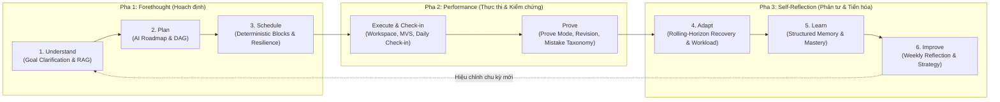
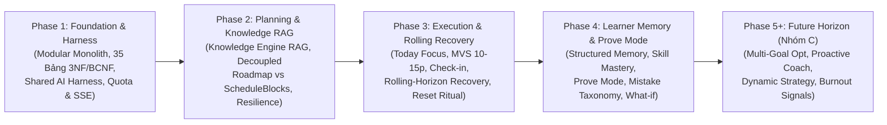
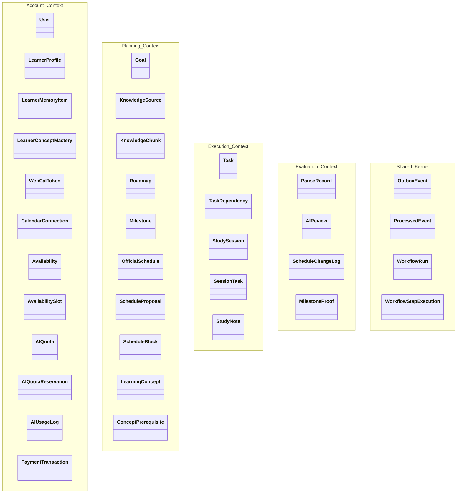

# FocusFlow — Software Requirements Specification (SRS)
## Phiên bản: v1.4 (Phê duyệt Kiểm soát Thay đổi CCB - 05/11/2026)

---

| Thông tin tài liệu | Chi tiết |
|---|---|
| **Dự án** | FocusFlow Learning Intelligence Harness — An adaptive AI-powered learning management system (Hệ điều hành & Khung điều phối học tập thích ứng tích hợp AI) |
| **Cấp độ tài liệu** | Software Requirements Specification (SRS) |
| **Phiên bản** | v1.4 (Requirements Baseline v1.4 — Post-CCB Approval, 8 Actors, 43 Functional Requirements & GDPR Compliance) |
| **Trạng thái** | Chuẩn Cơ sở v1.4 — Phê duyệt Kiểm soát Thay đổi (CCB), Tích hợp 8 Tác nhân Chuẩn OMG UML & 43 Yêu cầu Chức năng (05/11/2026) |
| **Vai trò soạn thảo** | Senior Business Analyst / Lead Software Architect |
| **Nguồn chân lý duy nhất (Single Source of Truth)** | `docs/requirements/problem-definition.md` |
| **Tiêu chuẩn Kỹ thuật Yêu cầu** | **ISO/IEC/IEEE 29148:2018** (Tham chiếu lịch sử: IEEE Std 830-1998) |
| **Căn cứ đánh giá học thuật** | Khung Rubric Đồ án Tốt nghiệp / Khóa luận CNTT (Tiêu chí TC1, TC2.1, TC2.3, TC2.7) |

### Lịch sử Thay đổi Phiên bản (Document Revision History)

| Phiên bản | Ngày hiệu lực | Tác giả thực hiện | Lý do & Nội dung thay đổi cốt lõi |
|---|---|---|---|
| **v1.0** | 17/09/2026 | Vũ Toàn Thắng | Khởi tạo chuẩn yêu cầu cơ sở ban đầu (Baseline Frozen); giải quyết 8 quyết định mở kỹ thuật (`OS-01` đến `OS-08`). |
| **v1.1** | 30/09/2026 | Vũ Toàn Thắng | Thẩm định và chuẩn hóa Tác nhân Hệ thống & Danh mục Use Cases theo chuẩn UML 2.5.1: Bổ sung Phân hệ Quản trị viên (`FR-ADM-001..003`), tích hợp Cổng thanh toán trực tuyến (`Payment Gateway` — `FR-QUOTA-002`) và Đồng bộ lịch ngoại vi 2 chiều có kiểm soát (`BUSR-08`, `FR-CALENDAR-002`); bổ sung quy tắc `BUSR-11` (RBAC Gate) và `BR-006`; định vị chuẩn mực nghiệp vụ Review là Supporting Subdomain trong mô hình Zimmerman SRL (2002); cập nhật ma trận RTM toàn diện. |
| **v1.2** | 27/10/2026 | Vũ Toàn Thắng | Chuẩn hóa ngữ nghĩa trung lập công nghệ (ISO/IEC/IEEE 29148:2018) và đồng bộ hóa toàn diện với Kiến trúc (`ADR-001`..`ADR-010`), Danh mục **7 Tác nhân (`ACT-01`..`ACT-07`)** & **25 Use Cases (`UC-01`..`UC-25` trên 5 phân hệ)**: (1) Chuẩn hóa `FR-ADAPT-002` (`UC-21`) sinh `ScheduleProposal` (`DRAFT`) cho 1 lộ trình đi qua cổng kiểm định 3 tầng (`UC-12`) và yêu cầu người học phê duyệt (`Apply`) để bảo toàn bất biến `BUSR-02`/`BUSR-03`; (2) Bổ sung yêu cầu cập nhật hồ sơ & múi giờ (`FR-AUTH-003`), quản lý danh mục & lưu trữ lộ trình `ARCHIVED` (`FR-PLAN-006`, Mục 6.1), giới hạn thời lượng task AI ($30\text{--}120$ phút) vs thủ công ($15\text{--}240$ phút) & hủy task (`FR-TASK-001..002`), quy tắc hạ cấp `PREMIUM` $\rightarrow$ `FREE` giữ 3 lộ trình `ACTIVE` theo EDF (`FR-QUOTA-002`, `FR-ADM-002`); (3) Đồng bộ hành vi hủy và hoàn trả giữ chỗ quota (`RELEASED`) sau 2 lần retry AI thất bại (`FR-PLAN-005`, `FR-AI-001`), chuẩn hóa trạng thái giao dịch thanh toán `{PENDING, PAID, FAILED, CANCELLED, EXPIRED}` có `expires_at` (15 phút), tách bạch `CalendarConnection` và `WebCalToken` (Mục 12), và chuẩn hóa luồng kiểm toán bảo mật/quản trị tập trung (Structured Audit Stream). |
| **v1.3** | 03/11/2026 | Vũ Toàn Thắng | Nâng cấp toàn diện theo thiết kế **FocusFlow Learning Intelligence Harness** & Báo cáo Đối chiếu Chiến lược Sản phẩm (Mentor Report 11/2026): (1) Nâng cấp định vị thành **FocusFlow Learning Intelligence Harness — An adaptive AI-powered learning management system** xoay quanh 3 Trụ cột Cạnh tranh (*Personalized Learning Planning với Knowledge RAG, Adaptive Scheduling với Rolling-Horizon & Schedule Resilience, Continuous Learner Intelligence với Structured Learner Memory*) và **Controlled Adaptive Recovery**; (2) Thống nhất **Chu trình 6 bước (Understand $\rightarrow$ Plan $\rightarrow$ Schedule $\rightarrow$ Adapt $\rightarrow$ Learn $\rightarrow$ Improve)** với **Mô hình 3 pha Zimmerman SRL** (*Forethought = Understand + Plan + Schedule; Performance = Execute + Check-in + Prove; Self-Reflection = Adapt + Learn + Improve*); (3) Phân tách nền tảng **3 Thực thể Cốt lõi**: **Roadmap** (`estimated_effort`), **Schedule** (`schedule_blocks` với `scheduled_duration`, đổi giờ rảnh chỉ chạy lại Schedule Optimization mà không tạo lại Roadmap) và **Learner Model** (`learner_profiles`, `learner_memory_items`, `learner_concept_masteries` lưu giữ xuyên suốt nhiều Roadmap); (4) Tích hợp **Knowledge Ingestion & Hybrid RAG Pipeline** (`knowledge_sources`, `knowledge_chunks` với PostgreSQL 16 `tsvector` + `pgvector` HNSW, SSRF Guard, `<untrusted_knowledge_context>`), **Unified Availability Model** (`freeBusy`/`syncToken` + `external_calendar_event_id`), **Schedule Resilience**, **Goal Feasibility Prediction** và **What-if Planning** (`WHAT_IF_SIMULATION`); (5) Bổ sung **Today Focus View** (`UC-13`), **MVS Mode 10–15 phút (`UC-15`)**, **Daily Learning Check-in**, bắt buộc `Key Takeaway` (Tầng 1 Guard) + `self_confidence (1..5)` (`UC-14`), nợ takeaway (`pending_takeaway` — `UC-16`), **Rolling-Horizon Overdue Recovery** (`UC-23`), **Adaptive Workload**, **Weekly Reschedule Budget**, **Anti-Procrastination Mode**, **Post-Failure Reset Ritual** (`UC-24`); (6) Bổ sung **Prove Mode** (`UC-20`) kèm **Mistake Intelligence** (`mistake_taxonomy_json`), **Intelligent Revision** (What Works Clearinghouse), **Skill Mastery Tracking** (`learner_concept_masteries`), **Weekly Reflection** (`user_reflection_payload` — `UC-21`), và **Structured Learner Memory** (4 loại $\times$ 3 tầng nhận thức); (7) Phân tầng **3 Nhóm Tính năng (Nhóm A, Nhóm B, Nhóm C)** + **Lộ trình 5 Giai đoạn**; chuẩn hóa Domain Model lên **35 bảng (3NF/BCNF)** (12 `account`, 10 `planning`, 5 `execution`, 4 `evaluation`, 4 `shared_kernel`) và **28 Use Cases (`UC-01`..`UC-28`)**. |
| **v1.4** | 05/11/2026 | Hội đồng CCB — Vũ Toàn Thắng | Phê duyệt Kiểm soát Thay đổi (Change Control Board - CCB) chốt Baseline: (1) Bổ sung Yêu cầu Chức năng Tự đặt lại Mật khẩu qua Thư điện tử (FR-AUTH-004), gỡ bỏ khỏi §2.5 Out-of-Scope; (2) Bổ sung Yêu cầu Chức năng Đóng & Xóa vĩnh viễn Tài khoản theo Quyền được Lãng quên (FR-PROFILE-002, tuân thủ GDPR Điều 17) kèm trạng thái 'DELETED' tại Mục 12 Bảng #1 users; (3) Chuẩn hóa mô hình **8 Tác nhân (`ACT-00`..`ACT-07`)** theo chuẩn OMG UML 2.5.1 và Alistair Cockburn (bổ sung `ACT-00` Guest, `ACT-01` Registered User abstract, loại bỏ `Time <<temporal>>` / Scheduler nội bộ khỏi danh mục Actor — các thành phần nội bộ `PostgreSQL`, `Redis`, `Taskiq Worker/Scheduler`, `Internal AI Harness` nằm trong System Boundary, còn các Use Case định kỳ sử dụng `TimeEvent` trigger gắn với Beneficiary Actor `Learner`/`Administrator`); (4) Cập nhật Ma trận Truy vết RTM Mục 16 đạt 43 Yêu cầu Chức năng (FR-AUTH-001..004, FR-GOAL-001..003, FR-PLAN-001..006, FR-AVAIL-001..003, FR-SCHEDULE-001, FR-TASK-001..003, FR-SESSION-001..003, FR-ADAPT-001..003, FR-PAUSE-001..002, FR-CALENDAR-001..003, FR-REPORT-001..003, FR-AI-001..002, FR-QUOTA-001..002, FR-ADM-001..003, FR-PROFILE-001..002) và Mục 17 Tổng kết Baseline v1.4. |

---

## MỤC LỤC

1. [Giới thiệu (Introduction)](#1-giới-thiệu-introduction)
   - 1.1 [Mục đích (Purpose)](#11-mục-đích-purpose)
   - 1.2 [Phạm vi (Scope)](#12-phạm-vi-scope)
   - 1.3 [Đối tượng độc giả (Intended Audience)](#13-đối-tượng-độc-giả-intended-audience)
   - 1.4 [Tổng quan sản phẩm (Product Overview)](#14-tổng-quan-sản-phẩm-product-overview)
   - 1.5 [Hệ thống Thuật ngữ Chuẩn hóa (Canonical Definitions & Terminology)](#15-hệ-thống-thuật-ngữ-chuẩn-hóa-canonical-definitions--terminology)
   - 1.6 [Tài liệu tham khảo (References)](#16-tài-liệu-tham-khảo-references)
2. [Phạm vi & Bối cảnh Sản phẩm (Product Scope & Context)](#2-phạm-vi--bối-cảnh-sản-phẩm-product-scope--context)
   - 2.1 [Người dùng mục tiêu](#21-người-dùng-mục-tiêu)
   - 2.2 [Mục tiêu sản phẩm](#22-mục-tiêu-sản-phẩm)
   - 2.3 [Ranh giới hệ thống (System Boundaries)](#23-ranh-giới-hệ-thống-system-boundaries)
   - 2.4 [Các tính năng trong phạm vi (In-Scope — Core MVP)](#24-các-tính-năng-trong-phạm-vi-in-scope--core-mvp)
   - 2.5 [Các tính năng ngoài phạm vi (Out-of-Scope)](#25-các-tính-năng-ngoài-phạm-vi-out-of-scope)
3. [Tổng quan Tác nhân & Use Cases (Actors & Use Cases Overview)](#3-tổng-quan-tác-nhân--use-cases-actors--use-cases-overview)
   - 3.1 [Các tác nhân hệ thống (System Actors)](#31-các-tác-nhân-hệ-thống-system-actors)
   - 3.2 [Danh mục Use Cases Cấp Yêu cầu (Use Case Inventory)](#32-danh-mục-use-cases-cấp-yêu-cầu-use-case-inventory)
4. [Yêu cầu Nghiệp vụ (Business Requirements - BR)](#4-yêu-cầu-nghiệp-vụ-business-requirements---br)
5. [Quy tắc Nghiệp vụ Cốt lõi (Business Rules - BUSR)](#5-quy-tắc-nghiệp-vụ-cốt-lõi-business-rules---busr)
6. [Quy tắc Chuyển đổi Trạng thái (State Transition Rules)](#6-quy-tắc-chuyển-đổi-trạng-thái-state-transition-rules)
   - 6.1 [Vòng đời Lộ trình (Roadmap Lifecycle)](#61-vòng-đời-lộ-trình-roadmap-lifecycle)
   - 6.2 [Vòng đời Task & Điều kiện Quá hạn (Task Lifecycle & Derived Overdue Condition)](#62-vòng-đời-task--điều-kiện-quá-hạn-task-lifecycle--derived-overdue-condition)
   - 6.3 [Vòng đời Phiên học (Study Session Lifecycle)](#63-vòng-đời-phiên-học-study-session-lifecycle)
   - 6.4 [Vòng đời Đề xuất Lịch & Lịch Chính thức (Schedule Proposal & Official Schedule Lifecycle)](#64-vòng-đời-đề-xuất-lịch--lịch-chính-thức-schedule-proposal--official-schedule-lifecycle)
7. [Yêu cầu Chức năng (Functional Requirements - FR)](#7-yêu-cầu-chức-năng-functional-requirements---fr)
   - 7.1 [Xác thực & Quản lý Tài khoản (FR-AUTH)](#71-xác-thực--quản-lý-tài-khoản-fr-auth)
   - 7.2 [Thiết lập Mục tiêu & Thu thập Ngữ cảnh (FR-GOAL)](#72-thiết-lập-mục-tiêu--thu-thập-ngữ-cảnh-fr-goal)
   - 7.3 [Khởi tạo Kế hoạch & Duyệt 2 cấp độ bằng AI (FR-PLAN)](#73-khởi-tạo-kế-hoạch--duyệt-2-cấp-độ-bằng-ai-fr-plan)
   - 7.4 [Cấu hình Thời gian rảnh Lai (FR-AVAIL)](#74-cấu-hình-thời-gian-rảnh-lai-fr-avail)
   - 7.5 [Quản lý Lịch trình Chính thức (FR-SCHEDULE)](#75-quản-lý-lịch-trình-chính-thức-fr-schedule)
   - 7.6 [Quản trị Task & Hàng đợi Backlog (FR-TASK)](#76-quản-trị-task--hàng-đợi-backlog-fr-task)
   - 7.7 [Không gian Thực thi Phiên học & Phục hồi (FR-SESSION)](#77-không-gian-thực-thi-phiên-học--phục-hồi-fr-session)
   - 7.8 [Cơ chế Thích ứng khi Quá hạn (FR-ADAPT)](#78-cơ-chế-thích-ứng-khi-quá-hạn-fr-adapt)
   - 7.9 [Tạm dừng Lộ trình & Domino Shift (FR-PAUSE)](#79-tạm-dừng-lộ-trình--domino-shift-fr-pause)
   - 7.10 [Đồng bộ Lịch ngoại vi 2 chiều, WebCal & .ics (FR-CALENDAR)](#710-đồng-bộ-lịch-ngoại-vi-2-chiều-webcal--ics-fr-calendar)
   - 7.11 [Báo cáo & AI Review Định kỳ (FR-REPORT)](#711-báo-cáo--ai-review-định-kỳ-fr-report)
   - 7.12 [Kiểm soát An toàn & Cơ chế Thử lại AI (FR-AI)](#712-kiểm-soát-an-toàn--cơ-chế-thử-lại-ai-fr-ai)
   - 7.13 [Quản trị Hạn ngạch, Gói cước & Thanh toán Trực tuyến (FR-QUOTA)](#713-quản-trị-hạn-ngạch-gói-cước--thanh-toán-trực-tuyến-fr-quota)
   - 7.14 [Phân hệ Quản trị viên Nền tảng (FR-ADM)](#714-phân-hệ-quản-trị-viên-nền-tảng-fr-adm)
   - 7.15 [Hồ sơ Thói quen Người học & Cá nhân hóa Lộ trình (FR-PROFILE)](#715-hồ-sơ-thói-quen-người-học--cá-nhân-hóa-lộ-trình-fr-profile)
8. [Yêu cầu Phi Chức năng (Non-Functional Requirements - NFR)](#8-yêu-cầu-phi-chức-năng-non-functional-requirements---nfr)
   - 8.1 [Hiệu năng & Thời gian Phản hồi (NFR-PERF)](#81-hiệu-năng--thời-gian-phản-hồi-nfr-perf)
   - 8.2 [An toàn & Bảo mật Hệ thống (NFR-SEC)](#82-an-toàn--bảo-mật-hệ-thống-nfr-sec)
   - 8.3 [Độ sẵn sàng Hệ thống (NFR-AVAIL)](#83-độ-sẵn-sàng-hệ-thống-nfr-avail)
   - 8.4 [Khả năng Tương thích & Tiếp cận Giao diện (NFR-UX)](#84-khả-năng-tương-thích--tiếp-cận-giao-diện-nfr-ux)
   - 8.5 [Ràng buộc Đặc thù về AI (NFR-AI)](#85-ràng-buộc-đặc-thù-về-ai-nfr-ai)
9. [Tiêu chí Đánh giá Dự án & Thử nghiệm (Evaluation Metrics & Benchmarks)](#9-tiêu-chí-đánh-giá-dự-án--thử-nghiệm-evaluation-metrics--benchmarks)
10. [Kiểm soát Rủi ro & Kiến trúc An toàn AI (AI Risk Controls & Architecture Consistency)](#10-kiểm-soát-rủi-ro--kiến-trúc-an-toàn-ai-ai-risk-controls--architecture-consistency)
11. [Bảo mật & Quyền Sở hữu Dữ liệu (Security & Data Ownership)](#11-bảo-mật--quyền-sở-hữu-dữ-liệu-security--data-ownership)
12. [Yêu cầu Dữ liệu Cấp Khái niệm (Conceptual Data Requirements)](#12-yêu-cầu-dữ-liệu-cấp-khái-niệm-conceptual-data-requirements)
13. [Yêu cầu Giao diện Ngoại vi (External Interface Requirements)](#13-yêu-cầu-giao-diện-ngoại-vi-external-interface-requirements)
14. [Xử lý Ngoại lệ & Kịch bản Lỗi Toàn diện (Exception & Failure Handling)](#14-xử-lý-ngoại-lệ--kịch-bản-lỗi-toàn-diện-exception--failure-handling)
15. [Danh mục Điểm Chưa Đặc tả & Quyết định Mở (Open Specification / TBD Register)](#15-danh-mục-điểm-chưa-đặc-tả--quyết-định-mở-open-specification--tbd-register)
16. [Ma trận Truy vết Toàn diện (Comprehensive Traceability Matrix)](#16-ma-trận-truy-vết-toàn-diện-comprehensive-traceability-matrix)
17. [Kết luận & Tình trạng Chuẩn Cơ sở (Quality Sign-Off & Baseline Status)](#17-kết-luận--tình-trạng-chuẩn-cơ-sở-quality-sign-off--baseline-status)

---

## 1. Giới thiệu (Introduction)

### 1.1 Mục đích (Purpose)
Tài liệu **Software Requirements Specification (SRS) v1.4** này đặc tả chi tiết, đầy đủ và chuẩn hóa các yêu cầu chức năng, yêu cầu phi chức năng, quy tắc nghiệp vụ, ràng buộc an toàn AI và các giao diện tích hợp cho **FocusFlow Learning Intelligence Harness — An adaptive AI-powered learning management system** (Hệ điều hành & Khung điều phối học tập thích ứng tích hợp AI). Hệ thống được xây dựng trên nền tảng lý thuyết Tự điều chỉnh học tập (Self-Regulated Learning - SRL) của Zimmerman (2002), giải quyết triệt để 3 đứt gãy kinh điển của người tự học thông qua **3 Trụ cột Cạnh tranh Cốt lõi** (*Personalized Learning Planning với Knowledge Engine RAG, Adaptive Scheduling với Rolling-Horizon & Schedule Resilience, Continuous Learner Intelligence với Structured Learner Memory*), năng lực **Controlled Adaptive Recovery (Phục hồi thích ứng có kiểm soát)** và trục **Evidence-based Learning (Học tập thực chứng)**.

Tài liệu đóng vai trò là chuẩn cơ sở kỹ thuật phục vụ phân tích hệ thống, mô hình hóa UML, thiết kế kiến trúc, thiết kế cơ sở dữ liệu (**35 bảng chuẩn 3NF/BCNF**) và nghiệm thu kiểm thử phần mềm. Đối với các chi tiết nghiệp vụ chưa được giải quyết dứt khoát từ tài liệu gốc, tài liệu ghi nhận tường minh dưới dạng **Quyết định Mở của Chủ sở hữu Sản phẩm (Open Decision — Product Owner)** thay vì tự ý suy đoán.

### 1.2 Phạm vi, Chu trình 6 Bước & Phân tách 3 Thực thể Cốt lõi (Scope, 6-Step Learning Intelligence Loop & 3 Core Entities)
Hệ thống FocusFlow được xây dựng dưới dạng ứng dụng web (Web Application) responsive, thống nhất **Chu trình Trí tuệ Học tập 6 Bước (6-Step Learning Intelligence Loop: Understand $\rightarrow$ Plan $\rightarrow$ Schedule $\rightarrow$ Adapt $\rightarrow$ Learn $\rightarrow$ Improve)** với **Mô hình 3 pha tự điều chỉnh học tập của Zimmerman (2002)** (*Forethought $\rightarrow$ Performance $\rightarrow$ Self-Reflection*):



#### 1.2.1 Thống nhất Chu trình 6 Bước với 3 Pha Zimmerman SRL
1. **Understand (Thấu hiểu mục tiêu, học liệu & ngữ cảnh)** *(Pha Forethought)*:
   - Thu thập ý định ban đầu (`Goal`), tương tác đối thoại với AI (`Goal Clarification`) để làm rõ phạm vi, trình độ nền tảng và tiêu chí đầu ra.
   - Tiếp nhận tài liệu tham khảo của người học (PDF, DOCX, TXT, URL) qua **Knowledge Ingestion & Hybrid RAG Pipeline** (`knowledge_sources`, `knowledge_chunks` sử dụng PostgreSQL 16 `tsvector` + `pgvector` HNSW) kèm kiểm soát SSRF và cô lập `<untrusted_knowledge_context>`.
   - Phân tích và cấu hình mô hình thời gian rảnh hợp nhất (**`UnifiedAvailabilityModel`**: Mode A/B kết hợp mức năng lượng `energy_level` và đồng bộ Google Calendar `freeBusy`/`syncToken`).
2. **Plan (Lập lộ trình cá nhân hóa & Dự báo khả thi)** *(Pha Forethought)*:
   - AI phân rã mục tiêu thành **Roadmap** độc lập với lịch biểu: danh sách Cột mốc (`Milestones`), Nhiệm vụ (`Tasks` với nỗ lực ước tính `estimated_effort`), Đồ thị tiên quyết (`TaskDependencies`, `LearningConcepts`, `ConceptPrerequisites`), và Tài nguyên học tập (`Learning Resources`) kèm trích dẫn nguồn (provenance citations).
   - Thực hiện **Goal Feasibility Prediction** (đối chiếu tổng nỗ lực yêu cầu với quỹ thời gian thực tế trước hạn chót `target_date`).
3. **Schedule (Lập thời gian biểu tất định & Mô phỏng kịch bản)** *(Pha Forethought)*:
   - **Deterministic Scheduling Engine** tự động phân bổ các task của Roadmap vào các phiên học cụ thể (**`schedule_blocks`** với `scheduled_duration_minutes`, cho phép tách một task 120 phút thành 2 phiên 60 phút).
   - Áp dụng bộ quy tắc **Schedule Resilience** (*Buffer Time, Recovery Window, Daily Workload Cap, Protected Sessions, Schedule Stability*) và hỗ trợ **What-if Planning** (`WHAT_IF_SIMULATION`).
   - Đi qua **Cổng kiểm duyệt lai 3 tầng (3-Tier Hybrid Validation Gate — `UC-12`)**, hiển thị `Diff Preview` và chỉ ghi vào `OfficialSchedule` khi người học bấm **`Apply`**.
4. **Execute, Daily Check-in & Prove (Thực thi tập trung & Kiểm chứng thực chất)** *(Pha Performance)*:
   - Cung cấp **Today Focus View** và **Study Workspace** (Task Checklist, Pomodoro/Stopwatch, Scratchpad, chế độ **Minimum Viable Session — MVS 10–15 phút**).
   - Thu thập **Daily Learning Check-in** cuối phiên (`checkin_time_sufficiency`, `checkin_perceived_difficulty`, `checkin_focus_level` trên `study_sessions`) và bắt buộc đúc kết `Key Takeaway` (Tầng 1 Guard) + `self_confidence (1..5)`.
   - Kích hoạt **Prove Mode** cuối Milestone (`UC-20`), **Intelligent Revision** (Spaced Repetition Flashcards/Quizzes/Explanation Prompts theo chuẩn What Works Clearinghouse), và **Mistake Intelligence** (`milestone_proofs.mistake_taxonomy_json`: phân loại lỗi thành `MISSING_FOUNDATION`, `CONCEPT_MISCONCEPTION`, `PROCESS_ERROR`, `LACK_OF_PRACTICE`).
5. **Adapt (Thích ứng cửa sổ trượt & Phục hồi có kiểm soát)** *(Pha Self-Reflection)*:
   - Phát hiện quá hạn tất định lúc `00:05` hàng ngày kèm thông báo Email.
   - Thực thi **Rolling-Horizon Overdue Recovery** (`UC-23`: Overdue Detection $\rightarrow$ Impact Analysis $\rightarrow$ Optional Reason Collection $\rightarrow$ AI Replanning Strategy + Deterministic Scheduling Engine $\rightarrow$ 3-Tier Gate $\rightarrow$ Recovery Proposal Diff Approval) và **Adaptive Workload** dựa trên tín hiệu Check-in.
   - Cơ chế chống trì hoãn 2 cấp: Cấp Task (**`STALLED`** khi `reschedule_count >= 3`) và Cấp Roadmap (**`DORMANT`** khi $\ge 7$ ngày không học) kèm **Weekly Reschedule Budget** (3 lượt/tuần), **Post-Failure Reset Ritual** (`UC-24`) và thuật toán **Domino Shift** (`UC-22`).
6. **Learn & Improve (Tích lũy bộ nhớ người học & Cải tiến liên tục)** *(Pha Self-Reflection)*:
   - Cập nhật **Structured Learner Memory** (`learner_memory_items` gồm 4 loại `PROFILE`, `BEHAVIORAL`, `KNOWLEDGE`, `INTERACTION` và 3 tầng nhận thức `EXPLICIT`, `OBSERVED`, `INFERRED`) và **Skill Mastery Tracking** (`learner_concept_masteries`), được lưu giữ xuyên suốt nhiều Roadmap.
   - Thực hiện **Weekly Review & Reflection** (`UC-21`: kết hợp 2–3 câu hỏi phản tư chủ quan trong `ai_reviews.user_reflection_payload` với số liệu định lượng khách quan) để cải tiến chiến lược học tập cho chu kỳ kế tiếp.

#### 1.2.2 Phân tách Nền tảng 3 Thực thể Cốt lõi (Foundational Separation of 3 Core Entities)
Kiến trúc dữ liệu và miền nghiệp vụ của FocusFlow tách biệt tuyệt đối 3 thực thể cốt lõi:
1. **Roadmap (Lộ trình — Học những gì và theo thứ tự nào):** Gồm `goals`, `roadmaps`, `milestones`, `tasks` (với `estimated_effort`), `task_dependencies`, `learning_concepts`, `concept_prerequisites`, `knowledge_sources`, `knowledge_chunks`.
2. **Schedule (Thời gian biểu — Học vào thời điểm nào):** Gồm `official_schedules`, `schedule_proposals`, `schedule_blocks` (với `scheduled_duration_minutes`). **Bất biến kiến trúc:** Khi người học thay đổi thời gian rảnh (ví dụ: giảm từ 2h/ngày xuống 1h/ngày hoặc phát sinh lịch bận trên Google Calendar), hệ thống **chỉ cần chạy lại Schedule Optimization để tái phân bổ `schedule_blocks` mà không phải tạo lại Roadmap**.
3. **Learner Model (Mô hình người học — Học như thế nào và cần hỗ trợ ra sao):** Gồm `learner_profiles`, `learner_memory_items` và `learner_concept_masteries`. Được duy trì bền vững ở cấp độ tài khoản (`account`) và tái sử dụng xuyên suốt mọi Roadmap của người học.

### 1.3 Đối tượng độc giả (Intended Audience)
- **Sinh viên / Tác giả đề tài**: Định hướng phân tích thiết kế, lập trình, kiểm thử và viết khóa luận tốt nghiệp.
- **Giảng viên hướng dẫn & Hội đồng đánh giá**: Căn cứ chấm điểm đồ án dựa trên bảng Rubric chuẩn (tiêu chí TC1, TC2.1, TC2.3, TC2.7).
- **Kỹ sư kiểm thử (QA/Tester) & Người dùng thử nghiệm (UAT Participants)**: Căn cứ thiết kế test case và kiểm chứng tiêu chí chấp nhận.

### 1.4 Tổng quan sản phẩm (Product Overview)
FocusFlow là **Adaptive Self-Learning Operating System** (Hệ điều hành tự học thích ứng) chuyên biệt giải quyết triệt để 3 đứt gãy kinh điển của người tự học:
- **Rào cản phân rã mục tiêu (Decomposition Barrier)**: Người học có ý định tốt nhưng không biết bắt đầu từ đâu, lộ trình trên mạng quá chung chung. Giải quyết bằng cơ chế đối thoại làm rõ ngữ cảnh và phân rã 2 cấp (Milestones & Schedule Proposal) dựa trên đồ thị tri thức.
- **Phân mảnh công cụ (Tool Fragmentation)**: Người học phải nhảy qua lại giữa Notion/Todoist, Google Calendar, Pomodoro timer và tài liệu ghi chú khiến tải nhận thức (cognitive load) tăng cao. Giải quyết bằng Study Workspace tích hợp khép kín giữa Lộ trình $\leftrightarrow$ Task $\leftrightarrow$ Timer $\leftrightarrow$ Notes $\leftrightarrow$ Prove $\leftrightarrow$ Review.
- **Đứt gãy kế hoạch khi có biến cố (Rigid Planning Failure)**: Khi ốm đau, thi cử, tăng ca chen vào, kế hoạch cũ bị vỡ, người học rơi vào cảm giác tội lỗi và bỏ cuộc (guilt spiral). Giải quyết bằng trục **Controlled Adaptive Recovery** (Phục hồi thích ứng có kiểm soát): phát hiện trễ hạn tất định không xáo trộn lịch ngầm, dời lịch AI có diff preview và budget tuần, chế độ MVS 10–15 phút, ngắt mạch trì hoãn 2 cấp (Task STALLED vs Roadmap DORMANT), Reset Ritual và Domino Shift.

### 1.5 Hệ thống Thuật ngữ Chuẩn hóa (Canonical Definitions & Terminology)

| Thuật ngữ chuẩn | Khái niệm phân biệt & Định nghĩa nghiệp vụ |
|---|---|
| **Goal** | Ý định học tập ban đầu do Learner nhập vào hệ thống (ví dụ: *"Học Backend Golang trong 3 tháng"*), là đầu vào cho quy trình làm rõ và sinh lộ trình. |
| **Roadmap** | Lộ trình học tập tổng thể của một mục tiêu, bao gồm danh sách Milestones và các nhiệm vụ tương ứng, có trạng thái vòng đời riêng (`INITIALIZED`, `ACTIVE`, `PAUSED`, `COMPLETED`, `ARCHIVED`). |
| **Milestone** | Cột mốc kiến thức/kỹ năng trung gian (Cấp độ 1 của lộ trình) cần đạt được trong một giai đoạn cụ thể, có trạng thái kiểm chứng năng lực (`proof_status`: `UNVERIFIED`, `PENDING_REVIEW`, `PROVEN`, `NEEDS_REVIEW`). |
| **Task** | Đầu việc/nhiệm vụ học tập cụ thể (Cấp độ 2), có thời lượng dự tính, trạng thái vòng đời bền vững (`TODO`, `IN_PROGRESS`, `COMPLETED`, `CANCELLED`) và mốc ngày thực hiện; hỗ trợ quan hệ cha-con (`parent_task_id`) cho Micro-Stepping và liên kết khái niệm (`concept_id`). |
| **Scheduled Task** | Task đã được phân bổ ngày học cụ thể (`scheduled_date != NULL`) trong Official Schedule hoặc Schedule Proposal. |
| **Backlog Task** | Task chưa được gán ngày thực hiện (`scheduled_date == NULL`), nằm trong hàng đợi Backlog của Roadmap. |
| **Overdue Task** | Điều kiện suy diễn (derived condition) của task khi thỏa mãn: $\text{task.status} \neq \text{COMPLETED} \land \text{task.scheduled\_date} < \text{CURRENT\_DATE}$. |
| **Task STALLED** | Cờ dẫn xuất trên Task khi bị dời lịch do quá hạn $\ge 3$ lần (`tasks.reschedule_count >= 3`), ngắt tính năng dời lịch tự do và kích hoạt can thiệp thích ứng 3 nhánh (Micro-Stepping / Commitment Contract / Backlog). |
| **Roadmap DORMANT** | Trạng thái dẫn xuất trên Roadmap đang `ACTIVE` nhưng không có bất kỳ phiên học hợp lệ nào trong $\ge 7$ ngày liên tiếp (và không nằm trong kỳ `PAUSED`), kích hoạt Post-Failure Reset Ritual. |
| **Schedule Proposal** (hoặc **AI Proposal**) | Bản đề xuất lịch trình tạm thời do AI sinh ra (khi lập lịch mới từ Milestone đã duyệt theo `FR-PLAN-002` hoặc khi dời lịch quá hạn bằng AI cho 1 lộ trình theo `FR-ADAPT-002`); mang tính dự thảo (`DRAFT`), đã qua cổng kiểm định 3 tầng (`UC-12`), chưa có giá trị chính thức và Learner có toàn quyền xem xét đối chiếu (diff), chỉnh sửa trước khi bấm "Apply". |
| **Official Schedule** | Lịch trình học tập chính thức đã được Backend kiểm tra tính hợp lệ (Validation Gate — `UC-12`) sau khi Learner chủ động bấm "Apply" (hoặc lưu lịch thủ công); là nguồn dữ liệu duy nhất để hiển thị lịch làm việc, tính toán tiến độ và xuất ra WebCal / `.ics`. |
| **Guest / Anonymous User** | Khách vãng lai (`ACT-00`), người dùng chưa đăng ký tài khoản truy cập hệ thống để tìm hiểu tính năng và thực hiện đăng ký (`UC-01` / `UC-ACC-01`). |
| **Registered User** | Người dùng đã đăng ký (`ACT-01`), lớp tác nhân trừu tượng (`<<abstract>>`) đại diện cho mọi cá nhân sở hữu tài khoản hợp lệ trên hệ thống, khởi xướng các ca sử dụng xác thực dùng chung (`UC-02`, `FR-AUTH-004`). |
| **Learner** | Người học / Người dùng cuối (End-User) trực tiếp sử dụng hệ thống để tạo lộ trình và thực thi các phiên học (`ACT-02`, kế thừa `Registered User`). |
| **Administrator** | Người dùng nội bộ giữ vai trò Quản trị viên hệ thống (`ACT-03`, kế thừa `Registered User`), đăng nhập qua Admin Portal để quản lý tài khoản, phân tầng gói cước (Tier), hạn mức Quota, đối soát giao dịch thanh toán và giám sát vận hành hạ tầng/AI. |
| **External LLM Provider** | Nhà cung cấp dịch vụ LLM bên ngoài (`ACT-04`), cung cấp năng lực suy luận ngôn ngữ tự nhiên theo cấu trúc JSON Schema định sẵn. |
| **Payment Gateway** | Cổng thanh toán trực tuyến (`ACT-05`), cung cấp mã VietQR/liên kết thanh toán nâng cấp gói và gửi thông báo Webhook bất đồng bộ. |
| **External Calendar Service** | Dịch vụ Lịch ngoại vi (`ACT-06`), cung cấp khoảng bận Inbound (`Free/Busy`) và tiếp nhận xuất bản Outbound (`.ics` / WebCal feed). |
| **Email Notification Service** | Dịch vụ Thư điện tử (`ACT-07`), tiếp nhận yêu cầu gửi liên kết đặt lại mật khẩu bảo mật (`FR-AUTH-004`) và thư cảnh báo nhiệm vụ quá hạn định kỳ (`UC-25`). |
| **Internal TimeEvent Trigger** | Sự kiện thời gian nội bộ (`TimeEvent` do `Taskiq Scheduler` bên trong System Boundary phát sinh theo chuẩn UML 2.5.1) kích hoạt định kỳ các ca sử dụng nền (`UC-06`, `UC-16`, `UC-25`) phục vụ Tác nhân Thụ hưởng chính (`Beneficiary Actor`: `Learner — ACT-02`, `Administrator — ACT-03`). |
| **Admin Portal** | Giao diện web tối giản dành riêng cho Quản trị viên (gồm Xác thực RBAC, Quản lý Tài khoản & Hạn ngạch, Đối soát Giao dịch Thanh toán, và Dashboard Giám sát vận hành & dịch vụ AI). |
| **Today Focus View** | Chế độ xem tối giản mặc định khi mở ứng dụng, hiển thị thẻ "Hôm nay học gì" (tên task, lý do học, nút bắt đầu phiên Standard/MVS), ẩn toàn bộ độ phức tạp mô hình dữ liệu. |
| **Minimum Viable Session (MVS)** | Chế độ phiên học tối thiểu (10–15 phút) nhằm giữ đà học tập và vượt qua rào cản trì hoãn; khi đạt $\ge 10$ phút thực học kèm Key Takeaway hợp lệ được tính là `PARTIAL_COMPLETED` (hợp lệ cho điểm chuyên cần KPI3 Plan Adherence). |
| **Key Takeaway** | Câu đúc kết bài học cốt lõi bắt buộc nhập khi kết thúc phiên học chủ động ($\ge 30$ ký tự, $\ge 6$ từ, vượt qua Anti-Gaming Gate Tầng 1) kèm mức tự tin (`self_confidence 1..5`). |
| **Takeaway Debt (`pending_takeaway`)** | Cờ đánh dấu phiên học bị gián đoạn/tự động lưu khi mất kết nối (`UC-16`) còn nợ đúc kết; Today Focus View sẽ yêu cầu hoàn tất takeaway trước khi bắt đầu phiên mới. |
| **Weekly Reschedule Budget** | Ngân sách số lần dời task quá hạn tối đa trong 1 tuần của mỗi Roadmap (mặc định 3 lượt/tuần) nhằm kiểm soát việc lạm dụng dời lịch. |
| **Anti-Procrastination Mode** | Chế độ giao diện tối giản đặc biệt tự động kích hoạt khi có task `STALLED`, roadmap `DORMANT` hoặc hết budget tuần; ẩn toàn bộ lịch tháng/analytics, chỉ hiển thị 1 việc nhỏ nhất. |
| **Khôi phục lộ trình bị gián đoạn lâu ngày (Reset Ritual)** | Nghi thức phục hồi kế hoạch 4 bước (`UC-24`) khi lộ trình bị đứt gãy nặng (Thừa nhận $\rightarrow$ Chọn nguyên nhân $\rightarrow$ Chọn hướng: 7-Day Light Reboot / Re-scope / Archive $\rightarrow$ Áp dụng). |
| **Backlog Recovery Queue** | Hàng đợi các task chưa có ngày học (`scheduled_date IS NULL`) được xếp thứ tự ưu tiên phục hồi tất định dựa trên 4 trọng số (DAG out-degree, Milestone sequence, reschedule count, estimated minutes). |
| **Làm bài kiểm tra cột mốc (Prove Mode)** | Chế độ kiểm chứng bằng chứng học tập cuối Milestone (`UC-20`) dựa trên kiến trúc 2 tầng (Deterministic Takeaway Guard & AI Recall Blind-Spot Probing) đối chiếu nội dung gốc của Task. |
| **Confidence Calibration Gap** | Độ lệch nhận thức giữa mức tự tin tự đánh giá (`self_confidence`) và điểm chất lượng bằng chứng do AI chấm (`ai_evidence_score`), phát hiện hiện tượng ảo tưởng năng lực. |
| **Availability** | Cấu hình thời gian rảnh của Learner dùng để làm căn cứ xếp lịch học, bao gồm mức năng lượng (`energy_level`: `LOW`, `MEDIUM`, `HIGH`). |
| **Availability Mode A — Daily Hours Quota** | Chế độ thời gian rảnh theo quỹ tổng số giờ khả dụng mỗi ngày (Ví dụ: Thứ Hai 2h, Thứ Bảy 4h). |
| **Availability Mode B — Time Slot Window** | Chế độ thời gian rảnh theo các khung giờ cố định cụ thể trong ngày (Ví dụ: Thứ Hai 19:00 – 21:00). |
| **Study Session** (hoặc **Session**) | Phiên học tập trung thời gian thực trong Study Workspace gắn liền với một danh sách task cụ thể, chạy ở chế độ `STANDARD` (`UC-14`) hoặc `MVS` (`UC-15`). |
| **Study Workspace** | Không gian làm việc tập trung trong phiên học, tích hợp Task Checklist, Timer/Stopwatch, Scratchpad và Key Takeaways. |
| **Pause Roadmap** | Tính năng cho phép tạm dừng một lộ trình học tập trong một khoảng thời gian xác định (từ ngày A đến ngày B — `UC-22`). |
| **Domino Shift** | Thuật toán tịnh tiến dây chuyền: dời toàn bộ các ngày học kể từ ngày bắt đầu tạm dừng lùi về sau đúng bằng số ngày khả dụng tương ứng, bảo toàn nguyên vẹn thứ tự các task và không làm tăng `reschedule_count`. |
| **Adaptive Recovery** | Cơ chế thích ứng và phục hồi kế hoạch khi xảy ra quá hạn, kết hợp phát hiện tất định phía Backend kèm thông báo Email và tùy chọn dời lịch hợp lý bằng AI trong phạm vi 1 lộ trình có phê duyệt của người học. |
| **Plan Adherence** | Tỷ lệ tuân thủ kế hoạch học tập, đo bằng tỷ lệ phần trăm số buổi học người dùng tham gia trên tổng số buổi đã lên lịch (loại trừ khoảng thời gian PAUSED, ghi nhận phiên MVS hợp lệ). |
| **AI Planning** | Quy trình tương tác với mô hình ngôn ngữ lớn để làm rõ mục tiêu, phân rã kiến thức và sinh đề xuất kế hoạch. |
| **AI Reprioritization / AI Reschedule** | Tính năng **"Dời lịch hợp lý bằng AI"** (`UC-23`) do người dùng chủ động kích hoạt để AI quét các task chưa hoàn thành của riêng lộ trình bị trễ và lịch trống tương lai nhằm sinh bản đề xuất lịch trình mới (`ScheduleProposal` ở trạng thái `DRAFT`, đi qua cổng kiểm định 3 tầng `UC-12`) cho duy nhất lộ trình đó. Chỉ khi người học xem bảng đối chiếu (diff) và bấm **"Áp dụng (Apply)"**, hệ thống mới cập nhật vào `OfficialSchedule`. |
| **WebCal** | Giao thức đăng ký theo dõi lịch ngoại vi qua URL bảo mật định dạng `.ics`. |
| **`.ics`** | Định dạng tệp tin lịch chuẩn iCalendar tĩnh được hệ thống kết xuất để tải về. |
| **Controlled Two-Way Calendar Sync** | Cơ chế đồng bộ lịch ngoại vi 2 chiều có kiểm soát: chiều Inbound đọc các khoảng thời gian bận (Free/Busy intervals) từ Google Calendar để trừ dung lượng thời gian rảnh khả dụng; chiều Outbound xuất và đồng bộ các nhiệm vụ thuộc Official Schedule ra ứng dụng lịch ngoài. |
| **AI Quota** | Định mức hạn ngạch gọi dịch vụ AI (Token usage & Request Quota) được cấp cho tài khoản theo phân tầng Free/Premium. |
| **Payment Gateway (PayOS / VNPay)** | Cổng thanh toán trực tuyến cung cấp giao diện thanh toán mã QR (VietQR) / Checkout URL và gửi thông báo kết quả giao dịch tức thời qua Webhook/IPN có chữ ký số HMAC-SHA256 để nâng cấp gói Premium tự động. |
| **Schedule Block (`schedule_blocks`)** | Phiên thời gian biểu cụ thể phân bổ cho một Task với thời lượng `scheduled_duration_minutes`, cho phép tách một Task dài (VD: `estimated_minutes = 120`) thành nhiều phiên học (VD: hai phiên 60 phút) và ánh xạ 1-1 với sự kiện lịch ngoại vi (`external_calendar_event_id`). |
| **Knowledge Source & Chunk (`knowledge_sources`, `knowledge_chunks`)** | Nguồn học liệu người học tải lên (PDF, DOCX, TXT, URL) và các đoạn văn bản đã được bóc tách, chỉ mục hóa lai (`tsvector` + `pgvector` HNSW) để làm căn cứ RAG kèm trích dẫn nguồn (provenance citations). |
| **Structured Learner Memory (`learner_memory_items`)** | Bộ nhớ người học có cấu trúc gồm 4 loại (`PROFILE`, `BEHAVIORAL`, `KNOWLEDGE`, `INTERACTION`) và 3 tầng nhận thức (`EXPLICIT`, `OBSERVED`, `INFERRED`) kèm `sample_size`, `observation_window_days`, `confidence_score`, `confirmation_status`, lưu giữ xuyên suốt nhiều Roadmap. |
| **Skill Mastery (`learner_concept_masteries`)** | Hồ sơ theo dõi mức độ thành thạo từng khái niệm (`mastery_score`, `retention_decay`, `next_review_at`) phục vụ ôn tập ngắt quãng (**Intelligent Revision**). |
| **Mistake Intelligence (`mistake_taxonomy_json`)** | Hệ thống phân loại lỗi sai của người học trong Prove Mode thành 4 nhóm nguyên nhân gốc rễ: `MISSING_FOUNDATION`, `CONCEPT_MISCONCEPTION`, `PROCESS_ERROR`, `LACK_OF_PRACTICE`. |
| **Daily Learning Check-in** | Khảo sát nhanh 3 tín hiệu cuối phiên học trên `study_sessions` (`checkin_time_sufficiency`, `checkin_perceived_difficulty`, `checkin_focus_level`) phục vụ điều chỉnh tải học tập (**Adaptive Workload**). |
| **Schedule Resilience** | Tập hợp 5 quy tắc bảo vệ thời gian biểu khỏi hiệu ứng vỡ lịch dây chuyền: *Buffer Time, Recovery Window, Daily Workload Cap, Protected Sessions, Schedule Stability*. |
| **What-if Planning (`WHAT_IF_SIMULATION`)** | Chế độ mô phỏng kịch bản thay đổi quỹ thời gian rảnh, hạn chót hoặc tốc độ học trên `ScheduleProposal` mà không làm ảnh hưởng đến `OfficialSchedule` hiện hành. |
| **Review / Retrospective** | Hoạt động tổng kết định kỳ đóng vai trò Supporting Subdomain khép kín chu trình tự học theo mô hình Zimmerman SRL (2002), kết hợp phân tích số liệu định lượng toán học, phản tư chủ quan (**Weekly Reflection** — `user_reflection_payload`) và nhận xét định tính từ AI Review dựa trên Key Takeaways. |

### 1.6 Tài liệu tham khảo (References)
1. **ISO/IEC/IEEE 29148:2018** — Systems and software engineering — Life cycle processes — Requirements engineering *(Chuẩn kỹ thuật chính)*.
2. IEEE Std 830-1998 — Recommended Practice for Software Requirements Specifications *(Tham chiếu lịch sử)*.
3. `docs/requirements/problem-definition.md` — FocusFlow Problem Definition & Requirements Discovery Document (Approved Baseline).
4. `docs/requirements/user-survey-and-benchmarking.md` — FocusFlow User Needs Survey & Competitive Benchmarking Report (DOC-REQ-SURVEY-01).
5. `docs/requirements/business-goals-and-kpis.md` — FocusFlow Business Goals & Quantitative KPIs Specification (DOC-REQ-GOALS-01).
6. `docs/requirements/system-actors-and-personas.md` — FocusFlow System Actors & User Personas Analysis Specification (DOC-REQ-ACTOR-01).
7. `AGENTS.md` — FocusFlow Agent Instructions & Engineering Governance Rules.
8. RFC 5545 — Internet Calendaring and Scheduling Core Object Specification (iCalendar).

---

## 2. Phạm vi & Bối cảnh Sản phẩm (Product Scope & Context)

### 2.1 Người dùng mục tiêu
Cá nhân tự học (Self-Directed Learners) có nhu cầu nâng cao kỹ năng nghề nghiệp, công nghệ, ngoại ngữ; có quỹ thời gian hạn hẹp cần tối ưu hóa và có xu hướng nản lòng khi kế hoạch học tập bị đổ vỡ do biến cố đời sống.

### 2.2 Mục tiêu sản phẩm
Xây dựng một hệ thống khép kín hỗ trợ người học chuyển hóa mục tiêu trừu tượng thành hành động khả thi mỗi ngày, duy trì sự tập trung tối đa trong từng phiên học, thích ứng linh hoạt trước biến cố mà không làm gãy đổ kỷ luật cá nhân, và phản tư định kỳ để cải tiến hiệu suất.

### 2.3 Ranh giới hệ thống (System Boundaries)
```
+-------------------------------------------------------------------------------+
|                               FOCUSFLOW SYSTEM                                |
|                                                                               |
|  [Auth & Quota] <---> [Planning Engine] <---> [Active Study Workspace]        |
|    ^        ^                 |                              |                |
|    |        |                 v                              v                |
|    | [User Database]  [Official Schedule] <--------> [Session Logs & Notes]   |
|    |                          |                              |                |
|    |                          v                              v                |
|    |               [Adaptive Recovery / Pause]      [Quantitative Reporting]  |
+----|--------------------------|------------------------------|----------------+
     |                          |                              |
     v                          v                              v
[Payment Gateway       [Controlled 2-Way Sync:        [AI Review Engine]
 (PayOS/VNPay)]         Busy Slots Inbound /                   |
                        Official Schedule Outbound]            v
                                ^                     [External LLM Provider]
                                |
                                v
                      [Apple / Google Calendar]
```

> **Ghi chú Ranh giới Hệ thống (System Boundary Invariant):** Toàn bộ các thành phần hạ tầng và thực thi nội bộ — bao gồm cơ sở dữ liệu `PostgreSQL 16 + pgvector`, bộ nhớ đệm/hàng đợi `Redis 7`, trình điều phối tác vụ nền `Taskiq Worker & Taskiq Scheduler`, và lõi `Internal AI Harness Runtime` — nằm hoàn toàn **bên trong ranh giới hệ thống FocusFlow** (được mô hình hóa tại biểu đồ C4 Container/Component, tuyệt đối không xuất hiện dưới dạng Use Case Actor). Chỉ **8 Tác nhân (`ACT-00`..`ACT-07`)** nằm ngoài ranh giới hệ thống mới tương tác qua các giao diện công khai/API/Webhook.

### 2.4 Các tính năng trong phạm vi, Phân tầng 3 Nhóm (Nhóm A/B/C) & Lộ trình 5 Giai đoạn (In-Scope, Feature Tiers & 5-Phase Roadmap)

Hệ thống **FocusFlow Learning Intelligence Harness** được tổ chức theo **3 Nhóm Tính năng (Nhóm A, Nhóm B, Nhóm C)** và **Lộ trình Phát triển 5 Giai đoạn (5-Phase Implementation Roadmap)** nhằm tối ưu hóa giá trị cốt lõi trước khi mở rộng quy mô:



#### 1. Phân tầng 3 Nhóm Tính năng (Nhóm A, Nhóm B, Nhóm C) & Lộ trình 5 Giai đoạn
- **Nhóm A — Core Differentiators (Trọng tâm bắt buộc triển khai hoàn chỉnh — Phase 1..3)**:
  - Phân tách 3 thực thể cốt lõi (`Roadmap` với `estimated_effort`, `Schedule` với `schedule_blocks` & `scheduled_duration`, `Learner Model` xuyên suốt nhiều Roadmap).
  - Khởi tạo lộ trình & lập lịch tách biệt: Đối thoại làm rõ mục tiêu (`Goal Clarification`), AI sinh `Roadmap` và **Deterministic Scheduling Engine** phân bổ `schedule_blocks` trên `UnifiedAvailabilityModel` (Mode A/B + Google Calendar `freeBusy`/`syncToken`), đi qua Cổng kiểm duyệt 3 tầng (`UC-12`) kèm **Schedule Resilience** (*Buffer Time, Recovery Window, Daily Workload Cap, Protected Sessions, Schedule Stability*) và **Goal Feasibility Prediction**.
  - Thực thi & Thích ứng: **Today Focus View**, **Study Workspace** (Pomodoro/Stopwatch, Scratchpad, Key Takeaways, **MVS Mode 10–15 phút**), **Daily Learning Check-in**, **Rolling-Horizon Overdue Recovery** (`UC-23`), **Domino Shift** (`UC-22`), **Weekly Reschedule Budget** (3 lượt/tuần) và **Anti-Procrastination Mode**.
  - Trí tuệ người học & Kiểm chứng: **Structured Learner Memory** (`learner_memory_items`), **Skill Mastery Tracking** (`learner_concept_masteries`), **Prove Mode 2 tầng** (`UC-20`).
- **Nhóm B — Advanced Intelligence Capabilities (Chiều sâu trí tuệ học tập — Phase 2..4)**:
  - **Knowledge Ingestion & Hybrid RAG Pipeline** (`knowledge_sources`, `knowledge_chunks` với PostgreSQL 16 `tsvector` + `pgvector` HNSW, hỗ trợ PDF/DOCX/TXT/URL, SSRF Guard, `<untrusted_knowledge_context>`, provenance citations).
  - **What-if Planning** (`WHAT_IF_SIMULATION`), **Adaptive Workload**, **Intelligent Revision** (Spaced Repetition Flashcards/Quizzes/Explanation Prompts dựa trên What Works Clearinghouse), **Mistake Intelligence** (`milestone_proofs.mistake_taxonomy_json`), **Weekly Reflection** (`ai_reviews.user_reflection_payload`), và **Post-Failure Reset Ritual** (`UC-24`).
- **Nhóm C — Phase 5+ Future Horizon (Định hướng Mở rộng Tương lai)**:
  1. **Multi-Goal Optimization**: Tối ưu hóa đa mục tiêu học tập cạnh tranh tài nguyên nâng cao với trọng số động.
  2. **Proactive Learning Coach**: Huấn luyện viên AI chủ động can thiệp sớm trước khi xảy ra đứt gãy lịch học.
  3. **Dynamic Learning Strategy**: Tự động chuyển đổi phương pháp sư phạm (Socratic, Project-based, Spaced Recall) theo phản ứng nhận thức của người học.
  4. **Learning Resource Recommendation**: Tự động tìm kiếm và gợi ý học liệu bên ngoài cá nhân hóa theo lỗ hổng kiến thức.
  5. **Personalized Assessment**: Sinh bộ đề kiểm tra thích ứng (Adaptive Testing / IRT) đa định dạng theo mức độ thành thạo.
  6. **Burnout Prevention Signals**: Phát hiện sớm tín hiệu kiệt sức từ chuỗi Check-in, biến thiên nhịp học và hành vi dời lịch để tự động giảm tải.

#### 2. Phân bổ Tính năng theo 5 Phân hệ Nghiệp vụ (Phạm vi Hiện hành — 28 Use Cases)
- **Phân hệ 1 — Quản lý Tài khoản, Hồ sơ & Gói dịch vụ (`UC-01`..`UC-06`)**: Đăng ký (`UC-01`), đăng nhập email/mật khẩu, tự đặt lại mật khẩu an toàn qua thư điện tử (`FR-AUTH-004` / `UC-ACC-03`), đóng & xóa vĩnh viễn tài khoản theo Quyền được Lãng quên (`FR-PROFILE-002`, tuân thủ GDPR Điều 17 / `UC-ACC-05`), quản lý phiên xác thực (Access Token 15 phút, Refresh Token xoay vòng, đăng xuất — `UC-02`), cập nhật hồ sơ cá nhân (`full_name`, `timezone`), thiết lập cấu hình thời gian rảnh lai (Mode A / Mode B kèm `energy_level`), quản lý hồ sơ thói quen học tập SRL & bộ nhớ người học (`UC-03`), nâng cấp gói Premium qua cổng thanh toán trực tuyến (`UC-04`, `UC-05`) và làm mới hạn ngạch định kỳ (`UC-06`).
- **Phân hệ 2 — Thiết lập Mục tiêu & Lập kế hoạch Lộ trình (`UC-07`..`UC-12`)**: Thu thập thông tin mục tiêu, đối thoại làm rõ với AI, tạo danh sách bài học bằng AI (`UC-07` / `UC-PLAN-02`), sinh và duyệt Milestone Cấp 1 kết hợp đồ thị khái niệm (`LearningConcepts`), sinh Schedule Proposal Cấp 2, cổng kiểm định lịch học 3 tầng (`UC-12`), giao diện xem lại/chỉnh sửa và thao tác "Apply" lưu Official Schedule, lập kế hoạch lộ trình thủ công độc lập, quản lý danh mục & lưu trữ lộ trình (`ARCHIVED`), quản lý công việc học tập, quan hệ tiên quyết DAG, và Backlog Recovery Queue.
- **Phân hệ 3 — Thực thi Học tập & Lịch ngoại vi (`UC-13`..`UC-18`)**: Today Focus View tối giản, xem lịch học chính thức và dời lịch thủ công (`UC-13`), thực hiện phiên học tập trung (Tiêu chuẩn & Rút gọn) trong Study Workspace (`UC-14`, `UC-15`), tự động lưu phiên học khi mất kết nối (`UC-16`), kết nối tài khoản Google Calendar (`UC-17`), tự động cập nhật thời gian bận từ Google Calendar (`UC-EXEC-08`), và đồng bộ lịch học sang Google Calendar / ứng dụng lịch (`UC-18`).
- **Phân hệ 4 — Phân tích Tiến độ & Thích ứng Lịch trình (`UC-19`..`UC-25`)**: Báo cáo thống kê tiến độ định lượng toán học kết hợp North Star Metric (WRLS) và Dòng thời gian Bằng chứng học tập (`UC-19`), làm bài kiểm tra cột mốc (`UC-20`), đánh giá học tập cuối tuần (`UC-21`), tạm dừng và tiếp tục lộ trình và dời lịch bù ngày dừng với thuật toán Domino Shift (`UC-22`), dời lịch bằng AI cho bài học quá hạn qua `ScheduleProposal` có kiểm định và phê duyệt của người học (`UC-23`) gắn với Weekly Reschedule Budget & Anti-Procrastination Mode, khôi phục lộ trình bị gián đoạn lâu ngày qua Reset Ritual 4 bước (`UC-24`), và tiến trình nền tự động gửi email nhắc nhở bài quá hạn và lộ trình gián đoạn, tổng hợp hồ sơ thói quen (`UC-25`).
- **Phân hệ 5 — Quản trị Hệ thống & Vận hành (Minimal Admin Portal — `UC-26`..`UC-28`)**: Giao diện web bảo mật RBAC (`role = 'ADMIN'`, giới hạn phiên tuyệt đối 8 giờ) hỗ trợ quản lý tài khoản và hạn ngạch người dùng (`UC-26`), đối soát giao dịch thanh toán với cổng thanh toán (`UC-27`), và giám sát tình trạng vận hành hệ thống cùng dịch vụ AI (`UC-28`).

### 2.5 Các tính năng ngoài phạm vi (Out-of-Scope)
Tuân thủ định hướng chiến lược sản phẩm (Mục 7.3 Mentor Report), các tính năng sau được xác định rõ ràng là **ngoài phạm vi (Out-of-Scope)** đối với phiên bản hiện tại nhằm bảo vệ trọng tâm cốt lõi và phòng ngừa phình to phạm vi (scope creep):
- **Ứng dụng Native Mobile (iOS/Android)**: Không phát triển ứng dụng di động gốc; tập trung duy nhất vào Web Application responsive chuẩn PWA cho trải nghiệm Desktop và Mobile Web mượt mà (định hướng Phase 4).
- **Mạng xã hội, Tương tác cộng đồng & Cohort Learning**: Không hỗ trợ kết bạn, bảng tin xã hội, chia sẻ lộ trình công khai giữa người học, phòng học nhóm thời gian thực hoặc hệ thống nhắn tin trực tiếp (định hướng Phase 4).
- **Chợ lộ trình học tập & Chia sẻ mẫu (Roadmap Marketplace & Public Templates)**: Không xây dựng sàn thương mại điện tử mua bán lộ trình hay nền tảng chia sẻ template công khai có người dùng đóng góp (định hướng Phase 4).
- **Hệ thống Quản trị Học tập hoàn chỉnh (Full LMS) & Lưu trữ Đa phương tiện**: Không lưu trữ hoặc phát trực tiếp video bài giảng dung lượng lớn, không quản lý nộp bài tập/chấm điểm kiểu trường học (LMS). FocusFlow tập trung vào quản trị kế hoạch và thực thi nỗ lực tự học.
- **Tích hợp Thiết bị đeo Thông minh (Wearables & Biometric Tracking)**: Không tích hợp thu thập dữ liệu nhịp tim, giấc ngủ hay đo đạc mức năng lượng sinh học từ Apple Watch, Garmin hay Fitbit (định hướng Phase 4).
- **Đăng nhập Mạng xã hội (OAuth Social Login)**: Không triển khai tính năng đăng nhập qua tài khoản mạng xã hội bên thứ ba (Google, GitHub, Facebook) trong phạm vi hiện tại nhằm tập trung kiểm soát chặt chẽ bề mặt bảo mật xác thực nội bộ (định hướng xem xét ở Phase 4). *Lưu ý phê duyệt CCB v1.4: Tính năng Tự đặt lại Mật khẩu qua Thư điện tử đã được Hội đồng CCB phê duyệt bổ sung chính thức vào phạm vi hệ thống tại `FR-AUTH-004` (`UC-ACC-03`), gỡ bỏ hoàn toàn khỏi danh mục Out-of-Scope.*
- **Sửa đổi/xóa trực tiếp cấu trúc lộ trình học tập từ ứng dụng lịch bên ngoài**: Ứng dụng lịch bên ngoài chỉ đóng vai trò nguồn đọc khoảng bận Inbound (`UC-17`) và đích xuất bản chỉ đọc Outbound (`UC-18`); tuyệt đối không cho phép thao tác sửa/xóa sự kiện trên Google/Apple Calendar ghi đè ngược làm thay đổi cấu trúc lộ trình và lịch chính thức của FocusFlow mà không qua cổng kiểm định (`UC-12`).
- **Hoàn tiền tự động đa tiền tệ phức tạp (Complex Multi-currency Automated Refunds)**: Không triển khai nghiệp vụ hoàn tiền trực tuyến tự động, kế toán đa ngoại tệ quốc tế, hoặc xử lý tranh chấp bồi hoàn thẻ tín dụng (chargeback).
- **Tính năng quản trị phức tạp ngoài phạm vi Admin Portal tối giản**: Hệ thống không xây dựng CMS quản trị nội dung chi tiết bài học của người học, không can thiệp đọc trộm nhật ký hội thoại/prompt học tập cá nhân, không hỗ trợ xuất báo cáo PDF/Excel phức tạp và không can thiệp chỉnh sửa lộ trình học tập của người dùng.

---

## 3. Tổng quan Tác nhân & Use Cases (Actors & Use Cases Overview)

### 3.1 Các tác nhân hệ thống (System Actors)

Mô hình tác nhân của hệ thống được chuẩn hóa toàn diện theo chuẩn **OMG UML 2.5.1 (Clause 18 — Use Cases)** và phương pháp luận của **Alistair Cockburn** (*"Writing Effective Use Cases"*), bao gồm **8 tác nhân chuẩn hóa (`ACT-00` đến `ACT-07`)**: 01 tác nhân trừu tượng (`Registered User`), 03 tác nhân người dùng con người cụ thể (`Guest`, `Learner`, `Administrator`), và 04 tác nhân hệ thống/dịch vụ ngoại vi (`External LLM Provider`, `Payment Gateway`, `External Calendar Service`, `Email Notification Service`):

> [!NOTE]
> **Lý giải Chuẩn mực UML về Ranh giới Hệ thống (System Boundary), Thành phần Nội bộ & Tác nhân Thụ hưởng (Beneficiary Actor):**
> - Theo OMG UML 2.5.1 (Clause 18), Actor bắt buộc phải đại diện cho một vai trò nằm **bên ngoài** ranh giới hệ thống đang thiết kế (System Under Design - SuD). Các thành phần hạ tầng nội bộ như **`PostgreSQL`**, **`Redis`**, **`Taskiq Worker / Taskiq Scheduler`**, và **`Internal AI Harness`** thuộc hoàn toàn **bên trong System Boundary** (được mô hình hóa tại biểu đồ C4 Container/Component, tuyệt đối không biểu diễn làm Use Case Actor).
> - Theo Alistair Cockburn (*"Writing Effective Use Cases"*), đối với các ca sử dụng chạy tự động theo lịch định kỳ (`UC-06` / `UC-ACC-08..10`, `UC-16` / `UC-EXEC-06`, `UC-18` / `UC-EXEC-08`, `UC-25` / `UC-ADAPT-08..10`), chúng được kích hoạt bởi sự kiện thời gian nội bộ (**`Trigger: TimeEvent`**) nhưng không gán cho một Actor giả tạo `Time <<temporal>>` hay `System Scheduler`. Thay vào đó, các Use Case này được kết nối trực tiếp tới **Tác nhân Thụ hưởng chính (Primary / Beneficiary Actor)** có lợi ích nghiệp vụ được bảo vệ (gồm `Learner — ACT-02`, cùng `Administrator — ACT-03` trong tác vụ làm mới hạn ngạch/đối soát đơn quá hạn) và các **Tác nhân Phụ ngoại vi (Secondary Actors)** tham gia thực thi (`External Calendar Service — ACT-06` khi đồng bộ lịch, `Email Notification Service — ACT-07` khi gửi thư cảnh báo quá hạn).

#### 0. `ACT-00` — Guest / Anonymous User (Khách vãng lai — Primary Actor)
Người dùng chưa đăng ký hoặc chưa đăng nhập vào hệ thống, truy cập vào ứng dụng thông qua giao diện web công khai để tìm hiểu thông tin sản phẩm và khởi xướng ca sử dụng đăng ký tài khoản mới (`UC-01` / `UC-ACC-01`).

#### 1. `ACT-01` — Registered User (Người dùng đã đăng ký — Primary Actor, Trừu tượng `<<abstract>>`)
Tác nhân trừu tượng đại diện cho mọi cá nhân đã sở hữu tài khoản hợp lệ trong hệ thống. Đóng vai trò lớp tổng quát hóa (Generalization) cho `Learner` (`ACT-02`) và `Administrator` (`ACT-03`). Khởi xướng trực tiếp các ca sử dụng xác thực và quản lý tài khoản chung: Đăng nhập & quản lý phiên xác thực (`UC-02` / `UC-ACC-02`), và Tự đặt lại mật khẩu qua thư điện tử (`FR-AUTH-004` / `UC-ACC-03`). *(Chuẩn hóa thay thế nhãn `Authenticated User` cũ)*.

#### 2. `ACT-02` — Learner (Người học — Primary / Beneficiary Actor, kế thừa `Registered User`)
Cá nhân trực tiếp trải nghiệm toàn bộ chu trình tự điều chỉnh học tập (Zimmerman SRL) và vòng đời lập kế hoạch thích ứng trên sản phẩm (`Learner --|> Registered User`).
- **Trách nhiệm & Quyền lợi thụ hưởng của Learner**:
  - Đăng ký tài khoản (`UC-01`), đăng nhập/đăng xuất (`UC-02`), tự đặt lại mật khẩu (`FR-AUTH-004`), cập nhật thông tin hồ sơ cá nhân (`full_name`, `timezone`), cấu hình thời gian rảnh (Mode A / Mode B) và bộ nhớ người học (`UC-03`), đóng và xóa vĩnh viễn tài khoản theo Quyền được Lãng quên (`FR-PROFILE-002`, tuân thủ GDPR Điều 17).
  - Nâng cấp gói dịch vụ Premium (`UC-04`) và thụ hưởng cơ chế tự động làm mới hạn ngạch AI hàng tháng / khôi phục giữ chỗ quá hạn (`UC-06` — `[Trigger: TimeEvent]`).
  - Khởi tạo mục tiêu, nạp tài liệu học tập RAG và tạo danh sách bài học bằng AI (`UC-07` / `UC-PLAN-02`), sinh lịch học đề xuất bằng AI và phê duyệt (`UC-08`), hoặc tạo và lập lịch lộ trình thủ công (`UC-09`).
  - Quản lý danh mục lộ trình, cập nhật thông tin và lưu trữ lộ trình (`UC-10`), quản lý công việc học tập và quan hệ tiên quyết DAG (`UC-11`), xem lịch học, Today Focus View và dời lịch công việc thủ công (`UC-13`).
  - Thực hiện phiên học tập trung (Tiêu chuẩn & Rút gọn), ghi chú đúc kết và xử lý dừng sớm/phục hồi phiên học (`UC-14`, `UC-15`), và được bảo vệ tiến độ nhờ cơ chế tự động lưu phiên học khi mất kết nối (`UC-16` — `[Trigger: TimeEvent]`).
  - Kết nối tài khoản Google Calendar (`UC-17`), tự động cập nhật thời gian bận từ Google Calendar (`UC-EXEC-08`), đồng bộ lịch học sang Google Calendar / ứng dụng lịch, xuất lịch `.ics` và quản lý liên kết WebCal (`UC-18`).
  - Xem báo cáo thống kê tiến độ và dòng thời gian bằng chứng học tập (`UC-19`), làm bài kiểm tra cột mốc (`UC-20`), yêu cầu AI đánh giá chuyên sâu và thực hiện đánh giá học tập cuối tuần (`UC-21`), tạm dừng và tiếp tục lộ trình và dời lịch bù ngày dừng (`UC-22`), yêu cầu dời lịch bằng AI cho bài học quá hạn (`UC-23`), khôi phục lộ trình bị gián đoạn lâu ngày (`UC-24`), và nhận thông báo gửi email nhắc nhở bài quá hạn và lộ trình gián đoạn / cập nhật hồ sơ thói quen tự động hàng ngày (`UC-25` — `[Trigger: TimeEvent]`).

#### 3. `ACT-03` — Administrator (Quản trị viên hệ thống — Primary / Beneficiary Actor, kế thừa `Registered User`)
Người dùng nội bộ nắm giữ vai trò quản trị hệ thống và vận hành dịch vụ nền tảng thông qua giao diện Admin Portal được bảo vệ bởi cơ chế phân quyền RBAC (`role = 'ADMIN'`, `Administrator --|> Registered User`).
- **Trách nhiệm & Quyền lợi thụ hưởng của Administrator**:
  - Xác thực phiên làm việc quản trị (`UC-02` với giới hạn thời gian phiên tuyệt đối 8 giờ).
  - Quản lý tài khoản người dùng (khóa/mở khóa, chuyển đổi phân tầng `FREE` / `PREMIUM`) và điều chỉnh hạn ngạch AI (`UC-26`), đồng thời thụ hưởng cơ chế tự động làm mới hạn ngạch đầu tháng, thu hồi giữ chỗ treo và quét hết hạn đơn thanh toán (`UC-06` — `[Trigger: TimeEvent]`).
  - Tra cứu và đối soát giao dịch thanh toán nâng cấp gói dịch vụ (`UC-27`).
  - Giám sát tình trạng vận hành hệ thống, mức tiêu thụ tài nguyên dịch vụ AI và thống kê doanh thu (`UC-28`).

#### 4. `ACT-04` — External LLM Provider (Nhà cung cấp dịch vụ LLM — Secondary Actor)
Dịch vụ mô hình ngôn ngữ lớn đám mây bên ngoài cung cấp qua giao diện API hỗ trợ đầu ra có cấu trúc nghiêm ngặt (Structured JSON Outputs).
- **Trách nhiệm của External LLM Provider**:
  - **Tác nhân phụ (Secondary Actor)** cho `UC-07`, `UC-08`, `UC-14` (tuỳ chọn khi gợi ý Takeaway đúc kết), `UC-20`, `UC-21`, `UC-23`, `UC-24`: Tiếp nhận prompt đã làm sạch và cô lập ngữ cảnh từ FocusFlow (`<user_input>`, `<untrusted_knowledge_context>`), phản hồi kết quả làm rõ mục tiêu, phân rã Milestones, sinh đề xuất lịch học (`ScheduleProposal`), kiểm chứng năng lực cột mốc Prove Mode (`MilestoneProof`), đánh giá định kỳ (`AIReview`), đề xuất dời lịch quá hạn và tái thiết lộ trình ngủ đông theo đúng JSON Schema trong giới hạn thời gian quy định (Hard Timeout 55s).

#### 5. `ACT-05` — Payment Gateway (Cổng thanh toán trực tuyến — Secondary Actor & Webhook Initiator)
Dịch vụ cổng thanh toán trực tuyến tích hợp chuẩn công nghiệp (PayOS / VNPay Sandbox).
- **Trách nhiệm của Payment Gateway**:
  - **Tác nhân phụ (Secondary Actor)** cho `UC-04`: Cung cấp API khởi tạo đơn hàng thanh toán nâng cấp gói Premium (trả về `checkout_url` và mã `VietQR` có thời hạn 15 phút).
  - **Tác nhân chính (Primary Actor)** cho `UC-05`: Chủ động gửi thông báo kết quả giao dịch tức thời (Webhook / IPN) kèm chữ ký số bảo mật HMAC-SHA256 về FocusFlow ngay khi giao dịch hoàn tất hoặc thay đổi trạng thái.
  - **Tác nhân phụ (Secondary Actor)** cho `UC-27`: Cung cấp trạng thái giao dịch chuẩn xác phục vụ Quản trị viên đối soát khi có sự cố trễ hoặc thất lạc Webhook.

#### 6. `ACT-06` — External Calendar Service (Dịch vụ Lịch ngoại vi — Secondary Actor)
Các dịch vụ lịch tiêu chuẩn của bên thứ ba (Google Calendar, Apple Calendar, Outlook...).
- **Trách nhiệm của External Calendar Service**:
  - **Tác nhân phụ (Secondary Actor)** cho `UC-17` (Chiều Inbound): Xác thực OAuth 2.0 và cung cấp dữ liệu các khoảng thời gian bận (`Free/Busy intervals`) để FocusFlow khấu trừ dung lượng thời gian rảnh khả dụng.
  - **Tác nhân phụ (Secondary Actor)** cho `UC-18` (Chiều Outbound): Tiếp nhận tệp lịch tĩnh `.ics`, đồng bộ các khối `schedule_blocks` chính thức hoặc định kỳ truy vấn luồng dữ liệu lịch chỉ đọc WebCal qua URL bảo mật chứa token SHA-256.

#### 7. `ACT-07` — Email Notification Service (Dịch vụ Thư điện tử — Secondary Actor)
Hạ tầng chuyển phát thư điện tử giao dịch bên ngoài tích hợp qua giao thức SMTP hoặc REST API dịch vụ chuyển phát email an toàn.
- **Trách nhiệm của Email Notification Service**:
  - **Tác nhân phụ (Secondary Actor)** cho `FR-AUTH-004` (`UC-ACC-03`): Tiếp nhận yêu cầu gửi liên kết đặt lại mật khẩu bảo mật (Signed Token link thời hạn 15 phút) đến hòm thư người dùng.
  - **Tác nhân phụ (Secondary Actor)** cho `UC-25` (`UC-ADAPT-08: Gửi email nhắc nhở bài quá hạn và lộ trình gián đoạn`): Tiếp nhận yêu cầu gửi thư từ FocusFlow và chuyển phát thông báo danh sách nhiệm vụ quá hạn cùng cảnh báo lộ trình gián đoạn đến địa chỉ email đăng ký của người học.

### 3.2 Danh mục Use Cases Cấp Yêu cầu (Use Case Inventory)

Hệ thống FocusFlow được chuẩn hóa thành **28 Ca sử dụng (`UC-01` đến `UC-28`)** — bao gồm **27 Use Cases cấp mục tiêu (User-Goal / System-Goal)** và **01 Use Case hàm con dùng chung (`UC-12` — Included Subfunction)** — được tổ chức nhất quán theo **5 Phân hệ chức năng (Subsystems)**:

| Phân hệ (Subsystem) | Mã UC | Tên Use Case | Tác nhân chính / Thụ hưởng (Primary / Beneficiary Actor) | Tác nhân phụ (Secondary Actor) & Quan hệ UML |
|---|---|---|---|---|
| **Phân hệ 1: Quản lý Tài khoản, Hồ sơ & Gói dịch vụ (Account, Profile & Billing)** | **UC-01** | Đăng ký tài khoản | Guest / Anonymous User (`ACT-00`) | Không có |
| **Phân hệ 1: Quản lý Tài khoản, Hồ sơ & Gói dịch vụ (Account, Profile & Billing)** | **UC-02** | Đăng nhập và Quản lý phiên xác thực | Registered User (`ACT-01`) (`Learner` / `Administrator`) | Không có *(bao gồm Làm mới phiên & Đăng xuất; Tự đặt lại mật khẩu tại `FR-AUTH-004` / `UC-ACC-03` kết nối `ACT-07`)* |
| **Phân hệ 1: Quản lý Tài khoản, Hồ sơ & Gói dịch vụ (Account, Profile & Billing)** | **UC-03** | Quản lý hồ sơ cá nhân, Thời gian rảnh và Bộ nhớ Người học có cấu trúc (`Structured Learner Memory`) | Learner (`ACT-02`) | Không có *(Bao gồm Xóa vĩnh viễn tài khoản tại `FR-PROFILE-002` / `UC-ACC-05`)* |
| **Phân hệ 1: Quản lý Tài khoản, Hồ sơ & Gói dịch vụ (Account, Profile & Billing)** | **UC-04** | Nâng cấp gói dịch vụ Premium | Learner (`ACT-02`) | Payment Gateway (`ACT-05`) |
| **Phân hệ 1: Quản lý Tài khoản, Hồ sơ & Gói dịch vụ (Account, Profile & Billing)** | **UC-05** | Xử lý thông báo kết quả thanh toán (Webhook) | Payment Gateway (`ACT-05`) | Không có |
| **Phân hệ 1: Quản lý Tài khoản, Hồ sơ & Gói dịch vụ (Account, Profile & Billing)** | **UC-06** | Làm mới hạn ngạch định kỳ và Thu hồi giữ chỗ quá hạn | Learner (`ACT-02`), Administrator (`ACT-03`) `[Trigger: TimeEvent]` | Không có |
| **Phân hệ 2: Thiết lập Mục tiêu & Lập kế hoạch Lộ trình (Goal & Roadmap Planning)** | **UC-07** | Khởi tạo mục tiêu, Nạp học liệu RAG (`Knowledge Ingestion`) và Tạo danh sách bài học bằng AI | Learner (`ACT-02`) | External LLM Provider (`ACT-04`) |
| **Phân hệ 2: Thiết lập Mục tiêu & Lập kế hoạch Lộ trình (Goal & Roadmap Planning)** | **UC-08** | Sinh lịch học đề xuất tách biệt (`Roadmap` vs. `ScheduleBlocks`), Mô phỏng `What-if` và Phê duyệt | Learner (`ACT-02`) | External LLM Provider (`ACT-04`); `<<include>>` `UC-12` |
| **Phân hệ 2: Thiết lập Mục tiêu & Lập kế hoạch Lộ trình (Goal & Roadmap Planning)** | **UC-09** | Tạo và Lập lịch lộ trình thủ công | Learner (`ACT-02`) | Không có *(Độc lập, không `<<extend>>` `UC-07`/`UC-08`)*; `<<include>>` `UC-12` |
| **Phân hệ 2: Thiết lập Mục tiêu & Lập kế hoạch Lộ trình (Goal & Roadmap Planning)** | **UC-10** | Quản lý danh mục lộ trình và Lưu trữ | Learner (`ACT-02`) | Không có |
| **Phân hệ 2: Thiết lập Mục tiêu & Lập kế hoạch Lộ trình (Goal & Roadmap Planning)** | **UC-11** | Quản lý công việc học tập và Quan hệ tiên quyết | Learner (`ACT-02`) | Không có; `<<include>>` `UC-12` |
| **Phân hệ 2: Thiết lập Mục tiêu & Lập kế hoạch Lộ trình (Goal & Roadmap Planning)** | **UC-12** | Kiểm định tính hợp lệ của lịch học và Quy tắc Bền vững (`Schedule Resilience`) | *(Included Subfunction)* | Được `<<include>>` bởi `UC-08`, `UC-09`, `UC-11`, `UC-13`, `UC-22`, `UC-23`, `UC-24` |
| **Phân hệ 3: Thực thi Học tập & Lịch ngoại vi (Study Execution & External Calendar)** | **UC-13** | Xem lịch học, Tiêu điểm Hôm nay (Today Focus View) và Dời lịch công việc thủ công | Learner (`ACT-02`) | Không có; `<<include>>` `UC-12` |
| **Phân hệ 3: Thực thi Học tập & Lịch ngoại vi (Study Execution & External Calendar)** | **UC-14** | Thực hiện phiên học tập trung (Tiêu chuẩn & Rút gọn) | Learner (`ACT-02`) | External LLM Provider (`ACT-04`) (tuỳ chọn khi gợi ý Takeaway đúc kết) *(bao gồm luồng dừng sớm & phục hồi mất kết nối)* |
| **Phân hệ 3: Thực thi Học tập & Lịch ngoại vi (Study Execution & External Calendar)** | **UC-15** | Thực hiện phiên học duy trì nhịp tối thiểu (Minimum Viable Session — MVS) | Learner (`ACT-02`) | Không có *(Chế độ thực thi độc lập, không `<<extend>>` `UC-14`)* |
| **Phân hệ 3: Thực thi Học tập & Lịch ngoại vi (Study Execution & External Calendar)** | **UC-16** | Tự động lưu phiên học khi mất kết nối | Learner (`ACT-02`) `[Trigger: TimeEvent]` | Không có |
| **Phân hệ 3: Thực thi Học tập & Lịch ngoại vi (Study Execution & External Calendar)** | **UC-17** | Kết nối tài khoản Google Calendar & Tự động cập nhật thời gian bận | Learner (`ACT-02`) | External Calendar Service (`ACT-06`) |
| **Phân hệ 3: Thực thi Học tập & Lịch ngoại vi (Study Execution & External Calendar)** | **UC-18** | Đồng bộ lịch học sang Google Calendar / ứng dụng lịch (Xuất `.ics` & WebCal) | Learner (`ACT-02`) | External Calendar Service (`ACT-06`) |
| **Phân hệ 4: Phân tích Tiến độ & Thích ứng Lịch trình (Analytics & Adaptive Scheduling)** | **UC-19** | Xem báo cáo thống kê tiến độ và Dòng thời gian Bằng chứng học tập | Learner (`ACT-02`) | Không có |
| **Phân hệ 4: Phân tích Tiến độ & Thích ứng Lịch trình (Analytics & Adaptive Scheduling)** | **UC-20** | Làm bài kiểm tra cột mốc (Prove Mode), Ôn tập thông minh, Phân loại Lỗi sai (`Mistake Intelligence`) & Theo dõi `Skill Mastery` | Learner (`ACT-02`) | External LLM Provider (`ACT-04`) *(Ca sử dụng độc lập, không `<<extend>>` `UC-19`)* |
| **Phân hệ 4: Phân tích Tiến độ & Thích ứng Lịch trình (Analytics & Adaptive Scheduling)** | **UC-21** | Đánh giá học tập cuối tuần (Weekly Review Ritual), Tự phản tư (`Weekly Reflection`) và Cam kết tuần mới | Learner (`ACT-02`) | External LLM Provider (`ACT-04`) *(Ca sử dụng độc lập, không `<<extend>>` `UC-19`)* |
| **Phân hệ 4: Phân tích Tiến độ & Thích ứng Lịch trình (Analytics & Adaptive Scheduling)** | **UC-22** | Tạm dừng lộ trình và Tiếp tục lộ trình và dời lịch bù ngày dừng (Domino Shift) | Learner (`ACT-02`) | Không có; `<<include>>` `UC-12` |
| **Phân hệ 4: Phân tích Tiến độ & Thích ứng Lịch trình (Analytics & Adaptive Scheduling)** | **UC-23** | Phục hồi Quá hạn theo Cửa sổ trượt (`Rolling-Horizon Overdue Recovery`) & Điều chỉnh Tải học tập (`Adaptive Workload`) | Learner (`ACT-02`) | External LLM Provider (`ACT-04`); `<<include>>` `UC-12` |
| **Phân hệ 4: Phân tích Tiến độ & Thích ứng Lịch trình (Analytics & Adaptive Scheduling)** | **UC-24** | Khôi phục lộ trình bị gián đoạn lâu ngày (Reset Ritual) | Learner (`ACT-02`) | External LLM Provider (`ACT-04`); `<<include>>` `UC-12` *(Độc lập, không `<<extend>>` `UC-23`)* |
| **Phân hệ 4: Phân tích Tiến độ & Thích ứng Lịch trình (Analytics & Adaptive Scheduling)** | **UC-25** | Gửi email nhắc nhở bài quá hạn và lộ trình gián đoạn & Tổng hợp `Structured Learner Memory` | Learner (`ACT-02`) `[Trigger: TimeEvent]` | Email Notification Service (`ACT-07`) |
| **Phân hệ 5: Quản trị Hệ thống & Vận hành (System Administration & Operations)** | **UC-26** | Quản lý tài khoản và Hạn ngạch người dùng | Administrator (`ACT-03`) | Không có |
| **Phân hệ 5: Quản trị Hệ thống & Vận hành (System Administration & Operations)** | **UC-27** | Đối soát giao dịch thanh toán | Administrator (`ACT-03`) | Payment Gateway (`ACT-05`) |
| **Phân hệ 5: Quản trị Hệ thống & Vận hành (System Administration & Operations)** | **UC-28** | Giám sát tình trạng vận hành hệ thống và dịch vụ AI | Administrator (`ACT-03`) | Không có |

> [!NOTE]
> **Tài liệu Đặc tả & Bộ 6 Biểu đồ Mô hình hóa Chi tiết (OMG UML 2.5.1):**
> - Toàn bộ 28 Use Cases cấp nghiệp vụ/hệ thống trên được đặc tả chi tiết và phân rã thành **47 Ca sử dụng miền nghiệp vụ chi tiết (Domain-Prefixed Use Cases)** theo chuẩn ranh giới Bounded Context (Preconditions, Postconditions, Main/Alt/Exception Flows, AI Properties, Traceability) tại: `docs/uml/use-case-specifications.md`.
> - **Mối quan hệ ánh xạ chính**:
>   - `UC-03` ánh xạ sang `UC-ACC-04` (Cấu hình hồ sơ và thời gian rảnh) và **`UC-ACC-11`** (Quản lý ghi chú thói quen học tập).
>   - `UC-08` ánh xạ sang `UC-PLAN-03` (Xếp lịch học bằng AI và áp dụng) và **`UC-PLAN-10`** (Mô phỏng kịch bản giả định — `What-if Planning Simulation`).
> - Bộ 6 sơ đồ Ca sử dụng chuẩn PlantUML (47 Use Cases) tại thư mục `docs/uml/use-cases/`:
>   1. Sơ đồ tổng quan hệ thống (Master Overview — 47 UCs): `docs/uml/use-cases/use-case-diagram.puml` | File Draw.io: `docs/uml/UC_Dia.drawio`
>   2. Phân hệ 1 — Tài khoản, Hồ sơ & Gói dịch vụ (11 UCs): `docs/uml/use-cases/uc-mod-01-account-profile-billing.puml`
>   3. Phân hệ 2 — Thiết lập Mục tiêu & Lập kế hoạch Lộ trình (10 UCs): `docs/uml/use-cases/uc-mod-02-roadmap-planning.puml`
>   4. Phân hệ 3 — Thực thi Học tập & Lịch ngoại vi (9 UCs): `docs/uml/use-cases/uc-mod-03-study-execution-calendar.puml`
>   5. Phân hệ 4 — Phân tích Tiến độ & Thích ứng Lịch trình (10 UCs): `docs/uml/use-cases/uc-mod-04-analytics-adaptation.puml`
>   6. Phân hệ 5 — Quản trị Hệ thống & Vận hành (7 UCs): `docs/uml/use-cases/uc-mod-05-system-administration.puml`

---

## 4. Yêu cầu Nghiệp vụ (Business Requirements - BR)

- **BR-001: Rút ngắn thời gian khởi tạo kế hoạch học tập**
  - **Mô tả**: Hệ thống phải cung cấp quy trình phân rã tự động và giao diện phê duyệt tập trung cho phép hoàn tất việc tạo và lưu lộ trình chi tiết trong vòng $\le 5$ phút.
  - **Nguồn gốc**: `problem-definition.md` (Mục 1.2, Mục 4 - KPI 1).
  - **Tiêu chuẩn đo lường**: Thời gian từ lúc gửi mục tiêu đến khi hoàn tất lưu Official Schedule đạt $\le 300$ giây trong điều kiện kết nối mạng chuẩn.

- **BR-002: Nâng cao hiệu quả thực thi trong buổi học**
  - **Mô tả**: Hệ thống phải cung cấp không gian học tập tích hợp (Study Workspace) hỗ trợ người học theo dõi và thực thi các nhiệm vụ đã lên lịch trong từng buổi học.
  - **Nguồn gốc**: `problem-definition.md` (Mục 4 - KPI 2, Mục 5.3).
  - **Chỉ tiêu đánh giá**: Hỗ trợ người học hướng đến tỷ lệ hoàn thành nhiệm vụ trong phiên $\ge 80\%$.

- **BR-003: Duy trì tính liên tục và giảm thiểu tỷ lệ bỏ cuộc**
  - **Mô tả**: Hệ thống phải hỗ trợ các cơ chế thích ứng lịch (Adaptive Recovery, Domino Shift) để bảo vệ tính liên tục của kế hoạch học tập khi xảy ra sự cố.
  - **Nguồn gốc**: `problem-definition.md` (Mục 4 - KPI 3, Mục 5.4).
  - **Chỉ tiêu đánh giá**: Hỗ trợ người học hướng đến tỷ lệ tuân thủ kế hoạch (Plan Adherence) $\ge 70\%$ (loại trừ các khoảng thời gian lộ trình ở trạng thái `PAUSED`).

- **BR-004: Đảm bảo khả năng sử dụng và mức độ hài lòng cao**
  - **Mô tả**: Hệ thống phải được thiết kế trực quan, dễ thao tác, có khả năng đo lường tỷ lệ hoàn thành tác vụ (Task Success Rate) và điểm đánh giá khả năng sử dụng chuẩn hóa SUS khi thử nghiệm với người dùng thật.
  - **Nguồn gốc**: `problem-definition.md` (Mục 4 - KPI 4, KPI 5, Tiêu chí TC2.7).
  - **Chỉ tiêu đánh giá**: Đo lường trong đợt thử nghiệm UAT đạt Task Success Rate $\ge 90\%$ và điểm SUS $\ge 80/100$ trên tối thiểu 10 người dùng thật.

- **BR-005: Kiểm soát chặt chẽ chi phí và sự phụ thuộc vào AI**
  - **Mô tả**: Hệ thống phải kiểm soát tuyệt đối hạn ngạch gọi dịch vụ LLM, không bao giờ để người dùng chưa xác thực hoặc vượt hạn ngạch gọi ra dịch vụ AI ngoài; giữ chi phí trong phạm vi ngân sách đồ án.
  - **Nguồn gốc**: `problem-definition.md` (Mục 5.1, Mục 8.2, Mục 9).
  - **Tiêu chuẩn đo lường**: 100% request gọi AI được xác thực danh tính và kiểm tra quota tại backend trước khi phát sinh request ra nhà cung cấp LLM.

- **BR-006: Năng lực Quản trị, Vận hành và Giám sát Tài nguyên Hệ thống (Platform Administration & Observability)**
  - **Mô tả**: Hệ thống phải cung cấp giao diện quản trị tập trung tối giản (Admin Portal) cho phép quản trị viên đăng nhập an toàn bằng cơ chế RBAC, quản lý phân tầng tài khoản (Free/Premium), cấu hình/reset quota AI, đối soát giao dịch thanh toán và giám sát chỉ số tiêu thụ tài nguyên và độ sẵn sàng hệ thống.
  - **Nguồn gốc**: Kiến trúc hệ thống và Tiêu chí đánh giá phân quyền RBAC đồ án CNTT (Tiêu chí TC2.1).
  - **Tiêu chuẩn đo lường**: 100% các thao tác quản trị được kiểm soát bởi claim `role = 'ADMIN'`; thời gian tải dữ liệu dashboard giám sát $\le 500$ ms.

---

## 5. Quy tắc Nghiệp vụ Cốt lõi (Business Rules - BUSR)

- **BUSR-01: Định danh bắt buộc trước khi tạo kế hoạch (Onboarding First)**
  - Người dùng bắt buộc phải hoàn tất Đăng ký / Đăng nhập trước khi được phép nhập mục tiêu và yêu cầu AI tạo kế hoạch.
  - Kế hoạch học tập, dữ liệu phiên học và hạn ngạch AI bắt buộc phải gắn liền với ID định danh của người dùng đã xác thực.

- **BUSR-02: Phân tách tuyệt đối giữa Schedule Proposal và Official Schedule (Human-in-the-Loop Gate)**
  - Mọi kết quả phân rã hoặc tái lập lịch thời gian do AI sinh ra — bao gồm cả khi khởi tạo lộ trình mới (`FR-PLAN-002` / `UC-08`) lẫn khi dời lịch hợp lý cho các nhiệm vụ quá hạn trong phạm vi 1 lộ trình (`FR-ADAPT-002` / `UC-23`, `UC-24`) — chỉ là **Schedule Proposal** (Bản đề xuất lịch trình tạm thời ở trạng thái `DRAFT`).
  - AI tuyệt đối không có quyền tự động ghi hoặc cập nhật trực tiếp dữ liệu vào **Official Schedule**.
  - Bản đề xuất của AI bắt buộc phải vượt qua cổng kiểm định 3 tầng (`FR-PLAN-005` / `UC-12`) trước khi hiển thị bản xem trước / đối chiếu (diff) cho người học. Chỉ khi người dùng xem xét và chủ động bấm nút **"Apply (Áp dụng)"** (kích hoạt kiểm định tất định lần cuối tại Backend), dữ liệu đề xuất mới được chuyển đổi và ghi nhận vào **Official Schedule**.

- **BUSR-03: Thực thi giới hạn thời gian rảnh cứng từ Backend (Backend Hard Ceiling)**
  - Backend là chốt chặn cuối cùng kiểm tra sự hợp lệ về mặt thời gian cho mọi thao tác tạo mới, chỉnh sửa thủ công, dời lịch hoặc áp dụng đề xuất AI (`UC-12`).
  - Tổng thời lượng task được xếp trong một ngày hoặc khung giờ không bao giờ được vượt quá thời gian rảnh khả dụng đã cấu hình của người dùng (sau khi đã trừ lịch của các lộ trình khác và khoảng bận lịch ngoại vi), ngoại trừ trường hợp thỏa mãn quy tắc Tràn giờ mềm (Soft Overflow — `BUSR-04`).
  - Giới hạn hợp lệ của cấu hình quỹ giờ mỗi ngày (Mode A) tuân theo quy định tại `OS-06`.

- **BUSR-04: Quy tắc Tràn giờ mềm có kiểm soát (Soft Overflow Rule)**
  - Chỉ áp dụng đối với task cuối cùng trong một ngày học thuộc chế độ Mode B (Time Slot Window).
  - Task cuối cùng được phép kết thúc muộn hơn mốc kết thúc của khung giờ rảnh tối đa **30 phút**.
  - Hệ thống phải hiển thị cảnh báo trực quan về thời gian tràn giờ và yêu cầu người dùng xác nhận rõ ràng trước khi cho phép "Apply".

- **BUSR-05: Dung lượng đa lộ trình (Multi-Roadmap Capacity Rule)**
  - Người dùng có quyền sở hữu nhiều Roadmap đồng thời (tối đa 3 lộ trình `ACTIVE` cho gói `FREE` và 15 lộ trình `ACTIVE` cho gói `PREMIUM` theo `OS-02`).
  - Khi xếp lịch cho Roadmap mới hoặc dời lịch, hệ thống phải trừ đi các khoảng thời gian đã được cam kết cho Official Schedule của các Roadmap hiện có.
  - Các task mới chỉ được xếp vào các khoảng trống thời gian (available capacity slots) còn lại.
  - Thứ tự ưu tiên giải quyết khi có xung đột cạnh tranh slot giữa các Roadmap tuân theo quyết định mở `OS-04` (Earliest Deadline First — EDF).

- **BUSR-06: Phát hiện quá hạn tất định & Thông báo Email (Deterministic Overdue Detection & Email Notification Rule)**
  - Tình trạng task quá hạn là một điều kiện suy diễn (derived condition) được tính toán thuần túy bởi logic phía backend theo công thức (dựa trên múi giờ cấu hình của người học):
    $$\text{task.status} \neq \text{COMPLETED} \quad \land \quad \text{task.scheduled\_date} < \text{CURRENT\_DATE}$$
  - Điều kiện quá hạn không phụ thuộc vào LLM. Khi sự kiện thời gian nội bộ (`[Trigger: TimeEvent]`, `UC-25`, kích hoạt định kỳ lúc `00:05` hàng ngày theo múi giờ IANA của người học, với `Learner` — `ACT-02` là Tác nhân Thụ hưởng) phát hiện task quá hạn, hệ thống **tuyệt đối không tự ý dời `scheduled_date` ngầm**, mà giữ nguyên mốc ngày cũ, gắn nhãn cảnh báo dẫn xuất `OVERDUE` và **gửi Email thông báo nhiệm vụ quá hạn về địa chỉ email đăng ký của người học** thông qua Dịch vụ Thư điện tử (`Email Notification Service` — `ACT-07`).
  - Việc dời lịch chỉ diễn ra khi người học đăng nhập lại vào ứng dụng Web và chủ động chọn dời lịch thủ công (`UC-13`) hoặc bấm nút **"Dời lịch hợp lý bằng AI"** cho riêng lộ trình đó để sinh đề xuất `ScheduleProposal` và phê duyệt (`FR-ADAPT-002` / `UC-23`, `UC-24`).

- **BUSR-07: Cơ chế tịnh tiến dây chuyền khi tạm dừng (Domino Shift Rule)**
  - Khi người dùng thiết lập Tạm dừng lộ trình (Pause Roadmap — `UC-22`) từ ngày A đến ngày B:
    - Tất cả các buổi học đã lên lịch từ ngày A trở đi sẽ được tịnh tiến lùi về sau đúng bằng số ngày khả dụng tương ứng với khoảng thời gian tạm dừng (thông qua kiểm định `UC-12`).
    - Toàn bộ thứ tự tuần tự và liên kết logic của các task được bảo toàn nguyên vẹn.
    - Trong khoảng thời gian từ ngày A đến ngày B, hệ thống không phát sinh bất kỳ cảnh báo quá hạn nào cho lộ trình bị tạm dừng.

- **BUSR-08: Đồng bộ lịch ngoại vi 2 chiều có kiểm soát & Bảo mật WebCal (Controlled Two-Way Calendar Sync & WebCal Security Rule)**
  - Hệ thống thực thi cơ chế **đồng bộ lịch ngoại vi 2 chiều có kiểm soát (Controlled Two-Way Calendar Sync)**:
    - *Chiều Inbound (Lịch ngoài $\rightarrow$ FocusFlow — `UC-17`)*: Chỉ đọc dữ liệu các khoảng thời gian bận (Free/Busy intervals) từ dịch vụ lịch ngoại vi đã kết nối OAuth (`CalendarConnection`) của người học để tự động trừ dung lượng thời gian rảnh khả dụng khi lập lịch theo `FR-AVAIL-003`. Tuyệt đối không cho phép thao tác trên ứng dụng lịch bên ngoài sửa đổi hoặc xóa trực tiếp cấu trúc lộ trình học tập gốc.
    - *Chiều Outbound (FocusFlow $\rightarrow$ Lịch ngoài — `UC-18`)*: Xuất qua luồng WebCal và tệp `.ics` tuyệt đối **chỉ xuất bản các task thuộc Official Schedule**. Các task thuộc Schedule Proposal hoặc Backlog không bao giờ được đưa ra lịch ngoài.
  - Mỗi liên kết WebCal gắn liền với một mã token ngẫu nhiên bảo mật (`WebCalToken`, tách biệt hoàn toàn với `CalendarConnection`). Khi người dùng bấm "Reset Token", token cũ bị hủy hiệu lực ngay lập tức.
  - URL và mã token WebCal tuyệt đối không được ghi vào log truy cập máy chủ (access logs) ở dạng bản rõ.

- **BUSR-09: Bảo toàn dữ liệu khi gián đoạn phiên học & Ngoại lệ MVS (Session Interruption & MVS Exception Rule)**
  - Khi phiên học bị hủy, dừng sớm trước thời gian dự kiến (`UC-14`, `UC-15`) hoặc bị tự động chốt do mất kết nối quá thời gian chờ (`UC-16`):
    - Hệ thống phải lưu chính xác số phút thực học đã trôi qua vào lịch sử hoạt động.
    - Giữ nguyên trạng thái `COMPLETED` cho các task đã được người dùng tick hoàn thành.
    - Toàn bộ các task chưa hoàn thành trong phiên học tự động được trả về danh sách Backlog Recovery Queue an toàn mà không phạt người học.
    - Trạng thái kết thúc của phiên học gián đoạn (`PARTIAL_COMPLETED` hoặc `CANCELLED`) tuân theo quy tắc chuyển đổi trạng thái tại Mục 6.3 và quyết định mở `OS-01`: Phiên học ở chế độ Minimum Viable Session (`session_mode = 'MVS'` — `UC-15`) có thời gian thực học $\ge 10$ phút và ghi nhận `Key Takeaway` hợp lệ được tính là `PARTIAL_COMPLETED` (được tính là ngày có mặt hợp lệ $D_{attended}$ cho KPI 3 Plan Adherence và North Star Metric WRLS, không bị đánh trượt `CANCELLED`).
    - Nếu phiên bị Auto-close do rớt mạng (`UC-16`), hệ thống gắn cờ `pending_takeaway = TRUE` để yêu cầu hoàn tất takeaway ở lần mở app kế tiếp.

- **BUSR-10: Kiểm soát hạn ngạch và quyền riêng tư AI (AI Quota & Privacy Guard)**
  - Hệ thống phải kiểm tra hạn ngạch khả dụng của tài khoản trước khi chuyển tiếp yêu cầu đến nhà cung cấp LLM.
  - Giao dịch kiểm tra, giữ chỗ (`RESERVED`) và quyết toán (`COMMITTED` / `RELEASED` / `EXPIRED`) hạn ngạch phải đảm bảo tính nguyên tử (atomic transaction).
  - Các request gọi AI thất bại (503, 429, timeout) hoặc bị hủy sau 2 lượt auto-retry do vi phạm cổng kiểm định nội bộ tuyệt đối không được trừ hạn ngạch của người dùng (khoản giữ chỗ được chuyển sang `RELEASED` hoặc thu hồi `EXPIRED`).
  - Thông tin nhạy cảm của người dùng (mật khẩu, thông tin nhận dạng cá nhân nhạy cảm, ghi chú nháp bảo mật) tuyệt đối không được đưa vào prompt gửi ra mô hình AI bên ngoài.

- **BUSR-11: Phân quyền Quản trị viên, Kiểm soát Truy cập RBAC & Nhật ký Kiểm toán Tập trung (Admin RBAC Gate & Structured Audit Stream)**
  - Mọi yêu cầu truy cập các tuyến đường dẫn quản trị `/admin/*` trên Frontend và các API endpoint `/api/v1/admin/*` trên Backend bắt buộc phải đi qua chốt chặn xác thực RBAC.
  - Hệ thống kiểm tra nghiêm ngặt thuộc tính `role == 'ADMIN'`. Bất kỳ yêu cầu nào từ tài khoản `role != 'ADMIN'` hoặc chưa đăng nhập đều bị chặn ngay lập tức với mã lỗi `403 Forbidden` (hoặc `401 Unauthorized`).
  - Mọi sự kiện an ninh và thao tác quản trị nhạy cảm (truy cập trái phép RBAC, đăng nhập thất bại, chữ ký Webhook không hợp lệ, khóa/mở khóa tài khoản, đổi gói cước, điều chỉnh hạn ngạch) bắt buộc phải được phát xuất ra **Luồng Nhật ký Kiểm toán Có Cấu trúc Tập trung (Centralized Structured Audit Stream — xem `ADR-008`)** kèm định danh tác nhân, thời điểm và địa chỉ IP.

- **BUSR-12: Tính độc lập và vai trò phản tư của AI Review (Non-Mutating AI Review Rule)**
  - Phân hệ Báo cáo & AI Review là một **Supporting Subdomain** đóng vai trò khép kín chu trình tự học theo mô hình Zimmerman SRL (2002) (Pha Phản tư - Self-Reflection).
  - Kết quả nhận xét từ AI Review chỉ mang tính chất định tính hỗ trợ tâm lý và đúc kết nhận thức dựa trên số liệu toán học thực học và nội dung Key Takeaways.
  - AI Review tuyệt đối **không có quyền tự động thay đổi** trạng thái lộ trình, không tự ý dời ngày học, không tự ý sửa đổi danh sách task trong Official Schedule mà không có sự kích hoạt và phê duyệt chủ động từ người học.

---

## 6. Quy tắc Chuyển đổi Trạng thái (State Transition Rules)

Mục này chuẩn hóa toàn bộ các máy trạng thái (State Machines) của hệ thống. Mọi chuyển đổi trạng thái phải có điều kiện tiên quyết, sự kiện kích hoạt và trạng thái đích rõ ràng.

### 6.1 Vòng đời Lộ trình (Roadmap Lifecycle)

```
       [Tạo mới Goal]
             │
             ▼
     ┌───────────────┐
     │  INITIALIZED  │ (Đang làm rõ mục tiêu / Milestones)
     └───────┬───────┘
             │ [Apply Official Schedule thành công]
             ▼
     ┌───────────────┐  [Bấm Pause / Hạ cấp >3 Active]  ┌───────────────┐
     │    ACTIVE     │ ───────────────────────────────> │    PAUSED     │
     │               │ <─────────────────────────────── │ (Domino Shift)│
     └───┬───────┬───┘     [Hết hạn Pause / Resume]     └───────┬───────┘
         │       │                                              │
         │       ├── [Không học >= 7 ngày] ──> [DERIVED: DORMANT] (Mở Post-Failure Reset Ritual)
         │       │                                              │
         │       │ [User bấm Lưu trữ (Archive)]                 │ [User bấm Lưu trữ (Archive)]
         │       └──────────────────────┐ ┌─────────────────────┘
         │ [100% Task hoàn thành]       │ │
         ▼                              ▼ ▼
 ┌───────────────┐              ┌───────────────┐
 │   COMPLETED   │              │   ARCHIVED    │
 └───────────────┘              └───────────────┘
```

> **LÀM RÕ KIẾN TRÚC VỀ CỜ `DORMANT` CẤP ROADMAP**:
> Tương tự như cờ `OVERDUE` của Task, **`DORMANT` (Lộ trình Ngủ đông / Đình trệ)** là một **trạng thái dẫn xuất (Derived Condition / Computed Flag)** trên Roadmap đang `ACTIVE`, **không phải** là trạng thái lưu trữ bền vững (vòng đời bền vững chỉ gồm 5 giá trị: `INITIALIZED`, `ACTIVE`, `PAUSED`, `COMPLETED`, `ARCHIVED`).
> - **Điều kiện kích hoạt tất định**: Roadmap đang `ACTIVE` nhưng không có bất kỳ phiên học hợp lệ nào (`COMPLETED` hoặc `PARTIAL_COMPLETED` ở chế độ Standard/MVS) trong **$\ge 7$ ngày** liên tiếp (`NOW() - last_study_activity_at >= 7 days`, loại trừ khoảng thời gian `PAUSED`).
> - **Hành vi can thiệp tâm lý**: Hệ thống chủ động ẩn toàn bộ các thẻ đỏ dồn dập (tránh kích hoạt vòng xoáy tội lỗi - guilt loop), thay thế bằng giao diện **Post-Failure Reset Ritual** với 3 lựa chọn tái khởi động (7-Day Light Reboot / Re-scope / Archive).
> - **Quy tắc giải tỏa (Reset)**: Khi người học hoàn tất Apply kế hoạch tái thiết từ Reset Ritual hoặc hoàn thành 1 phiên học hợp lệ mới, cờ `DORMANT` được gỡ bỏ, cập nhật `last_study_activity_at = NOW()`.

| Trạng thái Nguồn | Sự kiện / Hành động (Trigger) | Điều kiện Tiên quyết (Preconditions) | Trạng thái Đích | Hậu điều kiện / Hành vi Kèm theo |
|---|---|---|---|---|
| *(Khởi tạo)* | Nhập mục tiêu ban đầu (FR-GOAL-001) | User đã đăng nhập | `INITIALIZED` | Tạo bản ghi Goal và Roadmap khởi tạo, bắt đầu luồng làm rõ và sinh Milestone. |
| `INITIALIZED` | Apply Official Schedule (FR-PLAN-003) hoặc Lưu lịch thủ công (FR-PLAN-004) | Đề xuất / lịch vượt qua cổng kiểm định (UC-12) và chưa vượt trần lộ trình `ACTIVE` của gói cước | `ACTIVE` | Lịch trình chính thức được lưu bền vững, bắt đầu theo dõi tiến độ. |
| `ACTIVE` | Thiết lập Pause Roadmap (FR-PAUSE-001) | Chọn khoảng ngày tạm dừng hợp lệ `[PauseStart, PauseEnd]` | `PAUSED` | Kích hoạt Domino Shift (FR-PAUSE-002), vô hiệu hóa cảnh báo quá hạn, không trừ Weekly Reschedule Budget. |
| `ACTIVE` | Không có hoạt động học trong $\ge 7$ ngày (UC-25) | Roadmap `ACTIVE`, không có phiên học `COMPLETED` / `PARTIAL_COMPLETED` $\ge 7$ ngày | `ACTIVE`<br>*(Derived DORMANT)* | Gắn cờ dẫn xuất `is_dormant = TRUE`, ẩn cảnh báo đỏ dồn dập, kích hoạt Post-Failure Reset Ritual (4 bước — `UC-24`). |
| `ACTIVE` | Hạ cấp gói `PREMIUM` $\rightarrow$ `FREE` khi có $> 3$ lộ trình `ACTIVE` (FR-QUOTA-002, FR-ADM-002) | Lộ trình không nằm trong nhóm 3 lộ trình `ACTIVE` có `target_date` gần nhất (EDF) | `PAUSED` | Tự động chuyển sang `PAUSED` để tuân thủ trần gói `FREE` (3 lộ trình), bảo toàn nguyên vẹn toàn bộ dữ liệu học tập. |
| `PAUSED` | Hết hạn Pause hoặc bấm Tiếp tục sớm | Ngày hiện tại $> \text{PauseEnd}$ hoặc User bấm tiếp tục và tổng lộ trình `ACTIVE` chưa vượt trần gói cước | `ACTIVE` | Kích hoạt lại việc theo dõi lịch và cảnh báo quá hạn theo lịch đã dời. |
| `ACTIVE` / `PAUSED` | Người học lưu trữ lộ trình (FR-PLAN-006 / UC-10) | User xác nhận thao tác lưu trữ lộ trình | `ARCHIVED` | Chuyển toàn bộ các task chưa hoàn thành (`TODO`, `IN_PROGRESS`) sang `CANCELLED`, giải phóng toàn bộ slot lịch (`scheduled_date = NULL`), ngừng quét quá hạn và giải phóng 1 suất lộ trình hoạt động. |
| `ACTIVE` | Hoàn thành task cuối cùng | 100% task không bị hủy thuộc Roadmap có trạng thái `COMPLETED` | `COMPLETED` | Ghi nhận thời điểm hoàn tất lộ trình, hiển thị lời chúc mừng và giải phóng 1 suất lộ trình hoạt động. |
| `COMPLETED` / `ARCHIVED` | Bất kỳ hành động sửa đổi hoặc kích hoạt lại nào | Trạng thái kết thúc vòng đời | *Bất biến* | Lộ trình đã hoàn thành hoặc đã lưu trữ chỉ cho phép xem lại lịch sử (read-only), không được kích hoạt lại (muốn học tiếp phải tạo Goal mới). |

### 6.2 Vòng đời Task & Điều kiện Quá hạn (Task Lifecycle & Derived Overdue Condition)

> **LÀM RÕ KIẾN TRÚC & PHÂN TÁCH ĐỘC LẬP GIỮA TASK `STALLED` VÀ ROADMAP `DORMANT`**:
> - Căn cứ vào công thức tại `problem-definition.md` (`task.status != COMPLETED AND task.scheduled_date < TODAY`), `OVERDUE`, `BLOCKED` và `STALLED` là các **điều kiện tính toán suy diễn (Derived Conditions / Computed Flags)** tại thời điểm truy vấn, **không phải** là các giá trị trạng thái vòng đời bền vững (persisted lifecycle state).
> - Vòng đời dữ liệu bền vững của Task gồm 4 trạng thái chuẩn hóa (`TODO`, `IN_PROGRESS`, `COMPLETED`, `CANCELLED`) kết hợp với thuộc tính lịch (`scheduled_date` có giá trị hoặc `NULL`), khóa ngoại tự tham chiếu (`parent_task_id`) cho Micro-Stepping, và bộ đếm số lần dời lịch do quá hạn (`reschedule_count`).
> - **Phân tách rạch ròi giữa 2 cấp độ**:
>   1. **Cấp Task — `STALLED`**: Xảy ra khi một đầu việc cụ thể bị dời lịch quá hạn chạm ngưỡng $\ge 3$ lần (`tasks.reschedule_count >= 3`). Đây là nút thắt cục bộ của 1 bài học (do bài quá khó, quá dài hoặc bị nghẽn tâm lý). Hệ thống ngắt cơ chế dời tự do task đó và mở Hộp thoại Can thiệp Thích ứng 3 nhánh (Micro-Stepping / Cam kết ngày mới / Backlog Recovery Queue).
>   2. **Cấp Roadmap — `DORMANT`**: Xảy ra khi toàn bộ lộ trình bị đình trệ $\ge 7$ ngày không học. Đây là đứt gãy toàn cục do hoàn cảnh sống chen vào. Hệ thống không phạt từng task mà mở Post-Failure Reset Ritual để tái thiết toàn bộ lộ trình.

```
       [AI / User tạo Task]
             │
             ▼
     ┌───────────────┐
     │     TODO      │ <─── Trạng thái vòng đời bền vững (`TODO`, `IN_PROGRESS`, `COMPLETED`, `CANCELLED`)
     └───────┬───────┘
             │
             ├── [scheduled_date < CURRENT_DATE] ──> [DERIVED: OVERDUE] (Gửi Email + Cảnh báo UI)
             ├── [reschedule_count >= 3] ──────────> [DERIVED: STALLED] (Khóa dời tự do, mở can thiệp 3 nhánh)
             ├── [Predecessor != COMPLETED] ───────> [DERIVED: BLOCKED] (Khóa nút Start Session)
             │
             ├── [Tick hoàn thành]
             │
             ▼
     ┌───────────────┐
     │   COMPLETED   │ <─── Trạng thái kết thúc bền vững
     └───────────────┘
```

| Trạng thái / Thuộc tính | Hành động (Trigger) | Điều kiện Tiên quyết | Trạng thái Đích | Hành vi Hệ thống |
|---|---|---|---|---|
| *(Mới tạo)* | Sinh từ AI Proposal hoặc tạo thủ công | Proposal được Apply hoặc User thêm task hợp lệ qua cổng kiểm định (UC-12) | `TODO`<br>*(scheduled)* | Gán `scheduled_date` cụ thể theo lịch trình; `reschedule_count = 0`. |
| `TODO` *(scheduled)* | Bắt đầu phiên học (FR-SESSION-001) | Toàn bộ task tiền đề đã `COMPLETED` | `IN_PROGRESS` | Task đang được thực thi trong Study Workspace (chế độ `STANDARD` — `UC-14` hoặc `MVS` — `UC-15`). |
| `TODO` / `IN_PROGRESS` *(scheduled)* | Gián đoạn phiên học (FR-SESSION-003 / UC-14 / UC-15 / UC-16) | Phiên học kết thúc khi task chưa tick | `TODO`<br>*(Backlog)* | Đặt `scheduled_date = NULL`, chuyển về danh sách Backlog Recovery Queue. |
| `TODO` *(Backlog)* | Xếp lịch lại từ Backlog (FR-TASK-002 / UC-11 / UC-13) | User chọn ngày mới vượt qua cổng kiểm định (UC-12) | `TODO`<br>*(scheduled)* | Gán `scheduled_date` mới, đưa vào Official Schedule và ghi nhận `ScheduleChangeLog`. |
| `TODO` *(scheduled)* | Sang ngày mới mà chưa hoàn thành (UC-25) | `CURRENT_DATE > scheduled_date` | `TODO`<br>*(Derived OVERDUE)* | Giữ nguyên `scheduled_date`, gửi Email thông báo quá hạn, gắn cờ hiển thị `OVERDUE` kèm nút **"Dời lịch hợp lý bằng AI"** (`UC-23`, có trừ Weekly Reschedule Budget). |
| `TODO` *(Derived OVERDUE)* | Dời lịch do quá hạn chạm ngưỡng $\ge 3$ lần | `reschedule_count >= 3` | `TODO`<br>*(Derived STALLED)* | Gắn cờ `/isStalled = true` (`STALLED`), khóa dời lịch tự động task này, yêu cầu User: (1) AI Micro-Stepping tách nhỏ $\le 30$p (`parent_task_id`), (2) Commitment Contract chọn ngày cam kết, hoặc (3) Đưa về Backlog Recovery Queue. |
| `TODO` / `IN_PROGRESS` | User tick hoàn thành (FR-TASK-001) | User bấm tick hoàn thành | `COMPLETED` | Ghi nhận `completed_at = CURRENT_TIMESTAMP`, đặt `reschedule_count = 0`, cập nhật tiến độ. |
| `COMPLETED` | User bỏ tick hoàn thành | User bỏ chọn hoàn thành task | `TODO` | Xóa `completed_at`, tính toán lại tiến độ tương ứng. |
| `TODO` / `IN_PROGRESS` | User xóa / hủy bỏ nhiệm vụ (FR-TASK-001) hoặc Lưu trữ lộ trình (FR-PLAN-006) | Task chưa hoàn thành | `CANCELLED` | Đặt `scheduled_date = NULL`, giải phóng slot thời gian và đánh dấu hủy bỏ nhiệm vụ khỏi kế hoạch hoạt động. |

### 6.3 Vòng đời Phiên học (Study Session Lifecycle)

```
     [User bấm Start Session (STANDARD hoặc MVS)]
                       │
                       ▼
             ┌──────────────────┐
             │   IN_PROGRESS    │
             └─────────┬────────┘
                       │
     ┌─────────────────┴───────────────────────────────────────┐
     │ [Hết giờ / Bấm Kết thúc]                                │ [Bấm Dừng sớm / Gián đoạn / Timeout OS-07]
     │ (Bắt buộc nhập Key Takeaway >=30 ký tự                  │
     │  + self_confidence 1..5)                                │
     ▼                                                         ▼
┌───────────┐                                  ┌───────────────────────────────────────────────┐
│ COMPLETED │                                  │ [Phân định trạng thái gián đoạn theo OS-01]   │
└───────────┘                                  │                                               │
                                               │ TH1: Có task hoàn thành COMPLETED             │
                                               │      ──> PARTIAL_COMPLETED                    │
                                               │                                               │
                                               │ TH2: Phiên STANDARD có thời gian >= 50%       │
                                               │      ──> PARTIAL_COMPLETED                    │
                                               │                                               │
                                               │ TH3: Phiên MVS có thời gian >= 10 phút VÀ     │
                                               │      có Key Takeaway hợp lệ                   │
                                               │      ──> PARTIAL_COMPLETED                    │
                                               │                                               │
                                               │ TH4: Không thỏa cả 3 điều kiện trên           │
                                               │      ──> CANCELLED                            │
                                               └───────────────────────────────────────────────┘
```

| Trạng thái Nguồn | Sự kiện Kích hoạt (Trigger) | Điều kiện Tiên quyết (Preconditions) | Trạng thái Đích | Hậu điều kiện / Hành vi Kèm theo |
|---|---|---|---|---|
| *(Chưa bắt đầu)* | Bấm "Start Session" (FR-SESSION-001) | Chọn $\ge 1$ task có lịch trong ngày; chọn chế độ `session_mode` (`STANDARD` hoặc `MVS`) | `IN_PROGRESS` | Khởi tạo bản ghi Session (`session_mode`, `pending_takeaway = FALSE`), lưu `started_at = CURRENT_TIMESTAMP`, chuyển các task được chọn sang `IN_PROGRESS`, mở Study Workspace. |
| `IN_PROGRESS` | Hoàn tất phiên bình thường | Hết thời lượng dự kiến hoặc User bấm kết thúc khi đã hoàn tất các task; **bắt buộc nhập Key Takeaway ($\ge 30$ ký tự) + `self_confidence (1..5)`** | `COMPLETED` | Ghi nhận `ended_at`, tính tổng số phút thực học, lưu `study_notes (note_type='TAKEAWAY', verification_status='PENDING_PROVE')`, giữ nguyên các task đã tick hoàn thành. |
| `IN_PROGRESS` | Dừng sớm (`UC-14`, `UC-15`) / Gián đoạn có kết quả (`UC-16`) | User bấm dừng sớm HOẶC mất kết nối quá ngưỡng `OS-07` MÀ thỏa mãn: (1) Có $\ge 1$ task đã `COMPLETED`; HOẶC (2) Phiên `STANDARD` đạt $\ge 50\%$ thời lượng; HOẶC (3) **Phiên `MVS` đạt $\ge 10$ phút thực học VÀ có Key Takeaway hợp lệ** theo `OS-01` | `PARTIAL_COMPLETED` | Lưu số phút thực học (được tính vào KPI3 Plan Adherence và North Star Metric WRLS); giữ nguyên task đã tick `COMPLETED`; chuyển toàn bộ task chưa xong về `TODO` trong Backlog Recovery Queue (`scheduled_date = NULL`). Nếu là Auto-close ngầm (`UC-16`) thì gắn cờ `pending_takeaway = TRUE`. |
| `IN_PROGRESS` | Dừng sớm (`UC-14`, `UC-15`) / Gián đoạn không có kết quả (`UC-16`) | User bấm dừng sớm HOẶC mất kết nối quá ngưỡng `OS-07` MÀ: Chưa có task nào `COMPLETED`, thời gian học dưới ngưỡng quy định của cả Standard và MVS theo `OS-01` | `CANCELLED` | Lưu số phút thực học (để thống kê nỗ lực nhưng không tính vào KPI Adherence); chuyển toàn bộ task về `TODO` trong Backlog Recovery Queue (`scheduled_date = NULL`). |
| `COMPLETED` / `PARTIAL_COMPLETED` / `CANCELLED` | Bất kỳ hành động nào | Trạng thái phiên đã kết thúc | *Bất biến* | Không cho phép mở lại phiên học đã đóng; muốn học tiếp phải tạo phiên mới. |
| `COMPLETED` / `PARTIAL_COMPLETED` / `CANCELLED` | Bất kỳ hành động nào | Trạng thái phiên đã kết thúc | *Bất biến* | Không cho phép mở lại phiên học đã đóng; muốn học tiếp phải tạo phiên mới. |

### 6.4 Vòng đời Đề xuất Lịch & Lịch Chính thức (Schedule Proposal & Official Schedule Lifecycle)

```
   [AI sinh lịch Cấp 2 (FR-PLAN-002) hoặc AI Reschedule 1 lộ trình (FR-ADAPT-002)]
                │
                ▼ (Vượt qua Cổng kiểm định 3 tầng FR-PLAN-005 / UC-12)
     ┌──────────────────────┐
     │   PROPOSAL: DRAFT    │
     └──────────┬───────────┘
                │
        ┌───────┴────────────────────────┐
        │ [User bấm Apply & Pass Gate]   │ [User hủy / Tạo đề xuất mới]
        ▼                                ▼
┌──────────────────────┐        ┌──────────────────────┐
│  PROPOSAL: APPLIED   │        │  PROPOSAL: DISCARDED │
└──────────┬───────────┘        └──────────────────────┘
           │
           ▼
┌─────────────────────────────────────────────────────────────┐
│ TẠO / CẬP NHẬT OFFICIAL SCHEDULE:                           │
│ - Nếu chưa có Official Schedule: Lưu thành ACTIVE           │
│ - Nếu ĐÃ CÓ Official Schedule: Hành vi Merge / Future Shift │
│   tuân theo Quyết định Mở [OS-03] & ghi ScheduleChangeLog.  │
└─────────────────────────────────────────────────────────────┘
```

| Trạng thái Nguồn | Sự kiện Kích hoạt | Điều kiện Tiên quyết | Trạng thái Đích | Hành vi Hệ thống |
|---|---|---|---|---|
| *(Khởi tạo)* | AI sinh lịch Cấp 2 (`FR-PLAN-002` / `UC-08`) hoặc AI sinh đề xuất dời lịch quá hạn / tái thiết cho 1 lộ trình (`FR-ADAPT-002` / `UC-23`, `UC-24`) | Dữ liệu sinh ra từ AI vượt qua Cổng kiểm định 3 tầng (`FR-PLAN-005` / `UC-12`) | `PROPOSAL: DRAFT` | Hiển thị bảng xem trước / đối chiếu (diff preview), cho phép chỉnh sửa task, chưa ghi vào Official Schedule. |
| `PROPOSAL: DRAFT` | User hủy đề xuất hoặc bấm tạo lại | User bấm "Hủy" hoặc sinh lại Proposal mới | `PROPOSAL: DISCARDED` | Hủy bản đề xuất dự thảo; không làm thay đổi Official Schedule hiện hành. |
| `PROPOSAL: DRAFT` | User bấm "Apply" (`FR-PLAN-003` / `FR-ADAPT-002`) | Vượt qua Backend Validation Gate (`UC-12`: `BUSR-03`, `BUSR-04`, `BUSR-05`, `FR-TASK-003`) | `PROPOSAL: APPLIED` | Chuyển đổi dữ liệu sang Official Schedule theo chính sách `OS-03`; nếu là dời lịch quá hạn (`FR-ADAPT-002`) thì tăng `reschedule_count` và ghi `ScheduleChangeLog`. |

---

## 7. Yêu cầu Chức năng (Functional Requirements - FR)

### 7.1 Xác thực & Quản lý Tài khoản, Hồ sơ (FR-AUTH)

#### FR-AUTH-001: Đăng ký tài khoản Người học (Learner Registration)
- **Tiêu đề**: Đăng ký tài khoản Learner mới trực tiếp bằng Email & Mật khẩu.
- **Mô tả**: Hệ thống phải cho phép người dùng mới đăng ký tài khoản Learner trực tiếp bằng Email & Mật khẩu được băm một chiều bằng Argon2id (tuân thủ `ADR-008`), tự động kích hoạt tài khoản ở trạng thái hoạt động với vai trò `LEARNER`, gói `FREE`, cấp phát hạn ngạch AI Quota ban đầu (30 cuộc gọi/tháng) và cấp phiên xác thực an toàn qua HttpOnly Cookie (tuân thủ đúng §2.5 Out-of-Scope và `ADR-008`).
- **Tiền điều kiện**: Người dùng chưa đăng nhập hệ thống.
- **Tác nhân kích hoạt**: Người dùng gửi biểu mẫu đăng ký (`UC-01`).
- **Dữ liệu đầu vào**: Họ tên hiển thị (`full_name`), Địa chỉ Email, Mật khẩu, Xác nhận mật khẩu, Múi giờ mặc định (`timezone`, mặc định `'Asia/Ho_Chi_Minh'`).
- **Luồng chính (Đăng ký trực tiếp an toàn)**:
  1. Người dùng nhập thông tin đăng ký (Họ tên, Email, Mật khẩu đạt chuẩn, Múi giờ) và bấm "Đăng ký".
  2. Hệ thống kiểm tra định dạng email và độ phức tạp mật khẩu (tối thiểu 8 ký tự, gồm chữ hoa, chữ thường, số, ký tự đặc biệt).
  3. Hệ thống kiểm tra tính duy nhất của email trong cơ sở dữ liệu.
  4. Hệ thống băm mật khẩu một chiều bằng Argon2id (tuân thủ `ADR-008`), tạo tài khoản User trạng thái hoạt động (`ACTIVE`) với vai trò `LEARNER`, gói `FREE`, cấp phát hạn ngạch AI Quota ban đầu (30 cuộc gọi/tháng).
  5. Hệ thống thiết lập cặp cookie bảo mật HttpOnly (`SameSite=Lax`, `Path=/`): **Access Token ngắn hạn (15 phút)** kèm **Refresh Token xoay vòng (RTR 7 ngày)** và chuyển hướng người dùng vào không gian thiết lập mục tiêu ban đầu.
- **Luồng ngoại lệ**:
  - *Email đã tồn tại*: Hệ thống từ chối tạo tài khoản, trả về mã lỗi 400 và thông báo: *"Email đã được sử dụng"*.
  - *Mật khẩu không đạt chuẩn*: Hệ thống từ chối tạo tài khoản, hiển thị thông báo lỗi chi tiết các tiêu chí chưa đạt.
- **Hậu điều kiện**: Tài khoản User mới được lưu trữ bền vững; phiên xác thực được cấp qua HttpOnly Cookie; hạn ngạch AI Quota ban đầu được khởi tạo.
- **Tiêu chí chấp nhận**:
  - Không cho phép tạo 2 tài khoản trùng email.
  - 100% mật khẩu được băm một chiều bằng Argon2id trước khi lưu trữ.
  - Tài khoản mới được kích hoạt trạng thái hoạt động ngay lập tức và được cấp đủ hạn ngạch 30 cuộc gọi AI/tháng.
- **Phương pháp kiểm chứng**: Unit Test, Integration Test và Kiểm thử E2E Playwright cho toàn bộ luồng đăng ký trực tiếp và cấp phiên cookie.
- **Truy vết**: BR-005, BUSR-01, UC-01, NFR-SEC-002, ADR-008.

#### FR-AUTH-002: Đăng nhập & Quản lý Phiên Xác thực (Login & Session Management)
- **Tiêu đề**: Đăng nhập, làm mới phiên (RTR) và đăng xuất an toàn.
- **Mô tả**: Hệ thống phải xác thực thông tin đăng nhập của người dùng (`Learner` hoặc `Administrator`), cấp phát phiên xác thực an toàn qua HttpOnly Cookie kết hợp cơ chế xoay vòng Refresh Token (RTR 7 ngày) và cho phép đăng xuất thu hồi phiên; việc hỗ trợ mở khóa hoặc cấp lại quyền truy cập tài khoản khi có sự cố được thực hiện an toàn qua Quản trị viên hệ thống (`UC-26`), hoàn toàn khớp với §2.5 Out-of-Scope.
- **Tiền điều kiện**: Tài khoản đã tồn tại trên hệ thống và không bị khóa (`is_locked == false`).
- **Tác nhân kích hoạt**: Người dùng gửi biểu mẫu đăng nhập, yêu cầu làm mới phiên hoặc bấm đăng xuất (`UC-02`).
- **Dữ liệu đầu vào**: Địa chỉ Email, Mật khẩu.
- **Luồng chính (Đăng nhập)**:
  1. Người dùng nhập email, mật khẩu và bấm "Đăng nhập".
  2. Hệ thống tìm kiếm tài khoản theo email, kiểm tra trạng thái tài khoản không bị khóa (`is_locked == false`) và đối soát mã băm mật khẩu bằng Argon2id.
  3. Khi xác thực thành công, hệ thống thiết lập cặp cookie bảo mật HttpOnly (`SameSite=Lax`, `Path=/`): **Access Token ngắn hạn (15 phút)** kèm **Refresh Token xoay vòng (RTR, tối đa 7 ngày đối với `LEARNER`)**; riêng tài khoản `ADMIN` chịu thêm ràng buộc **Giới hạn Thời gian Phiên Tuyệt đối (Absolute Session Timeout) tối đa 8 giờ** (tuân thủ `FR-ADM-001` và `ADR-008`).
  4. Khi Access Token hết hạn, hệ thống hỗ trợ xoay vòng Refresh Token hợp lệ để cấp cặp token mới mà không làm gián đoạn trải nghiệm; khi người dùng bấm "Đăng xuất", hệ thống thu hồi ngay lập tức hiệu lực của phiên hiện hành và xóa sạch cookies.
- **Luồng ngoại lệ**:
  - *Sai email hoặc mật khẩu*: Hệ thống trả về thông báo lỗi: *"Thông tin đăng nhập không chính xác"*, phát sự kiện cảnh báo vào Luồng Nhật ký Kiểm toán Tập trung (Structured Audit Stream) và không tiết lộ trường cụ thể để phòng chống dò quét tài khoản.
  - *Tài khoản đang bị khóa (`LOCKED`)*: Hệ thống từ chối cấp phiên, trả về mã lỗi 403 Forbidden và thông báo liên hệ Quản trị viên.
  - *Phát hiện Refresh Token Reuse*: Nếu một Refresh Token đã bị tiêu hủy được sử dụng lại, hệ thống lập tức thu hồi toàn bộ phiên (Family Revocation) trong Redis và bắt buộc đăng nhập lại từ đầu để phòng chống chiếm đoạt phiên.
- **Hậu điều kiện**: Phiên xác thực hợp lệ được thiết lập qua HttpOnly Cookie (hoặc bị thu hồi hoàn toàn khi đăng xuất); mọi request nghiệp vụ tiếp theo đều mang định danh người dùng.
- **Tiêu chí chấp nhận**: Access Token có hiệu lực đúng 15 phút; Refresh Token cũ bị vô hiệu hóa ngay sau khi xoay vòng hoặc đăng xuất; 100% token được lưu trong HttpOnly Cookie (không lưu trong localStorage của trình duyệt); chặn 100% tài khoản bị khóa.
- **Phương pháp kiểm chứng**: Unit Test, Integration Test và Playwright E2E Test cho luồng đăng nhập, làm mới phiên (RTR) và đăng xuất.
- **Truy vết**: BR-005, BUSR-01, UC-02, NFR-SEC-001, NFR-SEC-002, ADR-008.

#### FR-AUTH-003: Quản lý Hồ sơ Cá nhân & Cấu hình Múi giờ (Personal Profile & Timezone Configuration)
- **Tiêu đề**: Cập nhật thông tin hồ sơ cơ bản và múi giờ cá nhân.
- **Mô tả**: Hệ thống phải cho phép Learner xem và cập nhật thông tin hồ sơ cá nhân cơ bản bao gồm họ tên hiển thị (`full_name`) và múi giờ chuẩn IANA (`timezone`, mặc định `'Asia/Ho_Chi_Minh'`), đồng thời sử dụng múi giờ này làm mốc thời gian chuẩn để đánh giá ranh giới ngày học và quét nhiệm vụ quá hạn.
- **Tiền điều kiện**: Learner đã đăng nhập hệ thống.
- **Tác nhân kích hoạt**: Learner cập nhật thông tin tại trang Hồ sơ & Cài đặt (`UC-03`).
- **Dữ liệu đầu vào**: Họ tên hiển thị (`full_name`, từ 2 đến 100 ký tự), Mã múi giờ chuẩn IANA (`timezone`, ví dụ: `'Asia/Ho_Chi_Minh'`, `'Asia/Tokyo'`, `'America/New_York'`).
- **Luồng chính**:
  1. Learner truy cập trang Hồ sơ cá nhân, chỉnh sửa họ tên hiển thị hoặc chọn múi giờ mới từ danh sách chuẩn IANA và bấm "Lưu thay đổi".
  2. Hệ thống kiểm tra tính hợp lệ của chuỗi họ tên và mã định danh múi giờ IANA.
  3. Hệ thống lưu cập nhật vào thông tin tài khoản User.
  4. Múi giờ đã cấu hình được áp dụng làm mốc quy chiếu thời gian địa phương cho việc hiển thị lịch trình, tính toán khung giờ rảnh trong ngày và xác định mốc `00:05` khi quét nhiệm vụ quá hạn (`FR-ADAPT-001` / `UC-25`).
- **Luồng ngoại lệ**:
  - *Mã múi giờ không thuộc chuẩn IANA hoặc họ tên rỗng*: Hệ thống từ chối lưu và hiển thị thông báo lỗi dữ liệu đầu vào không hợp lệ.
- **Hậu điều kiện**: Thông tin `full_name` và `timezone` của Learner được cập nhật bền vững.
- **Tiêu chí chấp nhận**: Chỉ chấp nhận định danh múi giờ IANA hợp lệ; ranh giới ngày `CURRENT_DATE` của người học được tính đúng theo `timezone` đã lưu.
- **Phương pháp kiểm chứng**: Unit Test và Integration Test kiểm tra cập nhật hồ sơ và quy đổi mốc ngày theo múi giờ.
- **Truy vết**: BR-001, BUSR-01, BUSR-06, UC-03.

#### FR-AUTH-004: Tự đặt lại Mật khẩu qua Thư điện tử (Self-Service Password Reset)
- **Tiêu đề**: Tự khôi phục và đặt lại mật khẩu an toàn qua liên kết ký số gửi về thư điện tử.
- **Mô tả**: Hệ thống phải cho phép người dùng đã sở hữu tài khoản (`Registered User` — `ACT-01`) gửi yêu cầu khôi phục mật khẩu khi bị quên thông qua địa chỉ email đã đăng ký. Hệ thống phối hợp với Dịch vụ Thư điện tử (`Email Notification Service` — `ACT-07`) để chuyển phát một liên kết an toàn chứa mã thông báo ký số (Signed Reset Token) có hiệu lực đúng **15 phút** và chỉ được sử dụng một lần duy nhất. Khi người dùng thiết lập mật khẩu mới thành công, hệ thống băm mật khẩu bằng Argon2id (tuân thủ `ADR-008`), thu hồi toàn bộ các phiên làm việc đang hoạt động (Family Session Revocation) trên mọi thiết bị và ghi nhật ký kiểm toán bảo mật.
- **Tiền điều kiện**: Người dùng đã sở hữu tài khoản hợp lệ trên hệ thống và có quyền truy cập vào hòm thư điện tử đã đăng ký.
- **Tác nhân kích hoạt**: Người dùng đã đăng ký (`Registered User` — `ACT-01`) khởi xướng yêu cầu; Dịch vụ Thư điện tử (`Email Notification Service` — `ACT-07`) chuyển phát email (`UC-ACC-03`).
- **Dữ liệu đầu vào**:
  - Giai đoạn 1 (Yêu cầu khôi phục): Địa chỉ Email đã đăng ký.
  - Giai đoạn 2 (Thiết lập mật khẩu mới): Mã token khôi phục (`reset_token`), Mật khẩu mới, Xác nhận mật khẩu mới.
- **Quy tắc an toàn & Nghiệp vụ Trọng yếu**:
  1. **Thời hạn và tính đơn nhất của Token (`BR-AUTH-04`)**: Mã token khôi phục được sinh bằng bộ tạo số ngẫu nhiên mật mã an toàn (CSPRNG 32 bytes hex), gắn chữ ký điện tử HMAC-SHA256, chỉ có giá trị sử dụng một lần duy nhất và tự động hết hiệu lực sau đúng **15 phút** kể từ thời điểm phát hành.
  2. **Chống dò quét tài khoản (Account Enumeration Prevention)**: Nếu địa chỉ email nhập vào không tồn tại trong cơ sở dữ liệu, hệ thống vẫn phản hồi thông báo trung lập thành công trên giao diện: *"Nếu địa chỉ email tồn tại trên hệ thống, hướng dẫn đặt lại mật khẩu đã được gửi đến hòm thư của bạn"*, tuyệt đối không tiết lộ trạng thái tồn tại của tài khoản và không phát sinh thư thực tế ra bên ngoài.
  3. **Thu hồi phiên toàn diện (Global Session Revocation)**: Ngay khi cập nhật mật khẩu mới thành công, hệ thống lập tức hủy bỏ toàn bộ các phiên làm việc (Access Token / Refresh Token) hiện hành của người dùng trong Redis để ngăn chặn nguy cơ chiếm đoạt phiên cũ.
- **Luồng chính (Basic Flow)**:
  1. Người dùng chọn chức năng "Quên mật khẩu" tại màn hình đăng nhập và nhập địa chỉ email đã đăng ký.
  2. Hệ thống kiểm tra tài khoản theo email. Nếu tài khoản tồn tại và không ở trạng thái bị khóa (`is_locked == false`), hệ thống sinh mã reset token an toàn kèm chữ ký số HMAC-SHA256 và thời hạn hết hạn (`expires_at = now() + 15 minutes`).
  3. Hệ thống gửi yêu cầu sang Dịch vụ Thư điện tử (`ACT-07`) để gửi email chứa liên kết khôi phục an toàn: `https://focusflow.app/reset-password?token={signed_token}`.
  4. Người dùng kiểm tra hòm thư, nhấn vào liên kết và được chuyển hướng đến biểu mẫu thiết lập mật khẩu mới trên ứng dụng.
  5. Người dùng nhập mật khẩu mới thỏa mãn chính sách độ phức tạp (tối thiểu 8 ký tự, gồm chữ hoa, chữ thường, số, ký tự đặc biệt) và bấm "Xác nhận đổi mật khẩu".
  6. Hệ thống xác thực token hợp lệ, băm mật khẩu mới bằng Argon2id (tuân thủ `ADR-008`), lưu vào cơ sở dữ liệu, đánh dấu token đã sử dụng, thu hồi toàn bộ các Refresh Token của tài khoản trong Redis và gửi email thông báo bảo mật xác nhận mật khẩu đã được thay đổi.
  7. Hệ thống chuyển hướng người dùng về trang Đăng nhập kèm thông báo cập nhật mật khẩu thành công.
- **Luồng ngoại lệ**:
  - *Email không tồn tại trong hệ thống*: Hệ thống hiển thị thông báo trung lập thành công, không gửi thư thực tế để chống dò quét tài khoản.
  - *Liên kết khôi phục đã hết hạn (> 15 phút) hoặc đã qua sử dụng*: Hệ thống từ chối cập nhật mật khẩu, trả về mã lỗi 400 Bad Request kèm thông báo: *"Liên kết đặt lại mật khẩu đã hết hạn hoặc không hợp lệ. Vui lòng gửi lại yêu cầu mới."*
  - *Mật khẩu mới không đạt chuẩn*: Hệ thống từ chối cập nhật và hiển thị chi tiết các tiêu chí độ phức tạp chưa đạt.
  - *Tài khoản đang bị khóa (`LOCKED`)*: Hệ thống từ chối gửi liên kết khôi phục và thông báo người dùng liên hệ Quản trị viên hệ thống.
- **Hậu điều kiện**: Mật khẩu mới được cập nhật bền vững; toàn bộ phiên đăng nhập cũ bị thu hồi; token khôi phục bị vô hiệu hóa hoàn toàn; Luồng Kiểm toán Tập trung ghi nhận sự kiện đổi mật khẩu.
- **Tiêu chí chấp nhận**:
  - 100% liên kết khôi phục hết hiệu lực sau đúng 15 phút hoặc sau 1 lần sử dụng thành công.
  - Phản hồi giao diện không làm lộ việc email có tồn tại hay không trong hệ thống.
  - 100% các phiên đăng nhập cũ bị hủy ngay lập tức khi đổi mật khẩu thành công.
  - Mật khẩu mới bắt buộc được băm một chiều bằng Argon2id trước khi lưu trữ.
- **Phương pháp kiểm chứng**: Automated Integration Test, Security Unit Test kiểm tra token expiry / replay attack, và Playwright E2E Test cho toàn bộ luồng quên mật khẩu đến đăng nhập lại.
- **Truy vết**: BR-001, BR-005, BUSR-01, UC-ACC-03, NFR-SEC-002, ADR-008.

---

### 7.2 Thiết lập Mục tiêu & Thu thập Ngữ cảnh (FR-GOAL)

#### FR-GOAL-001: Nhập mục tiêu học tập ban đầu
- **Tiêu đề**: Thu thập mục tiêu học tập ban đầu.
- **Mô tả**: Hệ thống phải cho phép Learner đã đăng nhập nhập mục tiêu học tập tự do kèm thời hạn hoàn thành mong muốn.
- **Tiền điều kiện**: Learner đã xác thực thành công phiên làm việc và số lượng lộ trình `ACTIVE` hiện tại chưa vượt trần của gói dịch vụ (`FREE` $\le 3$, `PREMIUM` $\le 15$ theo `OS-02`).
- **Tác nhân kích hoạt**: Learner gửi mục tiêu học tập (`UC-07`).
- **Dữ liệu đầu vào**: Tiêu đề / Chuỗi mô tả mục tiêu (chuỗi ký tự), Ngày hoàn thành mong muốn (`target_date`).
- **Luồng chính**:
  1. Learner nhập mô tả mục tiêu và thời hạn vào giao diện Tạo mới lộ trình.
  2. Hệ thống kiểm tra độ dài văn bản mục tiêu (tối thiểu 10 ký tự, tối đa 500 ký tự), kiểm tra ngày mục tiêu phải ở tương lai (`target_date > CURRENT_DATE`) và kiểm tra số lượng lộ trình đang `ACTIVE` của tài khoản.
  3. Hệ thống lưu bản ghi Goal và khởi tạo Roadmap ở trạng thái `INITIALIZED` gắn liền với `user_id`, chuyển tiếp sang bước AI làm rõ ngữ cảnh.
- **Luồng ngoại lệ**:
  - *Mục tiêu rỗng hoặc quá ngắn*: Hệ thống hiển thị cảnh báo yêu cầu mô tả rõ hơn.
  - *Ngày mục tiêu ở quá khứ*: Hệ thống yêu cầu chọn ngày trong tương lai.
  - *Đạt trần số lộ trình hoạt động của gói cước*: Hệ thống từ chối tạo mới và gợi ý lưu trữ lộ trình cũ (`UC-10`) hoặc nâng cấp gói Premium (`UC-04`).
- **Hậu điều kiện**: Bản ghi Goal và Roadmap được tạo ở trạng thái `INITIALIZED`.
- **Tiêu chí chấp nhận**: Ghi nhận chính xác mục tiêu của đúng người dùng đã đăng nhập; chặn tạo mới khi vượt trần lộ trình `ACTIVE` của gói cước.
- **Phương pháp kiểm chứng**: Kiểm thử giao diện và kiểm thử dữ liệu API.
- **Truy vết**: BR-001, BUSR-01, BUSR-05, UC-07, OS-02.

#### FR-GOAL-002: Tương tác hỏi-đáp làm rõ ngữ cảnh với AI (AI Clarification)
- **Tiêu đề**: Đối thoại làm rõ ngữ cảnh với AI.
- **Mô tả**: Hệ thống phải hỗ trợ luồng đối thoại có cấu trúc để AI đặt câu hỏi làm rõ trình độ hiện tại, phong cách học và mức độ chuyên sâu mong muốn.
- **Tiền điều kiện**: Goal đã được khởi tạo; tài khoản còn hạn ngạch AI (tuân thủ `FR-QUOTA-001`).
- **Tác nhân kích hoạt**: Hệ thống tự động chuyển tiếp sau khi Goal được nhập (`UC-07`).
- **Dữ liệu đầu vào**: Câu trả lời của Learner cho các câu hỏi gợi ý từ AI.
- **Luồng chính**:
  1. Hệ thống làm sạch và cô lập ngữ cảnh mô tả Goal (tuân thủ `NFR-SEC-003`), sau đó gửi yêu cầu đến External LLM Provider (`ACT-04`) để sinh 2–3 câu hỏi định hình năng lực.
  2. Hệ thống hiển thị các câu hỏi cho Learner dưới dạng trắc nghiệm hoặc nhập liệu ngắn.
  3. Learner chọn hoặc nhập câu trả lời và bấm "Tiếp tục".
  4. Hệ thống tổng hợp câu trả lời vào ngữ cảnh làm rõ (`clarification_context`) của Goal để chuẩn bị cho giai đoạn sinh Milestone.
- **Luồng ngoại lệ**:
  - *AI gặp lỗi hoặc timeout*: Kích hoạt cơ chế Fallback (`FR-AI-002`), cho phép bỏ qua bước làm rõ để sinh kế hoạch cơ bản hoặc chuyển sang lập kế hoạch thủ công (`UC-09`).
- **Hậu điều kiện**: Goal được cập nhật ngữ cảnh làm rõ bổ sung, sẵn sàng cho việc phân rã Milestones.
- **Tiêu chí chấp nhận**: Hoàn tất trao đổi trong giới hạn thời gian `NFR-PERF-001`; cung cấp đường thoát lập kế hoạch thủ công khi có lỗi.
- **Phương pháp kiểm chứng**: Mock LLM Service Integration Test.
- **Truy vết**: BR-001, BUSR-10, UC-07, NFR-PERF-001, NFR-SEC-003.

#### FR-GOAL-003: Nạp Tài liệu Học tập & Đường ống Tri thức RAG Lai (Knowledge Ingestion & Hybrid RAG Pipeline)
- **Tiêu đề**: Nạp tài liệu tham khảo cá nhân và tìm kiếm ngữ nghĩa lai (`tsvector` + `pgvector` HNSW).
- **Mô tả**: Hệ thống cho phép Learner đính kèm tài liệu học tập (tệp `PDF`, `DOCX`, `TXT` hoặc liên kết `URL`) vào Goal/Roadmap (`UC-07`, `UC-08`); thực thi bóc tách văn bản, chia nhỏ đoạn (`knowledge_chunks`), tạo vector nhúng và chỉ mục tìm kiếm lai trên PostgreSQL 16 (`tsvector` GIN + `pgvector` HNSW) để cung cấp ngữ cảnh có trích dẫn nguồn (provenance citations) cho AI khi lập lộ trình và kiểm chứng năng lực.
- **Tiền điều kiện**: Learner đã đăng nhập và khởi tạo Goal/Roadmap.
- **Tác nhân kích hoạt**: Learner tải lên tệp tài liệu hoặc nhập URL tham khảo (`UC-07`).
- **Dữ liệu đầu vào**: Tệp tin (`PDF`, `DOCX`, `TXT` dung lượng $\le 20\text{MB}$) hoặc chuỗi `URL` công khai hợp lệ.
- **Quy tắc An toàn Bảo mật Tài liệu & Chống Prompt Injection**:
  1. **Bảo vệ chống SSRF (SSRF Protection on URL Fetching)**: Khi nạp tài liệu từ `URL`, hệ thống bắt buộc phân giải DNS và chặn toàn bộ dải IP nội bộ/loopback/link-local (`127.0.0.0/8`, `10.0.0.0/8`, `172.16.0.0/12`, `192.168.0.0/16`, `169.254.169.254`, `::1`), chỉ cho phép giao thức `http`/`https` chuẩn với giới hạn kích thước tải xuống và timeout nghiêm ngặt.
  2. **Cô lập Dữ liệu Tham khảo Không Tin cậy (Untrusted Reference Data Sandboxing)**: Toàn bộ các đoạn trích xuất từ `knowledge_chunks` khi đưa vào prompt của LLM bắt buộc phải được bao bọc trong thẻ cô lập `<untrusted_knowledge_context>...</untrusted_knowledge_context>` kèm chỉ thị hệ thống coi đây thuần túy là dữ liệu tham khảo thụ động, tuyệt đối không thực thi bất kỳ mệnh lệnh điều khiển nào nằm bên trong tài liệu.
- **Luồng chính**:
  1. Hệ thống lưu siêu dữ liệu nguồn vào bảng `knowledge_sources` (`source_type`: `'PDF'`, `'DOCX'`, `'TXT'`, `'URL'`, trạng thái xử lý `ingestion_status`).
  2. Tiến trình nền Taskiq bóc tách nội dung, phân đoạn theo cấu trúc ngữ nghĩa (`knowledge_chunks`), tính toán vector nhúng (`embedding`) và cập nhật cột tìm kiếm toàn văn `search_vector` (`tsvector`).
  3. Khi AI sinh Roadmap/Tasks (`UC-07`, `UC-08`) hoặc sinh câu hỏi Prove Mode (`UC-20`), bộ truy xuất Hybrid RAG kết hợp điểm khớp từ khóa (`ts_rank_cd`) và độ tương đồng cosine vector (`<=>` trên chỉ mục HNSW) qua thuật toán Reciprocal Rank Fusion (RRF) để lấy các đoạn tri thức sát nhất, gắn trích dẫn nguồn (`provenance_citations`) trực tiếp lên Task.
- **Hậu điều kiện**: Tài liệu được lưu trữ tại `knowledge_sources` và `knowledge_chunks`; các Task sinh ra có trích dẫn nguồn minh bạch.
- **Tiêu chí chấp nhận**: Chặn 100% URL trỏ vào dải IP nội bộ (SSRF); cô lập 100% nội dung RAG trong `<untrusted_knowledge_context>`; truy xuất Hybrid Search phản hồi $\le 200\text{ms}$.
- **Phương pháp kiểm chứng**: Security SSRF Unit Test, Prompt Sandbox Test và Hybrid RAG Integration Test.
- **Truy vết**: BR-001, BUSR-10, UC-07, UC-08, UC-20, NFR-SEC-003.

---

### 7.3 Khởi tạo Kế hoạch, Duyệt 2 Cấp độ & Quản lý Danh mục Lộ trình (FR-PLAN)

#### FR-PLAN-001: Sinh và Phê duyệt Cột mốc tổng quan (Milestones - Cấp 1)
- **Tiêu đề**: Phân rã và phê duyệt Milestones Cấp 1.
- **Mô tả**: Hệ thống phải yêu cầu AI sinh danh sách các cột mốc kiến thức (Milestones) tổng quan, hiển thị cho Learner xem xét, chỉnh sửa và bấm duyệt.
- **Tiền điều kiện**: Goal đã thu thập đủ ngữ cảnh; tài khoản còn hạn ngạch AI.
- **Tác nhân kích hoạt**: Learner xác nhận hoàn tất bước làm rõ ngữ cảnh (`UC-07`).
- **Dữ liệu đầu vào**: Thông tin Goal và ngữ cảnh làm rõ của người học.
- **Luồng chính**:
  1. Hệ thống gửi yêu cầu đến External LLM Provider (`ACT-04`) với schema định sẵn yêu cầu sinh danh sách 3–7 Milestones tuần tự.
  2. Hệ thống kiểm tra schema kết quả trả về từ AI (tuân thủ `FR-AI-001`).
  3. Giao diện hiển thị danh sách Milestones cho Learner.
  4. Learner có quyền: thêm mới, sửa đổi tên/mô tả/thứ tự, hoặc xóa bớt Milestone.
  5. Learner bấm "Duyệt Milestones (Approve Milestones)".
  6. Hệ thống lưu danh sách Milestones đã duyệt ở trạng thái `APPROVED` gắn liền với Roadmap.
- **Luồng ngoại lệ**:
  - *AI trả về sai cấu trúc sau 2 lần tự động thử lại*: Hủy thao tác, hoàn trả giữ chỗ hạn ngạch AI (`RELEASED`) theo `FR-AI-001` và cho phép thử lại hoặc lập kế hoạch thủ công (`UC-09`).
- **Hậu điều kiện**: Roadmap lưu danh sách Milestones ở trạng thái `APPROVED`.
- **Tiêu chí chấp nhận**: Hệ thống không bao giờ tự động sinh task chi tiết nếu Learner chưa bấm duyệt Milestones.
- **Phương pháp kiểm chứng**: End-to-end Automated Test.
- **Truy vết**: BR-001, BUSR-02, UC-07, NFR-AI-001.

#### FR-PLAN-002: Phân tách Sinh Lộ trình AI (Roadmap) và Lập Thời gian biểu Tất định (`schedule_blocks`), Dự báo Khả thi & Mô phỏng What-if
- **Tiêu đề**: Phân tách sinh Lộ trình học tập (AI Roadmap Generation) với Lập thời gian biểu tất định (`DeterministicSchedulingEngine` & `schedule_blocks`), Dự báo tính khả thi (`Goal Feasibility Prediction`) và Mô phỏng kịch bản (`What-if Planning`).
- **Mô tả**: Dựa trên Milestones đã duyệt, cơ sở tri thức RAG (`knowledge_chunks`) và `LearnerModel`, hệ thống tách biệt rõ 2 bước:
  1. **AI Roadmap Generation**: AI phân rã mỗi Milestone thành các `Tasks` độc lập với lịch biểu (chứa nỗ lực ước tính `estimated_effort` / `estimated_minutes` từ **$30\text{--}120$ phút**, quan hệ tiên quyết `Task Dependencies` DAG, và `Learning Resources` kèm trích dẫn nguồn `provenance_citations`).
  2. **Deterministic Schedule Allocation (`schedule_blocks`)**: Bộ lập lịch tất định **`DeterministicSchedulingEngine`** phân bổ các Task vào các phiên học cụ thể trong bảng **`schedule_blocks`** với thời lượng phiên `scheduled_duration_minutes` (cho phép tách một Task dài 120 phút thành hai phiên `schedule_blocks` 60 phút trên các ngày/khung giờ khác nhau) dựa trên `UnifiedAvailabilityModel` và bộ quy tắc **Schedule Resilience**, sau đó kiểm định qua cổng 3 tầng (`FR-PLAN-005` / `UC-12`) để tạo `ScheduleProposal` (`DRAFT`).
  3. **Bất biến Tách biệt Roadmap vs. Schedule**: Khi người học thay đổi cấu hình thời gian rảnh (ví dụ giảm từ 2h/ngày xuống 1h/ngày), hệ thống **chỉ cần chạy lại Schedule Optimization để tái phân bổ `schedule_blocks` mà không phải tạo lại Roadmap**.
- **Quy tắc Chống Vỡ Lịch (Schedule Resilience Rules)**:
  Bộ lập lịch tất định áp dụng 5 quy tắc bảo vệ lịch học:
  1. **Buffer Time (Thời gian đệm)**: Tự động chừa khoảng đệm nghỉ (10–15%) giữa các phiên học liên tiếp hoặc trong tuần để hấp thụ biến động nhỏ.
  2. **Recovery Window (Khung giờ dự phòng phục hồi)**: Giữ lại ít nhất 1 khung giờ dự phòng mỗi tuần dành riêng cho việc học bù hoặc xử lý bài quá hạn.
  3. **Daily Workload Cap (Trần tải nhận thức ngày)**: Giới hạn tổng thời lượng học tập nặng trong một ngày theo ngưỡng tập trung tối ưu của người học, ngay cả khi giờ rảnh lý thuyết còn dư.
  4. **Protected Sessions (Phiên học được bảo vệ)**: Cho phép ghim cố định các phiên học quan trọng không bị xê dịch khi tái lập lịch tự động.
  5. **Schedule Stability (Tính ổn định lịch biểu)**: Hạn chế tối đa việc xáo trộn các phiên học trong 48 giờ tới (Minimal Perturbation / Rolling Horizon) khi tối ưu hóa lại lịch.
- **Dự báo Tính khả thi (Goal Feasibility Prediction) & Mô phỏng Kịch bản (What-if Planning)**:
  - **Goal Feasibility Prediction**: Trước khi lưu đề xuất, hệ thống tính toán tỷ số giữa tổng nỗ lực cần thiết (đã nhân hệ số $\beta_{bias}$ từ `LearnerModel` và cộng `Buffer Time`) so với tổng quỹ thời gian rảnh thực tế đến `target_date`, trả về chỉ số khả thi (`FEASIBLE`, `TIGHT`, `UNREALISTIC`) kèm gợi ý điều chỉnh hạn chót hoặc tăng quỹ giờ.
  - **What-if Planning (`proposal_type = 'WHAT_IF_SIMULATION'`)**: Cho phép người học tạo bản mô phỏng kịch bản giả định (ví dụ: *"Nếu tuần tới tôi chỉ học được 1h/ngày hoặc muốn xong sớm hơn 2 tuần thì lịch sẽ thay đổi thế nào?"*) trên `ScheduleProposal` mà hoàn toàn không ảnh hưởng đến `OfficialSchedule` đang chạy cho tới khi bấm `Apply`.
- **Tiền điều kiện**: Milestones đã ở trạng thái `APPROVED`; Learner đã có cấu hình Availability hợp lệ; tài khoản còn hạn ngạch AI.
- **Tác nhân kích hoạt**: Learner bấm "Tạo Đề xuất Lịch trình" hoặc "Mô phỏng What-if" (`UC-08`).
- **Dữ liệu đầu vào**: Danh sách Milestones đã duyệt, `knowledge_chunks`, Cấu hình `UnifiedAvailabilityModel` của Learner, `LearnerModel` (`learner_profiles`, `learner_memory_items`, `learner_concept_masteries`), Thời hạn mục tiêu.
- **Luồng chính**:
  1. Hệ thống tính toán các khoảng thời gian trống khả dụng theo `UnifiedAvailabilityModel` sau khi đã khấu trừ `schedule_blocks` của các Roadmap đang hoạt động khác và khoảng bận lịch ngoại vi (`BUSR-05`, `FR-AVAIL-003`).
  2. Hệ thống gửi prompt kèm schema nghiêm ngặt đến External LLM Provider (`ACT-04`) để sinh cấu trúc Roadmap (`Tasks` với `estimated_minutes` $30\text{--}120$ phút, `Task Dependencies`, `Learning Resources` & `provenance_citations`).
  3. **`DeterministicSchedulingEngine`** phân bổ các Task vào các khối phiên học `schedule_blocks` (`scheduled_duration_minutes`), áp dụng 5 quy tắc **Schedule Resilience** và tính toán **Goal Feasibility Prediction**.
  4. Hệ thống kiểm định kết quả qua **Cổng kiểm định 3 tầng (`FR-PLAN-005` / `UC-12`)**. Khi đạt chuẩn, hệ thống tạo đối tượng `ScheduleProposal` ở trạng thái `DRAFT` (`proposal_type` là `INITIAL_SCHEDULE` hoặc `WHAT_IF_SIMULATION`).
  5. Hệ thống hiển thị `ScheduleProposal` kèm các `schedule_blocks`, chỉ số Feasibility và trích dẫn học liệu cho Learner xem xét và chỉnh sửa.
- **Luồng ngoại lệ**:
  - *Thời gian xử lý vượt quá 55 giây hoặc vi phạm cổng kiểm định sau 2 lần retry*: Hệ thống hủy thao tác, giải phóng khoản giữ chỗ hạn ngạch AI (`RELEASED`), không lưu bản nháp lỗi và trả về mã lỗi cấu trúc theo `FR-AI-001` / `FR-PLAN-005`.
- **Hậu điều kiện**: `ScheduleProposal` hợp lệ được tạo ở trạng thái `DRAFT`, chưa ghi vào `OfficialSchedule`.
- **Tiêu chí chấp nhận**: Nhãn trạng thái hiển thị rõ là "Bản đề xuất (Proposal)"; tách được task 120 phút thành hai `schedule_blocks` 60 phút; thay đổi giờ rảnh chỉ chạy lại bộ lập lịch mà không cần sinh lại Roadmap; dữ liệu chưa lưu vào `OfficialSchedule` trước khi Apply.
- **Phương pháp kiểm chứng**: Database assertion và Unit/Integration test cho `DeterministicSchedulingEngine`, `schedule_blocks`, Feasibility Analyzer và What-if Simulation.
- **Truy vết**: BR-001, BUSR-02, BUSR-03, UC-08, UC-12, NFR-PERF-001.

#### FR-PLAN-003: Xem xét, Chỉnh sửa và Áp dụng Lịch trình (Apply Schedule Proposal)
- **Tiêu đề**: Xem xét, chỉnh sửa và áp dụng Lịch trình chính thức.
- **Mô tả**: Hệ thống phải cho phép Learner chỉnh sửa các task trên `ScheduleProposal` (thời lượng chỉnh sửa thủ công cho phép trong khoảng **$15\text{--}240$ phút**) và chủ động bấm nút "Apply" để kích hoạt kiểm định tính hợp lệ của lịch học (`UC-12`) chuyển đổi thành `OfficialSchedule`.
- **Tiền điều kiện**: `ScheduleProposal` đang hiển thị ở trạng thái `DRAFT`.
- **Tác nhân kích hoạt**: Learner bấm nút "Apply Lịch trình" (`UC-08`, hoặc khi áp dụng đề xuất dời lịch quá hạn / tái thiết tại `UC-23`, `UC-24`).
- **Dữ liệu đầu vào**: Danh sách task trên Proposal (đã chỉnh sửa nếu có).
- **Luồng chính**:
  1. Learner thực hiện chỉnh sửa tùy chọn trên giao diện Proposal (đổi ngày, đổi thời lượng trong ngưỡng thủ công $15\text{--}240$ phút, đổi vị trí, xóa task).
  2. Learner bấm nút "Apply (Áp dụng)".
  3. Hệ thống thực thi ca sử dụng kiểm định tính hợp lệ của lịch học (**`UC-12` — Backend Validation Gate**):
     - Xác thực quyền sở hữu Roadmap của người dùng (`user_id`).
     - Kiểm tra tính phi chu trình và thứ tự thời gian của quan hệ tiên quyết DAG (`FR-TASK-003`).
     - Kiểm tra tổng thời lượng task trong từng ngày và khung giờ so với Availability Mode A/Mode B (`BUSR-03`).
     - Kiểm tra quy tắc Soft Overflow nếu có task tràn biên Mode B (`BUSR-04`).
     - Kiểm tra không chồng lấn với `OfficialSchedule` hiện có của các Roadmap khác và khoảng bận lịch ngoại vi (`BUSR-05`, `FR-AVAIL-003`).
  4. Khi toàn bộ kiểm tra hợp lệ:
     - Nếu đây là lần áp dụng đầu tiên cho Roadmap: Hệ thống lưu trữ thành `OfficialSchedule` và chuyển trạng thái Roadmap sang `ACTIVE`.
     - Nếu Roadmap **đã có `OfficialSchedule` đang hoạt động**: Hệ thống thực thi chính sách **Merge / Future Shift** theo Quyết định Mở `OS-03` (giữ nguyên các task đã `COMPLETED` trong quá khứ, cập nhật các task chưa hoàn thành trong tương lai) và ghi vết kiểm toán vào `ScheduleChangeLog`.
  5. Hệ thống gửi thông báo thành công và chuyển hướng người dùng về màn hình Lịch học chính thức.
- **Luồng thay thế (Xác nhận Soft Overflow)**:
  - Nếu task cuối cùng trong ngày thuộc Mode B vượt quá khung giờ từ 1–30 phút: Hệ thống hiển thị hộp thoại cảnh báo: *"Task cuối ngày vượt quá khung giờ rảnh X phút. Bạn có đồng ý tiếp tục?"*. Nếu Learner bấm đồng ý, hệ thống tiếp tục lưu trữ; nếu từ chối, giữ nguyên màn hình chỉnh sửa.
- **Luồng ngoại lệ**:
  - *Vi phạm giới hạn thời gian rảnh hoặc thứ tự tiên quyết*: Hệ thống từ chối lưu trữ, trả về mã lỗi `VALIDATION_OVERLOAD` (hoặc `ERR_DAG_VIOLATION`) kèm danh sách ngày/task vi phạm để người dùng điều chỉnh lại.
- **Hậu điều kiện**: `ScheduleProposal` chuyển sang `APPLIED`; `OfficialSchedule` được lưu trữ bền vững.
- **Tiêu chí chấp nhận**: Không có bất kỳ lịch trình vi phạm thời gian rảnh hoặc thứ tự DAG nào được ghi vào `OfficialSchedule`; thao tác Apply hoàn tất trong $\le 500$ ms.
- **Phương pháp kiểm chứng**: Automated Integration Tests với các kịch bản hợp lệ, quá tải, vi phạm DAG và tràn giờ mềm.
- **Truy vết**: BR-001, BUSR-02, BUSR-03, BUSR-04, BUSR-05, UC-08, UC-12, UC-23, UC-24, OS-03.

#### FR-PLAN-004: Tạo và Lập kế hoạch Lộ trình Thủ công (Manual Roadmap Planning)
- **Tiêu đề**: Tạo và lập lịch lộ trình học tập thủ công độc lập.
- **Mô tả**: Khi người học muốn tự chủ hoàn toàn việc thiết kế lộ trình hoặc khi dịch vụ AI tạm thời gián đoạn, hệ thống phải cung cấp luồng chức năng độc lập (`UC-09`) cho phép tự khởi tạo Goal/Roadmap, tự tạo Milestones và thêm các Tasks thủ công (thời lượng từ **15 đến 240 phút**) vào lịch trình mà không cần gọi AI.
- **Tiền điều kiện**: Learner đã đăng nhập hệ thống và chưa vượt trần số lượng lộ trình `ACTIVE` của gói cước (`OS-02`).
- **Tác nhân kích hoạt**: Learner chọn chức năng "Tạo lộ trình thủ công" từ menu tạo lộ trình (hoặc chuyển hướng từ thông báo lỗi AI) (`UC-09`).
- **Dữ liệu đầu vào**: Tên mục tiêu, Thời hạn mục tiêu (`target_date`), Danh sách Milestones, Danh sách Tasks (Tên task, thời lượng dự kiến $15\text{--}240$ phút, ngày học dự kiến, quan hệ tiên quyết nếu có).
- **Luồng chính**:
  1. Learner nhập thông tin mục tiêu, tự tạo các Milestones và thêm các Tasks trực tiếp vào bảng lịch (hoặc để ở Backlog).
  2. Learner bấm "Lưu và Kích hoạt Lộ trình".
  3. Hệ thống thực thi cổng kiểm định tính hợp lệ của lịch học (**`UC-12`**) để kiểm tra thời lượng task ($15\text{--}240$ phút), tính hợp lệ DAG (`FR-TASK-003`), giới hạn Availability (`BUSR-03`, `BUSR-04`) và dung lượng đa lộ trình (`BUSR-05`).
  4. Khi hợp lệ, hệ thống lưu trữ thành `OfficialSchedule` và chuyển trạng thái Roadmap sang `ACTIVE` (tuân thủ `OS-03`).
- **Hậu điều kiện**: Roadmap `ACTIVE` và `OfficialSchedule` được tạo hoàn chỉnh mà không tiêu tốn hạn ngạch AI.
- **Tiêu chí chấp nhận**: Là ca sử dụng độc lập hoàn chỉnh (`UC-09`); hoạt động trơn tru 100% ngay cả khi ngắt toàn bộ kết nối đến External LLM Provider.
- **Phương pháp kiểm chứng**: Integration Test ngắt kết nối dịch vụ AI (offline mock) và kiểm tra tạo lộ trình thủ công qua cổng kiểm định `UC-12`.
- **Truy vết**: BR-001, BUSR-03, BUSR-05, UC-09, UC-12, NFR-AVAIL-001.

#### FR-PLAN-005: Kiểm định Tính hợp lệ của Lịch học Đa tầng (Hybrid Schedule Validation Gate)
- **Tiêu đề**: Kiểm định tính hợp lệ của lịch học đa tầng (Cú pháp, Ràng buộc Cứng Tất định và Tham vấn Sư phạm).
- **Mô tả**: Mọi đề xuất lịch học do AI sinh ra (bao gồm lập lịch lộ trình mới tại `FR-PLAN-002` / `UC-08` và dời lịch quá hạn / tái thiết trong phạm vi 1 lộ trình tại `FR-ADAPT-002` / `UC-23`, `UC-24`) bắt buộc phải đi qua cổng kiểm định 3 tầng (xem `ADR-009`), đồng thời bộ kiểm định ràng buộc cứng tất định (Tầng 2 — `UC-12`) được tái sử dụng cho mọi thao tác lưu/sửa lịch thủ công (`UC-09`, `UC-11`, `UC-13`) và tịnh tiến Domino Shift (`UC-22`):
  1. *Tầng 1 — Chốt chặn cứng (Hard Blocking Gate — Cú pháp & JSON Schema)*: Kiểm tra tính toàn vẹn cấu trúc JSON Schema, định dạng ngày giờ hợp lệ và tính xác thực của `milestone_id` / `task_id` thuộc đúng Roadmap đang xét.
  2. *Tầng 2 — Chốt chặn cứng (Hard Blocking Gate — Deterministic Constraint Engine 100% — `UC-12`)*:
     - Kiểm tra toán học quỹ thời gian rảnh mỗi ngày và tổng tuần không bị vượt trần ở Chế độ A (`BUSR-03`, `FR-AVAIL-001`, `OS-06`) dựa trên `UnifiedAvailabilityModel`.
     - Kiểm tra từng khối `schedule_blocks` (`scheduled_duration_minutes`) nằm trọn trong khung giờ rảnh thực tế ở Chế độ B (`BUSR-03`, `FR-AVAIL-002`) và quy tắc Tràn giờ mềm tối đa 30 phút cho task cuối ngày (`BUSR-04`).
     - Kiểm tra không trùng lấn lịch (Zero Overlap) với `OfficialSchedule` của các lộ trình `ACTIVE` khác và khoảng bận từ lịch ngoại vi (`BUSR-05`, `FR-AVAIL-003`).
     - Kiểm tra đồ thị phụ thuộc tiên quyết không có chu trình (DAG acyclicity) và ngày học của task hậu kế không đứng trước task tiền đề (`FR-TASK-003`).
     - Kiểm tra giới hạn thời lượng task hợp lệ (`estimated_effort` / `estimated_minutes`): **$30\text{--}120$ phút** đối với task do AI sinh (`FR-PLAN-002`, `FR-ADAPT-002`, có thể tách thành các `schedule_blocks` $\ge 30$ phút) và **$15\text{--}240$ phút** đối với task do người học tạo hoặc chỉnh sửa thủ công (`FR-PLAN-004`, `FR-TASK-001`).
     - Kiểm tra 5 quy tắc **Schedule Resilience**: (1) `Buffer Time` ($\ge 10\text{--}15$ phút nghỉ giữa các `schedule_blocks`), (2) `Recovery Window` (giữ $\ge 15\%$ dung lượng dự phòng tuần), (3) `Daily Workload Cap` (trần nỗ lực nhận thức mỗi ngày), (4) `Protected Sessions` (không tự động dời các phiên đã ghim `is_protected = TRUE`), và (5) `Schedule Stability` (neo giữ lịch trong cửa sổ gần khi tái lập lịch).
  3. *Tầng 3 — Cổng tham vấn mềm (Soft Advisory Gate — Lightweight LLM Pedagogical Judge)*: Đánh giá độ dốc nhận thức (kiến thức nền tảng xếp trước nâng cao) và tính hợp lý của khối lượng học, vận hành với giới hạn thời gian chờ độc lập **$\le 5\text{ giây}$** và cơ chế **Fail-Open**.
- **Tiền điều kiện**: Hệ thống nhận dữ liệu lịch dự thảo từ AI hoặc yêu cầu thay đổi lịch từ người học.
- **Tác nhân kích hoạt**: Sự kiện sinh đề xuất từ AI (`UC-08`, `UC-23`, `UC-24`) hoặc thao tác áp dụng/chỉnh sửa lịch của người học (`UC-08`, `UC-09`, `UC-11`, `UC-13`, `UC-22`, `UC-23`, `UC-24`).
- **Dữ liệu đầu vào**: Danh sách task dự thảo/thay đổi, Quan hệ tiên quyết, Cấu hình thời gian rảnh (Availability), Lịch chính thức hiện có và khoảng bận ngoại vi.
- **Luồng chính**:
  1. Hệ thống thực thi Tầng 1 (Schema Validator). Nếu lỗi schema $\rightarrow$ chuyển Luồng Ngoại lệ.
  2. Hệ thống thực thi Tầng 2 (Deterministic Constraint Engine — `UC-12`). Nếu vi phạm bất kỳ ràng buộc cứng nào $\rightarrow$ chuyển Luồng Ngoại lệ.
  3. Đối với luồng sinh đề xuất bằng AI, hệ thống thực thi Tầng 3 (Soft Advisory Gate với timeout độc lập $\le 5\text{ giây}$). Khi Tầng 1 và Tầng 2 đạt 100%, hệ thống lưu `ScheduleProposal` ở trạng thái `DRAFT` và hiển thị bản xem trước (Preview / Diff) cho người học.
- **Luồng ngoại lệ & Fallback**:
  - *Vi phạm Tầng 1 hoặc Tầng 2 trong luồng AI (Hard Blocking Gates)*: Hệ thống đóng gói danh sách mã lỗi vi phạm cụ thể làm ngữ cảnh phản hồi (Feedback Prompt) yêu cầu LLM tự điều chỉnh trong cùng giao dịch (tối đa **2 lần retry tự động**, không trừ thêm hạn ngạch). Nếu sau 2 lần retry vẫn vi phạm ràng buộc cứng hoặc chạm ngắt cứng 55 giây, hệ thống **hủy bỏ thao tác, giải phóng khoản giữ chỗ hạn ngạch AI (`RELEASED`), tuyệt đối không lưu bản nháp vi phạm**, và trả về mã lỗi `AI_SCHEMA_VALIDATION_ERROR` (hoặc `AI_GATEWAY_TIMEOUT`) kèm 2 tùy chọn: `[Thử lại (Retry)]` hoặc `[Lập kế hoạch thủ công (Manual Planning — UC-09)]` (đồng bộ 100% với `FR-AI-001` và `ADR-009`).
  - *Sự cố Tầng 3 (Soft Advisory Gate — LLM Judge lỗi, vượt timeout $\le 5\text{s}$ hoặc có góp ý nhẹ)*: Áp dụng cơ chế **Fail-Open có kiểm soát**: Cho phép hiển thị Preview ngay lập tức nếu Tầng 1 và Tầng 2 đã đạt 100%, đính kèm nhãn góp ý sư phạm (nếu có) để người học tự quyết định trước khi Apply. Tuyệt đối không chặn người học nếu ràng buộc toán học đã thỏa mãn.
- **Hậu điều kiện**: Chỉ các đề xuất lịch thỏa mãn 100% ràng buộc cứng mới được lưu ở trạng thái `DRAFT` hoặc ghi nhận vào `OfficialSchedule`.
- **Tiêu chí chấp nhận**: Tỷ lệ vi phạm ràng buộc cứng sau Validation Gate là $0\%$ (`EVAL-06`); không lưu bản nháp lỗi và hoàn trả 100% giữ chỗ quota (`RELEASED`) khi hết 2 lần retry thất bại.
- **Phương pháp kiểm chứng**: Automated Unit & Integration Tests với bộ mock vi phạm giờ rảnh, ngược prerequisite, lỗi schema và kiểm tra trạng thái hoàn trả giữ chỗ quota.
- **Truy vết**: BR-001, BUSR-02, BUSR-03, BUSR-04, BUSR-05, FR-PLAN-002, FR-TASK-003, FR-AI-001, UC-08, UC-09, UC-11, UC-12, UC-13, UC-22, UC-23, UC-24, NFR-AI-001, NFR-PERF-001, ADR-009.

#### FR-PLAN-006: Quản lý Danh mục, Cập nhật Thông tin & Lưu trữ Lộ trình (Roadmap Portfolio Management, Metadata Update & Archiving)
- **Tiêu đề**: Quản lý danh mục lộ trình, cập nhật thông tin mục tiêu và lưu trữ lộ trình (`ARCHIVED`).
- **Mô tả**: Hệ thống phải cho phép Learner xem danh sách toàn bộ các lộ trình học tập của mình theo trạng thái (`INITIALIZED`, `ACTIVE`, `PAUSED`, `COMPLETED`, `ARCHIVED`), chuyển đổi ngữ cảnh làm việc giữa các lộ trình, đổi tên lộ trình/mục tiêu, cập nhật hạn chót hoàn thành (`target_date`) và chủ động lưu trữ (`ARCHIVED`) các lộ trình không còn nhu cầu theo đuổi.
- **Tiền điều kiện**: Learner đã đăng nhập và sở hữu ít nhất một Roadmap.
- **Tác nhân kích hoạt**: Learner thao tác trên màn hình Quản lý Danh mục Lộ trình (`UC-10`).
- **Dữ liệu đầu vào**: ID của Roadmap, Tiêu đề mới (`title`), Ngày hoàn thành mục tiêu mới (`target_date > CURRENT_DATE`), hoặc lệnh Lưu trữ lộ trình (`Archive`).
- **Luồng chính**:
  1. **Xem danh mục & Chuyển ngữ cảnh**: Hệ thống hiển thị danh sách các Roadmap kèm tiến độ phần trăm, hạn chót `target_date`, trạng thái hiện tại và bộ đếm số lộ trình `ACTIVE` trên trần gói cước (`3` đối với `FREE`, `15` đối với `PREMIUM`).
  2. **Cập nhật thông tin lộ trình (Rename / Update Target Date)**:
     - Khi Learner đổi tên lộ trình/mục tiêu hoặc cập nhật `target_date` mới hợp lệ (`target_date > CURRENT_DATE`), hệ thống lưu cập nhật bền vững.
     - Việc thay đổi `target_date` tự động cập nhật lại thứ tự ưu tiên **Earliest Deadline First (EDF — `OS-04`)** của lộ trình cho các lần lập lịch hoặc dời lịch tiếp theo (không tự ý xáo trộn các ngày học đã cam kết trong `OfficialSchedule` hiện tại nếu người học không yêu cầu xếp lại lịch).
  3. **Lưu trữ lộ trình (`ACTIVE` / `PAUSED` $\rightarrow$ `ARCHIVED`)**:
     - Khi Learner chọn "Lưu trữ lộ trình (Archive Roadmap)" và xác nhận hộp thoại cảnh báo, hệ thống thực hiện giao dịch nguyên tử:
       - Chuyển trạng thái của Roadmap sang `ARCHIVED` (trạng thái kết thúc bất biến theo Mục 6.1).
       - Chuyển toàn bộ các nhiệm vụ chưa hoàn thành (`TODO`, `IN_PROGRESS`) thuộc Roadmap đó sang trạng thái `CANCELLED` và đặt `scheduled_date = NULL`.
       - Giải phóng toàn bộ các khoảng thời gian đã cam kết của Roadmap đó trong `OfficialSchedule` để trả lại dung lượng trống cho các lộ trình khác (`FR-AVAIL-003`).
       - Ngừng toàn bộ việc quét quá hạn và thông báo đối với Roadmap đã lưu trữ, đồng thời giải phóng 01 suất lộ trình hoạt động cho tài khoản.
- **Luồng ngoại lệ**:
  - *Ngày `target_date` mới ở quá khứ*: Hệ thống từ chối cập nhật và yêu cầu chọn ngày trong tương lai.
  - *Thao tác sửa đổi trên lộ trình đã `COMPLETED` hoặc `ARCHIVED`*: Hệ thống từ chối thay đổi vì lộ trình đã ở trạng thái kết thúc bất biến (chỉ cho phép xem lại lịch sử).
- **Hậu điều kiện**: Thông tin hoặc trạng thái `ARCHIVED` của lộ trình được cập nhật nhất quán; dung lượng lịch trống và hạn mức số lộ trình `ACTIVE` được giải phóng chính xác.
- **Tiêu chí chấp nhận**: Lưu trữ lộ trình hủy 100% task chưa xong (`CANCELLED`), giải phóng 100% slot lịch tương lai và giảm ngay số lượng lộ trình `ACTIVE` đang tính vào trần gói cước.
- **Phương pháp kiểm chứng**: Automated Integration Test kiểm tra trạng thái Roadmap, trạng thái các task con và dung lượng thời gian rảnh khả dụng sau khi lưu trữ.
- **Truy vết**: BR-001, BR-003, BUSR-05, Mục 6.1 State Transition, UC-10, OS-02, OS-04.

---

### 7.4 Cấu hình Thời gian rảnh Lai (FR-AVAIL)

#### FR-AVAIL-001: Cấu hình Thời gian rảnh Chế độ A — Daily Hours Quota & Scheduling Preferences
- **Tiêu đề**: Cấu hình Thời gian rảnh Chế độ A (Quỹ giờ mỗi ngày & Sở thích phân bổ).
- **Mô tả**: Hệ thống phải cho phép Learner thiết lập số giờ rảnh tối đa cho từng ngày trong tuần (Thứ Hai đến Chủ Nhật) kèm theo chính sách phân bổ giờ học dự kiến (khung giờ cho phép `allowed_window`, buổi học ưu tiên `preferred_period`, thời lượng phiên học tối thiểu `min_session_minutes`).
- **Tiền điều kiện**: Learner đã đăng nhập.
- **Tác nhân kích hoạt**: Learner gửi biểu mẫu cấu hình Mode A (`UC-03`).
- **Dữ liệu đầu vào**: Số giờ rảnh cho từng ngày trong tuần (ngưỡng giá trị $0.5$h đến $14.0$h/ngày theo `OS-06`, tổng tuần $\ge 1.0$h), khung giờ `allowed_window` (ví dụ: `07:00 - 23:00`), và buổi ưu tiên (`MORNING`, `AFTERNOON`, `EVENING`, `ANY`).
- **Luồng chính**:
  1. Learner chọn "Chế độ A — Quỹ giờ mỗi ngày" trên trang cài đặt Availability.
  2. Learner điền số giờ rảnh cho từng ngày và tùy chọn buổi ưu tiên.
  3. Learner bấm "Lưu cấu hình".
  4. Hệ thống kiểm tra giá trị hợp lệ theo quy định của `OS-06` và lưu vào cấu hình thời gian rảnh của người dùng.
- **Luồng ngoại lệ**:
  - *Giá trị ngoài khoảng hợp lệ*: Hệ thống từ chối lưu, hiển thị thông báo giới hạn giờ theo quy định của `OS-06`.
- **Hậu điều kiện**: Cấu hình Availability Mode A được kích hoạt làm căn cứ phân bổ task.
- **Tiêu chí chấp nhận**: Tổng thời lượng task được xếp trong ngày không được vượt quá số giờ rảnh đã cấu hình cho ngày đó; các phiên học được xếp trong khung giờ `allowed_window`.
- **Phương pháp kiểm chứng**: Unit Test kiểm tra tính hợp lệ của dải dữ liệu và thuật toán kiểm tra trần thời gian.
- **Truy vết**: BUSR-03, UC-03, OS-06.

#### FR-AVAIL-002: Cấu hình Thời gian rảnh Chế độ B — Time Slot Window & Slot-fit Validation
- **Tiêu đề**: Cấu hình Thời gian rảnh Chế độ B (Khung giờ cố định & Kiểm định vị trí thực).
- **Mô tả**: Hệ thống phải cho phép Learner thiết lập các khung giờ rảnh cố định (bắt đầu - kết thúc) theo từng ngày trong tuần, hỗ trợ khung giờ qua nửa đêm (`end_day_offset`), đồng thời thẩm định vị trí thời gian thực tế của các nhiệm vụ học tập.
- **Tiền điều kiện**: Learner đã đăng nhập.
- **Tác nhân kích hoạt**: Learner gửi biểu mẫu cấu hình Mode B (`UC-03`).
- **Dữ liệu đầu vào**: Danh sách các khoảng thời gian `[StartTime, EndTime, end_day_offset]` cho từng ngày trong tuần (Ví dụ: Thứ 2 từ 19:00 đến 21:00 hoặc 22:30 đến 00:30 ngày hôm sau với `end_day_offset = 1`).
- **Luồng chính**:
  1. Learner chọn "Chế độ B — Khung giờ cố định".
  2. Learner thêm các khung giờ rảnh cho từng ngày.
  3. Hệ thống kiểm tra: tính hợp lệ của từng slot (thời lượng $\ge 30$ phút), và các khung giờ trong cùng một ngày không được chồng lấn nhau.
  4. Learner bấm "Lưu cấu hình".
  5. Hệ thống lưu cấu hình Mode B vào hồ sơ thời gian rảnh của người dùng.
- **Luồng ngoại lệ**:
  - *Khung giờ không hợp lệ hoặc chồng lấn*: Hệ thống từ chối lưu, hiển thị thông báo lỗi cụ thể.
- **Hậu điều kiện**: Cấu hình Availability Mode B được kích hoạt; các task được xếp sẽ có giờ bắt đầu và kết thúc cụ thể, nằm trọn trong các slot rảnh hợp lệ (cho phép Soft Overflow $\le 30$ phút ngoài biên slot nếu có người dùng xác nhận).
- **Tiêu chí chấp nhận**: Hệ thống từ chối lưu khung giờ nếu thời lượng $< 30$ phút hoặc chồng lấn; từ chối proposal nếu task đè lên khoảng bận.
- **Phương pháp kiểm chứng**: Unit Test kiểm tra logic không chồng lấn khung giờ và kiểm định vị trí task thực tế.
- **Truy vết**: BUSR-03, BUSR-04, UC-03.

#### FR-AVAIL-003: Mô hình Thời gian Rảnh Hợp nhất (`UnifiedAvailabilityModel`), Quản lý Đa Lộ trình & Đồng bộ Google Calendar (`freeBusy`/`syncToken`)
- **Tiêu đề**: Quản trị dung lượng thời gian rảnh hợp nhất (`UnifiedAvailabilityModel`) đa lộ trình và đồng bộ lịch ngoại vi gia tăng.
- **Mô tả**: Hệ thống hợp nhất cấu hình Mode A/Mode B nội bộ với dữ liệu lịch ngoại vi thành **`UnifiedAvailabilityModel`** bằng cách trừ đi các khối `schedule_blocks` đã phân bổ cho các `OfficialSchedule` hiện có và các khoảng bận từ dịch vụ lịch ngoại vi đã kết nối (`CalendarConnection` sử dụng Google Calendar `freeBusy` API và đồng bộ gia tăng qua `syncToken`, ánh xạ sự kiện xuất bản qua `schedule_blocks.external_calendar_event_id`):
  - *Với Mode A*: Trả về tổng số phút khả dụng còn lại (`remaining_capacity_minutes: int`) tuân thủ `Daily Workload Cap`.
  - *Với Mode B*: Trả về danh sách các khoảng thời gian rảnh còn lại thực tế (`List<TimeSlot>`) sau giải thuật trừ đoạn thời gian và `Buffer Time`.
- **Tiền điều kiện**: Learner sở hữu ít nhất một Roadmap đang ở trạng thái `ACTIVE` hoặc có kết nối lịch ngoại vi (`CONNECTED`).
- **Tác nhân kích hoạt**: Yêu cầu tạo lịch, kiểm định lịch (`UC-12`) hoặc cập nhật lịch cho một Roadmap.
- **Luồng chính**:
  1. Hệ thống truy vấn toàn bộ các task thuộc `OfficialSchedule` của tất cả Roadmap đang `ACTIVE` của Learner và các khoảng bận ngoại vi đã đồng bộ.
  2. Xác định các khoảng thời gian đã bị chiếm dụng trên từng ngày.
  3. Trả về năng lực còn lại theo đúng định dạng của từng chế độ cho bộ lập lịch và cổng kiểm định (`UC-12`).
  4. Trường hợp có xung đột cạnh tranh khoảng thời gian trống giữa các lộ trình, hệ thống áp dụng nguyên tắc ưu tiên theo quy định tại `OS-04` (Earliest Deadline First — EDF).
- **Hậu điều kiện**: Lộ trình mới hoặc các task dời lịch chỉ được xếp vào các khoảng thời gian chưa có cam kết học tập hoặc lịch bận trước đó.
- **Tiêu chí chấp nhận**: Tuyệt đối không tự ý xếp trùng giờ giữa 2 task thuộc 2 Roadmap khác nhau của cùng một Learner; không biến quota Mode A thành các khung giờ giả lập.
- **Phương pháp kiểm chứng**: Automated Integration Test với 2 Roadmap chạy song song và đối chiếu dung lượng rảnh.
- **Truy vết**: BUSR-05, UC-08, UC-09, UC-12, UC-17, UC-23, UC-24, OS-04.

---

### 7.5 Quản lý Lịch trình Chính thức & Dời lịch Thủ công (FR-SCHEDULE)

#### FR-SCHEDULE-001: Hiển thị Lịch trình Học tập Chính thức & Dời lịch Công việc Thủ công
- **Tiêu đề**: Hiển thị Lịch trình Học tập Chính thức và hỗ trợ dời lịch công việc thủ công.
- **Mô tả**: Hệ thống phải hiển thị toàn bộ các task thuộc `OfficialSchedule` theo chế độ xem ngày, tuần và danh sách theo Milestone, đồng thời cho phép Learner chủ động dời ngày/khung giờ học của từng task thủ công thông qua cổng kiểm định lịch học (`UC-12`).
- **Tiền điều kiện**: Learner có ít nhất một Roadmap đã có `OfficialSchedule`.
- **Tác nhân kích hoạt**: Learner truy cập trang Lịch trình (Schedule View) hoặc kéo-thả / chọn ngày mới cho một task (`UC-13`).
- **Luồng chính**:
  1. **Xem lịch học**: Hệ thống truy vấn các task chính thức của Learner theo khoảng thời gian được chọn và hiển thị trực quan: Tên task, thời lượng, khung giờ (nếu Mode B), trạng thái vòng đời (`TODO`, `IN_PROGRESS`, `COMPLETED`, `CANCELLED`), cờ cảnh báo dẫn xuất (`OVERDUE`, `BLOCKED`, `STALLED`) và màu sắc phân biệt từng Roadmap.
  2. **Dời lịch công việc thủ công**:
     - Khi Learner chọn một task chưa hoàn thành (`TODO`) và chỉ định ngày học / khung giờ mới (hoặc chuyển về Backlog `scheduled_date = NULL`), hệ thống kích hoạt cổng kiểm định **`UC-12`** để kiểm tra: thứ tự tiên quyết DAG (`FR-TASK-003`), trần thời gian rảnh Mode A/B (`BUSR-03`, `BUSR-04`) và không trùng lấn đa lộ trình / lịch ngoại vi (`BUSR-05`).
     - Nếu hợp lệ, hệ thống cập nhật `scheduled_date` mới trong `OfficialSchedule`, tăng `reschedule_count = reschedule_count + 1` nếu task đang ở điều kiện `OVERDUE` (hoặc đặt lại `reschedule_count = 0` nếu người học chọn ngày cam kết từ hộp thoại can thiệp `STALLED` theo `FR-ADAPT-003`), và ghi vết vào `ScheduleChangeLog`.
- **Luồng ngoại lệ**:
  - *Ngày mới vi phạm thứ tự tiên quyết DAG hoặc vượt trần thời gian rảnh*: Hệ thống từ chối dời lịch, giữ nguyên ngày cũ và hiển thị thông báo lý do vi phạm cụ thể từ `UC-12`.
- **Hậu điều kiện**: Giao diện hiển thị trực quan; mọi thao tác dời lịch thủ công đều được kiểm định chặt chẽ và lưu vết kiểm toán.
- **Tiêu chí chấp nhận**: Tải dữ liệu lịch trình hiển thị hoàn tất trong vòng $\le 500$ ms (`NFR-PERF-002`); chặn 100% thao tác dời lịch thủ công làm vi phạm DAG hoặc vượt trần giờ rảnh.
- **Phương pháp kiểm chứng**: Performance testing đo thời gian render và Integration test cho luồng dời lịch thủ công qua `UC-12`.
- **Truy vết**: BR-002, BUSR-03, BUSR-04, BUSR-05, UC-12, UC-13, NFR-PERF-002.

---

### 7.6 Quản trị Task, Thời lượng, Micro-Stepping & Hàng đợi Backlog Recovery Queue (FR-TASK)

#### FR-TASK-001: Quản lý Công việc Học tập (Tạo, Sửa, Hủy, Micro-Stepping) & Cập nhật Trạng thái Hoàn thành
- **Tiêu đề**: Quản lý thông tin công việc học tập, giới hạn thời lượng, Micro-Stepping và cập nhật trạng thái hoàn thành.
- **Mô tả**: Hệ thống phải cho phép Learner đánh dấu hoàn thành (`COMPLETED`) hoặc hoàn tác (`TODO`) cho một task, đồng thời cho phép thêm mới, chỉnh sửa thông tin, chia nhỏ nhiệm vụ (**AI Micro-Stepping**) hoặc hủy bỏ (`CANCELLED`) từng task chưa hoàn thành trên lộ trình đang `ACTIVE` với quy tắc giới hạn thời lượng phân biệt rõ giữa AI và thủ công.
- **Tiền điều kiện**: Task / Roadmap tồn tại và thuộc quyền sở hữu của Learner (`user_id == resource.user_id`).
- **Tác nhân kích hoạt**: Learner thao tác đánh dấu hoàn thành, thêm mới, chỉnh sửa, chia nhỏ hoặc hủy task trên lộ trình (`UC-11`, `UC-13`, `UC-14`).
- **Quy tắc Giới hạn Thời lượng & Quan hệ Phân cấp Task**:
  - **Task do AI sinh tự động (`FR-PLAN-002`, `FR-ADAPT-002`)**: Thời lượng dự kiến (`estimated_minutes`) bắt buộc nằm trong khoảng **$30\text{--}120$ phút** ($[30, 120]$) để đảm bảo chuẩn sư phạm tập trung.
  - **Task do người học tạo mới hoặc chỉnh sửa thủ công (`FR-PLAN-004`, `FR-TASK-001`)**: Thời lượng dự kiến (`estimated_minutes`) được phép nằm trong khoảng linh hoạt từ **15 đến 240 phút** ($[15, 240]$).
  - **AI Micro-Stepping (`parent_task_id`)**: Đối với các task lớn ($\ge 60$ phút) hoặc task bị `STALLED`, hệ thống hỗ trợ chia nhỏ thành 2–3 task con có thời lượng ngắn $\le 30$ phút (`parent_task_id = original_task.id`), giúp người học dễ dàng tiếp cận và phá vỡ rào cản trì hoãn.
  - **Liên kết Khái niệm Học thuật (`concept_id`)**: Mỗi task liên kết với một khái niệm chuẩn (`LearningConcept`) dùng làm cơ sở đối chiếu (Ground Truth) trong Prove Mode.
- **Luồng chính**:
  1. **Đánh dấu hoàn thành / Bỏ đánh dấu**:
     - Khi Learner bấm tick chọn hoàn thành task, hệ thống cập nhật `task.status = COMPLETED`, ghi nhận `completed_at = CURRENT_TIMESTAMP`, đặt `reschedule_count = 0`, phản hồi giao diện tức thì trong $\le 500$ ms (Optimistic UI) và tính lại tiến độ của Milestone / Roadmap (nếu 100% task không bị hủy của Roadmap đã `COMPLETED` thì chuyển Roadmap sang `COMPLETED` theo Mục 6.1).
     - Nếu Learner bỏ tick, hệ thống cập nhật `task.status = TODO`, đặt `completed_at = NULL` và tính lại tiến độ.
  2. **Thêm mới hoặc Chỉnh sửa thông tin Task trên lộ trình `ACTIVE`**:
     - Learner nhập hoặc sửa tiêu đề, mô tả, Milestone liên kết, thời lượng dự kiến (`15–240 phút`) và ngày học dự kiến (nếu xếp lịch ngay).
     - Nếu task có gắn ngày học (`scheduled_date != NULL`), hệ thống thực thi cổng kiểm định **`UC-12`** để xác nhận không vượt trần thời gian rảnh và không vi phạm DAG trước khi lưu.
  3. **Chia nhỏ Nhiệm vụ bằng AI Micro-Stepping**:
     - Khi Learner chọn "Chia nhỏ task", hệ thống gọi AI sinh 2–3 task con $\le 30$ phút, lưu vào bảng `tasks` với `parent_task_id = original_task.id`, kế thừa Milestone và liên kết DAG phù hợp.
  4. **Hủy bỏ / Xóa Task chưa hoàn thành (`TODO` / `IN_PROGRESS` $\rightarrow$ `CANCELLED`)**:
     - Khi Learner chọn hủy/xóa một task chưa hoàn thành trên lộ trình `ACTIVE`, hệ thống kiểm tra task đó không phải là tiền đề bắt buộc chưa hoàn tất của một task khác đang giữ lịch (hoặc gỡ liên kết phụ thuộc theo xác nhận của người học), chuyển trạng thái task sang `CANCELLED`, đặt `scheduled_date = NULL` để giải phóng slot trong `OfficialSchedule`, và tính toán lại tiến độ lộ trình.
- **Luồng ngoại lệ**:
  - *Thời lượng thủ công nằm ngoài ngưỡng $[15, 240]$ phút*: Hệ thống từ chối lưu và thông báo giới hạn thời lượng cho phép.
- **Hậu điều kiện**: Dữ liệu và trạng thái task (`TODO`, `COMPLETED`, `CANCELLED`) cùng dung lượng `OfficialSchedule` được cập nhật bền vững, nhất quán.
- **Tiêu chí chấp nhận**: Đồng bộ trạng thái hoàn thành tức thì ($\le 500$ ms); tuân thủ đúng ngưỡng $30\text{--}120$ phút cho AI và $15\text{--}240$ phút cho thao tác thủ công; task chuyển sang `CANCELLED` giải phóng hoàn toàn slot lịch.
- **Phương pháp kiểm chứng**: Automated UI and API Integration Test cho các thao tác tick hoàn thành, thêm/sửa thời lượng biên, chia nhỏ task và hủy task.
- **Truy vết**: BR-002, BUSR-03, Mục 6.2 State Transition, UC-11, UC-12, UC-13, UC-14, NFR-PERF-002.

#### FR-TASK-002: Quản trị Hàng đợi Backlog Recovery Queue & Xếp lịch Ưu tiên
- **Tiêu đề**: Quản trị Hàng đợi Phục hồi Backlog có thứ tự ưu tiên tất định và xếp lịch lại.
- **Mô tả**: Hệ thống duy trì **Backlog Recovery Queue** lưu trữ các task ở trạng thái `TODO` chưa được gán ngày học (`scheduled_date == NULL`) hoặc các task bị trả về do phiên học gián đoạn. Hàng đợi được sắp xếp ưu tiên tự động bằng thuật toán tất định `BacklogPriorityRanker` và cho phép xếp lịch lại vào `OfficialSchedule` thông qua cổng kiểm định `UC-12`.
- **Tiền điều kiện**: Task thuộc quyền sở hữu của Learner và có trạng thái `TODO` với `scheduled_date IS NULL`.
- **Tác nhân kích hoạt**: Dừng phiên học sớm (`UC-14`, `UC-15`), tự động chốt phiên gián đoạn (`UC-16`), người dùng đưa task về Backlog, can thiệp `STALLED`, hoặc xếp lịch lại cho task từ Backlog (`UC-11`, `UC-13`).
- **Thuật toán Xếp hạng Ưu tiên Hàng đợi (Deterministic Backlog Priority Ranking)**:
  Thuật toán `BacklogPriorityRanker` trong Domain Layer tự động sắp xếp các task trong Backlog theo 4 tiêu chí toán học:
  1. **Số lượng task hậu kế bị chặn trên đồ thị DAG (`out_degree` giảm dần)**: Task nào mở khóa nhiều task sau hơn được xếp lên đầu hàng đợi để giải phóng tiến độ.
  2. **Thứ tự tuần tự Milestone (`sequence_order` tăng dần)**: Task thuộc Milestone hiện tại hoặc sớm hơn được ưu tiên trước.
  3. **Số lần đã bị dời lịch (`reschedule_count` giảm dần)**: Task đã bị dời nhiều lần được ưu tiên cứu trước để tránh tồn đọng mãn tính.
  4. **Thời lượng ước tính ngắn (`estimated_minutes` tăng dần)**: Trong cùng mức ưu tiên, task ngắn hơn (15–30 phút) được ưu tiên xếp trước để người học lấy đà thành công (Quick Win).
- **Luồng chính**:
  1. Khi task chuyển về Backlog, hệ thống cập nhật `task.scheduled_date = NULL`, gán vào **Backlog Recovery Queue** có thứ tự hiển thị số 1, 2, 3 rõ ràng.
  2. Khi Learner chọn một task từ Backlog và chỉ định ngày học: Hệ thống thực thi cổng kiểm định **`UC-12`** (kiểm tra DAG `FR-TASK-003`, trần giờ rảnh `BUSR-03`, Soft Overflow `BUSR-04` và dung lượng đa lộ trình `BUSR-05`).
  3. Nếu vượt qua cổng kiểm định, hệ thống cập nhật `scheduled_date` mới, đưa task vào `OfficialSchedule` và ghi nhận `ScheduleChangeLog`.
- **Hậu điều kiện**: Task trong Backlog có thứ tự phục hồi rõ ràng; bảo đảm toàn vẹn khi đưa vào `OfficialSchedule`.
- **Tiêu chí chấp nhận**: 100% task chưa hoàn thành từ phiên học gián đoạn xuất hiện đầy đủ trong Backlog Recovery Queue; thứ tự ưu tiên tính toán tất định chính xác; xếp lịch lại qua `UC-12` 100% không vi phạm ràng buộc.
- **Phương pháp kiểm chứng**: Unit Test kiểm tra thuật toán `BacklogPriorityRanker` với các kịch bản DAG phức tạp và Integration Test luồng xếp lịch lại.
- **Truy vết**: BR-002, BUSR-03, BUSR-05, BUSR-09, Mục 6.2 State Transition, UC-11, UC-12, UC-13, UC-14, UC-15, UC-16.

#### FR-TASK-003: Quản lý Quan hệ Tiên quyết (Prerequisite Task Dependencies) & Kiểm soát Đồ thị Không Chu trình (DAG)
- **Tiêu đề**: Quản lý quan hệ phụ thuộc tiên quyết giữa các nhiệm vụ và khóa thực thi có điều kiện.
- **Mô tả**: Hệ thống cho phép thiết lập quan hệ phụ thuộc tiên quyết có hướng giữa các task trong cùng một Roadmap, đảm bảo cấu trúc đồ thị có hướng không chu trình (Directed Acyclic Graph — DAG) và chỉ cho phép bắt đầu phiên học khi toàn bộ các task tiền đề đã hoàn tất (`COMPLETED`).
- **Tiền điều kiện**: Các task cùng thuộc về một Roadmap đang hoạt động.
- **Tác nhân kích hoạt**: Learner tự gán/gỡ quan hệ phụ thuộc (`UC-11`) hoặc AI đề xuất trong `ScheduleProposal` (`UC-08`, `UC-23`, `UC-24`).
- **Dữ liệu đầu vào**: Định danh nhiệm vụ tiền đề (`predecessor_id`), định danh nhiệm vụ hậu kế (`successor_id`), định danh lộ trình (`roadmap_id`).
- **Luồng chính**:
  1. Khi có yêu cầu thêm quan hệ phụ thuộc có hướng ($A \to B$), hệ thống thực thi kiểm định tính phi chu trình của đồ thị phụ thuộc (`UC-12` — chi tiết giải thuật kiểm tra chu trình đồ thị xem `ADR-009`) và kiểm tra tính hợp lệ về mặt thời gian (nếu cả $A$ và $B$ đều đã có ngày học thì ngày học của $B$ không được sớm hơn $A$).
  2. Nếu hợp lệ và không tạo chu trình, hệ thống lưu trữ quan hệ phụ thuộc tiên quyết giữa hai nhiệm vụ.
  3. Khi Learner bấm "Start Session" (`UC-14`, `UC-15`) cho Task $B$: Hệ thống kiểm tra điều kiện tất cả các nhiệm vụ tiền đề trực tiếp của $B$ đều đã hoàn thành:
     $$\forall p \in \text{Predecessors}(B), \quad p.\text{status} = \text{'COMPLETED'}$$
  4. Nếu toàn bộ $p$ đã `COMPLETED`, hệ thống cho phép mở Study Workspace.
- **Luồng ngoại lệ**:
  - *Phát hiện phụ thuộc vòng tròn / chu trình ($A \to \dots \to A$)*: Hệ thống từ chối giao dịch, trả về mã lỗi `ERR_CYCLIC_DEPENDENCY` kèm danh sách các task tạo thành chu trình.
  - *Task tiền đề chưa hoàn thành*: Hệ thống đánh dấu trạng thái dẫn xuất của Task $B$ là `BLOCKED` (`/isBlocked = true`), vô hiệu hóa nút "Start Session" đối với Task $B$ và hiển thị chú thích nêu rõ tên task tiền đề cần hoàn thành trước.
- **Hậu điều kiện**: Mối quan hệ tiên quyết luôn giữ cấu trúc DAG phi chu trình; không task nào được thực thi sai thứ tự kiến thức tiên quyết.
- **Tiêu chí chấp nhận**: Phát hiện và chặn $100\%$ chu trình phụ thuộc; chặn tuyệt đối việc bắt đầu phiên học cho task đang ở điều kiện `BLOCKED`.
- **Phương pháp kiểm chứng**: Unit test kiểm định tính chất DAG và Integration test chặn bắt đầu phiên học khi tiền đề chưa hoàn tất.
- **Truy vết**: BR-002, BUSR-02, Mục 6.2 State Transition, UC-11, UC-12, UC-14, UC-15, ADR-009.

---

### 7.7 Không gian Thực thi Phiên học, Today Focus View & Phục hồi (FR-SESSION)

#### FR-SESSION-001: Khởi động Phiên học Tập trung, Today Focus View & Chế độ MVS Mode
- **Tiêu đề**: Khởi động phiên học tập trung, giao diện Today Focus View và hỗ trợ chế độ Minimum Viable Session (MVS).
- **Mô tả**: Hệ thống cung cấp giao diện mặc định **Today Focus View** (`UC-13`) tinh gọn giúp người học nắm bắt ngay bài học hôm nay, và không gian **Study Workspace** chuyên biệt khi bắt đầu buổi học, tích hợp Task Checklist, Bộ bấm giờ (Pomodoro/Stopwatch), Scratchpad, Key Takeaways và hỗ trợ chế độ **Minimum Viable Session (MVS Mode 10–15 phút — `UC-15`)**.
- **Tiền điều kiện**: Learner có ít nhất một task hợp lệ (trạng thái `TODO`, không bị khóa bởi điều kiện `BLOCKED`) được chọn cho buổi học.
- **Tác nhân kích hoạt**: Learner truy cập trang chủ (`UC-13`) hoặc chọn task, chọn chế độ phiên (`STANDARD` — `UC-14` hoặc `MVS` — `UC-15`), chế độ đồng hồ (`POMODORO` hoặc `STOPWATCH`) và bấm "Start Session".
- **Giao diện Today Focus View (Hôm nay học gì — `UC-13`)**:
  - Khi người học mở ứng dụng, màn hình chính ưu tiên hiển thị **Thẻ Tiêu điểm Hôm nay (Today Focus Card)** tối giản:
    1. Tên Task tiếp theo cần hoàn thành.
    2. Lý do học task này (thuộc Milestone nào, mở khóa task nào sau đó).
    3. Nút **"Bắt đầu phiên học chuẩn"** (`UC-14`, thời lượng theo task) và nút **"Bắt đầu nhanh 10 phút (MVS — Giữ nhịp học)"** (`UC-15`).
    4. Toàn bộ thông tin đồ thị DAG, quota, và biểu đồ phức tạp được ẩn dưới tab phụ để giảm quá tải nhận thức.
  - *Xử lý nợ đúc kết (`pending_takeaway`)*: Nếu người học có phiên học trước đó bị Auto-close ngầm (`pending_takeaway = TRUE` — `UC-16`), Today Focus View hiển thị hộp thoại yêu cầu bổ sung 1 câu đúc kết cho phiên dở dang trước khi mở phiên mới.
- **Chế độ Minimum Viable Session (MVS Mode 10–15 phút — `UC-15`)**:
  - Cho phép người học chọn chế độ `session_mode = 'MVS'` trên một task có thời lượng dài (ví dụ: 60 phút) khi cảm thấy mệt mỏi hoặc thời gian eo hẹp.
  - Khi chọn `MVS`, `planned_minutes` của phiên được đặt là `10` hoặc `15` phút (thay vì toàn bộ thời lượng task).
- **Luồng chính**:
  1. Learner bấm "Start Session" (chế độ `STANDARD` — `UC-14` hoặc `MVS` — `UC-15`).
  2. Hệ thống khởi tạo bản ghi `StudySession` (`status = 'IN_PROGRESS'`, `session_mode`, `pending_takeaway = FALSE`), ghi nhận `started_at = CURRENT_TIMESTAMP`, `timer_mode`, chuyển trạng thái các task được chọn sang `IN_PROGRESS`.
  3. Màn hình chuyển sang Study Workspace hiển thị:
     - Task Checklist cho phép tick hoàn thành ngay trong phiên.
     - Bộ công cụ thời gian (Pomodoro 25/5 hoặc Stopwatch).
     - Bảng nháp nhanh (Scratchpad).
     - Ô đúc kết bắt buộc (Key Takeaways) kèm chọn mức tự tin (`self_confidence 1..5`).
- **Hậu điều kiện**: Phiên học và các task chuyển sang `IN_PROGRESS`, đồng bộ thời gian thực.
- **Tiêu chí chấp nhận**: Today Focus View tải $\le 500$ ms; Study Workspace khởi động mượt mà; hỗ trợ chọn đúng chế độ Standard hoặc MVS.
- **Phương pháp kiểm chứng**: Automated UI Test và API state test.
- **Truy vết**: BR-002, Mục 6.2 & 6.3 State Transition, UC-13, UC-14, UC-15, NFR-PERF-002.

#### FR-SESSION-002: Bắt buộc Đúc kết Key Takeaways (Anti-Gaming Gate), Daily Learning Check-in & Lưu trữ Scratchpad
- **Tiêu đề**: Quy định bắt buộc đúc kết Key Takeaways qua cổng chống gõ rác (Anti-Gaming Gate Layer 1), thu thập tín hiệu Daily Learning Check-in và tự động lưu Scratchpad.
- **Mô tả**: Hệ thống tự động lưu định kỳ Scratchpad ($\le 10.000$ ký tự), **bắt buộc** người học nhập tối thiểu 1 `Key Takeaway` ($\ge 30$ ký tự, vượt qua bộ lọc chống đối phó Tầng 1) kèm đánh giá mức độ tự tin `self_confidence (1..5)` và thu thập bộ 3 tín hiệu **Daily Learning Check-in** (`checkin_time_sufficiency`, `checkin_perceived_difficulty`, `checkin_focus_level` lưu trên bảng `study_sessions`) khi chủ động hoàn tất phiên học (`UC-14`, `UC-15`).
- **Tiền điều kiện**: Phiên học đang ở trạng thái `IN_PROGRESS`.
- **Tác nhân kích hoạt**: Learner nhập Scratchpad hoặc bấm nút "Kết thúc phiên học" / hoàn tất task (`UC-14`, `UC-15`).
- **Quy tắc Kiểm duyệt Takeaway Tầng 1 (Deterministic Takeaway Guard — 0 AI Quota)**:
  Khi người học gửi Takeaway để kết thúc phiên, hệ thống kiểm tra tất định trong $0$ ms:
  1. **Độ dài tối thiểu**: Nội dung $\ge 30$ ký tự và $\ge 6$ từ có nghĩa riêng biệt.
  2. **Chống gõ rác / Entropy ký tự**: Chặn các chuỗi lặp vô nghĩa (ví dụ: `"asdfasdf"`, `"ok ok ok ok ok"`, `"1234567890"`).
  3. **Chống Copy-Paste nguyên xi đề bài**: Độ tương đồng từ vựng (Normalized Token Overlap / Jaccard similarity) giữa nội dung Takeaway và `tasks.title` / `tasks.description` của bài học phải $< 85\%$. Nếu người học chỉ copy-paste tiêu đề đề bài dán vào, hệ thống từ chối và yêu cầu diễn đạt bằng lời của mình.
- **Quy tắc Daily Learning Check-in (3 Tín hiệu Phản hồi Thực thi trên `study_sessions`)**:
  Ngay trên Modal Kết thúc phiên học (`UC-14`, `UC-15`), người học chọn nhanh (1-click chips) 3 tín hiệu định lượng để cấp dữ liệu đầu vào cho **Adaptive Workload** và **Structured Learner Memory**:
  1. **`checkin_time_sufficiency`**: Đánh giá độ đủ thời gian (`'TOO_SHORT'`, `'JUST_RIGHT'`, `'TOO_LONG'`) phục vụ hiệu chỉnh hệ số ước lượng thời gian ($\beta_{bias}$).
  2. **`checkin_perceived_difficulty`**: Độ khó cảm nhận thực tế (`1..5`) phục vụ điều chỉnh độ dốc nhận thức và khối lượng bài học kế tiếp.
  3. **`checkin_focus_level`**: Mức độ tập trung tự đánh giá (`1..5`) phục vụ nhận diện khung giờ năng lượng thực chứng (*Peak Productivity Slots*).
- **Luồng chính**:
  1. Khi người học gõ Scratchpad, hệ thống tự động lưu sau 3 giây không có thao tác phím (debounce 3s, $\le 10.000$ ký tự).
  2. Khi người học chủ động bấm Kết thúc phiên học:
     - Giao diện hiển thị Modal kết thúc phiên, **bắt buộc** nhập tối thiểu 1 Key Takeaway, chọn mức tự tin `self_confidence` từ 1 (Chưa chắc chắn) đến 5 (Rất tự tin), và chọn 3 tín hiệu **Daily Learning Check-in** (`checkin_time_sufficiency`, `checkin_perceived_difficulty`, `checkin_focus_level`).
     - Hệ thống kiểm tra Takeaway qua Cổng Tầng 1 (Deterministic Takeaway Guard).
     - Nếu không đạt (dưới 30 ký tự, gõ rác, copy tiêu đề): Hiển thị thông báo hướng dẫn và giữ nguyên phiên học để người học nhập lại.
     - Nếu đạt: Lưu vào bảng `study_notes` với `note_type = 'TAKEAWAY'`, `self_confidence`, `verification_status = 'PENDING_PROVE'`, đồng thời lưu 3 trường `checkin_time_sufficiency`, `checkin_perceived_difficulty`, `checkin_focus_level` vào bản ghi `study_sessions`.
- **Hậu điều kiện**: Ghi chú và tín hiệu Daily Learning Check-in được lưu trữ bền vững; Takeaway vượt qua Tầng 1 sẵn sàng làm bằng chứng học tập cho Prove Mode (`UC-20`); tín hiệu Check-in sẵn sàng cho `Adaptive Workload` và `Structured Learner Memory` (`UC-25`).
- **Tiêu chí chấp nhận**: Chặn 100% các chuỗi Takeaway $< 30$ ký tự hoặc copy-paste tiêu đề $\ge 85\%$; lưu đúng mức tự tin `self_confidence (1..5)` và 3 trường Check-in trên `study_sessions`.
- **Phương pháp kiểm chứng**: Unit Test và E2E persistence test với các chuỗi gõ rác, chuỗi hợp lệ và bộ tín hiệu Daily Learning Check-in.
- **Truy vết**: BR-002, UC-14, UC-15, UC-25, NFR-SEC-003.

#### FR-SESSION-003: Xử lý Gián đoạn, Phục hồi Phiên học & Tự động Chốt Phiên (Quy tắc OS-01 Sửa đổi & Nợ Takeaway)
- **Tiêu đề**: Xử lý dừng phiên học sớm, phục hồi khi mất kết nối, nợ Takeaway và tự động chốt phiên học bị bỏ dở.
- **Mô tả**: Khi phiên học bị gián đoạn (do người dùng chủ động dừng sớm, mất kết nối mạng hoặc timeout 5 phút heartbeat `OS-07`), hệ thống bảo toàn số phút thực học đã trôi qua, giữ nguyên task đã tick `COMPLETED`, chuyển task chưa xong về `TODO` trong Backlog Recovery Queue, và phân định trạng thái phiên theo **Quy tắc `OS-01` sửa đổi hỗ trợ MVS Mode**.
- **Tiền điều kiện**: Phiên học đang ở trạng thái `IN_PROGRESS`.
- **Tác nhân kích hoạt**: Learner bấm "Dừng phiên học sớm" / kết nối lại (`UC-14`, `UC-15`), HOẶC sự kiện thời gian nội bộ (`[Trigger: TimeEvent]`, với `Learner — ACT-02` là Tác nhân Thụ hưởng) quét phát hiện phiên mất heartbeat quá 5 phút (`UC-16`).
- **Quy tắc Phân định Trạng thái Phiên Gián đoạn (`OS-01` Chuẩn hóa v1.3)**:
  Phiên học bị dừng sớm hoặc gián đoạn được ghi nhận là **`PARTIAL_COMPLETED`** (được tính là ngày có mặt hợp lệ $D_{attended}$ cho KPI 3 Plan Adherence và North Star Metric WRLS) nếu thỏa mãn ít nhất một trong ba điều kiện:
  1. **Điều kiện 1**: Có ít nhất 01 task trong phiên đã được tick hoàn thành (`COMPLETED`).
  2. **Điều kiện 2**: Phiên chạy ở chế độ chuẩn (`session_mode = 'STANDARD'`) có thời gian thực học đạt $\ge 50\%$ thời lượng dự kiến của task.
  3. **Điều kiện 3 (Ngoại lệ MVS Mode — `UC-15`)**: Phiên chạy ở chế độ tối thiểu (**`session_mode = 'MVS'`**) có thời gian thực học **$\ge 10$ phút** VÀ người học đã **nhập `Key Takeaway` hợp lệ** (vượt qua Tầng 1) kèm `self_confidence`.
  Nếu không thỏa mãn bất kỳ điều kiện nào trong 3 điều kiện trên, phiên học mới bị đánh dấu là **`CANCELLED`** (vẫn lưu số phút thực học để đo nỗ lực nhưng không tính vào KPI Plan Adherence).
- **Luồng chính 1 — Dừng sớm chủ động & Phục hồi kết nối (`UC-14`, `UC-15`)**:
  1. *Khi Learner bấm dừng sớm*:
     - Hệ thống tính `actual_duration_minutes = (CURRENT_TIMESTAMP - session.started_at)`.
     - Giữ nguyên task đã `COMPLETED`; chuyển các task chưa tick về `TODO` trong Backlog Recovery Queue (`scheduled_date = NULL`).
     - Áp dụng quy tắc `OS-01` chuẩn hóa: Cập nhật `session.status = PARTIAL_COMPLETED` hoặc `CANCELLED`.
  2. *Khi Learner tải lại trang hoặc kết nối lại trong thời gian < 5 phút mất tín hiệu*: Khôi phục Study Workspace, tiếp tục đếm giờ.
- **Luồng chính 2 — Tự động lưu phiên học khi mất kết nối (`UC-16` / `UC-EXEC-06` — `[Trigger: TimeEvent]`)**:
  1. Định kỳ mỗi 60 giây, sự kiện thời gian nội bộ (`[Trigger: TimeEvent]`) kích hoạt quét các phiên `IN_PROGRESS` của `Learner` (`ACT-02`) không nhận được tín hiệu Heartbeat quá 5 phút (`OS-07`).
  2. Hệ thống tự động chốt `ended_at = last_heartbeat_at`, tính `actual_duration_minutes`, trả task chưa xong về Backlog Recovery Queue, phân định trạng thái `PARTIAL_COMPLETED` hoặc `CANCELLED` theo `OS-01`, đồng thời **gắn cờ `pending_takeaway = TRUE`** trên bản ghi `study_sessions` để yêu cầu bổ sung đúc kết khi người học mở lại Today Focus View.
- **Hậu điều kiện**: Số phút thực học được lưu chính xác; không mất trạng thái task đã hoàn thành; phiên MVS hợp lệ được ghi nhận điểm chuyên cần; không có phiên học treo vô thời hạn.
- **Tiêu chí chấp nhận**:
  - Không mất dữ liệu số phút thực học đã trôi qua.
  - Task đã tick giữ nguyên `COMPLETED`; task dở dang về `TODO` trong Backlog Recovery Queue (`scheduled_date = NULL`).
  - Phiên MVS $\ge 10$ phút kèm Takeaway được tính là `PARTIAL_COMPLETED` 100%.
  - Tự động chốt phiên sau đúng 5 phút mất heartbeat và gắn cờ `pending_takeaway = TRUE`.
- **Phương pháp kiểm chứng**: Automated integration tests mô phỏng dừng sớm, chạy MVS 10 phút, ngắt mạng kết nối lại và tiến trình nền tự động chốt phiên sau 5 phút mất heartbeat.
- **Truy vết**: BR-002, BUSR-09, Mục 6.2 & 6.3 State Transition, UC-14, UC-15, UC-16, OS-01, OS-07.

---

### 7.8 Cơ chế Thích ứng khi Quá hạn, Chống Trì hoãn & Tái thiết Kế hoạch (FR-ADAPT)

#### FR-ADAPT-001: Quét Phát hiện Task Quá hạn Bằng Logic Tất định, Gửi Email & Quản trị Ngân sách Tuần (Weekly Reschedule Budget)
- **Tiêu đề**: Quét phát hiện task quá hạn bằng logic tất định, gửi Email thông báo và kiểm soát Weekly Reschedule Budget.
- **Mô tả**: Hệ thống tự động quét và đánh dấu điều kiện quá hạn cho các task chưa hoàn thành bằng logic tất định thuần túy phía Backend, **không tự ý dời `scheduled_date` ngầm**, gửi Email thông báo kịp thời, và quản lý **Ngân sách Dời lịch Hàng tuần (Weekly Reschedule Budget)** để ngăn chặn việc lạm dụng dời lịch.
- **Tiền điều kiện**: Có task tồn tại trong hệ thống thuộc Roadmap đang `ACTIVE`.
- **Tác nhân kích hoạt**: Sự kiện thời gian nội bộ (`[Trigger: TimeEvent]`, với `Learner — ACT-02` là Tác nhân Thụ hưởng) kích hoạt định kỳ hàng ngày lúc `00:05` theo múi giờ cấu hình của người học (`UC-25` — xem `ADR-004`) hoặc khi Learner truy cập trang Lịch trình / Dashboard.
- **Quy tắc Ngân sách Dời lịch Tuần (Weekly Reschedule Budget Rule)**:
  - Mỗi Roadmap được cấp một ngân sách dời task quá hạn: `weekly_reschedule_budget` (mặc định **3 lượt/tuần**).
  - Khi người học thực hiện dời lịch cho các task đã quá hạn (`trigger_type = 'OVERDUE_RESCHEDULE'`), hệ thống trừ 1 lượt: `weekly_reschedule_used = weekly_reschedule_used + 1`.
  - **Ngoại lệ miễn trừ ngân sách**:
    - Thao tác dời lịch do Pause Roadmap / Domino Shift chính đáng (`disruption_category IN ('LEGITIMATE_HEALTH', 'LEGITIMATE_WORK_SCHOOL', 'LEGITIMATE_EXTERNAL_CALENDAR')`) **không bị trừ** ngân sách tuần.
    - Thao tác chủ động dời lịch trước khi task bị quá hạn (`scheduled_date >= CURRENT_DATE`) **không bị trừ** ngân sách tuần.
  - Khi số lượt đã dùng đạt ngưỡng trần (`weekly_reschedule_used >= weekly_reschedule_budget`), hệ thống tự động kích hoạt **Anti-Procrastination Mode**, khóa dời lịch tự do và hướng người học vào phiên MVS hoặc Micro-Stepping.
  - Ngân sách được làm mới (`weekly_reschedule_used = 0`) vào đầu mỗi tuần mới (thứ Hai) hoặc sau khi hoàn tất Weekly Review Ritual.
- **Luồng chính**:
  1. Sự kiện thời gian nội bộ (`[Trigger: TimeEvent]`) kích hoạt quét định kỳ lúc `00:05` tìm các task của `Learner` (`ACT-02`) thỏa mãn:
     $$\text{task.status} \neq \text{'COMPLETED'} \quad \land \quad \text{task.status} \neq \text{'CANCELLED'} \quad \land \quad \text{task.scheduled\_date} < \text{CURRENT\_DATE}$$
  2. Hệ thống **giữ nguyên `scheduled_date` hiện tại**, gắn nhãn dẫn xuất `OVERDUE` (`/isOverdue = true`) và gửi **Email thông báo nhiệm vụ quá hạn** về địa chỉ email đăng ký của người học qua `Email Notification Service` (`ACT-07`).
  3. Khi Learner đăng nhập lại vào ứng dụng Web, hệ thống hiển thị các task quá hạn tại mục **"Task Cần Chú Ý (`OVERDUE`)"** kèm hiển thị số lượt dời lịch còn lại trong tuần (`budget_remaining = budget - used`) và nút **"Dời lịch hợp lý bằng AI (AI Reschedule)"** (`FR-ADAPT-002` / `UC-23`).
- **Hậu điều kiện**: Các task quá hạn được định danh minh bạch; số lượt dời lịch tuần được kiểm soát; không xáo trộn lịch ngầm.
- **Tiêu chí chấp nhận**: Phát hiện chính xác 100% task quá hạn; không gọi LLM và không tự ý đổi `scheduled_date` trong tiến trình quét; khấu trừ đúng ngân sách tuần khi dời task quá hạn.
- **Phương pháp kiểm chứng**: Unit Test và Integration Test với các mốc ngày giả lập và mock Email service.
- **Truy vết**: BR-003, BUSR-06, Mục 6.2 State Transition, UC-25, ADR-004, ADR-010.

#### FR-ADAPT-002: Phục hồi Quá hạn theo Cửa sổ Trượt (Rolling-Horizon Overdue Recovery) & Điều chỉnh Tải Học tập Thích ứng (Adaptive Workload)
- **Tiêu đề**: Thực thi quy trình Rolling-Horizon Overdue Recovery 6 bước kết hợp Adaptive Workload trong phạm vi 1 lộ trình (`UC-23`).
- **Mô tả**: Khi và chỉ khi Learner chủ động bấm nút **"Dời lịch hợp lý bằng AI (AI Reschedule)"**, hệ thống thực thi quy trình **Rolling-Horizon Overdue Recovery** 6 bước chuẩn hóa:
  $$\text{Overdue Detection} \longrightarrow \text{Impact Analysis} \longrightarrow \text{Optional Reason Collection} \longrightarrow \text{AI Replanning Strategy + Deterministic Scheduling Engine} \longrightarrow \text{3-Tier Validation Gate (UC-12)} \longrightarrow \text{Recovery Proposal Diff Approval}$$
  Thay vì xáo trộn toàn bộ lộ trình dài hạn (gây hiệu ứng "vỡ trận dây chuyền"), hệ thống giữ cố định cấu trúc `Roadmap` và chỉ tái phân bổ các khối `schedule_blocks` bị trễ trong **cửa sổ trượt ngắn hạn (7–14 ngày tới)** kết hợp **Adaptive Workload** (tự động điều chỉnh tải học tập hàng ngày dựa trên tín hiệu `Daily Learning Check-in` như `checkin_time_sufficiency`, `checkin_perceived_difficulty` và tỷ lệ hoàn thành gần đây). Hệ thống sinh ra một **Bản đề xuất lịch trình (`ScheduleProposal` ở trạng thái `DRAFT`, `proposal_type = 'AI_RECOVERY'`)** đi qua đầy đủ **Cổng kiểm định 3 tầng (`FR-PLAN-005` / `UC-12`)**, tuyệt đối không tự động ghi đè trực tiếp vào `OfficialSchedule` và không làm ảnh hưởng các lộ trình hay sự kiện khác. Chỉ khi Learner xem bảng đối chiếu (**Recovery Proposal Diff**) và bấm **"Áp dụng (Apply)"**, hệ thống mới cập nhật `OfficialSchedule`.
- **Tiền điều kiện**: Lộ trình đang `ACTIVE`, có ít nhất một task ở điều kiện quá hạn (`OVERDUE`), chưa chạm ngưỡng khóa `STALLED` (`reschedule_count < 3`), còn ngân sách dời lịch tuần (`weekly_reschedule_used < weekly_reschedule_budget`), và Learner còn hạn ngạch AI (`FR-QUOTA-001`).
- **Tác nhân kích hoạt**: Learner bấm nút **"Dời lịch hợp lý bằng AI (AI Reschedule)"** trên lộ trình có task quá hạn (`UC-23`).
- **Dữ liệu đầu vào**: Danh sách các task chưa hoàn thành (`reschedule_count < 3`) và quan hệ tiên quyết DAG của riêng Roadmap đó (`roadmap_id`), nguyên nhân gián đoạn tùy chọn (`disruption_category`), tín hiệu `Daily Learning Check-in` gần nhất (`Adaptive Workload`), `UnifiedAvailabilityModel` (Mode A/B kèm `energy_level` và Google Calendar `freeBusy`/`syncToken`), `Structured Learner Memory` (`LearnerProfile` + `learner_memory_items`) và các khối `schedule_blocks` đã cam kết của các Roadmap khác.
- **Luồng chính (6 bước Rolling-Horizon Overdue Recovery + Adaptive Workload)**:
  1. **Bước 1 — Overdue Detection & Bước 2 — Impact Analysis**: Hệ thống xác định tập hợp các task `OVERDUE` cùng chuỗi task phụ thuộc hậu kế bị ảnh hưởng trên đồ thị DAG trong cửa sổ trượt 7–14 ngày tới, giữ nguyên các phiên đã được bảo vệ (`Protected Sessions`) và các mốc xa chưa bị ảnh hưởng (`Schedule Stability`).
  2. **Bước 3 — Optional Reason Collection**: Người học có thể chọn nhanh nguyên nhân trễ hạn (`disruption_category`: bận đột xuất, bài học khó hơn dự kiến, mệt mỏi/thiếu tập trung) và bấm xác nhận khởi chạy phục hồi.
  3. **Bước 4 — AI Replanning Strategy + Deterministic Scheduling Engine (kèm Adaptive Workload)**:
     - Hệ thống kiểm tra và giữ chỗ hạn ngạch AI (`RESERVED`).
     - **AI Replanning Strategy**: LLM phân tích nguyên nhân trễ hạn và tín hiệu `Daily Learning Check-in` để đề xuất chiến lược phục hồi sư phạm (ví dụ: áp dụng **Adaptive Workload** giảm trần tải ngày hoặc chia task 120 phút thành hai phiên 60 phút nếu `checkin_perceived_difficulty >= 4` hoặc `checkin_time_sufficiency = 'TOO_SHORT'`), kèm giải thích lý do (`placement_rationale`).
     - **Deterministic Scheduling Engine**: Bộ lập lịch toán học phân bổ các task và khối `schedule_blocks` (`scheduled_duration_minutes`) vào các khoảng trống thực tế của `UnifiedAvailabilityModel` (ưu tiên đưa vào `Recovery Window` dự phòng của tuần trước khi đẩy lùi `deadline_slip_days`), **tuyệt đối không can thiệp, không sửa đổi hay xê dịch nhiệm vụ của các Roadmap khác hoặc các sự kiện lịch khác của người dùng**.
  4. **Bước 5 — 3-Tier Validation Gate (`FR-PLAN-005` / `UC-12`)**:
     - *Tầng 1 (JSON Schema & Scope Gate)*: Đảm bảo đúng cấu trúc JSON Schema và chỉ chứa các task chưa hoàn thành của đúng Roadmap đang xét.
     - *Tầng 2 (Deterministic Constraint Gate — `UC-12`)*: Kiểm tra 100% tính toàn vẹn thứ tự tiên quyết DAG (`FR-TASK-003`), trần giờ rảnh ngày/tuần Mode A (`BUSR-03`), khung giờ rảnh Mode B & Soft Overflow (`BUSR-04`), không trùng lấn với lịch của các Roadmap khác hay khoảng bận ngoại vi (`BUSR-05`), và tuân thủ các quy tắc `Schedule Resilience` (`Buffer Time`, `Daily Workload Cap`, `Protected Sessions`).
     - *Tầng 3 (Soft Pedagogical Advisory Gate)*: Kiểm tra tham vấn sư phạm với cơ chế Fail-Open $\le 5\text{s}$.
  5. **Bước 6 — Recovery Proposal Diff Approval**: Khi vượt qua cổng kiểm định, hệ thống quyết toán hạn ngạch AI (`COMMITTED`), lưu bản đề xuất thành **`ScheduleProposal` ở trạng thái `DRAFT`** (lưu snapshot `original_proposal_data`) và hiển thị giao diện **Bảng đối chiếu phục hồi (Recovery Proposal Diff)** gồm 6 thông tin minh bạch:
     1. Danh sách Task & `schedule_blocks` bị dời (Ngày/khung giờ cũ $\rightarrow$ Ngày/khung giờ đề xuất mới).
     2. Chiến lược phục hồi, điều chỉnh `Adaptive Workload` và giải thích vị trí (`placement_rationale`).
     3. Đánh đổi thời gian (`Recovery Window` hoặc khung giờ nào bị chiếm dụng).
     4. Độ trượt hạn chót cuối cùng (`deadline_slip_days`).
     5. Số lượt Reschedule Budget còn lại trong tuần.
     6. Cam kết cho phiên học tiếp theo.
  6. Khi Learner chủ động bấm nút **"Áp dụng (Apply)"**, hệ thống kiểm định tất định lần cuối (`UC-12`) và thực thi giao dịch nguyên tử:
     - Cập nhật ngày học mới (`scheduled_date`) và các khối `schedule_blocks` vào `OfficialSchedule` theo chính sách `OS-03` và chuyển `ScheduleProposal` sang trạng thái `APPLIED`.
     - Tăng bộ đếm `reschedule_count = reschedule_count + 1` đối với các task quá hạn được dời lịch.
     - Khấu trừ ngân sách tuần: `weekly_reschedule_used = weekly_reschedule_used + 1` (trừ trường hợp miễn trừ chính đáng theo `FR-ADAPT-001`).
     - Ghi nhận vết kiểm toán bất biến vào `ScheduleChangeLog` (kèm `disruption_category`).
- **Luồng ngoại lệ**:
  - *Learner hủy bản đề xuất (`DISCARDED`)*: Hệ thống tuyệt đối không thay đổi `OfficialSchedule`, không trừ ngân sách tuần và không tăng `reschedule_count`.
  - *AI trả về vi phạm Tầng 1 hoặc Tầng 2 sau 2 lần tự động thử lại (hoặc timeout 55s)*: Hệ thống hủy thao tác, giải phóng khoản giữ chỗ hạn ngạch AI (`RELEASED`), không lưu bản nháp lỗi và trả về mã lỗi `AI_SCHEMA_VALIDATION_ERROR` kèm tùy chọn Thử lại hoặc Tự dời lịch thủ công (`UC-13`).
- **Hậu điều kiện**: Bản đề xuất phục hồi theo cửa sổ trượt của riêng lộ trình bị trễ được kiểm định chặt chẽ qua `UC-12` và chỉ cập nhật vào `OfficialSchedule` (`schedule_blocks`) sau khi người học bấm **Apply**; các lộ trình và sự kiện khác được bảo toàn nguyên vẹn 100%.
- **Tiêu chí chấp nhận**: Bảo toàn tuyệt đối nguyên tắc Human-in-the-Loop (`BUSR-02`) và trần thời gian cứng (`BUSR-03`, `EVAL-06`: 100% Zero Overbooking); 100% đề xuất dời lịch đều thực thi đúng quy trình Rolling-Horizon 6 bước, đi qua cổng kiểm định 3 tầng (`UC-12`) và tạo `ScheduleProposal` (`DRAFT`) trước khi người học bấm `Apply`.
- **Phương pháp kiểm chứng**: Automated E2E & Integration Test kiểm tra `FR-ADAPT-002` tạo `ScheduleProposal` (`DRAFT`), chạy qua `UC-12`, không sửa `OfficialSchedule` trước khi bấm Apply, và chỉ cập nhật `OfficialSchedule` + `schedule_blocks` + `reschedule_count` + ngân sách tuần sau khi bấm Apply.
- **Truy vết**: BR-003, BUSR-02, BUSR-03, BUSR-04, BUSR-05, BUSR-06, FR-PLAN-005, UC-12, UC-23, OS-03, ADR-009.

#### FR-ADAPT-003: Cơ chế Ngắt mạch Chống lặp (STALLED), Anti-Procrastination Mode & Post-Failure Reset Ritual
- **Tiêu đề**: Ngắt mạch chống trì hoãn lặp cấp Task (`STALLED`), Anti-Procrastination Mode và Nghi thức Phục hồi Cấp Roadmap (`DORMANT` — `UC-24`).
- **Mô tả**: Hệ thống thực thi cơ chế can thiệp chống trì hoãn 2 cấp độ: ngắt mạch dời lịch khi một task chạm ngưỡng $\ge 3$ lần dời (`reschedule_count >= 3` — `STALLED`), tự động chuyển đổi giao diện sang **Anti-Procrastination Mode** khi cạn ngân sách tuần, và kích hoạt **Post-Failure Reset Ritual (`UC-24`)** khi toàn bộ lộ trình rơi vào trạng thái ngủ đông (`DORMANT` $\ge 7$ ngày).
- **Tiền điều kiện**: Task hoặc Roadmap thuộc quyền sở hữu của Learner.
- **Tác nhân kích hoạt**:
  - `Task STALLED`: Bộ đếm `reschedule_count` của task chạm mốc $\ge 3$.
  - `Anti-Procrastination Mode`: Có task `STALLED`, HOẶC Roadmap hết ngân sách tuần (`weekly_reschedule_used >= weekly_reschedule_budget`), HOẶC $\ge 5$ ngày không có phiên học hợp lệ.
  - `Roadmap DORMANT & Reset Ritual`: Roadmap `ACTIVE` không có hoạt động học hợp lệ trong $\ge 7$ ngày liên tiếp (`UC-25`), hoặc người học chủ động chọn "Khởi động lại lộ trình" (`UC-24`).
- **Hành vi Can thiệp Chi tiết**:
  1. **Can thiệp Cấp 1 — Task `STALLED` (`reschedule_count >= 3`)**:
     - Khóa tính năng dời lịch hàng loạt đối với task này.
     - Đánh dấu trạng thái dẫn xuất là `STALLED` (`/isStalled = true`).
     - Hiển thị Modal Can thiệp Thích ứng bắt buộc người học chọn 1 trong 3 nhánh xử lý tận gốc:
       1. *AI Micro-Stepping*: Gọi AI chia nhỏ task thành 2–3 task con $\le 30$ phút (`parent_task_id = original_task.id`).
       2. *Commitment Contract*: Chọn một ngày và khung giờ cố định cụ thể với cam kết thực hiện phiên học tối thiểu $\ge 15$ phút; nếu hoàn thành đúng cam kết, `reschedule_count` được reset về `0`.
       3. *Chuyển vào Backlog Recovery Queue*: Đặt `scheduled_date = NULL`, đưa vào hàng đợi ưu tiên giải quyết sau.
  2. **Can thiệp Cấp 2a — Anti-Procrastination Mode**:
     - Dashboard tự động thu gọn giao diện tối đa: ẩn lịch tháng, ẩn biểu đồ phân tích và đồ thị DAG.
     - Chỉ hiển thị duy nhất **1 Task ưu tiên cao nhất** kèm 2 nút bấm: **"Bắt đầu MVS 10 phút (Giữ nhịp học)"** (`UC-15`) hoặc **"Chia nhỏ thành bước 15 phút"**.
     - Khóa tính năng "Dời lịch tự do" cho tới khi người học hoàn thành ít nhất 1 phiên học hợp lệ (Standard hoặc MVS).
  3. **Can thiệp Cấp 2b — Post-Failure Reset Ritual (`UC-24` — Khi Roadmap `DORMANT >= 7 ngày`)**:
     - Hệ thống tắt toàn bộ thông báo đỏ dồn dập, mở quy trình phục hồi 4 bước:
       - *Bước 1 (Giải tỏa tâm lý)*: Hiển thị thông điệp thấu hiểu: *"Kế hoạch cũ không còn phù hợp với cuộc sống hiện tại. Hãy xóa bỏ cảm giác tội lỗi và làm mới lại mục tiêu."*
       - *Bước 2 (Phân loại nguyên nhân)*: Người học chọn lý do gián đoạn chính (`disruption_category`: sức khỏe, công việc, kế hoạch quá tải, hay né tránh).
       - *Bước 3 (Chọn hướng tái thiết)*: Người học chọn 1 trong 3 hướng:
         - **7-Day Light Reboot**: AI sinh kế hoạch 7 ngày khởi động nhẹ nhàng, mỗi ngày chỉ 15–30 phút để lấy lại đà học tập.
         - **Re-scope (Thu hẹp phạm vi)**: Giảm bớt các Milestone không cấp bách, kéo lùi hạn chót `target_date`.
         - **Archive có chủ đích**: Lưu trữ lộ trình một cách tỉnh táo và khép lại mục tiêu mà không mang mặc cảm thất bại (`UC-10`).
       - *Bước 4 (Áp dụng & Làm mới)*: Sinh bản đề xuất `ScheduleProposal` đi qua `UC-12`, người học bấm Apply để tái phân bổ lịch trình, xóa cờ `DORMANT`, tăng bộ đếm `reset_ritual_count = reset_ritual_count + 1` và cập nhật `last_study_activity_at = NOW()`.
- **Hậu điều kiện**: Ngăn chặn hoàn toàn hiện tượng tuyết lăn trì hoãn; bảo vệ tâm lý người học khỏi cảm giác tội lỗi; phục hồi lộ trình an toàn có kiểm soát.
- **Tiêu chí chấp nhận**: Chặn 100% dời lịch tự do khi task `STALLED` hoặc hết budget; hiển thị đúng Anti-Procrastination Mode; thực thi Reset Ritual 4 bước (`UC-24`) và reset cờ `DORMANT` thành công khi Apply.
- **Phương pháp kiểm chứng**: Automated Integration Test mô phỏng tăng `reschedule_count >= 3`, kịch bản hết budget tuần, và kịch bản Roadmap không hoạt động $\ge 7$ ngày kích hoạt Reset Ritual.
- **Truy vết**: BR-003, BUSR-06, BUSR-07, UC-11, UC-12, UC-13, UC-15, UC-22, UC-23, UC-24, UC-25, NFR-AVAIL-001, ADR-010.

---

### 7.9 Tạm dừng Lộ trình & Domino Shift (FR-PAUSE)

#### FR-PAUSE-001: Thiết lập Tạm dừng và Tiếp tục Lộ trình (Pause & Resume Roadmap)
- **Tiêu đề**: Thiết lập Tạm dừng và Tiếp tục Lộ trình.
- **Mô tả**: Hệ thống phải cho phép Learner tạm dừng một Roadmap cụ thể trong một khoảng thời gian xác định từ ngày bắt đầu (`PauseStartDate`) đến ngày kết thúc (`PauseEndDate`), hoặc chủ động kích hoạt tiếp tục sớm lộ trình đang tạm dừng.
- **Tiền điều kiện**: Roadmap đang ở trạng thái `ACTIVE` (khi tạm dừng) hoặc `PAUSED` (khi tiếp tục).
- **Tác nhân kích hoạt**: Learner gửi lệnh tạm dừng hoặc tiếp tục lộ trình (`UC-22`).
- **Dữ liệu đầu vào**: ID của Roadmap, `PauseStartDate`, `PauseEndDate`.
- **Luồng chính**:
  1. Learner chọn lộ trình cần tạm dừng, chọn khoảng ngày tạm dừng và bấm "Xác nhận Tạm dừng".
  2. Hệ thống kiểm tra: `PauseStartDate >= CURRENT_DATE` và `PauseEndDate >= PauseStartDate`.
  3. Hệ thống tạo bản ghi `PauseRecord` gắn với Roadmap và chuyển trạng thái Roadmap sang `PAUSED`.
  4. Hệ thống tự động kích hoạt **Thuật toán Domino Shift** (`FR-PAUSE-002`) kết hợp cổng kiểm định lịch học (`UC-12`) để tịnh tiến lịch học.
  5. Trong toàn bộ khoảng thời gian từ `PauseStartDate` đến `PauseEndDate`, hệ thống vô hiệu hóa mọi thông báo và cảnh báo quá hạn đối với Roadmap này.
  6. Khi hết hạn khoảng tạm dừng hoặc khi Learner bấm "Tiếp tục lộ trình (Resume)" (với điều kiện tổng số lộ trình `ACTIVE` chưa vượt trần gói cước theo `OS-02`), hệ thống chuyển trạng thái Roadmap trở lại `ACTIVE`.
- **Hậu điều kiện**: Lộ trình chuyển sang `PAUSED` (hoặc khôi phục `ACTIVE`); lịch trình tương lai được tịnh tiến an toàn.
- **Tiêu chí chấp nhận**: Không phát sinh bất kỳ cảnh báo quá hạn nào trong suốt khoảng thời gian tạm dừng; tỷ lệ Plan Adherence không bị trừ điểm trong thời gian này.
- **Phương pháp kiểm chứng**: Automated Test với Mock System Clock trong khoảng ngày tạm dừng.
- **Truy vết**: BR-003, BUSR-07, Mục 6.1 State Transition, UC-12, UC-22.

#### FR-PAUSE-002: Thực thi Thuật toán Tịnh tiến Dây chuyền (Domino Shift)
- **Tiêu đề**: Thực thi Thuật toán Domino Shift.
- **Mô tả**: Hệ thống phải tự động dời toàn bộ các ngày học kể từ ngày bắt đầu tạm dừng lùi về sau đúng bằng số ngày khả dụng tương ứng thông qua cổng kiểm định lịch học (`UC-12`), bảo toàn nguyên vẹn thứ tự và mối liên kết tiên quyết của các task.
- **Tiền điều kiện**: Lệnh tạm dừng lộ trình hợp lệ được xác nhận (`UC-22`).
- **Tác nhân kích hoạt**: Hoàn tất lưu cấu hình Pause Roadmap.
- **Luồng chính**:
  1. Xác định tập hợp tất cả các task chưa hoàn thành đã lên lịch có `scheduled_date >= PauseStartDate`.
  2. Sắp xếp các task này theo thứ tự thời gian và thứ tự tiên quyết DAG ban đầu.
  3. Bỏ qua toàn bộ các ngày nằm trong khoảng `[PauseStartDate, PauseEndDate]`.
  4. Lần lượt xếp lại từng task vào các ngày khả dụng tiếp theo kể từ sau ngày `PauseEndDate` theo cấu hình Availability của Learner và kiểm định qua **`UC-12`** để đảm bảo không vượt giới hạn thời gian rảnh mỗi ngày và không trùng lấn với các lộ trình khác.
  5. Cập nhật ngày học mới cho toàn bộ các task bị ảnh hưởng trong `OfficialSchedule` và ghi nhận vết kiểm toán vào `ScheduleChangeLog` (không làm tăng `reschedule_count`).
- **Hậu điều kiện**: Toàn bộ lịch trình tương lai được dời lùi đều đặn; thứ tự bài học giữ nguyên 100%.
- **Tiêu chí chấp nhận**: Không có task nào bị đảo lộn thứ tự trước sau; ngày học mới hoàn toàn nằm ngoài khoảng thời gian tạm dừng và thỏa mãn cổng kiểm định `UC-12`.
- **Phương pháp kiểm chứng**: Algorithm Unit Test so sánh chuỗi thứ tự task trước và sau khi dời lịch.
- **Truy vết**: BR-003, BUSR-07, UC-12, UC-22.

---

### 7.10 Đồng bộ Lịch ngoại vi, WebCal & .ics (FR-CALENDAR)

#### FR-CALENDAR-001: Xuất Tệp tin Lịch Tĩnh `.ics`
- **Tiêu đề**: Xuất lịch tĩnh định dạng `.ics`.
- **Mô tả**: Hệ thống phải cho phép Learner tải về tệp tin lịch tĩnh chuẩn iCalendar (`.ics`) chứa toàn bộ các task thuộc `OfficialSchedule`.
- **Tiền điều kiện**: Learner có ít nhất một Roadmap đã có `OfficialSchedule`.
- **Tác nhân kích hoạt**: Learner bấm nút "Tải tệp .ics (Export .ics)" (`UC-18`).
- **Luồng chính**:
  1. Learner bấm nút xuất tệp `.ics`.
  2. Hệ thống truy vấn các task thuộc `OfficialSchedule` của người dùng.
  3. Chuyển đổi dữ liệu thành định dạng chuẩn RFC 5545 (mỗi task tương ứng với một `VEVENT` gồm: UID, SUMMARY, DESCRIPTION, DTSTART, DTEND hoặc DTSTAMP).
  4. Trả về tệp tin `.ics` đính kèm để trình duyệt của Learner tải về máy và nhập vào Dịch vụ Lịch ngoại vi (`ACT-06`).
- **Hậu điều kiện**: Tệp `.ics` được tải về máy thành công, có thể nhập thủ công vào các ứng dụng lịch ngoài.
- **Tiêu chí chấp nhận**: Tệp `.ics` tuân thủ chuẩn RFC 5545, không phát sinh lỗi cú pháp khi import; chỉ xuất các task thuộc `OfficialSchedule`.
- **Phương pháp kiểm chứng**: RFC 5545 iCalendar Linter / Validator tự động.
- **Truy vết**: BUSR-08, UC-18.

#### FR-CALENDAR-002: Kết nối Lịch Ngoại vi Đồng bộ Khoảng bận (Inbound) & Cung cấp Luồng Bảo mật WebCal (Outbound)
- **Tiêu đề**: Kết nối OAuth đồng bộ khoảng bận từ lịch ngoại vi và cung cấp luồng đăng ký lịch WebCal bảo mật.
- **Mô tả**: Hệ thống phải hỗ trợ cơ chế đồng bộ lịch 2 chiều có kiểm soát với Dịch vụ Lịch ngoại vi (`ACT-06`) thông qua hai thực thể độc lập: (1) Chiều Inbound (`UC-17`) quản lý liên kết OAuth (`CalendarConnection`) để đọc khoảng bận Free/Busy trừ vào dung lượng thời gian rảnh khả dụng theo `FR-AVAIL-003`; (2) Chiều Outbound (`UC-18`) cung cấp luồng đăng ký lịch chỉ đọc `.ics` qua URL WebCal bảo mật xác thực bằng mã băm (`WebCalToken`).
- **Tiền điều kiện**: Learner có tài khoản hợp lệ.
- **Tác nhân kích hoạt**: Learner liên kết/đồng bộ tài khoản lịch ngoại vi (`UC-17`) hoặc khởi tạo/sao chép liên kết WebCal (`UC-18`).
- **Luồng chính**:
  1. **Kết nối & Đồng bộ chiều Inbound (`UC-17` — `CalendarConnection`)**:
     - Khi Learner cấp quyền kết nối dịch vụ lịch ngoại vi qua OAuth 2.0, hệ thống lưu trữ trạng thái kết nối vào thực thể `CalendarConnection` (`CONNECTED`, thông tin mã thông báo OAuth được mã hóa bảo mật, định danh lịch ngoại vi `external_calendar_id`).
     - Hệ thống truy vấn các khoảng thời gian bận (`Free/Busy intervals`) trong phạm vi lập lịch từ `ACT-06` để cập nhật vào bộ tính toán dung lượng khả dụng (`FR-AVAIL-003`), đảm bảo AI và cổng kiểm định (`UC-12`) không xếp nhiệm vụ học tập đè lên lịch bận cá nhân. Learner có thể chủ động ngắt kết nối (`DISCONNECTED`) bất kỳ lúc nào.
  2. **Cung cấp luồng WebCal chiều Outbound (`UC-18` — `WebCalToken`)**:
     - Hệ thống khởi tạo cho mỗi Learner một mã bảo mật WebCal độc lập (`WebCalToken`, chỉ lưu bản băm một chiều `token_hash` theo `OS-05`).
     - Hiển thị đường dẫn đăng ký cá nhân chỉ đọc: `https://focusflow.app/api/v1/feeds/{user_secure_token}.ics` kèm nút sao chép.
     - Khi Dịch vụ Lịch ngoại vi (`ACT-06`) gửi request `GET` đến URL trên: Hệ thống băm mã token nhận được, đối chiếu với `WebCalToken.token_hash` và trả về luồng dữ liệu lịch iCalendar (MIME type: `text/calendar`) chứa duy nhất các task thuộc `OfficialSchedule` của đúng người dùng sở hữu token.
  3. Toàn bộ URL và token WebCal không được ghi vào access log của máy chủ ở dạng bản rõ (tuân thủ `NFR-SEC-004` và `BUSR-08`).
- **Luồng ngoại lệ**:
  - *WebCal Token không tồn tại hoặc đã bị thu hồi*: Trả về mã lỗi HTTP `404 Not Found` hoặc `401 Unauthorized`, tuyệt đối không trả về dữ liệu lịch.
  - *Mất kết nối hoặc bị thu hồi quyền OAuth lịch ngoài (`REVOKED`)*: Hệ thống cập nhật trạng thái `CalendarConnection` sang `REVOKED`, thông báo cho người học và vẫn cho phép lập lịch bình thường dựa trên cấu hình Availability nội bộ.
- **Hậu điều kiện**: Khoảng bận từ lịch ngoài được tự động khấu trừ khi xếp lịch (`UC-17`); ứng dụng lịch ngoài nhận đầy đủ sự kiện học tập thuộc `OfficialSchedule` qua WebCal (`UC-18`).
- **Tiêu chí chấp nhận**: Tách biệt hoàn toàn dữ liệu `CalendarConnection` (OAuth Inbound) và `WebCalToken` (SHA-256 hash Outbound); chiều Inbound đọc đúng khoảng bận Free/Busy; chiều Outbound chỉ xuất `OfficialSchedule`; chặn 100% truy cập feed nếu token sai.
- **Phương pháp kiểm chứng**: Automated Security, OAuth Mock Free/Busy Sync Test và Feed Validation Test.
- **Truy vết**: BR-004, BUSR-08, FR-AVAIL-003, UC-17, UC-18, NFR-SEC-004, OS-05.

#### FR-CALENDAR-003: Đặt lại Mã Bảo mật WebCal (Reset WebCal Token)
- **Tiêu đề**: Đặt lại mã bảo mật WebCal.
- **Mô tả**: Hệ thống phải cho phép Learner chủ động bấm nút đặt lại mã bảo mật WebCal (`WebCalToken`) để hủy quyền truy cập của các thiết bị/ứng dụng cũ khi nghi ngờ bị lộ liên kết mà không làm ảnh hưởng đến kết nối OAuth Inbound (`CalendarConnection`).
- **Tiền điều kiện**: Learner đã đăng nhập hệ thống.
- **Tác nhân kích hoạt**: Learner bấm nút "Tạo lại liên kết mới (Reset Token)" (`UC-18`).
- **Luồng chính**:
  1. Learner bấm "Reset Token" trên trang cấu hình WebCal.
  2. Hệ thống hiển thị hộp thoại cảnh báo: *"Liên kết cũ trên các ứng dụng lịch ngoài sẽ ngừng hoạt động ngay lập tức. Bạn có chắc chắn muốn đổi mã mới?"*.
  3. Learner xác nhận đồng ý.
  4. Hệ thống hủy hiệu lực (revoke) ngay lập tức của `WebCalToken` cũ.
  5. Hệ thống sinh một mã bảo mật ngẫu nhiên mới, lưu bản băm `token_hash` vào `WebCalToken` và trả về liên kết URL mới một lần duy nhất để người dùng sao chép.
- **Hậu điều kiện**: Token cũ bị vô hiệu hóa hoàn toàn; mọi request sử dụng token cũ đều bị từ chối truy cập.
- **Tiêu chí chấp nhận**: Token cũ bị chặn ngay lập tức sau thời điểm reset; token mới hoạt động bình thường.
- **Phương pháp kiểm chứng**: Integration Test kiểm tra request tới token cũ trả về 401/404 ngay sau khi reset.
- **Truy vết**: BUSR-08, UC-18, NFR-SEC-004, OS-05.

---

### 7.11 Báo cáo, AI Review & Prove Mode Kiểm chứng Cột mốc (FR-REPORT)

#### FR-REPORT-001: Báo cáo Thống kê Tiến độ Định lượng & Đo lường North Star Metric (WRLS)
- **Tiêu đề**: Báo cáo thống kê tiến độ định lượng và đo lường North Star Metric.
- **Mô tả**: Hệ thống tính toán và hiển thị trực quan các chỉ số thống kê học tập định lượng bằng các công thức toán học chính xác (không dùng AI để suy đoán số liệu — `UC-19`), bao gồm North Star Metric: **Weekly Recovered Learning Sessions (WRLS)**.
- **Tiền điều kiện**: Learner có lịch sử hoạt động học tập.
- **Tác nhân kích hoạt**: Learner truy cập trang Báo cáo (Analytics / Progress — `UC-19`).
- **Luồng chính**:
  1. Hệ thống tổng hợp dữ liệu lịch sử từ các bản ghi Study Session và Official Schedule.
  2. Tính toán các chỉ số toán học:
     - **Tổng thời gian tập trung thực tế (Total Focused Hours)**: $\frac{\sum \text{actual\_duration\_minutes}}{60}$.
     - **Tỷ lệ hoàn thành nhiệm vụ (Task Completion Rate)**: $\frac{\text{Số task COMPLETED}}{\text{Tổng số task đã lên lịch}} \times 100\%$.
     - **Tỷ lệ tuân thủ kế hoạch (Plan Adherence Rate)**: $\frac{\text{Số ngày có buổi học COMPLETED hoặc MVS PARTIAL\_COMPLETED}}{\text{Tổng số ngày đã lên lịch (loại trừ ngày PAUSED)}} \times 100\%$.
     - **North Star Metric — Weekly Recovered Learning Sessions (WRLS)**: Đếm tổng số phiên học hợp lệ trong tuần vượt qua rào cản đứt gãy (phiên chạy MVS Mode, phiên giải quyết task từng bị quá hạn `reschedule_count > 0` hoặc micro-task `parent_task_id IS NOT NULL`, hoặc phiên đầu tiên sau kỳ Pause/Reset Ritual).
     - Biểu đồ phân bổ thời gian học theo từng ngày trong tuần/tháng và mức năng lượng.
  3. Hiển thị báo cáo trực quan dưới dạng biểu đồ và thẻ tóm tắt.
- **Hậu điều kiện**: Báo cáo định lượng hiển thị chính xác, minh bạch.
- **Tiêu chí chấp nhận**: Số liệu khớp chính xác 100% với log thực tế; thời gian hiển thị báo cáo $\le 500$ ms.
- **Phương pháp kiểm chứng**: Unit Test kiểm tra công thức toán học với tập dữ liệu mẫu đã biết trước kết quả.
- **Truy vết**: BR-002, BR-003, UC-19.

#### FR-REPORT-002: Tạo Nhận xét Định tính, Đánh giá Học tập Cuối tuần (Weekly Review Ritual) & Phản tư Chủ quan (Weekly Reflection)
- **Tiêu đề**: Tạo nhận xét định tính từ AI Review, thu thập câu trả lời Weekly Reflection và thực thi Weekly Review Ritual 3 bước.
- **Mô tả**: Hệ thống hỗ trợ người học thực hiện **Weekly Review Ritual 3 bước** vào cuối tuần, kết hợp **2–3 câu hỏi Phản tư Chủ quan (Weekly Reflection)** lưu tại `ai_reviews.user_reflection_payload` với số liệu thống kê khách quan do Backend tính toán (`quantitative_summary`) và các ghi chú Key Takeaways để AI đưa ra nhận xét định tính, phát hiện điểm nghẽn và chốt cam kết cho tuần mới (`UC-21`).
- **Tiền điều kiện**: Có dữ liệu thống kê của ít nhất 1 tuần học hoặc 3 phiên học hoàn tất; Learner còn hạn ngạch AI.
- **Tác nhân kích hoạt**: Learner bấm "Thực hiện Weekly Review" hoặc "Generate AI Review" (`UC-21`).
- **Quy trình Weekly Review Ritual 3 bước (kèm Weekly Reflection)**:
  - *Bước 1 (Nhìn lại dữ liệu khách quan & Trả lời 2–3 câu hỏi Weekly Reflection chủ quan)*:
    - Người học rà soát tổng số giờ thực học, tỷ lệ Adherence, các Key Takeaways đã ghi nhận và số phiên MVS đã cứu nhịp trong tuần.
    - Người học trả lời nhanh **2–3 câu hỏi phản tư ngắn (`Weekly Reflection`)** lưu vào `ai_reviews.user_reflection_payload`: (1) *"Nội dung nào tuần qua khiến bạn tốn nhiều năng lượng nhất?"*, (2) *"Lịch học hiện tại đang vừa sức, hơi nhẹ hay quá tải với bạn?"*, (3) *"Tuần tới bạn có sự kiện bận đột xuất nào cần hệ thống dự phòng trước không?"*.
  - *Bước 2 (AI Phản tư & Nhận diện Điểm nghẽn)*: AI nhận JSON số liệu khách quan (`quantitative_summary` do `LearnerFeatureAggregator` tính toán 100%, tuyệt đối không tự cộng trừ số liệu), câu trả lời `user_reflection_payload` và `Structured Learner Memory` để đưa ra đánh giá định tính: (1) Khen ngợi nỗ lực phục hồi và tính nhất quán (`strengths_feedback`), (2) Chỉ rõ điểm nghẽn (`bottlenecks_feedback`: task quá lớn, lệch khung giờ năng lượng, hoặc takeaway còn hời hợt), (3) Gợi ý điều chỉnh dung lượng và chiến lược (`action_recommendations`).
  - *Bước 3 (Cam kết Tuần mới)*: Người học chọn 1 hành động cam kết cụ thể cho tuần tới (ví dụ: chia nhỏ các task $> 60$ phút, đổi khung giờ rảnh, hoặc cam kết 3 phiên đầu tuần) và làm mới lại Weekly Reschedule Budget.
- **Hậu điều kiện**: Nhận xét định tính cùng `user_reflection_payload` được lưu vào `ai_reviews`; dữ liệu phản tư được cập nhật vào `learner_memory_items`; Weekly Reschedule Budget của tuần mới được cấp đủ 3 lượt; tuyệt đối không tự ý thay đổi lịch học (`BUSR-12`).
- **Tiêu chí chấp nhận**: AI đưa ra nhận xét dựa đúng trên dữ liệu thực tế (`quantitative_summary`) và phản tư (`user_reflection_payload`) được cung cấp, 0% tự bịa đặt số liệu thống kê.
- **Phương pháp kiểm chứng**: Prompt Assertion Test kiểm tra output chứa các thành phần cấu trúc quy định và khớp 100% số liệu `quantitative_summary`.
- **Truy vết**: BR-003, BUSR-10, BUSR-12, UC-21.

#### FR-REPORT-003: Chế độ Kiểm chứng Cột mốc (Prove Mode), Theo dõi Thành thạo Khái niệm (Skill Mastery), Trí tuệ Phân tích Lỗi sai (Mistake Intelligence) & Ôn tập Thông minh (Intelligent Revision)
- **Tiêu đề**: Kiểm chứng bằng chứng học tập cuối Milestone (`UC-20`) bằng kiến trúc 2 tầng chống Fake Takeaway, cập nhật Skill Mastery (`learner_concept_masteries`), phân loại Mistake Intelligence (`mistake_taxonomy_json`) và lập lịch Intelligent Revision theo chuẩn WWC.
- **Mô tả**: Khi người học hoàn tất các task thuộc một Milestone, hệ thống cung cấp tính năng **Prove Mode (`UC-20`)** nhằm xác thực người học thực sự nắm vững kiến thức thay vì gõ Takeaway đối phó. Tính năng đối chiếu trực tiếp giữa nội dung gốc của Task (`title`, `description`, `learning_outcomes` từ `LearningConcept`) với các `Key Takeaway` đã nộp, sinh câu hỏi Recall xoáy vào điểm mù (Blind-Spot Probing), phân loại nguyên nhân lỗi sai theo **4 nhóm `Mistake Intelligence` (`mistake_taxonomy_json`)**, cập nhật điểm thành thạo khái niệm **Skill Mastery (`learner_concept_masteries`)**, lên lịch **Intelligent Revision** (ôn tập lặp lại ngắt quãng & truy hồi chủ động theo khuyến nghị của *What Works Clearinghouse — WWC*), và cấp trạng thái `milestones.proof_status = 'PROVEN'`.
- **Tiền điều kiện**: 100% task không bị hủy thuộc Milestone đã ở trạng thái `COMPLETED`; Learner còn hạn ngạch AI (`FR-QUOTA-001`).
- **Tác nhân kích hoạt**: Learner bấm "Kiểm chứng Cột mốc (Prove Milestone)" trên giao diện Milestone hoặc Roadmap (`UC-20`).
- **Kiến trúc Phòng thủ 2 Tầng Chống Fake Takeaway & Phân tích Nhận thức**:
  1. **Tầng 1 — Deterministic Takeaway Guard (Đã kiểm tra tại phiên học — FR-SESSION-002)**: Đảm bảo độ dài $\ge 30$ ký tự, $\ge 6$ từ, không gõ rác, và độ tương đồng token overlap so với đề bài $< 85\%$.
  2. **Tầng 2 — AI Recall, Blind-Spot Probing & Mistake Intelligence Engine (Tại Prove Mode)**:
     - *Dữ liệu gửi vào LLM qua `LLMProviderPort` gồm CẢ HAI nguồn*:
       - **(A) Ground Truth Task Spec**: Bao gồm `title`, `description` và `learning_outcomes` từ bảng `learning_concepts` của tất cả task trong Milestone.
       - **(B) Learner Evidence**: Toàn bộ nội dung các `Key Takeaway` người học đã viết kèm mức tự tin `self_confidence (1..5)`.
     - *Nhiệm vụ của AI*:
       1. **Chấm điểm Semantic Alignment**: Chấm `ai_evidence_score (1.00..5.00)` và gán nhãn `alignment_flag` (`ALIGNED`, `SUPERFICIAL`, `OFF_TOPIC`, `CONTRADICTORY`).
       2. **Blind-Spot Probing (Hỏi vào phần khuyết)**: Sinh 2–3 câu hỏi tình huống / Recall / Flashcard / Giải thích sâu dựa trên trọng tâm của Task gốc, đặc biệt xoáy sâu vào các khái niệm mà Takeaway của người học **bỏ sót, diễn đạt mơ hồ hoặc viết sai**.
       3. **Mistake Intelligence (`mistake_taxonomy_json`)**: Khi phát hiện câu trả lời sai hoặc lỗ hổng kiến thức, phân loại chính xác vào **4 nhóm lỗi chuẩn hóa**:
          - `MISSING_FOUNDATION`: Hổng kiến thức nền tảng tiên quyết (`concept_prerequisites`).
          - `CONCEPT_MISCONCEPTION`: Hiểu sai bản chất khái niệm cốt lõi.
          - `PROCESS_ERROR`: Nhớ lý thuyết nhưng áp dụng sai quy trình hoặc thao tác kỹ thuật.
          - `LACK_OF_PRACTICE`: Hiểu khái quát nhưng thiếu luyện tập thực hành dẫn đến lúng túng.
- **Luồng chính**:
  1. Learner bấm "Prove Milestone".
  2. Hệ thống kiểm tra hạn ngạch AI, tổng hợp Task Specs và Takeaways, gửi tới `LLMProviderPort`.
  3. AI phản hồi nhận xét độ khớp Takeaway và hiển thị 2–3 câu hỏi Recall tình huống ngắn trên giao diện.
  4. Learner trả lời ngắn (1–2 câu/ý) cho các câu hỏi Recall và bấm "Nộp câu trả lời".
  5. AI chấm điểm câu trả lời đối chiếu với Ground Truth Outcomes và cập nhật **Skill Mastery (`learner_concept_masteries`)**:
     - **Trường hợp Đạt (Evidence Verified)**:
       - Cập nhật `study_notes.verification_status = 'VERIFIED'`, `milestones.proof_status = 'PROVEN'`, lưu bản ghi `milestone_proofs` (`proof_verdict = 'PROVEN'`).
       - Cập nhật bảng **`learner_concept_masteries`**: Tăng `mastery_score (0..100)`, nâng bậc `mastery_level` (`'NOVICE'` $\rightarrow$ `'DEVELOPING'` $\rightarrow$ `'PROFICIENT'` $\rightarrow$ `'MASTERED'`), và tính thời điểm ôn tập lặp lại ngắt quãng kế tiếp **`next_review_at`** theo chuẩn **Intelligent Revision (WWC)**.
       - Cấp huy hiệu "Milestone Proven (Đã kiểm chứng thực chất)".
     - **Trường hợp Takeaway Lạc đề HOẶC Trả lời Sai (Gắn cờ, Mistake Intelligence & Ôn tập bù)**:
       - Cập nhật `study_notes.verification_status = 'NEEDS_REVIEW'`, `milestones.proof_status = 'NEEDS_REVIEW'`.
       - Lưu phân loại lỗi vào **`milestone_proofs.mistake_taxonomy_json`** và cập nhật `learner_concept_masteries.mistake_pattern_summary` cùng `next_review_at` sớm hơn.
       - Tính chỉ số lệch tự tin: $\text{calibration\_gap} = \text{avg\_self\_confidence} - \text{ai\_evidence\_score}$. Nếu gap dương lớn ($\ge +1.5$), hệ thống chỉ rõ hiện tượng **Ảo tưởng năng lực (Illusion of Competence)**.
       - Tự động gợi ý 1-click tạo một **Task Ôn tập Củng cố (Remedial Micro-Task / Intelligent Revision Block 15–20 phút)** gắn vào `corrective_task_id` (hoặc khối `schedule_blocks.block_type = 'REVISION'`) đúng theo nhóm lỗi `Mistake Taxonomy`.
- **Hậu điều kiện**: Kết quả kiểm chứng và phân loại lỗi được lưu vào bảng `milestone_proofs`; mức độ thành thạo khái niệm và lịch ôn tập ngắt quãng được cập nhật vào `learner_concept_masteries`.
- **Tiêu chí chấp nhận**: Chặn 100% trường hợp Takeaway lạc đề không được cấp `PROVEN`; tính chính xác `calibration_gap`; phân loại đúng 4 nhóm `Mistake Taxonomy`; cập nhật `learner_concept_masteries` không chỉ dựa vào việc tick hoàn thành task.
- **Phương pháp kiểm chứng**: Automated Evaluation Harness kiểm tra đối chiếu các kịch bản Takeaway giả mạo, hời hợt, chuẩn xác và phân loại `Mistake Taxonomy`.
- **Truy vết**: BR-002, BR-003, BUSR-10, BUSR-12, UC-19, UC-20, ADR-009, ADR-010.

---

### 7.12 Kiểm soát An toàn & Cơ chế Thử lại AI (FR-AI)

#### FR-AI-001: Kiểm tra Schema Đầu ra của AI & Cơ chế Thử lại (Schema Validation & Retry Semantics)
- **Tiêu đề**: Kiểm tra Schema đầu ra và ngữ nghĩa thử lại của AI.
- **Mô tả**: Hệ thống phải kiểm tra tính hợp lệ của cấu trúc dữ liệu JSON và bất biến nghiệp vụ trả về từ External LLM Provider (`ACT-04`) theo schema định sẵn; phân loại lỗi và áp dụng quy tắc thử lại chính xác (xem `ADR-009`).
- **Tiền điều kiện**: Có request gửi đến External LLM Provider và nhận được phản hồi.
- **Tác nhân kích hoạt**: Hệ thống nhận phản hồi từ LLM API trong các luồng `UC-07`, `UC-08`, `UC-20`, `UC-21`, `UC-23`, `UC-24`.
- **Phân loại lỗi & Hành vi thử lại**:
  - **Lỗi có thể thử lại tự động (Retryable Failure - Schema / Invariant Failure)**: Phản hồi thành công về mặt mạng nhưng sai cú pháp JSON, thiếu trường bắt buộc của schema hoặc vi phạm bất biến tại Cổng Kiểm định 3 tầng (`FR-PLAN-005` / `UC-12`).
    - *Số lần thử lại*: Tối đa **2 lần** (Auto-retry $\le 2$).
    - *Ngữ nghĩa thử lại*: Gửi lại yêu cầu kèm thông báo lỗi cấu trúc/ràng buộc cụ thể (Corrective Feedback Prompt) cho LLM. Lượt thử lại nằm trong cùng một giao dịch logic đặt trước hạn ngạch (`RESERVED`), **tuyệt đối không trừ thêm hạn ngạch của người dùng**.
    - *Hành vi khi kiệt số lần thử lại*: Nếu sau 2 lần thử lại vẫn lỗi, hệ thống hủy thao tác, **giải phóng khoản đặt trước hạn ngạch AI (`RESERVED` $\rightarrow$ `RELEASED` — không trừ hạn ngạch của người học)**, **tuyệt đối không lưu bản nháp vi phạm**, trả về mã lỗi `AI_SCHEMA_VALIDATION_ERROR` và kích hoạt giao diện hiển thị 2 nút bấm: `[Thử lại (Retry)]` và `[Lập kế hoạch thủ công (Manual Planning)]` (`UC-09` / `UC-13`).
  - **Lỗi quá tải mạng tạm thời (Transient Upstream Failure - 429 / 503)**:
    - Hệ thống bắt lỗi HTTP 429 (Rate Limit) hoặc 503 (Service Unavailable), áp dụng chiến lược thử lại có độ trễ lùi theo cấp số nhân kèm nhiễu ngẫu nhiên (Exponential Backoff với Full Jitter theo `OS-08`, tối đa 2 lần).
    - Nếu vẫn không thành công, hệ thống giải phóng khoản đặt trước hạn ngạch (`RELEASED`), trả về mã lỗi cấu trúc `AI_SERVICE_UNAVAILABLE` cho client, hiển thị nút `[Thử lại]` (có khuyến nghị chờ) và `[Lập kế hoạch thủ công]`.
  - **Lỗi không thể thử lại (Non-Retryable Failure)**:
    - Lỗi client/prompt sai định dạng (HTTP 400), lỗi xác thực API Key (HTTP 401/403), hoặc tài khoản hết hạn ngạch.
    - Chấm dứt request ngay lập tức, giải phóng khoản đặt trước hạn ngạch (`RELEASED`), ghi log lỗi hệ thống, không retry.
  - **Tính bất biến và Idempotency**: Mỗi request gọi AI phải mang một mã định danh duy nhất (`idempotency_key`) để đảm bảo không bị xử lý hoặc khấu trừ hạn ngạch trùng lặp.
- **Hậu điều kiện**: Không bao giờ để dữ liệu sai schema hoặc vi phạm bất biến lọt vào tầng lưu trữ; hạn ngạch được hoàn trả nguyên vẹn (`RELEASED`) nếu thao tác thất bại.
- **Tiêu chí chấp nhận**: Auto-retry kích hoạt đúng tối đa 2 lần; hoàn trả hạn ngạch (`RELEASED`) và không lưu bản nháp lỗi khi kiệt retry; cung cấp tùy chọn Fallback Manual Plan.
- **Phương pháp kiểm chứng**: Automated Mock LLM Tests mô phỏng payload sai schema lần 1, lần 2, lần 3.
- **Truy vết**: BR-005, UC-07, UC-08, UC-12, UC-20, UC-21, UC-23, UC-24, NFR-AI-001, OS-08, ADR-009.

#### FR-AI-002: Ngắt cứng Thời gian chờ AI & Cơ chế Dự phòng (Hard Timeout & Fallback)
- **Tiêu đề**: Ngắt cứng thời gian chờ AI và cơ chế dự phòng.
- **Mô tả**: Hệ thống phải áp dụng thời gian ngắt cứng ở giây thứ 55 đối với mọi yêu cầu gọi External LLM Provider (`ACT-04`); nếu quá thời gian, hủy kết nối, giải phóng khoản đặt trước hạn ngạch (`RELEASED`), trả về mã lỗi cấu trúc và hiển thị tùy chọn dự phòng cho người dùng.
- **Tiền điều kiện**: Request gọi AI đang được xử lý.
- **Tác nhân kích hoạt**: Bộ đếm thời gian chạm mốc 55.000 ms.
- **Luồng chính**:
  1. Ngay khi phát lệnh gọi LLM API, hệ thống kích hoạt bộ đếm thời gian timeout độc lập ở mức 55 giây.
  2. Nếu nhận được phản hồi hợp lệ trước giây thứ 55: Xử lý bình thường và xác nhận khấu trừ hạn ngạch (`COMMITTED`).
- **Luồng ngoại lệ (Hard Timeout)**:
  1. Khi bộ đếm chạm mốc 55 giây: Hệ thống chủ động hủy kết nối (abort request), ghi log `AI_GATEWAY_TIMEOUT` vào `AIUsageLog`.
  2. Hệ thống chuyển trạng thái đặt trước hạn ngạch từ `RESERVED` sang `RELEASED` (**không trừ hạn ngạch của người dùng**).
  3. Hệ thống trả về cho Client mã lỗi có cấu trúc chuẩn JSON:
     ```json
     {
       "success": false,
       "error_code": "AI_GATEWAY_TIMEOUT",
       "message": "Dịch vụ AI phản hồi chậm hơn 55 giây. Vui lòng thử lại hoặc tự tạo kế hoạch thủ công.",
       "allow_retry": true,
       "allow_manual_fallback": true
     }
     ```
  4. Giao diện hiển thị thông báo thân thiện kèm 2 nút bấm: `[Thử lại]` và `[Lập kế hoạch thủ công]`.
- **Hậu điều kiện**: Luồng kết nối phía client không bị treo; khoản đặt trước hạn ngạch được giải phóng (`RELEASED`); người dùng luôn có đường thoát chủ động.
- **Tiêu chí chấp nhận**: Hệ thống ngắt chính xác ở giây thứ 55; không trừ quota; hiển thị đầy đủ tùy chọn dự phòng.
- **Phương pháp kiểm chứng**: Mock Test với LLM trễ 60s, kiểm tra hệ thống ngắt ở 55s, giải phóng reservation và trả về đúng payload.
- **Truy vết**: BR-005, UC-07, UC-08, UC-20, UC-21, UC-23, UC-24, NFR-PERF-001.

---

### 7.13 Quản trị Hạn ngạch, Gói cước & Thanh toán Trực tuyến (FR-QUOTA)

#### FR-QUOTA-001: Kiểm soát Hạn ngạch Gọi AI Cấp Dịch vụ & Làm mới Định kỳ (Service-Level Quota Guard & Periodic Reset)
- **Tiêu đề**: Kiểm soát hạn ngạch AI cấp dịch vụ và tự động đặt lại hạn ngạch định kỳ.
- **Mô tả**: Hệ thống phải kiểm tra và quản lý hạn ngạch gọi AI của tài khoản theo mô hình đặt trước 2 pha (`RESERVED` $\rightarrow$ `COMMITTED` / `RELEASED` / `EXPIRED`) trước khi thực hiện bất kỳ lệnh gọi nào đến External LLM Provider (`ACT-04`), chặn ngay lập tức nếu đã hết hạn ngạch; đồng thời tự động đặt lại hạn ngạch vào ngày 01 hàng tháng và thu hồi các bản ghi đặt trước bị treo (`UC-06`).
- **Tiền điều kiện**: Request có phát sinh gọi AI hoặc đến thời điểm kích hoạt của sự kiện thời gian nội bộ (`[Trigger: TimeEvent]`).
- **Tác nhân kích hoạt**: Người học gửi yêu cầu gọi AI (`UC-07`, `UC-08`, `UC-20`, `UC-21`, `UC-23`, `UC-24`) hoặc sự kiện thời gian nội bộ (`[Trigger: TimeEvent]`, với `Learner — ACT-02` và `Administrator — ACT-03` là Tác nhân Thụ hưởng) kích hoạt `UC-06`.
- **Quy tắc Kiểm tra, Đặt trước & Làm mới Hạn ngạch**:
  1. **Thời điểm kiểm tra**: Diễn ra ngay trước khi gửi request ra nhà cung cấp LLM.
  2. **Cơ chế Đặt trước 2 pha (Two-Phase Quota Reservation)**:
     - Hệ thống kiểm tra số dư hạn ngạch khả dụng của tài khoản (`total_limit - used_count - active_pending_reservations > 0`) trong một giao dịch nguyên tử để chống xung đột tương tranh (race conditions) khi có nhiều request đồng thời từ cùng một tài khoản.
     - Tạo bản ghi `AIQuotaReservation` ở trạng thái `RESERVED` gắn với `idempotency_key` và thời hạn hiệu lực (`expires_at`).
     - Hạn ngạch chỉ chuyển sang `COMMITTED` và cộng vào `used_count` khi request gọi AI thành công và vượt qua kiểm tra schema / Cổng Kiểm định 3 tầng. Nếu request thất bại do lỗi 503, 429, timeout hoặc lỗi schema sau 2 lần retry, bản ghi đặt trước phải được chuyển sang `RELEASED` để hoàn trả nguyên vẹn hạn ngạch cho tài khoản.
  3. **Xử lý khi không đủ hạn ngạch**:
     - Hệ thống chặn request ngay tại chỗ, tuyệt đối không gửi prompt ra bên ngoài.
     - Trả về mã lỗi có cấu trúc `QUOTA_EXHAUSTED`.
     - Giao diện người dùng hiển thị thông báo hết hạn ngạch kèm liên kết chuyển hướng đến trang Nâng cấp Gói học tập Premium (`UC-04`).
  4. **Định mức phân tầng, Chu kỳ làm mới & Thu hồi đặt trước treo (`UC-06`)**:
     - Định mức theo `OS-02`: Phân tầng `FREE` có tối đa **3 Roadmap `ACTIVE`** và **30 lượt gọi AI/tháng**; phân tầng `PREMIUM` có tối đa **15 Roadmap `ACTIVE`** và **300 lượt gọi AI/tháng**.
     - Vào ngày 01 hàng tháng, sự kiện thời gian nội bộ (`[Trigger: TimeEvent]`, `UC-06`) tự động đặt lại `used_count = 0` và mở chu kỳ hạn ngạch tháng mới cho toàn bộ tài khoản của `Learner` (`ACT-02`).
     - Định kỳ, sự kiện thời gian nội bộ (`[Trigger: TimeEvent]`, `UC-06`) quét các bản ghi `AIQuotaReservation` đang ở trạng thái `RESERVED` nhưng đã quá hạn `expires_at` (do sự cố tiến trình bất thường) và tự động chuyển sang `EXPIRED` (giảm `reserved_count`) để khôi phục số dư hạn ngạch cho người học.
- **Hậu điều kiện**: 100% request hết hạn ngạch bị chặn; không rò rỉ hạn ngạch khi lỗi mạng hoặc treo tiến trình; bảo vệ toàn vẹn chi phí API.
- **Tiêu chí chấp nhận**: Không có bất kỳ request nào được gửi đến External LLM khi tài khoản hết hạn ngạch; thao tác kiểm tra đảm bảo tính nguyên tử; thu hồi đầy đủ các reservation quá hạn.
- **Phương pháp kiểm chứng**: Concurrency Load Test (k6) kiểm tra race condition với tài khoản chỉ còn 1 lượt gọi và Integration Test kiểm tra tác vụ `UC-06`.
- **Truy vết**: BR-005, BUSR-10, UC-04, UC-06, OS-02.

#### FR-QUOTA-002: Nâng cấp Gói học tập Premium, Xử lý Webhook Thanh toán & Quy tắc Hạ cấp Gói (Online Subscription, Payment Webhook & Tier Downgrade)
- **Tiêu đề**: Nâng cấp gói học tập Premium tích hợp Cổng thanh toán trực tuyến và xử lý vòng đời gói cước.
- **Mô tả**: Hệ thống phải cho phép Learner chọn gói nâng cấp tài khoản từ `FREE` lên `PREMIUM` và khởi tạo giao dịch thanh toán qua Cổng thanh toán trực tuyến (`Payment Gateway` — `ACT-05`, `UC-04`), tự động kích hoạt quyền lợi gói Premium khi nhận được thông báo Webhook/IPN hợp lệ từ `Payment Gateway` (`UC-05`), và áp dụng quy tắc bảo toàn dữ liệu khi gói `PREMIUM` hết hạn hoặc bị hạ cấp về `FREE`.
- **Tiền điều kiện**: Learner đã đăng nhập tài khoản ở phân tầng `FREE` (khi nâng cấp) hoặc có giao dịch `PENDING` chờ xác nhận.
- **Tác nhân kích hoạt**:
  - Learner chọn gói nâng cấp Premium và yêu cầu thanh toán (`UC-04`).
  - Payment Gateway (`ACT-05`) gửi thông báo kết quả thanh toán qua Webhook/IPN (`UC-05`).
- **Luồng chính 1 — Khởi tạo yêu cầu nâng cấp gói Premium (`UC-04`)**:
  1. Hệ thống hiển thị bảng so sánh quyền lợi giữa gói `FREE` (3 Roadmap `ACTIVE`, 30 lượt gọi AI/tháng) và gói `PREMIUM` (15 Roadmap `ACTIVE`, 300 lượt gọi AI/tháng theo `OS-02`).
  2. Learner chọn gói nâng cấp Premium và bấm "Thanh toán nâng cấp".
  3. Hệ thống kiểm tra xem Learner có giao dịch `PaymentTransaction` nào đang ở trạng thái `PENDING` và còn thời hạn hiệu lực (`expires_at > CURRENT_TIMESTAMP`, TTL 15 phút) hay không:
     - Nếu còn hiệu lực: Tái sử dụng đơn hàng `PENDING` hiện có để tránh tạo đơn trùng lặp.
     - Nếu chưa có hoặc đơn cũ đã quá hạn (chuyển đơn cũ sang `EXPIRED`): Khởi tạo bản ghi `PaymentTransaction` mới ở trạng thái `PENDING` kèm mã đơn hàng duy nhất (`order_code`) và mốc hết hạn `expires_at = CURRENT_TIMESTAMP + 15 phút`, sau đó gọi API của **Payment Gateway (`ACT-05`)** để lấy liên kết thanh toán (`checkout_url`) và mã QR chuyển khoản (`VietQR`).
  4. Learner thực hiện quét mã QR hoặc hoàn tất thanh toán trên giao diện cổng thanh toán.
- **Luồng chính 2 — Xác nhận giao dịch thanh toán tự động qua Webhook/IPN (`UC-05`)**:
  1. **Payment Gateway (`ACT-05`)** gửi thông báo kết quả giao dịch tức thời về endpoint Webhook/IPN của FocusFlow kèm chữ ký số bảo mật (`HMAC-SHA256`).
  2. Hệ thống kiểm tra tính xác thực của chữ ký số `HMAC-SHA256` và xử lý bất biến (idempotent) theo tập trạng thái chuẩn của `PaymentTransaction.status` gồm 5 giá trị `{PENDING, PAID, FAILED, CANCELLED, EXPIRED}`:
     - Nếu hợp lệ và giao dịch đang ở trạng thái `PENDING` (hoặc `EXPIRED` nhưng cổng thanh toán xác nhận thu tiền thành công): Hệ thống thực thi giao dịch nguyên tử cập nhật `status = PAID`, ghi nhận `paid_at`, nâng cấp phân tầng tài khoản của Learner lên `PREMIUM` và cấp hạn ngạch AI mới là **300 lượt gọi/tháng** (theo `OS-02`).
     - Nếu cổng thanh toán báo giao dịch thất bại hoặc bị hủy: Cập nhật trạng thái tương ứng là `FAILED` hoặc `CANCELLED`.
  3. Giao diện người học cập nhật thông báo nâng cấp thành công và hiển thị đầy đủ hạn ngạch Premium.
- **Quy tắc Khi Gói Premium Hết hạn hoặc Hạ cấp về Free (`PREMIUM` $\rightarrow$ `FREE` Downgrade Rule)**:
  - Khi thời hạn gói `PREMIUM` kết thúc hoặc khi Quản trị viên chuyển phân tầng tài khoản từ `PREMIUM` về `FREE` (`UC-26`), hạn mức tài khoản quay về ngưỡng gói `FREE` (tối đa 3 Roadmap `ACTIVE`, 30 lượt gọi AI/tháng).
  - Nếu tại thời điểm hạ cấp, người học đang có **nhiều hơn 3 Roadmap ở trạng thái `ACTIVE`**, hệ thống **giữ nguyên trạng thái `ACTIVE` cho 3 Roadmap có ngày mục tiêu hoàn thành (`target_date`) gần nhất** (theo nguyên tắc ưu tiên *Earliest Deadline First — EDF*) và **tự động chuyển các Roadmap `ACTIVE` còn lại sang trạng thái `PAUSED`**. Toàn bộ dữ liệu lịch sử, cột mốc, nhiệm vụ và ghi chú của người học được bảo toàn tuyệt đối (không xóa bất kỳ dữ liệu nào).
- **Luồng ngoại lệ**:
  - *Người dùng hủy thanh toán hoặc giao dịch quá hạn 15 phút không thanh toán*: Trạng thái giao dịch chuyển sang `CANCELLED` hoặc `EXPIRED`; tài khoản giữ nguyên phân tầng `FREE`.
  - *Chữ ký số Webhook không hợp lệ*: Hệ thống từ chối yêu cầu với mã lỗi `400 Bad Request` / `401 Unauthorized`, phát sự kiện cảnh báo vào Luồng Nhật ký Kiểm toán Tập trung (Centralized Structured Audit Stream) và tuyệt đối không nâng cấp tài khoản.
  - *Webhook gửi trùng lặp (Duplicate IPN)*: Hệ thống kiểm tra trạng thái đơn hàng đã là `PAID` và trả về phản hồi `200 OK` ngay lập tức (idempotency), không cộng dồn hạn ngạch trùng lặp.
- **Hậu điều kiện**: Bản ghi giao dịch được lưu vết đầy đủ theo đúng 5 trạng thái `{PENDING, PAID, FAILED, CANCELLED, EXPIRED}` (chính sách hoàn tiền trực tuyến nằm ngoài phạm vi phiên bản v1.0 theo `Mục 2.5`); tài khoản được nâng cấp/hạ cấp nhất quán và an toàn dữ liệu.
- **Tiêu chí chấp nhận**: Xác thực chữ ký số HMAC-SHA256 chính xác 100%; đảm bảo tính idempotent khi nhận Webhook trùng lặp; tái sử dụng đơn `PENDING` trong TTL 15 phút; khi hạ cấp `PREMIUM` $\rightarrow$ `FREE` giữ đúng 3 Roadmap `ACTIVE` có `target_date` sớm nhất và chuyển phần dư sang `PAUSED`.
- **Phương pháp kiểm chứng**: Automated Integration Test mô phỏng luồng tạo đơn thanh toán, gửi Webhook hợp lệ/giả mạo/trùng lặp và kiểm thử quy tắc hạ cấp gói với tài khoản có $> 3$ Roadmap `ACTIVE`.
- **Truy vết**: BR-005, BUSR-10, UC-04, UC-05, UC-06, UC-26, OS-02.

---

### 7.14 Phân hệ Quản trị viên Nền tảng (FR-ADM)

#### FR-ADM-001: Đăng nhập Quản trị viên, Phân quyền RBAC & Giới hạn Phiên Tuyệt đối (Admin Authentication, RBAC & Session Policy)
- **Tiêu đề**: Đăng nhập, phân quyền dựa trên vai trò (RBAC) và kiểm soát thời hạn phiên làm việc của Quản trị viên.
- **Mô tả**: Hệ thống phải cung cấp cơ chế xác thực cho tài khoản Quản trị viên mang thuộc tính `role = 'ADMIN'`, cấp phát phiên làm việc bảo mật có chứa thông tin phân quyền tương ứng, áp dụng giới hạn thời gian phiên tuyệt đối 8 giờ và bảo vệ nghiêm ngặt toàn bộ giao diện `/admin/*` cũng như các điểm cuối `/api/v1/admin/*`.
- **Tiền điều kiện**: Tài khoản quản trị viên đã được khởi tạo hợp lệ trên hệ thống với `role = 'ADMIN'`.
- **Tác nhân kích hoạt**: Administrator (`ACT-03`) thực hiện đăng nhập (`UC-02`) hoặc truy cập các chức năng quản trị (`UC-26`, `UC-27`, `UC-28`).
- **Luồng chính**:
  1. Administrator nhập thông tin email và mật khẩu tại trang đăng nhập (`UC-02`).
  2. Hệ thống kiểm tra tính hợp lệ của thông tin xác thực mật khẩu theo tiêu chuẩn bảo mật tại `NFR-SEC-002` và kiểm tra trạng thái tài khoản đang hoạt động (`is_active == true`).
  3. Hệ thống kiểm tra thuộc tính phân quyền: `user.role == 'ADMIN'`.
  4. Nếu hợp lệ, hệ thống cấp phát phiên làm việc bảo mật mang thông tin phân quyền `role = 'ADMIN'` tuân thủ chính sách phiên tại `Mục 11.1`: Access Token có thời hạn ngắn **15 phút** kết hợp cơ chế xoay vòng Refresh Token, nhưng áp dụng **thời hạn phiên tuyệt đối (Absolute Session Timeout) tối đa 8 giờ** kể từ thời điểm đăng nhập đối với vai trò `ADMIN` (bắt buộc đăng nhập lại sau 8 giờ).
  5. Hệ thống điều hướng Administrator vào bảng điều khiển Admin Portal.
- **Luồng ngoại lệ**:
  - *Sai email hoặc mật khẩu*: Trả về mã lỗi `401 Unauthorized`, hiển thị thông báo "Thông tin đăng nhập không chính xác".
  - *Tài khoản người dùng thông thường (`role == 'LEARNER'`) cố tình truy cập `/admin/*` hoặc `/api/v1/admin/*`*: Hệ thống từ chối cấp quyền, trả về mã lỗi `403 Forbidden` và phát sự kiện cảnh báo an ninh kèm địa chỉ IP vào Luồng Nhật ký Kiểm toán Tập trung (Centralized Structured Audit Stream).
- **Hậu điều kiện**: Administrator đăng nhập thành công vào phiên làm việc bảo mật có giới hạn tuyệt đối 8 giờ; người dùng không có quyền bị chặn 100%.
- **Tiêu chí chấp nhận**: 100% các route `/admin/*` và API `/api/v1/admin/*` chặn đứng các truy cập không mang quyền `role = 'ADMIN'`; phiên `ADMIN` tự động hết hiệu lực hoàn toàn sau 8 giờ.
- **Phương pháp kiểm chứng**: Automated Security Test kiểm thử truy cập trái phép bằng tài khoản Learner và kiểm thử hết hạn phiên tuyệt đối 8 giờ.
- **Truy vết**: BR-006, BUSR-11, UC-02, UC-26, UC-27, UC-28, NFR-SEC-002.

#### FR-ADM-002: Quản lý Người dùng, Gói cước, Hạn ngạch AI & Đối soát Giao dịch Thanh toán (User, Tier, Quota & Payment Reconciliation Administration)
- **Tiêu đề**: Quản lý người dùng, phân tầng gói cước, điều chỉnh hạn ngạch AI (`UC-26`) và đối soát giao dịch thanh toán (`UC-27`).
- **Mô tả**: Hệ thống phải cung cấp giao diện quản trị cho phép Administrator tìm kiếm, lọc và phân trang danh sách người dùng; khóa/mở khóa tài khoản, chuyển đổi phân tầng gói cước (`FREE` $\leftrightarrow$ `PREMIUM`), đặt lại hoặc điều chỉnh hạn ngạch gọi AI (`UC-26`); đồng thời cho phép tra cứu, lọc lịch sử giao dịch thanh toán theo đầy đủ 5 trạng thái `{PENDING, PAID, FAILED, CANCELLED, EXPIRED}` và kích hoạt đối soát trạng thái giao dịch với Cổng thanh toán trực tuyến (`Payment Gateway` — `ACT-05`, `UC-27`).
- **Tiền điều kiện**: Administrator đã đăng nhập với phiên làm việc hợp lệ.
- **Tác nhân kích hoạt**: Administrator thực hiện thao tác quản trị người dùng & hạn ngạch (`UC-26`) hoặc đối soát giao dịch thanh toán (`UC-27`).
- **Luồng chính 1 — Quản lý người dùng, phân tầng gói cước & hạn ngạch AI (`UC-26`)**:
  1. Administrator tra cứu tài khoản người học theo email, trạng thái hoạt động hoặc phân tầng gói cước (`FREE` / `PREMIUM`).
  2. Hệ thống hiển thị danh sách người dùng (ID, Email, Họ tên, Vai trò `role`, Phân tầng `tier`, Số lượt gọi AI đã dùng / Tổng hạn mức, Số Roadmap `ACTIVE`, Trạng thái tài khoản `is_active`).
  3. Administrator chọn thao tác quản trị: Khóa/Mở khóa tài khoản (`is_active`), "Chuyển đổi Phân tầng (Switch Tier)" (`FREE` $\leftrightarrow$ `PREMIUM`), hoặc "Đặt lại / Điều chỉnh Hạn ngạch (Reset / Adjust Quota)" kèm lý do quản trị.
  4. Hệ thống yêu cầu xác nhận thao tác quản trị.
  5. Khi xác nhận, hệ thống thực thi giao dịch cập nhật nguyên tử thông tin tài khoản và hạn ngạch AI:
     - Nếu nâng cấp từ `FREE` lên `PREMIUM`: Cập nhật hạn mức lên 15 Roadmap `ACTIVE` và 300 lượt gọi AI/tháng (`OS-02`).
     - Nếu hạ cấp từ `PREMIUM` về `FREE`: Cập nhật hạn mức về 3 Roadmap `ACTIVE` và 30 lượt gọi AI/tháng; nếu người học đang có $> 3$ Roadmap `ACTIVE`, hệ thống tự động giữ nguyên `ACTIVE` cho **3 Roadmap có `target_date` sớm nhất (EDF)** và chuyển các Roadmap `ACTIVE` còn lại sang trạng thái `PAUSED` (bảo toàn 100% dữ liệu học tập).
  6. Hệ thống phát sự kiện kiểm toán quản trị (kèm định danh Admin, tài khoản mục tiêu, giá trị trước/sau và lý do) vào Luồng Nhật ký Kiểm toán Tập trung (Centralized Structured Audit Stream) và hiển thị thông báo cập nhật thành công.
- **Luồng chính 2 — Tra cứu & Đối soát giao dịch thanh toán nâng cấp gói (`UC-27`)**:
  1. Administrator tra cứu lịch sử giao dịch thanh toán (`PaymentTransaction`) theo mã đơn hàng (`order_code`), email người học, khoảng thời gian hoặc lọc theo bất kỳ trạng thái nào trong 5 trạng thái: `PENDING`, `PAID`, `FAILED`, `CANCELLED`, `EXPIRED`.
  2. Đối với các giao dịch nghi ngờ bị trễ hoặc mất thông báo Webhook (đang ở trạng thái `PENDING` hoặc `EXPIRED` nhưng người học phản ánh đã thanh toán), Administrator bấm "Đối soát giao dịch (Reconcile Transaction)".
  3. Hệ thống gửi yêu cầu truy vấn trạng thái đơn hàng sang **Payment Gateway (`ACT-05`)**:
     - Nếu Payment Gateway xác nhận đơn hàng đã thanh toán thành công: Hệ thống thực thi giao dịch nguyên tử cập nhật `PaymentTransaction.status = PAID`, nâng cấp tài khoản người học lên `PREMIUM` và cấp hạn ngạch 300 lượt/tháng (đảm bảo idempotent).
     - Nếu Payment Gateway xác nhận giao dịch thất bại, đã hủy hoặc hết hạn: Hệ thống đồng bộ trạng thái tương ứng (`FAILED`, `CANCELLED`, `EXPIRED`).
  4. Hệ thống ghi nhận sự kiện đối soát vào Luồng Nhật ký Kiểm toán Tập trung và hiển thị kết quả cho Administrator.
- **Hậu điều kiện**: Trạng thái tài khoản, phân tầng gói cước, trạng thái các Roadmap (khi hạ cấp) và hạn ngạch của người học được cập nhật nguyên tử; trạng thái giao dịch thanh toán đồng bộ chính xác với cổng thanh toán.
- **Tiêu chí chấp nhận**: Thao tác cập nhật hạn ngạch, phân tầng và tra cứu giao dịch phản hồi trong vòng $\le 500$ ms; hạ cấp `PREMIUM` $\rightarrow$ `FREE` tuân thủ đúng quy tắc giữ 3 Roadmap EDF; đối soát giao dịch đảm bảo tính idempotent.
- **Phương pháp kiểm chứng**: Integration Test thực hiện cập nhật phân tầng của User (bao gồm kịch bản hạ cấp khi có $> 3$ Roadmap `ACTIVE`), kiểm tra số dư quota khả dụng và kiểm thử đối soát giao dịch với Payment Gateway.
- **Truy vết**: BR-006, BUSR-10, BUSR-11, UC-26, UC-27, OS-02.

#### FR-ADM-003: Bảng điều khiển Giám sát Chỉ số Vận hành, Tiêu thụ AI & Doanh thu (Admin Observability & Revenue Dashboard)
- **Tiêu đề**: Giám sát chỉ số vận hành, mức tiêu thụ tài nguyên AI và thống kê doanh thu gói cước (`UC-28`).
- **Mô tả**: Hệ thống phải cung cấp màn hình Dashboard hiển thị các chỉ số đo lường hiệu năng vận hành, mức tiêu thụ tài nguyên AI (từ `AIUsageLog`) và thống kê doanh thu từ các giao dịch nâng cấp gói cước Premium (`PaymentTransaction`) trên toàn hệ thống theo thời gian thực hoặc cận thời gian thực.
- **Tiền điều kiện**: Administrator đã đăng nhập với phiên làm việc hợp lệ.
- **Tác nhân kích hoạt**: Administrator truy cập trang tổng quan Admin Dashboard (`UC-28`).
- **Luồng chính**:
  1. Administrator mở màn hình Dashboard (`UC-28`).
  2. Hệ thống truy vấn và tổng hợp các chỉ số:
     - **Thống kê người dùng & Chuyển đổi**: Tổng số tài khoản đăng ký, số lượng và tỷ lệ tài khoản phân tầng `FREE` so với `PREMIUM`.
     - **Thống kê tài nguyên AI (`AIUsageLog`)**: Tổng số cuộc gọi API AI đã thực hiện trong chu kỳ, tổng lượng Prompt/Completion Tokens tiêu thụ, độ trễ xử lý phân vị và chi phí dự toán (USD).
     - **Thống kê Giao dịch & Doanh thu gói cước (`PaymentTransaction`)**: Tổng số giao dịch theo từng trạng thái (`PENDING`, `PAID`, `FAILED`, `CANCELLED`, `EXPIRED`) và tổng doanh thu gói học tập Premium từ các giao dịch `PAID` theo tuần/tháng.
     - **Chỉ số vận hành & Sức khỏe hệ thống**: Tỷ lệ hoàn thành tác vụ gọi AI thành công (API Success Rate), số lượng request bị lỗi hoặc timeout, chỉ số Uptime của hệ thống.
  3. Hệ thống biểu diễn các số liệu qua các thẻ chỉ số (Metric Cards) và biểu đồ phân bổ trực quan.
- **Hậu điều kiện**: Số liệu vận hành, tiêu thụ AI và doanh thu được hiển thị trung thực, phục vụ công tác giám sát hạ tầng và nghiệm thu khóa luận.
- **Tiêu chí chấp nhận**: Dashboard tải và hiển thị hoàn tất trong vòng $\le 500$ ms; truy vấn tổng hợp số liệu không khóa (non-blocking) các giao dịch ghi dữ liệu của người dùng.
- **Phương pháp kiểm chứng**: Performance Test đo thời gian tải trang Dashboard dưới tải nền 20 concurrent learners.
- **Truy vết**: BR-006, BUSR-11, UC-28, NFR-PERF-002, NFR-AVAIL-001.

---

### 7.15 Hồ sơ Thói quen Người học, Bộ nhớ Cấu trúc hóa (Structured Learner Memory) & Cá nhân hóa Xuyên suốt Nhiều Roadmap (FR-PROFILE)

#### FR-PROFILE-001: Tổng hợp Hồ sơ Người học, Quản trị Bộ nhớ Cấu trúc hóa 4×3 (`learner_memory_items`) & Quyền Kiểm soát Minh bạch (Learner Profile & Structured Memory Governance)
- **Tiêu đề**: Thu thập, tổng hợp chỉ số thói quen học tập thực tế theo mô hình Zimmerman SRL (`UC-25`), duy trì hệ thống **Structured Learner Memory** (4 danh mục $\times$ 3 tầng nhận thức) xuyên suốt nhiều Roadmap và cho phép người học xem/chỉnh sửa/xác nhận/đặt lại hồ sơ (`UC-03`).
- **Mô tả**: Hệ thống tự động tính toán và cập nhật 4 chỉ số thực chứng của người học vào thực thể `LearnerProfile`, đồng thời vận hành **Memory Update Pipeline 6 bước** để cập nhật bảng **`learner_memory_items`** (phân chia theo **4 Memory Categories**: `PROFILE`, `BEHAVIORAL`, `KNOWLEDGE`, `INTERACTION` và **3 Epistemic Levels**: `EXPLICIT`, `OBSERVED`, `INFERRED`) và bảng **`learner_concept_masteries`**. Bộ nhớ người học được bảo toàn độc lập với từng lộ trình để **cá nhân hóa xuyên suốt nhiều Roadmap**, nhưng tuyệt đối tuân thủ quyền kiểm soát minh bạch của người học (`UC-03`).
- **Tiền điều kiện**: Người học có tài khoản đang hoạt động.
- **Tác nhân kích hoạt**:
  - Sự kiện hoàn tất phiên học thứ $5, 10, \dots$, hoàn tất Prove Mode (`UC-20`), hoàn tất Weekly Review (`UC-21`), hoặc lịch quét định kỳ hàng tuần theo sự kiện thời gian nội bộ (`[Trigger: TimeEvent]`, với `Learner — ACT-02` là Tác nhân Thụ hưởng, `UC-25`).
  - Người học xem, xác nhận (`CONFIRMED`), chỉnh sửa (`EDITED`), bác bỏ (`REJECTED`) từng mục bộ nhớ hoặc bấm "Đặt lại Hồ sơ (Reset Profile)" tại trang Hồ sơ & Cài đặt (`UC-03`).
- **Dữ liệu đầu vào**: Lịch sử các phiên học (`StudySession` kèm `checkin_*`), nhiệm vụ (`Task`), ghi chú (`StudyNote`), kết quả kiểm chứng (`MilestoneProof`) và nhật ký thay đổi lịch (`ScheduleChangeLog`).
- **Quy tắc Tính toán 4 Chỉ số Thực chứng (`LearnerProfile`) & Cấu trúc Bộ nhớ 4×3 (`learner_memory_items`)**:
  1. **Optimal Focus Duration ($D_{opt}$)**: Trung vị (Median) thời lượng tập trung thực tế từ các phiên học thành công (`status = COMPLETED`) trong 30 ngày gần nhất (yêu cầu $\ge 5$ phiên; loại bỏ ngoại lệ $< 5$ phút hoặc $> 180$ phút). Mặc định khi Cold Start: **25 phút**.
  2. **Peak Productivity Slots**: Các khung giờ trong ngày có tỷ lệ hoàn thành nhiệm vụ cao nhất ($\ge 70\%$) dựa trên tối thiểu $\ge 10$ phiên phân bổ qua 14 ngày.
  3. **Estimation Bias Factor ($\beta_{bias}$)**: Tỷ số trung bình giữa thời gian thực tế và thời gian ước lượng ban đầu ($\beta_{bias} = T_{actual} / T_{estimated}$), tính trên tối thiểu $\ge 8$ task; kẹp trong khoảng $[0.50, 2.00]$. Mặc định khi Cold Start: **1.00**.
  4. **Weekly Completion Rate**: Tỷ lệ phần trăm hoàn thành nhiệm vụ được lên lịch của tuần gần nhất.
  5. **Ba Tầng Nhận thức Dữ liệu (`Epistemic Levels` trong `learner_memory_items`)**:
     - **`EXPLICIT`**: Sở thích và ràng buộc do người học trực tiếp khai báo (`confidence_score = 1.000`, `confirmation_status = 'CONFIRMED'`).
     - **`OBSERVED`**: Thống kê hành vi khách quan do hệ thống đo đếm tất định.
     - **`INFERRED`**: Nhận định suy luận có cấu trúc, bắt buộc lưu đầy đủ **7 trường kiểm chứng**: `claim_value` (JSONB), `source_evidence`, `sample_size` ($\ge 3$), `observation_window_days`, `confidence_score` ($\ge 0.700$), `updated_at`, và `confirmation_status` (`'UNCONFIRMED'`, `'CONFIRMED'`, `'REJECTED'`, `'EDITED'`).
- **Luồng chính (Memory Update Pipeline 6 bước)**:
  1. *Event Capture & Candidate Extraction*: Thu thập tín hiệu từ phiên học, Daily Check-in, Prove Mode và Weekly Review dưới khóa loại trừ tương hỗ trên từng người học (`ADR-004`).
  2. *Evidence Scoring & Conflict Resolution*: Tính `sample_size`, `observation_window_days`, `confidence_score`; kiểm tra xung đột để đảm bảo nhận định `INFERRED` không bao giờ tự ý ghi đè lên khai báo `EXPLICIT` hoặc mục đã bị người học đánh dấu `'REJECTED'`.
  3. *Persistence (3NF/BCNF)*: Cập nhật nguyên tử bản ghi `LearnerProfile`, `learner_memory_items` và `learner_concept_masteries` (`ADR-010`).
  4. *Context Assembly (Hermes-style 5-Layer Context Engine)*: Khi sinh lộ trình hoặc dời lịch (`UC-07`, `UC-08`, `UC-23`, `UC-24`), `ContextEngine` chỉ nạp **JSON Feature Tổng hợp tinh gọn** (không nhồi lịch sử phiên học thô vào prompt) để cá nhân hóa xuyên suốt nhiều Roadmap.
- **Bất biến An toàn & Quyền Minh bạch của Người học**:
  - Dữ liệu `LearnerProfile` và `learner_memory_items` chỉ đóng vai trò gợi ý tối ưu (Advisory Guidance), **tuyệt đối không được ghi đè** lên cấu hình thời gian rảnh (`Availability`) hoặc các chỉnh sửa thủ công của người học.
  - Người học có toàn quyền xem toàn bộ các mục trong `learner_memory_items` kèm bằng chứng (`source_evidence`), bấm **Xác nhận (`CONFIRMED`)**, **Chỉnh sửa (`EDITED`)**, **Bác bỏ (`REJECTED`)** từng mục, hoặc bấm **"Đặt lại Hồ sơ (Reset Profile)"** (`UC-03`) để đưa hồ sơ về trạng thái `Cold Start`.
- **Hậu điều kiện**: Hồ sơ `LearnerProfile` và `learner_memory_items` được cập nhật đồng bộ ở chế độ nền hoặc được chỉnh sửa/đặt lại ngay lập tức khi người học yêu cầu.
- **Tiêu chí chấp nhận**: Quá trình tính toán chạy ngầm không làm tăng độ trễ thao tác kết thúc phiên học; mọi mục `INFERRED` lưu đủ 7 trường siêu dữ liệu; mục bị đánh dấu `'REJECTED'` bị loại khỏi `ContextEngine` 100%.
- **Phương pháp kiểm chứng**: Automated Unit Test và Integration Test kiểm tra Memory Update Pipeline, quyền xác nhận/từ chối mục nhớ và chức năng Reset Profile.
- **Truy vết**: BR-002, BR-005, UC-03, UC-25, NFR-AI-001, NFR-PERF-002, ADR-004, ADR-010.

#### FR-PROFILE-002: Đóng & Xóa vĩnh viễn Tài khoản theo Quyền được Lãng quên (Right to Erasure - GDPR Điều 17)
- **Tiêu đề**: Đóng và xóa vĩnh viễn tài khoản người dùng, ẩn danh hóa thông tin định danh cá nhân (PII) tuân thủ Điều 17 GDPR.
- **Mô tả**: Hệ thống phải cho phép Người học (`Learner` — `ACT-02`) thực thi quyền được lãng quên (Right to Erasure / Right to be Forgotten) theo chuẩn Điều 17 GDPR bằng cách chủ động gửi yêu cầu đóng và xóa vĩnh viễn tài khoản cá nhân. Hệ thống áp dụng quy trình Soft Delete an toàn kết hợp ẩn danh hóa triệt để dữ liệu nhận dạng cá nhân (PII Scrubbing & Anonymization): cập nhật trạng thái tài khoản sang `DELETED`, xóa bỏ vĩnh viễn địa chỉ email, mật khẩu băm, họ tên và toàn bộ token xác thực/liên kết; tự động hủy bỏ mọi nhiệm vụ học tập tương lai trên `OfficialSchedule`; giải phóng tài nguyên và thu hồi toàn bộ các phiên làm việc hiện hành; đồng thời bảo lưu duy nhất các bản ghi giao dịch tài chính ở dạng ẩn danh hóa phi định danh nhằm phục vụ công tác đối soát kế toán và lưu trữ chứng từ tài chính theo luật định.
- **Tiền điều kiện**: Người học đã đăng nhập hợp lệ vào hệ thống; tài khoản hiện tại không có bất kỳ đơn hàng giao dịch nào ở trạng thái chờ xử lý (`PaymentTransaction.status == 'PENDING'`).
- **Tác nhân kích hoạt**: Người học (`Learner` — `ACT-02`) thực hiện thao tác xóa tài khoản tại giao diện Cài đặt bảo mật (`UC-ACC-05`).
- **Dữ liệu đầu vào**: Mật khẩu hiện tại của tài khoản (đối soát xác thực 2 lớp), Văn bản/Hộp kiểm xác nhận chấp thuận xóa vĩnh viễn không thể khôi phục.
- **Quy tắc An toàn Dữ liệu & Tuân thủ GDPR Điều 17 (`BR-USER-01`)**:
  1. **Xác thực Mật khẩu Bắt buộc**: Nhằm ngăn ngừa hành vi phá hoại hoặc thao tác nhầm lẫn, người học bắt buộc phải nhập chính xác mật khẩu hiện tại để xác nhận danh tính trước khi hệ thống chấp thuận lệnh xóa.
  2. **Bảo vệ Tính toàn vẹn Giao dịch Thanh toán**: Nếu tài khoản đang có đơn thanh toán `PaymentTransaction` ở trạng thái `PENDING`, hệ thống từ chối xóa ngay lập tức để tránh tranh chấp số dư; người học phải đợi đơn hết hạn (TTL 15 phút) hoặc hủy đơn trước khi tiếp tục.
  3. **Ẩn danh hóa PII Triệt để (PII Scrubbing)**:
     - Trạng thái tài khoản `User.status` chuyển thành `'DELETED'`, cờ `is_active = false`.
     - Trường `email` được thay thế bằng chuỗi giả danh ngẫu nhiên mã hóa một chiều (ví dụ: `deleted_user_{user_id_hash}@anonymized.focusflow.local`), xóa sạch `full_name`, `password_hash`, ảnh đại diện.
     - Vô hiệu hóa vĩnh viễn mã băm WebCal (`WebCalToken.is_active = false`) và thu hồi liên kết OAuth lịch ngoài (`CalendarConnection.sync_status = 'REVOKED'`).
     - Toàn bộ các phiên làm việc (Access Token / Refresh Token) bị thu hồi tức thời trong Redis (`Family Revocation`).
  4. **Dọn dẹp Lịch học & Task Tương lai**: Mọi nhiệm vụ học tập (`Task`) chưa hoàn thành (`TODO`, `IN_PROGRESS`) thuộc `OfficialSchedule` có ngày lên lịch $\ge \text{CURRENT\_DATE}$ được chuyển sang trạng thái `CANCELLED` và giải phóng toàn bộ các khung giờ `schedule_blocks`.
  5. **Bảo lưu Giao dịch Tài chính Ẩn danh**: Các bản ghi `PaymentTransaction` được bảo lưu phục vụ đối soát kế toán và tuân thủ pháp luật thuế, nhưng toàn bộ mối liên kết định danh người dùng bị ẩn danh hóa.
- **Luồng chính (Basic Flow)**:
  1. Người học truy cập trang Cài đặt Tài khoản & Quyền riêng tư, chọn chức năng "Xóa tài khoản vĩnh viễn".
  2. Hệ thống hiển thị hộp thoại cảnh báo nguy cơ nghiêm trọng: việc xóa tài khoản là vĩnh viễn, toàn bộ lộ trình, lịch sử phiên học, ghi chú đúc kết và quyền lợi gói Premium chưa sử dụng sẽ bị hủy bỏ và không thể khôi phục; yêu cầu người học nhập mật khẩu hiện tại.
  3. Người học nhập mật khẩu và bấm xác nhận "Tôi hiểu và muốn xóa vĩnh viễn tài khoản".
  4. Hệ thống kiểm tra mật khẩu hợp lệ (Argon2id) và xác nhận tài khoản không có đơn thanh toán `PENDING`.
  5. Hệ thống thực thi giao dịch cơ sở dữ liệu nguyên tử:
     - Cập nhật `User.status = 'DELETED'`, `is_active = false`.
     - Thực hiện ẩn danh hóa thông tin PII (`email`, `full_name`, `password_hash`).
     - Hủy toàn bộ token và phiên đăng nhập của người dùng trong Redis.
     - Chuyển toàn bộ các task tương lai sang `CANCELLED` và giải phóng `schedule_blocks`.
     - Vô hiệu hóa `WebCalToken` và ngắt kết nối `CalendarConnection`.
     - Ghi nhận sự kiện `AccountDeleted` vào Luồng Kiểm toán Tập trung và bảng `outbox_events`.
  6. Hệ thống xóa cookie xác thực HttpOnly, chuyển hướng người dùng về trang chủ công khai kèm thông báo: *"Tài khoản của bạn đã được xóa vĩnh viễn thành công theo quy định bảo vệ dữ liệu cá nhân."*
- **Luồng ngoại lệ**:
  - *Mật khẩu xác nhận không chính xác*: Hệ thống từ chối thao tác, hiển thị thông báo: *"Mật khẩu xác nhận không chính xác. Yêu cầu xóa tài khoản bị từ chối."* và giữ nguyên tài khoản hoạt động.
  - *Tài khoản có đơn thanh toán `PENDING`*: Hệ thống từ chối xóa, hiển thị thông báo: *"Tài khoản đang có giao dịch thanh toán chờ xử lý. Vui lòng hoàn tất hoặc chờ đơn thanh toán hết hạn (15 phút) trước khi thực hiện xóa tài khoản."*
- **Hậu điều kiện**: Tài khoản chuyển sang trạng thái `DELETED`; toàn bộ PII bị xóa/ẩn danh hóa; phiên làm việc bị thu hồi; lịch tương lai bị hủy; người dùng không thể đăng nhập lại bằng thông tin cũ.
- **Tiêu chí chấp nhận**:
  - 100% PII bị loại bỏ khỏi cơ sở dữ liệu người dùng, không thể giải mã hoặc tái định danh danh tính cá nhân.
  - Tuyệt đối không cho phép đăng nhập lại bằng email hoặc mật khẩu cũ sau khi đã xóa (trả về 401/403).
  - Chặn 100% yêu cầu xóa tài khoản nếu mật khẩu sai hoặc có giao dịch `PENDING`.
  - Tuân thủ đầy đủ Điều 17 GDPR (Right to Erasure) và chuẩn ISO/IEC/IEEE 29148:2018.
- **Phương pháp kiểm chứng**: Automated Integration Test, Security PII Audit Test, và Playwright E2E Test cho toàn bộ luồng yêu cầu xóa tài khoản, kiểm tra đối soát CSDL và kiểm tra từ chối đăng nhập lại.
- **Truy vết**: BR-005, BUSR-01, UC-ACC-05, GDPR Art. 17, ISO/IEC/IEEE 29148:2018, ADR-008.

---

## 8. Yêu cầu Phi Chức năng (Non-Functional Requirements - NFR)

### 8.1 Hiệu năng & Thời gian Phản hồi (NFR-PERF)
- **NFR-PERF-001: Giới hạn Thời gian Tạo Lịch AI (AI Generation Latency & Hard Timeout)**
  - Quá trình xử lý sinh lộ trình và đề xuất lịch từ External LLM phải hoàn tất hiển thị cho người dùng trong thời gian $\le \mathbf{60}$ giây.
  - Backend phải áp dụng thời gian ngắt cứng (Hard Timeout) chính xác ở giây thứ **55**; nếu quá thời gian này, kết nối phải bị hủy và trả về mã lỗi cấu trúc kèm phương án dự phòng.
  - *Phương pháp kiểm chứng*: Đo lường tự động bằng công cụ kiểm thử hiệu năng API (k6 / Postman) và đồng hồ mạng.
  - *Truy vết*: BR-001, FR-AI-002, TC2.1.

- **NFR-PERF-002: Độ trễ Thao tác Giao diện & Phản hồi Backend (Interaction Latency)**
  - Các tương tác cơ bản của người dùng trên giao diện web (tick hoàn thành task, khởi động/dừng đồng hồ timer, chuyển tab không gian học tập) phải phản hồi thị giác trong vòng $\le \mathbf{500}$ ms.
  - Các API Backend nội bộ tương ứng phải phản hồi với thời gian xử lý $\le \mathbf{200}$ ms ở mức tải đồng thời tối thiểu **20 người dùng hoạt động đồng thời (20 concurrent users)**.
  - *Phương pháp kiểm chứng*: Đo lường bằng Performance Observer API trên client và công cụ kiểm thử tải (k6) trên backend.
  - *Truy vết*: BR-002, FR-TASK-001, FR-SESSION-001, TC2.1.

### 8.2 An toàn & Bảo mật Hệ thống (NFR-SEC)
- **NFR-SEC-001: Quản lý Bí mật Tuyệt đối (Zero Secret Leakage)**
  - 100% các khóa bí mật hệ thống (API Keys dịch vụ AI, Database Credentials, JWT Secret Keys) phải được lưu trữ và nạp thông qua biến môi trường an toàn (Environment Variables).
  - Tuyệt đối không hard-code hoặc để lộ bất kỳ khóa bí mật nào trong mã nguồn client, mã nguồn public repository hoặc trong phản hồi API gửi về trình duyệt.
  - *Phương pháp kiểm chứng*: Quét tự động mã nguồn bằng công cụ kiểm tra bảo mật (Secret Scanner) đạt 0 cảnh báo trước khi triển khai.
  - *Truy vết*: BR-005, TC2.4.

- **NFR-SEC-002: Băm Mật khẩu & Bảo mật Xác thực (Password Security)**
  - 100% mật khẩu người dùng phải được băm bằng các thuật toán mã hóa một chiều đạt chuẩn công nghiệp an toàn (Argon2id hoặc bcrypt với cost factor $\ge 10$) trước khi lưu vào cơ sở dữ liệu.
  - Không bao giờ lưu trữ mật khẩu ở dạng văn bản thô (plaintext) trong bất kỳ tầng nào của hệ thống.
  - *Phương pháp kiểm chứng*: Kiểm tra cấu trúc bảng dữ liệu và mã nguồn xác thực.
  - *Truy vết*: BR-005, FR-AUTH-001.

- **NFR-SEC-003: Làm sạch Dữ liệu, Cô lập Ngữ cảnh Chống Prompt Injection & Chống SSRF (Privacy, Sanitization, Prompt Isolation & SSRF Guard)**
  - Dữ liệu người dùng gửi vào prompt chuyển tiếp sang External LLM Provider phải được qua bộ lọc làm sạch (`sanitizePromptContext()` / `sanitizeForAIReview()` — xem `ADR-003`): tuyệt đối không gửi mật khẩu, thông tin nhận dạng cá nhân nhạy cảm (PII) hoặc ghi chú bảo mật cá nhân ra ngoài.
  - Để phòng chống tấn công tiêm lệnh trực tiếp và gián tiếp (Direct & Indirect Prompt Injection):
    - Toàn bộ văn bản tự do do người học nhập (mô tả mục tiêu, câu trả lời làm rõ, ghi chú Key Takeaways) bắt buộc phải được bao bọc cô lập trong cặp thẻ `<user_input>...</user_input>`.
    - Toàn bộ nội dung trích xuất từ tài liệu tải lên (PDF, DOCX, TXT) hoặc liên kết web (URL) từ `knowledge_chunks` phải được phân loại là dữ liệu tham khảo không đáng tin cậy và bao bọc cô lập trong cặp thẻ **`<untrusted_knowledge_context source_id="...">...</untrusted_knowledge_context>`**, tự động loại bỏ/mã hóa mọi thẻ đóng giả mạo hoặc chỉ dẫn ghi đè hệ thống.
  - Khi thu thập nội dung từ URL do người học cung cấp (`knowledge_sources`), hệ thống bắt buộc áp dụng **`SSRF Guard`**: chỉ cho phép giao thức `https://` / `http://` công khai hợp lệ, phân giải DNS và chặn 100% các dải IP nội bộ / loopback / link-local / cloud metadata (`127.0.0.0/8`, `10.0.0.0/8`, `172.16.0.0/12`, `192.168.0.0/16`, `169.254.0.0/16`, `::1/128`), đánh dấu `'QUARANTINED'` nếu phát hiện vi phạm.
  - *Phương pháp kiểm chứng*: Unit Test kiểm tra payload gửi đến LLM Provider cô lập hoàn toàn trong `<user_input>` và `<untrusted_knowledge_context>`, cùng Security Test kiểm thử chặn SSRF.
  - *Truy vết*: BR-005, BUSR-10, ADR-008, ADR-009.

- **NFR-SEC-004: Kiểm soát Phân quyền & Bảo mật Token WebCal (Authorization & Feed Security)**
  - Mọi thao tác truy xuất, chỉnh sửa hoặc xóa Roadmap, Milestone, Task, Session đều phải kiểm tra quyền sở hữu của chính người dùng đang đăng nhập (`user_id == resource.user_id`).
  - Đường dẫn WebCal chỉ được cung cấp dữ liệu lịch của đúng người sở hữu mã token hợp lệ; token ngẫu nhiên phải có độ dài tối thiểu 32 ký tự mã hóa an toàn.
  - URL và mã token WebCal tuyệt đối không được ghi vào access log máy chủ ở dạng bản rõ.
  - *Phương pháp kiểm chứng*: Automated Security Testing kiểm tra lỗ hổng IDOR và kiểm tra cấu hình log máy chủ.
  - *Truy vết*: BUSR-08, FR-CALENDAR-002, FR-CALENDAR-003.

### 8.3 Độ sẵn sàng Hệ thống (NFR-AVAIL)
- **NFR-AVAIL-001: Độ sẵn sàng trong Đợt Thử nghiệm (System Availability)**
  - Hệ thống khi triển khai trên môi trường staging/production công khai phải duy trì tỷ lệ sẵn sàng tối thiểu $\ge \mathbf{95\%}$ trong suốt đợt thử nghiệm người dùng (UAT phase).
  - Thời gian ngưng trệ do sự cố kỹ thuật không vượt quá 5% tổng thời gian thử nghiệm.
  - *Phương pháp kiểm chứng*: Giám sát thông qua công cụ theo dõi uptime độc lập (Uptime Monitor).
  - *Truy vết*: BR-004, TC2.1.

### 8.4 Khả năng Tương thích & Tiếp cận Giao diện (NFR-UX)
- **NFR-UX-001: Tương thích Đa Thiết bị (Responsive Web Layout)**
  - Giao diện hệ thống phải tương thích hoàn toàn, hiển thị đầy đủ và không bị vỡ bố cục, không bị tràn thanh cuộn ngang (horizontal overflow) trên 2 phân dải thiết bị chính:
    - Màn hình Desktop: Độ rộng hiển thị $\ge \mathbf{1024}$ px.
    - Màn hình Di động (Mobile View): Độ rộng hiển thị từ $\mathbf{375}$ px đến $\mathbf{768}$ px.
  - *Phương pháp kiểm chứng*: Kiểm tra tự động trên công cụ giả lập đa thiết bị và kiểm thử thủ công trên thiết bị thực.
  - *Truy vết*: BR-004.

- **NFR-UX-002: Tiêu chuẩn Tiếp cận Web (Web Accessibility Standard)**
  - Toàn bộ các trang giao diện người dùng chính (Onboarding, Study Workspace, Calendar, Analytics) phải đạt điểm kiểm định Google Lighthouse Accessibility tối thiểu $\ge \mathbf{90}$ điểm.
  - Đảm bảo độ tương phản màu sắc văn bản, nhãn thẻ aria-label cho các nút bấm và hỗ trợ điều hướng cơ bản bằng bàn phím.
  - *Phương pháp kiểm chứng*: Báo cáo kiểm định tự động từ Google Lighthouse Audit.
  - *Truy vết*: BR-004, TC2.1.

### 8.5 Ràng buộc Đặc thù về AI (NFR-AI)
- **NFR-AI-001: Định dạng Đầu ra Có cấu trúc Nghiêm ngặt (Structured JSON Outputs)**
  - 100% các phản hồi từ External LLM phục vụ cho nghiệp vụ phân rã Milestones, Tasks và AI Review phải tuân thủ nghiêm ngặt định dạng JSON Schema được khai báo trước.
  - Hệ thống phải từ chối xử lý và kích hoạt quy trình thử lại đối với bất kỳ văn bản tự do không khớp cấu trúc nào.
  - *Phương pháp kiểm chứng*: Schema Validation Test trên toàn bộ các prompt template.
  - *Truy vết*: BR-005, FR-AI-001, TC2.3.

- **NFR-AI-002: Kiểm soát An toàn Ngắt mạch Dịch vụ AI (AI Service Circuit Breaker)**
  - Khi dịch vụ External LLM phát sinh lỗi hệ thống (5xx, 429 quá tải hoặc Timeout liên tiếp $\ge 3$ lần trong vòng 60 giây), Circuit Breaker phải chuyển sang trạng thái `OPEN` để tạm ngắt gọi ngoại vi, bảo vệ tài nguyên và phản hồi ngay mã lỗi bảo trì kèm tùy chọn Lập kế hoạch thủ công (`FR-PLAN-004`).
  - *Phương pháp kiểm chứng*: Mock test chuỗi lỗi 3 lần liên tiếp và kiểm tra trạng thái circuit breaker trong bộ nhớ đệm trạng thái phân tán (xem `ADR-007`).
  - *Truy vết*: BR-005, FR-AI-002, NFR-AVAIL-001.

- **NFR-AI-003: Bộ khung Đánh giá Thực nghiệm Tự động (AI Evaluation Harness Suite)**
  - Hệ thống phải sở hữu bộ khung đánh giá thực nghiệm tự động (xem `ADR-003`) với tập dữ liệu chuẩn hóa 100+ kịch bản kiểm thử (JSONL) để kiểm thử hồi quy prompt, đo lường độ chính xác phân bổ thời gian và so sánh hiệu năng giữa các mô hình ngôn ngữ.
  - *Phương pháp kiểm chứng*: Thực thi công cụ kiểm thử thực nghiệm tự động đa tiến trình và xuất báo cáo đánh giá định lượng.
  - *Truy vết*: BR-005, NFR-PERF-001, TC2.3.

---

## 9. Tiêu chí Đánh giá Dự án & Thử nghiệm (Evaluation Metrics & Benchmarks)

> **PHÂN BIỆT RÕ RÀNG VỀ MẶT PHƯƠNG PHÁP LUẬN**: Các chỉ số dưới đây là **Tiêu chí Đánh giá Nghiệp vụ và Kết quả Dự án (Evaluation Metrics & Benchmarks)** trong đợt thử nghiệm thực tế (UAT Phase) và kiểm thử thực nghiệm AI (Benchmark Phase). Chúng phản ánh mức độ thành công của đề tài học thuật theo chuẩn Rubric CNTT, **không phải** là các yêu cầu phi chức năng nội tại mà phần mềm có thể tự đơn phương bảo đảm nếu không có sự tham gia của con người.

| Mã Chỉ số | Tên Chỉ số Nghiệp vụ / Đánh giá | Mục tiêu Định lượng (Benchmark) | Phương pháp & Công cụ Đo lường | Tiêu chí Rubric Căn cứ |
|---|---|---|---|---|
| **EVAL-01** | **Thời gian khởi tạo lộ trình (Plan Creation Time - KPI 1)** | $\le \mathbf{5}$ phút (300 giây) | Đo lường thực tế từ lúc người dùng bắt đầu gửi mục tiêu đến khi bấm Apply lưu Official Schedule thành công trên hệ thống. | KPI 1, TC1 Mức 5 |
| **EVAL-02** | **Hiệu quả thực thi buổi học (Session Execution Efficiency - KPI 2)** | $\ge \mathbf{80\%}$ hoàn thành | Công thức toán học: $\frac{\text{Số task tick COMPLETED trong Session}}{\text{Tổng số task dự kiến của Session}} \times 100\%$. | KPI 2, TC1 Mức 5 |
| **EVAL-03** | **Tỷ lệ duy trì lộ trình (Plan Adherence Rate - KPI 3)** | $\ge \mathbf{70\%}$ tham gia | Công thức toán học: $\frac{\text{Số buổi học có tham gia}}{\text{Tổng số buổi đã lên lịch (loại trừ ngày PAUSED)}} \times 100\%$. | KPI 3, TC1 Mức 5 |
| **EVAL-04** | **Tỷ lệ hoàn thành tác vụ (Task Success Rate - KPI 4)** | $\ge \mathbf{90\%}$ thành công | Đánh giá qua kịch bản kiểm thử UAT 4 tác vụ chính: (1) Tạo lộ trình, (2) Chạy phiên học Pomodoro, (3) Lưu ghi chú Scratchpad & Takeaway, (4) Đăng ký WebCal / Xem báo cáo. | KPI 4, TC2.7 Mức 5 |
| **EVAL-05** | **Độ hài lòng trải nghiệm người dùng (SUS Usability Score - KPI 5)** | $\ge \mathbf{80 / 100}$ điểm | Khảo sát chuẩn hóa bằng bảng câu hỏi System Usability Scale (SUS) gồm 10 câu hỏi tiêu chuẩn quốc tế trên tối thiểu $\ge \mathbf{10}$ người dùng thật thuộc đối tượng mục tiêu. | KPI 5, TC2.7 Mức 5 |
| **EVAL-06** | **Tỷ lệ tuân thủ Ràng buộc Lịch (AI Constraint Compliance Rate)** | $\mathbf{100\%}$ Zero Overbooking | Đo đạc qua AI Evaluation Harness trên 100 kịch bản: Tỷ lệ task không vi phạm thời gian rảnh và thứ tự prerequisite sau Hybrid Validation Gate. | TC2.3 Mức 5 |
| **EVAL-07** | **Độ trễ P95 Lập kế hoạch AI (AI Planner P95 Latency)** | $\le \mathbf{35}$ giây | Phân vị P95 thời gian xử lý toàn trình (kết nối SSE, suy luận LLM và Validation Gate). Ngưỡng tối đa chấp nhận là $< 55$s (NFR-PERF-001). | NFR-PERF-001 |
| **EVAL-08** | **Chi phí Token Trung bình (Average Token Cost per Schedule)** | $\le \mathbf{\$0.015}$ / Roadmap | Đo lường chi phí token thực tế trung bình qua kế toán token của các lượt gọi hoàn chỉnh. | TC2.3 Mức 5 |

---

## 10. Kiểm soát Rủi ro, Kiến trúc An toàn AI & Trục Evidence Verification (AI Risk Controls & Evidence Architecture)

Hệ thống FocusFlow tuân thủ nghiêm ngặt mô hình kiến trúc kiểm soát đa tầng cho mọi luồng sinh lịch bằng AI (bao gồm cả khởi tạo lịch học ban đầu `UC-08`, đề xuất dời lịch hợp lý bằng AI trong phạm vi lộ trình bị trễ `UC-23` — `FR-ADAPT-002` và tái thiết lộ trình ngủ đông `UC-24` — `FR-ADAPT-003`), đồng thời thiết lập trục kiểm chứng bằng chứng học tập (Prove Mode — `UC-20`) để chống lại các tác động tiêu cực của AI đối với người tự học:

### 10.1 Kiến trúc Kiểm soát Đa tầng cho Lập lịch & Phục hồi Thích ứng

```
[User Request: UC-08 Initial Plan / UC-23 AI Reschedule / UC-24 Khôi phục lộ trình gián đoạn (Reset Ritual)]
      │
      ▼
┌─────────────────────────────────────────────────────────────┐
│ TẦNG 1: Chốt chặn Hạn ngạch 2 Pha (Two-Phase Quota Guard)   │  <-- Đặt trước PENDING nguyên tử (Chặn nếu hết quota)
└─────────────────────────────┬───────────────────────────────┘
                              │
                              ▼
┌─────────────────────────────────────────────────────────────┐
│ TẦNG 2: Làm sạch & Cô lập Dữ liệu (Sanitization Pipeline)  │  <-- Lọc PII, bao bọc văn bản tự do trong <user_input>
└─────────────────────────────┬───────────────────────────────┘
                              │
                              ▼
┌─────────────────────────────────────────────────────────────┐
│ TẦNG 3: Ngắt cứng 55s & Fallback (Hard Timeout & Fallback)  │  <-- Chặn treo mạng / lỗi 503 / 429 (Hoàn trả RELEASED)
└─────────────────────────────┬───────────────────────────────┘
                              │
                              ▼
┌─────────────────────────────────────────────────────────────┐
│ TẦNG 4: Kiểm tra Schema & Tự động Retry tối đa 2 lần        │  <-- Chặn sai cấu trúc; kiệt retry -> RELEASED & báo lỗi
└─────────────────────────────┬───────────────────────────────┘
                              │
                              ▼
┌─────────────────────────────────────────────────────────────┐
│ TẦNG 5: Cổng Kiểm định Lai 3 Tầng (UC-12 / FR-PLAN-005)     │  <-- Chặn vượt quỹ giờ rảnh, trùng lịch & sai DAG
└─────────────────────────────┬───────────────────────────────┘
                              │
                              ▼
┌─────────────────────────────────────────────────────────────┐
│ TẦNG 6: Phê duyệt từ Con người (Human-in-the-Loop Approval) │  <-- Schedule Proposal (DRAFT) -> Diff Preview -> Apply
└─────────────────────────────────────────────────────────────┘
```

Nguyên tắc kiến trúc cốt lõi bất biến:
$$\text{AI} \longrightarrow \text{Schedule Proposal (DRAFT)} \longrightarrow \text{Deterministic 3-Tier Validation (UC-12)} \longrightarrow \text{Recovery Proposal Diff Preview} \longrightarrow \text{User Review \& Apply} \longrightarrow \text{Official Schedule}$$

AI **tuyệt đối không bao giờ** là nguồn chân lý trực tiếp ghi đè lên trạng thái chính thức của hệ thống (`OfficialSchedule`) mà không đi qua Cổng Kiểm định Lai 3 tầng của hệ thống (`UC-12` / `FR-PLAN-005`) và sự phê duyệt rõ ràng từ con người (**Apply**). Mọi đề xuất dời lịch hoặc tái thiết từ AI (`UC-23`, `UC-24`) đều bắt buộc tạo `ScheduleProposal (DRAFT)` và qua đầy đủ 3 tầng kiểm duyệt trước khi hiển thị bảng đối chiếu (`Recovery Proposal Diff`) để người học phê duyệt áp dụng.

### 10.2 Kiến trúc Phòng thủ 2 Tầng Chống Fake Takeaway & Đo lường Nhận thức (Làm bài kiểm tra cột mốc — Prove Mode Architecture — `UC-20`)

Để đảm bảo trục **Evidence-based Learning** thực chất, tránh việc người học gõ Takeaway đối phó hoặc bị AI huyễn hoặc năng lực, hệ thống áp dụng kiến trúc kiểm chứng 2 tầng:

1. **Tầng 1 — Deterministic Takeaway Guard (Tầng miền Backend — 0 AI Quota, `UC-14` / `UC-15`)**:
   - Kiểm tra ngay khi người học nộp Takeaway kết thúc phiên.
   - Chặn ký tự vô nghĩa (entropy thấp), yêu cầu tối thiểu $\ge 30$ ký tự và $\ge 6$ từ.
   - Đo độ trùng lặp từ vựng với đề bài (`tasks.title`, `tasks.description`): nếu độ tương đồng token $\ge 85\%$ (người học chỉ copy-paste đề bài), hệ thống từ chối ngay lập tức và yêu cầu diễn đạt bằng lời của mình.
2. **Tầng 2 — AI Recall & Blind-Spot Probing Engine (Tại Prove Mode cuối Milestone — `UC-20`)**:
   - Khi chạy Prove Mode (`milestone_proofs`), prompt gửi đến `LLMProviderPort` **luôn truyền đồng thời hai nguồn**:
     - *(A) Ground Truth Task Spec*: Bao gồm `tasks.title`, `tasks.description` và `learning_outcomes` từ bảng `learning_concepts`.
     - *(B) Learner Submitted Takeaways*: Toàn bộ ghi chú đúc kết người học đã nộp kèm `self_confidence (1..5)`.
   - **Semantic Alignment Check**: AI chấm điểm độ khớp ngữ nghĩa `ai_evidence_score (1.00..5.00)` và gán nhãn `alignment_flag` (`ALIGNED`, `SUPERFICIAL`, `OFF_TOPIC`, `CONTRADICTORY`).
   - **Blind-Spot Probing**: AI sinh câu hỏi kiểm tra xoáy sâu vào các khái niệm trọng tâm của Task mà người học **bỏ sót, diễn đạt mơ hồ hoặc viết sai** trong Takeaway.
   - **Hiệu chuẩn Nhận thức (Confidence Calibration)**: Tính toán $\text{calibration\_gap} = \text{avg\_self\_confidence} - \text{ai\_evidence\_score}$. Nếu người học tự chấm $5/5$ nhưng Takeaway lạc đề hoặc trả lời sai câu hỏi Recall, hệ thống cảnh báo hiện tượng **Ảo tưởng năng lực (Illusion of Competence)** và tạo Remedial Micro-Task ôn tập bù.

### 10.3 Kiểm soát Rủi ro AI Theo 4 Giai đoạn Phát triển Sản phẩm
- **Phase 1 (Core Loop)**: Tập trung an toàn lập lịch toán học, 100% Zero Overbooking, chặn vòng lặp DAG và bảo vệ hạn ngạch 2 pha nguyên tử.
- **Phase 2 (Recovery & Adherence)**: Kiểm soát hành vi lạm dụng dời lịch bằng Weekly Reschedule Budget; chống stress bằng Today Focus View và Anti-Procrastination Mode; bắt buộc đúc kết Takeaway qua Tầng 1 Guard.
- **Phase 3 (Evidence-based Learning)**: Thực thi Prove Mode 2 tầng, loại bỏ Fake Takeaway, đo lường nhận thức và cá nhân hóa mức năng lượng (Energy-aware).
- **Phase 4 (Platform & Expansion)**: Mở rộng các mô hình học máy cục bộ (on-device SLM) trên Mobile App và tích hợp dữ liệu sinh trắc học Wearables với cơ chế bảo vệ quyền riêng tư người học.

---

## 11. Bảo mật & Quyền Sở hữu Dữ liệu (Security & Data Ownership)

### 11.1 Xác thực, Chính sách Phiên & Phân quyền Truy cập (Authentication, Session Policy & Access Control)
- Áp dụng cơ chế xác thực phiên bảo mật với Access Token có thời hạn ngắn (**TTL 15 phút**) kết hợp cơ chế xoay vòng Refresh Token (tối đa **7 ngày** đối với người học `LEARNER`) và các thuộc tính bảo vệ cookie an toàn (`HttpOnly`, `SameSite`).
- Đối với tài khoản Quản trị viên (`role = 'ADMIN'`), hệ thống áp dụng **thời hạn phiên tuyệt đối (Absolute Session Timeout) tối đa 8 giờ** kể từ thời điểm đăng nhập (`FR-ADM-001`), bắt buộc xác thực lại sau 8 giờ bất kể hoạt động làm mới phiên.
- Mọi truy vấn dữ liệu nghiệp vụ của người học bắt buộc phải kèm điều kiện kiểm tra quyền sở hữu theo `user_id` của phiên hiện tại để ngăn ngừa lỗ hổng truy cập trái phép ngang quyền (IDOR).

### 11.2 Quyền Sở hữu Dữ liệu Độc quyền (Data Ownership Integrity)
- **Quyền sở hữu Roadmap**: Một Learner chỉ có quyền xem, chỉnh sửa, lưu trữ (`ARCHIVED`), xóa hoặc áp dụng các Roadmap do chính mình tạo ra.
- **Quyền sở hữu Task & Session**: Chỉ Learner sở hữu task mới có quyền cập nhật trạng thái (`COMPLETED`, `CANCELLED`) hoặc ghi nhận số phút thực học trong phiên.
- **Quyền sở hữu Kết nối Lịch & WebCal Token**: Kết nối lịch ngoại vi (`CalendarConnection`) và mã bảo mật WebCal (`WebCalToken`) thuộc về riêng từng tài khoản. Không người dùng nào có thể đọc dữ liệu lịch của tài khoản khác.

### 11.3 Quản lý Biến môi trường, Bảo mật Log & Kiểm toán Tập trung (Secrets Governance, Log Hygiene & Audit Stream)
- Toàn bộ API Keys gọi dịch vụ ngoài, chuỗi kết nối cơ sở dữ liệu và khóa ký token phải được cô lập tuyệt đối trong biến môi trường an toàn, cấm đưa vào mã nguồn.
- Máy chủ ứng dụng phải cấu hình lọc sạch URL (URL masking / sanitization) để mã token WebCal bí mật không xuất hiện trong access logs, error logs hoặc các công cụ giám sát hiệu năng bên thứ ba.
- Các sự kiện kiểm toán an ninh và thao tác quản trị nhạy cảm (truy cập trái phép `403`, chữ ký Webhook không hợp lệ, khóa/mở khóa tài khoản, chuyển đổi phân tầng gói cước, điều chỉnh hạn ngạch, đối soát giao dịch thanh toán) được phát dưới dạng bản ghi có cấu trúc vào **Luồng Nhật ký Kiểm toán Tập trung (Centralized Structured Audit Stream)**; trong khi lịch sử dịch chuyển nhiệm vụ học tập được lưu trữ bền vững tại thực thể miền **`ScheduleChangeLog`** (`Mục 12.18`) và thông tin tiêu thụ tài nguyên AI tại **`AIUsageLog`** (`Mục 12.19`).

---

## 12. Yêu cầu Dữ liệu Cấp Khái niệm (Conceptual Data Requirements)

> **SƠ ĐỒ LỚP TỔNG QUAN CHUẨN DUY NHẤT (SINGLE SOURCE OF TRUTH)**:
> - **Ảnh sơ đồ kết xuất độ nét cao:** [FocusFlow_Class_Diagram.png](../uml/images/FocusFlow_Class_Diagram.png)
> - **Mã nguồn PlantUML duy nhất:** [`docs/uml/class-diagrams/class-diagram.puml`](../uml/class-diagrams/class-diagram.puml)
> - **Tài liệu đặc tả chi tiết:** [`docs/uml/class-diagrams.md`](../uml/class-diagrams.md)

> **RÀNG BUỘC PHÂN CẤP & CHUẨN HÓA 3NF/BCNF**:
> Mục này mô tả mô hình dữ liệu cấp khái niệm (Conceptual Domain Entities) chuẩn hóa nghiêm ngặt đạt **3NF / BCNF**, phân định rõ ràng giữa 4 Bounded Contexts (`account`, `planning`, `execution`, `evaluation`) và `shared_kernel`, đồng thời tách biệt rạch ròi 3 đối tượng cốt lõi **`Roadmap` $\neq$ `Schedule` $\neq$ `Learner Model`** và tách biệt **`AI Execution Run`** khỏi **`Learning Event`**.
> Hệ thống quản lý chính xác **35 thực thể nghiệp vụ (tương ứng 35 bảng cơ sở dữ liệu vật lý trên PostgreSQL 16 + `pgvector`)**:



### 12.1 Bounded Context: Quản lý Tài khoản, Bộ nhớ Người học & Hạn ngạch (`account` — 12 Thực thể)
1. **User (Người dùng)**: Quản lý thông tin định danh (`user_id`), email, mật khẩu băm (Argon2id), họ tên hiển thị (`full_name`), múi giờ IANA (`timezone`, mặc định `'Asia/Ho_Chi_Minh'`), vai trò phân quyền RBAC (`role`: `'LEARNER'` hoặc `'ADMIN'`), phân tầng tài khoản (`tier`: `'FREE'` hoặc `'PREMIUM'`), trạng thái tài khoản (`status`: tập giá trị chuẩn `{'ACTIVE', 'LOCKED', 'DELETED'}` — trong đó `'DELETED'` biểu thị tài khoản đã đóng và xóa vĩnh viễn/ẩn danh hóa PII theo Quyền được Lãng quên - GDPR Điều 17 tại `FR-PROFILE-002`, `UC-ACC-05`), cờ hoạt động (`is_active`: `boolean`, `false` khi `LOCKED` hoặc `DELETED`), ngày tạo và thời điểm hoạt động (chuẩn UTC).
2. **LearnerProfile (Hồ sơ thói quen người học SRL)**: Lưu trữ 4 chỉ số thực chứng được tổng hợp định kỳ của User (`UC-25`, `UC-03`): thời lượng tập trung tối ưu ($D_{opt}$), khung giờ năng suất cao (*Peak Productivity Slots*), hệ số sai lệch ước lượng thời gian ($\beta_{bias}$) và tỷ lệ hoàn thành tuần (*Weekly Completion Rate*). Hỗ trợ đặt lại về Cold Start.
3. **LearnerMemoryItem (Mục bộ nhớ người học cấu trúc hóa 4×3 — `learner_memory_items`)**: Lưu trữ bộ nhớ cá nhân hóa dài hạn xuyên suốt nhiều Roadmap theo **4 danh mục (`memory_category`: `'PROFILE'`, `'BEHAVIORAL'`, `'KNOWLEDGE'`, `'INTERACTION'`)** và **3 tầng nhận thức (`epistemic_type`: `'EXPLICIT'`, `'OBSERVED'`, `'INFERRED'`)** kèm 7 trường kiểm chứng bắt buộc (`claim_value`, `source_evidence`, `sample_size`, `observation_window_days`, `confidence_score`, `updated_at`, `confirmation_status`: `'UNCONFIRMED'`, `'CONFIRMED'`, `'REJECTED'`, `'EDITED'`).
4. **LearnerConceptMastery (Mức độ làm chủ khái niệm — `learner_concept_masteries`)**: Theo dõi mức độ thành thạo từng khái niệm (`concept_id`) xuyên suốt các Roadmap của người học (`mastery_score 0..100`, `mastery_level`: `'NOVICE'`, `'DEVELOPING'`, `'PROFICIENT'`, `'MASTERED'`), số lần kiểm chứng (`evidence_count`), tóm tắt mẫu lỗi sai (`mistake_pattern_summary`) và thời điểm ôn tập lặp lại ngắt quãng kế tiếp (`next_review_at` — *Intelligent Revision*).
5. **WebCalToken (Mã bảo mật luồng đăng ký lịch một chiều `.ics`)**: Thực thể độc lập quan hệ 1-1 với User (`OS-05`), chỉ lưu trữ bản băm mật mã một chiều (`token_hash` SHA-256), trạng thái kích hoạt (`is_active`) và thời điểm xoay vòng/đặt lại mã gần nhất (`rotated_at`).
6. **CalendarConnection (Kết nối Lịch ngoại vi OAuth 2 chiều)**: Quản lý liên kết OAuth 2.0 hai chiều với ứng dụng lịch bên ngoài (`Google Calendar` / `Outlook` — `UC-17`); lưu nhà cung cấp (`provider`), trạng thái kết nối (`sync_status`: `ACTIVE`, `REVOKED`, `ERROR`), refresh token mã hóa an toàn Fernet, định danh lịch ngoại vi (`external_calendar_id`), `syncToken` và thời điểm đồng bộ gần nhất (`last_synced_at`).
7. **Availability (Cấu hình thời gian rảnh)**: Quản lý cấu hình thời gian rảnh của User; chứa chế độ lựa chọn (`MODE_A` hoặc `MODE_B`), định mức giờ học theo ngày của Chế độ A (`DailyHoursQuota` Value Object, $0.5\text{--}14.0$ giờ/ngày được lưu trữ tại `availabilities.daily_quotas` kiểu `JSONB` có `CHECK` kiểm định miền giá trị) và ngày áp dụng.
8. **AvailabilitySlot (Khung giờ rảnh chi tiết)**: Lưu trữ các slot thời gian rảnh chi tiết theo từng ngày trong tuần; bổ sung thuộc tính mức năng lượng người học tự khai báo (**`energy_level`: `'LOW'`, `'MEDIUM'`, `'HIGH'`**) phục vụ Energy-Aware Scheduling.
9. **AIQuota (Hạn ngạch AI)**: Quản lý định mức gọi LLM, số lượt đã sử dụng (`used_calls`) và chu kỳ làm mới ngày 01 hàng tháng (`OS-02`).
10. **AIQuotaReservation (Đặt trước hạn ngạch AI 2 pha)**: Quản lý giao dịch đặt trước hạn ngạch 2 pha nguyên tử (`RESERVED`, `COMMITTED`, `RELEASED`, `EXPIRED`) kèm `idempotency_key` và thời điểm hết hạn (`expires_at`).
11. **AIUsageLog (Nhật ký tiêu thụ tài nguyên AI)**: Lưu vết kỹ thuật từng lệnh gọi LLM (loại tác vụ `action_type` bao gồm cả `'KNOWLEDGE_INGESTION'` và `'WHAT_IF_SIMULATION'`, số prompt/completion tokens, độ trễ ms, chi phí ước tính USD, model mặc định `'gemini-2.5-flash'`) phục vụ giám sát vận hành (`UC-28`, `EVAL-07`, `EVAL-08`).
12. **PaymentTransaction (Giao dịch thanh toán nâng cấp)**: Quản lý đơn hàng thanh toán nâng cấp Premium qua Cổng thanh toán trực tuyến (`UC-04`, `UC-05`, `UC-27`) với mã đơn hàng (`order_code`), số tiền, hạn thanh toán (`expires_at` — TTL 15 phút) và 5 trạng thái chuẩn: `PENDING`, `PAID`, `FAILED`, `CANCELLED`, `EXPIRED`.

### 12.2 Bounded Context: Thiết lập Mục tiêu, Kho Tri thức & Lập kế hoạch (`planning` — 10 Thực thể)
13. **Goal (Mục tiêu học tập)**: Quản lý ý định tự học ban đầu, gắn liền với User; chứa mô tả mục tiêu, trình độ nền tảng hiện tại, ngày mục tiêu hoàn thành và ngữ cảnh làm rõ (`clarification_context`).
14. **KnowledgeSource (Nguồn tài liệu học tập — `knowledge_sources`)**: Quản lý các tệp tài liệu (`PDF`, `DOCX`, `TXT`) hoặc liên kết `URL` gắn với Goal/User; lưu mã băm `content_hash` (SHA-256) chống trùng lặp và trạng thái xử lý `ingestion_status` (`'PENDING'`, `'PROCESSING'`, `'INDEXED'`, `'FAILED'`, `'QUARANTINED'`).
15. **KnowledgeChunk (Phân đoạn tri thức Hybrid RAG — `knowledge_chunks`)**: Lưu trữ các đoạn văn bản đã chuẩn hóa (`chunk_index`, `content_text`, `token_count`), siêu dữ liệu nguồn gốc (`provenance_json`: trang, chương mục), cột tìm kiếm từ khóa `search_vector TSVECTOR` (chỉ mục GIN) và vector ngữ nghĩa `embedding vector(768)` (chỉ mục HNSW `pgvector`).
16. **Roadmap (Lộ trình học tập tổng thể)**: Quản lý cấu trúc chương trình học độc lập với lịch rảnh; quản lý tiêu đề, trạng thái vòng đời bền vững (`INITIALIZED`, `ACTIVE`, `PAUSED`, `COMPLETED`, `ARCHIVED`), cờ dẫn xuất `DORMANT`, ngày bắt đầu, ngày mục tiêu (`target_date`), **ngân sách dời lịch tuần (`weekly_reschedule_budget`, `weekly_reschedule_used`, `budget_week_start`)**, mốc thời gian học gần nhất (`last_study_activity_at`), và số lần thực hiện nghi thức phục hồi (`reset_ritual_count`).
17. **Milestone (Cột mốc kiến thức — Cấp 1)**: Quản lý các mốc kiến thức trung gian tuần tự thuộc Roadmap; chứa tên cột mốc, mô tả, thứ tự (`sequence_order`), trạng thái hoàn thành và **trạng thái kiểm chứng năng lực (`proof_status`: `'UNVERIFIED'`, `'PENDING_REVIEW'`, `'PROVEN'`, `'NEEDS_REVIEW'`)**.
18. **OfficialSchedule (Lịch trình chính thức)**: Đại diện cho lịch học tập chính thức hợp lệ đã qua Cổng Kiểm định Lai 3 tầng (`UC-12`) và được người học bấm **Apply**; lưu trữ 4 tham số **Schedule Resilience**: `buffer_minutes_per_week` (mặc định 60), `recovery_window_days` (mặc định 7), `daily_workload_cap_minutes` (mặc định 180) và `stability_weight` (mặc định 0.80).
19. **ScheduleProposal (Bản đề xuất lịch trình)**: Thực thể dự thảo tạm thời (`DRAFT`, `APPLIED`, `DISCARDED`) do hệ thống sinh khi lập lịch mới (`INITIAL_SCHEDULE` — `UC-08`), khi dời lịch quá hạn (`AI_RECOVERY` — `UC-23`), khi tái thiết lộ trình ngủ đông (`POST_FAILURE_RESET` — `UC-24`), khi tối ưu lại riêng thời gian biểu (`SCHEDULE_ONLY_REOPTIMIZE`) hoặc khi chạy mô phỏng giả định (`WHAT_IF_SIMULATION`); lưu snapshot dữ liệu gốc (`original_proposal_data`) và số lượt người học chỉnh sửa (`user_edit_count`).
20. **ScheduleBlock (Khối thời gian biểu chi tiết — `schedule_blocks`)**: Phân tách rạch ròi thời lượng phiên học được xếp lịch (`scheduled_duration_minutes`) khỏi nỗ lực ước tính của nhiệm vụ (`tasks.estimated_minutes`); lưu ngày/giờ bắt đầu và kết thúc, loại khối (`block_type`: `'STUDY'`, `'BUFFER'`, `'REVISION'`, `'RECOVERY'`), cờ khóa bảo vệ không cho tự động xê dịch (`is_protected`), trạng thái thực hiện (`PLANNED`, `COMPLETED`, `MISSED`, `RESCHEDULED`, `CANCELLED`) và mã sự kiện ánh xạ 1:1 với Google Calendar (`external_calendar_event_id`).
21. **LearningConcept (Khái niệm học thuật tri thức — `learning_concepts`)**: Lưu trữ các khái niệm cốt lõi trong Đồ thị Tri thức (`Learning Knowledge Graph`: `concept_id`, `name`, `description`, `learning_outcomes`), đóng vai trò Ground Truth để đối chiếu trong Prove Mode (`UC-20`) và theo dõi Skill Mastery xuyên suốt nhiều Roadmap.
22. **ConceptPrerequisite (Quan hệ tiên quyết giữa các khái niệm — `concept_prerequisites`)**: Quản lý cấu trúc phụ thuộc có hướng giữa các khái niệm tri thức trong `Learning Knowledge Graph`.

### 12.3 Bounded Context: Thực thi Học tập & Không gian Làm việc (`execution` — 5 Thực thể)
23. **Task (Nhiệm vụ học tập — Cấp 2)**: Quản lý đầu việc chi tiết thuộc Roadmap; chứa tên task, mô tả, nỗ lực ước tính (`estimated_minutes`: $30\text{--}120$ phút cho AI, $15\text{--}240$ phút cho thủ công), trích dẫn tài liệu học tập (`learning_resources_json`), ngày lên lịch (`scheduled_date`), trạng thái vòng đời bền vững (`TODO`, `IN_PROGRESS`, `COMPLETED`, `CANCELLED`), cờ dẫn xuất (`OVERDUE`, `BLOCKED`, `STALLED`), bộ đếm `reschedule_count`, **khóa ngoại tự tham chiếu `parent_task_id` cho Micro-Stepping**, và liên kết khái niệm `concept_id`.
24. **TaskDependency (Quan hệ phụ thuộc tiên quyết giữa các task)**: Quản lý các cặp quan hệ có hướng (`predecessor_id` $\rightarrow$ `successor_id`) giữa các task trong cùng Roadmap, đảm bảo tính chất đồ thị có hướng không chu trình (DAG) theo `FR-TASK-003`.
25. **StudySession (Phiên học tập trung)**: Quản lý buổi học thực tế trong Study Workspace (`UC-14`, `UC-15` / `UC-EXEC-04: Thực hiện phiên học tập trung (Tiêu chuẩn & Rút gọn)`, `UC-16` / `UC-EXEC-06: Tự động lưu phiên học khi mất kết nối`); lưu trữ **chế độ phiên (`session_mode`: `'STANDARD'` hoặc `'MVS'`)**, chế độ đồng hồ (`timer_mode`), thời điểm bắt đầu, `last_heartbeat_at`, thời điểm kết thúc, thời lượng thực học (`actual_duration_minutes`), trạng thái phiên (`IN_PROGRESS`, `COMPLETED`, `PARTIAL_COMPLETED`, `CANCELLED`), **cờ nợ đúc kết (`pending_takeaway`)**, và **3 tín hiệu Daily Learning Check-in (`checkin_time_sufficiency`, `checkin_perceived_difficulty`, `checkin_focus_level`)**.
26. **SessionTask (Liên kết phiên học và công việc)**: Bảng nối thể hiện các task được chọn học và kết quả hoàn thành trong một phiên học cụ thể.
27. **StudyNote (Ghi chú học tập & Đúc kết)**: Quản lý ghi chú trong phiên học (`note_type`: `'SCRATCHPAD'`, `'TAKEAWAY'`); đối với loại `TAKEAWAY`, lưu trữ bổ sung: **mức độ tự tin người học tự đánh giá (`self_confidence`: 1..5)**, **điểm bằng chứng do AI chấm (`ai_evidence_score`: 1.00..5.00)**, **cờ nhận diện Takeaway đối phó (`alignment_flag`: `'UNCHECKED'`, `'ALIGNED'`, `'SUPERFICIAL'`, `'OFF_TOPIC'`, `'CONTRADICTORY'`)**, và **trạng thái kiểm chứng (`verification_status`: `'PENDING_PROVE'`, `'VERIFIED'`, `'FLAGGED_SHALLOW'`, `'NEEDS_REVIEW'`)**.

### 12.4 Bounded Context: Đánh giá Tiến độ, Thích ứng & Phản tư (`evaluation` — 4 Thực thể)
28. **PauseRecord (Bản ghi tạm dừng lộ trình)**: Ghi nhận lịch sử và khoảng thời gian tạm dừng của Roadmap (`UC-22`); chứa ngày bắt đầu, ngày kết thúc, trạng thái và số ngày khả dụng đã dịch chuyển lùi (*Domino Shift*).
29. **AIReview (Báo cáo & Nhận xét định tính AI)**: Lưu trữ các nhận xét định tính do AI sinh ra dựa trên số liệu thống kê khách quan (`quantitative_summary`), Key Takeaways và **câu trả lời phản tư chủ quan của người học (`user_reflection_payload` — Weekly Reflection)** (`UC-19`, `UC-21`); chứa chu kỳ đánh giá (`WEEKLY`, `MILESTONE`), nhận xét điểm mạnh, điểm nghẽn và lời khuyên thích ứng.
30. **ScheduleChangeLog (Nhật ký thay đổi lịch trình)**: Lưu vết kiểm toán miền đối với các sự kiện thay đổi lịch trình nhiệm vụ (thủ công `UC-13`, AI Reschedule `UC-23`, Domino Shift `UC-22`, Commitment Contract, Backlog Queue Move, Post-Failure Reset `UC-24`); bổ sung **phân loại nguyên nhân gián đoạn (`disruption_category`: chính đáng vs quá tải plan vs trì hoãn né tránh)** và cờ tính vào ngân sách tuần (`counts_toward_budget`).
31. **MilestoneProof (Hồ sơ Kiểm chứng Cột mốc — Prove Mode)**: Lưu trữ lịch sử từng lần kiểm chứng (`attempt_no`: 1, 2...) tại `UC-20` / `UC-ADAPT-02` (Làm bài kiểm tra cột mốc): danh sách câu hỏi Recall do AI sinh từ Task gốc (`recall_questions_payload`), câu trả lời của người học (`learner_answers_payload`), điểm tự tin trung bình (`avg_self_confidence`), điểm bằng chứng AI (`ai_evidence_score`), **độ lệch nhận thức (`calibration_gap = avg_self_confidence - ai_evidence_score`)**, **phân loại nguyên nhân lỗi sai theo 4 nhóm (`mistake_taxonomy_json`: `MISSING_FOUNDATION`, `CONCEPT_MISCONCEPTION`, `PROCESS_ERROR`, `LACK_OF_PRACTICE`)**, kết luận kiểm chứng (`proof_verdict`: `PENDING`, `PROVEN`, `NEEDS_REVIEW`, `FLAGGED_SHALLOW`), bản tóm tắt nhận xét, và liên kết bài học ôn tập bù (`corrective_task_id`).

### 12.5 Tầng Dùng chung: Cơ sở hạ tầng Phân tán & Điều phối Workflow Bền vững (`shared_kernel` — 4 Thực thể)
32. **OutboxEvent (Sự kiện Transactional Outbox)**: Quản lý các sự kiện miền được ghi cùng giao dịch ACID với dữ liệu nghiệp vụ, chờ tiến trình nền chuyển tiếp ra Message Broker (Redis Streams) đảm bảo độ tin cậy At-Least-Once.
33. **ProcessedEvent (Bản ghi kiểm soát lũy đẳng Consumer)**: Lưu vết các sự kiện đã được xử lý bởi các Consumer để đảm bảo tính lũy đẳng (Idempotency) tuyệt đối.
34. **WorkflowRun (Phiên thực thi quy trình bền vững — `workflow_runs`)**: Lưu trữ trạng thái bền vững (`Durable Workflow State`) của 5 quy trình cốt lõi (`PLAN_CREATION`, `SCHEDULE_GENERATION`, `OVERDUE_RECOVERY`, `WEEKLY_REVIEW`, `CONTINUOUS_LEARNING`) với trạng thái (`RUNNING`, `PAUSED_WAITING_USER`, `COMPLETED`, `FAILED`, `CANCELLED`), bước hiện tại (`current_step`) và snapshot ngữ cảnh (`context_state_json`) để có thể tạm dừng chờ người học trả lời phỏng vấn hoặc phục hồi khi worker khởi động lại.
35. **WorkflowStepExecution (Nhật ký thực thi từng bước quy trình — `workflow_step_executions`)**: Quan hệ `1:N` từ `workflow_runs`, lưu vết đầu vào, đầu ra, trạng thái (`PENDING`, `RUNNING`, `PAUSED`, `COMPLETED`, `FAILED`, `SKIPPED`), số lần thử lại (`retry_count`), thời gian bắt đầu/kết thúc của từng bước trong pipeline, hoàn toàn tách biệt với dữ liệu sự kiện học tập (`Learning Event`).

---

## 13. Yêu cầu Giao diện Ngoại vi (External Interface Requirements)

### 13.1 Giao diện Người dùng (User Interfaces)
- **Công nghệ**: Nền tảng Web Application hiển thị trên trình duyệt hiện đại (Chrome, Safari, Firefox, Edge).
- **Yêu cầu Bố cục**: Thiết kế Responsive Web Design thích ứng trên Desktop ($\ge 1024$px) và Mobile ($375$px – $768$px) (`NFR-UX-001`).
- **Yêu cầu Tiếp cận**: Đạt chuẩn Google Lighthouse Accessibility $\ge 90$ điểm (`NFR-UX-002`).
- **Tương tác**: Phản hồi thao tác nội bộ $\le 500$ ms; áp dụng phản hồi tức thời khi cập nhật trạng thái nhiệm vụ.

### 13.2 Giao diện Nhà cung cấp AI (External LLM Provider Interface — `ACT-04`)
- **Giao thức**: HTTPS RESTful API / JSON Payload qua kết nối bảo mật TLS 1.3.
- **Ràng buộc Schema**: Yêu cầu nhà cung cấp hỗ trợ cơ chế Structured JSON Outputs hoặc JSON Object Mode nghiêm ngặt.
- **Xử lý Mạng**: Quản lý timeout cứng 55s, bắt mã lỗi HTTP chuẩn (400, 401, 429, 500, 503), hỗ trợ `idempotency_key`.

### 13.3 Giao diện Ứng dụng Lịch Ngoại vi (External Calendar Interfaces — `ACT-06`)
- **Giao thức Đồng bộ 2 Chiều Có Kiểm Soát (`UC-17`)**:
  - *Chiều Inbound*: OAuth 2.0 REST API truy vấn các khoảng thời gian bận (`Free/Busy intervals`) từ Google Calendar thông qua `CalendarConnection`.
  - *Chiều Outbound*: Đồng bộ sự kiện thuộc `OfficialSchedule` sang lịch ngoài.
- **Giao thức Luồng WebCal & Xuất tệp `.ics` (`UC-18`)**: HTTP/HTTPS GET Endpoint phản hồi luồng WebCal (MIME type `text/calendar`) bảo mật bằng `WebCalToken` (xác thực qua `token_hash` SHA-256) và kết xuất tệp tĩnh chuẩn RFC 5545 iCalendar (`.ics`, UTF-8).

### 13.4 Giao diện Cổng Thanh toán Trực tuyến (Payment Gateway Interface — `ACT-05`)
- **Giao thức Khởi tạo & Đối soát Giao dịch (`UC-04`, `UC-27`)**: HTTPS REST API tới cổng thanh toán (PayOS / VNPay Sandbox) để tạo đơn hàng thanh toán nâng cấp gói Premium (TTL 15 phút), nhận `checkout_url` / mã `VietQR` và truy vấn đối soát trạng thái giao dịch.
- **Giao thức Xác nhận Tức thời (Webhook / IPN — `UC-05`)**: HTTPS POST Webhook tiếp nhận kết quả thanh toán từ Payment Gateway, bắt buộc xác thực chữ ký số `HMAC-SHA256` và đảm bảo xử lý bất biến (idempotent).

### 13.5 Giao diện Dịch vụ Gửi Thông báo Email (Email Notification Service Interface — `ACT-07`)
- **Giao thức**: HTTPS API / SMTP bảo mật qua TLS để gửi email chứa liên kết đặt lại mật khẩu an toàn (`FR-AUTH-004` / `UC-ACC-03`), email cảnh báo nhiệm vụ quá hạn và nhắc lịch học hàng ngày (`UC-25` — `FR-ADAPT-001`) dựa trên múi giờ IANA của người học.

---

## 14. Xử lý Ngoại lệ & Kịch bản Lỗi Toàn diện (Exception & Failure Handling)

| Tình huống Ngoại lệ / Lỗi | Nguyên nhân Kích hoạt | Phản hồi của Hệ thống | Trải nghiệm Giao diện Người dùng | Tác động Dữ liệu Bền vững | Hướng Phục hồi Sự cố |
|---|---|---|---|---|---|
| **AI Hard Timeout** | External LLM không phản hồi sau 55 giây. | Hệ thống ngắt kết nối chủ động; giải phóng đặt trước hạn ngạch (`RESERVED` $\rightarrow$ `RELEASED`); ghi log `AI_GATEWAY_TIMEOUT`. | Hiển thị thông báo "Dịch vụ AI phản hồi chậm" kèm nút `[Thử lại]` và `[Lập kế hoạch thủ công]`. | Không ghi nhận dữ liệu hỏng; **hoàn trả nguyên vẹn hạn ngạch AI (`RELEASED`)**. | Learner bấm Thử lại hoặc chọn chuyển sang tự lập kế hoạch thủ công (`UC-09` / `UC-13`). |
| **Lỗi AI Provider 429 (Rate Limit)** | LLM API bên ngoài bị quá tải hoặc vượt giới hạn request. | Hệ thống bắt mã 429; thử lại theo Exponential Backoff + Full Jitter (`OS-08`); nếu vẫn lỗi thì giải phóng hạn ngạch (`RELEASED`) và trả về `AI_RATE_LIMIT_EXCEEDED`. | Hiển thị thông báo: "Hệ thống AI đang tiếp nhận nhiều yêu cầu, vui lòng đợi giây lát" kèm nút Thử lại / Thủ công. | Không phát sinh dữ liệu rác; **hoàn trả hạn ngạch (`RELEASED`)**. | Learner đợi giây lát rồi thử lại hoặc tạo thủ công. |
| **Lỗi AI Provider 503 (Unavailable)** | Dịch vụ AI bên ngoài bị sập hoặc bảo trì mạng. | Hệ thống bắt mã 503; giải phóng hạn ngạch (`RELEASED`); ghi log lỗi hạ tầng nhà cung cấp. | Hiển thị thông báo "Dịch vụ AI tạm thời gián đoạn" kèm nút `[Lập kế hoạch thủ công]`. | Không ghi nhận bản ghi mới; **hoàn trả hạn ngạch (`RELEASED`)**. | Learner chuyển sang lập kế hoạch thủ công mà không phụ thuộc vào AI. |
| **Lỗi Schema hoặc Vi phạm Ràng buộc AI (Schema / Gate Failure)** | AI trả về JSON sai cấu trúc hoặc vi phạm Cổng Kiểm định 3 tầng (`UC-12`). | Hệ thống phát hiện qua Cổng Kiểm định 3 tầng; tự động kích hoạt Auto-retry tối đa 2 lần kèm Corrective Feedback. Nếu kiệt 2 lần retry vẫn lỗi: hủy thao tác, giải phóng hạn ngạch (`RELEASED`) và trả về `AI_SCHEMA_VALIDATION_ERROR`. | Trong 2 lần đầu: Giao diện hiển thị đang xử lý. Nếu kiệt retry: hiển thị hộp thoại báo lỗi kèm 2 nút `[Thử lại]` và `[Lập kế hoạch thủ công]`. | **Tuyệt đối không lưu bản nháp vi phạm vào cơ sở dữ liệu; giải phóng khoản đặt trước hạn ngạch (`RELEASED`)**. | Tự động retry tối đa 2 lần; nếu kiệt thì người dùng chọn Thử lại hoặc lập kế hoạch thủ công (`UC-09` / `UC-13`). |
| **Áp dụng Lịch Không Hợp lệ (Invalid Apply)** | Learner chỉnh sửa task trên Proposal làm tổng giờ vượt quá Availability hoặc vi phạm DAG. | Cổng Kiểm định 3 tầng (`UC-12`) từ chối lưu trữ; trả về mã lỗi `VALIDATION_OVERLOAD` hoặc `DEPENDENCY_CYCLE_DETECTED`. | Đánh dấu đỏ các ngày bị quá tải thời gian hoặc nhiệm vụ vi phạm kèm thông báo chi tiết. | Tuyệt đối từ chối ghi vào `OfficialSchedule`. | Learner điều chỉnh giảm thời lượng task hoặc dời ngày cho phù hợp rồi bấm Apply lại. |
| **Cạn kiệt Hạn ngạch AI (Quota Exhausted)** | Người dùng đạt tới giới hạn số lượt gọi AI của gói tài khoản. | Hệ thống chặn ngay tại chỗ trước khi gọi LLM; trả về `QUOTA_EXHAUSTED`. | Hiển thị thông báo hết hạn ngạch kèm nút `[Nâng cấp gói học tập Premium]`. | Hạn ngạch giữ nguyên; không phát sinh chi phí. | Learner chọn nâng cấp gói học tập Premium (`UC-04`) để mở rộng hạn ngạch lên 300 lượt/tháng. |
| **Gián đoạn Phiên học (Browser Crash / Disconnect)** | Learner mất mạng, đóng trình duyệt hoặc bấm dừng phiên sớm. | Hệ thống bắt sự kiện dừng sớm hoặc sự kiện thời gian nội bộ (`[Trigger: TimeEvent]`) tự động chốt phiên của `Learner` (`ACT-02`) sau 5 phút mất tín hiệu heartbeat (`OS-07`, `UC-16`), gắn cờ `pending_takeaway = true`. | Khi mở lại: Hiển thị tóm tắt phiên, task xong giữ nguyên, task dở dang về Backlog; nhắc nhở nộp Key Takeaway bổ sung để cứu phiên. | Lưu chính xác số phút thực học vào `StudySession`; cập nhật trạng thái `PARTIAL_COMPLETED` hoặc `CANCELLED` theo `OS-01` (áp dụng ngoại lệ MVS `UC-15`: $\ge 10$ phút + Takeaway hợp lệ = `PARTIAL_COMPLETED`). | Người dùng nộp Key Takeaway bổ sung trong 24 giờ để khôi phục phiên thành `PARTIAL_COMPLETED`, hoặc truy cập Backlog để xếp lịch lại cho task dở dang. |
| **Lộ Liên kết WebCal** | Người dùng nghi ngờ lộ URL bí mật cho bên thứ ba. | Learner bấm nút "Reset Token" trên trang tích hợp (`UC-18`). | Hiển thị cảnh báo xác nhận; sau khi đổi hiển thị URL mới kèm nút sao chép. | Bản băm token cũ bị hủy hiệu lực tức thì trong `WebCalToken`; sinh token mới thay thế. | Các ứng dụng lịch cũ dùng token cũ bị từ chối 401/404 ngay lập tức; Learner dán URL mới vào ứng dụng lịch. |

---

## 15. Danh mục Quyết định Kỹ thuật Đã Phê duyệt (Approved Open Decisions Register - Milestone M2)

Toàn bộ 8 quyết định mở kỹ thuật (`OS-01` đến `OS-08`) đã được Chủ sở hữu Sản phẩm (Product Owner) và Trưởng nhóm Kỹ thuật phê duyệt chính thức tại Biên bản Thẩm định & Đóng băng Cơ sở Yêu cầu (Milestone M2 - WBS 2.4, ngày 17/09/2026):

| Mã ID | Vấn đề Quyết định (Decision Subject) | Yêu cầu Chi phối | Quyết định Chính thức Được Phê duyệt (Approved Resolution) |
|---|---|---|---|
| **OS-01** | **Ranh giới phân định trạng thái `CANCELLED` và `PARTIAL_COMPLETED` của Session & Ngoại lệ MVS** | FR-SESSION-003, BUSR-09, Mục 6.3, UC-14, UC-15, UC-16 | **Phê duyệt**: Phiên học tiêu chuẩn bị dừng sớm hoặc mất mạng được ghi nhận là `PARTIAL_COMPLETED` nếu có **$\ge 1$ task đã hoàn thành (`COMPLETED`)** HOẶC **thời gian thực học đạt $\ge 50\%$ thời lượng dự kiến**. Dưới cả 2 ngưỡng này, phiên ghi nhận là `CANCELLED`.<br>**Ngoại lệ Phiên học Tối thiểu (Minimum Viable Session - MVS Exception — `UC-15`)**: Đối với phiên học ở chế độ MVS (`session_mode = 'MVS'`), chỉ cần thời gian thực học đạt **$\ge 10$ phút** và hoàn thành đúc kết **Key Takeaway hợp lệ** (vượt qua Anti-Gaming Guard Tầng 1) thì phiên được ghi nhận là `PARTIAL_COMPLETED` (được tính đầy đủ vào tỷ lệ Plan Adherence - KPI 3 và North Star Metric WRLS) mà không bị rơi vào `CANCELLED`. Nếu phiên bị ngắt do mất tín hiệu Heartbeat quá 5 phút (`OS-07`, `UC-16`), hệ thống gắn cờ `pending_takeaway = true`, cho phép người học nộp bổ sung Takeaway trong vòng 24 giờ để cứu phiên thành `PARTIAL_COMPLETED`. |
| **OS-02** | **Định mức số lượng gọi AI cụ thể cho phân tầng Free và Premium** | FR-QUOTA-001, FR-QUOTA-002, BUSR-10 | **Phê duyệt**: Gói **Free** cấp tối đa 3 Roadmap `ACTIVE` đồng thời và 30 lượt gọi AI/tháng. Gói **Premium** cấp tối đa 15 Roadmap `ACTIVE` đồng thời và 300 lượt gọi AI/tháng. Chu kỳ đặt lại hạn ngạch: ngày 01 hàng tháng (`UC-06`). Khi hạ cấp `PREMIUM` $\rightarrow$ `FREE` mà có $> 3$ Roadmap `ACTIVE`, giữ nguyên 3 Roadmap có `target_date` sớm nhất (EDF) và chuyển phần còn lại sang `PAUSED`. |
| **OS-03** | **Cơ chế xử lý khi Apply Lịch mới trong khi Official Schedule đã tồn tại** | FR-PLAN-003, FR-SCHEDULE-001, FR-ADAPT-002, BUSR-02 | **Phê duyệt**: Áp dụng chính sách **Merge / Future Shift**: Giữ nguyên toàn bộ các task và phiên học đã `COMPLETED` trong quá khứ; chỉ cập nhật và thay thế các task chưa hoàn thành của lộ trình bằng `ScheduleProposal` mới sau khi người học bấm **Apply**. |
| **OS-04** | **Thuật toán giải quyết xung đột ưu tiên giữa nhiều Roadmap khi xếp lịch tự động** | FR-AVAIL-003, FR-PLAN-006, FR-QUOTA-002, BUSR-05 | **Phê duyệt**: Áp dụng giải thuật **Earliest Deadline First (EDF)**: Ưu tiên phân bổ slot thời gian trống (và ưu tiên giữ trạng thái `ACTIVE` khi hạ cấp gói) cho Roadmap có hạn chót mục tiêu (`target_date`) gần hơn. |
| **OS-05** | **Thuật toán mã hóa và định dạng cụ thể của WebCal Secure Token** | FR-CALENDAR-002, FR-CALENDAR-003, NFR-SEC-004 | **Phê duyệt**: Sử dụng chuỗi ngẫu nhiên độ dài **32-byte hex (64 ký tự hex)** sinh bằng bộ tạo số ngẫu nhiên mật mã an toàn (CSPRNG — xem `ADR-008`). Thực thể `WebCalToken` chỉ lưu bản băm **SHA-256** của token (`token_hash`), tách biệt hoàn toàn với thực thể `CalendarConnection` (OAuth 2.0). Token thô được trả về cho Client 1 lần duy nhất để nhúng vào URL; gắn quan hệ 1-1 với User và tự động vô hiệu hóa token cũ khi bấm Reset. |
| **OS-06** | **Dải giá trị hợp lệ của Quỹ giờ rảnh mỗi ngày (Mode A Availability Bounds)** | FR-AVAIL-001, BUSR-03 | **Phê duyệt**: Cận dưới tối thiểu là **0.5 giờ (30 phút)/ngày**; Cận trên tối đa là **14 giờ/ngày**. |
| **OS-07** | **Cơ chế kỹ thuật chốt giờ và đồng bộ phiên học khi mất kết nối kéo dài** | FR-SESSION-003, UC-16 | **Phê duyệt**: Client gửi định kỳ tín hiệu duy trì phiên **Heartbeat ping mỗi 60 giây** (tín hiệu keep-alive hệ thống mạng, không phải nhịp tim sinh học). Nếu hệ thống không nhận được ping quá **5 phút**, sự kiện thời gian nội bộ (`[Trigger: TimeEvent]`) tự động chốt phiên học của `Learner` (`ACT-02`) theo thời điểm ping thành công gần nhất (`ended_at = last_heartbeat_at`). |
| **OS-08** | **Chính sách Backoff và Giới hạn chờ cho lỗi quá tải AI 429/503** | FR-AI-001, FR-AI-002 | **Phê duyệt**: Áp dụng chiến lược **Exponential Backoff với Full Jitter** (khoảng chờ lần lượt 2s, 4s, tối đa 10s) cho tối đa 2 lần retry tự động; nếu vẫn thất bại thì giải phóng đặt trước hạn ngạch (`RELEASED`). |

---

## 16. Ma trận Truy vết Toàn diện (Comprehensive Traceability Matrix)

> **XÁC NHẬN ĐỘ PHỦ TRUY VẾT**: Độ phủ truy vết được duy trì đầy đủ 100% giữa 6 Yêu cầu Nghiệp vụ (`BR-001`..`BR-006`), 12 Quy tắc Nghiệp vụ (`BUSR-01`..`BUSR-12`), toàn bộ 43 Yêu cầu Chức năng (`FR`), **8 Tác nhân (`ACT-00`..`ACT-07`)**, **28 Ca sử dụng chuẩn hóa (`UC-01`..`UC-28`)** (tương ứng 47 use cases miền nghiệp vụ `UC-ACC-01`..`UC-ADM-07`), Yêu cầu Phi chức năng (`NFR`) và 8 Quyết định Kỹ thuật (`OS-01`..`OS-08`).

| Nguồn Chân lý (Problem Definition) | Mã BR | Mã Quy tắc (BUSR) | Mã Yêu cầu Chức năng (FR) | Mã Use Case (UC) | Mã NFR chi phối | Tiêu chí Đánh giá & Chấp nhận (EVAL / AC) |
|---|---|---|---|---|---|---|
| **Mục 1.2, 4, 7.1, 7.2, 7.3 (P1: Khó phân rã mục tiêu, Quản lý Xác thực & Danh mục Lộ trình)** | BR-001, BR-005 | BUSR-01, BUSR-02 | FR-AUTH-001, FR-AUTH-002, FR-AUTH-003 (Hồ sơ & Múi giờ IANA), FR-AUTH-004 (Tự đặt lại Mật khẩu qua Thư điện tử), FR-GOAL-001, FR-GOAL-002, FR-GOAL-003 (Nạp học liệu RAG & Hybrid RAG Pipeline), FR-PLAN-001, FR-PLAN-002, FR-PLAN-003, FR-PLAN-004, FR-PLAN-005 (Cổng Kiểm định 3 tầng), FR-PLAN-006 (Danh mục, Cập nhật & Lưu trữ `ARCHIVED`) | UC-01 (UC-ACC-01), UC-02 (UC-ACC-02), UC-03 (UC-ACC-04), UC-ACC-03, UC-07 (UC-PLAN-01), UC-08 (UC-PLAN-02..03), UC-09, UC-10, UC-11, UC-12 | NFR-PERF-001 ($\le 60$s), NFR-AI-001 (Schema), NFR-SEC-001, NFR-SEC-002 | **EVAL-01**: Tạo kế hoạch $\le 5$ phút.<br>**EVAL-06**: 100% Zero Overbooking.<br>**AC**: Đăng ký/đăng nhập an toàn; `FR-AUTH-004` tự đặt lại mật khẩu bằng signed email token 15 phút một lần dùng và thu hồi mọi phiên cũ; `FR-GOAL-003` trích xuất học liệu RAG vào `<untrusted_knowledge_context>`; `ScheduleProposal` (`DRAFT`) không tự ghi vào lịch chính thức; chỉ lưu khi Learner bấm **Apply** vượt qua Cổng Kiểm định 3 tầng (`UC-12`, tuân thủ `OS-03`). Lưu trữ lộ trình (`ARCHIVED`) chuyển các task chưa xong sang `CANCELLED` và giải phóng quỹ giờ. |
| **Mục 5.2, 7.4, 7.15 (Mô hình Thời gian rảnh Lai, Hồ sơ Thói quen & Quyền được Lãng quên)** | BR-001, BR-002, BR-003, BR-005 | BUSR-03, BUSR-04, BUSR-05 | FR-AVAIL-001 (Mode A), FR-AVAIL-002 (Mode B), FR-AVAIL-003 (Đa Roadmap EDF & Lịch bận), FR-PROFILE-001 (Tổng hợp & Đặt lại Hồ sơ người học), FR-PROFILE-002 (Đóng & Xóa vĩnh viễn Tài khoản theo Quyền được Lãng quên - GDPR Điều 17) | UC-03 (UC-ACC-04), UC-ACC-05, UC-08, UC-09, UC-11, UC-12, UC-25 | NFR-PERF-002 (UI $\le 500$ms, API $\le 200$ms), NFR-AI-001, NFR-SEC-002 | **AC**: Chặn vượt quỹ giờ Mode A (`0.5h–14h/ngày` theo `OS-06`); chặn lệch khung giờ Mode B; Soft Overflow tối đa 30 phút có cảnh báo và xác nhận; tổng hợp hồ sơ thói quen (`UC-25`) chạy ngầm không khóa phiên và cho phép Reset về `Cold Start` (`UC-03`); `FR-PROFILE-002` thực thi quyền được lãng quên (GDPR Art. 17) qua `UC-ACC-05`, chuyển status sang `DELETED`, ẩn danh hóa triệt để PII, thu hồi phiên làm việc, hủy mọi task tương lai, bảo lưu bản ghi thanh toán phi định danh. |
| **Mục 1.2, 5.3, 7.6, 7.7 (P2: Phân mảnh công cụ & Thực thi Phiên học)** | BR-002 | BUSR-09 | FR-SCHEDULE-001, FR-TASK-001 (CRUD, Hủy Task & Cận thời lượng), FR-TASK-002 (Hàng đợi Backlog, AI Micro-Stepping & Xếp lịch lại), FR-TASK-003 (DAG Prerequisites), FR-SESSION-001 (Today Focus View & Session), FR-SESSION-002 (MVS Mode, Scratchpad & Key Takeaways với Anti-Gaming Guard), FR-SESSION-003 (Heartbeat & Pending Takeaway) | UC-11, UC-12, UC-13, UC-14, UC-15, UC-16 | NFR-PERF-002, NFR-UX-001 (Responsive), NFR-UX-002 (Lighthouse $\ge 90$) | **EVAL-02**: Hiệu quả buổi học $\ge 80\%$.<br>**EVAL-04**: Task Success Rate $\ge 90\%$.<br>**EVAL-05**: SUS $\ge 80/100$.<br>**AC**: Today Focus View tối giản giảm tải nhận thức; thời lượng task do AI sinh `30–120` phút, thủ công `15–240` phút; chặn chu trình phụ thuộc DAG (`UC-12`); MVS Mode (`UC-15`: $\ge 10$ phút + Key Takeaway hợp lệ = `PARTIAL_COMPLETED` theo `OS-01`); Key Takeaway bắt buộc qua Anti-Gaming Guard Tầng 1 ($\ge 30$ ký tự, $\ge 6$ từ, token overlap $< 85\%$, `self_confidence` 1..5); tự động chốt phiên mất kết nối sau 5 phút (`UC-16`) gắn `pending_takeaway` cho phép nộp bổ sung trong 24 giờ. |
| **Mục 1.2, 5.4, 7.8, 7.9 (P3: Đứt gãy lịch khi trễ hạn & Tạm dừng)** | BR-003 | BUSR-02, BUSR-03, BUSR-06, BUSR-07 | FR-ADAPT-001 (Quét `OVERDUE` theo múi giờ IANA + Email + Weekly Reschedule Budget), FR-ADAPT-002 (Đề xuất AI Reschedule 1 lộ trình qua Cổng Kiểm định 3 tầng, Recovery Proposal Diff & `Apply`), FR-ADAPT-003 (Anti-Loop `STALLED`, Anti-Procrastination Mode & Post-Failure Reset Ritual khi Roadmap `DORMANT`), FR-PAUSE-001, FR-PAUSE-002 (Domino Shift) | UC-11, UC-12, UC-13, UC-15, UC-22, UC-23, UC-24, UC-25 | NFR-PERF-002, NFR-AVAIL-001 ($\ge 95\%$) | **EVAL-03**: Plan Adherence $\ge 70\%$.<br>**AC**: Phát hiện quá hạn lúc `00:05` theo `User.timezone` (`UC-25`) kèm gửi Email (`ACT-07`, không tự ý dời `scheduled_date` ngầm); Weekly Reschedule Budget mặc định 3 lượt/tuần; nút **"Dời lịch hợp lý bằng AI"** (`UC-23`) sinh `ScheduleProposal` (`DRAFT`) cho riêng lộ trình bị trễ, đi qua 3 tầng (`UC-12`), hiển thị Recovery Proposal Diff 6 tham số và chỉ cập nhật `OfficialSchedule` + tăng `reschedule_count` + trừ budget khi Learner bấm **Apply**; gắn cờ `STALLED` khi `reschedule_count >= 3`; kích hoạt Anti-Procrastination Mode; Post-Failure Reset Ritual 4 bước (`UC-24`) khi Roadmap `DORMANT >= 7 ngày`; Domino Shift (`UC-22`) dịch chuyển đúng số ngày khả dụng qua `UC-12`. |
| **Mục 5.5, 7.10 (Đồng bộ Lịch ngoại vi 2 chiều & WebCal)** | BR-004 | BUSR-08 | FR-CALENDAR-001 (Xuất `.ics`), FR-CALENDAR-002 (OAuth 2-Way Sync `CalendarConnection` & WebCal `WebCalToken`), FR-CALENDAR-003 (Reset WebCal Token) | UC-17, UC-18 | NFR-SEC-004 (Bảo mật Token & Log Hygiene), RFC 5545 | **AC**: Chiều Inbound đọc khoảng bận Free/Busy qua `CalendarConnection` (`UC-17`); chiều Outbound & WebCal (`WebCalToken`, `UC-18`) chỉ xuất `OfficialSchedule`; token cũ bị hủy hiệu lực ngay lập tức khi bấm Reset (`OS-05`). |
| **Mục 5.6, 7.11 (Báo cáo Định lượng, AI Review & Prove Mode)** | BR-002, BR-003 | BUSR-10, BUSR-12 | FR-REPORT-001 (Thống kê toán học & North Star Metric WRLS), FR-REPORT-002 (AI Review định tính & Weekly Review Ritual), FR-REPORT-003 (Prove Mode kiểm chứng Cột mốc 2 tầng & Calibration Gap) | UC-19, UC-20, UC-21 | NFR-PERF-002, NFR-SEC-003 (Sanitization) | **AC**: Thống kê toán học (`UC-19`) đo lường North Star Metric WRLS chính xác 100%; Weekly Review Ritual 3 bước làm mới ngân sách tuần; AI Review (`UC-21`) nhận xét đúng số liệu, không bịa đặt số liệu và không tự ý thay đổi lịch (`BUSR-12`); Prove Mode (`UC-20` / `FR-REPORT-003`) thực thi kiểm chứng 2 tầng: Tầng 1 (Takeaway Guard), Tầng 2 (AI Recall & Blind-Spot Probing từ Ground Truth `learning_concepts` + Takeaways, tính `calibration_gap`, lưu `milestone_proofs`, sinh Remedial Micro-Task khi lệch). |
| **Mục 5.1, 6.1, 7.12, 7.13 (Quản trị Hạn ngạch, Thanh toán & An toàn AI)** | BR-005 | BUSR-10 | FR-QUOTA-001 (Đặt trước 2 pha & Làm mới định kỳ), FR-QUOTA-002 (Nâng cấp Premium, Webhook & Quy tắc Hạ cấp gói), FR-AI-001 (Retry & Giải phóng Quota), FR-AI-002 (Timeout 55s / Fallback) | UC-04, UC-05, UC-06, UC-07, UC-08, UC-12, UC-20, UC-21, UC-23, UC-24, UC-26 | NFR-PERF-001 (Timeout 55s), NFR-SEC-001, NFR-AI-001, NFR-AI-002, NFR-AI-003 | **AC**: Đặt trước hạn ngạch 2 pha nguyên tử (`RESERVED` $\rightarrow$ `COMMITTED`/`RELEASED`/`EXPIRED`); kiệt 2 lần retry hoặc timeout 55s phải hoàn trả `RELEASED` và không lưu bản nháp lỗi; đơn thanh toán có 5 trạng thái `{PENDING, PAID, FAILED, CANCELLED, EXPIRED}` (TTL 15 phút); hạ cấp `PREMIUM` $\rightarrow$ `FREE` giữ 3 Roadmap `ACTIVE` theo EDF và chuyển phần dư sang `PAUSED`. |
| **Mục 7.14 (Quản trị Nền tảng, Đối soát & Giám sát Doanh thu)** | BR-006 | BUSR-10, BUSR-11 | FR-ADM-001 (RBAC Auth & Phiên tuyệt đối 8h), FR-ADM-002 (Quản lý User, Tier, Quota & Đối soát Giao dịch), FR-ADM-003 (Observability & Revenue Dashboard) | UC-02, UC-26, UC-27, UC-28 | NFR-SEC-002, NFR-PERF-002 ($\le 500$ms), NFR-AVAIL-001 | **AC**: 100% route `/admin/*` chặn truy cập không có `role = 'ADMIN'`; phiên `ADMIN` hết hạn tuyệt đối sau 8 giờ; cập nhật Tier/Quota (`UC-26`) và đối soát giao dịch với Payment Gateway (`UC-27`) phản hồi $\le 500$ms, phát sự kiện vào Luồng Kiểm toán Tập trung; Dashboard (`UC-28`) hiển thị số liệu trung thực, non-blocking. |

---

## 17. Kết luận & Tình trạng Chuẩn Cơ sở (Quality Sign-Off & Baseline Status)

Tài liệu **Software Requirements Specification (SRS) v1.4 — FocusFlow** đã được rà soát, thẩm định và chuẩn hóa toàn diện theo chuẩn quốc tế **ISO/IEC/IEEE 29148:2018**, tích hợp đầy đủ các nội dung phê duyệt từ Hội đồng Kiểm soát Thay đổi (Change Control Board - CCB — 05/11/2026).

Tài liệu hiện đang ở trạng thái:
> **Phiên bản v1.4 — Chuẩn Yêu cầu Cơ sở Sau Thẩm định CCB (Requirements Baseline Post-CCB Approval v1.4 — 05/11/2026)**

Tất cả 12 quy tắc nghiệp vụ cốt lõi (`BUSR-01`..`BUSR-12`), **8 tác nhân hệ thống (`ACT-00` đến `ACT-07` kèm phân cấp kế thừa từ `Registered User`, giữ các thành phần nội bộ `PostgreSQL`, `Redis`, `Taskiq Worker/Scheduler`, `Internal AI Harness` bên trong System Boundary)**, danh mục **28 ca sử dụng chuẩn hóa (`UC-01` đến `UC-28` phân bổ trên 5 phân hệ chức năng, tương ứng 47 use cases miền nghiệp vụ)**, **43 Yêu cầu Chức năng cốt lõi (`FR-AUTH-001..004`, `FR-GOAL-001..003`, `FR-PLAN-001..006`, `FR-AVAIL-001..003`, `FR-SCHEDULE-001`, `FR-TASK-001..003`, `FR-SESSION-001..003`, `FR-ADAPT-001..003`, `FR-PAUSE-001..002`, `FR-CALENDAR-001..003`, `FR-REPORT-001..003`, `FR-AI-001..002`, `FR-QUOTA-001..002`, `FR-ADM-001..003`, `FR-PROFILE-001..002`)**, kiến trúc **FocusFlow Learning Intelligence Harness** (1 AI Harness Runtime dùng chung + các Workflow bền vững, tách biệt `Roadmap` $\neq$ `Schedule` $\neq$ `Learner Model`, Hybrid RAG `tsvector` + `pgvector`, Deterministic Rolling-Horizon Scheduling Engine, Structured Learner Memory 4×3), **35 thực thể khái niệm miền nghiệp vụ (đạt chuẩn 3NF/BCNF tương ứng 35 bảng CSDL vật lý: 12 Account, 10 Planning, 5 Execution, 4 Evaluation, 4 Shared Kernel)**, cơ chế đồng bộ lịch ngoại vi 2 chiều có kiểm soát, tích hợp cổng thanh toán trực tuyến qua Webhook/IPN bảo mật, cơ chế Tự đặt lại mật khẩu qua thư điện tử (`FR-AUTH-004`), quyền được lãng quên xóa vĩnh viễn tài khoản tuân thủ GDPR Điều 17 (`FR-PROFILE-002`, trạng thái `DELETED`), trục Evidence Verification (Prove Mode 2 tầng, Skill Mastery, Mistake Intelligence, Intelligent Revision, Daily Learning Check-in, MVS, Anti-Procrastination Mode, Reset Ritual), cùng 8 quyết định mở kỹ thuật (`OS-01` đến `OS-08`) đã được phê chuẩn và đồng bộ hóa 100%, sẵn sàng làm nguồn chân lý duy nhất (Single Source of Truth) cho **Giai đoạn 2: Phân tích Hệ thống, Mô hình hóa UML 2.5.1 & Thiết kế Kiến trúc, CSDL**. Mọi yêu cầu thay đổi tiếp theo bắt buộc phải qua quy trình Quản lý Thay đổi (Change Control Board - CCB).
