# FocusFlow — Tài liệu Thiết kế Sơ đồ Lớp & Đặc tả Lớp Hệ thống (UML 2.5 Class Diagram & Specifications)

| Thông tin tài liệu | Chi tiết |
|---|---|
| **Dự án** | FocusFlow — Hệ thống hỗ trợ lập kế hoạch và thực thi lộ trình tự học thích ứng tích hợp AI |
| **Cấp độ tài liệu** | Thiết kế Sơ đồ Lớp Hệ thống & Từ điển Đặc tả Lớp (UML 2.5 Class Diagram & Class Specifications) |
| **Phiên bản** | v5.0 — Chuẩn hóa theo OMG UML 2.5.1, IBM Developer (Donald Bell) & DDD (4 Bounded Contexts + Shared Kernel — Đồng bộ 100% với 24 Bảng PostgreSQL 16) |
| **Tiêu chuẩn kỹ thuật** | OMG UML 2.5.1 Superstructure, IBM Developer *The UML 2 Class Diagram* (Donald Bell), Craig Larman (*Applying UML and Patterns*), Eric Evans (*Domain-Driven Design*) |
| **Tài liệu nguồn đối chiếu** | • Đặc tả Yêu cầu Phần mềm (SRS v1.1): [`docs/srs/srs-v1.0.md`](file:///Users/vuthang/Documents/FocusFlow/docs/srs/srs-v1.0.md) • Đặc tả Ca sử dụng Chi tiết (19 UCs v2.0): [`docs/uml/use-case-specifications.md`](file:///Users/vuthang/Documents/FocusFlow/docs/uml/use-case-specifications.md) • Sơ đồ Tuần tự Chi tiết: [`docs/uml/sequence-diagrams.md`](file:///Users/vuthang/Documents/FocusFlow/docs/uml/sequence-diagrams.md) • Đặc tả Máy trạng thái: [`docs/uml/state-machines.md`](file:///Users/vuthang/Documents/FocusFlow/docs/uml/state-machines.md) • Lược đồ CSDL Vật lý v3.0 (24 Bảng PostgreSQL 16): [`docs/database/schema.sql`](file:///Users/vuthang/Documents/FocusFlow/docs/database/schema.sql) |

---

## MỤC LỤC

1. [Phạm vi, Góc nhìn & Giả định Thiết kế (Scope, Perspective & Design Assumptions)](#1-phạm-vi-góc-nhìn--giả-định-thiết-kế-scope-perspective--design-assumptions)
2. [Danh sách Tổng hợp 45 Classifiers (Complete Classifier Inventory)](#2-danh-sách-tổng-hợp-45-classifiers-complete-classifier-inventory)
3. [Sơ đồ Lớp Hệ thống Chuẩn UML 2.5 (UML 2.5 Class Diagram)](#3-sơ-đồ-lớp-hệ-thống-chuẩn-uml-25-uml-25-class-diagram)
   - [3.1. Bản vẽ Sơ đồ Lớp Chuẩn UML 2.5 (PlantUML & PNG)](#31-bản-vẽ-sơ-đồ-lớp-chuẩn-uml-25-plantuml--png)
   - [3.2. Sơ đồ Xem nhanh trên Markdown (Mermaid Class Diagram)](#32-sơ-đồ-xem-nhanh-trên-markdown-mermaid-class-diagram)
4. [Phân tích & Giải thích Quan hệ Chuẩn Lý thuyết UML 2.5 (Relationship Semantics & Matrix)](#4-phân-tích--giải-thích-quan-hệ-chuẩn-lý-thuyết-uml-25-relationship-semantics--matrix)
   - [4.1. Biện luận Học thuật việc Lựa chọn Ký hiệu Quan hệ](#41-biện-luận-học-thuật-việc-lựa-chọn-ký-hiệu-quan-hệ)
   - [4.2. Bảng Ma trận Tổng hợp các Quan hệ Cấu trúc (30 Associations & 16 Enum/Service Dependencies)](#42-bảng-ma-trận-tổng-hợp-các-quan-hệ-cấu-trúc-30-associations--16-enumservice-dependencies)
5. [Bảng Đặc tả Lớp Chi tiết (Detailed Class Specifications / Data Dictionary)](#5-bảng-đặc-tả-lớp-chi-tiết-detailed-class-specifications--data-dictionary)
   - [5.1. Package 1: AccountProfileAndQuota (`account` — 8 Entities, 2 DataTypes, 1 DomainService)](#51-package-1-identity-availability--billing-8-entities-2-datatypes-1-domainservice)
   - [5.2. Package 2: RoadmapAndPlanning (`planning` — 5 Entities, 1 DomainService)](#52-package-2-roadmap--planning-5-entities-1-domainservice)
   - [5.3. Package 3: StudyExecutionAndScheduling (`execution` — 5 Entities)](#53-package-3-study-execution--scheduling-5-entities)
   - [5.4. Package 4: EvaluationAndAdaptation (`evaluation` — 3 Entities, 1 DataType, 1 DomainService)](#54-package-4-adaptation-analytics--governance-3-entities-1-datatype-1-domainservice)
   - [5.5. Package 5: SharedKernel (`shared_kernel` — 2 Entities)](#55-package-5-sharedkernel-shared_kernel--2-entities)
   - [5.6. Đặc tả 16 Kiểu Liệt kê (`<<enumeration>>`)](#56-đặc-tả-16-kiểu-liệt-kê-enumeration)
6. [Ma trận Truy vết Toàn diện & Đối chiếu 100% với 24 Bảng Vật lý (`schema.sql` v3.0 Synchronization)](#6-ma-trận-truy-vết-toàn-diện--đối-chiếu-100-với-24-bảng-vật-lý-schemasql-v30-synchronization)
   - [6.1. Ma trận Truy vết Use Cases (`UC-01`..`UC-19`) & Business Rules (`BUSR-01`..`BUSR-12`) ↔ Domain Classes](#61-ma-trận-truy-vết-use-cases-uc-01uc-19--business-rules-busr-01busr-12--domain-classes)
   - [6.2. Ma trận Ánh xạ 100% Giữa Mô hình Lớp v5.0 và 24 Bảng PostgreSQL 16 (`schema.sql` v3.0)](#62-ma-trận-ánh-xạ-100-giữa-mô-hình-lớp-v50-và-24-bảng-postgresql-16-schemasql-v30)

---

## 1. Phạm vi, Góc nhìn & Giả định Thiết kế (Scope, Perspective & Design Assumptions)

1. **Góc nhìn mô hình hóa (Rich Domain Class Diagram + Pure Domain Services)**:
   - Biểu đồ được thiết kế theo góc nhìn **Mô hình Miền Nghiệp vụ Giàu Hành vi (Rich Domain Model)** kết hợp **Dịch vụ Miền Thuần khiết (`<<domainService>>`)** theo chuẩn **GRASP Information Expert** và **Domain-Driven Design (Eric Evans)**.
   - Toàn bộ hệ thống được biểu diễn trên **01 sơ đồ tổng thể duy nhất (Single Master Class Diagram)** được phân chia mạch lạc thành **04 Gói Ngữ cảnh Giới hạn (Bounded Context Packages: `account`, `planning`, `execution`, `evaluation`) + 01 Gói Hạt nhân Dùng chung (`shared_kernel`)**.
   - **Phối hợp giữa Aggregate Roots và 03 Pure Domain Services (`<<domainService>>`)**: Khi một thuật toán nghiệp vụ phức tạp cần phối hợp trạng thái của nhiều thực thể hoặc nhiều lộ trình cùng lúc (vượt quá phạm vi tự biết của một thực thể đơn lẻ), Aggregate Root hoặc Application Use Case sẽ ủy quyền (delegate) cho một trong 3 Dịch vụ Miền không trạng thái (stateless, 100% pure Python):
     1. **`HybridAvailabilityRuleEngine`** (`account`): Kiểm tra trần giờ cứng Mode A (`BUSR-03`), quy tắc tràn giờ mềm 30 phút Mode B (`BUSR-04`), và khấu trừ khoảng bận từ lịch ngoài / đa lộ trình (`BUSR-05`, `BUSR-08`).
     2. **`DagCycleValidator`** (`planning`): Kiểm định đồ thị phụ thuộc nhiệm vụ có hướng không chu trình (`DAG` — `FR-TASK-003`) bằng thuật toán duyệt chiều sâu (DFS 3 màu) và sắp xếp tô-pô (Topological Sort) tại Cổng kiểm định Tier-2.
     3. **`DominoShiftEngine`** (`evaluation`): Thực thi thuật toán tịnh tiến dây chuyền tất định (`Domino Shift` — `BUSR-07`) khi tạm dừng lộ trình, bảo toàn thứ tự tiên quyết và sinh bản ghi kiểm toán `ScheduleChangeLog` trong $< 50\text{ms}$ mà không gọi LLM.
2. **Quy ước Cú pháp & Ký hiệu Chuẩn UML 2.5 / IBM Developer (Donald Bell)**:
   - **Tên Classifier (Class / DataType / DomainService / Enumeration)**: Danh từ số ít viết theo chuẩn `UpperCamelCase` (ví dụ: `AvailabilityProfile`, `StudySession`, `PaymentTransaction`, `DominoShiftEngine`).
   - **Định danh Thực thể Tường minh (Entity-Specific Identifier Names)**: Mỗi lớp thực thể (Entity) sử dụng tên thuộc tính định danh cụ thể theo tên thực thể (`- userId : UUID`, `- roadmapId : UUID`, `- milestoneId : UUID`, `- taskId : UUID`, v.v.). Ngược lại, các đối tượng giá trị (`<<dataType>>` như `WeeklySchedule`, `TimeSlot`, `QuantitativeMetrics`) định danh theo giá trị nên tuyệt đối không có thuộc tính ID.
   - **Lược bỏ Dấu thời gian Kiểm toán CSDL Thuần Kỹ thuật (`createdAt`, `updatedAt`)**: Theo chuẩn thiết kế Mô hình Miền (Craig Larman & Eric Evans), các cột dấu thời gian kiểm toán hạ tầng (`created_at`, `updated_at`) được lược bỏ khỏi các lớp thực thể miền để giữ tính tinh gọn; sơ đồ **chỉ giữ lại các mốc thời gian mang ngữ nghĩa nghiệp vụ thực sự** (như `cycleStart`, `cycleEnd`, `expiresAt`, `resolvedAt`, `paidAt`, `appliedAt`, `activatedAt`, `scheduledDate`, `completedAt`, `startedAt`, `endedAt`, `lastHeartbeatAt`, `pauseStartDate`, `pauseEndDate`, `generatedAt`, `changedAt`, `publishedAt`, `processedAt`).
   - **Thuộc tính suy diễn (Derived Attributes — `/`)**: Sử dụng tiền tố `/` kèm ràng buộc `{readOnly}`:
     - Trên `AIQuota`: `/remainingCalls : Integer {readOnly}` ($\text{monthlyLimit} - \text{usedCalls} - \text{reservedCalls}$).
     - Trên `Task`: `/isOverdue : Boolean {readOnly}` (`BUSR-06`), `/isStalled : Boolean {readOnly}` (`rescheduleCount >= 3`), `/isBlocked : Boolean {readOnly}` (còn `dependencies` chưa thỏa mãn).
   - **Loại bỏ hoàn toàn Khóa ngoại kỹ thuật (No Foreign Key Attributes)**: Tuyệt đối không khai báo các thuộc tính khóa ngoại tham chiếu lớp khác bên trong ngăn thuộc tính của lớp miền. Mọi mối liên kết giữa các lớp được biểu diễn hoàn toàn thông qua **Association / Aggregation / Composition** kèm **Role Name** và **Multiplicity** ở cả hai đầu.
3. **Đồng bộ hóa Tuyệt đối 100% với 24 Bảng Vật lý trong `docs/database/schema.sql` (v3.0)**:
   - Bổ sung lớp thực thể kiểm toán `AIUsageLog` (ánh xạ bảng `ai_usage_logs`) và lớp `PaymentTransaction` (ánh xạ bảng `payment_transactions`) trong Package 1 (`account`).
   - Làm rõ cơ chế **Data Mapper tại Repository**: Tập hợp `AvailabilityProfile` + `WeeklySchedule` (`<<dataType>>`) + `TimeSlot` (`<<dataType>>`) trong mô hình miền ánh xạ 100% sang **2 bảng chuẩn hóa 3NF** là `availabilities` (lưu `mode`, `calendar_integration_mode`, `daily_quotas`, `min_session_minutes`) và `availability_slots` (lưu từng khung giờ `day_of_week`, `start_time`, `end_time`, `end_day_offset`, `slot_type`, `is_active`).
   - Bổ sung Package 5 **`SharedKernel` (`shared_kernel`)** chứa 2 lớp hạ tầng miền giao dịch là `OutboxEvent` (ánh xạ bảng `outbox_events`) và `ProcessedEvent` (ánh xạ bảng `processed_events`), hoàn tất ánh xạ 100% tới **24 bảng PostgreSQL 16**.

---

## 2. Danh sách Tổng hợp 45 Classifiers (Complete Classifier Inventory)

Mô hình miền v5.0 của FocusFlow bao gồm tổng cộng **45 Classifiers**, được phân bổ vào **4 Bounded Context Packages + 1 Shared Kernel Package**:
- **23 Lớp Thực thể Miền (Domain Entities)** (trong đó có **01 Association Class** là `SessionTask`).
- **03 Lớp Đối tượng Giá trị (Value Objects — `<<dataType>>`)**.
- **03 Lớp Dịch vụ Miền Thuần khiết (Pure Domain Services — `<<domainService>>`)**.
- **16 Kiểu Liệt kê (Enumerations — `<<enumeration>>`)**.

| STT | Tên Classifier | Phân loại UML | Package (Bounded Context) | Ánh xạ Bảng / Cột CSDL (`schema.sql` v3.0 — 24 Bảng) | Mục đích & Trách nhiệm Nghiệp vụ Cốt lõi |
|---|---|---|---|---|---|
| **1** | `User` | Entity Class | Package 1: `account` | Bảng `1. users` | Đại diện cho Người học (`LEARNER`) hoặc Quản trị viên (`ADMIN`), quản lý định danh (`userId`), xác thực, múi giờ, gói cước (`FREE`/`PREMIUM`) và trạng thái khóa tài khoản (`isLocked`). |
| **2** | `LearnerProfile` | Entity Class | Package 1: `account` | Bảng `2. learner_profiles` | Hồ sơ thói quen tự học cá nhân hóa theo mô hình Zimmerman SRL (thời lượng tập trung tối ưu, khung giờ vàng, hệ số sai lệch ước lượng $\beta_{bias}$). |
| **3** | `WebCalToken` | Entity Class | Package 1: `account` | Bảng `3. webcal_tokens` | Quản lý mã băm bảo mật SHA-256 của token 32-byte hex xuất luồng lịch WebCal chuẩn RFC 5545 (`OS-05`) và siêu dữ liệu đồng bộ lịch OAuth2. |
| **4** | `AvailabilityProfile` | Entity Class | Package 1: `account` | Bảng `4. availabilities` | Quản lý cấu hình quỹ thời gian rảnh lai (Mode A: tổng giờ/ngày; Mode B: khung giờ cố định) và chế độ tích hợp lịch ngoài của người học. |
| **5** | `WeeklySchedule` | Value Object (`<<dataType>>`) | Package 1: `account` | Bảng `4. availabilities` (`daily_quotas`) + `5. availability_slots` | Cấu trúc dữ liệu định nghĩa hạn mức giờ học từng ngày trong tuần (Mode A) và danh sách các khung giờ cho phép/cố định (Mode B). |
| **6** | `TimeSlot` | Value Object (`<<dataType>>`) | Package 1: `account` | Bảng `5. availability_slots` (Chuẩn hóa 3NF) | Đại diện cho một khoảng thời gian trong tuần (`dayOfWeek`, `startTime`, `endTime`, `endDayOffset`), tự tính độ dài phút và kiểm tra giao cắt khung giờ. |
| **7** | `AIQuota` | Entity Class | Package 1: `account` | Bảng `6. ai_quotas` | Quản lý hạn ngạch lượt gọi AI theo chu kỳ tháng (30 lượt cho `FREE`, 300 lượt cho `PREMIUM` theo `OS-02`) và điều phối cơ chế giữ chỗ 2 pha. |
| **8** | `AIQuotaReservation` | Entity Class | Package 1: `account` | Bảng `7. ai_quota_reservations` | Bản ghi sổ cái giữ chỗ hạn ngạch AI 2 pha (`Reserve -> Commit / Release / Expired`) chống thất thoát quota khi luồng gọi LLM bị gián đoạn. |
| **9** | `AIUsageLog` | Entity Class | Package 1: `account` | Bảng `8. ai_usage_logs` | Nhật ký kiểm toán chi tiết từng lượt gọi dịch vụ AI qua `LLMProviderPort` (`actionType`, `modelName`, `promptTokens`, `completionTokens`, `latencyMs`, `status`). |
| **10** | `PaymentTransaction` | Entity Class | Package 1: `account` | Bảng `9. payment_transactions` | Lưu vết giao dịch thanh toán nâng cấp gói `PREMIUM` qua cổng thanh toán PayOS/VNPay/Mock và đối soát chữ ký số Webhook `HMAC-SHA256` (`FR-QUOTA-002`). |
| **11** | `HybridAvailabilityRuleEngine` | Pure Domain Service (`<<domainService>>`) | Package 1: `account` | Thuật toán trên `availabilities`, `availability_slots`, `tasks` | Dịch vụ miền thuần khiết kiểm tra trần giờ cứng Mode A (`BUSR-03`), tràn giờ mềm 30 phút Mode B (`BUSR-04`) và khấu trừ khoảng bận liên lộ trình (`BUSR-05`). |
| **12** | `Goal` | Entity Class | Package 2: `planning` | Bảng `10. goals` | Mục tiêu tự học dài hạn do người học khởi tạo trước khi phân rã thành lộ trình, chịu trách nhiệm làm sạch dữ liệu ngữ cảnh trước khi gửi đến LLM (`NFR-SEC-003`). |
| **13** | `Roadmap` | Entity Class | Package 2: `planning` | Bảng `11. roadmaps` | Thực thể gốc (Aggregate Root) quản lý toàn bộ vòng đời lộ trình học tập (`INITIALIZED`, `ACTIVE`, `PAUSED`, `COMPLETED`, `ARCHIVED`) và điều phối Domino Shift (`BUSR-07`). |
| **14** | `Milestone` | Entity Class | Package 2: `planning` | Bảng `12. milestones` | Cột mốc kiến thức Cấp 1 có thứ tự tuần tự (`sequenceOrder`) trong lộ trình; phải được người học phê duyệt (`APPROVED`) trước khi sinh nhiệm vụ Cấp 2. |
| **15** | `OfficialSchedule` | Entity Class | Package 2: `planning` | Bảng `13. official_schedules` | Lịch học chính thức có hiệu lực (Frozen Baseline) của một lộ trình sau khi vượt qua Validation Gate; tập hợp các nhiệm vụ đã lên lịch và xuất sự kiện `.ics`. |
| **16** | `ScheduleProposal` | Entity Class | Package 2: `planning` | Bảng `16. schedule_proposals` | Bản đề xuất lịch trình dự thảo (`DRAFT`) do AI sinh ra; tự thực thi kiểm định qua cổng Hybrid Validation Gate 3 tầng trước khi được phê duyệt (`BUSR-02`). |
| **17** | `DagCycleValidator` | Pure Domain Service (`<<domainService>>`) | Package 2: `planning` | Thuật toán trên `tasks`, `task_dependencies` | Dịch vụ miền thuần khiết kiểm định đồ thị có hướng không chu trình (`DAG`) bằng thuật toán DFS 3 màu và sắp xếp tô-pô (Topological Sort) tại Tier-2 Gate. |
| **18** | `Task` | Entity Class | Package 3: `execution` / `planning` | Bảng `14. tasks` | Nhiệm vụ học tập Cấp 2 (15–240 phút); tự suy diễn trạng thái quá hạn (`/isOverdue`), trạng thái đình trệ (`/isStalled`), trạng thái bị khóa tiên quyết (`/isBlocked`). |
| **19** | `TaskDependency` | Entity Class | Package 3: `execution` / `planning` | Bảng `15. task_dependencies` | Biểu diễn liên kết phụ thuộc tiên quyết có hướng giữa nhiệm vụ kế tiếp (`successor`) và nhiệm vụ tiên quyết (`prerequisite`), kiểm tra tính thỏa mãn và chống chu trình (`DAG`). |
| **20** | `StudySession` | Entity Class | Package 3: `execution` | Bảng `17. study_sessions` | Phiên học tập trung (Pomodoro/Stopwatch) trong Study Workspace; quản lý tín hiệu Heartbeat mỗi 60 giây (`OS-07`) và tự phân định kết quả gián đoạn theo `OS-01`. |
| **21** | `SessionTask` | Association Class | Package 3: `execution` | Bảng `18. session_tasks` | Lớp liên kết thuộc về cặp `(StudySession, Task)`, ghi nhận thời lượng phân bổ (`allocatedMinutes`), thời gian thực học (`timeSpentMinutes`) và trạng thái hoàn thành trong phiên. |
| **22** | `StudyNote` | Entity Class | Package 3: `execution` | Bảng `19. study_notes` | Lưu trữ nội dung ghi chép trong phiên học gồm tối đa 01 ghi chú nháp (`SCRATCHPAD`) và 01 đúc kết kiến thức trọng tâm (`TAKEAWAY`). |
| **23** | `PauseRecord` | Entity Class | Package 4: `evaluation` / `execution` | Bảng `20. pause_records` | Lưu vết khoảng thời gian đóng băng lộ trình và tính toán số ngày tịnh tiến tất định ($\text{shiftedDays} = \text{pauseEndDate} - \text{pauseStartDate} + 1$). |
| **24** | `AIReview` | Entity Class | Package 4: `evaluation` | Bảng `21. ai_reviews` | Báo cáo phản tư định kỳ theo chu kỳ tuần (`WEEKLY`) hoặc cột mốc (`MILESTONE`) theo mô hình Zimmerman SRL mà không tự ý thay đổi lịch học (`BUSR-12`). |
| **25** | `QuantitativeMetrics` | Value Object (`<<dataType>>`) | Package 4: `evaluation` | Các cột số chuẩn hóa trong `21. ai_reviews` | Chứa bộ chỉ số định lượng toán học đóng băng tại thời điểm đánh giá (`completionRate`, `plannedMinutes`, `actualMinutes`, `adherenceRate`, `overdueTaskCount`). |
| **26** | `ScheduleChangeLog` | Entity Class | Package 4: `evaluation` | Bảng `22. schedule_change_logs` | Nhật ký kiểm toán bất biến ghi nhận mọi biến động lịch trình (`DOMINO_SHIFT`, `MANUAL_EDIT`, `AI_REPLAN`, `CALENDAR_SYNC`) kèm `diffPayload` và thời điểm xảy ra. |
| **27** | `DominoShiftEngine` | Pure Domain Service (`<<domainService>>`) | Package 4: `evaluation` | Thuật toán trên `tasks`, `pause_records`, `schedule_change_logs` | Dịch vụ miền thuần khiết tính toán lịch tịnh tiến tất định Domino Shift (`BUSR-07`) dựa trên `AvailabilityProfile` và sinh bản ghi kiểm toán `ScheduleChangeLog`. |
| **28** | `OutboxEvent` | Entity Class | Package 5: `shared_kernel` | Bảng `23. outbox_events` | Sự kiện miền giao dịch (Transactional Outbox) được ghi cùng ACID transaction với Aggregate Root để tiếp vận tin cậy sang Taskiq Redis Streams (`ASR-02`). |
| **29** | `ProcessedEvent` | Entity Class | Package 5: `shared_kernel` | Bảng `24. processed_events` | Bản ghi sổ cái chống xử lý trùng sự kiện (Idempotent Consumer) với khóa định danh kép `(eventId, handlerName)` trên Taskiq Worker (`ASR-02`). |
| **30** | `UserRole` | `<<enumeration>>` | Package 1: `account` | `users.role` CHECK | Phân định vai trò truy cập hệ thống: `LEARNER`, `ADMIN` (`BUSR-11`). |
| **31** | `SubscriptionTier` | `<<enumeration>>` | Package 1: `account` | `users.tier` CHECK | Phân tầng gói cước tài khoản: `FREE` (3 lộ trình, 30 lượt AI/tháng), `PREMIUM` (15 lộ trình, 300 lượt AI/tháng theo `OS-02`). |
| **32** | `AvailabilityMode` | `<<enumeration>>` | Package 1: `account` | `availabilities.mode` CHECK | Chế độ cấu hình thời gian rảnh: `MODE_A` (hạn mức giờ/ngày), `MODE_B` (khung giờ cụ thể trong ngày). |
| **33** | `CalendarIntegrationMode` | `<<enumeration>>` | Package 1: `account` | `availabilities.calendar_integration_mode` | Chế độ tích hợp lịch ngoại vi: `NONE`, `EXPORT_ICS`, `CONNECTED`. |
| **34** | `QuotaReservationStatus` | `<<enumeration>>` | Package 1: `account` | `ai_quota_reservations.status` | Trạng thái giữ chỗ hạn ngạch AI 2 pha: `RESERVED`, `COMMITTED`, `RELEASED`, `EXPIRED`. |
| **35** | `PaymentStatus` | `<<enumeration>>` | Package 1: `account` | `payment_transactions.status` | Trạng thái giao dịch thanh toán nâng cấp gói cước: `PENDING`, `PAID`, `FAILED`, `CANCELLED`, `REFUNDED`. |
| **36** | `GoalStatus` | `<<enumeration>>` | Package 2: `planning` | `goals.status` CHECK | Trạng thái mục tiêu học tập: `ACTIVE`, `COMPLETED`, `ARCHIVED`. |
| **37** | `RoadmapStatus` | `<<enumeration>>` | Package 2: `planning` | `roadmaps.status` CHECK | Trạng thái vòng đời lộ trình: `INITIALIZED`, `ACTIVE`, `PAUSED`, `COMPLETED`, `ARCHIVED`. |
| **38** | `MilestoneStatus` | `<<enumeration>>` | Package 2: `planning` | `milestones.status` CHECK | Trạng thái cột mốc Cấp 1: `PENDING`, `APPROVED`, `IN_PROGRESS`, `COMPLETED`. |
| **39** | `ProposalStatus` | `<<enumeration>>` | Package 2: `planning` | `schedule_proposals.status` | Trạng thái đề xuất lịch trình Cấp 2: `DRAFT`, `APPLIED`, `DISCARDED`. |
| **40** | `TaskStatus` | `<<enumeration>>` | Package 3: `execution` | `tasks.status` CHECK | Trạng thái thực thi nhiệm vụ: `PENDING`, `TODO`, `IN_PROGRESS`, `COMPLETED`, `CANCELLED`. |
| **41** | `SessionStatus` | `<<enumeration>>` | Package 3: `execution` | `study_sessions.status` CHECK | Trạng thái kết thúc phiên học: `IN_PROGRESS`, `COMPLETED`, `PARTIAL_COMPLETED`, `CANCELLED` (`OS-01`). |
| **42** | `NoteType` | `<<enumeration>>` | Package 3: `execution` | `study_notes.note_type` CHECK | Phân loại ghi chú trong phiên học: `SCRATCHPAD`, `TAKEAWAY`, `GENERAL`. |
| **43** | `ReviewCycle` | `<<enumeration>>` | Package 4: `evaluation` | `ai_reviews.review_cycle` CHECK | Chu kỳ đánh giá của trợ lý AI Review: `WEEKLY`, `MILESTONE`. |
| **44** | `ChangeActorType` | `<<enumeration>>` | Package 4: `evaluation` | `schedule_change_logs.trigger_type` | Loại sự kiện gây biến động lịch trình: `DOMINO_SHIFT`, `MANUAL_EDIT`, `AI_REPLAN`, `CALENDAR_SYNC`. |
| **45** | `OutboxEventStatus` | `<<enumeration>>` | Package 5: `shared_kernel` | `outbox_events.status` CHECK | Trạng thái tiếp vận sự kiện Outbox: `PENDING`, `PUBLISHED`, `FAILED`. |

---

## 3. Sơ đồ Lớp Hệ thống Chuẩn UML 2.5 (UML 2.5 Class Diagram)

### 3.1. Bản vẽ Sơ đồ Lớp Chuẩn UML 2.5 (PlantUML & PNG)

- **Tệp nguồn PlantUML chuẩn duy nhất**: [`docs/uml/class-diagrams/class-diagram.puml`](file:///Users/vuthang/Documents/FocusFlow/docs/uml/class-diagrams/class-diagram.puml)
- **Hình ảnh kết xuất độ phân giải cao (PNG) duy nhất**: [`docs/uml/images/FocusFlow_Class_Diagram.png`](file:///Users/vuthang/Documents/FocusFlow/docs/uml/images/FocusFlow_Class_Diagram.png)

### 3.2. Sơ đồ Xem nhanh trên Markdown (Mermaid Class Diagram)

> [!NOTE]
> **Lưu ý về Giới hạn Ký hiệu của Mermaid `classDiagram`**:
> Mermaid hỗ trợ hiển thị trực tiếp trên trình đọc Markdown, nhưng có một số giới hạn kỹ thuật so với bản vẽ chuẩn PlantUML ở Mục 3.1: (1) Mermaid không có cú pháp gốc cho **Association Class** nối bằng nét đứt vào giữa đường liên kết — do đó `SessionTask` được biểu diễn bằng đường nối chấm `..` kèm chú thích; (2) Mermaid không hỗ trợ hiển thị đồng thời `package` lồng nhau phức tạp kèm hướng mũi tên cục bộ. Để thẩm định ký hiệu chuẩn tuyệt đối theo OMG UML 2.5.1, vui lòng đối chiếu trên bản vẽ PlantUML/PNG tại Mục 3.1.

```mermaid
classDiagram
    direction LR

    class User {
        -userId : UUID
        -email : String
        -passwordHash : String
        -fullName : String
        -timezone : String
        -role : UserRole
        -tier : SubscriptionTier
        -isLocked : Boolean
        +authenticate(rawPassword : String) Boolean
        +canCreateActiveRoadmap(currentActiveCount : Integer) Boolean
        +upgradeTier(newTier : SubscriptionTier) void
        +lockAccount(reason : String) void
        +unlockAccount() void
    }

    class AvailabilityProfile {
        -availabilityId : UUID
        -mode : AvailabilityMode
        -calendarIntegrationMode : CalendarIntegrationMode
        +getDailyCeilingMinutes(dayOfWeek : Integer) Integer
        +validateHardCeiling(date : Date, totalMinutes : Integer) Boolean
        +validateModeBWindow(slot : TimeSlot, allowSoftOverflow : Boolean) Boolean
        +deductBusyIntervals(busySlots : TimeSlot[]) TimeSlot[]
    }

    class WeeklySchedule {
        <<dataType>>
        +dailyQuotas : Map~DayOfWeek, Decimal~
        +allowedWindows : TimeSlot[]
        +fixedSlots : TimeSlot[]
        +minSessionMinutes : Integer
        +validateModeABounds() Boolean
        +hasOverlappingSlots() Boolean
    }

    class TimeSlot {
        <<dataType>>
        +dayOfWeek : Integer
        +startTime : Time
        +endTime : Time
        +endDayOffset : Integer
        +durationMinutes() Integer
        +overlapsWith(other : TimeSlot) Boolean
    }

    class HybridAvailabilityRuleEngine {
        <<domainService>>
        +evaluateHardCeiling(profile : AvailabilityProfile, date : Date, candidateMinutes : Integer, committedTasks : Task[]) Boolean
        +evaluateModeBPlacement(profile : AvailabilityProfile, candidateSlot : TimeSlot, isLastTaskOfDay : Boolean) Boolean
        +computeNetFreeWindows(profile : AvailabilityProfile, externalBusySlots : TimeSlot[]) TimeSlot[]
    }

    class LearnerProfile {
        -profileId : UUID
        -optimalFocusDurationMins : Integer
        -peakProductivitySlots : String[]
        -estimationBiasFactor : Decimal
        -weeklyCompletionRate : Decimal
        -totalCompletedSessions : Integer
        -isColdStart : Boolean
        -lastAggregatedAt : DateTime
        +recalculateFromHistory(sessions : StudySession[], tasks : Task[]) void
        +resetToColdStart() void
        +isEligibleForAggregation() Boolean
    }

    class WebCalToken {
        -tokenId : UUID
        -tokenHash : String
        -isActive : Boolean
        -lastUsedAt : DateTime
        -rotatedAt : DateTime
        +rotate(newTokenHash : String) void
        +deactivate() void
        +verifyHash(candidateHash : String) Boolean
        +recordAccess(accessedAt : DateTime) void
    }

    class AIQuota {
        -quotaId : UUID
        -monthlyLimit : Integer
        -usedCalls : Integer
        -reservedCalls : Integer
        -/remainingCalls : Integer
        -tokensConsumed : Long
        -cycleStart : DateTime
        -cycleEnd : DateTime
        +hasAvailableQuota() Boolean
        +reserveCall(operationType : String, estimatedTokens : Integer, ttlSeconds : Integer) AIQuotaReservation
        +commitReservation(reservation : AIQuotaReservation, actualTokens : Integer) void
        +releaseReservation(reservation : AIQuotaReservation) void
        +resetMonthlyCycle(newStart : DateTime, newEnd : DateTime) void
        +applyTierLimit(tier : SubscriptionTier) void
    }

    class AIQuotaReservation {
        -reservationId : UUID
        -operationType : String
        -status : QuotaReservationStatus
        -tokensReserved : Integer
        -expiresAt : DateTime
        -resolvedAt : DateTime
        +commit(resolvedAt : DateTime) void
        +release(resolvedAt : DateTime) void
        +markExpired(resolvedAt : DateTime) void
        +isExpired(now : DateTime) Boolean
    }

    class AIUsageLog {
        -logId : UUID
        -actionType : String
        -modelName : String
        -promptTokens : Integer
        -completionTokens : Integer
        -totalTokens : Integer
        -latencyMs : Integer
        -status : String
        -errorMessage : String
        +isSuccessful() Boolean
        +calculateTotalTokens() Integer
    }

    class PaymentTransaction {
        -transactionId : UUID
        -transactionRef : String
        -gatewayProvider : String
        -amountVnd : Integer
        -currency : String
        -status : PaymentStatus
        -qrCodeUrl : String
        -webhookSignatureVerified : Boolean
        -paidAt : DateTime
        +verifyWebhookSignature(payload : String, signature : String) Boolean
        +markPaid(paidAt : DateTime) Boolean
        +markCancelled(reason : String) void
        +markRefunded(refundedAt : DateTime) void
    }

    class Goal {
        -goalId : UUID
        -title : String
        -rawDescription : String
        -targetDate : Date
        -status : GoalStatus
        +sanitizePromptContext() String
        +getDaysRemaining(currentDate : Date) Integer
        +archive() void
    }

    class Roadmap {
        -roadmapId : UUID
        -title : String
        -description : String
        -status : RoadmapStatus
        -startDate : Date
        -targetDate : Date
        +validateMilestoneCount() Boolean
        +activateWithSchedule(proposal : ScheduleProposal) OfficialSchedule
        +pause(startDate : Date, endDate : Date, reason : String) PauseRecord
        +applyDominoShift(shiftedDays : Integer, fromDate : Date) Integer
        +resume(resumedAt : Date) void
        +evaluateCompletion() Boolean
        +archive() void
    }

    class Milestone {
        -milestoneId : UUID
        -sequenceOrder : Integer
        -title : String
        -description : String
        -status : MilestoneStatus
        +approve() void
        +reorder(newOrder : Integer) void
        +isCompleted() Boolean
    }

    class ScheduleProposal {
        -proposalId : UUID
        -proposalData : Object
        -status : ProposalStatus
        -appliedAt : DateTime
        +validateHybridGate(profile : AvailabilityProfile, existingTasks : Task[]) Boolean
        +markApplied(appliedAt : DateTime) void
        +discard() void
    }

    class OfficialSchedule {
        -scheduleId : UUID
        -totalSessions : Integer
        -totalPlannedMinutes : Integer
        -activatedAt : DateTime
        +mergeFutureTasks(newTasks : Task[], fromDate : Date) void
        +recalculateTotals(scheduledTasks : Task[]) void
        +exportIcsEvents() String
    }

    class DagCycleValidator {
        <<domainService>>
        +validateAcyclicGraph(tasks : Task[], dependencies : TaskDependency[]) Boolean
        +canAddEdge(predecessorId : UUID, successorId : UUID, existingEdges : TaskDependency[]) Boolean
        +topologicalSort(tasks : Task[], dependencies : TaskDependency[]) Task[]
    }

    class Task {
        -taskId : UUID
        -title : String
        -description : String
        -estimatedMinutes : Integer
        -scheduledDate : Date
        -startTime : Time
        -endTime : Time
        -status : TaskStatus
        -completedAt : DateTime
        -rescheduleCount : Integer
        -/isOverdue : Boolean
        -/isStalled : Boolean
        -/isBlocked : Boolean
        +markCompleted(completedAt : DateTime) void
        +reopen() void
        +moveToBacklog() void
        +reschedule(newDate : Date, start : Time, end : Time, isAuto : Boolean) void
        +addPrerequisite(predecessor : Task) TaskDependency
        +hasDependencyCycle(candidatePredecessor : Task) Boolean
    }

    class TaskDependency {
        -dependencyId : UUID
        -isMandatory : Boolean
        +validateNoCycle(dagTasks : Task[]) Boolean
        +isSatisfied(predecessor : Task) Boolean
    }

    class StudySession {
        -sessionId : UUID
        -startedAt : DateTime
        -endedAt : DateTime
        -plannedMinutes : Integer
        -actualMinutes : Integer
        -status : SessionStatus
        -lastHeartbeatAt : DateTime
        +recordHeartbeat(pingAt : DateTime) void
        +isHeartbeatTimedOut(now : DateTime, timeoutMinutes : Integer) Boolean
        +completeNormally(endedAt : DateTime) void
        +resolveInterruption(endedAt : DateTime) SessionStatus
        +upsertNote(type : NoteType, content : String) StudyNote
    }

    class SessionTask {
        -sessionTaskId : UUID
        -allocatedMinutes : Integer
        -timeSpentMinutes : Integer
        -isCompletedInSession : Boolean
        +recordProgress(spentMinutes : Integer, completed : Boolean) void
    }

    class StudyNote {
        -noteId : UUID
        -noteType : NoteType
        -content : String
        +updateContent(newContent : String) void
        +sanitizeForAIReview() String
    }

    class PauseRecord {
        -pauseId : UUID
        -pauseStartDate : Date
        -pauseEndDate : Date
        -shiftedDays : Integer
        -reason : String
        +calculateShiftedDays() Integer
        +isActiveOn(date : Date) Boolean
    }

    class AIReview {
        -reviewId : UUID
        -reviewCycle : ReviewCycle
        -periodStart : Date
        -periodEnd : Date
        -strengthsFeedback : String
        -bottlenecksFeedback : String
        -actionRecommendations : String
        -generatedAt : DateTime
        +validatePeriodInvariant() Boolean
    }

    class QuantitativeMetrics {
        <<dataType>>
        +completionRate : Decimal
        +plannedMinutes : Integer
        +actualMinutes : Integer
        +adherenceRate : Decimal
        +overdueTaskCount : Integer
        +calculateEfficiencyRatio() Decimal
    }

    class ScheduleChangeLog {
        -logId : UUID
        -triggerType : ChangeActorType
        -reason : String
        -affectedTasksCount : Integer
        -totalShiftedMinutes : Integer
        -diffPayload : Object
        -changedAt : DateTime
        +formatAuditEntry() String
    }

    class DominoShiftEngine {
        <<domainService>>
        +calculateShiftedSchedule(pendingTasks : Task[], pauseRecord : PauseRecord, profile : AvailabilityProfile) ScheduleChangeLog
        +shiftTaskToNextAvailableDate(task : Task, shiftedDays : Integer, profile : AvailabilityProfile) Date
    }

    class OutboxEvent {
        -eventId : UUID
        -aggregateType : String
        -aggregateId : UUID
        -eventType : String
        -payload : Object
        -status : OutboxEventStatus
        -retryCount : Integer
        -correlationId : String
        -createdAt : DateTime
        -publishedAt : DateTime
        +markPublished(publishedAt : DateTime) void
        +recordRetryFailure() void
    }

    class ProcessedEvent {
        -eventId : UUID
        -handlerName : String
        -processedAt : DateTime
        +isDuplicate(candidateEventId : UUID, candidateHandler : String) Boolean
    }

    User "1" *-- "0..1" AvailabilityProfile : availabilityProfile
    User "1" *-- "0..1" LearnerProfile : learnerProfile
    User "1" *-- "1" AIQuota : aiQuota
    User "1" *-- "0..1" WebCalToken : webCalToken
    User "1" -- "*" AIUsageLog : aiUsageLogs
    User "1" -- "*" PaymentTransaction : payments
    User "1" -- "*" Goal : goals
    User "1" -- "*" Roadmap : roadmaps

    AIQuota "1" *-- "*" AIQuotaReservation : reservations
    AvailabilityProfile "1" *-- "1" WeeklySchedule : weeklySchedule
    WeeklySchedule "1" *-- "*" TimeSlot : timeSlots
    AvailabilityProfile ..> HybridAvailabilityRuleEngine : delegates
    ScheduleProposal ..> HybridAvailabilityRuleEngine : validates ceiling

    Goal "1" -- "1..*" Roadmap : roadmaps
    Roadmap "1" *-- "1..*" Milestone : milestones
    Roadmap "1" *-- "0..1" OfficialSchedule : officialSchedule
    Roadmap "1" *-- "*" ScheduleProposal : proposals
    Roadmap "1" *-- "*" PauseRecord : pauseHistory
    Roadmap "1" *-- "*" ScheduleChangeLog : changeLogs
    Roadmap "1" -- "*" StudySession : studySessions
    Roadmap "1" -- "*" AIReview : aiReviews
    ScheduleProposal ..> DagCycleValidator : validates DAG
    TaskDependency ..> DagCycleValidator : delegates cycle check

    Milestone "1" -- "*" Task : tasks
    OfficialSchedule "0..1" o-- "*" Task : scheduledTasks
    Task "1" *-- "*" TaskDependency : dependencies
    TaskDependency "*" --> "1" Task : prerequisite

    StudySession "*" -- "1..*" Task : executes
    StudySession .. SessionTask : AssociationClass
    SessionTask .. Task : AssociationClass
    StudySession "1" *-- "0..2" StudyNote : notes

    AIReview "1" *-- "1" QuantitativeMetrics : metrics
    AIReview "*" --> "0..1" Milestone : reviewedMilestone
    ScheduleChangeLog "*" --> "0..1" Task : affectedTask
    Roadmap ..> DominoShiftEngine : delegates Domino Shift
    DominoShiftEngine ..> ScheduleChangeLog : produces

    OutboxEvent "1" -- "*" ProcessedEvent : processedHandlers
```

---

## 4. Phân tích & Giải thích Quan hệ Chuẩn Lý thuyết UML 2.5 (Relationship Semantics & Matrix)

### 4.1. Biện luận Học thuật việc Lựa chọn Ký hiệu Quan hệ

Theo chuẩn **OMG UML 2.5.1 Superstructure** và tài liệu kinh điển của **IBM Developer (Donald Bell)**, việc lựa chọn giữa *Composition*, *Aggregation*, *Standard Association*, *Uni-directional Association*, *Association Class* và *Dependency* trong FocusFlow được quyết định dựa trên cây quyết định ngữ nghĩa vòng đời (Lifecycle Semantics Decision Tree):

1. **Phân biệt Tường minh giữa Composition (`*--` Hình thoi đặc) và Aggregation (`o--` Hình thoi rỗng)**:
   - **Composition (`*--`)** được áp dụng khi và chỉ khi đối tượng bộ phận (Part) **thuộc độc quyền duy nhất một đối tượng toàn thể (Whole = `1`)** VÀ **vòng đời của bộ phận gắn chặt với toàn thể** (khi xóa Whole thì Part bị hủy theo hoàn toàn):
     - `User "1" *-- "0..1" AvailabilityProfile`, `User "1" *-- "0..1" LearnerProfile`, `User "1" *-- "1" AIQuota`, `User "1" *-- "0..1" WebCalToken`: Hồ sơ thời gian rảnh, hồ sơ thói quen SRL, hạn ngạch AI và token WebCal là các thành phần cấu thành gắn chặt với đúng một `User` (`ON DELETE CASCADE`).
     - `Roadmap "1" *-- "1..*" Milestone`, `Roadmap "1" *-- "0..1" OfficialSchedule`, `Roadmap "1" *-- "*" ScheduleProposal`, `Roadmap "1" *-- "*" PauseRecord`, `Roadmap "1" *-- "*" ScheduleChangeLog`: Mọi cột mốc, lịch chính thức, bản đề xuất lịch, bản ghi tạm dừng và nhật ký biến động lịch chỉ thuộc về duy nhất một `Roadmap` và bị xóa hoàn toàn khi `Roadmap` bị hủy.
     - `Task "successor 1" *-- "dependencies *" TaskDependency`: Mỗi nhiệm vụ kế tiếp (`successor`) sở hữu danh sách các ràng buộc phụ thuộc đầu vào (`TaskDependency`) của nó; khi nhiệm vụ bị xóa, các bản ghi phụ thuộc của nó cũng bị xóa theo (`ON DELETE CASCADE`).
     - `StudySession "1" *-- "0..2" StudyNote`: Mỗi phiên học sở hữu tối đa 2 ghi chú (`SCRATCHPAD` và `TAKEAWAY`); ghi chú không tồn tại độc lập ngoài phiên học.
     - `AvailabilityProfile "1" *-- "1" WeeklySchedule *-- "*" TimeSlot` và `AIReview "1" *-- "1" QuantitativeMetrics`: Các Value Object (`<<dataType>>`) nằm trọn vẹn bên trong thực thể sở hữu.
   - **Aggregation (`o--` Hình thoi rỗng)** được sử dụng đúng chuẩn học thuật tại duy nhất mối quan hệ **`OfficialSchedule "0..1" o-- "*" Task`**:
     - *Lý do*: `OfficialSchedule` đóng vai trò "Toàn thể" (Whole) tập hợp các `Task` đã được ấn định ngày học (`scheduledDate != null`). Tuy nhiên, nếu `OfficialSchedule` bị thay thế bởi một lịch mới (`OS-03` Merge/Future Shift) hoặc khi một `Task` bị gián đoạn trong phiên học và bị đẩy về hàng đợi **Backlog** (`scheduledDate = null`, tức liên kết với `OfficialSchedule` trở thành `0`), bản thân đối tượng `Task` **vẫn tồn tại độc lập** trong `Milestone`! Đây là ví dụ mẫu mực (textbook example) phân biệt Aggregation (vòng đời Part độc lập với Whole) và Composition.
   - **Tránh lỗi "Double Composition" & Lược bỏ đường nối dư thừa `Roadmap -- Task`**:
     - Trong chuẩn UML 2.5, một lớp Part không được phép đồng thời có hai hình thoi đặc (`*--`) trỏ tới hai lớp Whole khác nhau nếu cả hai cùng tồn tại đồng thời. Do `Task` còn được bảo vệ lịch sử khi đã tham gia `StudySession` (`ON DELETE RESTRICT` trên `session_tasks`), mối quan hệ `Milestone "1" -- "*" Task` được biểu diễn bằng **Standard Association (`--`)** với bản số bắt buộc `1` ở phía `Milestone`.
     - Đồng thời, vì `Roadmap "1" *-- "1..*" Milestone` và `Milestone "1" -- "*" Task` đã xác lập đầy đủ đường dẫn phân cấp `Roadmap -> Milestone -> Task` (kèm `OfficialSchedule "0..1" o-- "*" Task`), đường nối trực tiếp `Roadmap -- Task` được lược bỏ trên sơ đồ để tránh trùng lặp ngữ nghĩa (Derived Transitive Association) và giữ bố cục quanh lớp `Task` thông thoáng.

2. **Association Class (`(StudySession, Task) .. SessionTask`)**:
   - Giữa `StudySession` và `Task` tồn tại quan hệ nhiều–nhiều (`StudySession "*" -- "1..*" Task`): một phiên học thực thi một hoặc nhiều nhiệm vụ, và một nhiệm vụ có thể được học qua nhiều phiên học (nếu phiên trước bị gián đoạn `PARTIAL_COMPLETED`).
   - Các thuộc tính `allocatedMinutes` (thời lượng phân bổ dự kiến trong phiên), `timeSpentMinutes` (số phút thực học dành cho nhiệm vụ đó trong phiên) và `isCompletedInSession` (cờ đánh dấu hoàn thành nhiệm vụ ngay trong phiên) **không thuộc về riêng `StudySession`** và **cũng không thuộc về riêng `Task`**, mà thuộc về chính **mối liên kết giữa cặp `(StudySession, Task)`**.
   - Mặt khác, ràng buộc CSDL `CONSTRAINT uq_session_tasks_session_task UNIQUE (session_id, task_id)` bảo đảm mỗi cặp `(StudySession, Task)` có **tối đa 01 bản ghi duy nhất**. Đây là điều kiện cần và đủ theo chuẩn UML 2.5 để biểu diễn `SessionTask` bằng **Association Class** nối nét đứt vào đường liên kết giữa `StudySession` và `Task`.

3. **Mô hình hóa Đồ thị Phụ thuộc Tiên quyết qua lớp `TaskDependency` (`FR-TASK-003`) & `DagCycleValidator` (`<<domainService>>`)**:
   - Thay vì dùng đường tự tham chiếu vòng cung trên đỉnh lớp `Task`, mối quan hệ tiên quyết giữa các nhiệm vụ (bảng vật lý `task_dependencies`) được cụ thể hóa thành lớp thực thể `TaskDependency`:
     - `Task "successor 1" *-- "dependencies *" TaskDependency`: Nhiệm vụ kế tiếp sở hữu các điều kiện tiên quyết của nó.
     - `TaskDependency "*" --> "1" Task : prerequisite`: Mỗi bản ghi phụ thuộc tham chiếu một chiều tới nhiệm vụ tiên quyết (`prerequisite`) phải hoàn thành trước.
   - Khi kiểm tra toàn bộ đồ thị của lộ trình (hoặc bản nháp `ScheduleProposal`), thực thể ủy quyền cho dịch vụ miền không trạng thái `DagCycleValidator` (`<<domainService>>`) để thực hiện duyệt đồ thị DFS 3 màu và sắp xếp tô-pô.

4. **Liên kết Một chiều (Uni-directional Association — `-->`) để Giảm Độ Kết nối (Low Coupling)**:
   - `AIReview "*" --> "0..1" Milestone` (role `reviewedMilestone`): Khi `reviewCycle == MILESTONE`, báo cáo `AIReview` cần tham chiếu tới `Milestone` được đánh giá, nhưng bản thân thực thể `Milestone` trong luồng lập kế hoạch và thực thi không cần giữ danh sách các báo cáo `AIReview`.
   - `ScheduleChangeLog "*" --> "0..1" Task` (role `affectedTask`): Bản ghi nhật ký kiểm toán biết nó tác động lên `Task` nào (hoặc `0` nếu biến động cấp độ toàn `Roadmap`), nhưng `Task` không cần phụ thuộc ngược vào lớp nhật ký kiểm toán.

5. **Quan hệ Phụ thuộc Dịch vụ Miền (`<<domainService>>`) và Kiểu Liệt kê (`<<enumeration>>` — `..>`)**:
   - Ba dịch vụ miền thuần khiết (`HybridAvailabilityRuleEngine`, `DagCycleValidator`, `DominoShiftEngine`) và 16 kiểu `<<enumeration>>` được nối bằng mũi tên nét đứt đầu mở (`..>`) từ các Aggregate Root / Entity ủy quyền sang dịch vụ hoặc kiểu liệt kê tương ứng.

### 4.2. Bảng Ma trận Tổng hợp các Quan hệ Cấu trúc (30 Associations & 16 Enum/Service Dependencies)

| STT | Lớp Nguồn (Source) | Role & Bản số Nguồn | Ký hiệu UML | Role & Bản số Đích | Lớp Đích (Target) | Loại Quan hệ UML 2.5 | Giải thích Nghiệp vụ & Ràng buộc Toàn vẹn |
|---|---|---|---|---|---|---|---|
| **1** | `User` | `user` (`1`) | `*--` | `availabilityProfile` (`0..1`) | `AvailabilityProfile` | Composition | Mỗi người học có tối đa 1 cấu hình thời gian rảnh (`UNIQUE(user_id)`), hủy theo `User`. |
| **2** | `User` | `user` (`1`) | `*--` | `learnerProfile` (`0..1`) | `LearnerProfile` | Composition | Mỗi người học có tối đa 1 hồ sơ thói quen SRL (`UNIQUE(user_id)`), hủy theo `User`. |
| **3** | `User` | `user` (`1`) | `*--` | `aiQuota` (`1`) | `AIQuota` | Composition | Ngay khi đăng ký (`UC-01`), mỗi `User` bắt buộc được khởi tạo đúng 1 bản ghi hạn ngạch AI. |
| **4** | `User` | `user` (`1`) | `*--` | `webCalToken` (`0..1`) | `WebCalToken` | Composition | Token bảo mật xuất lịch WebCal gắn 1–1 với `User` (`OS-05`), chỉ sinh khi người học bật đồng bộ lịch. |
| **5** | `User` | `user` (`1`) | `--` | `aiUsageLogs` (`*`) | `AIUsageLog` | Bi-directional Association | Người học phát sinh 0 hoặc nhiều bản ghi nhật ký kiểm toán lượt gọi AI (`ai_usage_logs`). |
| **6** | `User` | `payer` (`1`) | `--` | `payments` (`*`) | `PaymentTransaction` | Bi-directional Association | Người học thực hiện 0 hoặc nhiều giao dịch nâng cấp gói cước (`ON DELETE RESTRICT` bảo vệ chứng từ). |
| **7** | `User` | `owner` (`1`) | `--` | `goals` (`*`) | `Goal` | Bi-directional Association | Một người học có thể thiết lập nhiều mục tiêu học tập (`BUSR-01`). |
| **8** | `User` | `learner` (`1`) | `--` | `roadmaps` (`*`) | `Roadmap` | Bi-directional Association | Người học sở hữu nhiều lộ trình (tối đa 3 `ACTIVE` cho `FREE`, 15 `ACTIVE` cho `PREMIUM` theo `OS-02`). |
| **9** | `AIQuota` | `quota` (`1`) | `*--` | `reservations` (`*`) | `AIQuotaReservation` | Composition | Một hạn ngạch AI quản lý nhiều bản ghi giữ chỗ 2 pha theo từng lượt gọi LLM (`ai_quota_reservations`). |
| **10** | `AvailabilityProfile` | `profile` (`1`) | `*--` | `weeklySchedule` (`1`) | `WeeklySchedule` | Composition | Hồ sơ thời gian rảnh chứa đúng 1 cấu trúc lịch tuần (ánh xạ `availabilities` + `availability_slots`). |
| **11** | `WeeklySchedule` | `schedule` (`1`) | `*--` | `timeSlots` (`*`) | `TimeSlot` | Composition | Lịch tuần bao gồm danh sách các khung giờ chuẩn hóa 3NF trong bảng `availability_slots`. |
| **12** | `Goal` | `goal` (`1`) | `--` | `roadmaps` (`1..*`) | `Roadmap` | Bi-directional Association | Mỗi mục tiêu học tập được phân rã thành ít nhất 1 lộ trình. |
| **13** | `Roadmap` | `roadmap` (`1`) | `*--` | `milestones` (`1..* {ordered}`) | `Milestone` | Composition | Mỗi lộ trình bao gồm các cột mốc sắp xếp theo `sequenceOrder` (từ 3..7 mốc khi sinh bằng AI theo `BUSR-02`). |
| **14** | `Roadmap` | `1` | `*--` | `officialSchedule` (`0..1`) | `OfficialSchedule` | Composition | Một lộ trình có tối đa 1 lịch học chính thức đang có hiệu lực (`UNIQUE(roadmap_id)`). |
| **15** | `Roadmap` | `roadmap` (`1`) | `*--` | `proposals` (`*`) | `ScheduleProposal` | Composition | Một lộ trình có thể trải qua nhiều bản đề xuất lịch trình, nhưng tại một thời điểm chỉ có tối đa 1 bản `DRAFT`. |
| **16** | `Roadmap` | `roadmap` (`1`) | `*--` | `pauseHistory` (`*`) | `PauseRecord` | Composition | Lộ trình lưu giữ toàn bộ lịch sử các lần đóng băng (`PAUSED`) và tịnh tiến Domino Shift (`BUSR-07`). |
| **17** | `Roadmap` | `roadmap` (`1`) | `*--` | `changeLogs` (`*`) | `ScheduleChangeLog` | Composition | Lộ trình sở hữu sổ nhật ký kiểm toán các biến động lịch trình của nó (`schedule_change_logs`). |
| **18** | `Roadmap` | `roadmap` (`1`) | `--` | `studySessions` (`*`) | `StudySession` | Bi-directional Association | Các phiên học thực tế được thực hiện trong khuôn khổ một lộ trình xác định. |
| **19** | `Roadmap` | `roadmap` (`1`) | `--` | `aiReviews` (`*`) | `AIReview` | Bi-directional Association | Lộ trình nhận các báo cáo đánh giá định kỳ theo tuần hoặc theo cột mốc. |
| **20** | `Milestone` | `milestone` (`1`) | `--` | `tasks` (`*`) | `Task` | Bi-directional Association | Mỗi nhiệm vụ học tập Cấp 2 bắt buộc thuộc về đúng 1 cột mốc Cấp 1. |
| **21** | `OfficialSchedule` | `officialSchedule` (`0..1`) | `o--` | `scheduledTasks` (`*`) | `Task` | **Aggregation** | `OfficialSchedule` tập hợp các `Task` đã có `scheduledDate`; khi `Task` về Backlog (`scheduledDate = null`), `Task` vẫn tồn tại độc lập. |
| **22** | `Task` | `successor` (`1`) | `*--` | `dependencies` (`*`) | `TaskDependency` | Composition | Nhiệm vụ kế tiếp (`successor`) sở hữu các ràng buộc phụ thuộc tiên quyết đầu vào của nó. |
| **23** | `TaskDependency` | `*` | `-->` | `prerequisite` (`1`) | `Task` | Uni-directional Association | Mỗi ràng buộc `TaskDependency` trỏ tới đúng 1 nhiệm vụ tiên quyết (`predecessor_id`) cần hoàn thành trước (`{acyclic, DAG}`). |
| **24** | `StudySession` | `sessions` (`*`) | `--` | `tasks` (`1..*`) | `Task` | Many-to-Many Association | Mỗi phiên học phải chọn ít nhất 1 nhiệm vụ (`1..*`); một nhiệm vụ có thể tham gia 0 hoặc nhiều phiên học (`*`). |
| **25** | `(StudySession, Task)` | — | `..` | — | `SessionTask` | **Association Class** | Lưu trữ `allocatedMinutes`, `timeSpentMinutes` và `isCompletedInSession` của từng cặp `(StudySession, Task)`. |
| **26** | `StudySession` | `session` (`1`) | `*--` | `notes` (`0..2`) | `StudyNote` | Composition | Mỗi phiên học có tối đa 2 ghi chú: 1 `SCRATCHPAD` và 1 `TAKEAWAY` (`UNIQUE(session_id, note_type)`). |
| **27** | `AIReview` | `review` (`1`) | `*--` | `metrics` (`1`) | `QuantitativeMetrics` | Composition | Báo cáo AI Review đóng gói bộ chỉ số định lượng toán học tại thời điểm sinh báo cáo. |
| **28** | `AIReview` | `*` | `-->` | `reviewedMilestone` (`0..1`) | `Milestone` | Uni-directional Association | Khi `reviewCycle == MILESTONE`, `AIReview` tham chiếu một chiều tới `Milestone` được đánh giá (`milestone_id` nullable). |
| **29** | `ScheduleChangeLog` | `*` | `-->` | `affectedTask` (`0..1`) | `Task` | Uni-directional Association | Nhật ký biến động lịch tham chiếu một chiều tới `Task` bị tác động (`ON DELETE SET NULL`). |
| **30** | `OutboxEvent` | `outboxEvent` (`1`) | `--` | `processedHandlers` (`*`) | `ProcessedEvent` | Bi-directional Association | Một sự kiện Outbox có thể được tiêu thụ bất biến bởi một hoặc nhiều Taskiq Event Handlers (`processed_events`). |
| **31–46** | Các lớp sở hữu | — | `..>` | — | 3 `<<domainService>>` & 16 `<<enumeration>>` | Dependency | Quan hệ ủy quyền thuật toán sang Pure Domain Services và phụ thuộc kiểu liệt kê. |

---

## 5. Bảng Đặc tả Lớp Chi tiết (Detailed Class Specifications / Data Dictionary)

### 5.1. Package 1: AccountProfileAndQuota (`account` — 8 Entities, 2 DataTypes, 1 DomainService)

---

#### 5.1.1. Lớp `User` (Entity Class) — Package `Identity, Availability & Billing`

- **Mục đích**: Đại diện cho tài khoản người dùng đã định danh trên hệ thống FocusFlow (bao gồm cả Người học `LEARNER` và Quản trị viên `ADMIN`), chịu trách nhiệm xác thực thông tin đăng nhập, kiểm soát giới hạn số lượng lộ trình hoạt động theo gói cước và quản lý trạng thái khóa tài khoản.
- **Bảng CSDL ánh xạ**: `users` (`docs/database/schema.sql`)
- **Use Cases liên quan**: `UC-01`, `UC-02`, `UC-04`, `UC-09`, `UC-18`, `UC-19`
- **Quy tắc nghiệp vụ**: `BUSR-01` (Onboarding First), `BUSR-10` (Quota Guard), `BUSR-11` (Admin RBAC Gate), `OS-02` (Tier Limits)

**Bảng Thuộc tính (Attributes)**

| Thuộc tính (UML `lowerCamelCase`) | Cột SQL (`snake_case`) | Kiểu dữ liệu UML | Bội số | Giá trị mặc định | Ràng buộc & Thuộc tính UML | Mô tả ý nghĩa nghiệp vụ |
|---|---|---|---|---|---|---|
| `- userId` | `id` | `UUID` | `1` | `gen_random_uuid()` | Primary Key | Định danh duy nhất toàn cục của người dùng. |
| `- email` | `email` | `String` | `1` | — | `{unique}` (`LOWER(email)`) | Địa chỉ email đăng nhập duy nhất không phân biệt hoa thường (`uq_users_lower_email`). |
| `- passwordHash` | `password_hash` | `String` | `1` | — | `NOT NULL` | Chuỗi băm mật khẩu một chiều chuẩn công nghiệp (`Argon2id` / `bcrypt` theo `NFR-SEC-002`). |
| `- fullName` | `full_name` | `String` | `1` | — | `maxLength = 100` | Họ và tên hiển thị của người học hoặc quản trị viên. |
| `- timezone` | `timezone` | `String` | `1` | `"Asia/Ho_Chi_Minh"` | Chuẩn IANA Timezone | Múi giờ địa phương của người học dùng để quy chiếu ranh giới ngày học và điều kiện quá hạn (`BUSR-06`). |
| `- role` | `role` | `UserRole` | `1` | `LEARNER` | `IN ('LEARNER', 'ADMIN')` | Vai trò phân quyền RBAC trên hệ thống (`BUSR-11`). |
| `- tier` | `tier` | `SubscriptionTier` | `1` | `FREE` | `IN ('FREE', 'PREMIUM')` | Phân tầng gói cước hiện hành của tài khoản (`OS-02`). |
| `- isLocked` | `is_locked` | `Boolean` | `1` | `false` | `NOT NULL` | Cờ đánh dấu tài khoản bị khóa bởi Quản trị viên (`UC-18`); nếu `true` thì từ chối đăng nhập (`UC-02`). |

**Bảng Phương thức (Operations)**

| Phương thức | Tham số → Kiểu trả về | Mô tả Hành vi Nghiệp vụ & Tiền/Hậu điều kiện |
|---|---|---|
| `+ authenticate` | `rawPassword : String → Boolean` | Kiểm tra tài khoản không bị khóa (`isLocked == false`) và đối chiếu mật khẩu thô với `passwordHash` bằng thuật toán Argon2id (`UC-02`). |
| `+ canCreateActiveRoadmap` | `currentActiveCount : Integer → Boolean` | Kiểm tra số lượng lộ trình `ACTIVE`/`PAUSED` hiện tại có nhỏ hơn trần cho phép của gói cước hay không (`< 3` với `FREE`, `< 15` với `PREMIUM` theo `OS-02`, `UC-06`, `UC-09`). |
| `+ upgradeTier` | `newTier : SubscriptionTier → void` | Nâng cấp hoặc chuyển đổi gói cước tài khoản (`FREE` ↔ `PREMIUM`) và đồng bộ hạn mức `monthlyLimit` của `AIQuota` tương ứng (`UC-04`, `UC-05`, `UC-18`). |
| `+ lockAccount` | `reason : String → void` | Khóa tài khoản người dùng (`isLocked = true`) theo quyết định quản trị (`UC-18`, `FR-ADM-002`). |
| `+ unlockAccount` | `() → void` | Mở khóa tài khoản người dùng (`isLocked = false`) để khôi phục quyền đăng nhập (`UC-18`). |

---

#### 5.1.2. Lớp `AvailabilityProfile` (Entity Class) — Package `Identity, Availability & Billing`

- **Mục đích**: Quản lý cấu hình quỹ thời gian rảnh trong tuần của người học theo mô hình lai (Mode A: tổng quỹ giờ/ngày từ 0.5h đến 14h; Mode B: các khung giờ rảnh cụ thể trong ngày) và cấu hình kết nối lịch ngoại vi 2 chiều có kiểm soát.
- **Bảng CSDL ánh xạ**: `availabilities` (`docs/database/schema.sql`)
- **Use Cases liên quan**: `UC-03`, `UC-07`, `UC-08`, `UC-13`, `UC-17`
- **Quy tắc nghiệp vụ**: `BUSR-03` (Backend Hard Ceiling), `BUSR-04` (Soft Overflow 30 phút), `BUSR-05` (Multi-Roadmap Capacity), `BUSR-08` (2-Way Calendar Sync), `OS-06` (Mode A Bounds 0.5h–14h)

**Bảng Thuộc tính (Attributes)**

| Thuộc tính (UML `lowerCamelCase`) | Cột SQL (`snake_case`) | Kiểu dữ liệu UML | Bội số | Giá trị mặc định | Ràng buộc & Thuộc tính UML | Mô tả ý nghĩa nghiệp vụ |
|---|---|---|---|---|---|---|
| `- availabilityId` | `id` | `UUID` | `1` | `gen_random_uuid()` | Primary Key | Định danh duy nhất của cấu hình thời gian rảnh. |
| `- mode` | `mode` | `AvailabilityMode` | `1` | `MODE_A` | `IN ('MODE_A', 'MODE_B')` | Chế độ lập lịch: `MODE_A` (theo tổng phút/ngày) hoặc `MODE_B` (theo khung giờ cụ thể). |
| `- calendarIntegrationMode` | `calendar_integration_mode` | `CalendarIntegrationMode` | `1` | `NONE` | `IN ('NONE', 'EXPORT_ICS', 'CONNECTED')` | Chế độ tích hợp lịch ngoài của người học (`UC-03`, `UC-13`). |

**Bảng Phương thức (Operations)**

| Phương thức | Tham số → Kiểu trả về | Mô tả Hành vi Nghiệp vụ & Tiền/Hậu điều kiện |
|---|---|---|
| `+ getDailyCeilingMinutes` | `dayOfWeek : Integer → Integer` | Trích xuất tổng số phút học tối đa khả dụng của một ngày trong tuần (`0..6`) từ `weeklySchedule`. |
| `+ validateHardCeiling` | `date : Date, totalMinutes : Integer → Boolean` | Kiểm tra tổng số phút nhiệm vụ dự kiến xếp vào ngày `date` không vượt quá trần giờ rảnh khả dụng (`BUSR-03`). |
| `+ validateModeBWindow` | `slot : TimeSlot, allowSoftOverflow : Boolean → Boolean` | Kiểm tra khung giờ của một nhiệm vụ trong chế độ `MODE_B` có nằm trọn trong `allowedWindows` hay không (cho phép tràn tối đa 30 phút đối với task cuối ngày nếu `allowSoftOverflow == true` theo `BUSR-04`). |
| `+ deductBusyIntervals` | `busySlots : TimeSlot [0..*] → TimeSlot [0..*]` | Khấu trừ các khoảng thời gian bận (`Free/Busy`) đọc từ Google Calendar chiều Inbound và các task đã cam kết ở Roadmap khác (`BUSR-05`, `BUSR-08`). |

---

#### 5.1.3. Lớp `WeeklySchedule` (`<<dataType>>` Value Object) — Package `Identity, Availability & Billing`

- **Mục đích**: Đối tượng giá trị bất biến (Value Object) mô hình hóa cấu trúc chi tiết bên trong cột `availabilities.weekly_schedule` (`JSONB`), bao gồm hạn mức giờ học từng thứ trong tuần và các khung giờ rảnh.
- **Ánh xạ CSDL**: Cột `weekly_schedule JSONB` trong bảng `availabilities`
- **Use Cases liên quan**: `UC-03`, `UC-07`
- **Quy tắc nghiệp vụ**: `BUSR-03`, `BUSR-04`, `OS-06`

**Bảng Thuộc tính & Phương thức**

| Thành viên | Chữ ký / Kiểu dữ liệu | Ràng buộc | Mô tả chi tiết |
|---|---|---|---|
| `+ dailyQuotas` | `Map<DayOfWeek, Decimal>` | `0.5 <= hours <= 14.0` (`OS-06`) | Ánh xạ từ thứ trong tuần (`MON`..`SUN`) sang số giờ rảnh khả dụng mỗi ngày (áp dụng cho `MODE_A`). |
| `+ allowedWindows` | `TimeSlot [0..*]` | Không chồng lấn nội bộ | Danh sách các khung giờ rảnh cho phép xếp lịch trong tuần (áp dụng cho `MODE_B`). |
| `+ fixedSlots` | `TimeSlot [0..*]` | Tùy chọn | Các khung giờ học cố định do người học ghim trước. |
| `+ minSessionMinutes` | `Integer = 30` | `>= 15` | Thời lượng phiên học tối thiểu khả thi (mặc định 30 phút theo `OS-06`). |
| `+ validateModeABounds()` | `() → Boolean` | `OS-06` | Kiểm tra mọi ngày có bật học trong `dailyQuotas` đều nằm trong khoảng $[0.5, 14.0]$ giờ. |
| `+ hasOverlappingSlots()` | `() → Boolean` | `BUSR-03` | Kiểm tra xem có hai `TimeSlot` nào trong cùng một ngày bị giao cắt thời gian hay không. |

---

#### 5.1.4. Lớp `TimeSlot` (`<<dataType>>` Value Object) — Package `Identity, Availability & Billing`

- **Mục đích**: Đối tượng giá trị đại diện cho một khoảng thời gian cụ thể trong tuần, hỗ trợ cả trường hợp khung giờ học kéo dài qua nửa đêm (`endDayOffset = 1`).
- **Ánh xạ CSDL**: Phần tử mảng JSON bên trong `availabilities.weekly_schedule`
- **Use Cases liên quan**: `UC-03`, `UC-07`, `UC-10`, `UC-13`
- **Quy tắc nghiệp vụ**: `BUSR-03`, `BUSR-04`

**Bảng Thuộc tính & Phương thức**

| Thành viên | Chữ ký / Kiểu dữ liệu | Ràng buộc | Mô tả chi tiết |
|---|---|---|---|
| `+ dayOfWeek` | `Integer` | `0..6` (Thứ Hai = 0 .. Chủ Nhật = 6) | Thứ bắt đầu của khung giờ trong tuần. |
| `+ startTime` | `Time` | `HH:MM` (24h) | Thời điểm bắt đầu khung giờ. |
| `+ endTime` | `Time` | `HH:MM` (24h) | Thời điểm kết thúc khung giờ. |
| `+ endDayOffset` | `Integer = 0` | `0` (cùng ngày) hoặc `1` (qua nửa đêm) | Độ lệch ngày kết thúc hỗ trợ khung giờ học đêm (ví dụ `23:00` đến `01:00` sáng hôm sau). |
| `+ durationMinutes()` | `() → Integer` | `> 0` | Tính tổng số phút của khung giờ: $(endTime - startTime) + endDayOffset \times 1440$. |
| `+ overlapsWith(other)` | `other : TimeSlot → Boolean` | Thuật toán giao đoạn thẳng | Kiểm tra hai khung giờ có giao cắt thời gian với nhau hay không. |

---

#### 5.1.5. Lớp `LearnerProfile` (Entity Class) — Package `Identity, Availability & Billing`

- **Mục đích**: Lưu trữ hồ sơ thói quen tự học thực chứng của người học theo chu trình **Zimmerman SRL (2002)**, được tổng hợp bất đồng bộ sau mỗi $\ge 5$ phiên học hoàn thành để làm ngữ cảnh gợi ý ($\le 60$ tokens) giúp AI hiệu chỉnh độ dài nhiệm vụ sát với năng lực thực tế (`FR-PROFILE-001`).
- **Bảng CSDL ánh xạ**: `learner_profiles` (`docs/database/schema.sql`)
- **Use Cases liên quan**: `UC-01`, `UC-03`, `UC-07`, `UC-11`, `UC-17`
- **Quy tắc nghiệp vụ**: `FR-PROFILE-001`, `BUSR-02` (Chỉ mang tính gợi ý Advisory, không tự ghi đè cấu hình của người học)

**Bảng Thuộc tính (Attributes)**

| Thuộc tính (UML `lowerCamelCase`) | Cột SQL (`snake_case`) | Kiểu dữ liệu UML | Bội số | Giá trị mặc định | Ràng buộc & Thuộc tính UML | Mô tả ý nghĩa nghiệp vụ |
|---|---|---|---|---|---|---|
| `- profileId` | `user_id` | `UUID` | `1` | — | Primary Key (1–1 `User`) | Định danh duy nhất của hồ sơ thói quen học tập. |
| `- optimalFocusDurationMins` | `optimal_focus_duration_mins` | `Integer` | `1` | `25` | `15..120` | Trung vị (Median) thời lượng tập trung thực tế trong 30 ngày gần nhất (mặc định 25 phút khi Cold Start). |
| `- peakProductivitySlots` | `peak_productivity_slots` | `String` | `1..*` | `["MORNING", "EVENING"]` | Mảng JSONB | Các buổi trong ngày mà người học có tỷ lệ hoàn thành nhiệm vụ cao nhất ($\ge 70\%$). |
| `- estimationBiasFactor` | `estimation_bias_factor` | `Decimal` | `1` | `1.00` | `0.50..2.00` (`NUMERIC(4,2)`) | Hệ số sai lệch ước lượng thời gian ($\beta_{bias} = T_{actual} / T_{estimated}$), kẹp trong đoạn an toàn $[0.50, 2.00]$. |
| `- weeklyCompletionRate` | `weekly_completion_rate` | `Decimal` | `1` | `0.00` | `0.00..100.00` (`NUMERIC(5,2)`) | Tỷ lệ phần trăm hoàn thành nhiệm vụ của tuần học gần nhất. |
| `- totalCompletedSessions` | `total_completed_sessions` | `Integer` | `1` | `0` | `>= 0` | Tổng số phiên học ở trạng thái `COMPLETED` tích lũy của người học. |
| `- isColdStart` | `is_cold_start` | `Boolean` | `1` | `true` | `NOT NULL` | Bằng `true` khi người học chưa đủ $\ge 5$ phiên học hoàn thành để tính toán thống kê thực chứng. |
| `- lastAggregatedAt` | `last_aggregated_at` | `DateTime` | `0..1` | `NOW()` | Nullable | Thời điểm tác vụ nền Taskiq Worker tổng hợp hồ sơ gần nhất (xem `ADR-004`). |

**Bảng Phương thức (Operations)**

| Phương thức | Tham số → Kiểu trả về | Mô tả Hành vi Nghiệp vụ & Tiền/Hậu điều kiện |
|---|---|---|
| `+ recalculateFromHistory` | `sessions : StudySession [0..*], tasks : Task [0..*] → void` | Tính toán lại 4 chỉ số thực chứng ($D_{opt}$, khung giờ vàng, $\beta_{bias}$, tỷ lệ hoàn thành tuần) và chuyển `isColdStart = false` khi `totalCompletedSessions >= 5` (`FR-PROFILE-001`). |
| `+ resetToColdStart` | `() → void` | Đặt lại toàn bộ chỉ số về giá trị mặc định ban đầu (`optimalFocusDurationMins = 25`, `estimationBiasFactor = 1.00`, `isColdStart = true`) khi người học bấm "Reset Profile" tại `UC-03`. |
| `+ isEligibleForAggregation` | `() → Boolean` | Kiểm tra xem người học đã đạt tối thiểu $\ge 5$ phiên học hoàn thành để kích hoạt hiệu chỉnh hồ sơ hay chưa. |

---

#### 5.1.6. Lớp `WebCalToken` (Entity Class) — Package `Identity, Availability & Billing`

- **Mục đích**: Quản lý mã băm bảo mật `SHA-256` của chuỗi token ngẫu nhiên 32-byte hex (`secrets.token_hex(32)`) dùng để xác thực đường dẫn đăng ký lịch một chiều WebCal (`.ics` feed) mà không lưu token bản rõ trong CSDL hay log máy chủ.
- **Bảng CSDL ánh xạ**: `webcal_tokens` (`docs/database/schema.sql`)
- **Use Cases liên quan**: `UC-03`, `UC-13`
- **Quy tắc nghiệp vụ**: `BUSR-08` (WebCal Security Rule), `OS-05` (32-byte hex CSPRN + SHA-256 hash), `NFR-SEC-004`

**Bảng Thuộc tính (Attributes)**

| Thuộc tính (UML `lowerCamelCase`) | Cột SQL (`snake_case`) | Kiểu dữ liệu UML | Bội số | Giá trị mặc định | Ràng buộc & Thuộc tính UML | Mô tả ý nghĩa nghiệp vụ |
|---|---|---|---|---|---|---|
| `- tokenId` | `id` | `UUID` | `1` | `gen_random_uuid()` | Primary Key | Định danh duy nhất của bản ghi token. |
| `- tokenHash` | `token_hash` | `String` | `1` | — | `{unique}`, Regex `^[0-9a-f]{64}$` | Bản băm SHA-256 (64 ký tự hex) của token WebCal bí mật. |
| `- isActive` | `is_active` | `Boolean` | `1` | `true` | `NOT NULL` | Cờ hiệu lực của token; bằng `false` nếu người dùng thu hồi liên kết. |
| `- lastUsedAt` | `last_used_at` | `DateTime` | `0..1` | `null` | Nullable | Thời điểm ứng dụng lịch ngoài (Google/Apple Calendar) truy vấn feed gần nhất. |
| `- rotatedAt` | `rotated_at` | `DateTime` | `0..1` | `null` | Nullable | Thời điểm người dùng bấm "Reset Token" để xoay vòng mã bí mật gần nhất. |

**Bảng Phương thức (Operations)**

| Phương thức | Tham số → Kiểu trả về | Mô tả Hành vi Nghiệp vụ & Tiền/Hậu điều kiện |
|---|---|---|
| `+ rotate` | `newTokenHash : String → void` | Thay thế `tokenHash` cũ bằng bản băm SHA-256 mới, cập nhật `rotatedAt = NOW()` và hủy hiệu lực URL cũ ngay lập tức (`FR-CALENDAR-003`, `UC-13`). |
| `+ deactivate` | `() → void` | Vô hiệu hóa đường dẫn WebCal (`isActive = false`). |
| `+ verifyHash` | `candidateHash : String → Boolean` | Kiểm tra `isActive == true` và so sánh hằng thời gian (constant-time comparison) giữa `candidateHash` và `tokenHash`. |
| `+ recordAccess` | `accessedAt : DateTime → void` | Ghi nhận thời điểm ứng dụng lịch ngoài đồng bộ thành công (`lastUsedAt = accessedAt`). |

---

#### 5.1.7. Lớp `AIQuota` (Entity Class) — Package `Identity, Availability & Billing`

- **Mục đích**: Kiểm soát định mức và số lượt gọi dịch vụ AI trong chu kỳ tháng của người dùng theo cơ chế giữ chỗ 2 pha nguyên tử (`Reserve -> Commit / Release`), đảm bảo tuyệt đối không vượt hạn ngạch và không trừ oan hạn ngạch khi dịch vụ AI gặp lỗi mạng hoặc lỗi schema.
- **Bảng CSDL ánh xạ**: `ai_quotas` (`docs/database/schema.sql`)
- **Use Cases liên quan**: `UC-01`, `UC-04`, `UC-06`, `UC-07`, `UC-15`, `UC-17`, `UC-18`, `UC-19`
- **Quy tắc nghiệp vụ**: `BUSR-10` (Atomic AI Quota Guard), `OS-02` (`FREE` = 30 lượt/tháng, `PREMIUM` = 300 lượt/tháng, đặt lại ngày 01 hàng tháng)

**Bảng Thuộc tính (Attributes)**

| Thuộc tính (UML `lowerCamelCase`) | Cột SQL (`snake_case`) | Kiểu dữ liệu UML | Bội số | Giá trị mặc định | Ràng buộc & Thuộc tính UML | Mô tả ý nghĩa nghiệp vụ |
|---|---|---|---|---|---|---|
| `- quotaId` | `id` | `UUID` | `1` | `gen_random_uuid()` | Primary Key | Định danh duy nhất của bản ghi hạn ngạch. |
| `- monthlyLimit` | `monthly_limit` | `Integer` | `1` | `30` | `> 0` (`30` hoặc `300`) | Định mức số lượt gọi AI tối đa trong chu kỳ tháng. |
| `- usedCalls` | `used_calls` | `Integer` | `1` | `0` | `>= 0` | Số lượt gọi AI đã thành công và đã khấu trừ chính thức trong chu kỳ. |
| `- reservedCalls` | `reserved_calls` | `Integer` | `1` | `0` | `>= 0`, `usedCalls + reservedCalls <= monthlyLimit` | Số lượt gọi AI đang được tạm giữ chỗ cho các tiến trình gọi LLM đang chạy. |
| `- /remainingCalls` | *(Derived)* | `Integer` | `1` | — | `{readOnly}` | **Thuộc tính suy diễn**: Số lượt gọi khả dụng còn lại $= \text{monthlyLimit} - \text{usedCalls} - \text{reservedCalls}$. |
| `- tokensConsumed` | `tokens_consumed` | `Long` | `1` | `0` | `>= 0` (`BIGINT`) | Tổng số lượng token LLM thực tế đã tiêu thụ phục vụ giám sát chi phí (`UC-19`). |
| `- cycleStart` | `cycle_start` | `DateTime` | `1` | Đầu tháng UTC | `NOT NULL` | Thời điểm bắt đầu chu kỳ hạn ngạch hiện tại. |
| `- cycleEnd` | `cycle_end` | `DateTime` | `1` | Cuối tháng UTC | `cycleEnd > cycleStart` | Thời điểm kết thúc chu kỳ hạn ngạch hiện tại. |

**Bảng Phương thức (Operations)**

| Phương thức | Tham số → Kiểu trả về | Mô tả Hành vi Nghiệp vụ & Tiền/Hậu điều kiện |
|---|---|---|
| `+ hasAvailableQuota` | `() → Boolean` | Kiểm tra bất biến `remainingCalls >= 1` và thời điểm hiện tại nằm trong `[cycleStart, cycleEnd]`. |
| `+ reserveCall` | `estimatedTokens : Integer, ttlSeconds : Integer → AIQuotaReservation` | Tăng nguyên tử `reservedCalls += 1` (nếu `hasAvailableQuota() == true`) và khởi tạo đối tượng `AIQuotaReservation` ở trạng thái `RESERVED` (`FR-QUOTA-001`). |
| `+ commitReservation` | `reservation : AIQuotaReservation, actualTokens : Integer → void` | Khi LLM trả về kết quả hợp lệ qua Schema Gate: giảm `reservedCalls -= 1`, tăng `usedCalls += 1`, cộng `tokensConsumed += actualTokens` và chuyển `reservation` sang `COMMITTED`. |
| `+ releaseReservation` | `reservation : AIQuotaReservation → void` | Khi gọi LLM gặp lỗi 429/503, Timeout 55s hoặc lỗi Schema sau 2 lần retry: giảm `reservedCalls -= 1` mà **không tăng `usedCalls`**, hoàn trả nguyên vẹn lượt gọi cho người học (`BUSR-10`). |
| `+ resetMonthlyCycle` | `newStart : DateTime, newEnd : DateTime → void` | Đặt lại `usedCalls = 0`, `reservedCalls = 0` vào ngày 01 đầu tháng hoặc khi Admin bấm "Reset Quota" (`UC-18`, `OS-02`). |
| `+ applyTierLimit` | `tier : SubscriptionTier → void` | Cập nhật `monthlyLimit = 300` khi nâng cấp lên `PREMIUM` hoặc `30` khi về `FREE` (`UC-04`, `UC-18`). |

---

#### 5.1.8. Lớp `AIQuotaReservation` (Entity Class) — Package `Identity, Availability & Billing`

- **Mục đích**: Bản ghi sổ cái theo dõi từng giao dịch giữ chỗ hạn ngạch AI 2 pha, giúp tiến trình nền Quota Sweeper (`SD9`) tự động thu hồi các lượt giữ chỗ bị treo quá hạn (`expiresAt`) khi worker gặp sự cố sập nguồn hoặc đứt kết nối.
- **Bảng CSDL ánh xạ**: `ai_quota_reservations` (`docs/database/schema.sql`)
- **Use Cases liên quan**: `UC-06`, `UC-07`, `UC-15`, `UC-17`
- **Quy tắc nghiệp vụ**: `BUSR-10`, `FR-QUOTA-001`, `FR-AI-002`

**Bảng Thuộc tính (Attributes)**

| Thuộc tính (UML `lowerCamelCase`) | Cột SQL (`snake_case`) | Kiểu dữ liệu UML | Bội số | Giá trị mặc định | Ràng buộc & Thuộc tính UML | Mô tả ý nghĩa nghiệp vụ |
|---|---|---|---|---|---|---|
| `- reservationId` | `id` | `UUID` | `1` | `gen_random_uuid()` | Primary Key | Định danh duy nhất của phiên giữ chỗ hạn ngạch. |
| `- status` | `status` | `QuotaReservationStatus` | `1` | `RESERVED` | `IN ('RESERVED', 'COMMITTED', 'RELEASED', 'EXPIRED')` | Trạng thái vòng đời của bản ghi giữ chỗ. |
| `- estimatedTokens` | `estimated_tokens` | `Integer` | `1` | `0` | `>= 0` | Số lượng token ước tính trước khi gửi prompt. |
| `- tokensConsumed` | `tokens_consumed` | `Integer` | `1` | `0` | `>= 0` | Số lượng token thực tế tiêu thụ sau khi LLM phản hồi. |
| `- expiresAt` | `expires_at` | `DateTime` | `1` | `NOW() + 60s` | `> NOW()` | Mốc thời gian hết hạn giữ chỗ (tương ứng ngưỡng Hard Timeout 55s + biên độ an toàn). |

**Bảng Phương thức (Operations)**

| Phương thức | Tham số → Kiểu trả về | Mô tả Hành vi Nghiệp vụ & Tiền/Hậu điều kiện |
|---|---|---|
| `+ commit` | `actualTokens : Integer → void` | Chuyển trạng thái từ `RESERVED` sang `COMMITTED` và ghi nhận `tokensConsumed = actualTokens`. |
| `+ release` | `() → void` | Chuyển trạng thái từ `RESERVED` sang `RELEASED` khi lệnh gọi AI thất bại có kiểm soát. |
| `+ markExpired` | `() → void` | Chuyển trạng thái từ `RESERVED` sang `EXPIRED` khi tiến trình nền Quota Sweeper thu hồi giữ chỗ quá hạn (`SD9`). |
| `+ isExpired` | `now : DateTime → Boolean` | Kiểm tra điều kiện `status == RESERVED && now >= expiresAt`. |

---

#### 5.1.9. Lớp `PaymentTransaction` (Entity Class) — Package `Identity, Availability & Billing`

- **Mục đích**: Quản lý vòng đời đơn hàng thanh toán trực tuyến khi Người học nâng cấp tài khoản lên gói `PREMIUM` (`UC-04`, `UC-05`), đảm bảo xác thực chữ ký số bảo mật `HMAC-SHA256` từ Webhook cổng thanh toán (PayOS / VNPay Sandbox) và xử lý bất biến (idempotent) chống cộng trùng hạn ngạch.
- **Bảng CSDL ánh xạ**: `payment_transactions` *(Đồng bộ hóa với SRS v1.1 `FR-QUOTA-002` — xem DDL tại Mục 6.2)*
- **Use Cases liên quan**: `UC-04`, `UC-05`, `UC-18`, `UC-19`
- **Quy tắc nghiệp vụ**: `FR-QUOTA-002`, `BUSR-10`, `BUSR-11`, `OS-02`

**Bảng Thuộc tính (Attributes)**

| Thuộc tính (UML `lowerCamelCase`) | Cột SQL (`snake_case`) | Kiểu dữ liệu UML | Bội số | Giá trị mặc định | Ràng buộc & Thuộc tính UML | Mô tả ý nghĩa nghiệp vụ |
|---|---|---|---|---|---|---|
| `- transactionId` | `id` | `UUID` | `1` | `gen_random_uuid()` | Primary Key | Định danh duy nhất của giao dịch thanh toán. |
| `- orderCode` | `order_code` | `Long` | `1` | — | `{unique}`, `> 0` (`BIGINT`) | Mã đơn hàng số nguyên duy nhất gửi sang cổng thanh toán PayOS/VNPay. |
| `- amountVnd` | `amount_vnd` | `Integer` | `1` | — | `> 0` | Số tiền thanh toán tính bằng Đồng Việt Nam (VNĐ). |
| `- targetTier` | `target_tier` | `SubscriptionTier` | `1` | `PREMIUM` | `IN ('PREMIUM')` | Gói cước mục tiêu sau khi thanh toán thành công. |
| `- provider` | `provider` | `String` | `1` | `"PAYOS"` | `IN ('PAYOS', 'VNPAY')` | Định danh cổng thanh toán xử lý giao dịch. |
| `- status` | `status` | `PaymentStatus` | `1` | `PENDING` | `IN ('PENDING', 'PAID', 'CANCELLED', 'EXPIRED')` | Trạng thái hiện tại của đơn hàng thanh toán. |
| `- checkoutUrl` | `checkout_url` | `String` | `0..1` | `null` | Nullable | Đường dẫn trang thanh toán / mã VietQR trả về từ Payment Gateway. |
| `- webhookSignature` | `webhook_signature` | `String` | `0..1` | `null` | Nullable | Chữ ký số `HMAC-SHA256` nhận từ Webhook/IPN khi giao dịch hoàn tất để lưu vết kiểm toán. |
| `- paidAt` | `paid_at` | `DateTime` | `0..1` | `null` | `status == PAID <=> paidAt != null` | Thời điểm cổng thanh toán xác nhận thu tiền thành công. |

**Bảng Phương thức (Operations)**

| Phương thức | Tham số → Kiểu trả về | Mô tả Hành vi Nghiệp vụ & Tiền/Hậu điều kiện |
|---|---|---|
| `+ verifyWebhookSignature` | `payload : String, signature : String → Boolean` | Kiểm tra tính xác thực của chữ ký số `HMAC-SHA256` từ Webhook Payment Gateway trước khi xử lý (`FR-QUOTA-002`). |
| `+ markPaid` | `paidAt : DateTime, signature : String → Boolean` | Xử lý bất biến (idempotent): Nếu `status == PAID` thì trả về `false` (bỏ qua Webhook trùng lặp); nếu `status == PENDING` thì cập nhật `status = PAID`, lưu `paidAt`, `webhookSignature` và trả về `true` để kích hoạt nâng cấp `User.upgradeTier(PREMIUM)`. |
| `+ markCancelled` | `reason : String → void` | Chuyển trạng thái đơn hàng từ `PENDING` sang `CANCELLED` khi người học hủy thanh toán (`UC-05`). |
| `+ markExpired` | `() → void` | Chuyển trạng thái đơn hàng từ `PENDING` sang `EXPIRED` khi quá thời gian chờ thanh toán QR. |

---

### 5.2. Package 2: Roadmap & Planning (5 Entities)

---

#### 5.2.1. Lớp `Goal` (Entity Class) — Package `Roadmap & Planning`

- **Mục đích**: Đại diện cho mục tiêu học tập tổng quát ban đầu do người học nhập vào (ví dụ: *"Đạt IELTS 7.0 trong 4 tháng"*), chịu trách nhiệm làm sạch dữ liệu nhạy cảm trước khi chuyển tiếp ngữ cảnh sang dịch vụ LLM bên ngoài.
- **Bảng CSDL ánh xạ**: `goals` (`docs/database/schema.sql`)
- **Use Cases liên quan**: `UC-06`, `UC-08`, `UC-09`
- **Quy tắc nghiệp vụ**: `BUSR-01` (Onboarding First), `BUSR-10` & `NFR-SEC-003` (LLM Prompt Sanitization)

**Bảng Thuộc tính (Attributes)**

| Thuộc tính (UML `lowerCamelCase`) | Cột SQL (`snake_case`) | Kiểu dữ liệu UML | Bội số | Giá trị mặc định | Ràng buộc & Thuộc tính UML | Mô tả ý nghĩa nghiệp vụ |
|---|---|---|---|---|---|---|
| `- goalId` | `id` | `UUID` | `1` | `gen_random_uuid()` | Primary Key | Định danh duy nhất của mục tiêu học tập. |
| `- title` | `title` | `String` | `1` | — | `NOT NULL` | Tiêu đề ngắn gọn của mục tiêu học tập. |
| `- rawDescription` | `raw_description` | `String` | `1` | — | `NOT NULL` | Mô tả chi tiết mục tiêu, trình độ nền tảng và mong muốn của người học. |
| `- targetDate` | `target_date` | `Date` | `0..1` | `null` | Nullable | Ngày hạn chót mục tiêu dự kiến hoàn thành. |
| `- status` | `status` | `GoalStatus` | `1` | `ACTIVE` | `IN ('ACTIVE', 'ARCHIVED')` | Trạng thái hiện hành của mục tiêu. |

**Bảng Phương thức (Operations)**

| Phương thức | Tham số → Kiểu trả về | Mô tả Hành vi Nghiệp vụ & Tiền/Hậu điều kiện |
|---|---|---|
| `+ sanitizePromptContext` | `() → String` | Lọc bỏ các mẫu thông tin định danh cá nhân nhạy cảm (email, số điện thoại, token/mật khẩu) khỏi `rawDescription` trước khi đóng gói vào prompt gửi tới External LLM (`NFR-SEC-003`). |
| `+ getDaysRemaining` | `currentDate : Date → Integer` | Tính số ngày còn lại tính từ `currentDate` đến `targetDate` để cung cấp khung thời gian cho thuật toán lập lịch. |
| `+ archive` | `() → void` | Lưu trữ mục tiêu (`status = ARCHIVED`) khi toàn bộ các lộ trình thuộc mục tiêu đã hoàn tất hoặc ngừng theo đuổi. |

---

#### 5.2.2. Lớp `Roadmap` (Entity Class / Aggregate Root) — Package `Roadmap & Planning`

- **Mục đích**: Thực thể trung tâm (Aggregate Root) của phân hệ lập kế hoạch, quản lý toàn bộ vòng đời của một lộ trình học tập (`INITIALIZED` → `ACTIVE` ↔ `PAUSED` → `COMPLETED` / `ARCHIVED`), điều phối việc kích hoạt `OfficialSchedule` và trực tiếp thực thi thuật toán tịnh tiến dây chuyền tất định (**Domino Shift** — `BUSR-07`) khi tạm dừng lộ trình.
- **Bảng CSDL ánh xạ**: `roadmaps` (`docs/database/schema.sql`)
- **Use Cases liên quan**: `UC-06`, `UC-07`, `UC-08`, `UC-09`, `UC-16`, `UC-17`
- **Quy tắc nghiệp vụ**: `BUSR-02` (Human-in-the-Loop Gate), `BUSR-05` (Multi-Roadmap EDF), `BUSR-07` (Domino Shift), `OS-03` (Merge/Future Shift), `OS-04` (Earliest Deadline First)

**Bảng Thuộc tính (Attributes)**

| Thuộc tính (UML `lowerCamelCase`) | Cột SQL (`snake_case`) | Kiểu dữ liệu UML | Bội số | Giá trị mặc định | Ràng buộc & Thuộc tính UML | Mô tả ý nghĩa nghiệp vụ |
|---|---|---|---|---|---|---|
| `- roadmapId` | `id` | `UUID` | `1` | `gen_random_uuid()` | Primary Key | Định danh duy nhất của lộ trình học tập. |
| `- title` | `title` | `String` | `1` | — | `maxLength = 255` | Tên lộ trình học tập. |
| `- description` | `description` | `String` | `0..1` | `null` | Nullable | Mô tả tổng quan định hướng sư phạm của lộ trình. |
| `- status` | `status` | `RoadmapStatus` | `1` | `INITIALIZED` | `IN ('INITIALIZED', 'ACTIVE', 'PAUSED', 'COMPLETED', 'ARCHIVED')` | Trạng thái vòng đời của lộ trình (theo máy trạng thái Mục 6.1 SRS). |
| `- startDate` | `start_date` | `Date` | `0..1` | `null` | Nullable | Ngày bắt đầu chính thức của lộ trình. |
| `- targetDate` | `target_date` | `Date` | `0..1` | `null` | `targetDate >= startDate` | Ngày mục tiêu hoàn thành lộ trình (dùng để xếp thứ tự ưu tiên EDF theo `OS-04`). |

**Bảng Phương thức (Operations)**

| Phương thức | Tham số → Kiểu trả về | Mô tả Hành vi Nghiệp vụ & Tiền/Hậu điều kiện |
|---|---|---|
| `+ validateMilestoneCount` | `() → Boolean` | Kiểm tra lộ trình có tối thiểu 1 cột mốc (và nằm trong khoảng `3..7` cột mốc đối với luồng phân rã bằng AI theo `UC-06`, `BUSR-02`). |
| `+ activateWithSchedule` | `proposal : ScheduleProposal → OfficialSchedule` | Khi người học bấm "Apply" (`UC-07`) và `proposal` đã vượt qua Hybrid Validation Gate: chuyển `proposal` sang `APPLIED`, khởi tạo hoặc cập nhật `OfficialSchedule` theo chính sách **Merge / Future Shift** (`OS-03`: giữ nguyên task `COMPLETED` quá khứ, thay thế task tương lai), và chuyển trạng thái `Roadmap` sang `ACTIVE`. |
| `+ pause` | `startDate : Date, endDate : Date, reason : String → PauseRecord` | Chuyển trạng thái lộ trình từ `ACTIVE` sang `PAUSED`, khởi tạo bản ghi `PauseRecord`, kích hoạt `applyDominoShift()` và ghi nhận `ScheduleChangeLog` với `actorType = SYSTEM_DOMINO` (`UC-16`, `BUSR-07`). |
| `+ applyDominoShift` | `shiftedDays : Integer, fromDate : Date → Integer` | Thuật toán tất định (`BUSR-07`): Tịnh tiến `scheduledDate` của toàn bộ các `Task` chưa hoàn thành (`status != COMPLETED` và `scheduledDate >= fromDate`) lùi về sau theo đúng số ngày khả dụng tương ứng với `shiftedDays`, đồng thời dời `targetDate` của `Roadmap` mà không gọi lại LLM; trả về số lượng `Task` đã được dời lịch. |
| `+ resume` | `resumedAt : Date → void` | Khôi phục trạng thái lộ trình từ `PAUSED` về `ACTIVE` (nếu khôi phục sớm trước `pauseEndDate` thì thu hồi phần ngày chưa sử dụng theo `UC-16`). |
| `+ evaluateCompletion` | `() → Boolean` | Kiểm tra nếu 100% `Task` thuộc các `Milestone` trong lộ trình đã đạt trạng thái `COMPLETED` thì tự động chuyển `Roadmap.status` sang `COMPLETED` (Mục 6.1 SRS). |
| `+ archive` | `() → void` | Lưu trữ lộ trình (`status = ARCHIVED`) để giải phóng suất lộ trình hoạt động trong hạn mức gói cước (`UC-09`). |

---

#### 5.2.3. Lớp `Milestone` (Entity Class) — Package `Roadmap & Planning`

- **Mục đích**: Đại diện cho cột mốc kiến thức trung gian Cấp 1 trong lộ trình học tập; đóng vai trò chốt chặn kiểm duyệt đầu tiên của con người (**Human-in-the-Loop Gate Cấp 1**) trước khi hệ thống phân rã thành các nhiệm vụ hàng ngày Cấp 2.
- **Bảng CSDL ánh xạ**: `milestones` (`docs/database/schema.sql`)
- **Use Cases liên quan**: `UC-06`, `UC-07`, `UC-08`, `UC-15`
- **Quy tắc nghiệp vụ**: `BUSR-02` (Phê duyệt cột mốc trước khi sinh đề xuất lịch chi tiết)

**Bảng Thuộc tính (Attributes)**

| Thuộc tính (UML `lowerCamelCase`) | Cột SQL (`snake_case`) | Kiểu dữ liệu UML | Bội số | Giá trị mặc định | Ràng buộc & Thuộc tính UML | Mô tả ý nghĩa nghiệp vụ |
|---|---|---|---|---|---|---|
| `- milestoneId` | `id` | `UUID` | `1` | `gen_random_uuid()` | Primary Key | Định danh duy nhất của cột mốc kiến thức. |
| `- sequenceOrder` | `sequence_order` | `Integer` | `1` | — | `>= 1`, `{unique per roadmap}` | Thứ tự tuần tự của cột mốc trong lộ trình (`DEFERRABLE INITIALLY DEFERRED` cho phép hoán đổi vị trí). |
| `- title` | `title` | `String` | `1` | — | `maxLength = 255` | Tiêu đề cột mốc kiến thức. |
| `- description` | `description` | `String` | `0..1` | `null` | Nullable | Mô tả mục tiêu đầu ra cần đạt được của cột mốc. |
| `- status` | `status` | `MilestoneStatus` | `1` | `PENDING` | `IN ('PENDING', 'APPROVED')` | Trạng thái phê duyệt của cột mốc (`UC-06`). |

**Bảng Phương thức (Operations)**

| Phương thức | Tham số → Kiểu trả về | Mô tả Hành vi Nghiệp vụ & Tiền/Hậu điều kiện |
|---|---|---|
| `+ approve` | `() → void` | Chuyển trạng thái cột mốc từ `PENDING` sang `APPROVED` khi người học xác nhận cấu trúc Cấp 1 (`UC-06`). |
| `+ reorder` | `newOrder : Integer → void` | Cập nhật thứ tự tuần tự `sequenceOrder = newOrder` (`newOrder >= 1`) trong lộ trình. |
| `+ isCompleted` | `() → Boolean` | Trả về `true` khi toàn bộ `tasks` thuộc cột mốc đều có `status == COMPLETED` (dùng để kích hoạt gợi ý `AIReview` chu kỳ `MILESTONE` tại `UC-15`). |

---

#### 5.2.4. Lớp `ScheduleProposal` (Entity Class) — Package `Roadmap & Planning`

- **Mục đích**: Đại diện cho bản đề xuất lịch học dự thảo (`DRAFT`) do AI sinh ra ở Cấp 2; cô lập hoàn toàn kết quả sinh của LLM khỏi lịch học chính thức cho đến khi vượt qua cổng kiểm định **Hybrid Validation Gate** và được người học bấm **"Apply"** (`BUSR-02`).
- **Bảng CSDL ánh xạ**: `schedule_proposals` (`docs/database/schema.sql`)
- **Use Cases liên quan**: `UC-07`, `UC-17`
- **Quy tắc nghiệp vụ**: `BUSR-02` (Human-in-the-Loop Gate), `BUSR-03` (Backend Hard Ceiling), `BUSR-04` (Soft Overflow), `BUSR-05` (Multi-Roadmap Capacity)

**Bảng Thuộc tính (Attributes)**

| Thuộc tính (UML `lowerCamelCase`) | Cột SQL (`snake_case`) | Kiểu dữ liệu UML | Bội số | Giá trị mặc định | Ràng buộc & Thuộc tính UML | Mô tả ý nghĩa nghiệp vụ |
|---|---|---|---|---|---|---|
| `- proposalId` | `id` | `UUID` | `1` | `gen_random_uuid()` | Primary Key | Định danh duy nhất của bản đề xuất lịch. |
| `- proposalData` | `proposal_data` | `Object` | `1` | — | JSONB `typeof = 'object'` | Cấu trúc JSONB lưu danh sách các nhiệm vụ dự thảo, ngày giờ phân bổ và quan hệ tiên quyết đề xuất. |
| `- status` | `status` | `ProposalStatus` | `1` | `DRAFT` | `IN ('DRAFT', 'APPLIED', 'DISCARDED')` | Trạng thái của bản đề xuất lịch; ràng buộc `uq_one_draft_per_roadmap` bảo đảm mỗi lộ trình chỉ có tối đa 1 bản `DRAFT` tại một thời điểm. |
| `- appliedAt` | `applied_at` | `DateTime` | `0..1` | `null` | Nullable | Thời điểm người học bấm "Apply" phê duyệt đề xuất thành lịch chính thức. |

**Bảng Phương thức (Operations)**

| Phương thức | Tham số → Kiểu trả về | Mô tả Hành vi Nghiệp vụ & Tiền/Hậu điều kiện |
|---|---|---|
| `+ validateHybridGate` | `profile : AvailabilityProfile, existingTasks : Task [0..*] → Boolean` | Thực thi cổng kiểm định tất định 3 tầng (`FR-PLAN-005`): (1) Kiểm tra tổng thời lượng mỗi ngày không vượt trần `profile.validateHardCeiling()` sau khi đã trừ `existingTasks` của các lộ trình khác (`BUSR-03`, `BUSR-05`); (2) Kiểm tra khung giờ `MODE_B` và quy tắc tràn giờ mềm tối đa 30 phút (`BUSR-04`); (3) Kiểm tra đồ thị phụ thuộc tiên quyết không có chu trình (`DAG`). |
| `+ markApplied` | `appliedAt : DateTime → void` | Chuyển trạng thái từ `DRAFT` sang `APPLIED` và ghi nhận `appliedAt` sau khi vượt qua `validateHybridGate()`. |
| `+ discard` | `() → void` | Chuyển trạng thái từ `DRAFT` sang `DISCARDED` khi người học hủy bỏ đề xuất hoặc yêu cầu sinh lại đề xuất mới (Mục 6.4 SRS). |

---

#### 5.2.5. Lớp `OfficialSchedule` (Entity Class) — Package `Roadmap & Planning`

- **Mục đích**: Đại diện cho lịch học chính thức đã được phê duyệt của một `Roadmap`; đóng vai trò nguồn chân lý duy nhất (Single Source of Truth) tập hợp các `Task` đã lên lịch để hiển thị trên Calendar và xuất ra luồng lịch ngoại vi WebCal / `.ics` (`BUSR-08`).
- **Bảng CSDL ánh xạ**: `official_schedules` (`docs/database/schema.sql`)
- **Use Cases liên quan**: `UC-07`, `UC-08`, `UC-10`, `UC-13`, `UC-14`, `UC-16`, `UC-17`
- **Quy tắc nghiệp vụ**: `BUSR-02` (Proposal vs Official Schedule), `BUSR-08` (Chỉ xuất Official Schedule ra lịch ngoài), `OS-03` (Merge / Future Shift)

**Bảng Thuộc tính (Attributes)**

| Thuộc tính (UML `lowerCamelCase`) | Cột SQL (`snake_case`) | Kiểu dữ liệu UML | Bội số | Giá trị mặc định | Ràng buộc & Thuộc tính UML | Mô tả ý nghĩa nghiệp vụ |
|---|---|---|---|---|---|---|
| `- scheduleId` | `id` | `UUID` | `1` | `gen_random_uuid()` | Primary Key | Định danh duy nhất của lịch học chính thức. |
| `- totalSessions` | `total_sessions` | `Integer` | `1` | `0` | `>= 0` | Tổng số buổi học dự kiến trên lịch chính thức. |
| `- totalPlannedMinutes` | `total_planned_minutes` | `Integer` | `1` | `0` | `>= 0` | Tổng số phút học tập theo kế hoạch cơ sở (`Baseline Planned Minutes`) phục vụ đối chiếu báo cáo tiến độ (`UC-14`). |
| `- activatedAt` | `activated_at` | `DateTime` | `1` | `NOW()` | `{readOnly}` | Thời điểm lịch chính thức được kích hoạt lần đầu. |

**Bảng Phương thức (Operations)**

| Phương thức | Tham số → Kiểu trả về | Mô tả Hành vi Nghiệp vụ & Tiền/Hậu điều kiện |
|---|---|---|
| `+ mergeFutureTasks` | `newTasks : Task [1..*], fromDate : Date → void` | Thực thi chính sách `OS-03` khi áp dụng Proposal mới lên lộ trình đã có lịch chính thức: bảo toàn 100% các `Task` đã `COMPLETED` hoặc trước `fromDate`, chỉ thay thế các `Task` chưa hoàn thành từ `fromDate` trở đi và gọi `recalculateTotals()`. |
| `+ recalculateTotals` | `scheduledTasks : Task [0..*] → void` | Tính toán lại `totalSessions` (số ngày học phân biệt có `scheduledDate != null`) và `totalPlannedMinutes` (tổng `estimatedMinutes` của các `scheduledTasks`). |
| `+ exportIcsEvents` | `() → String` | Kết xuất danh sách các `scheduledTasks` thuộc `OfficialSchedule` sang chuỗi định dạng chuẩn RFC 5545 iCalendar (`VCALENDAR` / `VEVENT`), tuyệt đối loại trừ các task trong Backlog hoặc `ScheduleProposal` (`BUSR-08`, `UC-13`). |

---

### 5.3. Package 3: Study Execution & Scheduling (5 Entities)

---

#### 5.3.1. Lớp `Task` (Entity Class) — Package `Study Execution & Scheduling`

- **Mục đích**: Đại diện cho đơn vị nhiệm vụ học tập chi tiết Cấp 2 (có thời lượng từ 15 đến 240 phút); tự đóng gói logic suy diễn tất định về tình trạng quá hạn (`/isOverdue` — `BUSR-06`), tình trạng đình trệ do dời lịch lặp lại (`/isStalled` — `FR-ADAPT-003`), tình trạng bị khóa bởi nhiệm vụ tiên quyết (`/isBlocked` — `FR-TASK-003`) và quản lý các ràng buộc `TaskDependency`.
- **Bảng CSDL ánh xạ**: `tasks` (`docs/database/schema.sql`)
- **Use Cases liên quan**: `UC-07`, `UC-08`, `UC-10`, `UC-11`, `UC-12`, `UC-13`, `UC-14`, `UC-16`, `UC-17`
- **Quy tắc nghiệp vụ**: `BUSR-03`, `BUSR-04`, `BUSR-06` (Deterministic Overdue Formula), `BUSR-07` (Domino Shift), `BUSR-09` (Session Interruption to Backlog)

**Bảng Thuộc tính (Attributes)**

| Thuộc tính (UML `lowerCamelCase`) | Cột SQL (`snake_case`) | Kiểu dữ liệu UML | Bội số | Giá trị mặc định | Ràng buộc & Thuộc tính UML | Mô tả ý nghĩa nghiệp vụ |
|---|---|---|---|---|---|---|
| `- taskId` | `id` | `UUID` | `1` | `gen_random_uuid()` | Primary Key | Định danh duy nhất của nhiệm vụ học tập. |
| `- title` | `title` | `String` | `1` | — | `maxLength = 255` | Tên nhiệm vụ học tập cụ thể. |
| `- description` | `description` | `String` | `0..1` | `null` | Nullable | Hướng dẫn chi tiết hoặc tiêu chí hoàn thành nhiệm vụ. |
| `- estimatedMinutes` | `estimated_minutes` | `Integer` | `1` | — | `15..240` (`CHECK BETWEEN 15 AND 240`) | Thời lượng học tập dự kiến của nhiệm vụ (tính bằng phút). |
| `- scheduledDate` | `scheduled_date` | `Date` | `0..1` | `null` | `null` khi nằm ở Backlog | Ngày học được ấn định trên lịch chính thức; bằng `null` nếu nhiệm vụ đang nằm trong hàng đợi **Backlog**. |
| `- startTime` | `start_time` | `Time` | `0..1` | `null` | `scheduledDate == null => startTime == null` | Giờ bắt đầu học (áp dụng khi lập lịch theo chế độ `MODE_B`). |
| `- endTime` | `end_time` | `Time` | `0..1` | `null` | `endTime > startTime` | Giờ kết thúc học (áp dụng khi lập lịch theo chế độ `MODE_B`). |
| `- status` | `status` | `TaskStatus` | `1` | `TODO` | `IN ('PENDING', 'TODO', 'IN_PROGRESS', 'COMPLETED', 'CANCELLED')` | Trạng thái vòng đời bền vững của nhiệm vụ. |
| `- completedAt` | `completed_at` | `DateTime` | `0..1` | `null` | `status == COMPLETED <=> completedAt != null` | Thời điểm chính xác người học hoàn thành nhiệm vụ (`chk_task_completed_at`). |
| `- rescheduleCount` | `reschedule_count` | `Integer` | `1` | `0` | `>= 0` | Số lần nhiệm vụ bị dời lịch tự động/thích ứng liên tiếp (dùng cho cầu dao chống lặp `FR-ADAPT-003`). |
| `- /isOverdue` | *(Derived)* | `Boolean` | `1` | — | `{readOnly}` (`BUSR-06`) | **Thuộc tính suy diễn**: `status NOT IN (COMPLETED, CANCELLED) && scheduledDate != null && scheduledDate < CURRENT_DATE` (quy chiếu theo `User.timezone`, và `Roadmap.status != PAUSED`). |
| `- /isStalled` | *(Derived)* | `Boolean` | `1` | — | `{readOnly}` (`FR-ADAPT-003`) | **Thuộc tính suy diễn**: `rescheduleCount >= 3 && status != COMPLETED` (kích hoạt cầu dao ngắt tự động dời lịch để yêu cầu người học can thiệp tại `UC-17`). |
| `- /isBlocked` | *(Derived)* | `Boolean` | `1` | — | `{readOnly}` (`FR-TASK-003`) | **Thuộc tính suy diễn**: Bằng `true` nếu tồn tại bất kỳ ràng buộc `TaskDependency` nào trong tập `dependencies` chưa thỏa mãn (`isSatisfied == false`). |

**Bảng Phương thức (Operations)**

| Phương thức | Tham số → Kiểu trả về | Mô tả Hành vi Nghiệp vụ & Tiền/Hậu điều kiện |
|---|---|---|
| `+ markCompleted` | `completedAt : DateTime → void` | Kiểm tra `/isBlocked == false`; chuyển `status = COMPLETED`, gán `completedAt` và kiểm tra hoàn tất cột mốc/lộ trình (`UC-10`, `UC-11`). |
| `+ reopen` | `() → void` | Khi người học bỏ chọn hoàn thành nhiệm vụ: chuyển `status = TODO`, xóa `completedAt = null` và cập nhật lại tiến độ (Mục 6.2 SRS). |
| `+ moveToBacklog` | `() → void` | Đưa nhiệm vụ chưa hoàn thành về hàng đợi **Backlog** bằng cách đặt `scheduledDate = null`, `startTime = null`, `endTime = null` và `status = PENDING` (`BUSR-09`, `UC-12`). |
| `+ reschedule` | `newDate : Date, start : Time [0..1], end : Time [0..1], isAuto : Boolean → void` | Cập nhật `scheduledDate = newDate`, `startTime = start`, `endTime = end`; nếu `isAuto == true` (do hệ thống/AI dời khi quá hạn) thì tăng `rescheduleCount += 1`, nếu người học chủ động cam kết ngày mới thì đặt lại `rescheduleCount = 0` (`UC-10`, `UC-17`). |
| `+ addPrerequisite` | `predecessor : Task → TaskDependency` | Kiểm tra `predecessor.taskId != this.taskId`, cùng `Roadmap`, và `hasDependencyCycle(predecessor) == false` trước khi tạo mới đối tượng `TaskDependency` (`FR-TASK-003`). |
| `+ hasDependencyCycle` | `candidatePredecessor : Task → Boolean` | Duyệt đồ thị theo chiều sâu (DFS) trên các liên kết `TaskDependency` để phát hiện chu trình có hướng (`{acyclic, DAG}`). |

---

#### 5.3.2. Lớp `TaskDependency` (Entity Class) — Package `Study Execution & Scheduling`

- **Mục đích**: Biểu diễn tường minh một cạnh phụ thuộc tiên quyết có hướng giữa nhiệm vụ kế tiếp (`successor`) và nhiệm vụ tiên quyết (`prerequisite`), đảm bảo cấu trúc đồ thị có hướng không chu trình (`DAG`) trong cùng một lộ trình học tập.
- **Bảng CSDL ánh xạ**: `task_dependencies` (`docs/database/schema.sql`)
- **Use Cases liên quan**: `UC-07`, `UC-08`, `UC-10`, `UC-11`
- **Quy tắc nghiệp vụ**: `FR-TASK-003` (Không tự tham chiếu `predecessor_task_id != successor_task_id`, cùng `Roadmap`, không tạo chu trình DAG)

**Bảng Thuộc tính (Attributes)**

| Thuộc tính (UML `lowerCamelCase`) | Cột SQL (`snake_case`) | Kiểu dữ liệu UML | Bội số | Giá trị mặc định | Ràng buộc & Thuộc tính UML | Mô tả ý nghĩa nghiệp vụ |
|---|---|---|---|---|---|---|
| `- dependencyId` | `(predecessor_task_id, successor_task_id)` | `UUID` | `1` | — | Primary / Surrogate Identifier | Định danh của liên kết phụ thuộc tiên quyết giữa hai nhiệm vụ. |
| `- isMandatory` | *(Domain Default)* | `Boolean` | `1` | `true` | `NOT NULL` | Cờ xác định ràng buộc tiên quyết bắt buộc phải hoàn thành trước khi mở khóa nhiệm vụ kế tiếp. |

**Bảng Phương thức (Operations)**

| Phương thức | Tham số → Kiểu trả về | Mô tả Hành vi Nghiệp vụ & Tiền/Hậu điều kiện |
|---|---|---|
| `+ validateNoCycle` | `dagTasks : Task [0..*] → Boolean` | Kiểm tra việc thêm cạnh phụ thuộc này vào tập nhiệm vụ của lộ trình có bảo toàn tính chất đồ thị có hướng không chu trình (`DAG`) hay không (`FR-TASK-003`). |
| `+ isSatisfied` | `predecessor : Task → Boolean` | Trả về `true` nếu nhiệm vụ tiên quyết `predecessor.status == COMPLETED` (hoặc `isMandatory == false`). |

---

#### 5.3.3. Lớp `StudySession` (Entity Class) — Package `Study Execution & Scheduling`

- **Mục đích**: Quản lý phiên học tập trung thực tế trong không gian **Study Workspace** (`UC-11`, `UC-12`); theo dõi tín hiệu duy trì kết nối mỗi 60 giây (`Heartbeat` — `OS-07`) và tự động phân định trạng thái kết thúc phiên học gián đoạn (`PARTIAL_COMPLETED` hay `CANCELLED`) theo quy tắc tất định `OS-01`.
- **Bảng CSDL ánh xạ**: `study_sessions` (`docs/database/schema.sql`)
- **Use Cases liên quan**: `UC-11`, `UC-12`, `UC-14`, `UC-15`
- **Quy tắc nghiệp vụ**: `BUSR-09` (Session Interruption Rule), `OS-01` (Ngưỡng phân định `PARTIAL_COMPLETED` vs `CANCELLED`), `OS-07` (Heartbeat 60s, Timeout 5 phút), Bất biến duy nhất 01 phiên `IN_PROGRESS` trên mỗi `User` (`uq_user_single_active_session`)

**Bảng Thuộc tính (Attributes)**

| Thuộc tính (UML `lowerCamelCase`) | Cột SQL (`snake_case`) | Kiểu dữ liệu UML | Bội số | Giá trị mặc định | Ràng buộc & Thuộc tính UML | Mô tả ý nghĩa nghiệp vụ |
|---|---|---|---|---|---|---|
| `- sessionId` | `id` | `UUID` | `1` | `gen_random_uuid()` | Primary Key | Định danh duy nhất của phiên học tập trung. |
| `- startedAt` | `started_at` | `DateTime` | `1` | `NOW()` | `{readOnly}` | Thời điểm bắt đầu phiên học. |
| `- endedAt` | `ended_at` | `DateTime` | `0..1` | `null` | `status == IN_PROGRESS <=> endedAt == null` | Thời điểm kết thúc hoặc chốt phiên học (`chk_session_status_ended`). |
| `- plannedMinutes` | `planned_minutes` | `Integer` | `1` | — | `> 0` | Tổng thời lượng mục tiêu dự kiến của phiên học (tính bằng phút). |
| `- actualMinutes` | `actual_minutes` | `Integer` | `1` | `0` | `>= 0` | Số phút thực học đã được ghi nhận tích lũy trong phiên. |
| `- status` | `status` | `SessionStatus` | `1` | `IN_PROGRESS` | `IN ('IN_PROGRESS', 'COMPLETED', 'PARTIAL_COMPLETED', 'CANCELLED')` | Trạng thái vòng đời của phiên học (Mục 6.3 SRS). |
| `- lastHeartbeatAt` | `last_heartbeat_at` | `DateTime` | `1` | `NOW()` | `>= startedAt` | Thời điểm máy chủ nhận được tín hiệu ping keep-alive 60s gần nhất từ trình duyệt (`OS-07`). |

**Bảng Phương thức (Operations)**

| Phương thức | Tham số → Kiểu trả về | Mô tả Hành vi Nghiệp vụ & Tiền/Hậu điều kiện |
|---|---|---|
| `+ recordHeartbeat` | `pingAt : DateTime → void` | Cập nhật `lastHeartbeatAt = pingAt` và tính lại `actualMinutes` theo khoảng thời gian từ `startedAt` đến `pingAt` (`UC-11`, `OS-07`). |
| `+ isHeartbeatTimedOut` | `now : DateTime, timeoutMinutes : Integer = 5 → Boolean` | Trả về `true` nếu `status == IN_PROGRESS` và khoảng cách `now - lastHeartbeatAt > 5 phút` (phục vụ tiến trình nền Abandoned Session Sweeper `SD8` / `UC-12`). |
| `+ completeNormally` | `endedAt : DateTime → void` | Chốt phiên học hoàn tất bình thường: gán `this.endedAt = endedAt`, cập nhật `actualMinutes` và chuyển `status = COMPLETED` (`UC-11`). |
| `+ resolveInterruption` | `endedAt : DateTime → SessionStatus` | Thực thi quy tắc `BUSR-09` & `OS-01` khi dừng phiên sớm hoặc mất kết nối quá 5 phút: chốt `this.endedAt = endedAt` (hoặc `lastHeartbeatAt`), tính `actualMinutes`, đẩy toàn bộ `Task` chưa hoàn thành trong phiên về **Backlog** (`task.moveToBacklog()`), và phân định trạng thái: nếu **có $\ge 1$ `SessionTask` đạt `isCompletedInSession == true` HOẶC `actualMinutes >= 0.5 * plannedMinutes`** thì chuyển sang `PARTIAL_COMPLETED`, ngược lại chuyển sang `CANCELLED`. |
| `+ upsertNote` | `type : NoteType, content : String → StudyNote` | Tạo mới hoặc cập nhật nội dung ghi chú `SCRATCHPAD` hoặc `TAKEAWAY` gắn với phiên học (`UC-11`). |

---

#### 5.3.4. Lớp `SessionTask` (Association Class) — Package `Study Execution & Scheduling`

- **Mục đích**: Lớp liên kết (Association Class) thuộc về mối quan hệ nhiều–nhiều giữa `StudySession` và `Task`, ghi nhận chi tiết phân bổ thời gian và kết quả thực hiện của từng nhiệm vụ cụ thể trong từng phiên học.
- **Bảng CSDL ánh xạ**: `session_tasks` (`docs/database/schema.sql`)
- **Use Cases liên quan**: `UC-11`, `UC-12`, `UC-14`
- **Quy tắc nghiệp vụ**: `BUSR-09`, `OS-01`, Ràng buộc `UNIQUE (session_id, task_id)` và `ON DELETE RESTRICT` trên `task_id` để bảo vệ lịch sử học tập

**Bảng Thuộc tính (Attributes)**

| Thuộc tính (UML `lowerCamelCase`) | Cột SQL (`snake_case`) | Kiểu dữ liệu UML | Bội số | Giá trị mặc định | Ràng buộc & Thuộc tính UML | Mô tả ý nghĩa nghiệp vụ |
|---|---|---|---|---|---|---|
| `- sessionTaskId` | `id` | `UUID` | `1` | `gen_random_uuid()` | Primary Key | Định danh duy nhất của bản ghi liên kết phiên–nhiệm vụ. |
| `- allocatedMinutes` | `allocated_minutes` | `Integer` | `1` | `0` | `>= 0` | Số phút dự kiến phân bổ cho nhiệm vụ này khi bắt đầu phiên học. |
| `- timeSpentMinutes` | `time_spent_minutes` | `Integer` | `1` | `0` | `>= 0` | Số phút thực tế người học đã dành cho nhiệm vụ này trong phiên học. |
| `- isCompletedInSession` | `is_completed_in_session` | `Boolean` | `1` | `false` | `NOT NULL` | Cờ xác nhận nhiệm vụ đã được tick hoàn thành ngay trong phiên học này hay chưa (tham gia công thức `OS-01` và `EVAL-02`). |

**Bảng Phương thức (Operations)**

| Phương thức | Tham số → Kiểu trả về | Mô tả Hành vi Nghiệp vụ & Tiền/Hậu điều kiện |
|---|---|---|
| `+ recordProgress` | `spentMinutes : Integer, completed : Boolean → void` | Cập nhật `timeSpentMinutes = spentMinutes`, `isCompletedInSession = completed` và đồng bộ trạng thái hoàn thành sang đối tượng `Task` liên kết (`UC-11`). |

---

#### 5.3.5. Lớp `StudyNote` (Entity Class) — Package `Study Execution & Scheduling`

- **Mục đích**: Lưu trữ nội dung ghi chép của người học trong phiên học tập trung, bao gồm tối đa 01 bản ghi nháp tự do (`SCRATCHPAD`) và 01 bản ghi đúc kết kiến thức trọng tâm (`TAKEAWAY` — được dùng làm dữ liệu đầu vào đã làm sạch cho `AIReview` tại `UC-15`).
- **Bảng CSDL ánh xạ**: `study_notes` (`docs/database/schema.sql`)
- **Use Cases liên quan**: `UC-11`, `UC-15`
- **Quy tắc nghiệp vụ**: `BUSR-10` & `NFR-SEC-003` (Chỉ gửi `TAKEAWAY` đã làm sạch sang LLM, không gửi ghi chú bảo mật cá nhân), Ràng buộc `UNIQUE (session_id, note_type)`

**Bảng Thuộc tính (Attributes)**

| Thuộc tính (UML `lowerCamelCase`) | Cột SQL (`snake_case`) | Kiểu dữ liệu UML | Bội số | Giá trị mặc định | Ràng buộc & Thuộc tính UML | Mô tả ý nghĩa nghiệp vụ |
|---|---|---|---|---|---|---|
| `- noteId` | `id` | `UUID` | `1` | `gen_random_uuid()` | Primary Key | Định danh duy nhất của ghi chú học tập. |
| `- noteType` | `note_type` | `NoteType` | `1` | — | `IN ('SCRATCHPAD', 'TAKEAWAY')` | Phân loại ghi chú: nháp trong phiên (`SCRATCHPAD`) hoặc đúc kết cuối phiên (`TAKEAWAY`). |
| `- content` | `content` | `String` | `1` | `""` | `NOT NULL` | Nội dung văn bản Markdown của ghi chú. |

**Bảng Phương thức (Operations)**

| Phương thức | Tham số → Kiểu trả về | Mô tả Hành vi Nghiệp vụ & Tiền/Hậu điều kiện |
|---|---|---|
| `+ updateContent` | `newContent : String → void` | Cập nhật nội dung `content = newContent`. |
| `+ sanitizeForAIReview` | `() → String` | Chỉ trích xuất nội dung khi `noteType == TAKEAWAY` (trả về chuỗi rỗng nếu là `SCRATCHPAD`) và lọc bỏ các thông tin nhạy cảm trước khi tổng hợp báo cáo `AIReview` (`NFR-SEC-003`, `UC-15`). |

---

### 5.4. Package 4: Adaptation, Analytics & Governance (3 Entities, 1 DataType)

---

#### 5.4.1. Lớp `PauseRecord` (Entity Class) — Package `Adaptation, Analytics & Governance`

- **Mục đích**: Ghi nhận khoảng thời gian người học chủ động đóng băng lộ trình (`PAUSED`) do biến cố cá nhân (thi cử, ốm đau, công tác) và tính toán chính xác số ngày tịnh tiến tất định cho thuật toán **Domino Shift** (`BUSR-07`), đồng thời loại trừ các ngày tạm dừng khỏi mẫu số tính tỷ lệ tuân thủ kế hoạch (`Plan Adherence Rate` — `EVAL-03`).
- **Bảng CSDL ánh xạ**: `pause_records` (`docs/database/schema.sql`)
- **Use Cases liên quan**: `UC-14`, `UC-16`
- **Quy tắc nghiệp vụ**: `BUSR-07` (Domino Shift Rule), `EVAL-03` (Loại trừ ngày `PAUSED` khi tính Plan Adherence)

**Bảng Thuộc tính (Attributes)**

| Thuộc tính (UML `lowerCamelCase`) | Cột SQL (`snake_case`) | Kiểu dữ liệu UML | Bội số | Giá trị mặc định | Ràng buộc & Thuộc tính UML | Mô tả ý nghĩa nghiệp vụ |
|---|---|---|---|---|---|---|
| `- pauseId` | `id` | `UUID` | `1` | `gen_random_uuid()` | Primary Key | Định danh duy nhất của bản ghi tạm dừng. |
| `- pauseStartDate` | `pause_start_date` | `Date` | `1` | — | `NOT NULL` | Ngày bắt đầu tạm dừng lộ trình ($A$). |
| `- pauseEndDate` | `pause_end_date` | `Date` | `1` | — | `pauseEndDate >= pauseStartDate` | Ngày kết thúc tạm dừng lộ trình ($B$). |
| `- shiftedDays` | `shifted_days` | `Integer` | `1` | — | `shiftedDays == (pauseEndDate - pauseStartDate + 1)` | Tổng số ngày lịch bị đóng băng và tịnh tiến lùi về sau (`chk_pause_duration`). |
| `- reason` | `reason` | `String` | `0..1` | `null` | Nullable | Lý do tạm dừng lộ trình do người học ghi chú. |

**Bảng Phương thức (Operations)**

| Phương thức | Tham số → Kiểu trả về | Mô tả Hành vi Nghiệp vụ & Tiền/Hậu điều kiện |
|---|---|---|
| `+ calculateShiftedDays` | `() → Integer` | Công thức tất định: $\text{shiftedDays} = (\text{pauseEndDate} - \text{pauseStartDate}) + 1$ ngày (`BUSR-07`). |
| `+ isActiveOn` | `date : Date → Boolean` | Kiểm tra một ngày cụ thể `date` có nằm trong đoạn đóng băng `[pauseStartDate, pauseEndDate]` hay không để tắt cảnh báo quá hạn và loại trừ khỏi mẫu số `adherenceRate`. |

---

#### 5.4.2. Lớp `AIReview` (Entity Class) — Package `Adaptation, Analytics & Governance`

- **Mục đích**: Đại diện cho báo cáo đánh giá sư phạm định kỳ (theo chu kỳ tuần `WEEKLY` hoặc theo cột mốc `MILESTONE`) thuộc pha Tự phản tư (*Self-Reflection*) của mô hình **Zimmerman SRL (2002)**; kết hợp số liệu định lượng toán học chính xác (`QuantitativeMetrics`) với nhận xét định tính 3 phần từ LLM mà tuyệt đối không tự ý thay đổi lịch học (`BUSR-12`).
- **Bảng CSDL ánh xạ**: `ai_reviews` (`docs/database/schema.sql`)
- **Use Cases liên quan**: `UC-14`, `UC-15`
- **Quy tắc nghiệp vụ**: `BUSR-10` (Quota Guard), `BUSR-12` (Non-Mutating AI Review Rule), Ràng buộc `chk_ai_review_period` phân tách chu kỳ `WEEKLY` và `MILESTONE`

**Bảng Thuộc tính (Attributes)**

| Thuộc tính (UML `lowerCamelCase`) | Cột SQL (`snake_case`) | Kiểu dữ liệu UML | Bội số | Giá trị mặc định | Ràng buộc & Thuộc tính UML | Mô tả ý nghĩa nghiệp vụ |
|---|---|---|---|---|---|---|
| `- reviewId` | `id` | `UUID` | `1` | `gen_random_uuid()` | Primary Key | Định danh duy nhất của báo cáo đánh giá AI. |
| `- reviewCycle` | `review_cycle` | `ReviewCycle` | `1` | — | `IN ('WEEKLY', 'MILESTONE')` | Chu kỳ đánh giá: theo tuần (`WEEKLY`) hoặc khi hoàn thành cột mốc (`MILESTONE`). |
| `- periodStart` | `period_start` | `Date` | `0..1` | `null` | `WEEKLY <=> periodStart != null` | Ngày bắt đầu kỳ báo cáo tuần (bằng `null` nếu đánh giá theo `MILESTONE`). |
| `- periodEnd` | `period_end` | `Date` | `0..1` | `null` | `periodEnd >= periodStart` | Ngày kết thúc kỳ báo cáo tuần (bằng `null` nếu đánh giá theo `MILESTONE`). |
| `- strengthsFeedback` | `strengths_feedback` | `String` | `1` | — | `NOT NULL` | Phần 1 của nhận xét định tính: Điểm mạnh và sự tiến bộ của người học trong kỳ. |
| `- bottlenecksFeedback` | `bottlenecks_feedback` | `String` | `1` | — | `NOT NULL` | Phần 2 của nhận xét định tính: Phân tích điểm nghẽn, nguyên nhân trễ hạn hoặc gián đoạn phiên. |
| `- actionRecommendations` | `action_recommendations` | `String` | `1` | — | `NOT NULL` | Phần 3 của nhận xét định tính: Khuyến nghị điều chỉnh thói quen học tập cho chu kỳ tiếp theo. |
| `- generatedAt` | `generated_at` | `DateTime` | `1` | `NOW()` | `{readOnly}` | Thời điểm sinh báo cáo đánh giá. |

**Bảng Phương thức (Operations)**

| Phương thức | Tham số → Kiểu trả về | Mô tả Hành vi Nghiệp vụ & Tiền/Hậu điều kiện |
|---|---|---|
| `+ validatePeriodInvariant` | `() → Boolean` | Kiểm tra bất biến `chk_ai_review_period`: Nếu `reviewCycle == MILESTONE` thì phải có liên kết `reviewedMilestone != null` và `periodStart == null && periodEnd == null`; nếu `reviewCycle == WEEKLY` thì `reviewedMilestone == null` và `periodStart <= periodEnd`. |

---

#### 5.4.3. Lớp `QuantitativeMetrics` (`<<dataType>>` Value Object) — Package `Adaptation, Analytics & Governance`

- **Mục đích**: Đối tượng giá trị bất biến (Value Object) đóng gói các chỉ số đo lường định lượng được tính toán thuần túy bằng công thức toán học phía Backend trước khi đưa vào báo cáo tiến độ (`UC-14`) và làm ngữ cảnh số liệu sự thật (Ground-Truth Metrics) cho `AIReview` (`UC-15`).
- **Ánh xạ CSDL**: Cột `quantitative_summary JSONB` trong bảng `ai_reviews`
- **Use Cases liên quan**: `UC-14`, `UC-15`
- **Quy tắc nghiệp vụ**: `BUSR-12`, `EVAL-02`, `EVAL-03`

**Bảng Thuộc tính & Phương thức**

| Thành viên | Chữ ký / Kiểu dữ liệu | Ràng buộc | Mô tả chi tiết |
|---|---|---|---|
| `+ completionRate` | `Decimal` | `0.00..100.00` | Tỷ lệ phần trăm hoàn thành nhiệm vụ trong kỳ báo cáo. |
| `+ plannedMinutes` | `Integer` | `>= 0` | Tổng số phút học tập theo kế hoạch trong kỳ. |
| `+ actualMinutes` | `Integer` | `>= 0` | Tổng số phút tập trung thực tế tích lũy từ các `StudySession` trong kỳ. |
| `+ adherenceRate` | `Decimal` | `0.00..100.00` (`EVAL-03`) | Tỷ lệ duy trì lộ trình: $\frac{\text{Số buổi học có tham gia}}{\text{Tổng số buổi đã lên lịch (trừ ngày PAUSED)}} \times 100\%$. |
| `+ overdueTaskCount` | `Integer` | `>= 0` | Số lượng nhiệm vụ bị quá hạn trong kỳ báo cáo. |
| `+ calculateEfficiencyRatio()` | `() → Decimal` | `>= 0.00` | Tính tỷ số hiệu suất thời gian thực học so với kế hoạch: $\text{actualMinutes} / \max(\text{plannedMinutes}, 1)$. |

---

#### 5.4.4. Lớp `ScheduleChangeLog` (Entity Class) — Package `Adaptation, Analytics & Governance`

- **Mục đích**: Bản ghi nhật ký kiểm toán bất biến (Immutable Audit Log) lưu vết toàn bộ các sự kiện làm thay đổi lịch trình học tập (người học dời lịch thủ công, hệ thống thực thi Domino Shift, hệ thống mở khóa/đẩy về Backlog, hoặc áp dụng đề xuất tái cấu trúc từ AI), phục vụ truy vết minh bạch và thống kê lịch sử thích ứng.
- **Bảng CSDL ánh xạ**: `schedule_change_logs` (`docs/database/schema.sql`)
- **Use Cases liên quan**: `UC-07`, `UC-10`, `UC-12`, `UC-16`, `UC-17`
- **Quy tắc nghiệp vụ**: `BUSR-02`, `BUSR-07`, `BUSR-09`

**Bảng Thuộc tính (Attributes)**

| Thuộc tính (UML `lowerCamelCase`) | Cột SQL (`snake_case`) | Kiểu dữ liệu UML | Bội số | Giá trị mặc định | Ràng buộc & Thuộc tính UML | Mô tả ý nghĩa nghiệp vụ |
|---|---|---|---|---|---|---|
| `- logId` | `id` | `UUID` | `1` | `gen_random_uuid()` | Primary Key | Định danh duy nhất của bản ghi nhật ký biến động lịch. |
| `- actorType` | `actor_type` | `ChangeActorType` | `1` | — | `IN ('USER', 'SYSTEM_ADAPT', 'SYSTEM_DOMINO', 'AI_PROPOSAL')` | Phân loại tác nhân gây ra sự thay đổi lịch trình. |
| `- action` | `action` | `String` | `1` | — | `maxLength = 50` | Mã hành động biến động (ví dụ: `MANUAL_RESCHEDULE`, `DOMINO_SHIFT`, `BACKLOG_RETURN`, `PROPOSAL_APPLIED`). |
| `- oldValue` | `old_value` | `Object` | `0..1` | `null` | JSONB nullable | Ảnh chụp trạng thái ngày/giờ lịch trước khi thay đổi. |
| `- newValue` | `new_value` | `Object` | `0..1` | `null` | JSONB nullable | Ảnh chụp trạng thái ngày/giờ lịch sau khi thay đổi. |
| `- reason` | `reason` | `String` | `0..1` | `null` | Nullable | Lý do thay đổi lịch trình. |
| `- changedAt` | `created_at` | `DateTime` | `1` | `NOW()` | `{readOnly}` | Thời điểm sự kiện biến động lịch xảy ra. |

**Bảng Phương thức (Operations)**

| Phương thức | Tham số → Kiểu trả về | Mô tả Hành vi Nghiệp vụ & Tiền/Hậu điều kiện |
|---|---|---|
| `+ formatAuditEntry` | `() → String` | Định dạng bản ghi kiểm toán thành chuỗi tóm tắt chuẩn hóa hiển thị trên dòng thời gian lịch sử thay đổi lộ trình. |

---

### 5.5. Đặc tả 15 Kiểu Liệt kê (`<<enumeration>>`)

Toàn bộ 15 kiểu liệt kê (`<<enumeration>>`) dưới đây ánh xạ chính xác 1–1 với các ràng buộc `CHECK (... IN (...))` trong tệp [`docs/database/schema.sql`](file:///Users/vuthang/Documents/FocusFlow/docs/database/schema.sql) và tài liệu SRS v1.1:

| STT | Tên `<<enumeration>>` | Package | Các giá trị hằng (Literals) | Lớp sử dụng (`..>`) | Ý nghĩa Nghiệp vụ & Ràng buộc |
|---|---|---|---|---|---|
| **1** | `UserRole` | Package 1 | `LEARNER`, `ADMIN` | `User` | Vai trò phân quyền RBAC: Người học (`LEARNER`) và Quản trị viên hệ thống (`ADMIN` — `BUSR-11`). |
| **2** | `SubscriptionTier` | Package 1 | `FREE`, `PREMIUM` | `User`, `PaymentTransaction` | Gói cước tài khoản: `FREE` (3 lộ trình, 30 lượt AI/tháng) và `PREMIUM` (15 lộ trình, 300 lượt AI/tháng — `OS-02`). |
| **3** | `AvailabilityMode` | Package 1 | `MODE_A`, `MODE_B` | `AvailabilityProfile` | Chế độ cấu hình thời gian rảnh: `MODE_A` (hạn mức giờ/ngày) và `MODE_B` (khung giờ cụ thể trong ngày). |
| **4** | `CalendarIntegrationMode` | Package 1 | `NONE`, `EXPORT_ICS`, `CONNECTED` | `AvailabilityProfile` | Trạng thái kết nối lịch ngoại vi: chưa bật (`NONE`), chỉ xuất `.ics`/WebCal (`EXPORT_ICS`), hoặc kết nối OAuth 2 chiều có kiểm soát (`CONNECTED`). |
| **5** | `QuotaReservationStatus` | Package 1 | `RESERVED`, `COMMITTED`, `RELEASED`, `EXPIRED` | `AIQuotaReservation` | Trạng thái giữ chỗ hạn ngạch AI 2 pha (`FR-QUOTA-001`, `SD9`). |
| **6** | `PaymentStatus` | Package 1 | `PENDING`, `PAID`, `CANCELLED`, `EXPIRED` | `PaymentTransaction` | Trạng thái giao dịch nâng cấp gói cước qua cổng thanh toán trực tuyến (`FR-QUOTA-002`, `UC-05`). |
| **7** | `GoalStatus` | Package 2 | `ACTIVE`, `ARCHIVED` | `Goal` | Trạng thái của mục tiêu tự học. |
| **8** | `RoadmapStatus` | Package 2 | `INITIALIZED`, `ACTIVE`, `PAUSED`, `COMPLETED`, `ARCHIVED` | `Roadmap` | 5 trạng thái vòng đời chuẩn của lộ trình học tập (Mục 6.1 SRS). |
| **9** | `MilestoneStatus` | Package 2 | `PENDING`, `APPROVED` | `Milestone` | Trạng thái phê duyệt cột mốc Cấp 1 (`BUSR-02`, `UC-06`). |
| **10** | `ProposalStatus` | Package 2 | `DRAFT`, `APPLIED`, `DISCARDED` | `ScheduleProposal` | Trạng thái vòng đời của bản đề xuất lịch trình Cấp 2 (Mục 6.4 SRS). |
| **11** | `TaskStatus` | Package 3 | `PENDING`, `TODO`, `IN_PROGRESS`, `COMPLETED`, `CANCELLED` | `Task` | Trạng thái thực thi bền vững của nhiệm vụ học tập (`schema.sql` dòng 203). |
| **12** | `SessionStatus` | Package 3 | `IN_PROGRESS`, `COMPLETED`, `PARTIAL_COMPLETED`, `CANCELLED` | `StudySession` | 4 trạng thái vòng đời của phiên học tập trung theo quy tắc `OS-01` (Mục 6.3 SRS). |
| **13** | `NoteType` | Package 3 | `SCRATCHPAD`, `TAKEAWAY` | `StudyNote` | Phân loại ghi chú nháp (`SCRATCHPAD`) và ghi chú đúc kết (`TAKEAWAY`). |
| **14** | `ReviewCycle` | Package 4 | `WEEKLY`, `MILESTONE` | `AIReview` | Chu kỳ tổng hợp báo cáo phản tư của AI Review (`UC-15`). |
| **15** | `ChangeActorType` | Package 4 | `USER`, `SYSTEM_ADAPT`, `SYSTEM_DOMINO`, `AI_PROPOSAL` | `ScheduleChangeLog` | Phân loại tác nhân gây biến động lịch trình trong nhật ký kiểm toán. |

---

## 6. Ma trận Truy vết Toàn diện & Ghi chú Đồng bộ Schema (`schema.sql` v3.0 Synchronization — 24 Bảng)

### 6.1. Ma trận Truy vết Use Cases (`UC-01`..`UC-19`) & Business Rules (`BUSR-01`..`BUSR-12`) ↔ Domain Classes

| Mã Use Case | Tên Use Case (`docs/uml/use-case-specifications.md`) | Các Lớp Miền & Value Objects Tham gia Chính | Quy tắc Nghiệp vụ (`BUSR` / `OS`) Chi phối |
|---|---|---|---|
| **UC-01** | Đăng ký tài khoản người học | `User`, `AIQuota`, `LearnerProfile`, `UserRole`, `SubscriptionTier` | `BUSR-01`, `BUSR-10`, `OS-02` |
| **UC-02** | Đăng nhập hệ thống | `User`, `UserRole` | `BUSR-01`, `BUSR-11` |
| **UC-03** | Thiết lập thời gian rảnh và hồ sơ học tập | `User`, `AvailabilityProfile`, `WeeklySchedule`, `TimeSlot`, `LearnerProfile`, `AvailabilityMode`, `CalendarIntegrationMode` | `BUSR-03`, `BUSR-04`, `BUSR-08`, `OS-06` |
| **UC-04** | Nâng cấp gói học tập (Premium) | `User`, `AIQuota`, `PaymentTransaction`, `SubscriptionTier`, `PaymentStatus` | `BUSR-10`, `OS-02`, `FR-QUOTA-002` |
| **UC-05** | Thanh toán trực tuyến | `PaymentTransaction`, `User`, `AIQuota`, `PaymentStatus`, `SubscriptionTier` | `BUSR-10`, `OS-02`, `FR-QUOTA-002` |
| **UC-06** | Khởi tạo lộ trình và duyệt cột mốc với AI | `User`, `Goal`, `Roadmap`, `Milestone`, `AIQuota`, `AIQuotaReservation` | `BUSR-01`, `BUSR-02`, `BUSR-10`, `OS-02` |
| **UC-07** | Sinh đề xuất và áp dụng lịch học chi tiết | `Roadmap`, `Milestone`, `ScheduleProposal`, `OfficialSchedule`, `Task`, `TaskDependency`, `AvailabilityProfile`, `WeeklySchedule`, `TimeSlot`, `LearnerProfile`, `AIQuota`, `AIQuotaReservation`, `ScheduleChangeLog` | `BUSR-02`, `BUSR-03`, `BUSR-04`, `BUSR-05`, `BUSR-10`, `OS-03`, `OS-04` |
| **UC-08** | Lập kế hoạch học tập thủ công | `Goal`, `Roadmap`, `Milestone`, `OfficialSchedule`, `Task`, `TaskDependency`, `AvailabilityProfile`, `ScheduleChangeLog` | `BUSR-02`, `BUSR-03`, `BUSR-04`, `BUSR-05` |
| **UC-09** | Quản lý danh mục và trạng thái lộ trình | `User`, `Goal`, `Roadmap`, `OfficialSchedule`, `RoadmapStatus` | `BUSR-01`, `BUSR-05`, `OS-02` |
| **UC-10** | Quản lý lịch học, nhiệm vụ và Backlog | `Roadmap`, `OfficialSchedule`, `Milestone`, `Task`, `TaskDependency`, `AvailabilityProfile`, `TimeSlot`, `ScheduleChangeLog` | `BUSR-03`, `BUSR-04`, `BUSR-05`, `BUSR-06` |
| **UC-11** | Thực hiện phiên học tập trung | `StudySession`, `SessionTask`, `Task`, `TaskDependency`, `StudyNote`, `LearnerProfile`, `Roadmap` | `BUSR-09`, `OS-07` |
| **UC-12** | Xử lý gián đoạn và phục hồi phiên học | `StudySession`, `SessionTask`, `Task`, `StudyNote`, `ScheduleChangeLog` | `BUSR-09`, `OS-01`, `OS-07` |
| **UC-13** | Đồng bộ lịch học 2 chiều và xuất lịch ngoại vi | `User`, `AvailabilityProfile`, `WeeklySchedule`, `TimeSlot`, `WebCalToken`, `OfficialSchedule`, `Task` | `BUSR-08`, `OS-05` |
| **UC-14** | Xem báo cáo tiến độ định lượng | `Roadmap`, `OfficialSchedule`, `Task`, `StudySession`, `SessionTask`, `PauseRecord`, `QuantitativeMetrics` | `BUSR-06`, `BUSR-07`, `EVAL-02`, `EVAL-03` |
| **UC-15** | Yêu cầu AI đánh giá định kỳ | `Roadmap`, `Milestone`, `AIReview`, `QuantitativeMetrics`, `StudyNote`, `AIQuota`, `AIQuotaReservation`, `ReviewCycle` | `BUSR-10`, `BUSR-12` |
| **UC-16** | Tạm dừng và khôi phục lộ trình (Domino Shift) | `Roadmap`, `PauseRecord`, `OfficialSchedule`, `Task`, `ScheduleChangeLog` | `BUSR-07`, `EVAL-03` |
| **UC-17** | Xử lý nhiệm vụ quá hạn và tái cấu trúc lịch với AI | `Roadmap`, `Task`, `ScheduleProposal`, `OfficialSchedule`, `AvailabilityProfile`, `AIQuota`, `AIQuotaReservation`, `ScheduleChangeLog` | `BUSR-02`, `BUSR-03`, `BUSR-06`, `BUSR-10` |
| **UC-18** | Quản lý người dùng, gói cước và giao dịch | `User`, `AIQuota`, `PaymentTransaction`, `UserRole`, `SubscriptionTier`, `PaymentStatus` | `BUSR-10`, `BUSR-11`, `OS-02` |
| **UC-19** | Giám sát chỉ số vận hành, tiêu thụ AI và doanh thu | `User`, `AIQuota`, `AIQuotaReservation`, `PaymentTransaction` | `BUSR-10`, `BUSR-11` |

---

### 6.2. Ghi chú Đồng bộ hóa Lược đồ Vật lý (`docs/database/schema.sql` v3.0 — Đã hoàn tất)

Trạng thái đồng bộ: **ĐÃ HOÀN TẤT**. Tệp DDL [`docs/database/schema.sql`](file:///Users/vuthang/Documents/FocusFlow/docs/database/schema.sql) **v3.0** hiện chứa đầy đủ **24 bảng vật lý 3NF/BCNF** (PostgreSQL 16), khớp 1–1 với Sơ đồ Lớp v5.0 (tài liệu này), **SRS v1.1** (`FR-QUOTA-002`, `FR-ADM-002`) và **Đặc tả Use Case v2.0** (`UC-02`, `UC-04`, `UC-05`, `UC-18`, `UC-19`). Hai hạng mục DDL từng được ghi nhận là "cần bổ sung" ở phiên bản sơ đồ lớp trước (v4.1, khi `schema.sql` mới có 19 bảng) nay đã được hợp nhất vào `schema.sql` v3.0:

| # | Hạng mục DDL | Lớp / Use Case phục vụ | Trạng thái trong `schema.sql` v3.0 |
|---|---|---|---|
| 1 | Cột `users.is_locked BOOLEAN NOT NULL DEFAULT FALSE` | `User.isLocked` — `UC-02`, `UC-18`, `SD1` | ✅ Đã có trong `CREATE TABLE users` |
| 2 | Bảng `payment_transactions` (kèm CHECK `chk_payment_paid_at` và các index theo `user_id`/`status`) | `PaymentTransaction`, `PaymentStatus` — `UC-04`, `UC-05`, `UC-18`, `UC-19`, `FR-QUOTA-002` | ✅ Đã có `CREATE TABLE payment_transactions` |
| 3 | Các bảng bổ sung của kiến trúc v2.0 (`availability_slots`, `ai_usage_logs`, `outbox_events`, `processed_events`) | `WeeklySchedule`/`TimeSlot`, quan sát tiêu thụ AI, `OutboxEvent`, `ProcessedEvent` (`shared_kernel`, xem `ADR-004`) | ✅ Đã có trong `schema.sql` v3.0 |

> [!NOTE]
> Định nghĩa DDL chính thức (cột, ràng buộc, index) được duy trì duy nhất tại `docs/database/schema.sql` và tài liệu trong `docs/database/`; mục này không lặp lại DDL để tránh trôi lệch (drift) giữa các tài liệu.
