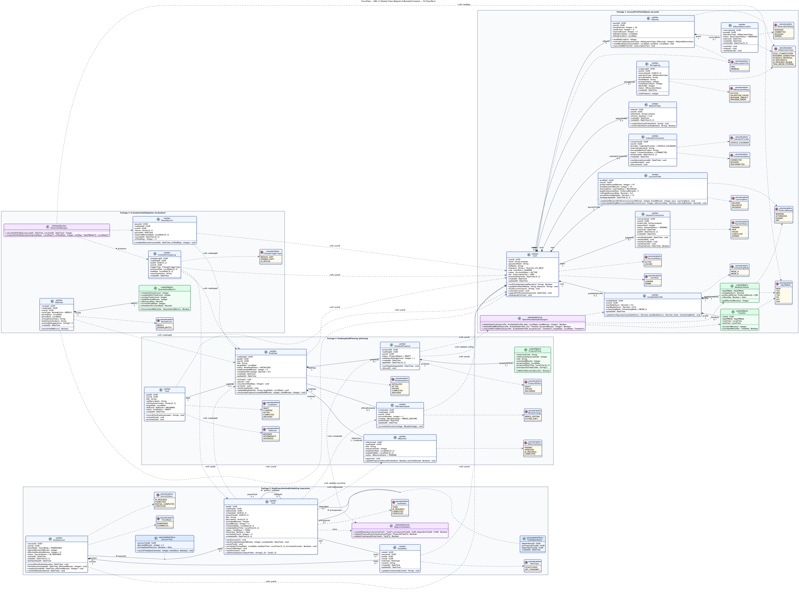

# FocusFlow — Tài liệu Thiết kế Sơ đồ Lớp & Đặc tả Lớp Hệ thống (UML 2.5 Class Diagram & Specifications)

| Thông tin tài liệu | Chi tiết |
|---|---|
| **Dự án** | FocusFlow — Hệ thống hỗ trợ lập kế hoạch và thực thi lộ trình tự học thích ứng tích hợp AI |
| **Cấp độ tài liệu** | Thiết kế Sơ đồ Lớp Hệ thống & Từ điển Đặc tả Lớp (UML 2.5 Class Diagram & Class Specifications) |
| **Phiên bản** | v6.0 — Chuẩn hóa theo OMG UML 2.5.1, IBM Developer (Donald Bell) & DDD (4 Bounded Contexts — 54 Classifiers) |
| **Tiêu chuẩn kỹ thuật** | OMG UML 2.5.1 Superstructure, IBM Developer *The UML 2 Class Diagram* (Donald Bell), Craig Larman (*Applying UML and Patterns*), Eric Evans (*Domain-Driven Design*), Vaughn Vernon (*Implementing Domain-Driven Design*) |
| **Tài liệu nguồn đối chiếu** | • Đặc tả Yêu cầu Phần mềm (SRS): [`../srs/srs-v1.0.md`](../srs/srs-v1.0.md)<br>• Đặc tả Ca sử dụng Chi tiết (25 UCs): [`use-case-specifications.md`](use-case-specifications.md)<br>• Sơ đồ Lớp PlantUML: [`class-diagrams/class-diagram.puml`](class-diagrams/class-diagram.puml)<br>• Sơ đồ Lớp Draw.io: [`class-diagrams/class_diagram.drawio`](class-diagrams/class_diagram.drawio)<br>• Lược đồ CSDL Vật lý: [`../database/schema.sql`](../database/schema.sql) \| [`../database/schema.dbml`](../database/schema.dbml) |

---

## MỤC LỤC

1. [Phạm vi, Góc nhìn & Giả định Thiết kế (Scope, Perspective & Design Assumptions)](#1-phạm-vi-góc-nhìn--giả-định-thiết-kế-scope-perspective--design-assumptions)
2. [Danh sách Tổng hợp 54 Classifiers (Complete Classifier Inventory)](#2-danh-sách-tổng-hợp-54-classifiers-complete-classifier-inventory)
3. [Sơ đồ Lớp Hệ thống Chuẩn UML 2.5 (UML 2.5 Class Diagram)](#3-sơ-đồ-lớp-hệ-thống-chuẩn-uml-25-uml-25-class-diagram)
   - [3.1. Bản vẽ Sơ đồ Lớp Chuẩn UML 2.5 (PlantUML & PNG)](#31-bản-vẽ-sơ-đồ-lớp-chuẩn-uml-25-plantuml--png)
   - [3.2. Sơ đồ Xem nhanh trên Markdown (Mermaid Class Diagram)](#32-sơ-đồ-xem-nhanh-trên-markdown-mermaid-class-diagram)
4. [Phân tích & Giải thích Quan hệ Chuẩn Lý thuyết UML 2.5 (Relationship Semantics & Matrix)](#4-phân-tích--giải-thích-quan-hệ-chuẩn-lý-thuyết-uml-25-relationship-semantics--matrix)
   - [4.1. Biện luận Học thuật việc Lựa chọn Ký hiệu Quan hệ & Ranh giới Bounded Context](#41-biện-luận-học-thuật-việc-lựa-chọn-ký-hiệu-quan-hệ--ranh-giới-bounded-context)
   - [4.2. Bảng Ma trận Tổng hợp các Quan hệ Cấu trúc và Tham chiếu Xuyên Ngữ cảnh](#42-bảng-ma-trận-tổng-hợp-các-quan-hệ-cấu-trúc-và-tham-chiếu-xuyên-ngữ-cảnh)
5. [Bảng Đặc tả Lớp Chi tiết (Detailed Class Specifications / Data Dictionary)](#5-bảng-đặc-tả-lớp-chi-tiết-detailed-class-specifications--data-dictionary)
   - [5.1. Package 1: AccountProfileAndQuota (`account` — 9 Entities, 2 ValueObjects, 1 DomainService)](#51-package-1-accountprofileandquota-account--9-entities-2-valueobjects-1-domainservice)
   - [5.2. Package 2: RoadmapAndPlanning (`planning` — 5 Entities, 1 ValueObject)](#52-package-2-roadmapandplanning-planning--5-entities-1-valueobject)
   - [5.3. Package 3: StudyExecutionAndScheduling (`execution` — 3 Entities, 2 AssociationClasses, 1 DomainService)](#53-package-3-studyexecutionandscheduling-execution--3-entities-2-associationclasses-1-domainservice)
   - [5.4. Package 4: EvaluationAndAdaptation (`evaluation` — 3 Entities, 1 ValueObject, 1 DomainService)](#54-package-4-evaluationandadaptation-evaluation--3-entities-1-valueobject-1-domainservice)
   - [5.5. Đặc tả 25 Kiểu Liệt kê (`<<enumeration>>`)](#55-đặc-tả-25-kiểu-liệt-kê-enumeration)
6. [Ma trận Truy vết & Đối chiếu Lược đồ Vật lý (`schema.sql` Synchronization)](#6-ma-trận-truy-vết--đối-chiếu-lược-đồ-vật-lý-schemasql-synchronization)
   - [6.1. Ma trận Truy vết 25 Use Cases (`UC-01`..`UC-25`) & Business Rules ↔ Domain Classes](#61-ma-trận-truy-vết-25-use-cases-uc-01uc-25--business-rules--domain-classes)
   - [6.2. Ghi chú Phân tách Mô hình Miền (Domain Model) và Lược đồ Vật lý (`schema.sql`)](#62-ghi-chú-phân-tách-mô-hình-miền-domain-model-và-lược-đồ-vật-lý-schemasql)

---

## 1. Phạm vi, Góc nhìn & Giả định Thiết kế (Scope, Perspective & Design Assumptions)

1. **Góc nhìn mô hình hóa (Rich Domain Class Diagram + Pure Domain Services)**:
   - Biểu đồ được thiết kế theo góc nhìn **Mô hình Miền Nghiệp vụ Giàu Hành vi (Rich Domain Model)** kết hợp **Dịch vụ Miền Thuần khiết (`<<domainService>>`)** theo nguyên lý **GRASP (High Cohesion, Information Expert)** và **Domain-Driven Design (Eric Evans & Vaughn Vernon)**.
   - Toàn bộ hệ thống được tổ chức thành **04 Gói Ngữ cảnh Giới hạn (Bounded Context Packages: `account`, `planning`, `execution`, `evaluation`)**, bao gồm **54 Classifiers** (20 Lớp Thực thể `<<entity>>`, 2 Lớp Liên kết `<<associationClass>>`, 4 Đối tượng Giá trị `<<valueObject>>`, 3 Dịch vụ Miền `<<domainService>>`, và 25 Kiểu Liệt kê `<<enumeration>>`).
   - **Tách bạch Mô hình Miền và Hạ tầng Truyền tin (Loại bỏ `OutboxEvent` và `ProcessedEvent` khỏi Sơ đồ Lớp Miền)**: Hai bảng `outbox_events` và `processed_events` là các bảng lưu trữ phục vụ mẫu kỹ thuật hạ tầng *Transactional Outbox* và *Idempotent Consumer* (xem `ADR-004`), thuộc về **Sơ đồ Thực thể Kết hợp Vật lý (Physical ERD — `docs/database/schema.sql`)**, không phải khái niệm miền nghiệp vụ học tập. Do đó, chúng được loại bỏ khỏi Sơ đồ Lớp Miền để bảo đảm tính thuần khiết của tầng Domain.

2. **Tuân thủ Tuyệt đối Ranh giới Bounded Context (`ADR-001`, `ADR-007 §3.2` & Quy tắc Aggregate của Vaughn Vernon)**:
   - **Không liên kết đối tượng trực tiếp xuyên ngữ cảnh (No Cross-Context Object Associations / Compositions)**:
     - Mọi đường liên kết UML nét liền (Association `--`, `-->`, Aggregation `o--`, Composition `*--`) chỉ được phép thiết lập **bên trong cùng một gói Bounded Context**.
     - Giữa các gói Bounded Context khác nhau, các Aggregate tham chiếu lẫn nhau **chỉ thông qua thuộc tính định danh (`userId : UUID`, `roadmapId : UUID`, `milestoneId : UUID`, `scheduleId : UUID [0..1]`)** và được biểu diễn trên sơ đồ bằng **mũi tên phụ thuộc nét đứt gắn stereotype `<<ref>>` (`..> : <<ref>>`)**.
   - **Không ghi đè trực tiếp bảng chéo ngữ cảnh (No Cross-Context Direct Table Writes)**:
     - Mỗi bảng và thực thể miền chỉ do Bounded Context sở hữu nó trực tiếp thay đổi trạng thái. Khi một nghiệp vụ cần phối hợp trạng thái liên ngữ cảnh — ví dụ khi khôi phục lộ trình (`Roadmap.resume` trong `planning` / `PauseRecord.completeResume` và `DominoShiftEngine` trong `evaluation`) cần lùi ngày học `Task.scheduledDate` trong `execution` — tầng Application Orchestration sẽ gọi qua cổng lệnh ứng dụng (Application Command Port) hoặc phát sự kiện miền để ngữ cảnh `execution` tự thực thi cập nhật trên `Task` và ngữ cảnh `evaluation` ghi `ScheduleChangeLog`.

3. **Phân định Trách nhiệm Rõ ràng giữa Entity và 03 Pure Domain Services (`<<domainService>>`)**:
   - Để tránh trùng lặp trách nhiệm giữa Entity và Domain Service, các phương thức trên Entity chỉ kiểm soát bất biến nội bộ của chính Aggregate đó, còn các thuật toán phối hợp nhiều đối tượng được đặt duy nhất tại 3 Pure Domain Services không trạng thái (stateless):
     1. **`HybridAvailabilityRuleEngine`** (`account`): Kiểm tra trần giờ cứng hàng ngày (`validateDailyCeiling`), kiểm tra khung giờ Mode B kèm quy tắc tràn giờ mềm 30 phút (`validateModeBWindow`), và khấu trừ khoảng bận từ lịch ngoài / đa lộ trình (`computeNetFreeWindows`).
     2. **`DagCycleValidator`** (`execution`): Kiểm định đồ thị phụ thuộc nhiệm vụ có hướng không chu trình (`DAG` — `FR-TASK-003`) khi thêm cạnh phụ thuộc mới (`canAddDependency`), kiểm định đề xuất lịch của AI (`validateProposalAcyclicity` trên `ProposedTask[*]`) và kiểm tra thứ tự tô-pô (`validateTopologicalOrder`).
     3. **`DominoShiftEngine`** (`evaluation`): Tính số ngày dịch chuyển khi tạm dừng/khôi phục lộ trình (`calculateShiftedDays`) và tính toán tập ngày học mới bỏ qua ngày nghỉ (`computeShiftedDates`) mà không gọi LLM.

4. **Quy ước Cú pháp & Ký hiệu Chuẩn UML 2.5**:
   - Mọi Classifier trên sơ đồ đều gắn tường minh stereotype chuẩn: `<<entity>>`, `<<valueObject>>`, `<<associationClass>>`, `<<domainService>>`, `<<enumeration>>`.
   - Thuộc tính của `<<entity>>` và `<<associationClass>>` dùng phạm vi `-` (private), thuộc tính của `<<valueObject>>` dùng `+` (public immutable), thao tác nghiệp vụ dùng `+` (public). Không liệt kê các hàm getter/setter thuần kỹ thuật hay các hàm hạ tầng/serialization (như xuất chuỗi `.ics` hay lọc chuỗi regex prompt).

---

## 2. Danh sách Tổng hợp 54 Classifiers (Complete Classifier Inventory)

Mô hình miền của FocusFlow bao gồm **54 Classifiers** thuộc **4 Bounded Context Packages**:
- **20 Lớp Thực thể Miền (`<<entity>>`)**.
- **02 Lớp Liên kết (`<<associationClass>>`)**: `TaskDependency`, `SessionTask`.
- **04 Lớp Đối tượng Giá trị (`<<valueObject>>`)**: `WeeklySchedule`, `TimeSlot`, `ProposedTask`, `QuantitativeMetrics`.
- **03 Lớp Dịch vụ Miền Thuần khiết (`<<domainService>>`)**: `HybridAvailabilityRuleEngine`, `DagCycleValidator`, `DominoShiftEngine`.
- **25 Kiểu Liệt kê (`<<enumeration>>`)**.

| STT | Tên Classifier | Phân loại UML | Package (Bounded Context) | Ánh xạ Bảng / Cấu trúc Vật lý (`schema.sql`) | Mục đích & Trách nhiệm Nghiệp vụ Cốt lõi |
|---|---|---|---|---|---|
| **1** | `User` | `<<entity>>` (Aggregate Root) | Package 1: `account` | Bảng `users` | Đại diện cho tài khoản người dùng (`LEARNER` / `ADMIN`), quản lý xác thực, hồ sơ cá nhân, múi giờ, trạng thái tài khoản (`ACTIVE`/`LOCKED`) và vòng đời gói cước (`FREE`/`PREMIUM`, `premiumExpiresAt`). |
| **2** | `AvailabilityProfile` | `<<entity>>` (Aggregate Root) | Package 1: `account` | Bảng `availabilities` | Quản lý cấu hình quỹ thời gian học tối đa theo ngày/tuần (`maxDailyHours`, `maxWeeklyHours`) và chế độ lập lịch (`MODE_A` / `MODE_B`). |
| **3** | `WeeklySchedule` | `<<valueObject>>` | Package 1: `account` | Cột `availabilities.daily_quotas` | Định nghĩa quỹ giờ học khả dụng, buổi ưu tiên (`preferredPeriod`) và cờ ngày nghỉ (`isRestDay`) cho từng thứ trong tuần (`dayOfWeek`). |
| **4** | `TimeSlot` | `<<valueObject>>` | Package 1: `account` | Bảng `availability_slots` | Đại diện cho một khung giờ rảnh cụ thể trong tuần (`dayOfWeek`, `startTime`, `endTime`), tính thời lượng phút và kiểm tra giao cắt khung giờ. |
| **5** | `HybridAvailabilityRuleEngine` | `<<domainService>>` | Package 1: `account` | Thuật toán miền trên `AvailabilityProfile`, `TimeSlot` | Dịch vụ miền kiểm tra trần giờ cứng hàng ngày (`BUSR-03`), khung giờ Mode B (`BUSR-04`) và tính toán khoảng thời gian rảnh ròng sau khi trừ lịch bận (`BUSR-05`, `BUSR-08`). |
| **6** | `LearnerProfile` | `<<entity>>` (Aggregate Root) | Package 1: `account` | Bảng `learner_profiles` | Hồ sơ thói quen tự học theo mô hình Zimmerman SRL: lưu cấu hình tự khai báo (thời lượng phiên, thời gian nghỉ, nhịp độ) và các chỉ số thực chứng 30 ngày (`rollingAdherenceRate`, `actualVelocityMultiplier`). |
| **7** | `CalendarConnection` | `<<entity>>` (Aggregate Root) | Package 1: `account` | Bảng `calendar_connections` | Quản lý trạng thái kết nối OAuth 2.0 với dịch vụ lịch ngoại vi (`GOOGLE_CALENDAR`), lưu khóa làm mới đã mã hóa (`encryptedRefreshToken`) và thời điểm đồng bộ gần nhất (`UC-16`). |
| **8** | `WebCalToken` | `<<entity>>` (Aggregate Root) | Package 1: `account` | Bảng `webcal_tokens` | Quản lý mã băm bảo mật (`tokenHash`) của liên kết xuất luồng lịch một chiều WebCal chuẩn RFC 5545 (`OS-05`, `UC-17`), tách biệt hoàn toàn với kết nối OAuth. |
| **9** | `AIQuota` | `<<entity>>` (Aggregate Root) | Package 1: `account` | Bảng `ai_quotas` | Quản lý hạn ngạch lượt gọi AI theo chu kỳ thanh toán tháng (`monthlyLimit`, `usedCount`, `reservedCount`) và điều phối giữ chỗ 2 pha (`BUSR-10`). |
| **10** | `AIQuotaReservation` | `<<entity>>` | Package 1: `account` | Bảng `ai_quota_reservations` | Bản ghi giữ chỗ hạn ngạch AI 2 pha (`RESERVED` → `COMMITTED` / `RELEASED` / `EXPIRED`) đảm bảo không trừ oan lượt gọi khi dịch vụ LLM lỗi. |
| **11** | `AIUsageLog` | `<<entity>>` (Aggregate Root) | Package 1: `account` | Bảng `ai_usage_logs` | Nhật ký kiểm toán từng lượt gọi dịch vụ AI (`operationType`, `providerName`, `modelName`, `promptTokens`, `completionTokens`, `latencyMs`, `status : AIExecutionStatus`). |
| **12** | `PaymentTransaction` | `<<entity>>` (Aggregate Root) | Package 1: `account` | Bảng `payment_transactions` | Quản lý giao dịch thanh toán nâng cấp gói `PREMIUM` (`orderCode`, `amountVnd`, `status : PaymentStatus`, `expiresAt`, `paidAt`). |
| **13** | `Goal` | `<<entity>>` (Aggregate Root) | Package 2: `planning` | Bảng `goals` | Mục tiêu tự học của người học, lưu mô tả gốc (`rawDescription`), ngữ cảnh làm rõ với AI (`clarificationContext`), trình độ (`skillLevel`) và ngày mục tiêu (`targetDate`). |
| **14** | `Roadmap` | `<<entity>>` (Aggregate Root) | Package 2: `planning` | Bảng `roadmaps` | Thực thể gốc quản lý vòng đời lộ trình học tập (`INITIALIZED`, `ACTIVE`, `PAUSED`, `COMPLETED`, `ARCHIVED`), tổng thời lượng ước tính và phần trăm hoàn thành. |
| **15** | `Milestone` | `<<entity>>` | Package 2: `planning` | Bảng `milestones` | Cột mốc kiến thức Cấp 1 có thứ tự (`sequenceOrder`) và khung ngày mục tiêu (`targetStartDate`, `targetEndDate`) thuộc một `Roadmap`. |
| **16** | `ScheduleProposal` | `<<entity>>` (Aggregate Root) | Package 2: `planning` | Bảng `schedule_proposals` | Bản đề xuất lịch học dự thảo (`DRAFT`) do AI sinh ra (cho lộ trình mới tại `UC-08` hoặc dời lịch quá hạn tại `UC-21`), chứa danh sách `ProposedTask` chờ kiểm định và phê duyệt (`BUSR-02`). |
| **17** | `ProposedTask` | `<<valueObject>>` | Package 2: `planning` | Phần tử trong `schedule_proposals.proposal_data` | Đối tượng giá trị biểu diễn một nhiệm vụ dự thảo do AI đề xuất (`tempTaskCode`, `estimatedMinutes`, `proposedDate`, `prerequisiteTempCodes`), tự kiểm tra biên thời lượng AI `30..120` phút. |
| **18** | `OfficialSchedule` | `<<entity>>` (Aggregate Root) | Package 2: `planning` | Bảng `official_schedules` | Lịch học chính thức có hiệu lực của một `Roadmap`, quản lý số phiên bản (`versionNumber`) và chiến lược hợp nhất lịch (`strategy : MergeStrategy`). |
| **19** | `Task` | `<<entity>>` (Aggregate Root) | Package 3: `execution` | Bảng `tasks` | Nhiệm vụ học tập Cấp 2 (thời lượng `15..240` phút thủ công, `30..120` phút khi sinh bởi AI), hỗ trợ phân rã thành 2–3 nhiệm vụ con (`parentTaskId`, `splitIntoSubtasks`) và theo dõi số lần dời lịch (`rescheduleCount`). |
| **20** | `TaskDependency` | `<<associationClass>>` | Package 3: `execution` | Bảng `task_dependencies` | Lớp liên kết biểu diễn quan hệ phụ thuộc tiên quyết bắt buộc giữa nhiệm vụ tiên quyết (`prerequisiteTaskId`) và nhiệm vụ phụ thuộc (`dependentTaskId`). |
| **21** | `DagCycleValidator` | `<<domainService>>` | Package 3: `execution` | Thuật toán miền trên `Task`, `TaskDependency`, `ProposedTask` | Dịch vụ miền kiểm định tính chất đồ thị có hướng không chu trình (`DAG`) khi thêm phụ thuộc mới, khi kiểm định `ScheduleProposal` và khi kiểm tra thứ tự tô-pô. |
| **22** | `StudySession` | `<<entity>>` (Aggregate Root) | Package 3: `execution` | Bảng `study_sessions` | Phiên học tập trung với chế độ đồng hồ (`timerMode : TimerMode`), theo dõi tín hiệu `lastHeartbeatAt` và phân định kết quả kết thúc phiên (`COMPLETED`, `PARTIAL_COMPLETED`, `CANCELLED`). |
| **23** | `SessionTask` | `<<associationClass>>` | Package 3: `execution` | Bảng `session_tasks` | Lớp liên kết giữa `StudySession` và `Task`, ghi nhận số phút phân bổ thực học (`allocatedMinutes`) và cờ hoàn thành nhiệm vụ trong phiên (`isCompletedInSession`). |
| **24** | `StudyNote` | `<<entity>>` | Package 3: `execution` | Bảng `study_notes` | Ghi chú học tập được tạo trong phiên học (`SCRATCHPAD` hoặc `KEY_TAKEAWAY`), gắn với `StudySession` và `Task`. |
| **25** | `PauseRecord` | `<<entity>>` (Aggregate Root) | Package 4: `evaluation` | Bảng `pause_records` | Bản ghi lịch sử đóng băng lộ trình (`pausedAt`, `expectedResumeDate`, `resumedAt`, `shiftedDays`) phục vụ khôi phục lộ trình (`UC-20`) và loại trừ ngày tạm dừng khi tính `adherenceRate`. |
| **26** | `AIReview` | `<<entity>>` (Aggregate Root) | Package 4: `evaluation` | Bảng `ai_reviews` | Báo cáo đánh giá định kỳ (`WEEKLY` / `SESSION_BATCH`) kết hợp chỉ số định lượng `QuantitativeMetrics` với nhận xét 3 phần từ LLM (`strengthsSummary`, `bottlenecksAnalysis`, `actionableSuggestions`). |
| **27** | `QuantitativeMetrics` | `<<valueObject>>` | Package 4: `evaluation` | Cột `ai_reviews.quantitative_summary` | Đối tượng giá trị đóng gói các chỉ số định lượng toán học của lộ trình (`scheduledTasksCount`, `completedOnTimeCount`, `overdueTasksCount`, `totalEffectiveMinutes`, `adherenceRate`, `currentStreakDays`, `estimationAccuracyRatio`). |
| **28** | `ScheduleChangeLog` | `<<entity>>` (Aggregate Root) | Package 4: `evaluation` | Bảng `schedule_change_logs` | Thực thể kiểm toán độc lập lưu vết mọi biến động ngày học (`MANUAL_EDIT`, `DOMINO_SHIFT`, `AI_REPLAN`), tồn tại độc lập để bảo toàn lịch sử kiểm toán ngay cả khi nhiệm vụ hoặc lộ trình thay đổi. |
| **29** | `DominoShiftEngine` | `<<domainService>>` | Package 4: `evaluation` | Thuật toán miền trên `PauseRecord`, `ScheduleChangeLog` | Dịch vụ miền tính toán số ngày đóng băng (`calculateShiftedDays`) và tập ngày học mới bỏ qua các ngày nghỉ (`computeShiftedDates`). |
| **30** | `UserRole` | `<<enumeration>>` | Package 1: `account` | `users.role` | Vai trò người dùng: `LEARNER`, `ADMIN`. |
| **31** | `AccountStatus` | `<<enumeration>>` | Package 1: `account` | `users.is_locked` / status | Trạng thái tài khoản: `ACTIVE`, `LOCKED`. |
| **32** | `SubscriptionTier` | `<<enumeration>>` | Package 1: `account` | `users.tier` | Phân tầng gói dịch vụ: `FREE`, `PREMIUM`. |
| **33** | `SchedulingMode` | `<<enumeration>>` | Package 1: `account` | `availabilities.mode` | Chế độ cấu hình quỹ thời gian rảnh: `MODE_A`, `MODE_B`. |
| **34** | `DayOfWeek` | `<<enumeration>>` | Package 1: `account` | `availability_slots.day_of_week` | Thứ trong tuần: `MON`, `TUE`, `WED`, `THU`, `FRI`, `SAT`, `SUN`. |
| **35** | `PreferredPeriod` | `<<enumeration>>` | Package 1: `account` | `availabilities` / `learner_profiles` | Buổi học ưu tiên hoặc khung giờ năng suất cao: `MORNING`, `AFTERNOON`, `EVENING`, `ANY`. |
| **36** | `LearningPace` | `<<enumeration>>` | Package 1: `account` | `learner_profiles` | Nhịp độ học tập tự khai báo: `RELAXED`, `BALANCED`, `INTENSIVE`. |
| **37** | `CalendarProvider` | `<<enumeration>>` | Package 1: `account` | `calendar_connections.provider` | Nhà cung cấp dịch vụ lịch ngoại vi OAuth: `GOOGLE_CALENDAR`. |
| **38** | `ConnectionStatus` | `<<enumeration>>` | Package 1: `account` | `calendar_connections.status` | Trạng thái kết nối OAuth lịch ngoại vi: `CONNECTED`, `REVOKED`, `DISCONNECTED`. |
| **39** | `AIOperationType` | `<<enumeration>>` | Package 1: `account` | `ai_quota_reservations` / `ai_usage_logs` | Loại tác vụ gọi AI: `GOAL_CLARIFICATION`, `ROADMAP_GENERATION`, `SCHEDULE_PROPOSAL`, `AI_RESCHEDULE`, `AI_PROGRESS_REVIEW`, `TASK_MICRO_STEPPING`. |
| **40** | `ReservationStatus` | `<<enumeration>>` | Package 1: `account` | `ai_quota_reservations.status` | Trạng thái giữ chỗ hạn ngạch AI 2 pha: `RESERVED`, `COMMITTED`, `RELEASED`, `EXPIRED`. |
| **41** | `AIExecutionStatus` | `<<enumeration>>` | Package 1: `account` | `ai_usage_logs.status` | Kết quả thực thi lời gọi AI: `SUCCESS`, `VALIDATION_FAILED`, `PROVIDER_TIMEOUT`, `PROVIDER_ERROR`. |
| **42** | `PaymentStatus` | `<<enumeration>>` | Package 1: `account` | `payment_transactions.status` | Trạng thái đơn thanh toán: `PENDING`, `PAID`, `FAILED`, `CANCELLED`, `EXPIRED`. |
| **43** | `SkillLevel` | `<<enumeration>>` | Package 2: `planning` | `goals.skill_level` | Trình độ khởi điểm của người học đối với mục tiêu: `BEGINNER`, `INTERMEDIATE`, `ADVANCED`. |
| **44** | `GoalStatus` | `<<enumeration>>` | Package 2: `planning` | `goals.status` | Trạng thái vòng đời của mục tiêu: `DRAFT`, `CLARIFIED`, `ACTIVE`, `COMPLETED`, `ARCHIVED`. |
| **45** | `RoadmapStatus` | `<<enumeration>>` | Package 2: `planning` | `roadmaps.status` | Trạng thái vòng đời của lộ trình: `INITIALIZED`, `ACTIVE`, `PAUSED`, `COMPLETED`, `ARCHIVED`. |
| **46** | `MilestoneStatus` | `<<enumeration>>` | Package 2: `planning` | `milestones.status` | Trạng thái của cột mốc Cấp 1: `PENDING`, `APPROVED`, `IN_PROGRESS`, `COMPLETED`. |
| **47** | `ProposalStatus` | `<<enumeration>>` | Package 2: `planning` | `schedule_proposals.status` | Trạng thái bản đề xuất lịch: `DRAFT`, `APPLIED`, `DISCARDED`. |
| **48** | `MergeStrategy` | `<<enumeration>>` | Package 2: `planning` | `official_schedules.strategy` | Chiến lược áp dụng lịch chính thức (`OS-03`): `MERGE_EXISTING`, `FUTURE_SHIFT`. |
| **49** | `TaskStatus` | `<<enumeration>>` | Package 3: `execution` | `tasks.status` | Trạng thái thực thi nhiệm vụ: `TODO`, `IN_PROGRESS`, `COMPLETED`, `CANCELLED`. |
| **50** | `TimerMode` | `<<enumeration>>` | Package 3: `execution` | `study_sessions.timer_mode` | Chế độ đồng hồ phiên học (`FR-SESSION-001`): `POMODORO`, `STOPWATCH`. |
| **51** | `SessionStatus` | `<<enumeration>>` | Package 3: `execution` | `study_sessions.status` | Trạng thái phiên học (`OS-01`): `IN_PROGRESS`, `COMPLETED`, `PARTIAL_COMPLETED`, `CANCELLED`. |
| **52** | `NoteType` | `<<enumeration>>` | Package 3: `execution` | `study_notes.note_type` | Phân loại ghi chú trong phiên học (`FR-SESSION-002`): `SCRATCHPAD`, `KEY_TAKEAWAY`. |
| **53** | `ReviewCycle` | `<<enumeration>>` | Package 4: `evaluation` | `ai_reviews.review_cycle` | Chu kỳ kích hoạt đánh giá AI (`FR-REPORT-002`): `WEEKLY`, `SESSION_BATCH`. |
| **54** | `ChangeTriggerType` | `<<enumeration>>` | Package 4: `evaluation` | `schedule_change_logs.trigger_type` | Nguyên nhân kích hoạt thay đổi lịch học: `MANUAL_EDIT`, `DOMINO_SHIFT`, `AI_REPLAN`. |

---

## 3. Sơ đồ Lớp Hệ thống Chuẩn UML 2.5 (UML 2.5 Class Diagram)

### 3.1. Bản vẽ Sơ đồ Lớp Chuẩn UML 2.5 (PlantUML & PNG)

- **Tệp nguồn Draw.io XML chỉnh sửa trực quan**: [`class-diagrams/class_diagram.drawio`](class-diagrams/class_diagram.drawio)
- **Tệp nguồn PlantUML chuẩn**: [`class-diagrams/class-diagram.puml`](class-diagrams/class-diagram.puml)
- **Hình ảnh kết xuất (PNG)**: [`images/FocusFlow_Class_Diagram.png`](images/FocusFlow_Class_Diagram.png)



### 3.2. Sơ đồ Xem nhanh trên Markdown (Mermaid Class Diagram)

> [!NOTE]
> **Lưu ý về Giới hạn Ký hiệu của Mermaid `classDiagram`**:
> Bản vẽ Mermaid dưới đây bao gồm đầy đủ **54 Classifiers (29 lớp/dịch vụ/đối tượng giá trị + 25 kiểu liệt kê)** hoàn toàn tương đương với bản PlantUML tại Mục 3.1. Do Mermaid chưa hỗ trợ cú pháp nối nét đứt vào điểm giữa đường liên kết cho **Association Class** (`TaskDependency`, `SessionTask`), hai lớp này được nối bằng đường chấm `..` kèm nhãn `AssociationClass`. Để xem ký hiệu Association Class và bố cục gói chuẩn OMG UML 2.5.1, vui lòng đối chiếu với tệp PlantUML tại Mục 3.1.

```mermaid
classDiagram
    direction LR

    %% =========================================================================
    %% PACKAGE 1: ACCOUNT, PROFILE, AVAILABILITY & QUOTA (account)
    %% =========================================================================
    class User {
        <<entity>>
        -userId : UUID
        -email : String
        -passwordHash : String
        -fullName : String
        -timezone : String
        -role : UserRole
        -status : AccountStatus
        -tier : SubscriptionTier
        -premiumExpiresAt : DateTime
        -createdAt : DateTime
        -updatedAt : DateTime
        +verifyCredentials(rawPassword : String) Boolean
        +updateProfile(fullName : String, timezone : String) void
        +lockAccount(reason : String) void
        +unlockAccount() void
        +upgradeToPremium(expiresAt : DateTime) void
        +downgradeToFree() void
    }

    class AvailabilityProfile {
        <<entity>>
        -availabilityId : UUID
        -userId : UUID
        -maxDailyHours : Decimal
        -maxWeeklyHours : Decimal
        -schedulingMode : SchedulingMode
        -updatedAt : DateTime
        +updateConfiguration(maxDailyHours : Decimal, maxWeeklyHours : Decimal, mode : SchedulingMode) void
    }

    class WeeklySchedule {
        <<valueObject>>
        +dayOfWeek : DayOfWeek
        +availableHours : Decimal
        +preferredPeriod : PreferredPeriod
        +isRestDay : Boolean
        +getEffectiveMinutes() Integer
    }

    class TimeSlot {
        <<valueObject>>
        +slotId : UUID
        +dayOfWeek : DayOfWeek
        +startTime : LocalTime
        +endTime : LocalTime
        +durationMinutes() Integer
        +overlapsWith(other : TimeSlot) Boolean
    }

    class HybridAvailabilityRuleEngine {
        <<domainService>>
        +validateDailyCeiling(profile : AvailabilityProfile, date : LocalDate, totalMinutes : Integer) Boolean
        +validateModeBWindow(profile : AvailabilityProfile, slot : TimeSlot, durationMinutes : Integer) Boolean
        +computeNetFreeWindows(profile : AvailabilityProfile, busyIntervals : TimeSlot[], targetDate : LocalDate) TimeSlot[]
    }

    class LearnerProfile {
        <<entity>>
        -profileId : UUID
        -userId : UUID
        -preferredSessionMinutes : Integer
        -breakDurationMinutes : Integer
        -learningPace : LearningPace
        -peakProductivitySlots : PreferredPeriod[]
        -rollingAdherenceRate : Decimal
        -actualVelocityMultiplier : Decimal
        -lastAggregatedAt : DateTime
        +updateSelfDeclaredPreferences(sessionMinutes : Integer, breakMinutes : Integer, pace : LearningPace) void
        +recalculateRollingMetrics(completedSessionsCount : Integer, adherenceRate : Decimal, velocityMultiplier : Decimal) void
    }

    class CalendarConnection {
        <<entity>>
        -connectionId : UUID
        -userId : UUID
        -provider : CalendarProvider
        -externalCalendarId : String
        -encryptedRefreshToken : String
        -status : ConnectionStatus
        -lastSyncedAt : DateTime
        -createdAt : DateTime
        +markSynced(syncedAt : DateTime) void
        +markRevoked() void
        +disconnect() void
    }

    class WebCalToken {
        <<entity>>
        -tokenId : UUID
        -userId : UUID
        -tokenHash : String
        -isActive : Boolean
        -createdAt : DateTime
        -rotatedAt : DateTime
        +rotateToken(newTokenHash : String) void
        +verifyTokenHash(candidateHash : String) Boolean
    }

    class AIQuota {
        <<entity>>
        -quotaId : UUID
        -userId : UUID
        -monthlyLimit : Integer
        -usedCount : Integer
        -reservedCount : Integer
        -billingCycleStart : LocalDate
        -billingCycleEnd : LocalDate
        +availableCredits() Integer
        +reserveCredit(operationType : AIOperationType, ttlSeconds : Integer) AIQuotaReservation
        +resetMonthlyCycle(cycleStart : LocalDate, cycleEnd : LocalDate) void
        +syncLimitWithTier(tier : SubscriptionTier) void
    }

    class AIQuotaReservation {
        <<entity>>
        -reservationId : UUID
        -quotaId : UUID
        -operationType : AIOperationType
        -status : ReservationStatus
        -expiresAt : DateTime
        -createdAt : DateTime
        -resolvedAt : DateTime
        +commit() void
        +release() void
        +markExpired() void
    }

    class AIUsageLog {
        <<entity>>
        -usageLogId : UUID
        -userId : UUID
        -reservationId : UUID
        -operationType : AIOperationType
        -providerName : String
        -modelName : String
        -promptTokens : Integer
        -completionTokens : Integer
        -latencyMs : Integer
        -status : AIExecutionStatus
        -createdAt : DateTime
        +totalTokens() Integer
    }

    class PaymentTransaction {
        <<entity>>
        -transactionId : UUID
        -userId : UUID
        -orderCode : String
        -amountVnd : Integer
        -status : PaymentStatus
        -expiresAt : DateTime
        -paidAt : DateTime
        -createdAt : DateTime
        +markPaid(paidAt : DateTime) void
        +markFailed() void
        +markCancelled() void
        +markExpired() void
        +isExpired(now : DateTime) Boolean
    }

    class UserRole {
        <<enumeration>>
        LEARNER
        ADMIN
    }

    class AccountStatus {
        <<enumeration>>
        ACTIVE
        LOCKED
    }

    class SubscriptionTier {
        <<enumeration>>
        FREE
        PREMIUM
    }

    class SchedulingMode {
        <<enumeration>>
        MODE_A
        MODE_B
    }

    class DayOfWeek {
        <<enumeration>>
        MON
        TUE
        WED
        THU
        FRI
        SAT
        SUN
    }

    class PreferredPeriod {
        <<enumeration>>
        MORNING
        AFTERNOON
        EVENING
        ANY
    }

    class LearningPace {
        <<enumeration>>
        RELAXED
        BALANCED
        INTENSIVE
    }

    class CalendarProvider {
        <<enumeration>>
        GOOGLE_CALENDAR
    }

    class ConnectionStatus {
        <<enumeration>>
        CONNECTED
        REVOKED
        DISCONNECTED
    }

    class AIOperationType {
        <<enumeration>>
        GOAL_CLARIFICATION
        ROADMAP_GENERATION
        SCHEDULE_PROPOSAL
        AI_RESCHEDULE
        AI_PROGRESS_REVIEW
        TASK_MICRO_STEPPING
    }

    class ReservationStatus {
        <<enumeration>>
        RESERVED
        COMMITTED
        RELEASED
        EXPIRED
    }

    class AIExecutionStatus {
        <<enumeration>>
        SUCCESS
        VALIDATION_FAILED
        PROVIDER_TIMEOUT
        PROVIDER_ERROR
    }

    class PaymentStatus {
        <<enumeration>>
        PENDING
        PAID
        FAILED
        CANCELLED
        EXPIRED
    }

    %% =========================================================================
    %% PACKAGE 2: ROADMAP & PLANNING (planning)
    %% =========================================================================
    class Goal {
        <<entity>>
        -goalId : UUID
        -userId : UUID
        -title : String
        -rawDescription : String
        -clarificationContext : String
        -targetDate : LocalDate
        -skillLevel : SkillLevel
        -status : GoalStatus
        -createdAt : DateTime
        +recordClarification(answers : String) void
        +activateGoal() void
        +archiveGoal() void
    }

    class Roadmap {
        <<entity>>
        -roadmapId : UUID
        -goalId : UUID
        -userId : UUID
        -title : String
        -targetDate : LocalDate
        -status : RoadmapStatus
        -totalEstimatedMinutes : Integer
        -completionPercentage : Decimal
        -createdAt : DateTime
        -updatedAt : DateTime
        +activate() void
        +pause() void
        +resume(shiftedDays : Integer) void
        +archive() void
        +markCompleted() void
        +updateMetadata(title : String, targetDate : LocalDate) void
        +recalculateProgress(completedMinutes : Integer, totalMinutes : Integer) void
    }

    class Milestone {
        <<entity>>
        -milestoneId : UUID
        -roadmapId : UUID
        -title : String
        -sequenceOrder : Integer
        -targetStartDate : LocalDate
        -targetEndDate : LocalDate
        -status : MilestoneStatus
        +approve() void
        +updateProgressStatus(allTasksDone : Boolean, anyTaskStarted : Boolean) void
    }

    class ScheduleProposal {
        <<entity>>
        -proposalId : UUID
        -roadmapId : UUID
        -userId : UUID
        -status : ProposalStatus
        -validationAttemptCount : Integer
        -createdAt : DateTime
        -appliedAt : DateTime
        +markApplied(appliedAt : DateTime) void
        +discard() void
    }

    class ProposedTask {
        <<valueObject>>
        +tempTaskCode : String
        +milestoneSequenceOrder : Integer
        +title : String
        +estimatedMinutes : Integer
        +proposedDate : LocalDate
        +proposedStartTime : LocalTime
        +prerequisiteTempCodes : String[]
        +isWithinAIDurationBounds() Boolean
    }

    class OfficialSchedule {
        <<entity>>
        -scheduleId : UUID
        -roadmapId : UUID
        -userId : UUID
        -versionNumber : Integer
        -strategy : MergeStrategy
        -publishedAt : DateTime
        -updatedAt : DateTime
        +incrementVersion(strategy : MergeStrategy) void
    }

    class SkillLevel {
        <<enumeration>>
        BEGINNER
        INTERMEDIATE
        ADVANCED
    }

    class GoalStatus {
        <<enumeration>>
        DRAFT
        CLARIFIED
        ACTIVE
        COMPLETED
        ARCHIVED
    }

    class RoadmapStatus {
        <<enumeration>>
        INITIALIZED
        ACTIVE
        PAUSED
        COMPLETED
        ARCHIVED
    }

    class MilestoneStatus {
        <<enumeration>>
        PENDING
        APPROVED
        IN_PROGRESS
        COMPLETED
    }

    class ProposalStatus {
        <<enumeration>>
        DRAFT
        APPLIED
        DISCARDED
    }

    class MergeStrategy {
        <<enumeration>>
        MERGE_EXISTING
        FUTURE_SHIFT
    }

    %% =========================================================================
    %% PACKAGE 3: STUDY EXECUTION & SCHEDULING (execution)
    %% =========================================================================
    class Task {
        <<entity>>
        -taskId : UUID
        -roadmapId : UUID
        -milestoneId : UUID
        -scheduleId : UUID
        -parentTaskId : UUID
        -title : String
        -description : String
        -estimatedMinutes : Integer
        -actualMinutes : Integer
        -scheduledDate : LocalDate
        -scheduledStartTime : LocalTime
        -status : TaskStatus
        -isOverdue : Boolean
        -rescheduleCount : Integer
        -completedAt : DateTime
        +startExecution() void
        +markCompleted(spentMinutes : Integer, completedAt : DateTime) void
        +cancelTask() void
        +rescheduleTo(newDate : LocalDate, newStartTime : LocalTime, incrementCounter : Boolean) void
        +moveToBacklog() void
        +markOverdue() void
        +splitIntoSubtasks(subtaskTitles : String[]) Task[]
    }

    class TaskDependency {
        <<associationClass>>
        -dependencyId : UUID
        -prerequisiteTaskId : UUID
        -dependentTaskId : UUID
        -createdAt : DateTime
    }

    class DagCycleValidator {
        <<domainService>>
        +canAddDependency(existingTasks : Task[], prerequisiteTaskId : UUID, dependentTaskId : UUID) Boolean
        +validateProposalAcyclicity(proposedTasks : ProposedTask[]) Boolean
        +validateTopologicalOrder(tasks : Task[]) Boolean
    }

    class StudySession {
        <<entity>>
        -sessionId : UUID
        -userId : UUID
        -timerMode : TimerMode
        -plannedDurationMinutes : Integer
        -effectiveDurationMinutes : Integer
        -status : SessionStatus
        -startedAt : DateTime
        -endedAt : DateTime
        -lastHeartbeatAt : DateTime
        +recordHeartbeat(timestamp : DateTime) void
        +finishSession(endedAt : DateTime, effectiveMinutes : Integer) void
        +stopEarly(endedAt : DateTime, effectiveMinutes : Integer) void
        +resolveAbandoned(now : DateTime) void
    }

    class SessionTask {
        <<associationClass>>
        -sessionTaskId : UUID
        -allocatedMinutes : Integer
        -isCompletedInSession : Boolean
        +recordTimeSpent(minutes : Integer, markDone : Boolean) void
    }

    class StudyNote {
        <<entity>>
        -noteId : UUID
        -sessionId : UUID
        -taskId : UUID
        -userId : UUID
        -noteType : NoteType
        -content : String
        -createdAt : DateTime
        -updatedAt : DateTime
        +updateContent(newContent : String) void
    }

    class TaskStatus {
        <<enumeration>>
        TODO
        IN_PROGRESS
        COMPLETED
        CANCELLED
    }

    class TimerMode {
        <<enumeration>>
        POMODORO
        STOPWATCH
    }

    class SessionStatus {
        <<enumeration>>
        IN_PROGRESS
        COMPLETED
        PARTIAL_COMPLETED
        CANCELLED
    }

    class NoteType {
        <<enumeration>>
        SCRATCHPAD
        KEY_TAKEAWAY
    }

    %% =========================================================================
    %% PACKAGE 4: EVALUATION & ADAPTATION (evaluation)
    %% =========================================================================
    class PauseRecord {
        <<entity>>
        -pauseId : UUID
        -roadmapId : UUID
        -userId : UUID
        -reason : String
        -pausedAt : DateTime
        -expectedResumeDate : LocalDate
        -resumedAt : DateTime
        -shiftedDays : Integer
        +completeResume(resumedAt : DateTime, shiftedDays : Integer) void
    }

    class AIReview {
        <<entity>>
        -reviewId : UUID
        -roadmapId : UUID
        -userId : UUID
        -cycleType : ReviewCycle
        -periodStart : LocalDate
        -periodEnd : LocalDate
        -strengthsSummary : String
        -bottlenecksAnalysis : String
        -actionableSuggestions : String[]
        -createdAt : DateTime
        +hasVerifiedMetrics() Boolean
    }

    class QuantitativeMetrics {
        <<valueObject>>
        +scheduledTasksCount : Integer
        +completedOnTimeCount : Integer
        +overdueTasksCount : Integer
        +totalEffectiveMinutes : Integer
        +adherenceRate : Decimal
        +currentStreakDays : Integer
        +estimationAccuracyRatio : Decimal
        +isConsistentWith(other : QuantitativeMetrics) Boolean
    }

    class ScheduleChangeLog {
        <<entity>>
        -changeLogId : UUID
        -roadmapId : UUID
        -taskId : UUID
        -userId : UUID
        -triggerType : ChangeTriggerType
        -previousDate : LocalDate
        -newDate : LocalDate
        -reasonSummary : String
        -createdAt : DateTime
    }

    class DominoShiftEngine {
        <<domainService>>
        +calculateShiftedDays(pausedAt : DateTime, resumedAt : DateTime) Integer
        +computeShiftedDates(pendingTaskDates : LocalDate[], shiftedDays : Integer, restDays : DayOfWeek[]) LocalDate[]
    }

    class ReviewCycle {
        <<enumeration>>
        WEEKLY
        SESSION_BATCH
    }

    class ChangeTriggerType {
        <<enumeration>>
        MANUAL_EDIT
        DOMINO_SHIFT
        AI_REPLAN
    }

    %% =========================================================================
    %% INTRA-PACKAGE COMPOSITIONS & ASSOCIATIONS
    %% =========================================================================
    User "1" *-- "0..1" AvailabilityProfile : availabilityProfile
    User "1" *-- "1" LearnerProfile : learnerProfile
    User "1" *-- "1" AIQuota : aiQuota
    User "1" *-- "0..1" CalendarConnection : calendarConnection
    User "1" *-- "0..1" WebCalToken : webCalToken
    User "1" -- "0..*" AIUsageLog : aiUsageLogs
    User "1" -- "0..*" PaymentTransaction : payments
    AIQuota "1" *-- "0..*" AIQuotaReservation : reservations
    AvailabilityProfile "1" *-- "7" WeeklySchedule : weeklySchedules
    AvailabilityProfile "1" *-- "0..*" TimeSlot : timeSlots

    Goal "1" -- "0..1" Roadmap : roadmap
    Roadmap "1" *-- "1..*" Milestone : milestones
    Roadmap "1" -- "0..1" OfficialSchedule : officialSchedule
    Roadmap "1" *-- "0..*" ScheduleProposal : proposals
    ScheduleProposal "1" *-- "1..*" ProposedTask : proposedTasks

    Task "0..1" -- "0..*" Task : parentTask / subTasks
    Task "0..*" -- "0..*" Task : prerequisites
    Task .. TaskDependency : AssociationClass
    StudySession "0..*" -- "1..*" Task : executes
    StudySession .. SessionTask : AssociationClass
    SessionTask .. Task : AssociationClass
    StudySession "1" *-- "0..*" StudyNote : notes
    Task "1" -- "0..*" StudyNote : notes

    AIReview "1" *-- "1" QuantitativeMetrics : metrics

    %% =========================================================================
    %% INTRA-PACKAGE ENUM & SERVICE DEPENDENCIES
    %% =========================================================================
    User ..> UserRole
    User ..> AccountStatus
    User ..> SubscriptionTier
    AvailabilityProfile ..> SchedulingMode
    WeeklySchedule ..> DayOfWeek
    WeeklySchedule ..> PreferredPeriod
    TimeSlot ..> DayOfWeek
    HybridAvailabilityRuleEngine ..> AvailabilityProfile
    HybridAvailabilityRuleEngine ..> WeeklySchedule
    HybridAvailabilityRuleEngine ..> TimeSlot
    LearnerProfile ..> LearningPace
    LearnerProfile ..> PreferredPeriod
    CalendarConnection ..> CalendarProvider
    CalendarConnection ..> ConnectionStatus
    AIQuota ..> AIOperationType
    AIQuota ..> SubscriptionTier
    AIQuotaReservation ..> AIOperationType
    AIQuotaReservation ..> ReservationStatus
    AIUsageLog ..> AIOperationType
    AIUsageLog ..> AIExecutionStatus
    PaymentTransaction ..> PaymentStatus

    Goal ..> SkillLevel
    Goal ..> GoalStatus
    Roadmap ..> RoadmapStatus
    Milestone ..> MilestoneStatus
    ScheduleProposal ..> ProposalStatus
    OfficialSchedule ..> MergeStrategy

    Task ..> TaskStatus
    Task ..> DagCycleValidator : uses
    StudySession ..> TimerMode
    StudySession ..> SessionStatus
    StudyNote ..> NoteType

    AIReview ..> ReviewCycle
    ScheduleChangeLog ..> ChangeTriggerType
    DominoShiftEngine ..> PauseRecord
    DominoShiftEngine ..> ScheduleChangeLog : produces

    %% =========================================================================
    %% CROSS-PACKAGE IDENTITY REFERENCES (<<ref>>)
    %% =========================================================================
    Goal ..> User : ref userId
    Roadmap ..> User : ref userId
    ScheduleProposal ..> User : ref userId
    OfficialSchedule ..> User : ref userId

    Task ..> Roadmap : ref roadmapId
    Task ..> Milestone : ref milestoneId
    Task ..> OfficialSchedule : ref scheduleId
    StudySession ..> User : ref userId
    StudyNote ..> User : ref userId

    PauseRecord ..> Roadmap : ref roadmapId
    PauseRecord ..> User : ref userId
    AIReview ..> Roadmap : ref roadmapId
    AIReview ..> User : ref userId
    ScheduleChangeLog ..> Roadmap : ref roadmapId
    ScheduleChangeLog ..> Task : ref taskId
    ScheduleChangeLog ..> User : ref userId

    ScheduleProposal ..> HybridAvailabilityRuleEngine : ref validates ceiling
    ScheduleProposal ..> DagCycleValidator : ref validates acyclicity
    DominoShiftEngine ..> DayOfWeek : ref restDays
```

---

## 4. Phân tích & Giải thích Quan hệ Chuẩn Lý thuyết UML 2.5 (Relationship Semantics & Matrix)

### 4.1. Biện luận Học thuật việc Lựa chọn Ký hiệu Quan hệ & Ranh giới Bounded Context

Theo chuẩn **OMG UML 2.5.1 Superstructure**, hướng dẫn của **IBM Developer (Donald Bell)** và **Quy tắc Thiết kế Aggregate của Vaughn Vernon (*Implementing DDD*)**, các mối quan hệ trong FocusFlow được chuẩn hóa theo 5 nguyên tắc cốt lõi:

1. **Tách biệt Liên kết Nội gói (Intra-Context Association/Composition) và Tham chiếu Xuyên gói (`<<ref>>` Dependency)**:
   - Theo `ADR-001` (Context-First Modular Monolith) và `ADR-007 §3.2` (Logical Foreign Keys Across Bounded Contexts), các lớp thuộc hai Bounded Context khác nhau không bao giờ giữ tham chiếu đối tượng trực tiếp (không dùng ORM `relationship()` xuyên gói và không vẽ đường Association/Composition xuyên gói).
   - Thay vào đó, các Aggregate ở gói khác tham chiếu thông qua **thuộc tính định danh (`userId`, `roadmapId`, `milestoneId`, `scheduleId`)** kèm mũi tên phụ thuộc nét đứt `..> : <<ref>>`. Cách mô hình hóa này giúp mỗi Bounded Context có thể kiểm thử độc lập và ngăn chặn hiệu ứng tải đồ thị đối tượng dây chuyền.

2. **Chuẩn hóa Composition (`*--`) và Association (`--`) theo đúng Vòng đời Thực thể**:
   - **Composition (`*--` Hình thoi đặc)** chỉ dùng cho các thành phần con nằm trong cùng Bounded Context và có vòng đời phụ thuộc hoàn toàn vào Aggregate Root:
     - Trong `account`: `User "1" *-- "1" LearnerProfile` (bản số bắt buộc `1` vì ngay khi đăng ký tại `UC-01`, người học luôn được khởi tạo hồ sơ SRL), `User "1" *-- "1" AIQuota`, `User "1" *-- "0..1" AvailabilityProfile`, `User "1" *-- "0..1" CalendarConnection`, `User "1" *-- "0..1" WebCalToken`; `AvailabilityProfile "1" *-- "7" WeeklySchedule` và `AvailabilityProfile "1" *-- "0..*" TimeSlot`; `AIQuota "1" *-- "0..*" AIQuotaReservation`.
     - Trong `planning`: `Roadmap "1" *-- "1..* {ordered}" Milestone`, `Roadmap "1" *-- "0..*" ScheduleProposal`, `ScheduleProposal "1" *-- "1..*" ProposedTask`.
     - Trong `execution`: `StudySession "1" *-- "0..*" StudyNote` (mọi ghi chú `SCRATCHPAD` và `KEY_TAKEAWAY` đều được tạo trong khuôn khổ một phiên học tập trung theo `FR-SESSION-002`).
     - Trong `evaluation`: `AIReview "1" *-- "1" QuantitativeMetrics`.
   - **Loại bỏ Composition sai trên `ScheduleChangeLog` và `PauseRecord`, loại bỏ Shared Aggregation (`o--`) trên `OfficialSchedule`**:
     - `ScheduleChangeLog` và `PauseRecord` thuộc gói `evaluation` là các Aggregate Root kiểm toán độc lập tham chiếu `Roadmap` qua `roadmapId : UUID` (`..> : <<ref>>`). Chúng không dùng Composition `*--` dưới `Roadmap` vì dữ liệu nhật ký kiểm toán cần bảo toàn độc lập và thuộc về ngữ cảnh `evaluation`.
     - Giữa `OfficialSchedule` (`planning`) và `Task` (`execution`), thay vì dùng ký hiệu Shared Aggregation (`o--`) mơ hồ xuyên gói, `Task` giữ thuộc tính `scheduleId : UUID [0..1]` (`..> : <<ref>> OfficialSchedule`): khi `Task` được đưa vào lịch chính thức thì `scheduleId` và `scheduledDate` khác `null`; khi `Task` bị đẩy về Backlog thì `scheduleId = null` và `scheduledDate = null`.
   - **Quan hệ `Goal "1" -- "0..1" Roadmap`**:
     - Theo quy tắc vòng đời lộ trình trong SRS, mỗi mục tiêu (`Goal`) được khởi tạo và phân rã thành tối đa một lộ trình (`Roadmap`). Khi người học muốn học mục tiêu nâng cao mới, họ tạo một `Goal` mới. Do đó bản số chính xác là `1` — `0..1`.

3. **Hai Lớp Liên kết Chuẩn UML 2.5 (`<<associationClass>>`: `TaskDependency` và `SessionTask`)**:
   - **`(Task, Task) .. TaskDependency`**: Mối quan hệ tiên quyết nhiều–nhiều giữa các `Task` trong cùng một lộ trình (`Task "prerequisite 0..*" -- "dependent 0..*" Task`) sinh ra thông tin của chính cạnh phụ thuộc (`dependencyId`, `prerequisiteTaskId`, `dependentTaskId`, `createdAt`), được mô hình hóa bằng lớp liên kết `TaskDependency`.
   - **`(StudySession, Task) .. SessionTask`**: Một phiên học thực thi `1..*` nhiệm vụ, và một nhiệm vụ có thể được thực hiện qua `0..*` phiên học. Thời lượng phân bổ trong phiên (`allocatedMinutes`) và cờ hoàn thành trong phiên (`isCompletedInSession`) thuộc về cặp `(StudySession, Task)`, được biểu diễn bằng lớp liên kết `SessionTask`.

4. **Phân cấp Nhiệm vụ Cha – Con (`Task "parentTask 0..1" -- "subTasks 0..*" Task`)**:
   - Để hỗ trợ tính năng chia nhỏ nhiệm vụ bị đình trệ (`rescheduleCount >= 3` — AI Micro-Stepping theo `FR-ADAPT-003`), lớp `Task` có mối liên kết tự tham chiếu `0..1` — `0..*` cùng thuộc tính `parentTaskId : UUID [0..1]` và hành vi `splitIntoSubtasks(subtaskTitles : String[2..3]) : Task[2..3]`.

### 4.2. Bảng Ma trận Tổng hợp các Quan hệ Cấu trúc và Tham chiếu Xuyên Ngữ cảnh

| STT | Lớp Nguồn (Source) | Role & Bản số Nguồn | Ký hiệu UML | Role & Bản số Đích | Lớp Đích (Target) | Phạm vi & Loại Quan hệ UML 2.5 | Giải thích Nghiệp vụ & Ràng buộc Toàn vẹn |
|---|---|---|---|---|---|---|---|
| **1** | `User` | `user` (`1`) | `*--` | `availabilityProfile` (`0..1`) | `AvailabilityProfile` | Nội gói `account` — Composition | Mỗi người học thiết lập tối đa 1 hồ sơ thời gian rảnh (`UC-03`). |
| **2** | `User` | `user` (`1`) | `*--` | `learnerProfile` (`1`) | `LearnerProfile` | Nội gói `account` — Composition | Mỗi người học luôn có đúng 1 hồ sơ thói quen SRL được tạo ngay khi đăng ký (`UC-01`). |
| **3** | `User` | `user` (`1`) | `*--` | `aiQuota` (`1`) | `AIQuota` | Nội gói `account` — Composition | Mỗi người học có đúng 1 sổ cái hạn ngạch AI theo chu kỳ tháng (`UC-01`). |
| **4** | `User` | `user` (`1`) | `*--` | `calendarConnection` (`0..1`) | `CalendarConnection` | Nội gói `account` — Composition | Thông tin kết nối OAuth 2.0 với Google Calendar (`UC-16`), tách riêng khỏi WebCal. |
| **5** | `User` | `user` (`1`) | `*--` | `webCalToken` (`0..1`) | `WebCalToken` | Nội gói `account` — Composition | Mã băm SHA-256 của đường dẫn đăng ký lịch WebCal một chiều (`UC-17`, `OS-05`). |
| **6** | `User` | `user` (`1`) | `--` | `aiUsageLogs` (`0..*`) | `AIUsageLog` | Nội gói `account` — Association | Nhật ký kiểm toán các lượt gọi dịch vụ AI của người dùng (`UC-25`). |
| **7** | `User` | `payer` (`1`) | `--` | `payments` (`0..*`) | `PaymentTransaction` | Nội gói `account` — Association | Lịch sử các đơn hàng thanh toán nâng cấp gói `PREMIUM` (`UC-04`, `UC-05`, `UC-24`). |
| **8** | `AIQuota` | `quota` (`1`) | `*--` | `reservations` (`0..*`) | `AIQuotaReservation` | Nội gói `account` — Composition | Một hạn ngạch AI quản lý danh sách các phiên giữ chỗ 2 pha (`UC-06`, `BUSR-10`). |
| **9** | `AvailabilityProfile` | `profile` (`1`) | `*--` | `weeklySchedules` (`7`) | `WeeklySchedule` | Nội gói `account` — Composition | Cấu hình quỹ giờ và buổi học ưu tiên cho 7 ngày trong tuần (`MON`..`SUN`). |
| **10** | `AvailabilityProfile` | `profile` (`1`) | `*--` | `timeSlots` (`0..*`) | `TimeSlot` | Nội gói `account` — Composition | Danh sách các khung giờ rảnh cụ thể trong tuần khi sử dụng `MODE_B`. |
| **11** | `Goal` | `goal` (`1`) | `--` | `roadmap` (`0..1`) | `Roadmap` | Nội gói `planning` — Association | Mỗi mục tiêu học tập gắn với tối đa 1 lộ trình học tập (`UC-07`, `UC-09`). |
| **12** | `Roadmap` | `roadmap` (`1`) | `*--` | `milestones` (`1..* {ordered}`) | `Milestone` | Nội gói `planning` — Composition | Lộ trình bao gồm các cột mốc sắp xếp theo `sequenceOrder` (`3..7` mốc khi tạo bằng AI). |
| **13** | `Roadmap` | `roadmap` (`1`) | `--` | `officialSchedule` (`0..1`) | `OfficialSchedule` | Nội gói `planning` — Association | Lộ trình có tối đa 1 lịch học chính thức đang có hiệu lực (`UC-08`, `UC-09`). |
| **14** | `Roadmap` | `roadmap` (`1`) | `*--` | `proposals` (`0..*`) | `ScheduleProposal` | Nội gói `planning` — Composition | Lộ trình lưu các bản đề xuất lịch do AI sinh ra tại `UC-08` và `UC-21` (`BUSR-02`). |
| **15** | `ScheduleProposal` | `proposal` (`1`) | `*--` | `proposedTasks` (`1..*`) | `ProposedTask` | Nội gói `planning` — Composition | Bản đề xuất lịch đóng gói danh sách các nhiệm vụ dự thảo (`ProposedTask`). |
| **16** | `Task` | `parentTask` (`0..1`) | `--` | `subTasks` (`0..*`) | `Task` | Nội gói `execution` — Self-Association | Một nhiệm vụ bị đình trệ có thể được chia nhỏ thành 2–3 nhiệm vụ con (`FR-ADAPT-003`). |
| **17** | `Task` | `prerequisite` (`0..*`) | `--` | `dependent` (`0..*`) | `Task` | Nội gói `execution` — Self-Association | Quan hệ phụ thuộc tiên quyết có hướng không chu trình (`DAG`) giữa các nhiệm vụ. |
| **18** | `(Task, Task)` | — | `..` | — | `TaskDependency` | Nội gói `execution` — Association Class | Lớp liên kết lưu định danh cạnh phụ thuộc (`prerequisiteTaskId`, `dependentTaskId`). |
| **19** | `StudySession` | `sessions` (`0..*`) | `--` | `tasks` (`1..*`) | `Task` | Nội gói `execution` — Many-to-Many | Mỗi phiên học thực thi ít nhất 1 nhiệm vụ; một nhiệm vụ có thể học qua nhiều phiên. |
| **20** | `(StudySession, Task)` | — | `..` | — | `SessionTask` | Nội gói `execution` — Association Class | Lớp liên kết ghi nhận `allocatedMinutes` và `isCompletedInSession` của từng nhiệm vụ trong phiên. |
| **21** | `StudySession` | `session` (`1`) | `*--` | `notes` (`0..*`) | `StudyNote` | Nội gói `execution` — Composition | Phiên học sở hữu các ghi chú `SCRATCHPAD` và `KEY_TAKEAWAY` tạo ra trong phiên (`UC-14`). |
| **22** | `Task` | `task` (`1`) | `--` | `notes` (`0..*`) | `StudyNote` | Nội gói `execution` — Association | Mỗi ghi chú trong phiên học gắn với một nhiệm vụ cụ thể đang được thực thi. |
| **23** | `AIReview` | `review` (`1`) | `*--` | `metrics` (`1`) | `QuantitativeMetrics` | Nội gói `evaluation` — Composition | Báo cáo đánh giá AI đóng gói bộ chỉ số định lượng toán học đã xác thực (`BUSR-12`). |
| **24** | `Goal`, `Roadmap`, `ScheduleProposal`, `OfficialSchedule` | — | `..>` | `<<ref>> userId` | `User` | Xuyên gói `planning` → `account` | Tham chiếu định danh người học sở hữu mục tiêu, lộ trình, đề xuất và lịch chính thức. |
| **25** | `Task` | — | `..>` | `<<ref>> roadmapId, milestoneId, scheduleId` | `Roadmap`, `Milestone`, `OfficialSchedule` | Xuyên gói `execution` → `planning` | Tham chiếu định danh lộ trình, cột mốc và lịch chính thức mà nhiệm vụ thuộc về. |
| **26** | `StudySession`, `StudyNote` | — | `..>` | `<<ref>> userId` | `User` | Xuyên gói `execution` → `account` | Tham chiếu định danh người học thực hiện phiên học và ghi chú. |
| **27** | `PauseRecord`, `AIReview`, `ScheduleChangeLog` | — | `..>` | `<<ref>> roadmapId, userId` | `Roadmap`, `User` | Xuyên gói `evaluation` → `planning`, `account` | Tham chiếu định danh lộ trình và người học trên bản ghi tạm dừng, báo cáo AI và nhật ký lịch. |
| **28** | `ScheduleChangeLog` | — | `..>` | `<<ref>> taskId` | `Task` | Xuyên gói `evaluation` → `execution` | Tham chiếu định danh nhiệm vụ bị thay đổi ngày học (nullable khi thay đổi cấp lộ trình). |
| **29** | `ScheduleProposal` | — | `..>` | `<<ref>>` | `HybridAvailabilityRuleEngine`, `DagCycleValidator` | Phối hợp dịch vụ miền qua Application Layer | Kiểm định đề xuất lịch Cấp 2 qua cổng kiểm định 3 tầng (`UC-08`, `UC-12`, `UC-21`). |

---

## 5. Bảng Đặc tả Lớp Chi tiết (Detailed Class Specifications / Data Dictionary)

### 5.1. Package 1: AccountProfileAndQuota (`account` — 9 Entities, 2 ValueObjects, 1 DomainService)

---

#### 5.1.1. Lớp `User` (`<<entity>>`, Aggregate Root) — Package 1: `AccountProfileAndQuota (account)`

- **Mục đích**: Đại diện cho tài khoản người dùng đã định danh trên hệ thống FocusFlow (bao gồm cả Người học `LEARNER` và Quản trị viên `ADMIN`), chịu trách nhiệm kiểm tra thông tin xác thực, cập nhật thông tin cá nhân và múi giờ, quản lý trạng thái khóa tài khoản (`ACTIVE` / `LOCKED`) và vòng đời gói dịch vụ (`FREE` / `PREMIUM`, `premiumExpiresAt`).
- **Bảng CSDL ánh xạ**: `users` (`../database/schema.sql`)
- **Use Cases liên quan**: `UC-01`, `UC-02`, `UC-03`, `UC-04`, `UC-05`, `UC-23`, `UC-25`
- **Quy tắc nghiệp vụ**: `BUSR-01` (Onboarding First), `BUSR-10` (Quota Guard), `BUSR-11` (Admin RBAC Gate), `OS-02` (Tier Limits & Downgrade Rule)

**Bảng Thuộc tính (Attributes)**

| Thuộc tính | Kiểu dữ liệu UML | Bội số | Giá trị mặc định | Ràng buộc & Ý nghĩa Nghiệp vụ |
|---|---|---|---|---|
| `- userId` | `UUID` | `1` | — | Định danh duy nhất toàn cục của người dùng (Primary Key). |
| `- email` | `String` | `1` | — | Địa chỉ email đăng nhập duy nhất không phân biệt hoa thường (`{unique}`). |
| `- passwordHash` | `String` | `1` | — | Chuỗi mật khẩu đã được băm bảo mật một chiều. |
| `- fullName` | `String` | `1` | — | Họ và tên hiển thị của người học hoặc quản trị viên. |
| `- timezone` | `String` | `1` | `"Asia/Ho_Chi_Minh"` | Múi giờ chuẩn IANA của người học dùng để tính ranh giới ngày học và điều kiện quá hạn (`BUSR-06`, `UC-03`). |
| `- role` | `UserRole` | `1` | `LEARNER` | Vai trò phân quyền truy cập hệ thống (`LEARNER` hoặc `ADMIN`). |
| `- status` | `AccountStatus` | `1` | `ACTIVE` | Trạng thái hoạt động của tài khoản (`ACTIVE` hoặc `LOCKED`). |
| `- tier` | `SubscriptionTier` | `1` | `FREE` | Gói dịch vụ hiện hành (`FREE`: tối đa 3 lộ trình `ACTIVE`, 30 lượt AI/tháng; `PREMIUM`: tối đa 15 lộ trình `ACTIVE`, 300 lượt AI/tháng). |
| `- premiumExpiresAt` | `DateTime` | `0..1` | `null` | Thời điểm hết hạn gói `PREMIUM` (bằng `null` khi tài khoản ở gói `FREE`). |
| `- createdAt` | `DateTime` | `1` | — | Thời điểm khởi tạo tài khoản. |
| `- updatedAt` | `DateTime` | `1` | — | Thời điểm cập nhật thông tin tài khoản gần nhất. |

**Bảng Phương thức (Operations)**

| Phương thức | Tham số → Kiểu trả về | Mô tả Hành vi Nghiệp vụ & Tiền/Hậu điều kiện |
|---|---|---|
| `+ verifyCredentials` | `rawPassword : String → Boolean` | Kiểm tra `status == ACTIVE` và xác thực mật khẩu đầu vào khớp với `passwordHash` (`UC-02`). |
| `+ updateProfile` | `fullName : String, timezone : String → void` | Cập nhật họ tên hiển thị và múi giờ chuẩn IANA của người dùng, đồng thời cập nhật `updatedAt` (`UC-03`). |
| `+ lockAccount` | `reason : String → void` | Chuyển `status = LOCKED` và thu hồi phiên đăng nhập hiện hành theo quyết định của Quản trị viên (`UC-23`). |
| `+ unlockAccount` | `() → void` | Chuyển `status = ACTIVE` để khôi phục quyền truy cập cho người dùng (`UC-23`). |
| `+ upgradeToPremium` | `expiresAt : DateTime → void` | Chuyển `tier = PREMIUM` và ghi nhận mốc thời gian hết hạn `premiumExpiresAt = expiresAt` (`UC-05`, `UC-23`). |
| `+ downgradeToFree` | `() → void` | Chuyển `tier = FREE`, đặt `premiumExpiresAt = null`. Tầng ứng dụng đồng thời đồng bộ hạn mức `AIQuota` và nếu người học đang có $> 3$ lộ trình `ACTIVE` thì giữ lại 3 lộ trình có `targetDate` gần nhất (EDF) và chuyển các lộ trình vượt trần sang `PAUSED` (`UC-06`, `UC-23`). |

---

#### 5.1.2. Lớp `AvailabilityProfile` (`<<entity>>`, Aggregate Root) — Package 1: `AccountProfileAndQuota (account)`

- **Mục đích**: Quản lý cấu hình giới hạn thời gian học tập tối đa mỗi ngày/tuần và chế độ lập lịch (`MODE_A` theo quỹ giờ/ngày hoặc `MODE_B` theo khung giờ cụ thể) của người học. Các phép kiểm tra thuật toán phức tạp được tách sang `HybridAvailabilityRuleEngine` để không trùng lặp trách nhiệm.
- **Bảng CSDL ánh xạ**: `availabilities` (`../database/schema.sql`)
- **Use Cases liên quan**: `UC-03`, `UC-08`, `UC-09`, `UC-11`, `UC-12`, `UC-13`, `UC-16`, `UC-20`, `UC-21`
- **Quy tắc nghiệp vụ**: `BUSR-03`, `BUSR-04`, `BUSR-05`, `OS-06`

**Bảng Thuộc tính (Attributes)**

| Thuộc tính | Kiểu dữ liệu UML | Bội số | Giá trị mặc định | Ràng buộc & Ý nghĩa Nghiệp vụ |
|---|---|---|---|---|
| `- availabilityId` | `UUID` | `1` | — | Định danh duy nhất của cấu hình thời gian rảnh. |
| `- userId` | `UUID` | `1` | — | Định danh người học sở hữu cấu hình (`1` — `0..1` với `User`). |
| `- maxDailyHours` | `Decimal` | `1` | `4.0` | Trần số giờ học tối đa trong một ngày (`0.5 <= maxDailyHours <= 14.0` theo `OS-06`). |
| `- maxWeeklyHours` | `Decimal` | `1` | `20.0` | Trần tổng số giờ học tối đa trong một tuần. |
| `- schedulingMode` | `SchedulingMode` | `1` | `MODE_A` | Chế độ lập lịch: `MODE_A` (quỹ giờ/ngày) hoặc `MODE_B` (khung giờ cố định). |
| `- updatedAt` | `DateTime` | `1` | — | Thời điểm cập nhật cấu hình thời gian rảnh gần nhất. |

**Bảng Phương thức (Operations)**

| Phương thức | Tham số → Kiểu trả về | Mô tả Hành vi Nghiệp vụ & Tiền/Hậu điều kiện |
|---|---|---|
| `+ updateConfiguration` | `maxDailyHours : Decimal, maxWeeklyHours : Decimal, mode : SchedulingMode → void` | Kiểm tra biên hợp lệ `0.5..14.0` giờ/ngày (`OS-06`), cập nhật trần giờ ngày/tuần và chế độ lập lịch (`UC-03`). |

---

#### 5.1.3. Lớp `WeeklySchedule` (`<<valueObject>>`) — Package 1: `AccountProfileAndQuota (account)`

- **Mục đích**: Đối tượng giá trị bất biến biểu diễn cấu hình thời gian rảnh và buổi học ưu tiên cho một ngày cụ thể trong tuần (`MON`..`SUN`) thuộc `AvailabilityProfile`.
- **Ánh xạ CSDL**: Cấu trúc `availabilities.daily_quotas` (`../database/schema.sql`)
- **Use Cases liên quan**: `UC-03`, `UC-08`, `UC-12`, `UC-20`, `UC-21`
- **Quy tắc nghiệp vụ**: `FR-AVAIL-001`, `BUSR-03`, `OS-06`

**Bảng Thuộc tính & Phương thức**

| Thành viên | Chữ ký / Kiểu dữ liệu | Giá trị mặc định | Mô tả chi tiết |
|---|---|---|---|
| `+ dayOfWeek` | `DayOfWeek` | — | Thứ trong tuần (`MON`, `TUE`, `WED`, `THU`, `FRI`, `SAT`, `SUN`). |
| `+ availableHours` | `Decimal` | — | Số giờ rảnh khả dụng trong ngày đó (`0.0` nếu `isRestDay == true`, hoặc `0.5..14.0` nếu là ngày học). |
| `+ preferredPeriod` | `PreferredPeriod` | `ANY` | Buổi học ưu tiên trong ngày (`MORNING`, `AFTERNOON`, `EVENING`, `ANY` theo `FR-AVAIL-001`). |
| `+ isRestDay` | `Boolean` | `false` | Cờ đánh dấu ngày nghỉ không xếp lịch học tập (dùng trong `DominoShiftEngine` và `HybridAvailabilityRuleEngine`). |
| `+ getEffectiveMinutes()` | `() → Integer` | — | Trả về `0` nếu `isRestDay == true`, ngược lại trả về `round(availableHours * 60)`. |

---

#### 5.1.4. Lớp `TimeSlot` (`<<valueObject>>`) — Package 1: `AccountProfileAndQuota (account)`

- **Mục đích**: Đối tượng giá trị đại diện cho một khung giờ học cụ thể trong tuần khi người học cấu hình theo chế độ `MODE_B` (hoặc biểu diễn khoảng thời gian bận khi tính toán giao cắt).
- **Ánh xạ CSDL**: Bảng `availability_slots` (`../database/schema.sql`)
- **Use Cases liên quan**: `UC-03`, `UC-08`, `UC-12`, `UC-13`, `UC-16`, `UC-21`
- **Quy tắc nghiệp vụ**: `FR-AVAIL-002` (độ dài tối thiểu $\ge 30$ phút), `BUSR-03`, `BUSR-04`

**Bảng Thuộc tính & Phương thức**

| Thành viên | Chữ ký / Kiểu dữ liệu | Mô tả chi tiết |
|---|---|---|
| `+ slotId` | `UUID` | Định danh khung giờ trong cấu hình lịch tuần. |
| `+ dayOfWeek` | `DayOfWeek` | Thứ trong tuần của khung giờ (`MON`..`SUN`). |
| `+ startTime` | `LocalTime` | Thời điểm bắt đầu khung giờ (`HH:MM`). |
| `+ endTime` | `LocalTime` | Thời điểm kết thúc khung giờ (`HH:MM`). |
| `+ durationMinutes()` | `() → Integer` | Tính độ dài của khung giờ bằng phút ($\ge 30$ phút đối với khung giờ rảnh `MODE_B`). |
| `+ overlapsWith(other)` | `other : TimeSlot → Boolean` | Kiểm tra hai khung giờ trong cùng `dayOfWeek` có giao cắt thời gian với nhau hay không. |

---

#### 5.1.5. Lớp `HybridAvailabilityRuleEngine` (`<<domainService>>`) — Package 1: `AccountProfileAndQuota (account)`

- **Mục đích**: Dịch vụ miền thuần khiết (stateless) tập trung toàn bộ thuật toán kiểm tra trần giờ cứng hàng ngày (`BUSR-03`), khung giờ `MODE_B` kèm quy tắc tràn giờ mềm 30 phút (`BUSR-04`) và khấu trừ khoảng bận từ lịch ngoại vi / đa lộ trình (`BUSR-05`, `BUSR-08`).
- **Use Cases liên quan**: `UC-03`, `UC-08`, `UC-09`, `UC-11`, `UC-12`, `UC-13`, `UC-16`, `UC-20`, `UC-21`
- **Quy tắc nghiệp vụ**: `BUSR-03`, `BUSR-04`, `BUSR-05`, `BUSR-08`

**Bảng Phương thức (Operations)**

| Phương thức | Tham số → Kiểu trả về | Mô tả Hành vi Nghiệp vụ & Tiền/Hậu điều kiện |
|---|---|---|
| `+ validateDailyCeiling` | `profile : AvailabilityProfile, date : LocalDate, totalMinutes : Integer → Boolean` | Kiểm tra tổng số phút nhiệm vụ dự kiến xếp vào ngày `date` (trên mọi lộ trình `ACTIVE`) không vượt quá số phút hiệu dụng của ngày đó trong `profile` (`BUSR-03`, `BUSR-05`). |
| `+ validateModeBWindow` | `profile : AvailabilityProfile, slot : TimeSlot, durationMinutes : Integer → Boolean` | Kiểm tra thời lượng `durationMinutes` có vừa với khung giờ `slot` trong chế độ `MODE_B` hay không (cho phép tràn mềm tối đa 30 phút đối với nhiệm vụ cuối ngày theo `BUSR-04`). |
| `+ computeNetFreeWindows` | `profile : AvailabilityProfile, busyIntervals : TimeSlot[*], targetDate : LocalDate → TimeSlot[*]` | Khấu trừ các khoảng thời gian bận `busyIntervals` (từ Google Calendar và các lộ trình `ACTIVE` khác) khỏi khung giờ rảnh của `profile` trong ngày `targetDate` để trả về danh sách khoảng trống khả dụng ròng (`BUSR-05`, `BUSR-08`). |

---

#### 5.1.6. Lớp `LearnerProfile` (`<<entity>>`, Aggregate Root) — Package 1: `AccountProfileAndQuota (account)`

- **Mục đích**: Lưu trữ cả cấu hình sở thích học tập tự khai báo của người học lẫn các chỉ số thực chứng được tổng hợp trong cửa sổ trượt 30 ngày gần nhất theo chu trình **Zimmerman SRL**, giúp AI điều chỉnh độ dài nhiệm vụ phù hợp với tốc độ thực tế (`FR-PROFILE-001`).
- **Bảng CSDL ánh xạ**: `learner_profiles` (`../database/schema.sql`)
- **Use Cases liên quan**: `UC-01`, `UC-03`, `UC-08`, `UC-21`, `UC-22`
- **Quy tắc nghiệp vụ**: `FR-PROFILE-001`, `BUSR-02` (Bản số `1` — `1` với `User`)

**Bảng Thuộc tính (Attributes)**

| Thuộc tính | Kiểu dữ liệu UML | Bội số | Giá trị mặc định | Ràng buộc & Ý nghĩa Nghiệp vụ |
|---|---|---|---|---|
| `- profileId` | `UUID` | `1` | — | Định danh duy nhất của hồ sơ học tập. |
| `- userId` | `UUID` | `1` | — | Định danh người học sở hữu hồ sơ (`1` — `1` bắt buộc với `User`). |
| `- preferredSessionMinutes` | `Integer` | `1` | `45` | Thời lượng phiên học tập trung ưa thích do người học khai báo (`15..120` phút). |
| `- breakDurationMinutes` | `Integer` | `1` | `10` | Thời gian nghỉ giải lao giữa các phiên học (`5..30` phút). |
| `- learningPace` | `LearningPace` | `1` | `BALANCED` | Nhịp độ học tập tự chọn (`RELAXED`, `BALANCED`, `INTENSIVE`). |
| `- peakProductivitySlots` | `PreferredPeriod` | `1..*` | — | Tập hợp các buổi trong ngày mà người học có hiệu suất hoàn thành nhiệm vụ cao nhất. |
| `- rollingAdherenceRate` | `Decimal` | `1` | `0.0` | Tỷ lệ tuân thủ lịch học thực chứng trong 30 ngày gần nhất (`0.0..100.0`). |
| `- actualVelocityMultiplier` | `Decimal` | `1` | `1.0` | Hệ số tốc độ thực thi thực tế so với ước lượng ($\text{actualMinutes} / \text{estimatedMinutes}$ trong 30 ngày gần nhất). |
| `- lastAggregatedAt` | `DateTime` | `0..1` | `null` | Thời điểm bộ lập lịch tổng hợp số liệu thực chứng gần nhất (`UC-22`). |

**Bảng Phương thức (Operations)**

| Phương thức | Tham số → Kiểu trả về | Mô tả Hành vi Nghiệp vụ & Tiền/Hậu điều kiện |
|---|---|---|
| `+ updateSelfDeclaredPreferences` | `sessionMinutes : Integer, breakMinutes : Integer, pace : LearningPace → void` | Cập nhật các thiết lập sở thích học tập do người học chủ động điều chỉnh tại `UC-03`. |
| `+ recalculateRollingMetrics` | `completedSessionsCount : Integer, adherenceRate : Decimal, velocityMultiplier : Decimal → void` | Cập nhật `rollingAdherenceRate`, `actualVelocityMultiplier` và `lastAggregatedAt` dựa trên dữ liệu phiên học hoàn thành trong 30 ngày gần nhất khi người học đạt $\ge 5$ phiên hoàn thành (`UC-22`, `FR-PROFILE-001`). |

---

#### 5.1.7. Lớp `CalendarConnection` (`<<entity>>`, Aggregate Root) — Package 1: `AccountProfileAndQuota (account)`

- **Mục đích**: Quản lý thông tin kết nối OAuth 2.0 với dịch vụ lịch ngoại vi (`GOOGLE_CALENDAR`) để đồng bộ các khoảng bận (`Free/Busy`) chiều Inbound (`UC-16`). Lớp này được tách độc lập khỏi `WebCalToken` để bảo đảm đơn nhiệm (Single Responsibility) và tuân thủ quy tắc bảo mật `OS-05`.
- **Bảng CSDL ánh xạ**: Thực thể kết nối lịch ngoại vi (`calendar_connections`)
- **Use Cases liên quan**: `UC-16`
- **Quy tắc nghiệp vụ**: `FR-CALENDAR-002`, `BUSR-08`

**Bảng Thuộc tính (Attributes)**

| Thuộc tính | Kiểu dữ liệu UML | Bội số | Giá trị mặc định | Ràng buộc & Ý nghĩa Nghiệp vụ |
|---|---|---|---|---|
| `- connectionId` | `UUID` | `1` | — | Định danh duy nhất của kết nối lịch ngoại vi. |
| `- userId` | `UUID` | `1` | — | Định danh người học sở hữu kết nối (`1` — `0..1` với `User`). |
| `- provider` | `CalendarProvider` | `1` | `GOOGLE_CALENDAR` | Nhà cung cấp dịch vụ lịch ngoại vi. |
| `- externalCalendarId` | `String` | `1` | — | Định danh lịch ngoại vi được chọn để đọc dữ liệu `Free/Busy`. |
| `- encryptedRefreshToken` | `String` | `1` | — | Chuỗi OAuth 2.0 Refresh Token đã được mã hóa đối xứng an toàn. |
| `- status` | `ConnectionStatus` | `1` | `CONNECTED` | Trạng thái kết nối hiện tại (`CONNECTED`, `REVOKED`, `DISCONNECTED`). |
| `- lastSyncedAt` | `DateTime` | `0..1` | `null` | Thời điểm đồng bộ khoảng bận thành công gần nhất. |
| `- createdAt` | `DateTime` | `1` | — | Thời điểm thiết lập kết nối lần đầu. |

**Bảng Phương thức (Operations)**

| Phương thức | Tham số → Kiểu trả về | Mô tả Hành vi Nghiệp vụ & Tiền/Hậu điều kiện |
|---|---|---|
| `+ markSynced` | `syncedAt : DateTime → void` | Ghi nhận thời điểm đồng bộ `lastSyncedAt = syncedAt` và giữ `status = CONNECTED` (`UC-16`). |
| `+ markRevoked` | `() → void` | Chuyển `status = REVOKED` khi token OAuth bị người dùng thu hồi quyền từ phía Google (`UC-16`). |
| `+ disconnect` | `() → void` | Ngắt kết nối lịch ngoại vi (`status = DISCONNECTED`) và xóa thông tin khóa làm mới (`UC-16`). |

---

#### 5.1.8. Lớp `WebCalToken` (`<<entity>>`, Aggregate Root) — Package 1: `AccountProfileAndQuota (account)`

- **Mục đích**: Quản lý duy nhất mã băm bảo mật (`tokenHash`) của đường dẫn xuất luồng lịch một chiều WebCal chuẩn RFC 5545 (`.ics` feed) theo đúng quyết định mở `OS-05` (`UC-17`).
- **Bảng CSDL ánh xạ**: `webcal_tokens` (`../database/schema.sql`)
- **Use Cases liên quan**: `UC-17`
- **Quy tắc nghiệp vụ**: `FR-CALENDAR-003`, `BUSR-08`, `OS-05`

**Bảng Thuộc tính (Attributes)**

| Thuộc tính | Kiểu dữ liệu UML | Bội số | Giá trị mặc định | Ràng buộc & Ý nghĩa Nghiệp vụ |
|---|---|---|---|---|
| `- tokenId` | `UUID` | `1` | — | Định danh duy nhất của bản ghi token WebCal. |
| `- userId` | `UUID` | `1` | — | Định danh người học sở hữu token (`1` — `0..1` với `User`). |
| `- tokenHash` | `String` | `1` | — | Bản băm một chiều SHA-256 của chuỗi token 32-byte hex (`{unique}`). |
| `- isActive` | `Boolean` | `1` | `true` | Cờ hiệu lực của liên kết WebCal. |
| `- createdAt` | `DateTime` | `1` | — | Thời điểm khởi tạo token lần đầu. |
| `- rotatedAt` | `DateTime` | `0..1` | `null` | Thời điểm người học tái tạo (rotate) mã token gần nhất. |

**Bảng Phương thức (Operations)**

| Phương thức | Tham số → Kiểu trả về | Mô tả Hành vi Nghiệp vụ & Tiền/Hậu điều kiện |
|---|---|---|
| `+ rotateToken` | `newTokenHash : String → void` | Thay thế `tokenHash` cũ bằng `newTokenHash`, cập nhật `rotatedAt` và vô hiệu hóa đường dẫn WebCal cũ ngay lập tức (`UC-17`). |
| `+ verifyTokenHash` | `candidateHash : String → Boolean` | Kiểm tra `isActive == true` và đối chiếu `candidateHash` khớp với `tokenHash` (`UC-17`). |

---

#### 5.1.9. Lớp `AIQuota` (`<<entity>>`, Aggregate Root) — Package 1: `AccountProfileAndQuota (account)`

- **Mục đích**: Quản lý hạn ngạch lượt gọi dịch vụ AI theo chu kỳ thanh toán tháng (`30` lượt cho gói `FREE`, `300` lượt cho gói `PREMIUM`) và điều phối cơ chế giữ chỗ 2 pha (`Reserve → Commit / Release`).
- **Bảng CSDL ánh xạ**: `ai_quotas` (`../database/schema.sql`)
- **Use Cases liên quan**: `UC-01`, `UC-04`, `UC-05`, `UC-06`, `UC-07`, `UC-08`, `UC-19`, `UC-21`, `UC-23`, `UC-25`
- **Quy tắc nghiệp vụ**: `BUSR-10`, `FR-QUOTA-001`, `OS-02`

**Bảng Thuộc tính (Attributes)**

| Thuộc tính | Kiểu dữ liệu UML | Bội số | Giá trị mặc định | Ràng buộc & Ý nghĩa Nghiệp vụ |
|---|---|---|---|---|
| `- quotaId` | `UUID` | `1` | — | Định danh duy nhất của bản ghi hạn ngạch AI. |
| `- userId` | `UUID` | `1` | — | Định danh người học sở hữu hạn ngạch (`1` — `1` với `User`). |
| `- monthlyLimit` | `Integer` | `1` | `30` | Tổng số lượt gọi AI tối đa trong chu kỳ tháng (`30` cho `FREE`, `300` cho `PREMIUM`). |
| `- usedCount` | `Integer` | `1` | `0` | Số lượt gọi AI đã thực thi thành công và được xác nhận (`COMMITTED`). |
| `- reservedCount` | `Integer` | `1` | `0` | Số lượt gọi AI đang trong trạng thái tạm giữ chỗ (`RESERVED`). |
| `- billingCycleStart` | `LocalDate` | `1` | — | Ngày bắt đầu chu kỳ hạn ngạch tháng hiện tại. |
| `- billingCycleEnd` | `LocalDate` | `1` | — | Ngày kết thúc chu kỳ hạn ngạch tháng hiện tại. |

**Bảng Phương thức (Operations)**

| Phương thức | Tham số → Kiểu trả về | Mô tả Hành vi Nghiệp vụ & Tiền/Hậu điều kiện |
|---|---|---|
| `+ availableCredits` | `() → Integer` | Trả về số lượt gọi AI khả dụng còn lại: $\text{monthlyLimit} - \text{usedCount} - \text{reservedCount}$. |
| `+ reserveCredit` | `operationType : AIOperationType, ttlSeconds : Integer → AIQuotaReservation` | Kiểm tra `availableCredits() >= 1`, tăng `reservedCount += 1` và tạo bản ghi `AIQuotaReservation` ở trạng thái `RESERVED` (`BUSR-10`). |
| `+ resetMonthlyCycle` | `cycleStart : LocalDate, cycleEnd : LocalDate → void` | Đặt lại `usedCount = 0`, `reservedCount = 0` và cập nhật chu kỳ tháng mới (`UC-06`, `UC-23`). |
| `+ syncLimitWithTier` | `tier : SubscriptionTier → void` | Đồng bộ `monthlyLimit = 300` khi `tier == PREMIUM` hoặc `30` khi `tier == FREE` (`UC-05`, `UC-23`). |

---

#### 5.1.10. Lớp `AIQuotaReservation` (`<<entity>>`) — Package 1: `AccountProfileAndQuota (account)`

- **Mục đích**: Bản ghi giao dịch giữ chỗ hạn ngạch AI 2 pha, đảm bảo hoàn trả lượt gọi (`RELEASED` / `EXPIRED`) khi nhà cung cấp LLM quá thời gian chờ hoặc trả về dữ liệu không vượt qua cổng kiểm định sau 2 lần thử lại.
- **Bảng CSDL ánh xạ**: `ai_quota_reservations` (`../database/schema.sql`)
- **Use Cases liên quan**: `UC-06`, `UC-07`, `UC-08`, `UC-19`, `UC-21`
- **Quy tắc nghiệp vụ**: `BUSR-10`, `FR-QUOTA-001`, `FR-AI-002`

**Bảng Thuộc tính (Attributes)**

| Thuộc tính | Kiểu dữ liệu UML | Bội số | Giá trị mặc định | Ràng buộc & Ý nghĩa Nghiệp vụ |
|---|---|---|---|---|
| `- reservationId` | `UUID` | `1` | — | Định danh duy nhất của phiên giữ chỗ. |
| `- quotaId` | `UUID` | `1` | — | Định danh sổ cái `AIQuota` sở hữu phiên giữ chỗ. |
| `- operationType` | `AIOperationType` | `1` | — | Loại nghiệp vụ gọi AI (`GOAL_CLARIFICATION`, `ROADMAP_GENERATION`, `SCHEDULE_PROPOSAL`, `AI_RESCHEDULE`, `AI_PROGRESS_REVIEW`, `TASK_MICRO_STEPPING`). |
| `- status` | `ReservationStatus` | `1` | `RESERVED` | Trạng thái giữ chỗ (`RESERVED`, `COMMITTED`, `RELEASED`, `EXPIRED`). |
| `- expiresAt` | `DateTime` | `1` | — | Thời điểm hết hạn tạm giữ chỗ (TTL 120 giây). |
| `- createdAt` | `DateTime` | `1` | — | Thời điểm khởi tạo giữ chỗ. |
| `- resolvedAt` | `DateTime` | `0..1` | `null` | Thời điểm phiên giữ chỗ được chốt, hoàn trả hoặc thu hồi. |

**Bảng Phương thức (Operations)**

| Phương thức | Tham số → Kiểu trả về | Mô tả Hành vi Nghiệp vụ & Tiền/Hậu điều kiện |
|---|---|---|
| `+ commit` | `() → void` | Chuyển `status = COMMITTED`, ghi nhận `resolvedAt`, đồng thời giảm `reservedCount` và tăng `usedCount` trên `AIQuota`. |
| `+ release` | `() → void` | Chuyển `status = RELEASED`, ghi nhận `resolvedAt` và giảm `reservedCount` trên `AIQuota` khi lời gọi AI thất bại hoặc không vượt qua kiểm định sau 2 lần retry. |
| `+ markExpired` | `() → void` | Chuyển `status = EXPIRED`, ghi nhận `resolvedAt` và hoàn trả lượt giữ chỗ bị treo quá hạn (`UC-06`). |

---

#### 5.1.11. Lớp `AIUsageLog` (`<<entity>>`, Aggregate Root) — Package 1: `AccountProfileAndQuota (account)`

- **Mục đích**: Nhật ký kiểm toán ghi nhận thông số kỹ thuật và lượng token tiêu thụ của từng lượt gọi dịch vụ LLM bên ngoài (trung lập nhà cung cấp, không gán cứng tên model mặc định).
- **Bảng CSDL ánh xạ**: `ai_usage_logs` (`../database/schema.sql`)
- **Use Cases liên quan**: `UC-07`, `UC-08`, `UC-19`, `UC-21`, `UC-25`
- **Quy tắc nghiệp vụ**: `BUSR-10`, `BUSR-11`

**Bảng Thuộc tính (Attributes)**

| Thuộc tính | Kiểu dữ liệu UML | Bội số | Giá trị mặc định | Ràng buộc & Ý nghĩa Nghiệp vụ |
|---|---|---|---|---|
| `- usageLogId` | `UUID` | `1` | — | Định danh duy nhất của bản ghi nhật ký gọi AI. |
| `- userId` | `UUID` | `1` | — | Định danh người học thực hiện yêu cầu AI. |
| `- reservationId` | `UUID` | `0..1` | `null` | Định danh phiên giữ chỗ `AIQuotaReservation` liên quan. |
| `- operationType` | `AIOperationType` | `1` | — | Loại thao tác nghiệp vụ AI đã thực thi. |
| `- providerName` | `String` | `1` | — | Tên nhà cung cấp dịch vụ LLM đã xử lý yêu cầu. |
| `- modelName` | `String` | `1` | — | Tên mô hình LLM đã thực thi (truyền động từ cấu hình adapter). |
| `- promptTokens` | `Integer` | `1` | — | Số lượng token đầu vào (`>= 0`). |
| `- completionTokens` | `Integer` | `1` | — | Số lượng token đầu ra (`>= 0`). |
| `- latencyMs` | `Integer` | `1` | — | Thời gian phản hồi của lời gọi AI tính bằng mili-giây (`>= 0`). |
| `- status` | `AIExecutionStatus` | `1` | — | Trạng thái kết quả thực thi (`SUCCESS`, `VALIDATION_FAILED`, `PROVIDER_TIMEOUT`, `PROVIDER_ERROR`). |
| `- createdAt` | `DateTime` | `1` | — | Thời điểm ghi nhận bản ghi nhật ký. |

**Bảng Phương thức (Operations)**

| Phương thức | Tham số → Kiểu trả về | Mô tả Hành vi Nghiệp vụ & Tiền/Hậu điều kiện |
|---|---|---|
| `+ totalTokens` | `() → Integer` | Tính tổng số lượng token tiêu thụ của lượt gọi: $\text{promptTokens} + \text{completionTokens}$. |

---

#### 5.1.12. Lớp `PaymentTransaction` (`<<entity>>`, Aggregate Root) — Package 1: `AccountProfileAndQuota (account)`

- **Mục đích**: Quản lý vòng đời giao dịch thanh toán nâng cấp gói `PREMIUM` với 5 trạng thái chuẩn (`PENDING`, `PAID`, `FAILED`, `CANCELLED`, `EXPIRED` — phù hợp với phạm vi dự án không triển khai nghiệp vụ hoàn tiền tại SRS §2.5).
- **Bảng CSDL ánh xạ**: `payment_transactions` (`../database/schema.sql`)
- **Use Cases liên quan**: `UC-04`, `UC-05`, `UC-24`, `UC-25`
- **Quy tắc nghiệp vụ**: `FR-QUOTA-002`, `BUSR-10`, `OS-02`

**Bảng Thuộc tính (Attributes)**

| Thuộc tính | Kiểu dữ liệu UML | Bội số | Giá trị mặc định | Ràng buộc & Ý nghĩa Nghiệp vụ |
|---|---|---|---|---|
| `- transactionId` | `UUID` | `1` | — | Định danh duy nhất của giao dịch thanh toán. |
| `- userId` | `UUID` | `1` | — | Định danh người học thực hiện thanh toán. |
| `- orderCode` | `String` | `1` | — | Mã đơn hàng duy nhất đối soát với cổng thanh toán (`{unique}`). |
| `- amountVnd` | `Integer` | `1` | — | Số tiền thanh toán tính bằng VNĐ (`> 0`). |
| `- status` | `PaymentStatus` | `1` | `PENDING` | Trạng thái đơn thanh toán (`PENDING`, `PAID`, `FAILED`, `CANCELLED`, `EXPIRED`). |
| `- expiresAt` | `DateTime` | `1` | — | Thời điểm hết hạn thanh toán của đơn hàng (mặc định 15 phút kể từ khi tạo). |
| `- paidAt` | `DateTime` | `0..1` | `null` | Thời điểm cổng thanh toán xác nhận thanh toán thành công (`status == PAID <=> paidAt != null`). |
| `- createdAt` | `DateTime` | `1` | — | Thời điểm khởi tạo đơn hàng. |

**Bảng Phương thức (Operations)**

| Phương thức | Tham số → Kiểu trả về | Mô tả Hành vi Nghiệp vụ & Tiền/Hậu điều kiện |
|---|---|---|
| `+ markPaid` | `paidAt : DateTime → void` | Chuyển trạng thái từ `PENDING` sang `PAID` và ghi nhận `this.paidAt = paidAt` một cách bất biến (`UC-05`, `UC-24`). |
| `+ markFailed` | `() → void` | Chuyển trạng thái đơn hàng sang `FAILED` khi giao dịch thanh toán thất bại (`UC-05`). |
| `+ markCancelled` | `() → void` | Chuyển trạng thái đơn hàng từ `PENDING` sang `CANCELLED` khi người học hủy đơn (`UC-04`). |
| `+ markExpired` | `() → void` | Chuyển trạng thái đơn hàng từ `PENDING` sang `EXPIRED` khi quá thời hạn `expiresAt` (`UC-04`, `UC-05`). |
| `+ isExpired` | `now : DateTime → Boolean` | Trả về `true` nếu `status == PENDING` và `now >= expiresAt`. |

---

### 5.2. Package 2: RoadmapAndPlanning (`planning` — 5 Entities, 1 ValueObject)

---

#### 5.2.1. Lớp `Goal` (`<<entity>>`, Aggregate Root) — Package 2: `RoadmapAndPlanning (planning)`

- **Mục đích**: Lưu trữ mục tiêu học tập ban đầu, trình độ nền tảng (`skillLevel`) và nội dung trả lời làm rõ mục tiêu với AI (`clarificationContext`) trước khi sinh khung lộ trình (`UC-07`). Mỗi `Goal` liên kết `1` — `0..1` với `Roadmap`.
- **Bảng CSDL ánh xạ**: `goals` (`../database/schema.sql`)
- **Use Cases liên quan**: `UC-07`, `UC-09`, `UC-10`
- **Quy tắc nghiệp vụ**: `FR-GOAL-001`, `FR-GOAL-002`, `BUSR-01`

**Bảng Thuộc tính (Attributes)**

| Thuộc tính | Kiểu dữ liệu UML | Bội số | Giá trị mặc định | Ràng buộc & Ý nghĩa Nghiệp vụ |
|---|---|---|---|---|
| `- goalId` | `UUID` | `1` | — | Định danh duy nhất của mục tiêu học tập. |
| `- userId` | `UUID` | `1` | — | Định danh người học sở hữu mục tiêu (`..> : <<ref>> User`). |
| `- title` | `String` | `1` | — | Tiêu đề mục tiêu học tập. |
| `- rawDescription` | `String` | `1` | — | Mô tả chi tiết mục tiêu ban đầu do người học nhập. |
| `- clarificationContext` | `String` | `0..1` | `null` | Nội dung câu hỏi và câu trả lời làm rõ ngữ cảnh mục tiêu (`FR-GOAL-002`). |
| `- targetDate` | `LocalDate` | `1` | — | Ngày mục tiêu dự kiến hoàn thành. |
| `- skillLevel` | `SkillLevel` | `1` | `BEGINNER` | Trình độ hiện tại của người học (`BEGINNER`, `INTERMEDIATE`, `ADVANCED`). |
| `- status` | `GoalStatus` | `1` | `DRAFT` | Trạng thái mục tiêu (`DRAFT`, `CLARIFIED`, `ACTIVE`, `COMPLETED`, `ARCHIVED`). |
| `- createdAt` | `DateTime` | `1` | — | Thời điểm khởi tạo mục tiêu. |

**Bảng Phương thức (Operations)**

| Phương thức | Tham số → Kiểu trả về | Mô tả Hành vi Nghiệp vụ & Tiền/Hậu điều kiện |
|---|---|---|
| `+ recordClarification` | `answers : String → void` | Lưu nội dung trả lời làm rõ `clarificationContext = answers` và chuyển `status = CLARIFIED` (`UC-07`). |
| `+ activateGoal` | `() → void` | Chuyển `status = ACTIVE` khi lộ trình tương ứng được kích hoạt (`UC-08`, `UC-09`). |
| `+ archiveGoal` | `() → void` | Chuyển `status = ARCHIVED` khi người học lưu trữ lộ trình (`UC-10`). |

---

#### 5.2.2. Lớp `Roadmap` (`<<entity>>`, Aggregate Root) — Package 2: `RoadmapAndPlanning (planning)`

- **Mục đích**: Thực thể gốc quản lý vòng đời lộ trình học tập (`INITIALIZED`, `ACTIVE`, `PAUSED`, `COMPLETED`, `ARCHIVED`), danh sách các cột mốc `Milestone`, các bản đề xuất `ScheduleProposal` và tiến độ tổng thể. Khi tạm dừng/khôi phục lộ trình (`resume(shiftedDays)`), việc lùi ngày học của các `Task` thuộc gói `execution` được điều phối qua tầng Application Orchestration / Command Port chứ `Roadmap` không ghi trực tiếp vào bảng của gói `execution`.
- **Bảng CSDL ánh xạ**: `roadmaps` (`../database/schema.sql`)
- **Use Cases liên quan**: `UC-07`, `UC-08`, `UC-09`, `UC-10`, `UC-20`, `UC-21`, `UC-23`
- **Quy tắc nghiệp vụ**: `BUSR-02`, `BUSR-05`, `BUSR-07`, `OS-02`, `OS-04`

**Bảng Thuộc tính (Attributes)**

| Thuộc tính | Kiểu dữ liệu UML | Bội số | Giá trị mặc định | Ràng buộc & Ý nghĩa Nghiệp vụ |
|---|---|---|---|---|
| `- roadmapId` | `UUID` | `1` | — | Định danh duy nhất của lộ trình học tập. |
| `- goalId` | `UUID` | `1` | — | Định danh mục tiêu gốc (`Goal "1" -- "0..1" Roadmap`). |
| `- userId` | `UUID` | `1` | — | Định danh người học sở hữu lộ trình (`..> : <<ref>> User`). |
| `- title` | `String` | `1` | — | Tiêu đề lộ trình học tập. |
| `- targetDate` | `LocalDate` | `1` | — | Ngày hạn chót hoàn thành lộ trình (dùng cho quy tắc ưu tiên EDF `OS-04`). |
| `- status` | `RoadmapStatus` | `1` | `INITIALIZED` | Trạng thái vòng đời lộ trình (`INITIALIZED`, `ACTIVE`, `PAUSED`, `COMPLETED`, `ARCHIVED`). |
| `- totalEstimatedMinutes` | `Integer` | `1` | `0` | Tổng số phút học tập ước tính của toàn bộ lộ trình (`>= 0`). |
| `- completionPercentage` | `Decimal` | `1` | `0.0` | Tỷ lệ phần trăm hoàn thành lộ trình (`0.0..100.0`). |
| `- createdAt` | `DateTime` | `1` | — | Thời điểm tạo lộ trình. |
| `- updatedAt` | `DateTime` | `1` | — | Thời điểm cập nhật lộ trình gần nhất. |

**Bảng Phương thức (Operations)**

| Phương thức | Tham số → Kiểu trả về | Mô tả Hành vi Nghiệp vụ & Tiền/Hậu điều kiện |
|---|---|---|
| `+ activate` | `() → void` | Chuyển `status = ACTIVE` khi lịch chính thức `OfficialSchedule` được công bố lần đầu (`UC-08`, `UC-09`). |
| `+ pause` | `() → void` | Chuyển trạng thái lộ trình từ `ACTIVE` sang `PAUSED` (`UC-20`, hoặc khi hạ cấp gói cước vượt trần tại `UC-06`/`UC-23`). |
| `+ resume` | `shiftedDays : Integer → void` | Chuyển trạng thái từ `PAUSED` về `ACTIVE` và cộng `shiftedDays` vào `targetDate`. Tầng Application Use Case đồng thời điều phối dịch ngày học `Task.scheduledDate` trong gói `execution` và ghi `PauseRecord` / `ScheduleChangeLog` trong gói `evaluation` (`UC-20`). |
| `+ archive` | `() → void` | Chuyển `status = ARCHIVED` để lưu trữ lộ trình và giải phóng suất lộ trình hoạt động (`UC-10`). |
| `+ markCompleted` | `() → void` | Chuyển `status = COMPLETED` và `completionPercentage = 100.0` khi toàn bộ cột mốc đã hoàn tất. |
| `+ updateMetadata` | `title : String, targetDate : LocalDate → void` | Cập nhật tiêu đề và ngày mục tiêu hoàn thành của lộ trình (`UC-10`). |
| `+ recalculateProgress` | `completedMinutes : Integer, totalMinutes : Integer → void` | Cập nhật `totalEstimatedMinutes = totalMinutes` và tính lại `completionPercentage` (`UC-11`, `UC-13`, `UC-14`). |

---

#### 5.2.3. Lớp `Milestone` (`<<entity>>`) — Package 2: `RoadmapAndPlanning (planning)`

- **Mục đích**: Đại diện cho cột mốc kiến thức Cấp 1 có thứ tự tuần tự (`sequenceOrder`) trong một `Roadmap` (`3..7` cột mốc khi khởi tạo bằng AI tại `UC-07`).
- **Bảng CSDL ánh xạ**: `milestones` (`../database/schema.sql`)
- **Use Cases liên quan**: `UC-07`, `UC-08`, `UC-09`, `UC-11`
- **Quy tắc nghiệp vụ**: `FR-PLAN-001`, `BUSR-02`

**Bảng Thuộc tính (Attributes)**

| Thuộc tính | Kiểu dữ liệu UML | Bội số | Giá trị mặc định | Ràng buộc & Ý nghĩa Nghiệp vụ |
|---|---|---|---|---|
| `- milestoneId` | `UUID` | `1` | — | Định danh duy nhất của cột mốc kiến thức. |
| `- roadmapId` | `UUID` | `1` | — | Định danh lộ trình sở hữu cột mốc (`Roadmap "1" *-- "1..*" Milestone`). |
| `- title` | `String` | `1` | — | Tiêu đề cột mốc kiến thức. |
| `- sequenceOrder` | `Integer` | `1` | — | Thứ tự tuần tự của cột mốc trong lộ trình (`>= 1`). |
| `- targetStartDate` | `LocalDate` | `0..1` | `null` | Ngày dự kiến bắt đầu cột mốc. |
| `- targetEndDate` | `LocalDate` | `0..1` | `null` | Ngày dự kiến kết thúc cột mốc (`targetEndDate >= targetStartDate`). |
| `- status` | `MilestoneStatus` | `1` | `PENDING` | Trạng thái cột mốc (`PENDING`, `APPROVED`, `IN_PROGRESS`, `COMPLETED`). |

**Bảng Phương thức (Operations)**

| Phương thức | Tham số → Kiểu trả về | Mô tả Hành vi Nghiệp vụ & Tiền/Hậu điều kiện |
|---|---|---|
| `+ approve` | `() → void` | Chuyển `status = APPROVED` khi người học duyệt danh sách cột mốc Cấp 1 (`UC-07`). |
| `+ updateProgressStatus` | `allTasksDone : Boolean, anyTaskStarted : Boolean → void` | Cập nhật trạng thái sang `COMPLETED` nếu `allTasksDone == true`, hoặc `IN_PROGRESS` nếu `anyTaskStarted == true`. |

---

#### 5.2.4. Lớp `ScheduleProposal` (`<<entity>>`, Aggregate Root) — Package 2: `RoadmapAndPlanning (planning)`

- **Mục đích**: Đại diện cho bản đề xuất lịch học dự thảo (`DRAFT`) do AI sinh ra (áp dụng cho cả sinh lịch mới tại `UC-08` và dời lịch bài quá hạn bằng AI tại `UC-21`), chứa tập hợp các đối tượng giá trị `ProposedTask` đã vượt qua Cổng kiểm định 3 tầng (`UC-12`) trước khi người học bấm **Áp dụng** (`BUSR-02`).
- **Bảng CSDL ánh xạ**: `schedule_proposals` (`../database/schema.sql`)
- **Use Cases liên quan**: `UC-08`, `UC-12`, `UC-21`
- **Quy tắc nghiệp vụ**: `BUSR-02`, `BUSR-03`, `BUSR-04`, `BUSR-05`, `FR-PLAN-005`, `FR-ADAPT-002`

**Bảng Thuộc tính (Attributes)**

| Thuộc tính | Kiểu dữ liệu UML | Bội số | Giá trị mặc định | Ràng buộc & Ý nghĩa Nghiệp vụ |
|---|---|---|---|---|
| `- proposalId` | `UUID` | `1` | — | Định danh duy nhất của bản đề xuất lịch học. |
| `- roadmapId` | `UUID` | `1` | — | Định danh lộ trình sở hữu bản đề xuất (`Roadmap "1" *-- "0..*" ScheduleProposal`). |
| `- userId` | `UUID` | `1` | — | Định danh người học (`..> : <<ref>> User`). |
| `- status` | `ProposalStatus` | `1` | `DRAFT` | Trạng thái đề xuất (`DRAFT`, `APPLIED`, `DISCARDED`). |
| `- validationAttemptCount` | `Integer` | `1` | `1` | Số lần kiểm định qua cổng Hybrid Validation Gate (`1..3`, tối đa 1 lần gọi đầu + 2 lần retry). |
| `- createdAt` | `DateTime` | `1` | — | Thời điểm khởi tạo bản đề xuất. |
| `- appliedAt` | `DateTime` | `0..1` | `null` | Thời điểm người học bấm Áp dụng thành lịch chính thức. |

**Bảng Phương thức (Operations)**

| Phương thức | Tham số → Kiểu trả về | Mô tả Hành vi Nghiệp vụ & Tiền/Hậu điều kiện |
|---|---|---|
| `+ markApplied` | `appliedAt : DateTime → void` | Chuyển `status = APPLIED` và ghi nhận `this.appliedAt = appliedAt` khi người học xác nhận áp dụng đề xuất (`UC-08`, `UC-21`). |
| `+ discard` | `() → void` | Chuyển `status = DISCARDED` khi người học hủy đề xuất hoặc tạo đề xuất mới thay thế (`UC-08`, `UC-21`). |

---

#### 5.2.5. Lớp `ProposedTask` (`<<valueObject>>`) — Package 2: `RoadmapAndPlanning (planning)`

- **Mục đích**: Đối tượng giá trị bất biến biểu diễn một mục nhiệm vụ dự thảo bên trong `ScheduleProposal`, thay thế cho kiểu `Object` phi cấu trúc trước đây và cho phép kiểm định chặt chẽ thời lượng AI (`30..120` phút) cùng tính phi chu trình (`DAG`) trước khi tạo thực thể `Task`.
- **Ánh xạ CSDL**: Phần tử có cấu trúc trong `schedule_proposals.proposal_data` (`../database/schema.sql`)
- **Use Cases liên quan**: `UC-08`, `UC-12`, `UC-21`
- **Quy tắc nghiệp vụ**: `FR-PLAN-002` (Thời lượng nhiệm vụ do AI sinh nằm trong đoạn `30..120` phút), `FR-PLAN-005`

**Bảng Thuộc tính & Phương thức**

| Thành viên | Chữ ký / Kiểu dữ liệu | Mô tả chi tiết |
|---|---|---|
| `+ tempTaskCode` | `String` | Mã định danh tạm thời của nhiệm vụ trong bản đề xuất (ví dụ `"T-01"`) để tham chiếu tiên quyết nội bộ. |
| `+ milestoneSequenceOrder` | `Integer` | Thứ tự cột mốc (`Milestone.sequenceOrder`) mà nhiệm vụ dự thảo này thuộc về. |
| `+ title` | `String` | Tiêu đề nhiệm vụ học tập dự thảo. |
| `+ estimatedMinutes` | `Integer` | Thời lượng ước tính do AI đề xuất (bắt buộc thỏa `30 <= estimatedMinutes <= 120` phút). |
| `+ proposedDate` | `LocalDate` | Ngày học dự kiến do AI phân bổ. |
| `+ proposedStartTime` | `LocalTime [0..1]` | Giờ bắt đầu dự kiến (bắt buộc có khi người học dùng chế độ `MODE_B`). |
| `+ prerequisiteTempCodes` | `String[*]` | Danh sách mã `tempTaskCode` của các nhiệm vụ tiên quyết trong cùng đề xuất. |
| `+ isWithinAIDurationBounds()` | `() → Boolean` | Kiểm tra bất biến thời lượng nhiệm vụ do AI sinh: `30 <= estimatedMinutes <= 120` (`FR-PLAN-002`). |

---

#### 5.2.6. Lớp `OfficialSchedule` (`<<entity>>`, Aggregate Root) — Package 2: `RoadmapAndPlanning (planning)`

- **Mục đích**: Đại diện cho phiên bản lịch học chính thức đã được phê duyệt của một `Roadmap` (`Roadmap "1" -- "0..1" OfficialSchedule`). Lớp chỉ giữ siêu dữ liệu phiên bản lịch miền nghiệp vụ; tác vụ kết xuất định dạng tệp `.ics` RFC 5545 thuộc tầng Infrastructure / Application Adapter (`UC-17`).
- **Bảng CSDL ánh xạ**: `official_schedules` (`../database/schema.sql`)
- **Use Cases liên quan**: `UC-08`, `UC-09`, `UC-13`, `UC-17`, `UC-20`, `UC-21`
- **Quy tắc nghiệp vụ**: `BUSR-02`, `BUSR-08`, `OS-03`

**Bảng Thuộc tính (Attributes)**

| Thuộc tính | Kiểu dữ liệu UML | Bội số | Giá trị mặc định | Ràng buộc & Ý nghĩa Nghiệp vụ |
|---|---|---|---|---|
| `- scheduleId` | `UUID` | `1` | — | Định danh duy nhất của lịch học chính thức. |
| `- roadmapId` | `UUID` | `1` | — | Định danh lộ trình sở hữu lịch chính thức (`1` — `0..1` với `Roadmap`). |
| `- userId` | `UUID` | `1` | — | Định danh người học (`..> : <<ref>> User`). |
| `- versionNumber` | `Integer` | `1` | `1` | Số phiên bản của lịch học chính thức (`>= 1`), tăng lên mỗi khi áp dụng đề xuất mới hoặc tái lập lịch. |
| `- strategy` | `MergeStrategy` | `1` | `MERGE_EXISTING` | Chiến lược cập nhật lịch (`MERGE_EXISTING` hoặc `FUTURE_SHIFT` theo `OS-03`). |
| `- publishedAt` | `DateTime` | `1` | — | Thời điểm phát hành lịch chính thức lần đầu. |
| `- updatedAt` | `DateTime` | `1` | — | Thời điểm cập nhật phiên bản lịch gần nhất. |

**Bảng Phương thức (Operations)**

| Phương thức | Tham số → Kiểu trả về | Mô tả Hành vi Nghiệp vụ & Tiền/Hậu điều kiện |
|---|---|---|
| `+ incrementVersion` | `strategy : MergeStrategy → void` | Tăng `versionNumber += 1`, ghi nhận chiến lược hợp nhất `this.strategy = strategy` và cập nhật `updatedAt` (`UC-08`, `UC-20`, `UC-21`). |

---

### 5.3. Package 3: StudyExecutionAndScheduling (`execution` — 3 Entities, 2 AssociationClasses, 1 DomainService)

---

#### 5.3.1. Lớp `Task` (`<<entity>>`, Aggregate Root) — Package 3: `StudyExecutionAndScheduling (execution)`

- **Mục đích**: Đại diện cho đơn vị công việc học tập cụ thể Cấp 2. Hỗ trợ hai ngưỡng thời lượng phân biệt rõ ràng: từ `15..240` phút khi người học tự tạo/chỉnh sửa thủ công (`UC-09`, `UC-11`) và `30..120` phút khi sinh tự động bởi AI (`UC-08`, `UC-21`). Hỗ trợ chuyển trạng thái sang `IN_PROGRESS` khi bắt đầu phiên học (`startExecution()`), hủy nhiệm vụ (`cancelTask()`), và chia nhỏ nhiệm vụ bị đình trệ thành 2–3 nhiệm vụ con (`splitIntoSubtasks()`).
- **Bảng CSDL ánh xạ**: `tasks` (`../database/schema.sql`)
- **Use Cases liên quan**: `UC-08`, `UC-09`, `UC-11`, `UC-12`, `UC-13`, `UC-14`, `UC-15`, `UC-17`, `UC-18`, `UC-20`, `UC-21`, `UC-22`
- **Quy tắc nghiệp vụ**: `BUSR-03`, `BUSR-04`, `BUSR-06`, `BUSR-07`, `BUSR-09`, `FR-PLAN-002`, `FR-ADAPT-003`

**Bảng Thuộc tính (Attributes)**

| Thuộc tính | Kiểu dữ liệu UML | Bội số | Giá trị mặc định | Ràng buộc & Ý nghĩa Nghiệp vụ |
|---|---|---|---|---|
| `- taskId` | `UUID` | `1` | — | Định danh duy nhất của nhiệm vụ học tập. |
| `- roadmapId` | `UUID` | `1` | — | Định danh lộ trình sở hữu nhiệm vụ (`..> : <<ref>> Roadmap`). |
| `- milestoneId` | `UUID` | `1` | — | Định danh cột mốc Cấp 1 chứa nhiệm vụ (`..> : <<ref>> Milestone`). |
| `- scheduleId` | `UUID` | `0..1` | `null` | Định danh `OfficialSchedule` hiện hành (`..> : <<ref>> OfficialSchedule`); bằng `null` khi nhiệm vụ nằm trong **Backlog**. |
| `- parentTaskId` | `UUID` | `0..1` | `null` | Định danh nhiệm vụ cha nếu nhiệm vụ này được sinh ra từ bước chia nhỏ (`Task "0..1" -- "0..*" Task`). |
| `- title` | `String` | `1` | — | Tiêu đề nhiệm vụ học tập. |
| `- description` | `String` | `0..1` | `null` | Mô tả chi tiết nội dung hoặc tiêu chí hoàn thành nhiệm vụ. |
| `- estimatedMinutes` | `Integer` | `1` | — | Thời lượng học tập dự kiến (`15..240` phút khi tạo/sửa thủ công; `30..120` phút khi sinh bởi AI). |
| `- actualMinutes` | `Integer` | `1` | `0` | Tổng số phút thực tế người học đã dành cho nhiệm vụ này qua các phiên học (`>= 0`). |
| `- scheduledDate` | `LocalDate` | `0..1` | `null` | Ngày học được ấn định trên lịch; bằng `null` khi nhiệm vụ ở **Backlog**. |
| `- scheduledStartTime` | `LocalTime` | `0..1` | `null` | Giờ bắt đầu dự kiến trong ngày (khi lập lịch theo `MODE_B`). |
| `- status` | `TaskStatus` | `1` | `TODO` | Trạng thái vòng đời nhiệm vụ (`TODO`, `IN_PROGRESS`, `COMPLETED`, `CANCELLED`). |
| `- isOverdue` | `Boolean` | `1` | `false` | Cờ đánh dấu nhiệm vụ bị quá hạn (`BUSR-06`, được cập nhật tại `UC-22`). |
| `- rescheduleCount` | `Integer` | `1` | `0` | Số lần nhiệm vụ bị dời lịch liên tiếp (`>= 3` kích hoạt cảnh báo đình trệ `FR-ADAPT-003`). |
| `- completedAt` | `DateTime` | `0..1` | `null` | Thời điểm hoàn thành nhiệm vụ (`status == COMPLETED <=> completedAt != null`). |

**Bảng Phương thức (Operations)**

| Phương thức | Tham số → Kiểu trả về | Mô tả Hành vi Nghiệp vụ & Tiền/Hậu điều kiện |
|---|---|---|
| `+ startExecution` | `() → void` | Chuyển trạng thái nhiệm vụ từ `TODO` sang `IN_PROGRESS` khi bắt đầu phiên học tập trung (`UC-14`, SRS §6.2). |
| `+ markCompleted` | `spentMinutes : Integer, completedAt : DateTime → void` | Cộng `actualMinutes += spentMinutes`, chuyển `status = COMPLETED`, đặt `isOverdue = false` và ghi nhận `this.completedAt = completedAt` (`UC-13`, `UC-14`). |
| `+ cancelTask` | `() → void` | Chuyển trạng thái nhiệm vụ sang `CANCELLED` và giải phóng lịch (`scheduledDate = null`, `scheduleId = null`) khi người học hủy nhiệm vụ lẻ hoặc lưu trữ lộ trình (`UC-10`, `UC-11`). |
| `+ rescheduleTo` | `newDate : LocalDate, newStartTime : LocalTime [0..1], incrementCounter : Boolean → void` | Cập nhật `scheduledDate = newDate`, `scheduledStartTime = newStartTime`, đặt lại `isOverdue = false`; nếu `incrementCounter == true` thì tăng `rescheduleCount += 1` (`UC-13`, `UC-20`, `UC-21`). |
| `+ moveToBacklog` | `() → void` | Đưa nhiệm vụ chưa hoàn thành về hàng đợi **Backlog** (`scheduleId = null`, `scheduledDate = null`, `scheduledStartTime = null`, `status = TODO`) khi phiên học bị gián đoạn (`UC-11`, `UC-14`, `UC-15`, `BUSR-09`). |
| `+ markOverdue` | `() → void` | Đặt `isOverdue = true` khi nhiệm vụ chưa hoàn thành có `scheduledDate < CURRENT_DATE` theo múi giờ người học và lộ trình đang `ACTIVE` (`UC-22`, `BUSR-06`). |
| `+ splitIntoSubtasks` | `subtaskTitles : String[2..3] → Task[2..3]` | Chia một nhiệm vụ bị đình trệ (`rescheduleCount >= 3`) thành 2–3 nhiệm vụ con có `parentTaskId = this.taskId` và hủy nhiệm vụ gốc (`status = CANCELLED`) (`UC-11`, `UC-21`, `FR-ADAPT-003`). |

---

#### 5.3.2. Lớp `TaskDependency` (`<<associationClass>>`) — Package 3: `StudyExecutionAndScheduling (execution)`

- **Mục đích**: Lớp liên kết biểu diễn mối quan hệ tiên quyết bắt buộc giữa nhiệm vụ tiên quyết (`prerequisiteTaskId`) và nhiệm vụ phụ thuộc (`dependentTaskId`) trong cùng một lộ trình (`FR-TASK-003`). Theo quy tắc của SRS, mọi điều kiện tiên quyết đã khai báo đều là bắt buộc; thuật toán kiểm tra chu trình được đặt tập trung tại `DagCycleValidator`.
- **Bảng CSDL ánh xạ**: `task_dependencies` (`../database/schema.sql`)
- **Use Cases liên quan**: `UC-08`, `UC-09`, `UC-11`, `UC-12`, `UC-13`
- **Quy tắc nghiệp vụ**: `FR-TASK-003`

**Bảng Thuộc tính (Attributes)**

| Thuộc tính | Kiểu dữ liệu UML | Bội số | Giá trị mặc định | Ràng buộc & Ý nghĩa Nghiệp vụ |
|---|---|---|---|---|
| `- dependencyId` | `UUID` | `1` | — | Định danh duy nhất của cạnh phụ thuộc tiên quyết. |
| `- prerequisiteTaskId` | `UUID` | `1` | — | Định danh nhiệm vụ tiên quyết phải hoàn thành trước (`prerequisiteTaskId != dependentTaskId`). |
| `- dependentTaskId` | `UUID` | `1` | — | Định danh nhiệm vụ kế tiếp phụ thuộc vào nhiệm vụ tiên quyết. |
| `- createdAt` | `DateTime` | `1` | — | Thời điểm thiết lập liên kết tiên quyết. |

---

#### 5.3.3. Lớp `DagCycleValidator` (`<<domainService>>`) — Package 3: `StudyExecutionAndScheduling (execution)`

- **Mục đích**: Dịch vụ miền thuần khiết (stateless) chịu trách nhiệm duy nhất về kiểm định tính chất đồ thị có hướng không chu trình (`DAG`) và thứ tự thời gian tiên quyết cho cả các thực thể `Task` lẫn các đối tượng giá trị dự thảo `ProposedTask`.
- **Use Cases liên quan**: `UC-08`, `UC-09`, `UC-11`, `UC-12`, `UC-13`, `UC-20`, `UC-21`
- **Quy tắc nghiệp vụ**: `FR-TASK-003`, `FR-PLAN-005`, `BUSR-02`

**Bảng Phương thức (Operations)**

| Phương thức | Tham số → Kiểu trả về | Mô tả Hành vi Nghiệp vụ & Tiền/Hậu điều kiện |
|---|---|---|
| `+ canAddDependency` | `existingTasks : Task[*], prerequisiteTaskId : UUID, dependentTaskId : UUID → Boolean` | Kiểm tra việc thêm cạnh `prerequisiteTaskId → dependentTaskId` có tạo chu trình trên tập `existingTasks` hay không (`UC-11`). |
| `+ validateProposalAcyclicity` | `proposedTasks : ProposedTask[*] → Boolean` | Kiểm tra tập hợp các nhiệm vụ dự thảo `ProposedTask` trong `ScheduleProposal` không chứa chu trình phụ thuộc trên `prerequisiteTempCodes` và thỏa mãn thứ tự ngày dự kiến (`UC-08`, `UC-12`, `UC-21`). |
| `+ validateTopologicalOrder` | `tasks : Task[*] → Boolean` | Kiểm tra mọi nhiệm vụ phụ thuộc đều có `scheduledDate >= prerequisite.scheduledDate` (`UC-12`, `UC-13`, `UC-20`). |

---

#### 5.3.4. Lớp `StudySession` (`<<entity>>`, Aggregate Root) — Package 3: `StudyExecutionAndScheduling (execution)`

- **Mục đích**: Quản lý phiên học tập trung của người học với chế độ đồng hồ (`POMODORO` hoặc `STOPWATCH`), theo dõi tín hiệu duy trì kết nối (`lastHeartbeatAt`) và xử lý hoàn tất bình thường, dừng sớm hoặc tự động chốt phiên bị gián đoạn quá 5 phút theo quy tắc `OS-01`.
- **Bảng CSDL ánh xạ**: `study_sessions` (`../database/schema.sql`)
- **Use Cases liên quan**: `UC-14`, `UC-15`, `UC-18`, `UC-22`
- **Quy tắc nghiệp vụ**: `FR-SESSION-001`, `FR-SESSION-003`, `BUSR-09`, `OS-01`, `OS-07`

**Bảng Thuộc tính (Attributes)**

| Thuộc tính | Kiểu dữ liệu UML | Bội số | Giá trị mặc định | Ràng buộc & Ý nghĩa Nghiệp vụ |
|---|---|---|---|---|
| `- sessionId` | `UUID` | `1` | — | Định danh duy nhất của phiên học tập trung. |
| `- userId` | `UUID` | `1` | — | Định danh người học thực hiện phiên học (`..> : <<ref>> User`). |
| `- timerMode` | `TimerMode` | `1` | `POMODORO` | Chế độ đồng hồ phiên học (`POMODORO` đếm ngược hoặc `STOPWATCH` đếm tiến theo `FR-SESSION-001`). |
| `- plannedDurationMinutes` | `Integer` | `1` | — | Thời lượng mục tiêu dự kiến của phiên học (`> 0`). |
| `- effectiveDurationMinutes` | `Integer` | `1` | `0` | Thời lượng tập trung thực tế tích lũy trong phiên học (`>= 0`). |
| `- status` | `SessionStatus` | `1` | `IN_PROGRESS` | Trạng thái phiên học (`IN_PROGRESS`, `COMPLETED`, `PARTIAL_COMPLETED`, `CANCELLED`). |
| `- startedAt` | `DateTime` | `1` | — | Thời điểm bắt đầu phiên học. |
| `- endedAt` | `DateTime` | `0..1` | `null` | Thời điểm kết thúc phiên học (`status == IN_PROGRESS <=> endedAt == null`). |
| `- lastHeartbeatAt` | `DateTime` | `1` | — | Thời điểm nhận tín hiệu duy trì kết nối gần nhất (`OS-07`). |

**Bảng Phương thức (Operations)**

| Phương thức | Tham số → Kiểu trả về | Mô tả Hành vi Nghiệp vụ & Tiền/Hậu điều kiện |
|---|---|---|
| `+ recordHeartbeat` | `timestamp : DateTime → void` | Cập nhật `lastHeartbeatAt = timestamp` trong quá trình phiên học đang diễn ra (`UC-14`). |
| `+ finishSession` | `endedAt : DateTime, effectiveMinutes : Integer → void` | Chốt phiên học hoàn thành bình thường: gán `this.endedAt = endedAt`, `effectiveDurationMinutes = effectiveMinutes` và `status = COMPLETED` (`UC-14`). |
| `+ stopEarly` | `endedAt : DateTime, effectiveMinutes : Integer → void` | Khi người học chủ động dừng phiên sớm (`UC-14`): cập nhật `this.endedAt = endedAt`, `effectiveDurationMinutes = effectiveMinutes`, và áp dụng ngưỡng `OS-01` để chuyển trạng thái sang `PARTIAL_COMPLETED` (nếu có $\ge 1$ nhiệm vụ hoàn thành hoặc `effectiveMinutes >= 0.5 * plannedDurationMinutes`) hoặc `CANCELLED`. |
| `+ resolveAbandoned` | `now : DateTime → void` | Khi bộ lập lịch phát hiện `now - lastHeartbeatAt > 5 phút` (`UC-15`, `OS-07`): chốt `endedAt = lastHeartbeatAt`, tính `effectiveDurationMinutes` và phân định trạng thái `PARTIAL_COMPLETED` / `CANCELLED` theo `OS-01`. |

---

#### 5.3.5. Lớp `SessionTask` (`<<associationClass>>`) — Package 3: `StudyExecutionAndScheduling (execution)`

- **Mục đích**: Lớp liên kết thuộc về cặp `(StudySession, Task)`, ghi nhận số phút thực tế phân bổ cho từng nhiệm vụ trong phiên học và cờ đánh dấu nhiệm vụ đó đã được hoàn tất ngay trong phiên hay chưa.
- **Bảng CSDL ánh xạ**: `session_tasks` (`../database/schema.sql`)
- **Use Cases liên quan**: `UC-14`, `UC-15`, `UC-18`
- **Quy tắc nghiệp vụ**: `BUSR-09`, `OS-01`

**Bảng Thuộc tính (Attributes)**

| Thuộc tính | Kiểu dữ liệu UML | Bội số | Giá trị mặc định | Ràng buộc & Ý nghĩa Nghiệp vụ |
|---|---|---|---|---|
| `- sessionTaskId` | `UUID` | `1` | — | Định danh duy nhất của bản ghi liên kết phiên học – nhiệm vụ. |
| `- allocatedMinutes` | `Integer` | `1` | `0` | Thời lượng thực học (phút) đã dành cho nhiệm vụ này trong phiên (`>= 0`). |
| `- isCompletedInSession` | `Boolean` | `1` | `false` | Bằng `true` nếu nhiệm vụ được đánh dấu hoàn thành ngay trong phiên học này. |

**Bảng Phương thức (Operations)**

| Phương thức | Tham số → Kiểu trả về | Mô tả Hành vi Nghiệp vụ & Tiền/Hậu điều kiện |
|---|---|---|
| `+ recordTimeSpent` | `minutes : Integer, markDone : Boolean → void` | Cập nhật `allocatedMinutes = minutes` và `isCompletedInSession = markDone` (`UC-14`, `UC-15`). |

---

#### 5.3.6. Lớp `StudyNote` (`<<entity>>`) — Package 3: `StudyExecutionAndScheduling (execution)`

- **Mục đích**: Lưu trữ ghi chú học tập được tạo trong phiên học tập trung (`StudySession "1" *-- "0..*" StudyNote`, `Task "1" -- "0..*" StudyNote`), gồm hai loại theo đúng `FR-SESSION-002`: ghi chú nháp (`SCRATCHPAD`) và đúc kết kiến thức trọng tâm (`KEY_TAKEAWAY`).
- **Bảng CSDL ánh xạ**: `study_notes` (`../database/schema.sql`)
- **Use Cases liên quan**: `UC-14`, `UC-19`
- **Quy tắc nghiệp vụ**: `FR-SESSION-002`, `BUSR-12`

**Bảng Thuộc tính (Attributes)**

| Thuộc tính | Kiểu dữ liệu UML | Bội số | Giá trị mặc định | Ràng buộc & Ý nghĩa Nghiệp vụ |
|---|---|---|---|---|
| `- noteId` | `UUID` | `1` | — | Định danh duy nhất của ghi chú học tập. |
| `- sessionId` | `UUID` | `1` | — | Định danh phiên học tạo ra ghi chú (`StudySession "1" *-- "0..*" StudyNote`). |
| `- taskId` | `UUID` | `1` | — | Định danh nhiệm vụ gắn với ghi chú (`Task "1" -- "0..*" StudyNote`). |
| `- userId` | `UUID` | `1` | — | Định danh người học sở hữu ghi chú (`..> : <<ref>> User`). |
| `- noteType` | `NoteType` | `1` | — | Phân loại ghi chú (`SCRATCHPAD` hoặc `KEY_TAKEAWAY`). |
| `- content` | `String` | `1` | — | Nội dung văn bản của ghi chú. |
| `- createdAt` | `DateTime` | `1` | — | Thời điểm tạo ghi chú. |
| `- updatedAt` | `DateTime` | `1` | — | Thời điểm cập nhật ghi chú gần nhất. |

**Bảng Phương thức (Operations)**

| Phương thức | Tham số → Kiểu trả về | Mô tả Hành vi Nghiệp vụ & Tiền/Hậu điều kiện |
|---|---|---|
| `+ updateContent` | `newContent : String → void` | Cập nhật nội dung `content = newContent` và `updatedAt` (`UC-14`). |

---

### 5.4. Package 4: EvaluationAndAdaptation (`evaluation` — 3 Entities, 1 ValueObject, 1 DomainService)

---

#### 5.4.1. Lớp `PauseRecord` (`<<entity>>`, Aggregate Root) — Package 4: `EvaluationAndAdaptation (evaluation)`

- **Mục đích**: Thực thể gốc độc lập lưu vết khoảng thời gian người học tạm dừng lộ trình (`pausedAt`, `expectedResumeDate`, `resumedAt`, `shiftedDays`). Khi người học tiếp tục lộ trình (`UC-20`), `DominoShiftEngine` tính toán số ngày lùi lịch, `PauseRecord.completeResume()` chốt bản ghi tạm dừng, và tầng Application Use Case điều phối qua cổng lệnh để cập nhật `Roadmap.resume()` (gói `planning`) và dịch chuyển `Task.scheduledDate` (gói `execution`).
- **Bảng CSDL ánh xạ**: `pause_records` (`../database/schema.sql`)
- **Use Cases liên quan**: `UC-18`, `UC-20`
- **Quy tắc nghiệp vụ**: `BUSR-07` (Domino Shift Rule), `EVAL-03` (Không phạt tỷ lệ tuân thủ trong thời gian tạm dừng)

**Bảng Thuộc tính (Attributes)**

| Thuộc tính | Kiểu dữ liệu UML | Bội số | Giá trị mặc định | Ràng buộc & Ý nghĩa Nghiệp vụ |
|---|---|---|---|---|
| `- pauseId` | `UUID` | `1` | — | Định danh duy nhất của bản ghi tạm dừng. |
| `- roadmapId` | `UUID` | `1` | — | Định danh lộ trình được tạm dừng (`..> : <<ref>> Roadmap`). |
| `- userId` | `UUID` | `1` | — | Định danh người học (`..> : <<ref>> User`). |
| `- reason` | `String` | `0..1` | `null` | Lý do tạm dừng lộ trình do người học nhập. |
| `- pausedAt` | `DateTime` | `1` | — | Thời điểm bắt đầu tạm dừng lộ trình. |
| `- expectedResumeDate` | `LocalDate` | `0..1` | `null` | Ngày dự kiến quay lại học tập. |
| `- resumedAt` | `DateTime` | `0..1` | `null` | Thời điểm thực tế người học khôi phục lộ trình (`null` khi đang tạm dừng). |
| `- shiftedDays` | `Integer` | `1` | `0` | Tổng số ngày lịch học được tịnh tiến khi khôi phục lộ trình (`>= 0`). |

**Bảng Phương thức (Operations)**

| Phương thức | Tham số → Kiểu trả về | Mô tả Hành vi Nghiệp vụ & Tiền/Hậu điều kiện |
|---|---|---|
| `+ completeResume` | `resumedAt : DateTime, shiftedDays : Integer → void` | Ghi nhận thời điểm khôi phục `this.resumedAt = resumedAt` và số ngày dịch chuyển `this.shiftedDays = shiftedDays` (`UC-20`). |

---

#### 5.4.2. Lớp `AIReview` (`<<entity>>`, Aggregate Root) — Package 4: `EvaluationAndAdaptation (evaluation)`

- **Mục đích**: Báo cáo đánh giá định kỳ theo chu kỳ tuần (`WEEKLY`) hoặc sau mỗi cụm $\ge 3$ phiên học (`SESSION_BATCH` theo đúng `FR-REPORT-002`), kết hợp bộ số liệu định lượng `QuantitativeMetrics` với nhận xét phản tư 3 phần (`strengthsSummary`, `bottlenecksAnalysis`, `actionableSuggestions`) mà không tự ý sửa đổi lịch học (`BUSR-12`).
- **Bảng CSDL ánh xạ**: `ai_reviews` (`../database/schema.sql`)
- **Use Cases liên quan**: `UC-18`, `UC-19`
- **Quy tắc nghiệp vụ**: `FR-REPORT-002`, `BUSR-10`, `BUSR-12`

**Bảng Thuộc tính (Attributes)**

| Thuộc tính | Kiểu dữ liệu UML | Bội số | Giá trị mặc định | Ràng buộc & Ý nghĩa Nghiệp vụ |
|---|---|---|---|---|
| `- reviewId` | `UUID` | `1` | — | Định danh duy nhất của báo cáo đánh giá AI. |
| `- roadmapId` | `UUID` | `1` | — | Định danh lộ trình được đánh giá (`..> : <<ref>> Roadmap`). |
| `- userId` | `UUID` | `1` | — | Định danh người học (`..> : <<ref>> User`). |
| `- cycleType` | `ReviewCycle` | `1` | `WEEKLY` | Loại chu kỳ đánh giá (`WEEKLY` hoặc `SESSION_BATCH`). |
| `- periodStart` | `LocalDate` | `1` | — | Ngày bắt đầu kỳ thống kê đánh giá. |
| `- periodEnd` | `LocalDate` | `1` | — | Ngày kết thúc kỳ thống kê đánh giá (`periodEnd >= periodStart`). |
| `- strengthsSummary` | `String` | `1` | — | Phần 1: Tóm tắt điểm mạnh và kết quả đạt được. |
| `- bottlenecksAnalysis` | `String` | `1` | — | Phần 2: Phân tích điểm nghẽn và nguyên nhân trễ hạn/gián đoạn. |
| `- actionableSuggestions` | `String` | `1..*` | — | Phần 3: Danh sách các gợi ý hành động cụ thể cho chu kỳ tiếp theo. |
| `- createdAt` | `DateTime` | `1` | — | Thời điểm khởi tạo báo cáo. |

**Bảng Phương thức (Operations)**

| Phương thức | Tham số → Kiểu trả về | Mô tả Hành vi Nghiệp vụ & Tiền/Hậu điều kiện |
|---|---|---|
| `+ hasVerifiedMetrics` | `() → Boolean` | Kiểm tra đối tượng `QuantitativeMetrics` đi kèm đã hợp lệ và có đầy đủ gợi ý hành động (`actionableSuggestions` không rỗng) (`UC-19`). |

---

#### 5.4.3. Lớp `QuantitativeMetrics` (`<<valueObject>>`) — Package 4: `EvaluationAndAdaptation (evaluation)`

- **Mục đích**: Đối tượng giá trị bất biến đóng gói các chỉ số đo lường định lượng toán học của lộ trình trong kỳ báo cáo (`UC-18`, `UC-19`). Đặc biệt, đơn vị tính của `adherenceRate` được định nghĩa tường minh theo số nhiệm vụ đã lên lịch hoàn thành đúng hạn để triệt tiêu mọi sự nhập nhằng giữa "buổi học" và "nhiệm vụ".
- **Ánh xạ CSDL**: Cột `ai_reviews.quantitative_summary` (`../database/schema.sql`)
- **Use Cases liên quan**: `UC-18`, `UC-19`
- **Quy tắc nghiệp vụ**: `FR-REPORT-001`, `BUSR-12`, `EVAL-02`, `EVAL-03`

**Bảng Thuộc tính & Phương thức**

| Thành viên | Chữ ký / Kiểu dữ liệu | Ràng buộc & Công thức Toán học | Mô tả chi tiết |
|---|---|---|---|
| `+ scheduledTasksCount` | `Integer` | `>= 0` | Tổng số nhiệm vụ được lên lịch trong kỳ (đã loại trừ các ngày lộ trình ở trạng thái `PAUSED`). |
| `+ completedOnTimeCount` | `Integer` | `0 <= completedOnTimeCount <= scheduledTasksCount` | Số nhiệm vụ đã hoàn thành đúng hạn trong kỳ. |
| `+ overdueTasksCount` | `Integer` | `>= 0` | Số lượng nhiệm vụ bị quá hạn trong kỳ. |
| `+ totalEffectiveMinutes` | `Integer` | `>= 0` | Tổng số phút học tập hiệu dụng tích lũy từ các `StudySession` trong kỳ. |
| `+ adherenceRate` | `Decimal` | `adherenceRate = (completedOnTimeCount / scheduledTasksCount) * 100` (bằng `100.0` nếu `scheduledTasksCount == 0`) | Tỷ lệ phần trăm tuân thủ kế hoạch học tập (`0.0..100.0`). |
| `+ currentStreakDays` | `Integer` | `>= 0` | Chuỗi số ngày học tập liên tiếp hiện tại của người học. |
| `+ estimationAccuracyRatio` | `Decimal` | `> 0.0` | Tỷ số độ chính xác ước lượng thời gian ($\text{actualMinutes} / \text{estimatedMinutes}$). |
| `+ isConsistentWith(other)` | `other : QuantitativeMetrics → Boolean` | So sánh bất biến số liệu | Kiểm tra các con số trích xuất trong báo cáo `AIReview` khớp 100% với số liệu định lượng gốc của Backend (`BUSR-12`). |

---

#### 5.4.4. Lớp `ScheduleChangeLog` (`<<entity>>`, Aggregate Root) — Package 4: `EvaluationAndAdaptation (evaluation)`

- **Mục đích**: Thực thể gốc độc lập lưu vết kiểm toán bất biến cho mọi sự kiện thay đổi ngày học (`MANUAL_EDIT`, `DOMINO_SHIFT`, `AI_REPLAN`). Không dùng Composition `*--` dưới `Roadmap` để đảm bảo vòng đời nhật ký kiểm toán tồn tại độc lập với thực thể nghiệp vụ mà nó ghi lại.
- **Bảng CSDL ánh xạ**: `schedule_change_logs` (`../database/schema.sql`)
- **Use Cases liên quan**: `UC-08`, `UC-09`, `UC-11`, `UC-13`, `UC-20`, `UC-21`
- **Quy tắc nghiệp vụ**: `BUSR-02`, `BUSR-07`

**Bảng Thuộc tính (Attributes)**

| Thuộc tính | Kiểu dữ liệu UML | Bội số | Giá trị mặc định | Ràng buộc & Ý nghĩa Nghiệp vụ |
|---|---|---|---|---|
| `- changeLogId` | `UUID` | `1` | — | Định danh duy nhất của bản ghi nhật ký thay đổi lịch. |
| `- roadmapId` | `UUID` | `1` | — | Định danh lộ trình có lịch bị thay đổi (`..> : <<ref>> Roadmap`). |
| `- taskId` | `UUID` | `0..1` | `null` | Định danh nhiệm vụ cụ thể bị dời ngày (`..> : <<ref>> Task`, nullable nếu thay đổi cấp toàn lộ trình). |
| `- userId` | `UUID` | `1` | — | Định danh người học (`..> : <<ref>> User`). |
| `- triggerType` | `ChangeTriggerType` | `1` | — | Nguyên nhân kích hoạt thay đổi (`MANUAL_EDIT`, `DOMINO_SHIFT`, `AI_REPLAN`). |
| `- previousDate` | `LocalDate` | `0..1` | `null` | Ngày học trước khi thay đổi. |
| `- newDate` | `LocalDate` | `0..1` | `null` | Ngày học mới sau khi thay đổi. |
| `- reasonSummary` | `String` | `1` | — | Mô tả tóm tắt lý do thay đổi lịch. |
| `- createdAt` | `DateTime` | `1` | — | Thời điểm ghi nhận bản ghi kiểm toán. |

---

#### 5.4.5. Lớp `DominoShiftEngine` (`<<domainService>>`) — Package 4: `EvaluationAndAdaptation (evaluation)`

- **Mục đích**: Dịch vụ miền thuần khiết (stateless) tính toán số ngày đóng băng và tính tập ngày học mới bỏ qua các ngày nghỉ (`restDays : DayOfWeek[*]`) theo quy tắc **Domino Shift** (`BUSR-07`). Dịch vụ này chỉ thực hiện tính toán thuần khiết và trả kết quả về cho tầng Application Use Case (`UC-20`); tầng Application sau đó gọi cổng lệnh của gói `execution` để cập nhật `Task.scheduledDate`, đảm bảo không vi phạm ranh giới ghi dữ liệu giữa `evaluation` và `execution`.
- **Use Cases liên quan**: `UC-20`
- **Quy tắc nghiệp vụ**: `BUSR-07`, `EVAL-03`

**Bảng Phương thức (Operations)**

| Phương thức | Tham số → Kiểu trả về | Mô tả Hành vi Nghiệp vụ & Tiền/Hậu điều kiện |
|---|---|---|
| `+ calculateShiftedDays` | `pausedAt : DateTime, resumedAt : DateTime → Integer` | Tính tổng số ngày lộ trình bị tạm dừng dựa trên khoảng thời gian từ `pausedAt` đến `resumedAt` (`>= 0`). |
| `+ computeShiftedDates` | `pendingTaskDates : LocalDate[*], shiftedDays : Integer, restDays : DayOfWeek[*] → LocalDate[*]` | Dịch chuyển danh sách ngày học của các nhiệm vụ chưa hoàn thành lùi về sau `shiftedDays` ngày, tự động nhảy qua các ngày nghỉ `restDays` và bảo toàn khoảng cách thứ tự tiên quyết (`BUSR-07`). |

---

### 5.5. Đặc tả 25 Kiểu Liệt kê (`<<enumeration>>`)

| STT | Tên `<<enumeration>>` | Package | Các giá trị hằng (Literals) | Lớp sử dụng (`..>`) | Ý nghĩa Nghiệp vụ & Ràng buộc |
|---|---|---|---|---|---|
| **1** | `UserRole` | Package 1: `account` | `LEARNER`, `ADMIN` | `User` | Vai trò phân quyền người dùng trên hệ thống (`BUSR-11`). |
| **2** | `AccountStatus` | Package 1: `account` | `ACTIVE`, `LOCKED` | `User` | Trạng thái hoạt động của tài khoản (`UC-02`, `UC-23`). |
| **3** | `SubscriptionTier` | Package 1: `account` | `FREE`, `PREMIUM` | `User`, `AIQuota` | Phân tầng gói dịch vụ (`OS-02`: `FREE` = 3 lộ trình / 30 lượt AI; `PREMIUM` = 15 lộ trình / 300 lượt AI). |
| **4** | `SchedulingMode` | Package 1: `account` | `MODE_A`, `MODE_B` | `AvailabilityProfile` | Chế độ cấu hình thời gian rảnh: `MODE_A` (quỹ giờ/ngày), `MODE_B` (khung giờ cố định). |
| **5** | `DayOfWeek` | Package 1: `account` | `MON`, `TUE`, `WED`, `THU`, `FRI`, `SAT`, `SUN` | `WeeklySchedule`, `TimeSlot`, `DominoShiftEngine` | Thứ trong tuần chuẩn hóa. |
| **6** | `PreferredPeriod` | Package 1: `account` | `MORNING`, `AFTERNOON`, `EVENING`, `ANY` | `WeeklySchedule`, `LearnerProfile` | Buổi học ưu tiên trong ngày (`FR-AVAIL-001`) và khung giờ năng suất cao (`FR-PROFILE-001`). |
| **7** | `LearningPace` | Package 1: `account` | `RELAXED`, `BALANCED`, `INTENSIVE` | `LearnerProfile` | Nhịp độ học tập tự khai báo của người học (`UC-03`). |
| **8** | `CalendarProvider` | Package 1: `account` | `GOOGLE_CALENDAR` | `CalendarConnection` | Nhà cung cấp dịch vụ lịch ngoại vi tích hợp qua OAuth 2.0 (`UC-16`). |
| **9** | `ConnectionStatus` | Package 1: `account` | `CONNECTED`, `REVOKED`, `DISCONNECTED` | `CalendarConnection` | Trạng thái kết nối OAuth 2.0 với lịch ngoại vi (`UC-16`). |
| **10** | `AIOperationType` | Package 1: `account` | `GOAL_CLARIFICATION`, `ROADMAP_GENERATION`, `SCHEDULE_PROPOSAL`, `AI_RESCHEDULE`, `AI_PROGRESS_REVIEW`, `TASK_MICRO_STEPPING` | `AIQuota`, `AIQuotaReservation`, `AIUsageLog` | Phân loại tường minh 6 tác vụ gọi dịch vụ AI trong hệ thống. |
| **11** | `ReservationStatus` | Package 1: `account` | `RESERVED`, `COMMITTED`, `RELEASED`, `EXPIRED` | `AIQuotaReservation` | Trạng thái giữ chỗ hạn ngạch AI 2 pha (`FR-QUOTA-001`, `UC-06`). |
| **12** | `AIExecutionStatus` | Package 1: `account` | `SUCCESS`, `VALIDATION_FAILED`, `PROVIDER_TIMEOUT`, `PROVIDER_ERROR` | `AIUsageLog` | Trạng thái kết quả thực thi lời gọi LLM (`UC-25`). |
| **13** | `PaymentStatus` | Package 1: `account` | `PENDING`, `PAID`, `FAILED`, `CANCELLED`, `EXPIRED` | `PaymentTransaction` | 5 trạng thái vòng đời đơn thanh toán (`FR-QUOTA-002`, `UC-04`, `UC-05`, `UC-24`). |
| **14** | `SkillLevel` | Package 2: `planning` | `BEGINNER`, `INTERMEDIATE`, `ADVANCED` | `Goal` | Trình độ nền tảng ban đầu của người học đối với mục tiêu (`FR-GOAL-001`). |
| **15** | `GoalStatus` | Package 2: `planning` | `DRAFT`, `CLARIFIED`, `ACTIVE`, `COMPLETED`, `ARCHIVED` | `Goal` | Trạng thái vòng đời của mục tiêu học tập (`UC-07`, `UC-10`). |
| **16** | `RoadmapStatus` | Package 2: `planning` | `INITIALIZED`, `ACTIVE`, `PAUSED`, `COMPLETED`, `ARCHIVED` | `Roadmap` | 5 trạng thái vòng đời chuẩn của lộ trình học tập (SRS §6.1). |
| **17** | `MilestoneStatus` | Package 2: `planning` | `PENDING`, `APPROVED`, `IN_PROGRESS`, `COMPLETED` | `Milestone` | Trạng thái phê duyệt và thực thi của cột mốc Cấp 1 (`UC-07`, `UC-08`). |
| **18** | `ProposalStatus` | Package 2: `planning` | `DRAFT`, `APPLIED`, `DISCARDED` | `ScheduleProposal` | Trạng thái vòng đời của bản đề xuất lịch trình Cấp 2 (SRS §6.4). |
| **19** | `MergeStrategy` | Package 2: `planning` | `MERGE_EXISTING`, `FUTURE_SHIFT` | `OfficialSchedule` | Chiến lược áp dụng lịch chính thức (`OS-03`). |
| **20** | `TaskStatus` | Package 3: `execution` | `TODO`, `IN_PROGRESS`, `COMPLETED`, `CANCELLED` | `Task` | 4 trạng thái vòng đời của nhiệm vụ học tập (SRS §6.2). |
| **21** | `TimerMode` | Package 3: `execution` | `POMODORO`, `STOPWATCH` | `StudySession` | Chế độ đồng hồ phiên học tập trung (`FR-SESSION-001`, `UC-14`). |
| **22** | `SessionStatus` | Package 3: `execution` | `IN_PROGRESS`, `COMPLETED`, `PARTIAL_COMPLETED`, `CANCELLED` | `StudySession` | 4 trạng thái vòng đời của phiên học tập trung theo quy tắc `OS-01` (SRS §6.3). |
| **23** | `NoteType` | Package 3: `execution` | `SCRATCHPAD`, `KEY_TAKEAWAY` | `StudyNote` | Hai loại ghi chú trong phiên học theo đúng `FR-SESSION-002` (`UC-14`). |
| **24** | `ReviewCycle` | Package 4: `evaluation` | `WEEKLY`, `SESSION_BATCH` | `AIReview` | Chu kỳ kích hoạt báo cáo phản tư AI: hàng tuần (`WEEKLY`) hoặc sau cụm $\ge 3$ phiên học (`SESSION_BATCH` — `FR-REPORT-002`). |
| **25** | `ChangeTriggerType` | Package 4: `evaluation` | `MANUAL_EDIT`, `DOMINO_SHIFT`, `AI_REPLAN` | `ScheduleChangeLog` | Nguyên nhân kích hoạt biến động lịch học (chiều đồng bộ lịch ngoại vi Inbound chỉ đọc khoảng bận và không tự ý sửa lịch theo `BUSR-08`). |

---

## 6. Ma trận Truy vết & Đối chiếu Lược đồ Vật lý (`schema.sql` Synchronization)

### 6.1. Ma trận Truy vết 25 Use Cases (`UC-01`..`UC-25`) & Business Rules ↔ Domain Classes

| Mã Use Case | Tên Use Case (`use-case-specifications.md`) | Các Lớp Miền, Value Objects, Domain Services & Enums Tham gia Chính | Quy tắc Nghiệp vụ (`BUSR` / `OS` / `FR`) Chi phối |
|---|---|---|---|
| **UC-01** | Đăng ký tài khoản | `User`, `LearnerProfile`, `AIQuota`, `UserRole`, `AccountStatus`, `SubscriptionTier` | `BUSR-01`, `BUSR-10`, `OS-02` |
| **UC-02** | Đăng nhập và Quản lý phiên xác thực | `User`, `UserRole`, `AccountStatus` | `BUSR-01`, `BUSR-11`, `FR-ADM-001` |
| **UC-03** | Quản lý hồ sơ cá nhân và Thời gian rảnh | `User`, `AvailabilityProfile`, `WeeklySchedule`, `TimeSlot`, `HybridAvailabilityRuleEngine`, `LearnerProfile`, `SchedulingMode`, `DayOfWeek`, `PreferredPeriod`, `LearningPace` | `BUSR-03`, `BUSR-04`, `OS-06`, `FR-AVAIL-001`, `FR-AVAIL-002` |
| **UC-04** | Nâng cấp gói dịch vụ Premium | `User`, `PaymentTransaction`, `SubscriptionTier`, `PaymentStatus` | `FR-QUOTA-002`, `OS-02` |
| **UC-05** | Xử lý thông báo kết quả thanh toán (Webhook) | `PaymentTransaction`, `User`, `AIQuota`, `PaymentStatus`, `SubscriptionTier` | `FR-QUOTA-002`, `BUSR-10`, `OS-02` |
| **UC-06** | Làm mới hạn ngạch định kỳ và Thu hồi giữ chỗ quá hạn | `AIQuota`, `AIQuotaReservation`, `User`, `Roadmap`, `ReservationStatus`, `SubscriptionTier`, `RoadmapStatus` | `BUSR-10`, `FR-QUOTA-001`, `OS-02` |
| **UC-07** | Khởi tạo mục tiêu và Tạo khung lộ trình bằng AI | `User`, `Goal`, `Roadmap`, `Milestone`, `AIQuota`, `AIQuotaReservation`, `AIUsageLog`, `SkillLevel`, `GoalStatus`, `RoadmapStatus`, `MilestoneStatus`, `AIOperationType` | `BUSR-01`, `BUSR-02`, `BUSR-10`, `FR-GOAL-001`, `FR-GOAL-002`, `FR-PLAN-001` |
| **UC-08** | Sinh lịch học đề xuất bằng AI và Phê duyệt | `Roadmap`, `Milestone`, `ScheduleProposal`, `ProposedTask`, `OfficialSchedule`, `Task`, `TaskDependency`, `DagCycleValidator`, `AvailabilityProfile`, `HybridAvailabilityRuleEngine`, `LearnerProfile`, `AIQuota`, `AIQuotaReservation`, `AIUsageLog`, `ScheduleChangeLog`, `ProposalStatus`, `MergeStrategy` | `BUSR-02`, `BUSR-03`, `BUSR-04`, `BUSR-05`, `BUSR-10`, `OS-03`, `OS-04`, `FR-PLAN-002`, `FR-PLAN-005` |
| **UC-09** | Tạo và Lập lịch lộ trình thủ công | `Goal`, `Roadmap`, `Milestone`, `OfficialSchedule`, `Task`, `TaskDependency`, `DagCycleValidator`, `AvailabilityProfile`, `HybridAvailabilityRuleEngine`, `ScheduleChangeLog` | `BUSR-02`, `BUSR-03`, `BUSR-04`, `BUSR-05`, `FR-PLAN-004` |
| **UC-10** | Quản lý danh mục lộ trình và Lưu trữ | `Goal`, `Roadmap`, `Task`, `GoalStatus`, `RoadmapStatus`, `TaskStatus` | `BUSR-01`, `BUSR-05`, `OS-02` |
| **UC-11** | Quản lý công việc học tập và Quan hệ tiên quyết | `Roadmap`, `Milestone`, `Task`, `TaskDependency`, `DagCycleValidator`, `AvailabilityProfile`, `HybridAvailabilityRuleEngine`, `ScheduleChangeLog`, `TaskStatus`, `ChangeTriggerType` | `FR-TASK-003`, `FR-ADAPT-003`, `BUSR-03`, `BUSR-04` |
| **UC-12** | Kiểm định tính hợp lệ của lịch học | `ScheduleProposal`, `ProposedTask`, `Task`, `TaskDependency`, `DagCycleValidator`, `AvailabilityProfile`, `WeeklySchedule`, `TimeSlot`, `HybridAvailabilityRuleEngine` | `BUSR-02`, `BUSR-03`, `BUSR-04`, `BUSR-05`, `FR-PLAN-005`, `FR-TASK-003` |
| **UC-13** | Xem lịch học và Dời lịch công việc thủ công | `Roadmap`, `OfficialSchedule`, `Task`, `TaskDependency`, `DagCycleValidator`, `AvailabilityProfile`, `HybridAvailabilityRuleEngine`, `ScheduleChangeLog`, `TaskStatus`, `ChangeTriggerType` | `BUSR-03`, `BUSR-04`, `BUSR-05`, `BUSR-06` |
| **UC-14** | Thực hiện phiên học tập trung và Ghi chú | `StudySession`, `SessionTask`, `Task`, `StudyNote`, `Roadmap`, `TimerMode`, `SessionStatus`, `TaskStatus`, `NoteType` | `FR-SESSION-001`, `FR-SESSION-002`, `FR-SESSION-003`, `BUSR-09`, `OS-01`, `OS-07` |
| **UC-15** | Tự động chốt phiên học bị gián đoạn | `StudySession`, `SessionTask`, `Task`, `SessionStatus`, `TaskStatus` | `FR-SESSION-003`, `BUSR-09`, `OS-01`, `OS-07` |
| **UC-16** | Kết nối và Đồng bộ khoảng bận từ lịch ngoại vi | `User`, `CalendarConnection`, `AvailabilityProfile`, `TimeSlot`, `HybridAvailabilityRuleEngine`, `CalendarProvider`, `ConnectionStatus` | `FR-CALENDAR-002`, `BUSR-08` |
| **UC-17** | Xuất lịch học `.ics` và Quản lý liên kết WebCal | `User`, `WebCalToken`, `OfficialSchedule`, `Task` | `FR-CALENDAR-001`, `FR-CALENDAR-003`, `BUSR-08`, `OS-05` |
| **UC-18** | Xem báo cáo thống kê tiến độ học tập | `Roadmap`, `OfficialSchedule`, `Task`, `StudySession`, `SessionTask`, `PauseRecord`, `QuantitativeMetrics` | `FR-REPORT-001`, `BUSR-06`, `BUSR-07`, `EVAL-02`, `EVAL-03` |
| **UC-19** | Yêu cầu AI đánh giá chuyên sâu và Gợi ý điều chỉnh | `Roadmap`, `AIReview`, `QuantitativeMetrics`, `StudyNote`, `AIQuota`, `AIQuotaReservation`, `AIUsageLog`, `ReviewCycle`, `AIOperationType` | `FR-REPORT-002`, `BUSR-10`, `BUSR-12` |
| **UC-20** | Tạm dừng và Tiếp tục lộ trình học tập (Domino Shift) | `Roadmap`, `PauseRecord`, `DominoShiftEngine`, `OfficialSchedule`, `Task`, `AvailabilityProfile`, `WeeklySchedule`, `HybridAvailabilityRuleEngine`, `DagCycleValidator`, `ScheduleChangeLog`, `RoadmapStatus`, `ChangeTriggerType` | `BUSR-07`, `EVAL-03` |
| **UC-21** | Dời lịch bằng AI cho bài học quá hạn | `Roadmap`, `ScheduleProposal`, `ProposedTask`, `DagCycleValidator`, `HybridAvailabilityRuleEngine`, `OfficialSchedule`, `Task`, `ScheduleChangeLog`, `AIQuota`, `AIQuotaReservation`, `AIUsageLog`, `ProposalStatus`, `ChangeTriggerType`, `AIOperationType` | `FR-ADAPT-002`, `FR-ADAPT-003`, `BUSR-02`, `BUSR-03`, `BUSR-04`, `BUSR-06`, `BUSR-10` |
| **UC-22** | Quét công việc quá hạn, Tổng hợp hồ sơ thói quen và Gửi thông báo | `Task`, `Roadmap`, `User`, `StudySession`, `LearnerProfile` | `FR-ADAPT-001`, `FR-ADAPT-003`, `FR-PROFILE-001`, `BUSR-06` |
| **UC-23** | Quản lý tài khoản và Hạn ngạch người dùng | `User`, `AIQuota`, `Roadmap`, `UserRole`, `AccountStatus`, `SubscriptionTier`, `RoadmapStatus` | `FR-ADM-002`, `BUSR-10`, `BUSR-11`, `OS-02` |
| **UC-24** | Đối soát giao dịch thanh toán | `PaymentTransaction`, `User`, `AIQuota`, `PaymentStatus`, `SubscriptionTier` | `FR-QUOTA-002`, `FR-ADM-002`, `BUSR-11` |
| **UC-25** | Giám sát tình trạng vận hành hệ thống và dịch vụ AI | `AIUsageLog`, `AIQuota`, `AIQuotaReservation`, `PaymentTransaction`, `AIExecutionStatus`, `AIOperationType` | `FR-ADM-003`, `BUSR-10`, `BUSR-11` |

---

### 6.2. Ghi chú Phân tách Mô hình Miền (Domain Model) và Lược đồ Vật lý (`schema.sql`)

Để đảm bảo tính nhất quán kiến trúc giữa **Sơ đồ Lớp Miền (Domain Class Diagram)** và **Lược đồ Cơ sở Dữ liệu Vật lý (`../database/schema.sql`)**:

1. **Các bảng hạ tầng truyền tin (`outbox_events` và `processed_events`)**:
   - Hai bảng `outbox_events` và `processed_events` trong `schema.sql` phục vụ cơ chế tiếp vận sự kiện bất đồng bộ *Transactional Outbox* và *Idempotent Consumer* giữa PostgreSQL và Taskiq Worker (`ADR-004`). Vì đây là chi tiết cài đặt hạ tầng lưu trữ/truyền tin chứ không phải khái niệm miền nghiệp vụ học tập, chúng chỉ xuất hiện trong tài liệu thiết kế CSDL vật lý (`schema.sql`, `database-schema-design.md`) và được loại bỏ khỏi Sơ đồ Lớp Miền.
2. **Ánh xạ Data Mapper tại tầng Infrastructure Repository**:
   - Tập hợp `AvailabilityProfile` + `WeeklySchedule` (`<<valueObject>>`) + `TimeSlot` (`<<valueObject>>`) trong gói `account` được tầng Repository ánh xạ vào hai bảng `availabilities` và `availability_slots`.
   - Tập hợp `ScheduleProposal` + `ProposedTask` (`<<valueObject>>`) trong gói `planning` được ánh xạ vào bảng `schedule_proposals` (cột `proposal_data` lưu danh sách có cấu trúc của `ProposedTask`).
   - Tập hợp `AIReview` + `QuantitativeMetrics` (`<<valueObject>>`) trong gói `evaluation` được ánh xạ vào bảng `ai_reviews` (cột `quantitative_summary` lưu cấu trúc của `QuantitativeMetrics`).
   - Lớp `CalendarConnection` (`account`) tách biệt hoàn toàn dữ liệu OAuth 2.0 (`encryptedRefreshToken`, `externalCalendarId`, `status`) khỏi bảng/lớp `WebCalToken` (vốn chỉ lưu `tokenHash` SHA-256 cho luồng xuất lịch `.ics` một chiều theo `OS-05`).
