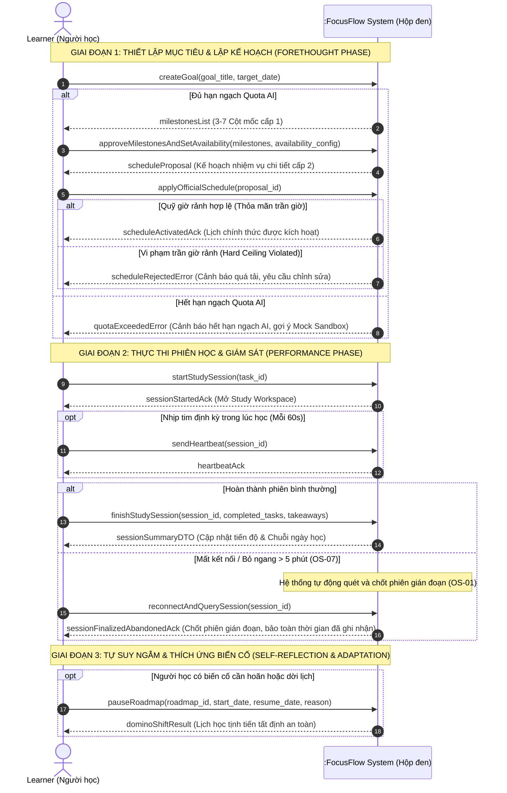
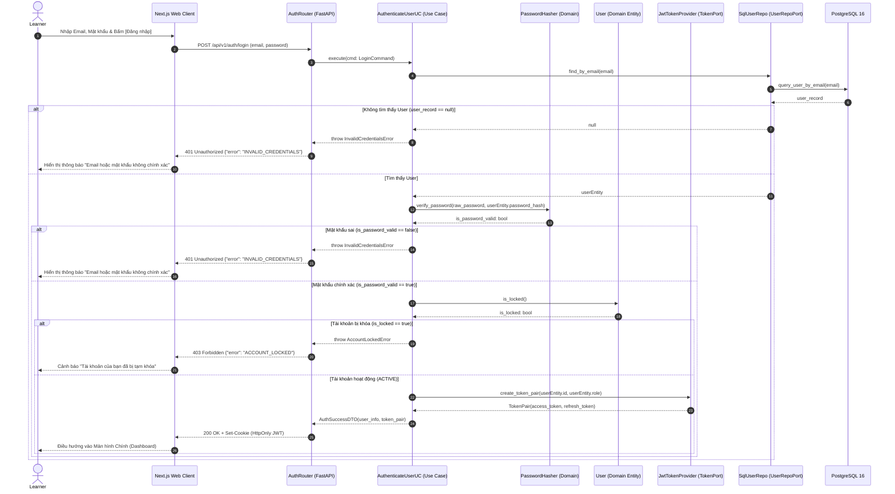
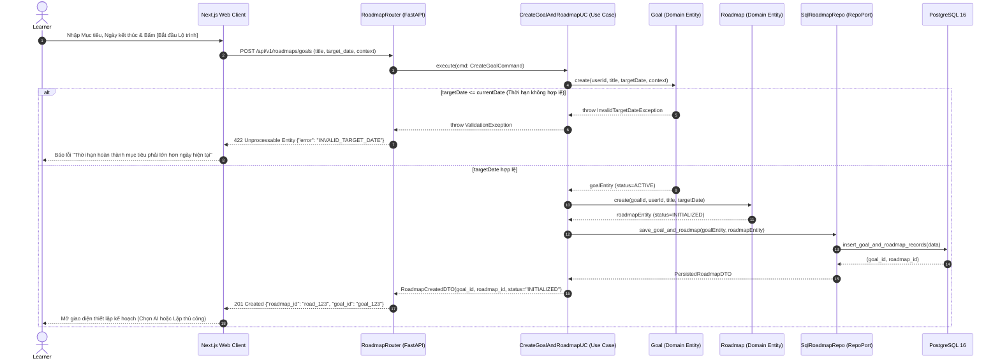
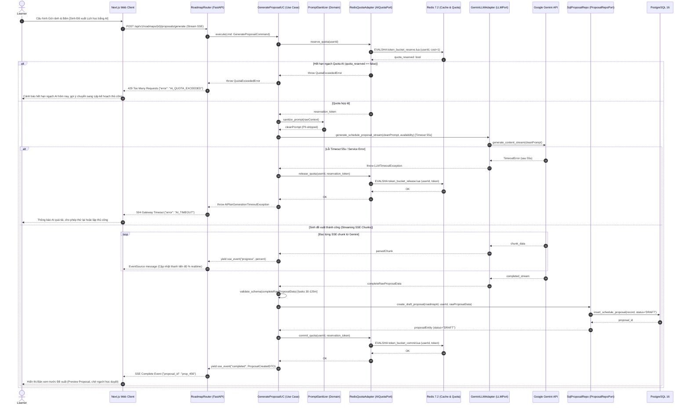
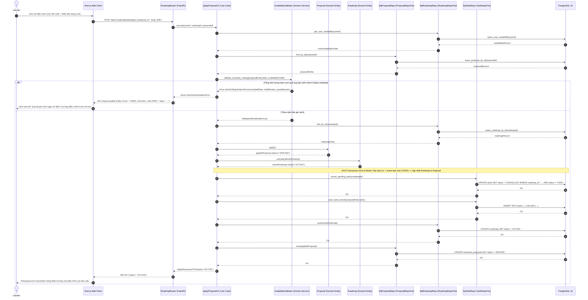
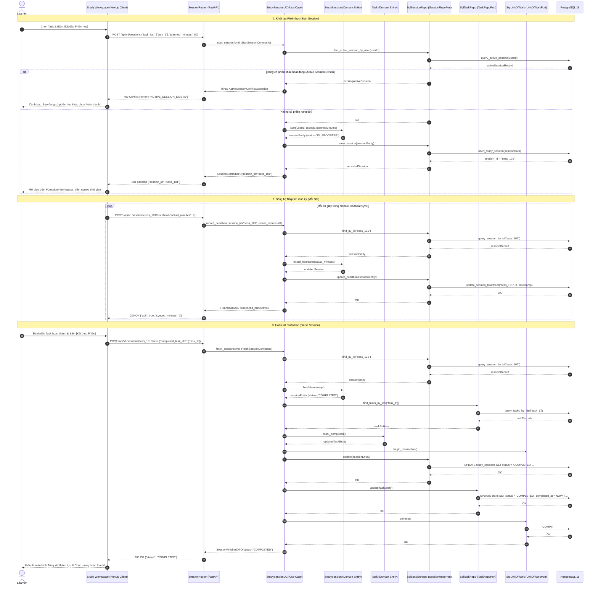
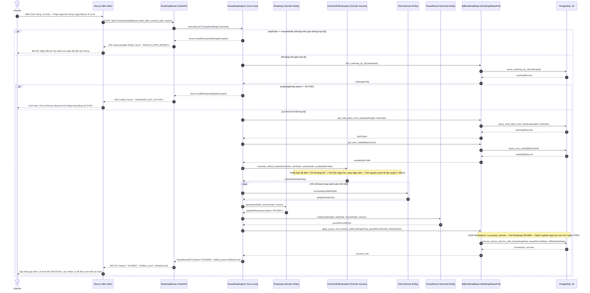

# FocusFlow — Thiết kế Sơ đồ Tuần tự Chi tiết (Sequence Diagrams Document)
## Phiên bản: v3.0 — Chuẩn UML 2.5.1 & Thực sự hóa Ca sử dụng (Use-Case Realization)
**Dự án:** FocusFlow — Hệ thống hỗ trợ lập kế hoạch và thực thi lộ trình tự học thích ứng tích hợp AI  
**Tiêu chuẩn kỹ thuật:** ISO/IEC 19505-2 (UML 2.5.1 Superstructure), RFC 5545 (iCalendar), Kiến trúc Lục giác (Hexagonal Architecture / Ports & Adapters)  
**Căn cứ đánh giá học thuật:** Khung Rubric Đồ án Tốt nghiệp CNTT — Tiêu chí TC1 & TC2.1 & TC2.3 (Mức 5)  
**Tài liệu liên kết:**
- Sơ đồ Ca sử dụng: [`docs/uml/use-cases/use-case-diagram.puml`](file:///Users/vuthang/Documents/FocusFlow/docs/uml/use-cases/use-case-diagram.puml)
- Đặc tả Ca sử dụng Chi tiết: [`docs/uml/use-case-specifications.md`](file:///Users/vuthang/Documents/FocusFlow/docs/uml/use-case-specifications.md)
- Biểu đồ Lớp (Domain Model & DCD): [`docs/uml/class-diagrams.md`](file:///Users/vuthang/Documents/FocusFlow/docs/uml/class-diagrams.md)
- Yêu cầu phần mềm (SRS): [`docs/srs/srs-v1.0.md`](file:///Users/vuthang/Documents/FocusFlow/docs/srs/srs-v1.0.md)
- Thiết kế Kiến trúc: [`docs/architecture/system-architecture.md`](file:///Users/vuthang/Documents/FocusFlow/docs/architecture/system-architecture.md)
- Thiết kế Cơ sở Dữ liệu: [`docs/database/database-schema-design.md`](file:///Users/vuthang/Documents/FocusFlow/docs/database/database-schema-design.md)
- Thư mục nguồn PlantUML: [`docs/uml/sequence/`](file:///Users/vuthang/Documents/FocusFlow/docs/uml/sequence) (gồm 9 sơ đồ độc lập)

---

## MỤC LỤC
1. [Nguyên tắc Thiết kế & Sơ đồ Tuần tự Hệ thống Tổng quan (SSD)](#1-nguyên-tắc-thiết-kế--sơ-đồ-tuần-tự-hệ-thống-mức-tổng-quan-ssd)
2. [Sequence Diagram 1: Đăng nhập Hệ thống (UC-AUTH-02)](#2-sequence-diagram-1-đăng-nhập-hệ-thống-uc-auth-02)
3. [Sequence Diagram 2: Khởi tạo Mục tiêu & Đăng ký Lộ trình (UC-PLAN-01)](#3-sequence-diagram-2-khởi-tạo-mục-tiêu--đăng-ký-lộ-trình-uc-plan-01)
4. [Sequence Diagram 3: Sinh Cột mốc & Phân rã Nhiệm vụ AI (UC-PLAN-02)](#4-sequence-diagram-3-sinh-cột-mốc--phân-rã-nhiệm-vụ-ai-uc-plan-02)
5. [Sequence Diagram 4: Áp dụng Lịch học Chính thức & Kiểm tra Trần Giờ rảnh (UC-PLAN-03)](#5-sequence-diagram-4-áp-dụng-lịch-học-chính-thức--kiểm-tra-trần-giờ-rảnh-uc-plan-03)
6. [Sequence Diagram 5: Thực thi Phiên học Pomodoro (UC-SESS-01)](#6-sequence-diagram-5-thực-thi-phiên-học-pomodoro-uc-sess-01)
7. [Sequence Diagram 6: Thiết lập Tạm dừng Lộ trình & Domino Shift (UC-PAUSE-01)](#7-sequence-diagram-6-thiết-lập-tạm-dừng-lộ-trình--domino-shift-uc-pause-01)
8. [Sequence Diagram 7: Đồng bộ Lịch 1 Chiều WebCal RFC 5545 (UC-CAL-01)](#8-sequence-diagram-7-đồng-bộ-lịch-1-chiều-webcal-rfc-5545-uc-cal-01)
9. [Sequence Diagram 8: Tự động Quét & Chốt Phiên Gián đoạn Celery Beat (UC-SESS-02)](#9-sequence-diagram-8-tự-động-quét--chốt-phiên-gián-đoạn-celery-beat-uc-sess-02)
10. [Ma trận Kiểm tra Tính Nhất quán (Consistency & Traceability Matrix)](#10-ma-trận-kiểm-tra-tính-nhất-quán-consistency--traceability-matrix)

---

## 1. Nguyên tắc Thiết kế & Sơ đồ Tuần tự Hệ thống Mức Tổng quan (SSD)

### 1.1 Nguyên tắc Thiết kế Use-Case Realization & Phân lớp Kiến trúc
Nhằm khắc phục triệt để lỗi thiết kế nhồi nhét nhiều kịch bản vào một sơ đồ gây rườm rà, bộ Sequence Diagram của FocusFlow tuân thủ nghiêm ngặt chuẩn mực công nghệ phần mềm:
1. **Phạm vi kịch bản đơn lẻ (Single Scenario Focus):** Mỗi sơ đồ tuần tự mức thiết kế (Design Sequence Diagram - DSD) mô hình hóa trọn vẹn sự hợp tác giữa các đối tượng để thực sự hóa **1 kịch bản cụ thể** (Use-Case Realization) của một Ca sử dụng.
2. **Tuân thủ phân lớp Kiến trúc Lục giác (Hexagonal Architecture):**
   - **Actor (Tác nhân):** Người dùng (`Learner`), tác nhân ngoại vi (`External Calendar App`) hoặc bộ lập lịch nền (`Celery Beat`).
   - **Boundary / Presentation Layer:** Giao diện `Next.js Web Client`, các bộ lọc `Middleware`, và các bộ điều hướng `FastAPI Router`.
   - **Control / Application Layer:** Các `Use Case Interactors` điều phối luồng nghiệp vụ.
   - **Domain Layer:** Các thực thể nghiệp vụ (`Goal`, `Roadmap`, `StudySession`, `Task`) và các `Domain Services` thuần Python (`DominoShiftCalculator`, `AvailabilityValidator`, `PromptSanitizer`).
   - **Infrastructure Adapters:** Các Adapter giao tiếp cơ sở dữ liệu (`SqlRoadmapRepo`, `SqlSessionRepo`, v.v.), dịch vụ token bảo mật, và bộ tích hợp AI (`GeminiLLMAdapter`).
   - **Storage / External Systems:** `PostgreSQL 16`, `Redis`, `Google Gemini API`.
3. **Quy chuẩn thông điệp (Messages & Activations):**
   - Lời gọi phương thức đồng bộ thể hiện bằng mũi tên nét liền đầu đặc (`->`).
   - Phản hồi dữ liệu / DTO thể hiện bằng mũi tên nét đứt đầu hở (`-->`).
   - Mọi tương tác dữ liệu phải thông qua phương thức hướng đối tượng của Repository, tuyệt đối không dùng câu lệnh SQL thô trên sơ đồ tuần tự.
   - Thanh kích hoạt (`Activation Bar`) thể hiện chính xác thời điểm thực thi của từng đối tượng.

---

### 1.2 Sơ đồ Tuần tự Hệ thống Tổng quan (System Sequence Diagram - SSD)
Mô hình hóa Hộp đen (**Black-box SSD**) theo chu trình Tự học có điều tiết (**Self-Regulated Learning - SRL**):
* **File nguồn PlantUML:** [`docs/uml/sequence/seq-00-system-sequence-diagram.puml`](file:///Users/vuthang/Documents/FocusFlow/docs/uml/sequence/seq-00-system-sequence-diagram.puml)



---

## 2. Sequence Diagram 1: Đăng nhập Hệ thống (UC-AUTH-02)
* **Ca sử dụng:** `UC-AUTH-02: Đăng nhập hệ thống`.
* **Yêu cầu chức năng:** `FR-AUTH-002`, `NFR-SEC-001`.
* **Mô tả kịch bản:** Người học gửi thông tin đăng nhập (email, password). Hệ thống xác thực danh tính qua băm mật khẩu bảo mật (Argon2/Bcrypt), kiểm tra trạng thái khóa tài khoản (`is_locked()`), sinh cặp JSON Web Token (Access Token & Refresh Token) và trả về HttpOnly Cookie.
* **File nguồn PlantUML:** [`docs/uml/sequence/seq-01-user-login.puml`](file:///Users/vuthang/Documents/FocusFlow/docs/uml/sequence/seq-01-user-login.puml)



---

## 3. Sequence Diagram 2: Khởi tạo Mục tiêu & Đăng ký Lộ trình (UC-PLAN-01)
* **Ca sử dụng:** `UC-PLAN-01: Khởi tạo mục tiêu & Làm rõ ngữ cảnh`.
* **Yêu cầu chức năng:** `FR-PLAN-001`.
* **Mô tả kịch bản:** Người học khởi tạo mục tiêu học tập ban đầu. Thực thể `Goal` và `Roadmap` được khởi tạo độc lập, kiểm tra quy tắc nghiệp vụ ngày hoàn thành (`targetDate > currentDate`), lưu vào cơ sở dữ liệu ở trạng thái `PLANNING` để chuẩn bị cho giai đoạn phân rã kế hoạch.
* **File nguồn PlantUML:** [`docs/uml/sequence/seq-02-create-goal-roadmap.puml`](file:///Users/vuthang/Documents/FocusFlow/docs/uml/sequence/seq-02-create-goal-roadmap.puml)



---

## 4. Sequence Diagram 3: Sinh Cột mốc & Phân rã Nhiệm vụ AI (UC-PLAN-02)
* **Ca sử dụng:** `UC-PLAN-02: Phê duyệt các cột mốc học tập & Sinh đề xuất kế hoạch`.
* **Yêu cầu chức năng:** `FR-PLAN-002`, `FR-QUOTA-001`, `OS-02` (Two-Phase Quota Lifecycle), `ADR-005` (SSE Streaming Progress).
* **Mô tả kịch bản:** Thực hiện phân rã kế hoạch học tập qua Google Gemini API với cơ chế phản hồi dòng SSE (`text/event-stream`). Quota được bảo lưu nguyên tử qua Redis Lua script (`reserve_quota`), prompt được khử khuẩn chống Prompt Injection (`PromptSanitizer`), gọi LLM kèm giới hạn thời gian Timeout 55s. Dữ liệu đề xuất được stream về Client theo từng chunk tiến trình. Khi hoàn tất, lưu bản nháp đề xuất (`status='DRAFT'`) và chính thức trừ hạn ngạch (`commit_quota`). Nếu lỗi/timeout, hạn ngạch được hoàn trả an toàn (`release_quota`).
* **File nguồn PlantUML:** [`docs/uml/sequence/seq-03-generate-milestones-tasks-ai.puml`](file:///Users/vuthang/Documents/FocusFlow/docs/uml/sequence/seq-03-generate-milestones-tasks-ai.puml)



---

### 5. Sequence Diagram 4: Áp dụng Lịch học Chính thức & Kiểm tra Trần Giờ rảnh (UC-PLAN-03)
* **Ca sử dụng:** `UC-PLAN-03: Tạo đề xuất & Áp dụng lịch trình`.
* **Yêu cầu chức năng:** `FR-PLAN-003`, `FR-PLAN-004`.
* **Mô tả kịch bản:** Trước khi ghi nhận lịch học chính thức, Domain Service `AvailabilityValidator` kiểm tra nghiêm ngặt trần giờ rảnh trong ngày (Hard Ceiling). Nếu vi phạm, từ chối giao dịch. Nếu hợp lệ, hệ thống thực thi theo mô hình Rich Domain Model (`Proposal.apply()`, `Roadmap.activate()`) và giao dịch nguyên tử (ACID Transaction qua Unit of Work): chuyển trạng thái các Task cũ còn dang dở sang `CANCELLED`, nạp danh sách task mới từ proposal với trạng thái `TODO`, kích hoạt Roadmap sang `ACTIVE` và đánh dấu Proposal là `APPLIED`.
* **File nguồn PlantUML:** [`docs/uml/sequence/seq-04-apply-official-schedule.puml`](file:///Users/vuthang/Documents/FocusFlow/docs/uml/sequence/seq-04-apply-official-schedule.puml)



---

## 6. Sequence Diagram 5: Thực thi Phiên học Tập trung (UC-SESS-01)
* **Ca sử dụng:** `UC-SESS-01: Thực hiện phiên học tập trung`.
* **Yêu cầu chức năng:** `FR-SESS-001`, `FR-SESS-002`, `OS-07` (Nhịp tim 60s).
* **Mô tả kịch bản:** Vòng đời trọn vẹn của phiên học tập trung gồm 3 mốc tương tác: Khởi tạo phiên (`start`) với kiểm tra xung đột phiên đang chạy (409 Conflict), đồng bộ nhịp tim định kỳ mỗi 60 giây (`record_heartbeat`) để bảo vệ thời gian tích lũy chống rớt mạng, và chốt phiên hoàn thành (`finish`), phân tách rõ ràng trách nhiệm giữa `SessionRepo` và `TaskRepo` qua Unit of Work, cập nhật trạng thái nhiệm vụ sang `COMPLETED`. (Kịch bản minh họa: Người học kích hoạt chế độ đếm ngược Pomodoro/Time-boxing 50 phút).
* **File nguồn PlantUML:** [`docs/uml/sequence/seq-05-study-session-pomodoro.puml`](file:///Users/vuthang/Documents/FocusFlow/docs/uml/sequence/seq-05-study-session-pomodoro.puml)



---

## 7. Sequence Diagram 6: Thiết lập Tạm dừng Lộ trình & Domino Shift (UC-ADAPT-02)
* **Ca sử dụng:** `UC-ADAPT-02: Thiết lập tạm dừng lộ trình`.
* **Yêu cầu chức năng:** `FR-ADAPT-001`, `BUSR-01` (Domino Shift tất định).
* **Mô tả kịch bản:** Khi người học có biến cố cần nghỉ học, hệ thống kích hoạt giải thuật toán học tất định `DominoShiftCalculator` trong tầng Domain. Thuật toán tịnh tiến toàn bộ các nhiệm vụ chưa thực hiện (`TODO`) lùi sang các ngày rảnh kế tiếp trong quỹ thời gian khả dụng mà không làm đảo lộn thứ tự tiên quyết (Prerequisites), thực thi tức thời (< 50ms) mà không phụ thuộc vào AI. Thao tác dời ngày được gói vào nghiệp vụ rich domain `Task.reschedule()`.
* **File nguồn PlantUML:** [`docs/uml/sequence/seq-06-pause-domino-shift.puml`](file:///Users/vuthang/Documents/FocusFlow/docs/uml/sequence/seq-06-pause-domino-shift.puml)



---

## 8. Sequence Diagram 7: Đồng bộ Lịch 1 Chiều WebCal RFC 5545 (UC-CAL-02)
* **Ca sử dụng:** `UC-CAL-02: Ngoại vi — Đồng bộ lịch 1 chiều WebCal`.
* **Yêu cầu chức năng:** `FR-CALENDAR-002`, `NFR-SEC-004` (Bảo mật token và log sanitizer).
* **Mô tả kịch bản:** Ứng dụng lịch bên ngoài (Google Calendar, Apple Calendar) gửi yêu cầu HTTP GET định kỳ lấy dữ liệu lịch. Request đi qua `LogSanitizerMiddleware` để kiểm duyệt và che giấu token bí mật khỏi log máy chủ. Use Case kiểm tra tính hợp lệ của token băm (SHA-256), truy vấn các nhiệm vụ chính thức và sử dụng `IcalGeneratorAdapter` để sinh luồng nội dung iCalendar chuẩn RFC 5545 (`text/calendar`).
* **File nguồn PlantUML:** [`docs/uml/sequence/seq-07-webcal-sync-export.puml`](file:///Users/vuthang/Documents/FocusFlow/docs/uml/sequence/seq-07-webcal-sync-export.puml)

```mermaid
sequenceDiagram
    autonumber
    actor ExtCal as External Calendar App (Google / Apple Calendar)
    participant LogMid as LogSanitizerMiddleware (Security Filter)
    participant Router as CalendarRouter (FastAPI)
    participant CalUC as ExportCalendarFeedUC (Use Case)
    participant WebCalRepo as SqlWebCalRepo (WebCalRepoPort)
    participant TaskRepo as SqlTaskRepo (TaskRepoPort)
    participant IcalGen as IcalGeneratorAdapter (CalendarExportPort)
    participant DB as PostgreSQL 16

    ExtCal->>LogMid: GET /api/v1/calendar/feed/{raw_token}.ics (HTTP Polling định kỳ)
    Note over LogMid: Che giấu token nhạy cảm trong server access log (REDACTED)
    LogMid->>Router: forward_sanitized_request(raw_token)
    Router->>CalUC: export_feed_by_token(raw_token)

    Note over CalUC: Băm SHA-256 token thô: token_hash = hash_sha256(raw_token)
    CalUC->>WebCalRepo: find_active_subscription_by_hash(token_hash)
    WebCalRepo->>DB: query_active_webcal_token(token_hash)
    DB-->>WebCalRepo: tokenRecord

    alt Token không hợp lệ hoặc đã bị vô hiệu hóa
        WebCalRepo-->>CalUC: null
        CalUC-->>Router: throw InvalidCalendarTokenException
        Router-->>ExtCal: 401 Unauthorized {"error": "INVALID_CALENDAR_TOKEN"}
    else Token hợp lệ (ACTIVE)
        WebCalRepo-->>CalUC: webCalSubscriptionEntity
        CalUC->>WebCalRepo: record_feed_access(token_hash)
        WebCalRepo->>DB: update_last_accessed_timestamp(token_hash)
        DB-->>WebCalRepo: OK
        WebCalRepo-->>CalUC: OK

        CalUC->>TaskRepo: get_active_scheduled_tasks(userId)
        TaskRepo->>DB: query_tasks_for_calendar_feed(userId)
        DB-->>TaskRepo: taskRecords
        TaskRepo-->>CalUC: taskEntities

        CalUC->>IcalGen: generate_ical_stream(taskEntities)
        Note over IcalGen: Kết xuất chuỗi iCalendar RFC 5545 (VCALENDAR, VEVENT, DTSTART, DTEND)
        IcalGen-->>CalUC: icalContentStream (.ics)
        CalUC-->>Router: CalendarFeedDTO(content=icalContentStream, mime_type="text/calendar")
        Router-->>ExtCal: 200 OK (Content-Type: text/calendar; charset=utf-8)
        Note over ExtCal: Ứng dụng Lịch tự động nạp sự kiện và hiển thị trên Lịch cá nhân của người học
    end
```

---

## 9. Sequence Diagram 8: Tự động Quét & Chốt Phiên Gián đoạn Celery Beat (UC-SESS-02)
* **Ca sử dụng:** `UC-SESS-02: Xử lý gián đoạn phiên học`.
* **Yêu cầu chức năng:** `FR-SESS-003`, `OS-01` (Quy tắc phân định trạng thái gián đoạn).
* **Mô tả kịch bản:** Tác vụ nền định kỳ kích hoạt mỗi 5 phút bởi Celery Beat bằng cách đẩy message bất đồng bộ vào Redis Broker. Worker nhận message và gọi Use Case quét các phiên học đang ở trạng thái `IN_PROGRESS` nhưng mất kết nối heartbeat quá 5 phút. Domain Service `AbandonmentEvaluator` áp dụng quy tắc OS-01: Nếu phiên đã hoàn thành $\ge 50\%$ thời lượng dự kiến hoặc có ít nhất 1 task hoàn thành thì chốt `PARTIAL_COMPLETED` (công nhận công sức, trả task dở dang về `TODO` trong Backlog); ngược lại chốt `CANCELLED` (hủy phiên, bảo toàn task `TODO`).
* **File nguồn PlantUML:** [`docs/uml/sequence/seq-08-abandoned-session-sweep.puml`](file:///Users/vuthang/Documents/FocusFlow/docs/uml/sequence/seq-08-abandoned-session-sweep.puml)

```mermaid
sequenceDiagram
    autonumber
    actor Beat as Celery Beat (Periodic Timer)
    participant Broker as Redis 7.2 (Message Broker)
    participant Worker as SessionSweepWorker (Celery Task)
    participant SweepUC as SweepAbandonedSessionsUC (Use Case)
    participant Evaluator as AbandonmentEvaluator (Domain Service - OS-01)
    participant SessionEntity as StudySession (Domain Entity)
    participant SessionRepo as SqlSessionRepo (SessionRepoPort)
    participant TaskRepo as SqlTaskRepo (TaskRepoPort)
    participant DB as PostgreSQL 16

    Note over Beat,DB: Tác vụ nền chạy định kỳ mỗi 5 phút quét các phiên mất heartbeat quá 5 phút
    Beat->>Broker: enqueue_task("sweep_abandoned_sessions", args=[threshold=5])
    Note over Beat: Beat gửi bất đồng bộ vào Redis rồi tiếp tục chu kỳ hẹn giờ
    Broker->>Worker: dispatch_task("sweep_abandoned_sessions", args=[threshold=5])
    Worker->>SweepUC: execute(threshold_minutes=5)
    SweepUC->>SessionRepo: find_stale_in_progress_sessions(interval_minutes=5)
    SessionRepo->>DB: query_sessions_heartbeat_older_than(interval_minutes=5)
    DB-->>SessionRepo: staleSessionRecords
    SessionRepo-->>SweepUC: List[staleSessions]

    loop Với mỗi staleSession trong danh sách
        SweepUC->>TaskRepo: get_completed_tasks_count_in_session(sessionId)
        TaskRepo->>DB: query_completed_task_count(sessionId)
        DB-->>TaskRepo: completedCount
        TaskRepo-->>SweepUC: completedCount

        SweepUC->>Evaluator: evaluate_disposition(staleSession, completedCount)
        Note over Evaluator: Áp dụng OS-01: actualMinutes >= 50% plannedMinutes HOẶC completedCount >= 1 => PARTIAL_COMPLETED; Ngược lại => CANCELLED
        Evaluator-->>SweepUC: evaluationResult (status, dispositionReason)

        SweepUC->>SessionEntity: mark_abandoned(evaluationResult.status, staleSession.lastHeartbeatAt)
        SessionEntity-->>SweepUC: finalizedSession

        SweepUC->>SessionRepo: finalize_abandoned_session(finalizedSession)
        alt Thỏa mãn ngưỡng: PARTIAL_COMPLETED
            Note over SessionRepo,DB: Transaction: Set session PARTIAL_COMPLETED & Trả task dở dang về TODO
            SessionRepo->>DB: execute_atomic_partial_finalize(sessionData)
            DB-->>SessionRepo: OK
        else Dưới ngưỡng: CANCELLED
            Note over SessionRepo,DB: Transaction: Set session CANCELLED & Trả toàn bộ task dở dang về TODO
            SessionRepo->>DB: execute_atomic_cancel_finalize(sessionData)
            DB-->>SessionRepo: OK
        end
        SessionRepo-->>SweepUC: sessionFinalizedAck
    end

    SweepUC-->>Worker: SweepSummaryDTO(processed_count, partial_count, cancelled_count)
    Worker->>Worker: log_summary_and_metrics(SweepSummaryDTO)
```

---

## 10. Ma trận Kiểm tra Tính Nhất quán (Consistency & Traceability Matrix)

| Mã Sơ đồ | Tên Kịch bản (Use-Case Realization) | Ca Sử Dụng Liên Kết | Lớp Điều Phối (Use Case) | Thực Thể & Domain Service | Adapters & Repositories | Ràng Buộc Nghiệp Vụ / Tiêu Chuẩn |
| :--- | :--- | :--- | :--- | :--- | :--- | :--- |
| **SSD** | Sơ đồ Tuần tự Hệ thống Tổng quan | Toàn hệ thống | :FocusFlow System | SRL 3 Pha | Web Client | ISO/IEC 19505-2, SRL Framework, OS-07 (5m Timeout) |
| **SD1** | Đăng nhập Hệ thống | `UC-AUTH-02` | `AuthenticateUserUC` | `User`, `PasswordHasher` | `SqlUserRepo`, `JwtTokenProvider` | `NFR-SEC-001`, Argon2, HttpOnly JWT |
| **SD2** | Khởi tạo Mục tiêu & Đăng ký Lộ trình | `UC-PLAN-01` | `CreateGoalAndRoadmapUC` | `Goal`, `Roadmap` | `SqlRoadmapRepo` | `FR-PLAN-001`, `targetDate > today` |
| **SD3** | Sinh Cột mốc & Phân rã Nhiệm vụ AI | `UC-PLAN-02` | `GenerateProposalUC` | `PromptSanitizer` | `RedisQuotaAdapter`, `GeminiLLMAdapter`, `SqlProposalRepo` | `OS-02` (Two-Phase Quota), 55s Timeout, ADR-005 (SSE Streaming) |
| **SD4** | Áp dụng Lịch học & Kiểm tra Quỹ giờ | `UC-PLAN-03` | `ApplyProposalUC` | `AvailabilityValidator`, `Proposal`, `Roadmap` | `SqlRoadmapRepo`, `SqlProposalRepo`, `SqlTaskRepo` | `BUSR-02`, Hard Ceiling Gate, ACID Persist (Task `TODO`) |
| **SD5** | Thực thi Phiên học Tập trung | `UC-SESS-01` | `StudySessionUC` | `StudySession`, `Task` | `SqlSessionRepo`, `SqlTaskRepo`, `SqlUnitOfWork` | `OS-07` (Nhịp tim 60s), 409 Conflict, Pomodoro/Timebox Timer |
| **SD6** | Tạm dừng Lộ trình & Domino Shift | `UC-ADAPT-02` | `PauseRoadmapUC` | `DominoShiftCalculator`, `Roadmap`, `Task`, `PauseRecord` | `SqlRoadmapRepo` | `BUSR-01`, Tất định < 50ms, Giữ tiên quyết, Task `TODO` |
| **SD7** | Đồng bộ Lịch 1 Chiều WebCal | `UC-CAL-02` | `ExportCalendarFeedUC` | Token Sanitizer Logic | `SqlWebCalRepo`, `SqlTaskRepo`, `IcalGeneratorAdapter` | `RFC 5545`, SHA-256 Token, `NFR-SEC-004`, `FR-CALENDAR-002` |
| **SD8** | Tự động Quét & Chốt Phiên Gián đoạn | `UC-SESS-02` | `SweepAbandonedSessionsUC` | `AbandonmentEvaluator`, `StudySession` | `SessionSweepWorker`, `SqlSessionRepo`, `SqlTaskRepo`, `Redis` | `OS-01` (Phân định 50% / 1 task), Celery Beat async queue |

---
*Tài liệu được cập nhật và kiểm duyệt tự động theo tiêu chuẩn ISO/IEC 19505-2 và kiến trúc Lục giác FocusFlow.*