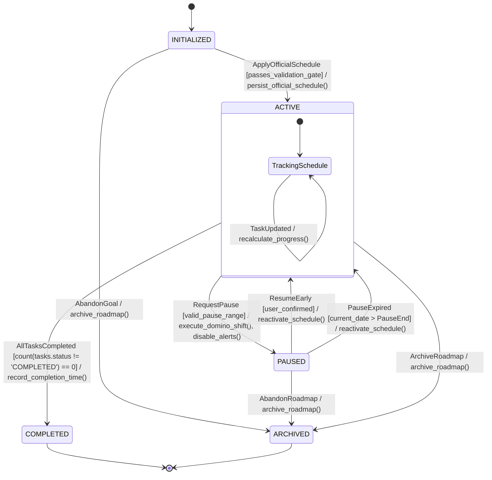
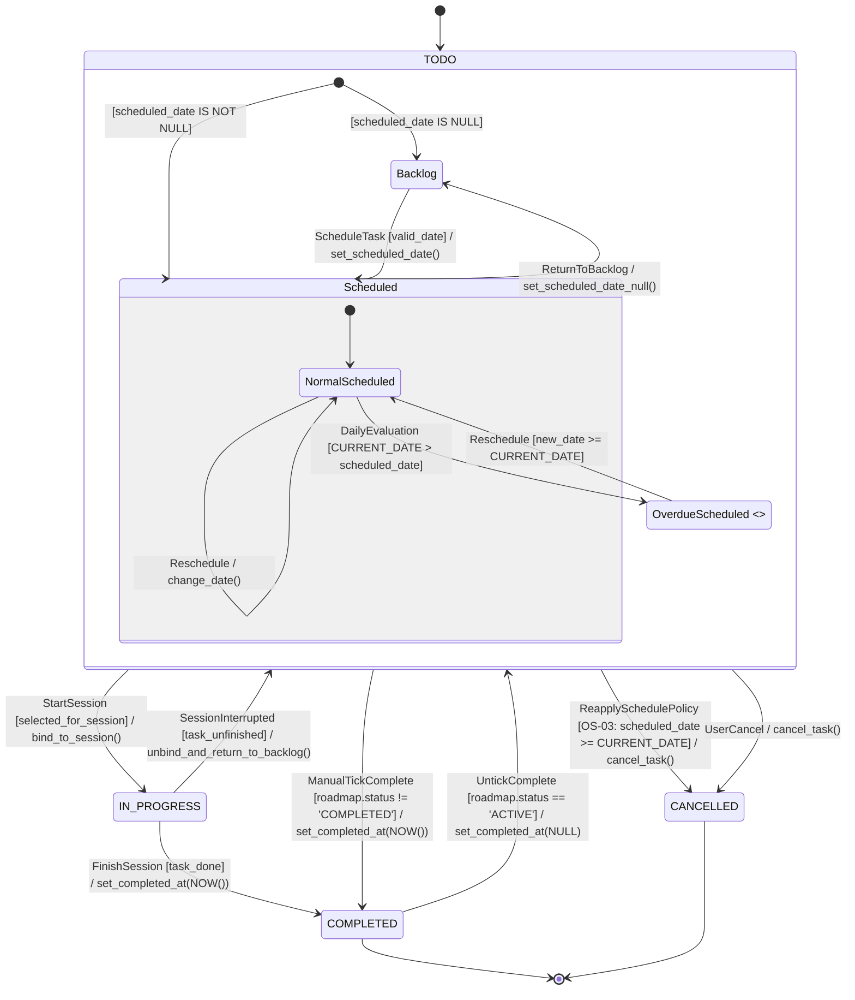
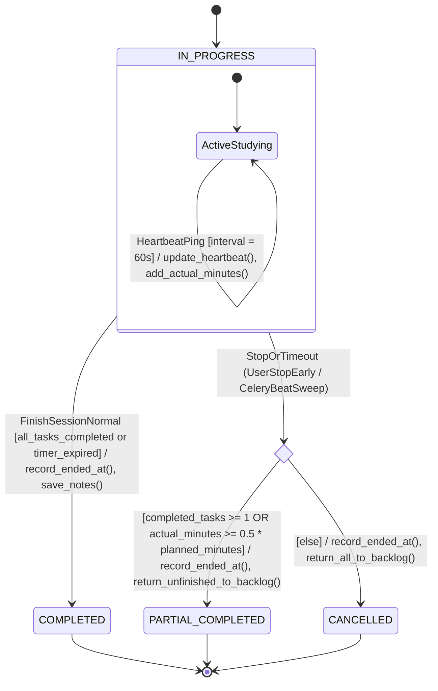
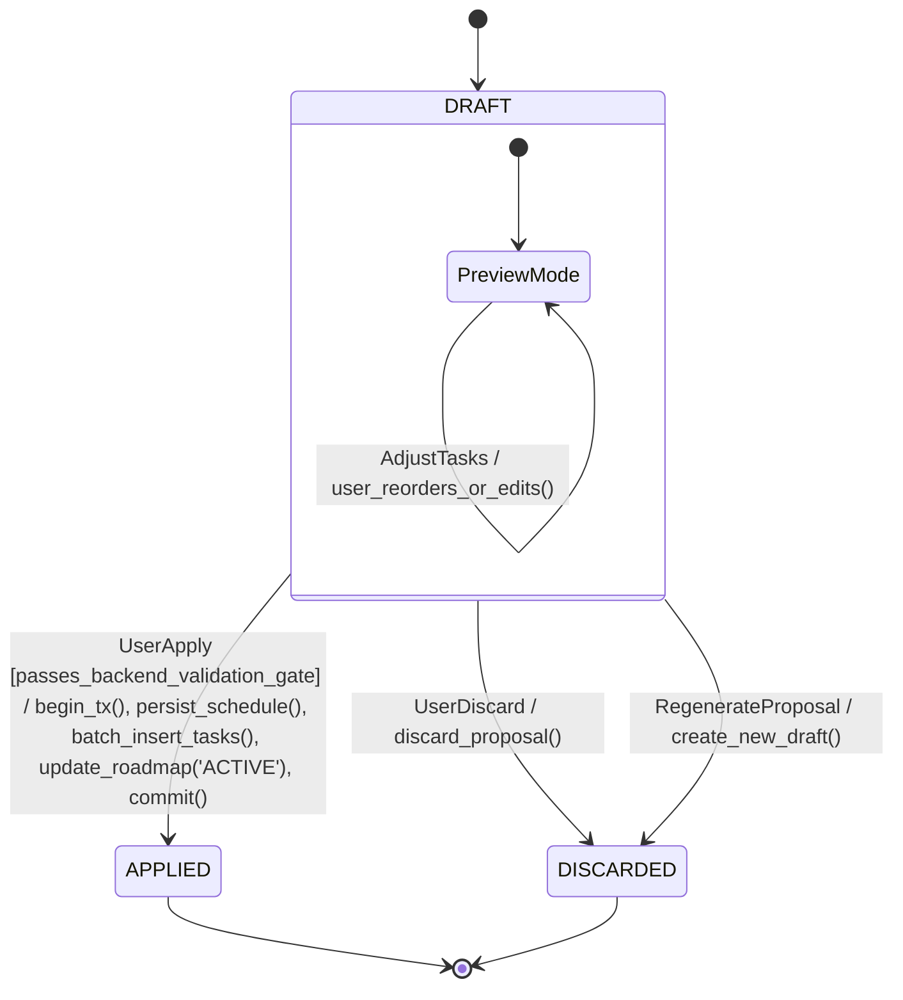
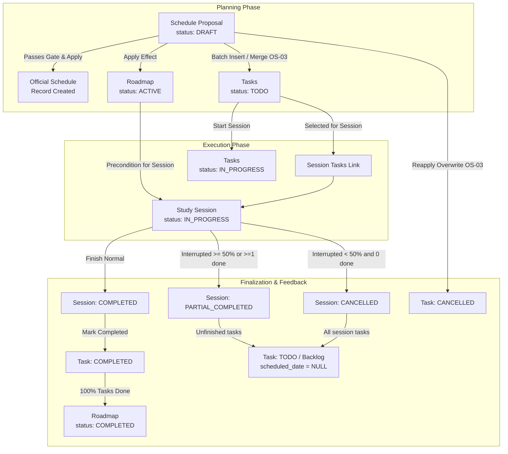

# FocusFlow — Đặc tả Biểu đồ Máy trạng thái UML 2.5.1 (UML State Machine Specification)

## Thông tin Hồ sơ Kỹ thuật
* **Dự án:** FocusFlow — Hệ thống hỗ trợ lập kế hoạch và thực thi lộ trình tự học thích ứng tích hợp AI
* **Phiên bản:** v1.0 — Chuẩn Thiết kế Trạng thái Hệ thống (UML Behavioral State Machine Baseline)
* **Tiêu chuẩn kỹ thuật:** UML 2.5.1 (OMG Specification), ISO/IEC/IEEE 29148:2018 (Requirements Engineering)
* **Căn cứ đánh giá học thuật:** Khung Rubric Đồ án Tốt nghiệp CNTT — Tiêu chí TC2.1 & TC2.3 (Mức 5)
* **Tài liệu nguồn chân lý liên kết:**
  * Đặc tả SRS v1.1: [`docs/srs/srs-v1.0.md`](file:///Users/vuthang/Documents/FocusFlow/docs/srs/srs-v1.0.md) (Mục 6.1..6.4, Mục 15: OS-01, OS-03, OS-07)
  * Thiết kế CSDL Quan hệ: [`docs/database/schema.sql`](file:///Users/vuthang/Documents/FocusFlow/docs/database/schema.sql) & [`docs/database/database-schema-design.md`](file:///Users/vuthang/Documents/FocusFlow/docs/database/database-schema-design.md)
  * Biểu đồ Tuần tự: [`docs/uml/sequence-m2-workflow.md`](file:///Users/vuthang/Documents/FocusFlow/docs/uml/sequence-m2-workflow.md)
  * Quyết định Kiến trúc: [`docs/decisions/ADR-004-worker-and-scheduled-jobs.md`](file:///Users/vuthang/Documents/FocusFlow/docs/decisions/ADR-004-worker-and-scheduled-jobs.md)
  * Thư mục nguồn PlantUML: [`docs/uml/state-machines/`](file:///Users/vuthang/Documents/FocusFlow/docs/uml/state-machines) (gồm 4 máy trạng thái độc lập)
  * Thư mục ảnh xuất sẵn: [`docs/uml/images/`](file:///Users/vuthang/Documents/FocusFlow/docs/uml/images) (PNG và SVG vector)

---

## 1. Vòng đời Lộ trình (Roadmap Lifecycle)

### 1.1. State Machine Diagram (Mermaid)

### 1.2. Bảng Chuyển trạng thái (State Transition Table)

| Mã Transition | Trạng thái Nguồn | Sự kiện Kích hoạt (Event / Trigger) | Điều kiện Tiên quyết (Guard) | Trạng thái Đích | Hành động Thực thi (Action / Effect) |
|---|---|---|---|---|---|
| `T_RD_00` | `[*]` (Initial) | Không điều kiện (UML 2.5.1) | Không | `INITIALIZED` | Khởi tạo bản ghi `roadmaps` (`status = 'INITIALIZED'`), liên kết `goal_id`. |
| `T_RD_01` | `INITIALIZED` | `ApplyOfficialSchedule` (`FR-PLAN-003`) | Proposal vượt qua Backend Validation Gate (`BUSR-02..05`) | `ACTIVE` | Lưu `official_schedules`, batch insert `tasks`, cập nhật `schedule_proposals.status = 'APPLIED'`. |
| `T_RD_02` | `ACTIVE` | `RequestPause` (`FR-PAUSE-001`) | Khoảng ngày `[PauseStart, PauseEnd]` hợp lệ, `PauseEnd >= PauseStart` | `PAUSED` | Kích hoạt Domino Shift (`FR-PAUSE-002`) dời ngày các task, tạo bản ghi `pause_records`, tắt cảnh báo trễ hạn. |
| `T_RD_03a` | `PAUSED` | `ResumeEarly` | Người dùng bấm tiếp tục lộ trình trước hạn | `ACTIVE` | Tái kích hoạt theo dõi tiến độ và kiểm tra trễ hạn theo lịch đã dời. |
| `T_RD_03b` | `PAUSED` | `PauseExpired` | Ngày hệ thống `CURRENT_DATE > PauseEnd` | `ACTIVE` | Tự động kích hoạt lại theo dõi tiến độ và kiểm tra trễ hạn. |
| `T_RD_04` | `ACTIVE` | `TaskCompleted` (`FR-TASK-001`) | $100\%$ task thuộc Roadmap có `status = 'COMPLETED'` | `COMPLETED` | Ghi nhận thời gian hoàn tất, hiển thị chúc mừng, khóa sửa đổi toàn bộ task sang chỉ đọc. |
| `T_RD_05a` | `INITIALIZED` | `AbandonGoal` | Người học hủy mục tiêu khi chưa lên lịch | `ARCHIVED` | Đánh dấu `roadmaps.status = 'ARCHIVED'`, ẩn khỏi bảng theo dõi. |
| `T_RD_05b` | `ACTIVE` | `ArchiveRoadmap` | Người học hủy hoặc lưu trữ lộ trình | `ARCHIVED` | Chuyển `roadmaps.status = 'ARCHIVED'`, hủy các task còn dang dở. |
| `T_RD_05c` | `PAUSED` | `AbandonRoadmap` | Người học từ bỏ lộ trình đang tạm dừng | `ARCHIVED` | Chuyển `roadmaps.status = 'ARCHIVED'`. |

### 1.3. Chuyển đổi Hợp lệ & Bị cấm (Negative Transition Analysis)
* **Valid Transitions:** `[*] -> INITIALIZED -> ACTIVE -> PAUSED -> ACTIVE -> COMPLETED -> [*]`; đồng thời `{INITIALIZED, ACTIVE, PAUSED} -> ARCHIVED -> [*]`.
* **Invalid Transitions (Bị cấm hoàn toàn):**
  * `INITIALIZED -> PAUSED`: Cấm (chưa có lịch chính thức để tạm dừng).
  * `INITIALIZED -> COMPLETED`: Cấm (chưa thực hiện nhiệm vụ nào).
  * `PAUSED -> COMPLETED`: Cấm (phải kích hoạt lại sang `ACTIVE` mới được hoàn thành).
  * `COMPLETED -> ACTIVE / PAUSED / INITIALIZED / ARCHIVED`: Cấm tuyệt đối (trạng thái kết thúc bền vững, bất biến).
  * `ARCHIVED -> ACTIVE / PAUSED / INITIALIZED / COMPLETED`: Cấm tuyệt đối (trạng thái lưu trữ vĩnh viễn).

### 1.4. Bất biến Vòng đời (Lifecycle Invariants)
* **INV_RD_01:** Một Roadmap chỉ có duy nhất 1 bản ghi `official_schedules` (`UNIQUE` constraint).
* **INV_RD_02:** Khi `status == 'PAUSED'`, không có cảnh báo Overdue nào được phát ra cho các task thuộc Roadmap.
* **INV_RD_03:** Khi `status == 'COMPLETED'`, tỷ lệ hoàn thành nhiệm vụ bắt buộc đạt $100\%$, toàn bộ task liên thuộc chuyển sang chế độ Chỉ đọc (Read-only / Locked).

---

## 2. Vòng đời Nhiệm vụ (Task Lifecycle & Derived Overdue)

### 2.1. State Machine Diagram (Mermaid)

> **Ghi chú chuẩn UML 2.5.1 về Trạng thái Task:**  
> - Bốn trạng thái bền vững chuẩn CSDL: `TODO`, `IN_PROGRESS`, `COMPLETED`, `CANCELLED` (`tasks.status IN ('TODO', 'IN_PROGRESS', 'COMPLETED', 'CANCELLED')`).
> - `OverdueScheduled` mang stereotype `<<derived>>`: Đây là trạng thái logic thời thực (Runtime Evaluation) tính toán động qua điều kiện `CURRENT_DATE > scheduled_date AND status = 'TODO'`, hoàn toàn **không lưu trữ cột enum riêng** trong CSDL PostgreSQL.  
> - Trạng thái `COMPLETED`: Khi Lộ trình kết thúc, Task được khóa ở chế độ Read-only theo quy tắc Invariant phục vụ báo cáo chứ không cần sub-state cô lập; chỉ các task bị hủy (`CANCELLED`) hoặc hoàn thành (`COMPLETED`) mới kết thúc vòng đời thực thể.

### 2.2. Bảng Chuyển trạng thái (State Transition Table)

| Mã Transition | Trạng thái Nguồn | Sự kiện Kích hoạt | Điều kiện Tiên quyết (Guard) | Trạng thái Đích | Hành động Thực thi |
|---|---|---|---|---|---|
| `T_TK_00` | `[*]` | Không điều kiện (UML 2.5.1) | Không | `TODO` | Khởi tạo bản ghi `tasks`, phân nhánh vào `Scheduled` nếu có `scheduled_date` hoặc `Backlog` nếu `NULL`. |
| `T_TK_01` | `TODO` | `StartSession` (`FR-SESSION-001`) | Người học chọn task tham gia Study Session | `IN_PROGRESS` | Cập nhật `tasks.status = 'IN_PROGRESS'`, ghi nhận liên kết `session_tasks`. |
| `T_TK_02` | `IN_PROGRESS` | `SessionInterrupted` (`FR-SESSION-003`) | Phiên học bị ngắt quãng mà task chưa hoàn thành | `TODO` (Backlog) | Đặt lại `status = 'TODO'`, `scheduled_date = NULL`, trả về Backlog. |
| `T_TK_03a` | `IN_PROGRESS` | `FinishSession` (`FR-SESSION-002`) | Phiên hoàn thành và task được đánh dấu xong | `COMPLETED` | Cập nhật `status = 'COMPLETED'`, `completed_at = NOW()`. |
| `T_TK_03b` | `TODO` | `ManualTickComplete` (`FR-TASK-001`) | `roadmaps.status != 'COMPLETED'` | `COMPLETED` | Ghi nhận `completed_at = NOW()`, cập nhật tiến độ lộ trình (hỗ trợ cả Scheduled lẫn Backlog). |
| `T_TK_04` | `COMPLETED` | `UntickComplete` | `roadmaps.status == 'ACTIVE'` | `TODO` | Xóa `completed_at = NULL`, `status = 'TODO'`. Bị chặn nếu Roadmap đã `COMPLETED`. |
| `T_TK_05` | `TODO (Scheduled)` | `DominoShiftTriggered` | `roadmaps.status == 'PAUSED'` | `TODO (Scheduled)` | Tịnh tiến `scheduled_date = scheduled_date + shifted_days`. |
| `T_TK_06` | `TODO (Scheduled)` | `ReapplySchedulePolicy` (`OS-03`) | User Apply Proposal mới đè lên lịch cũ | `CANCELLED` | Đánh dấu `status = 'CANCELLED'` cho các task tương lai (`scheduled_date >= CURRENT_DATE`). |
| `T_TK_07` | `TODO` | `UserCancel` | Người học chủ động hủy nhiệm vụ | `CANCELLED` | Đánh dấu `status = 'CANCELLED'`. |

### 2.3. Bất biến Vòng đời
* **INV_TK_01 (Toàn vẹn dấu thời gian hoàn thành):** `task.status == 'COMPLETED' <=> task.completed_at IS NOT NULL`. Ràng buộc này được bảo vệ ở tầng CSDL bằng `CONSTRAINT chk_task_completed_at CHECK ((status = 'COMPLETED' AND completed_at IS NOT NULL) OR (status != 'COMPLETED' AND completed_at IS NULL))`.
* **INV_TK_02 (Bảo vệ lịch sử học tập OS-03):** Không thao tác ghi đè lịch (`OS-03`) nào được phép hủy hoặc xóa task có `status == 'COMPLETED'` trong quá khứ.
* **INV_TK_03 (Ràng buộc thời lượng & khung giờ):** $15 \le \text{estimated\_minutes} \le 240$, đồng thời khung giờ học phải hợp lệ: `CONSTRAINT chk_task_time_window CHECK (start_time IS NULL OR end_time IS NULL OR start_time < end_time)`.
* **INV_TK_04 (Quy tắc Khóa khi Lộ trình Hoàn tất):** Khi Roadmap đạt trạng thái `COMPLETED`, toàn bộ task bị khóa ở chế độ Read-only, không cho phép thực hiện thao tác bỏ tick (`UntickComplete`).

---

## 3. Vòng đời Phiên học (Study Session Lifecycle)

### 3.1. State Machine Diagram (Mermaid)

> **Ghi chú chuẩn UML 2.5.1 về Choice Pseudostate:**  
> Nút `check_threshold` được mô hình hóa dưới dạng **Choice Pseudostate** (`<<choice>>`). Khi sự kiện ngắt quãng phát sinh (`UserStopEarly` do người học bấm dừng hoặc `CeleryBeatSweep` do mất tín hiệu nhịp tim > 5 phút), bộ điều khiển đánh giá động điều kiện toán học ngay tại thời điểm đó để phân nhánh chính xác sang `PARTIAL_COMPLETED` hoặc `CANCELLED`, loại bỏ sự trùng lặp trigger trên các chuyển đổi song song.

### 3.2. Bảng Chuyển trạng thái (State Transition Table)

| Mã Transition | Trạng thái Nguồn | Sự kiện Kích hoạt | Điều kiện Tiên quyết (Guard) | Trạng thái Đích | Hành động Thực thi |
|---|---|---|---|---|---|
| `T_SS_00` | `[*]` | Không điều kiện (UML 2.5.1) | Không | `IN_PROGRESS` | Khởi tạo bản ghi `study_sessions` (`status = 'IN_PROGRESS'`), tạo liên kết `session_tasks`, mở Study Workspace. |
| `T_SS_01` | `IN_PROGRESS` | `HeartbeatPing` (`OS-07`) | Client gửi ping định kỳ mỗi 60s | `IN_PROGRESS` | Cập nhật `last_heartbeat_at = NOW()`, cộng dồn thời gian thực học `actual_minutes`. |
| `T_SS_02` | `IN_PROGRESS` | `FinishSessionNormal` (`FR-SESSION-002`) | Hết giờ dự kiến HOẶC người dùng bấm kết thúc khi đã hoàn tất các nhiệm vụ | `COMPLETED` | Lưu `ended_at = NOW()`, chốt `actual_minutes`, lưu ghi chú Takeaway. |
| `T_SS_03a` | `IN_PROGRESS` | `UserStopEarly` (`FR-SESSION-003`) | Dừng sớm MÀ ($\ge 1$ task `COMPLETED` HOẶC $\text{actual\_minutes} \ge 0.5 \times \text{planned\_minutes}$) | `PARTIAL_COMPLETED` | Lưu `ended_at`, lưu số phút thực học; giữ nguyên task đã tick `COMPLETED`; chuyển các task chưa xong về Backlog (`scheduled_date = NULL`). |
| `T_SS_03b` | `IN_PROGRESS` | `CeleryBeatSweep` (`OS-07`, `ADR-004`) | Mất ping quá 5 phút MÀ ($\ge 1$ task `COMPLETED` HOẶC $\text{actual\_minutes} \ge 0.5 \times \text{planned\_minutes}$) | `PARTIAL_COMPLETED` | Chốt session tại `last_heartbeat_at`, lưu `actual_minutes`, chuyển các task chưa xong về Backlog. |
| `T_SS_04a` | `IN_PROGRESS` | `UserStopEarly` (`FR-SESSION-003`) | Dừng sớm MÀ (0 task `COMPLETED` VÀ $\text{actual\_minutes} < 0.5 \times \text{planned\_minutes}$) | `CANCELLED` | Lưu `ended_at`, lưu số phút thực học (thống kê nỗ lực), chuyển toàn bộ task về Backlog (`scheduled_date = NULL`). |
| `T_SS_04b` | `IN_PROGRESS` | `CeleryBeatSweep` (`OS-07`, `ADR-004`) | Mất ping quá 5 phút MÀ (0 task `COMPLETED` VÀ $\text{actual\_minutes} < 0.5 \times \text{planned\_minutes}$) | `CANCELLED` | Chốt session tại `last_heartbeat_at`, lưu `actual_minutes`, chuyển toàn bộ task về Backlog. |

### 3.3. Bất biến Vòng đời
* **INV_SS_01 (Đơn phiên đồng thời):** Tại một thời điểm, một người dùng chỉ có tối đa 01 Study Session ở trạng thái `IN_PROGRESS`. Ràng buộc này được bảo vệ vật lý tuyệt đối bằng chỉ mục từng phần duy nhất: `CREATE UNIQUE INDEX uq_user_single_active_session ON study_sessions(user_id) WHERE status = 'IN_PROGRESS';`.
* **INV_SS_02 (Ranh giới OS-01):** Phân định gián đoạn chuẩn mực theo công thức `OS-01`:
  $$\text{status} = \begin{cases} \text{PARTIAL\_COMPLETED} & \text{nếu } (\text{completed\_tasks} \ge 1) \lor (\text{actual\_minutes} \ge 0.5 \times \text{planned\_minutes}) \\ \text{CANCELLED} & \text{ngược lại} \end{cases}$$
* **INV_SS_03 (Toàn vẹn thời gian và trạng thái kết thúc):** Các trạng thái kết thúc (`COMPLETED`, `PARTIAL_COMPLETED`, `CANCELLED`) là vĩnh viễn và không thể mở lại. CSDL bảo vệ bằng:
  * `CONSTRAINT chk_session_times CHECK (ended_at IS NULL OR ended_at >= started_at)`
  * `CONSTRAINT chk_session_status_ended CHECK ((status = 'IN_PROGRESS' AND ended_at IS NULL) OR (status != 'IN_PROGRESS' AND ended_at IS NOT NULL))`

---

## 4. Vòng đời Đề xuất Lịch trình (Schedule Proposal Lifecycle)

### 4.1. State Machine Diagram (Mermaid)

### 4.2. Bảng Chuyển trạng thái (State Transition Table)

| Mã Transition | Trạng thái Nguồn | Sự kiện Kích hoạt | Điều kiện Tiên quyết (Guard) | Trạng thái Đích | Hành động Thực thi |
|---|---|---|---|---|---|
| `T_PR_00` | `[*]` | Không điều kiện (UML 2.5.1) | Không | `DRAFT` | AI phân bổ task, thẩm định Pydantic `ProposalPlanSchema`, lưu JSONB vào `schedule_proposals`. |
| `T_PR_01a` | `DRAFT` | `UserDiscard` | Người dùng bấm "Hủy đề xuất" | `DISCARDED` | Đánh dấu `status = 'DISCARDED'`, không tác động CSDL lịch chính thức. |
| `T_PR_01b` | `DRAFT` | `Regenerate` | Người dùng yêu cầu AI sinh lại đề xuất | `DISCARDED` | Đánh dấu đề xuất hiện tại là `DISCARDED`, sinh đề xuất mới ở trạng thái `DRAFT`. |
| `T_PR_02` | `DRAFT` | `UserApply` (`FR-PLAN-003`) | Vượt qua Backend Validation Gate (`BUSR-03..05`) | `APPLIED` | Chạy giao dịch ACID: Áp dụng `OS-03` Merge Policy, lưu `official_schedules`, batch insert `tasks`, chuyển `roadmaps.status = 'ACTIVE'`, chuyển `proposal.status = 'APPLIED'`. |

### 4.3. Bất biến Vòng đời
* **INV_PR_01:** Dữ liệu Proposal ở trạng thái `DRAFT` tuyệt đối không được xuất hiện trong bảng `tasks` hay tệp xuất `.ics`/WebCal.
* **INV_PR_02:** Chuyển đổi trạng thái `DRAFT -> APPLIED` bắt buộc diễn ra trong một giao dịch cơ sở dữ liệu duy nhất (`ACID Transaction`).

---

## 5. Ma trận Phụ thuộc & Ràng buộc Chéo (Cross-Entity Dependency Matrix)

### 5.1. Phụ thuộc Roadmap → Task → Session
1. **Toàn vẹn khóa ngoại:** Task phụ thuộc hoàn toàn vào Roadmap (`tasks.roadmap_id NOT NULL REFERENCES roadmaps(id) ON DELETE CASCADE`).
2. **Tiền điều kiện mở Session:** Chỉ lộ trình ở trạng thái `ACTIVE` mới được phép khởi tạo Study Session. Lộ trình `INITIALIZED`, `PAUSED`, `COMPLETED` hoặc `ARCHIVED` đều bị chặn mở Session.
3. **Phản hồi từ Session về Task:** Task xong trong phiên được chuyển sang `COMPLETED`; task dở dang chuyển về `TODO` (Backlog: `scheduled_date = NULL`).
4. **Kích hoạt hoàn tất Lộ trình:** Khi tất cả task của Roadmap đạt `COMPLETED`, Roadmap chuyển sang `COMPLETED` và khóa toàn bộ task ở chế độ Read-only.

### 5.2. Phụ thuộc Proposal → Roadmap / Task / Schedule
1. **Proposal kích hoạt Roadmap:** Kích hoạt thành công Proposal chuyển Roadmap từ `INITIALIZED` sang `ACTIVE`.
2. **Proposal sinh Lịch chính thức & Nhiệm vụ:** Áp dụng chính sách `OS-03`: Đánh dấu `CANCELLED` các task `TODO` tương lai của lịch cũ, bảo toàn task `COMPLETED` quá khứ, chèn hàng loạt task mới với trạng thái `TODO`.

---

## 6. Quyết định Thống nhất từ Phỏng vấn Kiến trúc (/grill-me Resolution)
1. **Khóa nhiệm vụ khi Lộ trình hoàn tất:** Khi Roadmap đạt `COMPLETED`, toàn bộ task được khóa ở chế độ Read-only; hệ thống cấm thao tác bỏ tick hoàn tác (`UntickComplete`) để bảo vệ tính bất biến của trạng thái `COMPLETED` theo SRS Mục 6.1.
2. **Cơ chế Hủy/Lưu trữ Lộ trình (ARCHIVED):** Hỗ trợ trạng thái `ARCHIVED` trực tiếp trong bảng `roadmaps` (`INITIALIZED`, `ACTIVE`, `PAUSED`, `COMPLETED`, `ARCHIVED`), cho phép người học từ bỏ hoặc lưu trữ lộ trình ở bất kỳ giai đoạn tiền hoàn tất nào.
3. **Hoàn thành Task từ Backlog:** Cho phép người học tick "Hoàn thành" trực tiếp đối với các nhiệm vụ `TODO` trong Backlog (`scheduled_date IS NULL`) nhằm tối ưu trải nghiệm người dùng mà không bắt buộc phải kéo thả xếp lịch lại trước.
4. **Chuẩn hóa 4 trạng thái bền vững của Task:** Bỏ khái niệm `PENDING` và `DeletedTask`; thay thế bằng 4 trạng thái tường minh: `TODO`, `IN_PROGRESS`, `COMPLETED`, `CANCELLED` đồng bộ trên mọi tầng kiến trúc.

---

## 7. Ma trận Đối soát Ràng buộc CSDL & Bất biến Máy trạng thái (Defense-in-Depth Matrix)

Dưới đây là bảng đối soát chi tiết chứng minh sự tương thích và bảo vệ đa tầng (Defense-in-Depth) giữa thiết kế State Machine UML 2.5.1 và các ràng buộc vật lý mới được chuẩn hóa trong CSDL PostgreSQL 16 (`schema.sql`):

| Thực thể / Bất biến UML | Ràng buộc / Chỉ mục Vật lý PostgreSQL 16 | Cơ chế Bảo vệ Đa tầng (Defense-in-Depth) | Đánh giá Tính Nhất quán |
|---|---|---|---|
| **Roadmap: Tính duy nhất của Lịch** (`INV_RD_01`) | `official_schedules.roadmap_id UNIQUE REFERENCES roadmaps(id)` | Đảm bảo 1 Roadmap chỉ có duy nhất 1 bộ lịch học chính thức đang kích hoạt. | **Hoàn toàn nhất quán (100%)** |
| **Roadmap: Ràng buộc trạng thái CSDL** | `roadmaps.status IN ('INITIALIZED', 'ACTIVE', 'PAUSED', 'COMPLETED', 'ARCHIVED')` | Bảo vệ toàn vẹn 5 trạng thái hợp lệ ở cấp độ CSDL. | **Hoàn toàn nhất quán (100%)** |
| **Roadmap: Tra cứu theo trạng thái** | `CREATE INDEX idx_roadmaps_user_status ON roadmaps(user_id, status)` | Tối ưu hóa truy vấn Dashboard theo các trạng thái lộ trình. | **Hoàn toàn nhất quán (100%)** |
| **Task: Ràng buộc trạng thái CSDL** | `tasks.status IN ('TODO', 'IN_PROGRESS', 'COMPLETED', 'CANCELLED')` | Chuẩn hóa 4 trạng thái bền vững ở tầng DB engine. | **Hoàn toàn nhất quán (100%)** |
| **Task: Toàn vẹn dấu thời gian** (`INV_TK_01`) | `CONSTRAINT chk_task_completed_at CHECK ((status = 'COMPLETED' AND completed_at IS NOT NULL) OR (status != 'COMPLETED' AND completed_at IS NULL))` | Chặn đứng ở mức DB engine: không thể tồn tại task `COMPLETED` mà không có timestamp hoặc task khác có timestamp. | **Hoàn toàn nhất quán (100%)** |
| **Task: Khung giờ hợp lệ** (`INV_TK_03`) | `CONSTRAINT chk_task_time_window CHECK (start_time IS NULL OR end_time IS NULL OR start_time < end_time)` | Đảm bảo thời điểm bắt đầu luôn diễn ra trước thời điểm kết thúc khi lên lịch. | **Hoàn toàn nhất quán (100%)** |
| **Task: Phát hiện Overdue động** | `CREATE INDEX idx_tasks_todo_overdue ON tasks(scheduled_date) WHERE status = 'TODO' AND scheduled_date IS NOT NULL` | Hỗ trợ tính toán điều kiện suy diễn Overdue tức thì mà không cần cột trạng thái thừa trong CSDL. | **Hoàn toàn nhất quán (100%)** |
| **Session: Đơn phiên đồng thời** (`INV_SS_01`) | `CREATE UNIQUE INDEX uq_user_single_active_session ON study_sessions(user_id) WHERE status = 'IN_PROGRESS'` | Ngăn chặn race condition ở tầng CSDL: Mỗi User chỉ có thể mở duy nhất 1 phiên học hoạt động cùng lúc. | **Hoàn toàn nhất quán (100%)** |
| **Session: Ràng buộc trạng thái OS-01** | `study_sessions.status IN ('IN_PROGRESS', 'COMPLETED', 'PARTIAL_COMPLETED', 'CANCELLED')` | Khớp 100% công thức phân định gián đoạn OS-01. | **Hoàn toàn nhất quán (100%)** |
| **Session: Toàn vẹn thời gian kết thúc** (`INV_SS_03`) | `CONSTRAINT chk_session_status_ended CHECK ((status = 'IN_PROGRESS' AND ended_at IS NULL) OR (status != 'IN_PROGRESS' AND ended_at IS NOT NULL))` | Phiên `IN_PROGRESS` bắt buộc `ended_at IS NULL`; khi sang trạng thái kết thúc bắt buộc phải ghi nhận `ended_at`. | **Hoàn toàn nhất quán (100%)** |
| **Session: Thứ tự thời gian phiên** | `CONSTRAINT chk_session_times CHECK (ended_at IS NULL OR ended_at >= started_at)` | Đảm bảo thời điểm kết thúc không bao giờ diễn ra trước thời điểm bắt đầu. | **Hoàn toàn nhất quán (100%)** |
| **Proposal: Phục vụ kích hoạt** | `CREATE INDEX idx_schedule_proposals_roadmap_status ON schedule_proposals(roadmap_id, status)` | Tăng tốc truy vấn lọc các bản đề xuất theo trạng thái `DRAFT`, `APPLIED`, `DISCARDED`. | **Hoàn toàn nhất quán (100%)** |

---
*Tài liệu được cập nhật và kiểm duyệt tự động theo tiêu chuẩn ISO/IEC 19505-2 và các ràng buộc vật lý FocusFlow.*

