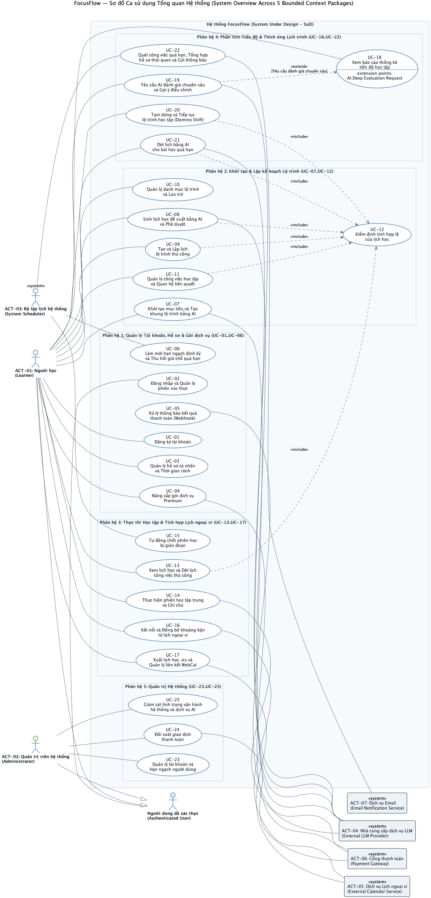
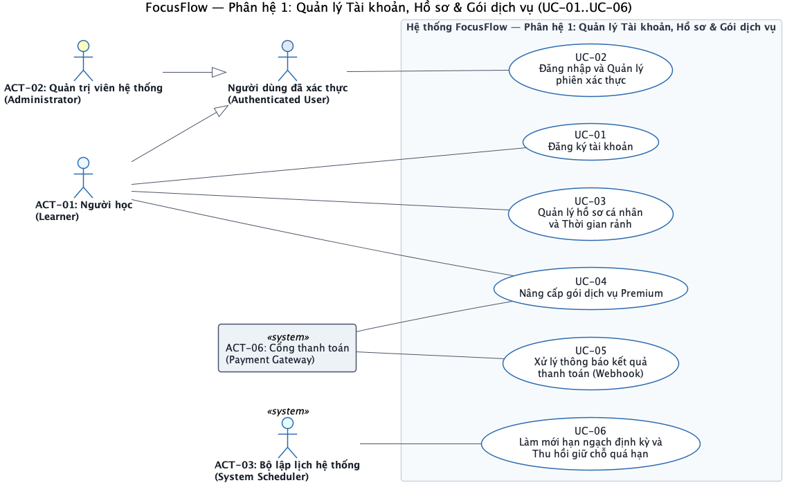
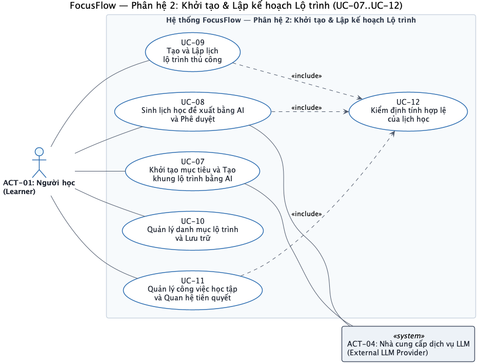
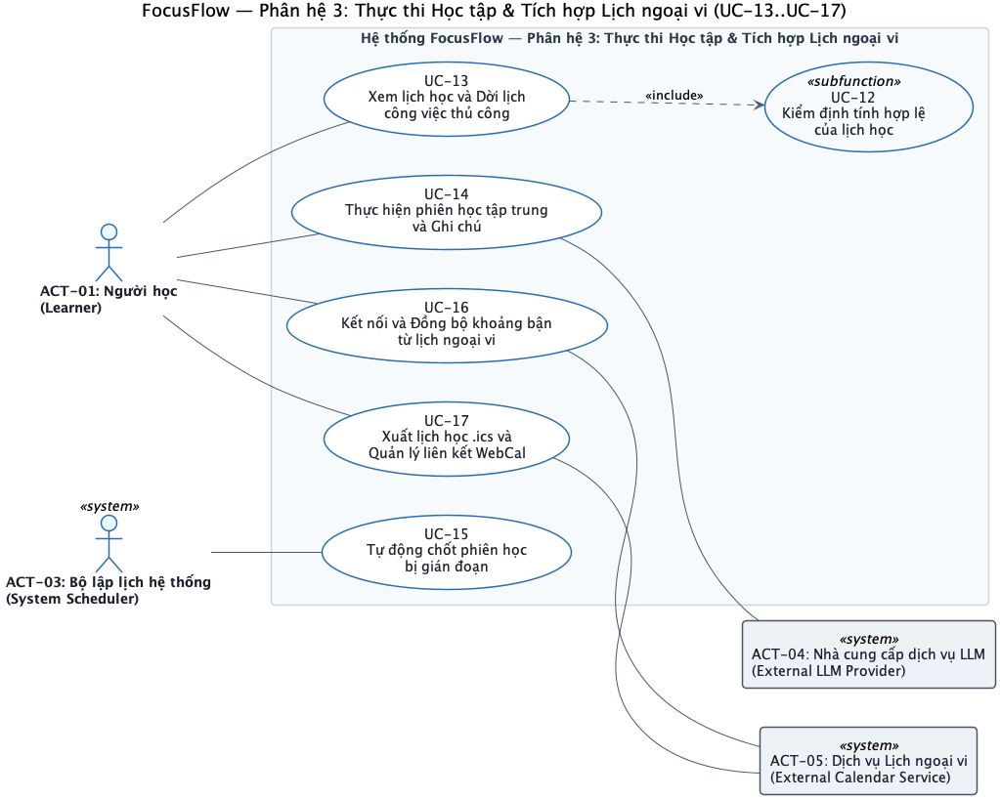
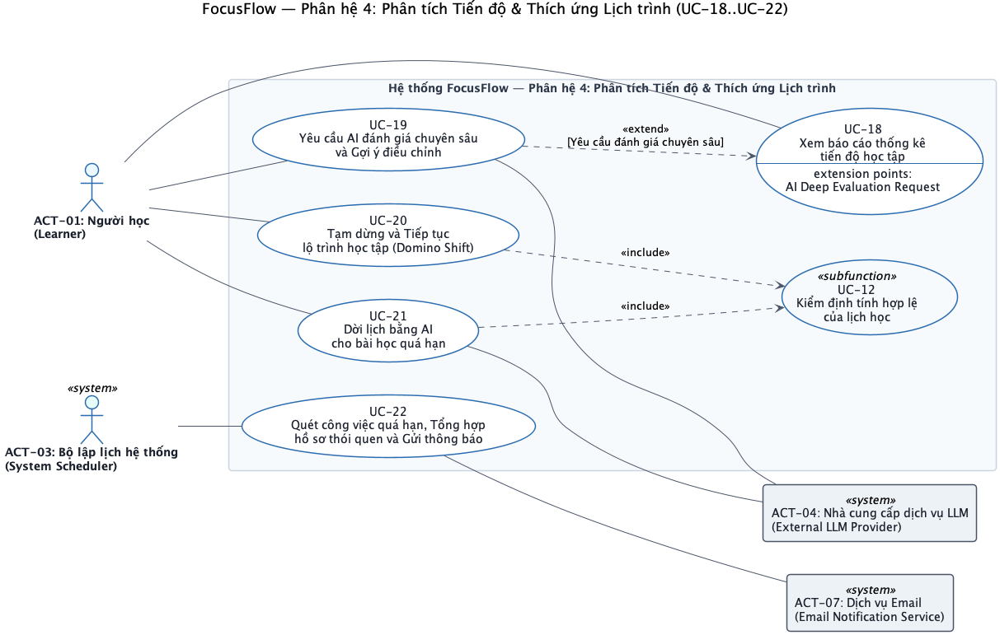
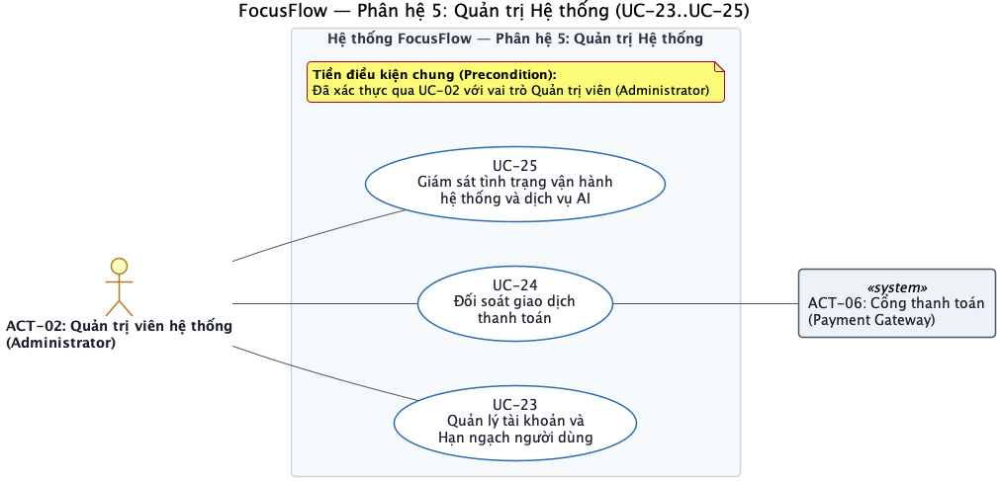

# FocusFlow — Tài liệu Đặc tả Ca sử dụng Chi tiết (Use Case Specifications)

| Thông tin tài liệu | Chi tiết |
|---|---|
| **Dự án** | FocusFlow — Hệ thống hỗ trợ lập kế hoạch và thực thi lộ trình tự học thích ứng tích hợp AI |
| **Cấp độ tài liệu** | Đặc tả Ca sử dụng Chi tiết (Detailed Use Case Specifications) |
| **Phiên bản** | v3.0 — Chuẩn hóa theo OMG UML 2.5.1, Cockburn User-Goal Level & Khung `usecase-analyst` |
| **Tiêu chuẩn kỹ thuật** | ISO/IEC/IEEE 29148:2018 (Requirements Engineering), OMG UML 2.5.1 (Clause 18 — Use Cases) |
| **Tài liệu liên kết** | • Đặc tả Yêu cầu Phần mềm (SRS): [`srs-v1.0.md`](../srs/srs-v1.0.md) • Sơ đồ Ca sử dụng Tổng quan: [`use-case-diagram.puml`](./use-cases/use-case-diagram.puml) • Sơ đồ Phân hệ 1..5: [`uc-mod-01-account-profile-billing.puml`](./use-cases/uc-mod-01-account-profile-billing.puml) .. [`uc-mod-05-system-administration.puml`](./use-cases/uc-mod-05-system-administration.puml) • Đặc tả Biểu đồ Lớp: [`class-diagrams.md`](./class-diagrams.md) |

---

## MỤC LỤC

1. [Tóm tắt Phạm vi & Giả định (Scope Summary & Assumptions)](#1-tóm-tắt-phạm-vi--giả-định-scope-summary--assumptions)
2. [Bảng Tác nhân Hệ thống (System Actors Table — 7 Canonical Actors + 1 Abstract Actor)](#2-bảng-tác-nhân-hệ-thống-system-actors-table--7-canonical-actors--1-abstract-actor)
3. [Danh mục Use Cases theo 5 Phân hệ (Use Case Inventory — `UC-01` đến `UC-25`)](#3-danh-mục-use-cases-theo-5-phân-hệ-use-case-inventory--uc-01-đến-uc-25)
4. [Kiến trúc Sơ đồ Use Case (Use Case Diagrams Reference)](#4-kiến-trúc-sơ-đồ-use-case-use-case-diagrams-reference)
5. [Đặc tả Chi tiết Từng Use Case (`UC-01` đến `UC-25`)](#5-đặc-tả-chi-tiết-từng-use-case-uc-01-đến-uc-25)
   - **Phân hệ 1: Quản lý Tài khoản, Hồ sơ & Gói dịch vụ** (`UC-01` – `UC-06`)
   - **Phân hệ 2: Khởi tạo & Lập kế hoạch Lộ trình** (`UC-07` – `UC-12`)
   - **Phân hệ 3: Thực thi Học tập & Tích hợp Lịch ngoại vi** (`UC-13` – `UC-17`)
   - **Phân hệ 4: Phân tích Tiến độ & Thích ứng Lịch trình** (`UC-18` – `UC-22`)
   - **Phân hệ 5: Quản trị Hệ thống** (`UC-23` – `UC-25`)
6. [Ma trận Truy vết Toàn cục (Master Traceability Matrix) & Rà soát Chất lượng](#6-ma-trận-truy-vết-toàn-cục-master-traceability-matrix--rà-soát-chất-lượng)

---

## 1. Tóm tắt Phạm vi & Giả định (Scope Summary & Assumptions)

- **Hệ thống đích (System Under Design — SuD)**: **FocusFlow** là ứng dụng web hỗ trợ người tự học (Self-Directed Learners) khép kín chu trình Tự học có điều tiết theo mô hình **Zimmerman SRL (2002)**: *(1) Pha Dự tính (Forethought)* — khởi tạo mục tiêu, phân rã lộ trình 2 cấp độ với AI hoặc thủ công và kiểm định tính hợp lệ của lịch học; *(2) Pha Thực hiện (Performance)* — thực thi phiên học tập trung kèm ghi chú và tích hợp lịch ngoại vi; *(3) Pha Tự phản tư & Thích ứng (Self-Reflection & Adaptation)* — báo cáo thống kê định lượng, đánh giá chuyên sâu từ AI, tạm dừng lộ trình (Domino Shift) và dời lịch bằng AI cho bài học quá hạn.
- **Phương pháp luận mô hình hóa (UML 2.5.1 & Cockburn Goal Levels)**:
  - **24 Use Cases mức mục tiêu (User-Goal / System-Goal Level)** hoàn thành trọn vẹn một mục tiêu nghiệp vụ có giá trị quan sát được trong một phiên tương tác liên tục (từ 3 đến 9 bước trong luồng chính theo chuẩn Cockburn).
  - **01 Use Case mức chức năng con dùng chung (`UC-12: Kiểm định tính hợp lệ của lịch học` — Subfunction Level)** được tái sử dụng thông qua quan hệ `<<include>>` bởi 6 Use Cases (`UC-08`, `UC-09`, `UC-11`, `UC-13`, `UC-20`, `UC-21`) nhằm bảo đảm 100% thay đổi lên lịch học đều tuân thủ quy tắc không chu trình tiên quyết, khung giờ rảnh cố định và trần thời gian học.
- **Nguyên tắc Quản trị AI & Quyền tự quyết của Người học (Human-in-the-Loop Governance — `BUSR-02`, `BUSR-03`, `BUSR-12`)**:
  - Nhà cung cấp dịch vụ LLM (`External LLM Provider`) tuyệt đối không có quyền tự động ghi trực tiếp vào Lịch học chính thức (`OfficialSchedule`).
  - Mọi đề xuất lịch trình do AI sinh ra (bao gồm cả lập lịch mới tại `UC-08` và dời lịch quá hạn tại `UC-21`) đều phải tạo thành Bản đề xuất lịch trình (`ScheduleProposal` ở trạng thái `DRAFT`), đi qua `UC-12` để kiểm định đầy đủ ràng buộc và hiển thị bản xem trước để Người học chủ động bấm **Áp dụng** mới cập nhật `OfficialSchedule`.
- **Giả định miền nghiệp vụ (Core Domain Assumptions)**:
  1. Mọi thời điểm lưu trữ nội bộ sử dụng chuẩn giờ quốc tế UTC; việc tính toán ranh giới ngày học, khung giờ rảnh và điều kiện quá hạn (`isOverdue`) được quy chiếu theo múi giờ IANA trong hồ sơ của từng Người học (mặc định `Asia/Ho_Chi_Minh`).
  2. Mỗi Người học chỉ được mở tối đa **01 phiên học tập trung (`IN_PROGRESS`)** tại một thời điểm trên toàn hệ thống.
  3. Chiều đồng bộ từ Dịch vụ Lịch ngoại vi vào FocusFlow (`UC-16`) chỉ đọc các khoảng thời gian bận (`Free/Busy`) để khấu trừ quỹ thời gian rảnh khả dụng, không tự động xóa hay sửa đổi lộ trình học tập (`BUSR-08`).

---

## 2. Bảng Tác nhân Hệ thống (System Actors Table — 7 Canonical Actors + 1 Abstract Actor)

| Mã Actor | Tên Tác nhân (Actor Name) | Phân loại (Primary / Secondary) | Quan hệ Kế thừa / Vai trò & Trách nhiệm tương tác |
|---|---|---|---|
| **Abstract** | **Người dùng đã xác thực (`Authenticated User`)** | **Abstract Primary Actor** *(Tác nhân trừu tượng)* | Tác nhân tổng quát hóa đại diện cho mọi người dùng con người cần xác thực danh tính, làm mới phiên và đăng xuất tại `UC-02`. Được kế thừa chuyên biệt hóa bởi `Learner` và `Administrator`. |
| **ACT-01** | **Người học (`Learner`)** | **Primary Actor** *(Tác nhân con người chính)* | Kế thừa `Authenticated User` (`Learner --\|> Authenticated User`). Khởi xướng trực tiếp các ca sử dụng học tập và quản lý lộ trình: `UC-01`, `UC-02`, `UC-03`, `UC-04`, `UC-07`, `UC-08`, `UC-09`, `UC-10`, `UC-11`, `UC-13`, `UC-14`, `UC-16`, `UC-17`, `UC-18`, `UC-19`, `UC-20`, `UC-21`. |
| **ACT-02** | **Quản trị viên hệ thống (`Administrator`)** | **Primary Actor** *(Tác nhân con người nội bộ)* | Kế thừa `Authenticated User` (`Administrator --\|> Authenticated User`). Khởi xướng `UC-02` để xác thực và thực hiện các ca sử dụng quản trị nền tảng: quản lý tài khoản & hạn ngạch (`UC-23`), đối soát giao dịch thanh toán (`UC-24`), và giám sát vận hành hệ thống & dịch vụ AI (`UC-25`). |
| **ACT-03** | **Bộ lập lịch hệ thống (`System Scheduler`)** | **Primary Actor** *(Tác nhân thời gian / Bộ kích hoạt định kỳ)* | Khởi xướng các ca sử dụng tự động theo lịch trình mà không cần tương tác con người: làm mới hạn ngạch định kỳ, thu hồi giữ chỗ quá hạn & hạ cấp gói hết hạn (`UC-06`); tự động chốt phiên học bị gián đoạn quá 5 phút (`UC-15`); quét công việc quá hạn lúc 00:05, tổng hợp hồ sơ thói quen 30 ngày & kích hoạt thông báo (`UC-22`). |
| **ACT-04** | **Nhà cung cấp dịch vụ LLM (`External LLM Provider`)** | **Secondary Actor** *(Tác nhân hệ thống phụ trợ)* | Cung cấp dịch vụ suy luận ngôn ngữ lớn có cấu trúc (trung lập nhà cung cấp theo `ADR-005`) cho các ca sử dụng: tạo khung lộ trình (`UC-07`), sinh lịch học đề xuất (`UC-08`), chia nhỏ bài học trong phiên học (`UC-14`), đánh giá chuyên sâu (`UC-19`), và dời lịch bài học quá hạn (`UC-21`). |
| **ACT-05** | **Dịch vụ Lịch ngoại vi (`External Calendar Service`)** | **Secondary Actor** *(Tác nhân hệ thống phụ trợ)* | Hệ thống lịch cá nhân bên ngoài cung cấp khoảng thời gian bận `Free/Busy` chiều Inbound (`UC-16`) và tiêu thụ dữ liệu lịch học chính thức chiều Outbound qua tệp `.ics` hoặc liên kết `WebCal` (`UC-17`). |
| **ACT-06** | **Cổng thanh toán (`Payment Gateway`)** | **Secondary Actor** (`UC-04`, `UC-24`) & **Primary Actor** (`UC-05`) | Cung cấp trang thanh toán/mã QR (`UC-04`) và dữ liệu đối soát giao dịch (`UC-24`) với vai trò Secondary Actor; đồng thời đóng vai trò **Primary Actor** chủ động gửi thông báo kết quả thanh toán bất đồng bộ (Webhook) vào hệ thống tại `UC-05`. |
| **ACT-07** | **Dịch vụ Email (`Email Notification Service`)** | **Secondary Actor** *(Tác nhân hệ thống phụ trợ)* | Tiếp nhận yêu cầu gửi thư điện tử thông báo danh sách bài học quá hạn hoặc cảnh báo chậm tiến độ tới Người học trong ca sử dụng `UC-22`. |

---

## 3. Danh mục Use Cases theo 5 Phân hệ (Use Case Inventory — `UC-01` đến `UC-25`)

| ID | Phân hệ (Module) | Tên Use Case | Actor chính (Primary) | Actor phụ (Secondary) | Quan hệ UML | Mục tiêu nghiệp vụ (Goal) |
|---|---|---|---|---|---|---|
| **UC-01** | **Phân hệ 1: Tài khoản, Hồ sơ & Gói dịch vụ** | Đăng ký tài khoản | `Learner` (`ACT-01`) | Không có | Association | Tạo tài khoản người học mới kèm cấu hình thời gian rảnh, hồ sơ học tập và hạn ngạch AI khởi đầu của gói `FREE`. |
| **UC-02** | **Phân hệ 1: Tài khoản, Hồ sơ & Gói dịch vụ** | Đăng nhập và Quản lý phiên xác thực | `Authenticated User` (`Learner`, `Administrator`) | Không có | Generalization (`ACT-01`, `ACT-02`) | Xác thực danh tính để mở phiên làm việc hợp lệ, gia hạn phiên làm việc hoặc đăng xuất an toàn. |
| **UC-03** | **Phân hệ 1: Tài khoản, Hồ sơ & Gói dịch vụ** | Quản lý hồ sơ cá nhân và Thời gian rảnh | `Learner` (`ACT-01`) | Không có | Association | Cập nhật thông tin cá nhân/múi giờ, cấu hình thời gian rảnh (Mode A/B, buổi học ưu tiên `preferredPeriod`) và thiết lập nhịp độ học tập SRL. |
| **UC-04** | **Phân hệ 1: Tài khoản, Hồ sơ & Gói dịch vụ** | Nâng cấp gói dịch vụ Premium | `Learner` (`ACT-01`) | `Payment Gateway` (`ACT-06`) | Association | Khởi tạo đơn nâng cấp gói `PREMIUM` (hoặc tái sử dụng đơn `PENDING` còn hạn < 15 phút) và nhận thông tin thanh toán từ cổng thanh toán. |
| **UC-05** | **Phân hệ 1: Tài khoản, Hồ sơ & Gói dịch vụ** | Xử lý thông báo kết quả thanh toán (Webhook) | `Payment Gateway` (`ACT-06`) | Không có | Association | Tiếp nhận thông báo kết quả giao dịch từ Cổng thanh toán, đối chiếu chữ ký và tính bất biến để chuyển trạng thái đơn và kích hoạt gói `PREMIUM`. |
| **UC-06** | **Phân hệ 1: Tài khoản, Hồ sơ & Gói dịch vụ** | Làm mới hạn ngạch định kỳ và Thu hồi giữ chỗ quá hạn | `System Scheduler` (`ACT-03`) | Không có | Association | Tự động làm mới hạn ngạch chu kỳ mới, thu hồi bản ghi giữ chỗ `RESERVED` quá hạn sang `EXPIRED`, và hạ cấp tài khoản hết hạn `PREMIUM` về `FREE` kèm tạm dừng các lộ trình vượt trần. |
| **UC-07** | **Phân hệ 2: Khởi tạo & Lập kế hoạch Lộ trình** | Khởi tạo mục tiêu và Tạo khung lộ trình bằng AI | `Learner` (`ACT-01`) | `External LLM Provider` (`ACT-04`) | Association | Nhập mục tiêu học tập, làm rõ ngữ cảnh đầu vào và yêu cầu AI sinh danh sách Cột mốc kiến thức (`Milestones`) để Người học duyệt. |
| **UC-08** | **Phân hệ 2: Khởi tạo & Lập kế hoạch Lộ trình** | Sinh lịch học đề xuất bằng AI và Phê duyệt | `Learner` (`ACT-01`) | `External LLM Provider` (`ACT-04`) | `<<include>> UC-12` | Phân rã các Cột mốc đã duyệt thành Bản đề xuất lịch học (`ScheduleProposal`), kiểm định qua `UC-12` và phê duyệt thành Lịch chính thức (`OfficialSchedule`). |
| **UC-09** | **Phân hệ 2: Khởi tạo & Lập kế hoạch Lộ trình** | Tạo và Lập lịch lộ trình thủ công | `Learner` (`ACT-01`) | Không có | `<<include>> UC-12` | Chủ động tự tạo mục tiêu, cột mốc, công việc học tập và xếp lịch lộ trình hoàn toàn thủ công (kiểm định qua `UC-12`) không phụ thuộc dịch vụ AI. |
| **UC-10** | **Phân hệ 2: Khởi tạo & Lập kế hoạch Lộ trình** | Quản lý danh mục lộ trình và Lưu trữ | `Learner` (`ACT-01`) | Không có | Association | Chuyển ngữ cảnh lộ trình làm việc, cập nhật tên/hạn chót (tính lại độ ưu tiên EDF), hoặc lưu trữ lộ trình (`ARCHIVED`) để hủy task dở dang và giải phóng lịch. |
| **UC-11** | **Phân hệ 2: Khởi tạo & Lập kế hoạch Lộ trình** | Quản lý công việc học tập và Quan hệ tiên quyết | `Learner` (`ACT-01`) | Không có | `<<include>> UC-12` | Thêm, sửa, hủy (`CANCELLED`) công việc học tập lẻ (15–240 phút), gán/gỡ quan hệ tiên quyết DAG và xếp công việc từ Hàng đợi (`Backlog`) vào lịch qua `UC-12`. |
| **UC-12** | **Phân hệ 2: Khởi tạo & Lập kế hoạch Lộ trình** | Kiểm định tính hợp lệ của lịch học | Không có *(Subfunction)* | Không có | Được `<<include>>` bởi `UC-08`, `UC-09`, `UC-11`, `UC-13`, `UC-20`, `UC-21` | Kiểm tra tất định đồ thị tiên quyết không có chu trình (DAG), tôn trọng thứ tự tiên quyết, khớp khung giờ Mode B và không vượt trần giờ học ngày/tuần. |
| **UC-13** | **Phân hệ 3: Thực thi Học tập & Lịch ngoại vi** | Xem lịch học và Dời lịch công việc thủ công | `Learner` (`ACT-01`) | Không có | `<<include>> UC-12` | Xem lịch học theo ngày/tuần/tháng, kéo thả dời ngày học thủ công (kiểm định qua `UC-12`) hoặc đánh dấu hoàn thành nhanh công việc. |
| **UC-14** | **Phân hệ 3: Thực thi Học tập & Lịch ngoại vi** | Thực hiện phiên học tập trung và Ghi chú | `Learner` (`ACT-01`) | `External LLM Provider` (`ACT-04`) *(tùy chọn)* | Association | Chọn $\ge 1$ công việc, chọn đồng hồ `POMODORO`/`STOPWATCH`, chuyển task sang `IN_PROGRESS`, ghi chú `SCRATCHPAD`/`KEY_TAKEAWAY`, hoàn thành/dừng sớm hoặc nhờ AI chia nhỏ bài học (`TASK_MICRO_STEPPING`). |
| **UC-15** | **Phân hệ 3: Thực thi Học tập & Lịch ngoại vi** | Tự động chốt phiên học bị gián đoạn | `System Scheduler` (`ACT-03`) | Không có | Association | Phát hiện phiên học `IN_PROGRESS` mất tín hiệu duy trì quá 5 phút (`OS-07`) và tự động chốt trạng thái `PARTIAL_COMPLETED` hoặc `CANCELLED` theo `OS-01`. |
| **UC-16** | **Phân hệ 3: Thực thi Học tập & Lịch ngoại vi** | Kết nối và Đồng bộ khoảng bận từ lịch ngoại vi | `Learner` (`ACT-01`) | `External Calendar Service` (`ACT-05`) | Association | Ủy quyền kết nối `CalendarConnection` và đồng bộ một chiều các khoảng bận `Free/Busy` để khấu trừ quỹ thời gian rảnh khả dụng. |
| **UC-17** | **Phân hệ 3: Thực thi Học tập & Lịch ngoại vi** | Xuất lịch học `.ics` và Quản lý liên kết WebCal | `Learner` (`ACT-01`) | `External Calendar Service` (`ACT-05`) | Association | Tải tệp lịch tĩnh `.ics` hoặc khởi tạo/xoay vòng liên kết `WebCalToken` để ứng dụng lịch ngoại vi tự động đọc Lịch học chính thức. |
| **UC-18** | **Phân hệ 4: Phân tích Tiến độ & Thích ứng Lịch trình** | Xem báo cáo thống kê tiến độ học tập | `Learner` (`ACT-01`) | Không có | Có Extension Point cho `UC-19` | Hiển thị chỉ số định lượng `QuantitativeMetrics`, tỷ lệ tuân thủ `adherenceRate`, chuỗi ngày học `currentStreakDays` và biểu đồ tiến độ. |
| **UC-19** | **Phân hệ 4: Phân tích Tiến độ & Thích ứng Lịch trình** | Yêu cầu AI đánh giá chuyên sâu và Gợi ý điều chỉnh | `Learner` (`ACT-01`) | `External LLM Provider` (`ACT-04`) | Association & `<<extend>> UC-18` | Phân tích dữ liệu thực học và ghi chú đúc kết để sinh báo cáo nhận xét chuyên sâu 3 phần theo mô hình Zimmerman SRL mà không tự ý sửa lịch. |
| **UC-20** | **Phân hệ 4: Phân tích Tiến độ & Thích ứng Lịch trình** | Tạm dừng và Tiếp tục lộ trình học tập (Domino Shift) | `Learner` (`ACT-01`) | Không có | `<<include>> UC-12` | Đóng băng lộ trình sang `PAUSED` khi có việc đột xuất và tính số ngày dịch chuyển Domino bỏ qua ngày nghỉ khi tiếp tục lộ trình (kiểm định qua `UC-12`). |
| **UC-21** | **Phân hệ 4: Phân tích Tiến độ & Thích ứng Lịch trình** | Dời lịch bằng AI cho bài học quá hạn | `Learner` (`ACT-01`) | `External LLM Provider` (`ACT-04`) | `<<include>> UC-12` | Yêu cầu AI sinh `ScheduleProposal` (`DRAFT`) cho các bài quá hạn/chưa xong của lộ trình, kiểm định qua `UC-12` và hiển thị bản xem trước để Người học bấm **Áp dụng**. |
| **UC-22** | **Phân hệ 4: Phân tích Tiến độ & Thích ứng Lịch trình** | Quét công việc quá hạn, Tổng hợp hồ sơ thói quen và Gửi thông báo | `System Scheduler` (`ACT-03`) | `Email Notification Service` (`ACT-07`) | Association | Quét lúc 00:05 theo múi giờ người học để đánh dấu `isOverdue = true`, tổng hợp lại `LearnerProfile` trên cửa sổ trượt 30 ngày và gửi email thông báo khi có $\ge 3$ bài quá hạn. |
| **UC-23** | **Phân hệ 5: Quản trị Hệ thống** | Quản lý tài khoản và Hạn ngạch người dùng | `Administrator` (`ACT-02`) | Không có | Association | Tra cứu người dùng, khóa/mở khóa `AccountStatus`, nâng/hạ gói dịch vụ (kèm quy tắc tạm dừng lộ trình vượt trần) và làm mới hạn ngạch AI. |
| **UC-24** | **Phân hệ 5: Quản trị Hệ thống** | Đối soát giao dịch thanh toán | `Administrator` (`ACT-02`) | `Payment Gateway` (`ACT-06`) | Association | Tra cứu lịch sử đơn thanh toán và đối chiếu trạng thái giao dịch thực tế với Cổng thanh toán để xử lý các trường hợp nghẽn thông báo. |
| **UC-25** | **Phân hệ 5: Quản trị Hệ thống** | Giám sát tình trạng vận hành hệ thống và dịch vụ AI | `Administrator` (`ACT-02`) | Không có | Association | Theo dõi chỉ số sức khỏe hệ thống, tỷ lệ lỗi/độ trễ và chi phí của `AIUsageLog`, cùng trạng thái hàng đợi tác vụ nền. |

---

## 4. Kiến trúc Sơ đồ Use Case (Use Case Diagrams Reference)

Theo hướng dẫn phân rã mô hình tại [`diagram-guide.md`](../../.agents/skills/usecase-analyst/references/diagram-guide.md) (giữ mỗi sơ đồ chi tiết $\le 12$ Use Cases để đảm bảo tính dễ đọc), bộ sơ đồ Use Case của FocusFlow được tổ chức theo cấu trúc 2 cấp:
1. **01 Sơ đồ Tổng quan Hệ thống (`use-case-diagram.puml`)**: Đóng vai trò **System Overview Across 5 Bounded Context Packages**, thể hiện bức tranh toàn cảnh 5 gói phân hệ và sự tham gia của 7 tác nhân chuẩn hóa (`ACT-01`..`ACT-07` cùng tác nhân trừu tượng `Authenticated User`).
2. **05 Sơ đồ Phân hệ Chuyên biệt (`uc-mod-01` đến `uc-mod-05`)**: Mỗi sơ đồ phân hệ chứa từ **3 đến 6 Use Cases**, hoàn toàn nằm gọn trong ngưỡng khuyến nghị $\le 12$ Use Cases/sơ đồ.

| STT | Phạm vi Sơ đồ | Số lượng UC | Tệp nguồn PlantUML (`.puml`) |
|---|---|---|---|
| **1** | **Sơ đồ Tổng quan Hệ thống (System Overview Across 5 Packages)** | Toàn cảnh 5 gói (`UC-01`..`UC-25`) | [`use-case-diagram.puml`](./use-cases/use-case-diagram.puml) |
| **2** | **Phân hệ 1: Quản lý Tài khoản, Hồ sơ & Gói dịch vụ** | 6 UCs (`UC-01`..`UC-06`) | [`uc-mod-01-account-profile-billing.puml`](./use-cases/uc-mod-01-account-profile-billing.puml) |
| **3** | **Phân hệ 2: Khởi tạo & Lập kế hoạch Lộ trình** | 6 UCs (`UC-07`..`UC-12`) | [`uc-mod-02-roadmap-planning.puml`](./use-cases/uc-mod-02-roadmap-planning.puml) |
| **4** | **Phân hệ 3: Thực thi Học tập & Tích hợp Lịch ngoại vi** | 5 UCs + 1 Subfunction (`UC-13`..`UC-17`, `UC-12`) | [`uc-mod-03-study-execution-calendar.puml`](./use-cases/uc-mod-03-study-execution-calendar.puml) |
| **5** | **Phân hệ 4: Phân tích Tiến độ & Thích ứng Lịch trình** | 5 UCs + 1 Subfunction (`UC-18`..`UC-22`, `UC-12`) | [`uc-mod-04-analytics-adaptation.puml`](./use-cases/uc-mod-04-analytics-adaptation.puml) |
| **6** | **Phân hệ 5: Quản trị Hệ thống** | 3 UCs (`UC-23`..`UC-25`) | [`uc-mod-05-system-administration.puml`](./use-cases/uc-mod-05-system-administration.puml) |
| STT | Phạm vi Sơ đồ | Số lượng UC | Tệp nguồn PlantUML (`.puml`) | Hình ảnh kết xuất (`.png`) |
|---|---|---|---|---|
| **1** | **Sơ đồ Tổng quan Hệ thống (System Overview Across 5 Packages)** | Toàn cảnh 5 gói (`UC-01`..`UC-25`) | [`use-cases/use-case-diagram.puml`](./use-cases/use-case-diagram.puml) | [`images/FocusFlow_UseCase_Diagram.png`](images/FocusFlow_UseCase_Diagram.png) |
| **2** | **Phân hệ 1: Quản lý Tài khoản, Hồ sơ & Gói dịch vụ** | 6 UCs (`UC-01`..`UC-06`) | [`use-cases/uc-mod-01-account-profile-billing.puml`](./use-cases/uc-mod-01-account-profile-billing.puml) | [`images/uc-mod-01-account-profile-billing.png`](images/uc-mod-01-account-profile-billing.png) |
| **3** | **Phân hệ 2: Khởi tạo & Lập kế hoạch Lộ trình** | 6 UCs (`UC-07`..`UC-12`) | [`use-cases/uc-mod-02-roadmap-planning.puml`](./use-cases/uc-mod-02-roadmap-planning.puml) | [`images/uc-mod-02-roadmap-planning.png`](images/uc-mod-02-roadmap-planning.png) |
| **4** | **Phân hệ 3: Thực thi Học tập & Tích hợp Lịch ngoại vi** | 5 UCs + 1 Subfunction (`UC-13`..`UC-17`, `UC-12`) | [`use-cases/uc-mod-03-study-execution-calendar.puml`](./use-cases/uc-mod-03-study-execution-calendar.puml) | [`images/uc-mod-03-study-execution-calendar.png`](images/uc-mod-03-study-execution-calendar.png) |
| **5** | **Phân hệ 4: Phân tích Tiến độ & Thích ứng Lịch trình** | 5 UCs + 1 Subfunction (`UC-18`..`UC-22`, `UC-12`) | [`use-cases/uc-mod-04-analytics-adaptation.puml`](./use-cases/uc-mod-04-analytics-adaptation.puml) | [`images/uc-mod-04-analytics-adaptation.png`](images/uc-mod-04-analytics-adaptation.png) |
| **6** | **Phân hệ 5: Quản trị Hệ thống** | 3 UCs (`UC-23`..`UC-25`) | [`use-cases/uc-mod-05-system-administration.puml`](./use-cases/uc-mod-05-system-administration.puml) | [`images/uc-mod-05-system-administration.png`](images/uc-mod-05-system-administration.png) |

### 4.1. Sơ đồ Tổng quan Ca Sử Dụng Toàn Hệ thống

---

## 5. Đặc tả Chi tiết Từng Use Case (`UC-01` đến `UC-25`)

### PHÂN HỆ 1: QUẢN LÝ TÀI KHOẢN, HỒ SƠ & GÓI DỊCH VỤ (`UC-01` – `UC-06`)

---

### UC-01: Đăng ký tài khoản

| Thuộc tính | Nội dung |
|---|---|
| **ID** | UC-01 |
| **Tên** | Đăng ký tài khoản |
| **Mô tả ngắn** | Người học cung cấp thông tin định danh cá nhân (họ tên, địa chỉ email, mật khẩu, múi giờ) để tạo tài khoản mới kèm hạn ngạch AI mặc định của gói `FREE` và hồ sơ học tập khởi đầu. |
| **Actor chính** | Người học (`Learner` — `ACT-01`) |
| **Actor phụ** | Không có |
| **Mức độ** | Mục tiêu người dùng (User-goal level) |
| **Trigger** | Người học chọn chức năng đăng ký tài khoản mới. |
| **Tiền điều kiện** | Người học đang ở trạng thái chưa xác thực; địa chỉ email đăng ký chưa tồn tại trong hệ thống. |
| **Hậu điều kiện – thành công** | Thực thể `User` được tạo ở trạng thái `ACTIVE`, vai trò `LEARNER`, gói dịch vụ `FREE`; các thực thể `AvailabilityProfile`, `LearnerProfile` (trạng thái khởi đầu) và `AIQuota` (30 lượt/tháng, tối đa 3 lộ trình hoạt động) được tạo nguyên tử; phiên xác thực được thiết lập. |
| **Hậu điều kiện – thất bại** | Không có bản ghi tài khoản, hồ sơ hay hạn ngạch nào được lưu; trạng thái hệ thống giữ nguyên. |
| **Include / Extend** | Không có |
| **Tần suất / Độ ưu tiên** | Trung bình (1 lần/người học mới) / Bắt buộc (Must have — P0) |
| **Truy vết SRS & Thiết kế** | • **SRS**: `FR-AUTH-001`, `BUSR-01`, `BUSR-10`, `OS-02`, `NFR-SEC-002` • **Lớp miền**: `User`, `AvailabilityProfile`, `LearnerProfile`, `AIQuota` • **Bảng CSDL**: `users`, `availabilities`, `learner_profiles`, `ai_quotas` |

**Luồng chính (Basic Flow)**
1. Người học mở chức năng đăng ký tài khoản mới.
2. Hệ thống yêu cầu Người học cung cấp họ tên hiển thị, địa chỉ email, mật khẩu, xác nhận mật khẩu và múi giờ cá nhân.
3. Người học nhập đầy đủ thông tin đăng ký và gửi yêu cầu tạo tài khoản.
4. Hệ thống kiểm tra định dạng email, độ mạnh mật khẩu (`BR-AUTH-01`) và xác nhận địa chỉ email chưa tồn tại trong hệ thống (`BR-AUTH-02`).
5. Hệ thống mã hóa bảo mật mật khẩu một chiều và khởi tạo tài khoản `User` ở trạng thái `ACTIVE` với vai trò `LEARNER` và gói dịch vụ `FREE`.
6. Hệ thống khởi tạo đồng bộ hạn ngạch `AIQuota` mặc định của gói `FREE` (`BR-QUOTA-01`), cấu hình thời gian rảnh `AvailabilityProfile` mặc định và hồ sơ thói quen `LearnerProfile` ở trạng thái khởi đầu.
7. Hệ thống mở phiên làm việc xác thực cho Người học và điều hướng tới không gian thiết lập mục tiêu ban đầu. Use case kết thúc thành công.

**Luồng thay thế (Alternative Flows)**
- **2a. Người học đã có tài khoản**
  1. Người học chọn chuyển sang chức năng đăng nhập.
  2. Hệ thống chuyển sang thực hiện `UC-02` (Đăng nhập và Quản lý phiên xác thực). Use case kết thúc.
- **3a. Người học không chỉ định múi giờ thủ công**
  1. Hệ thống tự động lấy múi giờ từ thiết bị của Người học; nếu không xác định được thì gán múi giờ mặc định `Asia/Ho_Chi_Minh`.
  2. Quay lại bước 4 của luồng chính.

**Luồng ngoại lệ (Exception Flows)**
- **4e1. Định dạng email không hợp lệ hoặc mật khẩu chưa đủ độ mạnh**
  1. Hệ thống từ chối yêu cầu và thông báo cụ thể tiêu chí định dạng email hoặc độ mạnh mật khẩu chưa đạt chuẩn (`BR-AUTH-01`).
  2. Quay lại bước 3 của luồng chính.
- **4e2. Địa chỉ email đã được đăng ký**
  1. Hệ thống từ chối tạo tài khoản mới và thông báo địa chỉ email đã tồn tại (`BR-AUTH-02`), đồng thời gợi ý chuyển sang đăng nhập.
  2. Use case kết thúc (thất bại).
- **6e. Lỗi lưu trữ dữ liệu trong quá trình khởi tạo**
  1. Hệ thống hoàn tác toàn bộ giao dịch tạo tài khoản, hồ sơ và hạn ngạch, sau đó thông báo sự cố tạm thời cho Người học.
  2. Use case kết thúc (thất bại).

**Quy tắc nghiệp vụ (Business Rules)**
- **BR-AUTH-01 (`FR-AUTH-001`, `NFR-SEC-002`)**: Mật khẩu phải có độ dài tối thiểu 8 ký tự, bao gồm ít nhất 01 chữ cái và 01 chữ số; mật khẩu không bao giờ được lưu ở dạng văn bản rõ.
- **BR-AUTH-02 (`FR-AUTH-001`)**: Mỗi địa chỉ email (sau khi chuẩn hóa chữ thường và cắt khoảng trắng hai đầu) là duy nhất trên toàn hệ thống.
- **BR-QUOTA-01 (`BUSR-01`, `OS-02`)**: Tài khoản mới đăng ký mặc định thuộc gói `FREE` với 30 lượt gọi AI/tháng và tối đa 03 lộ trình `ACTIVE` đồng thời.

**Yêu cầu phi chức năng & Ghi chú kỹ thuật**
- **Tính nguyên tử giao dịch (`NFR-AVAIL-001`)**: Khởi tạo `users`, `availabilities`, `learner_profiles` và `ai_quotas` thực thi trong cùng một giao dịch cơ sở dữ liệu nguyên tử (quan hệ `User 1 -- 1 LearnerProfile` và `User 1 -- 1 AIQuota`).
- **Độ trễ phản hồi (`NFR-PERF-002`)**: Thời gian xử lý đăng ký đạt $\le 500$ ms.
- **Ghi chú kỹ thuật (Technical Note)**: Mật khẩu được băm một chiều bằng thuật toán kháng phần cứng chuyên dụng theo `ADR-008`; phiên xác thực được lưu trữ trên bộ nhớ đệm tốc độ cao ở tầng hạ tầng mà không tạo bảng cơ sở dữ liệu quan hệ riêng.

**Dữ liệu vào / ra chính (Main Inputs / Outputs)**
- **Vào**: Họ tên hiển thị (`fullName`), Địa chỉ email (`email`), Mật khẩu, Xác nhận mật khẩu, Múi giờ (`timezone`).
- **Ra**: Thực thể `User` (`accountStatus = ACTIVE`, `role = LEARNER`, `tier = FREE`), `AIQuota` (`monthlyLimit = 30`), `LearnerProfile` khởi đầu, Phiên xác thực hợp lệ.

**Giả định & Quyết định thiết kế đã chốt (Assumptions & Resolved Decisions)**
- **Quyết định thiết kế (`EVAL-01`)**: Kích hoạt tài khoản ngay sau khi đăng ký hợp lệ mà không bắt buộc chờ xác minh qua thư điện tử nhằm đảm bảo tổng thời gian khởi tạo lộ trình đầu tiên $\le 5$ phút.

---

### UC-02: Đăng nhập và Quản lý phiên xác thực

| Thuộc tính | Nội dung |
|---|---|
| **ID** | UC-02 |
| **Tên** | Đăng nhập và Quản lý phiên xác thực |
| **Mô tả ngắn** | Người dùng đã xác thực (`Learner` hoặc `Administrator`) cung cấp thông tin định danh để mở phiên làm việc an toàn theo vai trò, gia hạn phiên làm việc đang hoạt động hoặc đăng xuất khỏi hệ thống. |
| **Actor chính** | Người dùng đã xác thực (`Authenticated User` — kế thừa bởi `Learner` `ACT-01` và `Administrator` `ACT-02`) |
| **Actor phụ** | Không có |
| **Mức độ** | Mục tiêu người dùng (User-goal level) |
| **Trigger** | Người dùng gửi yêu cầu đăng nhập, trình duyệt yêu cầu gia hạn phiên làm việc, hoặc người dùng chọn đăng xuất. |
| **Tiền điều kiện** | Tài khoản của người dùng đã tồn tại trong bảng `users`. |
| **Hậu điều kiện – thành công** | Khi đăng nhập/gia hạn: Phiên xác thực hợp lệ được cấp phát kèm vai trò phân quyền (`LEARNER` hoặc `ADMIN`) và cập nhật thời điểm đăng nhập gần nhất. Khi đăng xuất: Phiên xác thực hiện hành bị thu hồi hoàn toàn. |
| **Hậu điều kiện – thất bại** | Không cấp phát phiên làm việc; mọi truy cập sai thông tin định danh hoặc sai vai trò đều bị từ chối. |
| **Include / Extend** | Không có |
| **Tần suất / Độ ưu tiên** | Rất cao (Hàng ngày) / Bắt buộc (Must have — P0) |
| **Truy vết SRS & Thiết kế** | • **SRS**: `FR-AUTH-002`, `FR-ADM-001`, `BUSR-01`, `BUSR-11`, `NFR-SEC-001`, `NFR-SEC-002` • **Lớp miền**: `User`, `AccountStatus`, `UserRole` • **Bảng CSDL**: `users` |

**Luồng chính (Basic Flow)**
1. Người dùng (`Learner` hoặc `Administrator`) mở màn hình đăng nhập và cung cấp địa chỉ email cùng mật khẩu.
2. Hệ thống tra cứu tài khoản theo địa chỉ email và kiểm tra trạng thái tài khoản đang hoạt động (`accountStatus = ACTIVE`).
3. Hệ thống đối chiếu mật khẩu người dùng cung cấp với thông tin mật khẩu bảo mật đã lưu trữ của tài khoản (`BR-AUTH-04`).
4. Hệ thống kiểm tra vai trò phân quyền của tài khoản (`role = LEARNER` hoặc `role = ADMIN`) phù hợp với không gian làm việc yêu cầu (`BR-AUTH-03`).
5. Hệ thống thiết lập phiên xác thực hợp lệ, cấp quyền truy cập theo vai trò và cập nhật thời điểm đăng nhập gần nhất (`lastLoginAt`) của tài khoản.
6. Hệ thống điều hướng Người học vào Không gian học tập cá nhân hoặc điều hướng Quản trị viên vào Cổng quản trị hệ thống. Use case kết thúc thành công.

**Luồng thay thế (Alternative Flows)**
- **1a. Gia hạn phiên xác thực tự động khi mã truy cập ngắn hạn hết hạn**
  1. Thiết bị của người dùng gửi yêu cầu làm mới phiên kèm thông tin duy trì phiên hợp lệ.
  2. Hệ thống kiểm tra phiên chưa bị thu hồi, còn trong thời hạn cho phép và tài khoản vẫn ở trạng thái `accountStatus = ACTIVE`.
  3. Hệ thống xoay vòng thông tin phiên xác thực mới để duy trì phiên làm việc liền mạch. Use case kết thúc thành công.
- **6a. Người dùng chủ động đăng xuất khỏi hệ thống**
  1. Người dùng chọn chức năng đăng xuất khỏi phiên làm việc hiện tại.
  2. Hệ thống hủy hiệu lực phiên xác thực hiện hành ở phía máy chủ và xóa trạng thái đăng nhập trên thiết bị của người dùng.
  3. Hệ thống điều hướng người dùng về màn hình đăng nhập. Use case kết thúc thành công.

**Luồng ngoại lệ (Exception Flows)**
- **2e1. Email không tồn tại hoặc mật khẩu ở bước 3 không khớp**
  1. Hệ thống từ chối xác thực và hiển thị thông báo chung *"Thông tin đăng nhập không chính xác"* mà không tiết lộ trường nào sai (`BR-AUTH-04`).
  2. Quay lại bước 1 của luồng chính.
- **2e2. Tài khoản đang bị khóa (`accountStatus = LOCKED`)**
  1. Hệ thống từ chối mở phiên làm việc và thông báo tài khoản đã bị khóa bởi Quản trị viên (`BR-AUTH-05`).
  2. Use case kết thúc (thất bại).
- **4e. Tài khoản Người học (`role = LEARNER`) yêu cầu truy cập không gian Quản trị viên**
  1. Hệ thống chặn yêu cầu truy cập do không đủ thẩm quyền vai trò (`BR-AUTH-03`) và giữ nguyên trạng thái bảo vệ của cổng quản trị.
  2. Use case kết thúc (thất bại).

**Quy tắc nghiệp vụ (Business Rules)**
- **BR-AUTH-03 (`BUSR-11`, `FR-ADM-001`)**: Mọi chức năng quản trị hệ thống bắt buộc kiểm tra tài khoản có vai trò `role = ADMIN`.
- **BR-AUTH-04 (`FR-AUTH-002`)**: Thông báo từ chối khi sai email hoặc sai mật khẩu phải hoàn toàn giống nhau nhằm chống dò quét danh sách tài khoản (User Enumeration Prevention).
- **BR-AUTH-05 (`FR-ADM-002`)**: Tài khoản có `accountStatus = LOCKED` bị thu hồi toàn bộ phiên xác thực đang mở và không được phép đăng nhập hay gia hạn phiên.

**Yêu cầu phi chức năng & Ghi chú kỹ thuật**
- **Độ trễ xác thực (`NFR-PERF-002`)**: Thời gian phản hồi xác thực hoặc gia hạn phiên đạt $\le 200$ ms.
- **Ghi chú kỹ thuật (Technical Note)**: Theo `ADR-008`, hệ thống sử dụng cơ chế mã xác thực ngắn hạn (15 phút) kết hợp mã làm mới phiên (7 ngày; riêng phiên quản trị giới hạn tối đa 8 giờ theo `FR-ADM-001`) lưu trong cookie bảo mật và quản lý danh sách thu hồi phiên trên bộ nhớ đệm phân tán.

**Dữ liệu vào / ra chính (Main Inputs / Outputs)**
- **Vào**: Địa chỉ email (`email`), Mật khẩu, hoặc yêu cầu gia hạn/đăng xuất phiên làm việc.
- **Ra**: Phiên xác thực hợp lệ chứa thông tin định danh và phân quyền (`userId`, `role`, `tier`), Trạng thái điều hướng không gian làm việc.

**Giả định & Quyết định thiết kế đã chốt (Assumptions & Resolved Decisions)**
- **Quyết định thiết kế (`SRS §2.5`, `ADR-008`)**: Chức năng tự đặt lại mật khẩu qua thư điện tử nằm ngoài phạm vi MVP; tài khoản Quản trị viên khởi tạo từ cấu hình môi trường an toàn khi triển khai hệ thống.

---

### UC-03: Quản lý hồ sơ cá nhân và Thời gian rảnh

| Thuộc tính | Nội dung |
|---|---|
| **ID** | UC-03 |
| **Tên** | Quản lý hồ sơ cá nhân và Thời gian rảnh |
| **Mô tả ngắn** | Người học cập nhật thông tin cá nhân (họ tên, múi giờ), cấu hình quỹ thời gian rảnh theo Chế độ A (quỹ giờ ngày) hoặc Chế độ B (khung giờ cố định) kèm buổi học ưu tiên (`preferredPeriod`), và xem hoặc đặt lại hồ sơ nhịp độ học tập SRL (`LearnerProfile`). |
| **Actor chính** | Người học (`Learner` — `ACT-01`) |
| **Actor phụ** | Không có *(Việc kết nối lịch ngoại vi được tách riêng sang `UC-16`)* |
| **Mức độ** | Mục tiêu người dùng (User-goal level) |
| **Trigger** | Người học mở phần Cài đặt Hồ sơ cá nhân & Thời gian rảnh. |
| **Tiền điều kiện** | Người học đã đăng nhập hệ thống (`UC-02`). |
| **Hậu điều kiện – thành công** | Thông tin `User` (họ tên, múi giờ), cấu hình `AvailabilityProfile` (`MODE_A` hoặc `MODE_B`, `preferredPeriod`) và danh sách `AvailabilitySlot` được cập nhật hợp lệ; `LearnerProfile` được cập nhật hoặc đặt lại về mặc định theo yêu cầu. |
| **Hậu điều kiện – thất bại** | Cấu hình vi phạm ràng buộc thời gian không được lưu; dữ liệu hợp lệ trước đó được bảo toàn. |
| **Include / Extend** | Không có |
| **Tần suất / Độ ưu tiên** | Cao (Khi khởi tạo lộ trình hoặc thay đổi lịch sinh hoạt) / Bắt buộc (Must have — P0) |
| **Truy vết SRS & Thiết kế** | • **SRS**: `FR-AVAIL-001`, `FR-AVAIL-002`, `FR-AVAIL-003`, `FR-PROFILE-001`, `BUSR-03`, `BUSR-05`, `OS-06` • **Lớp miền**: `User`, `AvailabilityProfile`, `AvailabilitySlot`, `AvailabilityMode`, `PreferredPeriod`, `LearnerProfile` • **Bảng CSDL**: `users`, `availabilities`, `availability_slots`, `learner_profiles` |

**Luồng chính (Basic Flow)**
1. Người học mở màn hình Quản lý hồ sơ cá nhân và Thời gian rảnh.
2. Hệ thống hiển thị thông tin cá nhân (họ tên, múi giờ IANA), cấu hình thời gian rảnh hiện tại (`AvailabilityProfile`) và các chỉ số nhịp độ học tập trong `LearnerProfile` (`optimalFocusMinutes`, `peakProductivitySlots`, `estimationBiasFactor`, `recentCompletionRate`).
3. Người học cập nhật họ tên hoặc múi giờ cá nhân (nếu cần) và chọn chế độ cấu hình thời gian rảnh (mặc định **Chế độ A — Quỹ giờ mỗi ngày `MODE_A`**).
4. Người học thiết lập quỹ số giờ rảnh cho từng ngày trong tuần, buổi học ưu tiên trong ngày (`preferredPeriod`: `MORNING`, `AFTERNOON`, `EVENING`, `ANY`) và thời lượng phiên học tối thiểu (`minSessionMinutes`).
5. Người học gửi yêu cầu lưu cấu hình hồ sơ và thời gian rảnh.
6. Hệ thống kiểm tra tính hợp lệ của múi giờ, ngưỡng quỹ giờ mỗi ngày và tổng quỹ giờ toàn tuần (`BR-AVAIL-01`).
7. Hệ thống tính toán lại dung lượng thời gian rảnh khả dụng thực tế sau khi khấu trừ lịch của các lộ trình `ACTIVE` hiện có và khoảng bận ngoại vi (`BR-AVAIL-03`), lưu bền vững cấu hình và thông báo cập nhật thành công. Use case kết thúc thành công.

**Luồng thay thế (Alternative Flows)**
- **3a. Người học chọn Chế độ B — Khung giờ cố định trong ngày (`MODE_B`)**
  1. Người học chuyển sang Chế độ B và khai báo các khung giờ rảnh cụ thể `[startTime, endTime]` cho từng ngày trong tuần (hỗ trợ khung giờ vắt qua nửa đêm với `endDayOffset = 1`) cùng buổi học ưu tiên `preferredPeriod`.
  2. Hệ thống kiểm tra từng khung giờ trong `AvailabilitySlot` có độ dài tối thiểu $\ge 30$ phút và không có hai khung giờ nào chồng lấn nhau (`BR-AVAIL-02`).
  3. Quay lại bước 7 của luồng chính.
- **4a. Người học điều chỉnh nhịp độ học tập hoặc đặt lại Hồ sơ thói quen SRL (`LearnerProfile`)**
  1. Người học chọn đặt lại hồ sơ nhịp độ học tập về trạng thái khởi đầu (`Cold Start`).
  2. Hệ thống xác nhận thao tác và khôi phục các chỉ số của `LearnerProfile` về giá trị mặc định ban đầu (`optimalFocusMinutes = 25`, `estimationBiasFactor = 1.00`, làm trống danh sách khung giờ năng suất cũ — `BR-PROF-01`).
  3. Quay lại bước 5 của luồng chính.

**Luồng ngoại lệ (Exception Flows)**
- **6e1. Quỹ giờ mỗi ngày ở Chế độ A vượt ngưỡng hoặc tổng giờ tuần dưới mức tối thiểu**
  1. Hệ thống từ chối lưu và thông báo rõ ngày nào vi phạm ngưỡng $0.5$ – $14.0$ giờ/ngày hoặc tổng thời gian rảnh cả tuần chưa đạt tối thiểu $1.0$ giờ (`BR-AVAIL-01`).
  2. Quay lại bước 4 của luồng chính.
- **3a.2e. Khung giờ ở Chế độ B ngắn hơn 30 phút hoặc chồng lấn thời gian**
  1. Hệ thống từ chối lưu và đánh dấu rõ cặp khung giờ bị giao nhau hoặc khung giờ ngắn hơn 30 phút (`BR-AVAIL-02`).
  2. Quay lại bước 3a.1 để Người học điều chỉnh lại.

**Quy tắc nghiệp vụ (Business Rules)**
- **BR-AVAIL-01 (`BUSR-03`, `OS-06`, `FR-AVAIL-001`)**: Ở Chế độ A (`MODE_A`), mỗi ngày có học phải nằm trong khoảng từ **0.5 giờ (30 phút)** đến **14.0 giờ** (hoặc bằng 0 giờ nếu là ngày nghỉ), và tổng quỹ giờ rảnh cả tuần phải đạt $\ge 1.0$ giờ.
- **BR-AVAIL-02 (`BUSR-03`, `FR-AVAIL-002`)**: Ở Chế độ B (`MODE_B`), mỗi `AvailabilitySlot` phải có thời lượng $\ge 30$ phút và các khung giờ trong cùng một ngày (kể cả phần tràn qua nửa đêm `endDayOffset = 1`) không được chồng lấn.
- **BR-AVAIL-03 (`BUSR-05`, `OS-04`, `FR-AVAIL-003`)**: Dung lượng thời gian rảnh khả dụng thực tế bằng cấu hình gốc trừ đi các công việc thuộc `OfficialSchedule` của các lộ trình `ACTIVE` khác và các khoảng bận từ lịch ngoại vi.
- **BR-PROF-01 (`FR-PROFILE-001`)**: Các chỉ số trong `LearnerProfile` chỉ đóng vai trò ngữ cảnh tham khảo giúp AI cá nhân hóa độ dài bài học, không tự động ghi đè lên cấu hình `AvailabilityProfile` của Người học.

**Yêu cầu phi chức năng & Ghi chú kỹ thuật**
- **Độ trễ phản hồi (`NFR-PERF-002`)**: Kiểm tra chồng lấn khung giờ và lưu cấu hình hoàn tất trong $\le 200$ ms.
- **Ghi chú kỹ thuật (Technical Note)**: Múi giờ lưu theo chuẩn định danh IANA (`Asia/Ho_Chi_Minh`) trong bảng `users`; các khung giờ rảnh lưu tại bảng `availabilities` và `availability_slots`.

**Dữ liệu vào / ra chính (Main Inputs / Outputs)**
- **Vào**: Họ tên (`fullName`), Múi giờ (`timezone`), Chế độ rảnh (`MODE_A` / `MODE_B`), Buổi ưu tiên (`preferredPeriod`), Quỹ giờ từng ngày hoặc danh sách `AvailabilitySlot`, Lệnh đặt lại `LearnerProfile` (tùy chọn).
- **Ra**: Hồ sơ `User`, `AvailabilityProfile`, `AvailabilitySlot` và `LearnerProfile` đã cập nhật.

**Giả định & Quyết định thiết kế đã chốt (Assumptions & Resolved Decisions)**
- **Quyết định thiết kế (`OS-06`)**: Khi Người học đổi múi giờ cá nhân, hệ thống áp dụng múi giờ mới cho việc tính ranh giới ngày học và quét quá hạn từ chu kỳ kế tiếp mà không làm xáo trộn lịch sử các phiên học đã hoàn thành.

---

### UC-04: Nâng cấp gói dịch vụ Premium

| Thuộc tính | Nội dung |
|---|---|
| **ID** | UC-04 |
| **Tên** | Nâng cấp gói dịch vụ Premium |
| **Mô tả ngắn** | Người học đang ở gói `FREE` yêu cầu nâng cấp lên gói `PREMIUM`; hệ thống tái sử dụng đơn `PENDING` còn hạn dưới 15 phút hoặc tạo đơn giao dịch mới có `expiresAt = +15m` và phối hợp với Cổng thanh toán để hiển thị mã QR / trang thanh toán cho Người học. |
| **Actor chính** | Người học (`Learner` — `ACT-01`) |
| **Actor phụ** | Cổng thanh toán (`Payment Gateway` — `ACT-06`) |
| **Mức độ** | Mục tiêu người dùng (User-goal level) |
| **Trigger** | Người học chọn "Nâng cấp gói dịch vụ Premium" từ trang Quản lý gói dịch vụ hoặc từ thông báo chạm giới hạn gói `FREE`. |
| **Tiền điều kiện** | Người học đã đăng nhập (`UC-02`) và tài khoản đang ở gói dịch vụ `FREE`. |
| **Hậu điều kiện – thành công** | Bản ghi `PaymentTransaction` ở trạng thái `PENDING` với thời hạn hiệu lực `expiresAt = +15 phút` được khởi tạo (hoặc được tái sử dụng nếu còn hạn); thông tin thanh toán (mã QR / liên kết thanh toán) từ `Payment Gateway` được hiển thị cho Người học. |
| **Hậu điều kiện – thất bại** | Không tạo đơn thanh toán trùng lặp hoặc sai lệch; gói dịch vụ của Người học giữ nguyên là `FREE`. |
| **Include / Extend** | Không có *(Việc xử lý thông báo kết quả thanh toán bất đồng bộ từ Cổng thanh toán được tách thành `UC-05` do `Payment Gateway` khởi xướng).* |
| **Tần suất / Độ ưu tiên** | Thấp – Trung bình (Theo chu kỳ đăng ký gói) / Quan trọng (Should have — P1) |
| **Truy vết SRS & Thiết kế** | • **SRS**: `FR-QUOTA-001`, `FR-QUOTA-002`, `BUSR-10`, `OS-02`, `BR-005` • **Lớp miền**: `User`, `AIQuota`, `PaymentTransaction`, `PaymentStatus` • **Bảng CSDL**: `users`, `ai_quotas`, `payment_transactions` |

**Luồng chính (Basic Flow)**
1. Người học mở trang Quản lý gói dịch vụ và hạn ngạch AI.
2. Hệ thống hiển thị số dư hạn ngạch AI hiện tại, số lộ trình đang hoạt động và bảng so sánh quyền lợi giữa gói `FREE` (3 lộ trình `ACTIVE`, 30 lượt AI/tháng) với gói `PREMIUM` (15 lộ trình `ACTIVE`, 300 lượt AI/tháng — `BR-QUOTA-02`).
3. Người học chọn nâng cấp lên gói `PREMIUM` và gửi yêu cầu khởi tạo giao dịch thanh toán.
4. Hệ thống kiểm tra tài khoản chưa ở gói `PREMIUM` và kiểm tra không có đơn `PaymentTransaction` nào đang ở trạng thái `PENDING` còn thời hạn hiệu lực (`BR-PAY-01`).
5. Hệ thống tạo bản ghi `PaymentTransaction` mới ở trạng thái `PENDING` với mã đơn hàng duy nhất, số tiền gói cước và thời điểm hết hạn `expiresAt` là 15 phút kể từ thời điểm tạo.
6. Hệ thống gửi yêu cầu khởi tạo phiên thanh toán sang Cổng thanh toán (`Payment Gateway`) và nhận lại liên kết thanh toán cùng mã QR chuyển khoản.
7. Hệ thống hiển thị thông tin đơn hàng, đồng hồ đếm ngược 15 phút (`expiresAt`) và mã QR để Người học thực hiện thanh toán (kết quả thanh toán sẽ được xác nhận tự động qua `UC-05`). Use case kết thúc thành công.

**Luồng thay thế (Alternative Flows)**
- **4a. Tái sử dụng đơn thanh toán `PENDING` còn hạn hiệu lực dưới 15 phút**
  1. Hệ thống phát hiện Người học đang có một bản ghi `PaymentTransaction` ở trạng thái `PENDING` mà thời điểm hiện tại vẫn nhỏ hơn `expiresAt` (`BR-PAY-01`).
  2. Hệ thống tái sử dụng ngay đơn thanh toán `PENDING` đó cùng thông tin mã QR và thời gian hiệu lực còn lại mà không gọi tạo đơn mới trùng lặp.
  3. Chuyển sang bước 7 của luồng chính.
- **7a. Người học chủ động hủy đơn thanh toán khi đang ở màn hình chờ**
  1. Người học chọn hủy giao dịch nâng cấp gói đang chờ thanh toán.
  2. Hệ thống cập nhật trạng thái bản ghi `PaymentTransaction` từ `PENDING` sang `CANCELLED` và thông báo đơn hàng đã được hủy. Use case kết thúc.

**Luồng ngoại lệ (Exception Flows)**
- **4e. Tài khoản của Người học đã ở gói `PREMIUM` còn hiệu lực**
  1. Hệ thống thông báo tài khoản hiện đã kích hoạt gói `PREMIUM`, hiển thị thời hạn gói cùng hạn ngạch hiện hành và không tạo đơn thanh toán mới.
  2. Use case kết thúc (thất bại).
- **6e. Cổng thanh toán không phản hồi hoặc từ chối khởi tạo phiên thanh toán**
  1. Hệ thống cập nhật bản ghi `PaymentTransaction` sang trạng thái `FAILED` và thông báo dịch vụ thanh toán đang gián đoạn tạm thời để Người học thử lại sau.
  2. Use case kết thúc (thất bại).

**Quy tắc nghiệp vụ (Business Rules)**
- **BR-QUOTA-02 (`OS-02`, `FR-QUOTA-002`)**: Gói `FREE` cho phép tối đa 03 lộ trình `ACTIVE` đồng thời và 30 lượt gọi AI/tháng; gói `PREMIUM` cho phép tối đa 15 lộ trình `ACTIVE` đồng thời và 300 lượt gọi AI/tháng.
- **BR-PAY-01 (`FR-QUOTA-002`)**: Mỗi đơn thanh toán `PaymentTransaction` có thời hạn hiệu lực `expiresAt = createdAt + 15 phút`. Nếu Người học yêu cầu nâng cấp khi vẫn còn đơn `PENDING` chưa quá hạn 15 phút, hệ thống bắt buộc tái sử dụng đơn đó; nếu đơn cũ đã quá 15 phút thì chuyển đơn cũ sang `EXPIRED` trước khi tạo đơn mới.

**Yêu cầu phi chức năng & Ghi chú kỹ thuật**
- **Độ trễ phản hồi (`NFR-PERF-002`)**: Khởi tạo hoặc truy xuất đơn thanh toán `PENDING` hoàn tất trong $\le 500$ ms (không tính độ trễ mạng của Cổng thanh toán bên ngoài).
- **Ghi chú kỹ thuật (Technical Note)**: Tập trạng thái chuẩn của `PaymentStatus` gồm 5 giá trị `{PENDING, PAID, FAILED, CANCELLED, EXPIRED}` lưu tại bảng `payment_transactions` (loại bỏ hoàn toàn trạng thái hoàn tiền ngoài phạm vi theo `SRS §2.5` và `ADR-007`).

**Dữ liệu vào / ra chính (Main Inputs / Outputs)**
- **Vào**: Yêu cầu nâng cấp gói `PREMIUM` của Người học.
- **Ra**: Bản ghi `PaymentTransaction` (`status = PENDING`, `expiresAt = +15m`, `checkoutUrl`, `qrCodePayload`).

**Giả định & Quyết định thiết kế đã chốt (Assumptions & Resolved Decisions)**
- **Quyết định thiết kế (`OS-02`, `ADR-007`)**: Tách biệt rõ hành động khởi tạo đơn thanh toán của Người học (`UC-04`) và sự kiện thông báo kết quả bất đồng bộ do Cổng thanh toán đẩy về (`UC-05`) để xử lý đúng trường hợp Người học đóng trình duyệt ngay sau khi quét mã QR.

---

### UC-05: Xử lý thông báo kết quả thanh toán (Webhook)

| Thuộc tính | Nội dung |
|---|---|
| **ID** | UC-05 |
| **Tên** | Xử lý thông báo kết quả thanh toán (Webhook) |
| **Mô tả ngắn** | Cổng thanh toán chủ động gửi thông báo kết quả giao dịch (Webhook) về hệ thống; hệ thống đối chiếu chữ ký xác thực, kiểm tra tính bất biến (idempotency), cập nhật trạng thái đơn sang `PAID` / `FAILED` / `EXPIRED` và nâng cấp tài khoản Người học lên gói `PREMIUM`. |
| **Actor chính** | Cổng thanh toán (`Payment Gateway` — `ACT-06`) |
| **Actor phụ** | Không có |
| **Mức độ** | Mục tiêu hệ thống tích hợp (System-level goal) |
| **Trigger** | Cổng thanh toán gửi thông báo kết quả giao dịch bất đồng bộ (Webhook) đến điểm tiếp nhận của hệ thống. |
| **Tiền điều kiện** | Bản ghi `PaymentTransaction` tương ứng với mã đơn hàng đã được khởi tạo trong hệ thống (`UC-04`). |
| **Hậu điều kiện – thành công** | Bản ghi `PaymentTransaction` được cập nhật nguyên tử sang `PAID` (hoặc `FAILED`/`EXPIRED`); nếu `PAID`, tài khoản `User` được nâng lên gói `PREMIUM` kèm thời hạn gói và `AIQuota` được nâng trần lên 300 lượt/tháng cùng giới hạn 15 lộ trình `ACTIVE`. |
| **Hậu điều kiện – thất bại** | Thông báo giả mạo chữ ký hoặc sai lệch số tiền bị từ chối hoàn toàn; không thay đổi trạng thái đơn hàng hay quyền lợi gói dịch vụ. |
| **Include / Extend** | Không có |
| **Tần suất / Độ ưu tiên** | Thấp – Trung bình (Theo số lượng giao dịch thanh toán) / Quan trọng (Should have — P1) |
| **Truy vết SRS & Thiết kế** | • **SRS**: `FR-QUOTA-002`, `BUSR-10`, `OS-02`, `BR-005`, `NFR-SEC-001` • **Lớp miền**: `PaymentTransaction`, `PaymentStatus`, `User`, `SubscriptionTier`, `AIQuota` • **Bảng CSDL**: `payment_transactions`, `users`, `ai_quotas` |

**Luồng chính (Basic Flow)**
1. Cổng thanh toán (`Payment Gateway`) gửi thông báo kết quả giao dịch kèm mã đơn hàng, số tiền thực thu, trạng thái thanh toán và chữ ký xác thực đến Hệ thống.
2. Hệ thống kiểm tra tính toàn vẹn và hợp lệ của chữ ký xác thực từ Cổng thanh toán (`BR-PAY-02`).
3. Hệ thống tra cứu bản ghi `PaymentTransaction` theo mã đơn hàng, kiểm tra tính bất biến chống xử lý trùng lặp (`BR-PAY-03`) và đối chiếu khớp số tiền giao dịch.
4. Khi thông báo xác nhận thanh toán thành công, hệ thống chuyển trạng thái `PaymentTransaction` từ `PENDING` sang `PAID` và ghi nhận thời điểm hoàn tất thanh toán (`paidAt`).
5. Trong cùng giao dịch nguyên tử, hệ thống nâng cấp gói dịch vụ của `User` lên `PREMIUM` (thiết lập chu kỳ hiệu lực gói) và nâng định mức `AIQuota` lên **300 lượt gọi AI/tháng** cùng trần **15 lộ trình `ACTIVE` đồng thời** (`BR-QUOTA-02`).
6. Hệ thống trả về phản hồi xác nhận đã tiếp nhận thành công cho Cổng thanh toán. Use case kết thúc thành công.

**Luồng thay thế (Alternative Flows)**
- **3a. Cổng thanh toán gửi lại thông báo trùng lặp cho đơn hàng đã ở trạng thái `PAID` (Idempotent Webhook Delivery)**
  1. Hệ thống nhận thấy bản ghi `PaymentTransaction` ứng với mã đơn hàng đã ở trạng thái kết thúc `PAID` (`BR-PAY-03`).
  2. Hệ thống bỏ qua việc cập nhật lại hạn ngạch và trả về ngay phản hồi thành công cho Cổng thanh toán để dừng việc gửi lặp. Use case kết thúc thành công.
- **4a. Thông báo từ Cổng thanh toán báo giao dịch thất bại hoặc quá thời hạn thanh toán**
  1. Hệ thống xác định trạng thái trả về từ Cổng thanh toán là thất bại hoặc hết hạn.
  2. Hệ thống cập nhật trạng thái bản ghi `PaymentTransaction` sang `FAILED` hoặc `EXPIRED`, giữ nguyên gói `FREE` của Người học và phản hồi đã tiếp nhận cho Cổng thanh toán. Use case kết thúc thành công.

**Luồng ngoại lệ (Exception Flows)**
- **2e. Chữ ký xác thực của thông báo không hợp lệ**
  1. Hệ thống từ chối yêu cầu thông báo kết quả thanh toán, ghi nhận cảnh báo an ninh và không thực hiện bất kỳ thay đổi dữ liệu nào (`BR-PAY-02`).
  2. Use case kết thúc (thất bại).
- **3e. Mã đơn hàng không tồn tại hoặc số tiền thanh toán không khớp với đơn hàng gốc**
  1. Hệ thống từ chối cập nhật quyền lợi gói cước, giữ nguyên trạng thái đơn hàng để Quản trị viên đối soát tại `UC-24` và trả về thông báo lỗi dữ liệu.
  2. Use case kết thúc (thất bại).

**Quy tắc nghiệp vụ (Business Rules)**
- **BR-PAY-02 (`FR-QUOTA-002`, `NFR-SEC-001`)**: 100% thông báo kết quả thanh toán từ bên ngoài bắt buộc phải vượt qua bước kiểm tra chữ ký mật mã bằng khóa bí mật của máy chủ trước khi xử lý nghiệp vụ.
- **BR-PAY-03 (`FR-QUOTA-002`)**: Xử lý thông báo thanh toán phải đảm bảo tính bất biến (Idempotency): mỗi đơn hàng `PENDING` chỉ được chuyển sang `PAID` và kích hoạt nâng cấp gói `PREMIUM` đúng **01 lần duy nhất**.

**Yêu cầu phi chức năng & Ghi chú kỹ thuật**
- **Tính nguyên tử & Chống xung đột tương tranh (`NFR-AVAIL-001`)**: Cập nhật `payment_transactions`, `users` và `ai_quotas` thực thi trong cùng một giao dịch nguyên tử có khóa bản ghi đơn hàng để ngăn chặn hai thông báo đồng thời cộng hạn ngạch hai lần.
- **Ghi chú kỹ thuật (Technical Note)**: Chữ ký Webhook được xác thực bằng thuật toán băm mật mã có khóa đối xứng theo `ADR-008`; nhật ký cảnh báo an ninh được xuất ra luồng giám sát tập trung của máy chủ.

**Dữ liệu vào / ra chính (Main Inputs / Outputs)**
- **Vào**: Thông báo kết quả thanh toán từ `Payment Gateway` (`orderCode`, `amount`, `gatewayTransactionId`, `status`, `signature`).
- **Ra**: Bản ghi `PaymentTransaction` (`status = PAID / FAILED / EXPIRED`), Thực thể `User` (`tier = PREMIUM`), `AIQuota` (`monthlyLimit = 300`), Phản hồi xác nhận cho `Payment Gateway`.

**Giả định & Quyết định thiết kế đã chốt (Assumptions & Resolved Decisions)**
- **Quyết định thiết kế (`OS-02`)**: Ngay cả khi đơn thanh toán vừa chạm mốc `expiresAt` nhưng khách hàng đã hoàn tất chuyển khoản hợp lệ và Cổng thanh toán gửi thông báo `PAID` có chữ ký hợp lệ, hệ thống vẫn chấp nhận chuyển sang `PAID` và nâng cấp `PREMIUM` để bảo vệ quyền lợi người học.

---

### UC-06: Làm mới hạn ngạch định kỳ và Thu hồi giữ chỗ quá hạn

| Thuộc tính | Nội dung |
|---|---|
| **ID** | UC-06 |
| **Tên** | Làm mới hạn ngạch định kỳ và Thu hồi giữ chỗ quá hạn |
| **Mô tả ngắn** | Bộ lập lịch hệ thống tự động thu hồi các bản ghi giữ chỗ hạn ngạch AI (`RESERVED`) bị treo quá 5 phút sang trạng thái `EXPIRED`, làm mới hạn ngạch AI khi sang chu kỳ tháng mới, và hạ cấp các tài khoản hết hạn gói `PREMIUM` về `FREE` kèm quy tắc giữ tối đa 3 lộ trình `ACTIVE` có `targetDate` gần nhất và chuyển các lộ trình dư sang `PAUSED`. |
| **Actor chính** | Bộ lập lịch hệ thống (`System Scheduler` — `ACT-03`) |
| **Actor phụ** | Không có |
| **Mức độ** | Mục tiêu hệ thống tự động (System-goal level) |
| **Trigger** | Kích hoạt tự động theo lịch định kỳ của `System Scheduler` (chu kỳ mỗi 5 phút đối với thu hồi giữ chỗ treo và lúc 00:00 đầu ngày/tháng đối với làm mới hạn ngạch & kiểm tra thời hạn gói dịch vụ). |
| **Tiền điều kiện** | Tiến trình lập lịch của hệ thống đang hoạt động bình thường. |
| **Hậu điều kiện – thành công** | Các bản ghi `AIQuotaReservation` ở trạng thái `RESERVED` quá hạn (`expiresAt < now`) được chuyển sang `EXPIRED` và hoàn trả số lượt giữ chỗ vào `AIQuota`; các `AIQuota` đến ngày làm mới chu kỳ được đặt lại `usedCount = 0`; các tài khoản `User` hết hạn `PREMIUM` được hạ về `FREE` (30 lượt AI/tháng) và chỉ giữ tối đa 3 lộ trình `ACTIVE` có `targetDate` gần nhất (các lộ trình `ACTIVE` vượt trần chuyển sang `PAUSED` kèm bản ghi `PauseRecord`). |
| **Hậu điều kiện – thất bại** | Nếu một bản ghi đang bị khóa bởi giao dịch trực tuyến khác, hệ thống bỏ qua bản ghi đó trong lượt quét hiện tại và xử lý ở chu kỳ kế tiếp mà không làm hỏng dữ liệu. |
| **Include / Extend** | Không có |
| **Tần suất / Độ ưu tiên** | Rất cao (Định kỳ tự động mỗi 5 phút & hàng ngày/tháng) / Bắt buộc (Must have — P0) |
| **Truy vết SRS & Thiết kế** | • **SRS**: `FR-QUOTA-001`, `FR-QUOTA-002`, `BUSR-05`, `BUSR-10`, `OS-02`, `OS-04` • **Lớp miền**: `AIQuota`, `AIQuotaReservation`, `ReservationStatus`, `User`, `Roadmap`, `PauseRecord` • **Bảng CSDL**: `ai_quotas`, `ai_quota_reservations`, `users`, `roadmaps`, `pause_records`, `payment_transactions` |

**Luồng chính (Basic Flow)**
1. Bộ lập lịch hệ thống (`System Scheduler`) kích hoạt tác vụ bảo trì hạn ngạch, đơn thanh toán treo và vòng đời gói dịch vụ.
2. Hệ thống rà soát các bản ghi giữ chỗ hạn ngạch `AIQuotaReservation` đang ở trạng thái `RESERVED` nhưng đã vượt quá thời hạn hiệu lực 5 phút (`expiresAt < CURRENT_TIMESTAMP` — `BR-QUOTA-03`).
3. Hệ thống chuyển trạng thái các bản ghi giữ chỗ quá hạn đó sang `EXPIRED` và giải phóng số lượt giữ chỗ (`reservedCount`) về lại quỹ hạn ngạch khả dụng của `AIQuota`.
4. Hệ thống rà soát các đơn thanh toán `PaymentTransaction` còn ở trạng thái `PENDING` đã vượt quá 15 phút (`expiresAt < CURRENT_TIMESTAMP`) và chuyển trạng thái sang `EXPIRED`.
5. Đối với các tài khoản đến thời điểm làm mới chu kỳ hạn ngạch tháng mới (`resetAt <= CURRENT_TIMESTAMP`), hệ thống đặt lại số lượt đã dùng `usedCount = 0` và cập nhật mốc `resetAt` sang đầu chu kỳ tháng kế tiếp (`BR-QUOTA-03`).
6. Hệ thống kiểm tra các tài khoản đang ở gói `PREMIUM` đã hết thời hạn đăng ký gói dịch vụ để thực hiện hạ cấp tự động về gói `FREE` (`tier = FREE`, `monthlyLimit = 30` — `BR-QUOTA-04`).
7. Đối với tài khoản vừa hạ cấp từ `PREMIUM` về `FREE` đang có nhiều hơn 03 lộ trình ở trạng thái `ACTIVE`, hệ thống sắp xếp các lộ trình `ACTIVE` theo ngày đích `targetDate` tăng dần (ưu tiên hạn chót gần nhất — `EDF`), giữ nguyên trạng thái `ACTIVE` cho **03 lộ trình có `targetDate` gần nhất** và tự động chuyển các lộ trình `ACTIVE` còn lại sang trạng thái tạm dừng `PAUSED` kèm tạo bản ghi `PauseRecord` (`BR-QUOTA-04`).
8. Hệ thống ghi nhận hoàn tất chu kỳ bảo trì hạn ngạch và gói dịch vụ. Use case kết thúc thành công.

**Luồng thay thế (Alternative Flows)**
- **6a. Không có tài khoản nào hết hạn gói `PREMIUM` hoặc tài khoản hạ cấp có $\le 03$ lộ trình `ACTIVE`**
  1. Hệ thống giữ nguyên trạng thái `ACTIVE` của tất cả các lộ trình hiện có của người học đó mà không cần tạm dừng lộ trình nào.
  2. Chuyển sang bước 8 của luồng chính.

**Luồng ngoại lệ (Exception Flows)**
- **3e. Bản ghi hạn ngạch hoặc lộ trình đang được cập nhật đồng thời bởi một giao dịch người dùng**
  1. Hệ thống bỏ qua bản ghi đang bận mà không chờ khóa để tránh gây nghẽn giao dịch của Người học.
  2. Hệ thống tiếp tục xử lý các bản ghi còn lại và sẽ quét lại bản ghi bị bỏ qua ở chu kỳ 5 phút tiếp theo. Use case kết thúc thành công.

**Quy tắc nghiệp vụ (Business Rules)**
- **BR-QUOTA-03 (`OS-02`, `FR-QUOTA-001`)**: Mọi bản ghi `AIQuotaReservation` ở trạng thái `RESERVED` quá 05 phút chưa được chốt (`COMMITTED`) hoặc hủy (`RELEASED`) đều phải được chuyển sang `EXPIRED` và hoàn trả lại số dư hạn ngạch. Hạn ngạch AI được làm mới định kỳ vào đầu mỗi chu kỳ tháng.
- **BR-QUOTA-04 (`OS-02`, `OS-04`, `FR-QUOTA-002`)**: Quy tắc hạ cấp gói `PREMIUM` $\rightarrow$ `FREE`: Khi tài khoản chuyển về gói `FREE` (giới hạn tối đa 03 lộ trình `ACTIVE`), nếu người học đang có $> 03$ lộ trình `ACTIVE`, hệ thống tuyệt đối không xóa dữ liệu mà giữ lại 03 lộ trình `ACTIVE` có ngày đích `targetDate` gần nhất (theo nguyên tắc Earliest Deadline First — `OS-04`) và chuyển các lộ trình `ACTIVE` dư ra sang trạng thái `PAUSED`.

**Yêu cầu phi chức năng & Ghi chú kỹ thuật**
- **Không gây nghẽn giao diện (`NFR-PERF-002`)**: Tác vụ nền thực thi theo lô nhỏ, không làm tăng độ trễ của các thao tác trực tuyến.
- **Ghi chú kỹ thuật (Technical Note)**: Tác vụ nền được điều phối qua hàng đợi tác vụ bất đồng bộ theo `ADR-004`, sử dụng cơ chế truy vấn bỏ qua các bản ghi đang bị khóa (`SKIP LOCKED`) trên bảng `ai_quota_reservations`, `ai_quotas`, `users` và `roadmaps`.

**Dữ liệu vào / ra chính (Main Inputs / Outputs)**
- **Vào**: Sự kiện thời gian từ `System Scheduler` (`CURRENT_TIMESTAMP`).
- **Ra**: Các bản ghi `AIQuotaReservation` và `PaymentTransaction` quá hạn chuyển sang `EXPIRED`; `AIQuota` được làm mới chu kỳ; tài khoản hết hạn hạ về `FREE` và các `Roadmap` vượt trần chuyển sang `PAUSED`.

**Giả định & Quyết định thiết kế đã chốt (Assumptions & Resolved Decisions)**
- **Quyết định thiết kế (`OS-02`, `OS-04`)**: Áp dụng nhất quán quy tắc giữ 03 lộ trình `ACTIVE` có `targetDate` gần nhất và tạm dừng (`PAUSED`) các lộ trình dư cho cả trường hợp hết hạn gói tự động (`UC-06`) lẫn trường hợp Quản trị viên hạ gói dịch vụ thủ công (`UC-23`).

---

### PHÂN HỆ 2: KHỞI TẠO & LẬP KẾ HOẠCH LỘ TRÌNH (`UC-07` – `UC-12`)

---

### UC-07: Khởi tạo mục tiêu và Tạo khung lộ trình bằng AI

| Thuộc tính | Nội dung |
|---|---|
| **ID** | UC-07 |
| **Tên** | Khởi tạo mục tiêu và Tạo khung lộ trình bằng AI |
| **Mô tả ngắn** | Người học khởi tạo mục tiêu học tập, chọn trình độ đầu vào (`prior_knowledge_level`), trả lời các câu hỏi chẩn đoán với AI (kết hợp trắc nghiệm có phương án lựa chọn và tự luận ngắn — Bước 1), sau đó AI sinh 3–7 Cột mốc kiến thức Cấp 1 (`Milestones`) để Người học xem xét, chỉnh sửa và phê duyệt (`MilestoneStatus.APPROVED` — Bước 2) trước khi mở khóa bước phân rã nhiệm vụ chi tiết. |
| **Actor chính** | Người học (`Learner` — `ACT-01`) |
| **Actor phụ** | Nhà cung cấp dịch vụ LLM (`External LLM Provider` — `ACT-04`) |
| **Mức độ** | Mục tiêu người dùng (User-goal level) |
| **Trigger** | Người học chọn chức năng khởi tạo mục tiêu và tạo khung lộ trình học tập bằng AI. |
| **Tiền điều kiện** | Người học đã đăng nhập (`UC-02`); số lượng lộ trình `ACTIVE` hiện tại chưa vượt trần gói dịch vụ (`FREE < 3`, `PREMIUM < 15`); hạn ngạch `AIQuota` còn ít nhất 01 lượt khả dụng. |
| **Hậu điều kiện – thành công** | Thực thể `Goal` (kèm ngữ cảnh làm rõ `clarificationQa`), `Roadmap` (trạng thái `INITIALIZED`) và danh sách 3–7 `Milestone` (trạng thái `APPROVED`) được lưu bền vững; bản ghi `AIQuotaReservation` chuyển sang `COMMITTED` và ghi nhận `AIUsageLog`. |
| **Hậu điều kiện – thất bại** | Không lưu khung lộ trình lỗi cấu trúc; bản ghi giữ chỗ `AIQuotaReservation` được chuyển sang `RELEASED` để hoàn trả 100% hạn ngạch cho Người học. |
| **Include / Extend** | Không có *(Nếu muốn tạo thủ công, Người học khởi xướng trực tiếp `UC-09`).* |
| **Tần suất / Độ ưu tiên** | Cao (Mỗi khi bắt đầu mục tiêu học tập mới) / Bắt buộc (Must have — P0) |
| **Thuộc tính Quản trị AI (AI Governance)** | 1. **Mức tự chủ (Autonomy Level)**: `Act-with-Approval (Human-in-the-Loop)` — AI chỉ sinh câu hỏi làm rõ và dự thảo khung cột mốc; Người học phải chủ động rà soát và phê duyệt (`Approve`) trước khi lưu thành cột mốc chính thức. 2. **Dữ liệu đầu vào & Bảo vệ quyền riêng tư (Input & PII Masking)**: Ẩn danh toàn bộ thông tin định danh cá nhân (email, họ tên, mã định danh) và lọc văn bản tự do của Người học chống tấn công tiêm nhiễm chỉ thị (Prompt Injection — OWASP LLM01) trước khi gửi tới `External LLM Provider`. 3. **Cơ chế kiểm định & Dự phòng (Validation & Fallback)**: Kiểm định nghiêm ngặt cấu trúc đầu ra (3–7 cột mốc tuần tự hợp lệ) với tối đa **02 lần thử lại tự động** không tính thêm hạn ngạch; nếu vẫn lỗi thì hủy thao tác, hoàn trả hạn ngạch (`RELEASED`), ghi nhận `AIUsageLog` và cho phép Người học thử lại hoặc chuyển sang tạo lộ trình thủ công (`UC-09`). |
| **Truy vết SRS & Thiết kế** | • **SRS**: `FR-GOAL-001`, `FR-GOAL-002`, `FR-PLAN-001`, `FR-AI-001`, `FR-AI-002`, `FR-QUOTA-001`, `BUSR-01`, `BUSR-02`, `BUSR-10`, `OS-02`, `OS-08` • **Lớp miền**: `Goal`, `Roadmap`, `Milestone`, `AIQuota`, `AIQuotaReservation`, `AIUsageLog` • **Bảng CSDL**: `goals`, `roadmaps`, `milestones`, `ai_quotas`, `ai_quota_reservations`, `ai_usage_logs` |

**Luồng chính (Basic Flow)**
1. **[Bước 1 — Mục tiêu & Chẩn đoán thích ứng]:** Người học nhập tiêu đề mục tiêu học tập (`title`), mô tả chi tiết (`rawDescription`), lựa chọn trình độ nền tảng (`priorKnowledgeLevel`: `BEGINNER` | `INTERMEDIATE` | `ADVANCED`), ngày bắt đầu và ngày đích (`targetDate`).
2. Hệ thống kiểm tra tính hợp lệ của thông tin mục tiêu (`BR-GOAL-01`), kiểm tra giới hạn số lộ trình `ACTIVE` theo gói dịch vụ (`BR-QUOTA-02`) và tạo bản ghi giữ chỗ hạn ngạch `AIQuotaReservation` ở trạng thái `RESERVED` (`BR-AI-01`).
3. Hệ thống ẩn danh thông tin cá nhân, lọc văn bản đầu vào chống tiêm nhiễm chỉ thị (`BR-AI-02`) và gửi yêu cầu sinh câu hỏi làm rõ ngữ cảnh tới Nhà cung cấp dịch vụ LLM (`External LLM Provider`).
4. Nhà cung cấp dịch vụ LLM trả về 2–3 câu hỏi chẩn đoán kết hợp giữa trắc nghiệm (`question_type: "single_choice"` có 3–4 phương án lựa chọn nhanh) và tự luận ngắn (`question_type: "text"`). Người học bấm chọn phương án hoặc nhập câu trả lời (hoặc bấm Bỏ qua - Skip).
5. **[Bước 2 — Cột mốc Lộ trình & Cổng Phê duyệt]:** Hệ thống lưu ngữ cảnh chẩn đoán (`clarificationQa`) vào `Goal`, kết hợp với thông tin nhịp độ học tập trong `LearnerProfile` và gửi yêu cầu phân rã Cột mốc tới `External LLM Provider` qua luồng Uniform 2-Stage SSE.
6. Nhà cung cấp dịch vụ LLM trả về danh sách từ 3 đến 7 Cột mốc tuần tự kèm mô tả, số giờ ước lượng và tiêu chí hoàn thành; hệ thống kiểm định cấu trúc đầu ra (`BR-AI-03`).
7. Hệ thống chốt khấu trừ hạn ngạch (`COMMITTED`), ghi nhận nhật ký sử dụng `AIUsageLog` và hiển thị danh sách Cột mốc dự thảo trên giao diện chỉnh sửa tương tác.
8. Người học rà soát (thêm, sửa tên, mô tả, thay đổi thứ tự hoặc xóa cột mốc) và bấm xác nhận **"Phê duyệt Cột mốc"** (`Approve Milestones`).
9. Hệ thống lưu bền vững thực thể `Goal`, `Roadmap` (`status = INITIALIZED`) và chuyển danh sách `Milestone` sang trạng thái đã duyệt (`APPROVED`), đồng thời mở khóa nút điều hướng: *"Sang Bước 3: Sinh Nhiệm vụ chi tiết & Nguồn học"* (`UC-08`). Use case kết thúc thành công.

**Luồng thay thế (Alternative Flows)**
- **4a. Người học chọn bỏ qua bước trả lời câu hỏi làm rõ ngữ cảnh**
  1. Người học chọn bỏ qua bước trả lời câu hỏi phụ và yêu cầu sinh ngay khung Cột mốc từ mô tả ban đầu.
  2. Hệ thống chuyển thẳng sang bước 5 của luồng chính với dữ liệu mô tả gốc.
- **6a. Đầu ra từ Nhà cung cấp dịch vụ LLM sai cấu trúc ở lượt đầu tiên**
  1. Hệ thống phát hiện dữ liệu trả về thiếu trường bắt buộc hoặc số lượng cột mốc nằm ngoài khoảng 3–7 (`BR-AI-03`).
  2. Hệ thống tự động yêu cầu `External LLM Provider` sinh lại kèm mô tả lỗi cấu trúc (tối đa **02 lần thử lại** trong cùng một giao dịch mà không trừ thêm hạn ngạch).
  3. Khi nhận được dữ liệu hợp lệ, hệ thống tiếp tục bước 7 của luồng chính.

**Luồng ngoại lệ (Exception Flows)**
- **2e1. Mô tả mục tiêu không hợp lệ, ngày hoàn thành không ở tương lai hoặc đã chạm trần số lộ trình `ACTIVE`**
  1. Hệ thống từ chối yêu cầu và thông báo rõ nguyên nhân (mô tả mục tiêu phải từ 10–500 ký tự, `targetDate` phải lớn hơn ngày hiện tại, hoặc cần lưu trữ bớt lộ trình tại `UC-10` / nâng cấp gói `PREMIUM` tại `UC-04`).
  2. Use case kết thúc (thất bại).
- **2e2. Tài khoản đã hết hạn ngạch gọi AI trong chu kỳ (`QUOTA_EXHAUSTED`)**
  1. Hệ thống chặn yêu cầu trước khi gọi ra bên ngoài và gợi ý Người học nâng cấp gói `PREMIUM` (`UC-04`) hoặc chuyển sang tạo lộ trình thủ công (`UC-09`).
  2. Use case kết thúc (thất bại).
- **6e. Nhà cung cấp dịch vụ LLM quá thời gian chờ 55 giây, báo lỗi dịch vụ hoặc vẫn sai cấu trúc sau 02 lần thử lại**
  1. Hệ thống hủy yêu cầu, chuyển bản ghi `AIQuotaReservation` sang trạng thái hoàn trả `RELEASED`, ghi nhận lỗi vào `AIUsageLog` (`BR-AI-01`, `BR-AI-04`).
  2. Hệ thống thông báo sự cố dịch vụ AI và cho phép Người học thử lại hoặc chuyển sang tạo lộ trình thủ công (`UC-09`).
  3. Use case kết thúc (thất bại).

**Quy tắc nghiệp vụ (Business Rules)**
- **BR-GOAL-01 (`FR-GOAL-001`)**: Mô tả mục tiêu phải từ 10 đến 500 ký tự; ngày đích phải thỏa mãn `targetDate > CURRENT_DATE`; mỗi `Goal` gắn kết 1–1 với một `Roadmap` duy nhất.
- **BR-AI-01 (`BUSR-10`, `FR-QUOTA-001`, `OS-02`)**: Mọi thao tác gọi AI đều phải giữ chỗ hạn ngạch (`RESERVED`) trước khi thực thi. Nếu thao tác thất bại vì lỗi hệ thống, quá thời gian chờ hoặc sai cấu trúc sau khi thử lại, bản ghi giữ chỗ bắt buộc phải chuyển sang `RELEASED` để hoàn trả 100% hạn ngạch cho Người học.
- **BR-AI-02 (`BUSR-10`, `NFR-SEC-003`)**: Toàn bộ văn bản tự do của Người học phải được ẩn danh thông tin cá nhân và cô lập ngữ cảnh chống Prompt Injection (OWASP LLM01) trước khi gửi tới `External LLM Provider`.
- **BR-AI-03 (`FR-PLAN-001`, `FR-AI-001`)**: Khung lộ trình do AI sinh ra phải gồm từ 3 đến 7 Cột mốc tuần tự đúng cấu trúc quy định; cho phép tự động thử lại tối đa 02 lần nếu sai cấu trúc.
- **BR-AI-04 (`FR-AI-002`, `OS-08`, `ADR-009`)**: Áp dụng ngắt cứng thời gian chờ ở 55 giây; nếu sau 02 lần thử lại vẫn lỗi thì hủy thao tác và hoàn trả hạn ngạch (`RELEASED`).

**Yêu cầu phi chức năng & Ghi chú kỹ thuật**
- **Thời gian phản hồi AI (`NFR-PERF-001`, `EVAL-07`)**: Toàn trình sinh khung lộ trình đạt $\le 60$ giây (ngắt cứng ở 55 giây; phân vị P95 $\le 35$ giây).
- **Ghi chú kỹ thuật (Technical Note)**: Giao tiếp với `External LLM Provider` thông qua cổng trừu tượng trung lập nhà cung cấp (`LLMProviderPort` theo `ADR-005`), truyền dữ liệu tiến trình qua luồng sự kiện 2 giai đoạn (`2-Stage SSE` theo `ADR-002`).

**Dữ liệu vào / ra chính (Main Inputs / Outputs)**
- **Vào**: Tiêu đề mục tiêu (`title`), Mô tả (`rawDescription`), Trình độ (`priorKnowledgeLevel`), Ngày đích (`targetDate`), Câu trả lời làm rõ (`clarificationQa`), Xác nhận duyệt Cột mốc.
- **Ra**: Thực thể `Goal`, `Roadmap` (`status = INITIALIZED`), Danh sách 3–7 `Milestone` (`status = APPROVED`), Bản ghi `AIQuotaReservation` (`COMMITTED`) và `AIUsageLog`.

**Giả định & Quyết định thiết kế đã chốt (Assumptions & Resolved Decisions)**
- **Quyết định thiết kế (`ADR-009 §3.2`, `OS-08`)**: Thống nhất chính sách xử lý sau 02 lần thử lại tự động mà đầu ra AI vẫn không hợp lệ: hệ thống hủy thao tác, hoàn trả hạn ngạch (`RELEASED`) và cung cấp lựa chọn thử lại hoặc chuyển sang lập kế hoạch thủ công (`UC-09`), tuyệt đối không lưu dữ liệu lỗi cấu trúc.

---

### UC-08: Sinh lịch học đề xuất bằng AI và Phê duyệt

| Thuộc tính | Nội dung |
|---|---|
| **ID** | UC-08 |
| **Tên** | Sinh lịch học đề xuất bằng AI và Phê duyệt |
| **Mô tả ngắn** | Dựa trên các Cột mốc đã duyệt (`UC-07`), Người học chuyển sang Bước 3 để phân rã nhiệm vụ chi tiết theo từng Cột mốc, AI tự động tra cứu và đính kèm tài liệu học tập chính thống qua Knowledge Base Tool (`get_learning_resources_and_guidance`); sau đó chuyển sang Bước 4 để SpatioTemporal Engine phân bổ vào thời khóa biểu (Mode A/B), chạy cổng kiểm định 3 tầng qua `UC-12` (kèm Tier 3 Pedagogical Quality Judge) và Người học bấm **Áp dụng** (`Apply`) nhằm lưu thành Lịch học chính thức (`OfficialSchedule`). |
| **Actor chính** | Người học (`Learner` — `ACT-01`) |
| **Actor phụ** | Nhà cung cấp dịch vụ LLM (`External LLM Provider` — `ACT-04`) |
| **Mức độ** | Mục tiêu người dùng (User-goal level) |
| **Trigger** | Người học yêu cầu sinh lịch học chi tiết bằng AI cho lộ trình đã có danh sách Cột mốc được duyệt. |
| **Tiền điều kiện** | Lộ trình đã có các `Milestone` ở trạng thái `APPROVED` (`UC-07`); Người học đã có cấu hình `AvailabilityProfile` hợp lệ (`UC-03`); hạn ngạch `AIQuota` còn ít nhất 01 lượt khả dụng. |
| **Hậu điều kiện – thành công** | Bản đề xuất `ScheduleProposal` vượt qua `UC-12` và chuyển sang trạng thái `APPLIED`; thực thể `OfficialSchedule` được cập nhật; `Roadmap` chuyển sang trạng thái `ACTIVE`; danh sách `Task` và `TaskDependency` chính thức được khởi tạo; hạn ngạch `AIQuotaReservation` chuyển sang `COMMITTED` và ghi `AIUsageLog`. |
| **Hậu điều kiện – thất bại** | Không ghi bất kỳ công việc vi phạm ràng buộc nào vào `OfficialSchedule`; nếu lỗi từ dịch vụ AI, bản ghi giữ chỗ `AIQuotaReservation` chuyển sang `RELEASED`. |
| **Include / Extend** | • **Include**: `UC-12` (Kiểm định tính hợp lệ của lịch học) — bắt buộc thực hiện để kiểm định cả bản đề xuất từ AI lẫn bản chỉnh sửa trước khi áp dụng vào `OfficialSchedule`. |
| **Tần suất / Độ ưu tiên** | Cao (Khi kích hoạt lộ trình mới) / Bắt buộc (Must have — P0) |
| **Thuộc tính Quản trị AI (AI Governance)** | 1. **Mức tự chủ (Autonomy Level)**: `Act-with-Approval (Human-in-the-Loop)` — AI chỉ được tạo `ScheduleProposal` ở trạng thái `DRAFT`; chỉ khi Người học chủ động bấm **Áp dụng** và vượt qua `UC-12` thì hệ thống mới cập nhật `OfficialSchedule` (`BUSR-02`, `BUSR-03`). 2. **Dữ liệu đầu vào & Bảo vệ quyền riêng tư (Input & PII Masking)**: Ẩn danh thông tin định danh cá nhân và lọc văn bản tên/mô tả cột mốc chống Prompt Injection (OWASP LLM01) trước khi gửi tới `External LLM Provider`. 3. **Cơ chế kiểm định & Dự phòng (Validation & Fallback)**: Kiểm định đầu ra qua `UC-12` (kết hợp kiểm định sư phạm tham vấn $\le 5$ giây Fail-Open), tối đa **02 lần thử lại tự động** kèm ngữ cảnh lỗi cụ thể; nếu vẫn lỗi thì hủy thao tác, hoàn trả hạn ngạch (`RELEASED`) và cho phép thử lại hoặc lập lịch thủ công (`UC-09`). |
| **Truy vết SRS & Thiết kế** | • **SRS**: `FR-PLAN-002`, `FR-PLAN-003`, `FR-PLAN-005`, `FR-AVAIL-003`, `FR-TASK-003`, `BUSR-02`, `BUSR-03`, `BUSR-04`, `BUSR-05`, `OS-03`, `OS-04`, `EVAL-01`, `EVAL-06` • **Lớp miền**: `ScheduleProposal`, `ProposedTask`, `OfficialSchedule`, `Task`, `TaskDependency`, `Roadmap`, `AIQuotaReservation`, `AIUsageLog` • **Bảng CSDL**: `schedule_proposals`, `official_schedules`, `tasks`, `task_dependencies`, `roadmaps`, `ai_quotas`, `ai_quota_reservations`, `ai_usage_logs` |

**Luồng chính (Basic Flow)**
1. **[Bước 3 — Phân rã Nhiệm vụ theo Cột mốc & Tra cứu Nguồn học]:** Sau khi Cột mốc ở Bước 2 được phê duyệt (`APPROVED`), Người học yêu cầu AI phân rã các nhiệm vụ học tập chi tiết theo từng Cột mốc.
2. Hệ thống giữ chỗ 01 lượt hạn ngạch `AIQuotaReservation` (`RESERVED` — `BR-AI-01`) và tính toán quỹ thời gian rảnh khả dụng thực tế của Người học (`BR-AVAIL-03`).
3. Hệ thống kích hoạt **Knowledge Base Tool** `get_learning_resources_and_guidance` cho `RoadmapPipelineStage.TASK_DECOMPOSITION`, kết hợp thông tin nhịp độ học tập `LearnerProfile` và gửi tới Nhà cung cấp dịch vụ LLM (`External LLM Provider`).
4. Nhà cung cấp dịch vụ LLM phân rã từng Cột mốc thành danh sách các công việc đề xuất (`ProposedTask` có thời lượng 30–120 phút/bài, phân loại `THEORY`, `PRACTICE`, `REVIEW`, `PROJECT`, mục tiêu `learning_objective`, tiêu chí `completion_criteria`, kèm mảng `learning_resources` chứa tài liệu chính thức có link ngoài).
5. Giao diện hiển thị danh sách nhiệm vụ nhóm trực quan theo từng Cột mốc (`milestone-task-group`); Người học xem xét, chỉnh sửa nhiệm vụ, thêm/bớt tài liệu học tập và bấm **"Chốt danh sách nhiệm vụ & Sang Bước 4: Xếp Thời khóa biểu"**.
6. **[Bước 4 — Thời khóa biểu SpatioTemporal & Kích hoạt Lịch]:** SpatioTemporal Rule Engine phân bổ các nhiệm vụ đã chốt vào quỹ giờ Mode A hoặc các khung giờ cố định Mode B khả dụng.
7. Hệ thống thực hiện `UC-12` (Kiểm định tính hợp lệ của lịch học) (`<<include>>`) để kiểm định 3 tầng: Tier 1 (Bounds & JSON Schema), Tier 2 (SpatioTemporal & DAG không chu trình), và Tier 3 (Pedagogical Quality Judge $\le 5$s Fail-Open — `BR-PLAN-01`).
8. Khi đạt chuẩn kiểm định, hệ thống chốt khấu trừ hạn ngạch (`COMMITTED`), ghi nhận `AIUsageLog`, lưu `ScheduleProposal` ở trạng thái dự thảo (`DRAFT`) và hiển thị bảng Thời khóa biểu chi tiết (kèm cảnh báo Tràn mềm `Soft Overflow` $\le 30$ phút nếu có).
9. Người học xem xét thời khóa biểu, tích xác nhận Tràn mềm (nếu có) và chủ động bấm **"Gắn Lịch vào Hệ thống (Apply)"** (`BR-PLAN-02`).
10. Hệ thống lưu nguyên tử Lịch học chính thức (`OfficialSchedule` theo chính sách bảo toàn quá khứ `BR-PLAN-05` / `OS-03`), khởi tạo danh sách `Task` và `TaskDependency`, chuyển `ScheduleProposal` sang `APPLIED`, chuyển `Roadmap` sang `ACTIVE`, đồng thời hiển thị nút điều hướng trực tiếp vào Không gian Phiên học `/workspace`. Use case kết thúc thành công.

**Luồng thay thế (Alternative Flows)**
- **5a. Bản đề xuất từ AI vi phạm ràng buộc tại `UC-12` trong 2 lượt đầu**
  1. Hệ thống tổng hợp danh sách lỗi vi phạm cụ thể từ `UC-12` (ví dụ: ngày vượt quỹ giờ rảnh hoặc ngược thứ tự tiên quyết) và yêu cầu `External LLM Provider` tự hiệu chỉnh (tối đa **02 lần thử lại** không tính thêm hạn ngạch).
  2. Khi bản đề xuất hiệu chỉnh vượt qua `UC-12`, hệ thống tiếp tục bước 6 của luồng chính.
- **7a. Người học chọn hủy bỏ Bản đề xuất dự thảo (`Discard Proposal`)**
  1. Người học quyết định không áp dụng bản đề xuất và chọn hủy bỏ dự thảo.
  2. Hệ thống chuyển trạng thái `ScheduleProposal` sang `DISCARDED` mà không làm thay đổi `OfficialSchedule` hiện hành. Use case kết thúc.
- **8a. Công việc cuối ngày ở Chế độ B tràn khung giờ rảnh trong ngưỡng $\le 30$ phút (`Soft Overflow Confirmation`)**
  1. Kết quả kiểm định từ `UC-12` báo có công việc cuối ngày ở Chế độ B kết thúc muộn hơn biên khung giờ rảnh từ 1 đến 30 phút (`BR-PLAN-04`).
  2. Hệ thống hiển thị thông báo nêu rõ số phút tràn giờ mềm và hỏi ý kiến xác nhận của Người học.
  3. Người học xác nhận đồng ý; hệ thống chuyển sang bước 9 của luồng chính.

**Luồng ngoại lệ (Exception Flows)**
- **2e. Tài khoản đã hết hạn ngạch gọi AI (`QUOTA_EXHAUSTED`)**
  1. Hệ thống chặn yêu cầu trước khi gọi ra bên ngoài và gợi ý nâng cấp gói `PREMIUM` (`UC-04`) hoặc chuyển sang lập lịch thủ công (`UC-09`).
  2. Use case kết thúc (thất bại).
- **4e / 5e. Dịch vụ LLM quá thời gian chờ 55 giây, lỗi dịch vụ hoặc vẫn vi phạm `UC-12` sau 02 lần thử lại tự động**
  1. Hệ thống hủy thao tác, chuyển bản ghi giữ chỗ `AIQuotaReservation` sang `RELEASED`, ghi nhận lỗi vào `AIUsageLog` (`BR-AI-01`, `BR-AI-04`).
  2. Hệ thống thông báo không thể sinh đề xuất hợp lệ tự động và cho phép Người học thử lại hoặc chuyển sang lập lịch thủ công (`UC-09`).
  3. Use case kết thúc (thất bại).
- **8e. Người học chỉnh sửa bản dự thảo làm vi phạm trần thời gian rảnh hoặc tạo chu trình tiên quyết tại `UC-12`**
  1. Hệ thống từ chối áp dụng vào `OfficialSchedule` và đánh dấu trực quan các ngày quá tải hoặc các công việc bị lặp chu trình tiên quyết.
  2. Quay lại bước 7 của luồng chính để Người học điều chỉnh lại.

**Quy tắc nghiệp vụ (Business Rules)**
- **BR-PLAN-01 (`FR-PLAN-002`, `FR-PLAN-005`)**: Mỗi công việc do AI phân rã có thời lượng từ **30 đến 120 phút**; bản đề xuất bắt buộc vượt qua kiểm định cứng tại `UC-12`, trong khi bước kiểm định sư phạm đóng vai trò tham vấn mềm (giới hạn $\le 5$ giây, cơ chế Fail-Open có kiểm soát).
- **BR-PLAN-02 (`BUSR-02`)**: Phân tách tuyệt đối giữa `ScheduleProposal` (`DRAFT`) và `OfficialSchedule`. AI không bao giờ được tự động ghi vào `OfficialSchedule` nếu không có hành động bấm **Áp dụng** của Người học.
- **BR-PLAN-03 (`BUSR-03`, `EVAL-06`)**: Mọi thao tác áp dụng lịch trình bắt buộc đi qua `UC-12` để đảm bảo tỷ lệ đặt lịch vượt trần thời gian rảnh bằng **0% (100% Zero Overbooking)**.
- **BR-PLAN-04 (`BUSR-04`)**: Tràn giờ mềm (`Soft Overflow`): Chỉ cho phép công việc cuối ngày ở Chế độ B kết thúc muộn hơn khung giờ rảnh tối đa **30 phút** khi có xác nhận đồng ý của Người học.
- **BR-PLAN-05 (`OS-03`, `FR-PLAN-003`)**: Chính sách **Merge / Future Shift**: Khi áp dụng lịch mới cho lộ trình đã có `OfficialSchedule`, hệ thống bảo toàn 100% các công việc đã `COMPLETED` và chỉ cập nhật các công việc chưa hoàn thành từ ngày hiện tại về tương lai.

**Yêu cầu phi chức năng & Ghi chú kỹ thuật**
- **Thời gian khởi tạo lộ trình (`EVAL-01`, `NFR-PERF-001`, `NFR-PERF-002`)**: Tổng thời gian từ lúc nhập mục tiêu (`UC-07`) đến khi hoàn tất áp dụng lịch (`UC-08`) đạt $\le 5$ phút; thao tác bấm **Áp dụng** xử lý trong $\le 500$ ms.
- **Ghi chú kỹ thuật (Technical Note)**: Dữ liệu dự thảo lưu trong `schedule_proposals` dưới dạng danh sách `ProposedTask` có cấu trúc; khi áp dụng sẽ ghi nguyên tử vào `official_schedules`, `tasks` và `task_dependencies`.

**Dữ liệu vào / ra chính (Main Inputs / Outputs)**
- **Vào**: Danh sách `Milestone` đã duyệt, Quỹ thời gian rảnh khả dụng, Các chỉnh sửa của Người học trên `ScheduleProposal`, Xác nhận **Áp dụng**.
- **Ra**: `ScheduleProposal` (`status = APPLIED`), `OfficialSchedule`, Danh sách `Task` và `TaskDependency`, `Roadmap` (`status = ACTIVE`), `AIQuotaReservation` (`COMMITTED`), `AIUsageLog`.

**Giả định & Quyết định thiết kế đã chốt (Assumptions & Resolved Decisions)**
- **Quyết định thiết kế (`OS-03`, `ADR-009`)**: Thời lượng bài học do AI sinh được chuẩn hóa trong khoảng 30–120 phút (khớp 1–4 chu kỳ Pomodoro), trong khi bài học do Người học tự tạo/sửa thủ công (`UC-09`, `UC-11`) được phép linh hoạt từ 15–240 phút.

---

### UC-09: Tạo và Lập lịch lộ trình thủ công

| Thuộc tính | Nội dung |
|---|---|
| **ID** | UC-09 |
| **Tên** | Tạo và Lập lịch lộ trình thủ công |
| **Mô tả ngắn** | Người học chủ động khởi tạo mục tiêu, tự thiết lập các Cột mốc kiến thức (`Milestones`), thêm các công việc học tập (`Tasks` từ 15–240 phút), gán ngày học và quan hệ tiên quyết, đi qua `UC-12` kiểm định tính hợp lệ và lưu thành Lịch học chính thức (`OfficialSchedule`) mà không sử dụng AI. |
| **Actor chính** | Người học (`Learner` — `ACT-01`) |
| **Actor phụ** | Không có |
| **Mức độ** | Mục tiêu người dùng (User-goal level — nối association trực tiếp với `Learner`) |
| **Trigger** | Người học chọn chức năng "Tạo và Lập lịch lộ trình thủ công" từ danh mục lộ trình (hoặc khi quyết định tự lập kế hoạch không dùng AI). |
| **Tiền điều kiện** | Người học đã đăng nhập (`UC-02`); đã có cấu hình `AvailabilityProfile` hợp lệ (`UC-03`); số lượng lộ trình `ACTIVE` chưa vượt giới hạn gói dịch vụ (`FREE < 3`, `PREMIUM < 15`). |
| **Hậu điều kiện – thành công** | Thực thể `Goal`, `Roadmap` (`status = ACTIVE`), danh sách `Milestone`, `Task`, `TaskDependency` và `OfficialSchedule` được lưu bền vững sau khi vượt qua `UC-12`; **không tiêu tốn bất kỳ lượt hạn ngạch AI nào**. |
| **Hậu điều kiện – thất bại** | Không lưu lịch trình vi phạm ràng buộc tại `UC-12`; hạn ngạch AI của Người học giữ nguyên không đổi. |
| **Include / Extend** | • **Include**: `UC-12` (Kiểm định tính hợp lệ của lịch học) — bắt buộc thực hiện để kiểm định đồ thị tiên quyết DAG, khung giờ Mode B và trần giờ học trước khi kích hoạt lộ trình. |
| **Tần suất / Độ ưu tiên** | Trung bình (Khi người học muốn tự thiết kế lộ trình hoặc khi dịch vụ AI bảo trì) / Bắt buộc (Must have — P0) |
| **Truy vết SRS & Thiết kế** | • **SRS**: `FR-PLAN-004`, `FR-PLAN-003`, `FR-TASK-003`, `BUSR-01`, `BUSR-03`, `BUSR-04`, `BUSR-05`, `OS-03`, `NFR-AVAIL-001` • **Lớp miền**: `Goal`, `Roadmap`, `Milestone`, `Task`, `TaskDependency`, `OfficialSchedule` • **Bảng CSDL**: `goals`, `roadmaps`, `milestones`, `tasks`, `task_dependencies`, `official_schedules` |

**Luồng chính (Basic Flow)**
1. Người học mở chức năng Tạo và Lập lịch lộ trình thủ công.
2. Người học nhập tiêu đề mục tiêu học tập (`title`), mô tả mục tiêu và ngày hoàn thành mong muốn (`targetDate > CURRENT_DATE`).
3. Hệ thống kiểm tra thông tin mục tiêu hợp lệ và xác nhận số lượng lộ trình `ACTIVE` của Người học chưa vượt giới hạn gói dịch vụ (`BR-QUOTA-02`).
4. Người học tự thêm từ 01 Cột mốc kiến thức (`Milestone`) trở lên, nhập tên, mô tả và sắp xếp thứ tự thực hiện.
5. Trong từng Cột mốc, Người học thêm các công việc học tập (`Task`), nhập tên bài học, thời lượng dự kiến (từ **15 đến 240 phút** — `BR-MANUAL-01`), gán ngày/khung giờ học dự kiến (hoặc để trong Hàng đợi `Backlog`) và thiết lập quan hệ tiên quyết (nếu có).
6. Người học gửi yêu cầu lưu và kích hoạt lộ trình học tập.
7. Hệ thống thực hiện `UC-12` (Kiểm định tính hợp lệ của lịch học) (`<<include>>`) để kiểm tra toàn bộ các công việc được lên lịch và quan hệ phụ thuộc tiên quyết.
8. Khi vượt qua `UC-12`, hệ thống lưu nguyên tử `Goal`, `Roadmap` (`status = ACTIVE`), `Milestone`, `Task`, `TaskDependency` và `OfficialSchedule` mà không khấu trừ hạn ngạch AI, sau đó mở màn hình Lịch học chính thức. Use case kết thúc thành công.

**Luồng thay thế (Alternative Flows)**
- **2a. Người học lập lịch thủ công tiếp nối cho một lộ trình đã có sẵn Cột mốc ở trạng thái `INITIALIZED` từ `UC-07`**
  1. Hệ thống tải sẵn danh sách Cột mốc đã duyệt của lộ trình đó để Người học không phải nhập lại mục tiêu và cột mốc.
  2. Chuyển thẳng sang bước 5 của luồng chính để Người học thêm công việc và xếp lịch.
- **7a. Công việc cuối ngày ở Chế độ B tràn khung giờ rảnh trong ngưỡng $\le 30$ phút (`Soft Overflow Confirmation`)**
  1. Kết quả từ `UC-12` cảnh báo có công việc cuối ngày ở Chế độ B tràn khung giờ rảnh từ 1 đến 30 phút (`BR-PLAN-04`).
  2. Người học xác nhận đồng ý chấp nhận tràn giờ mềm; hệ thống chuyển sang bước 8 của luồng chính.

**Luồng ngoại lệ (Exception Flows)**
- **3e. Ngày hoàn thành mục tiêu không hợp lệ hoặc đã chạm giới hạn số lộ trình `ACTIVE` của gói dịch vụ**
  1. Hệ thống từ chối yêu cầu và thông báo rõ lỗi ngày hoàn thành hoặc yêu cầu lưu trữ bớt lộ trình tại `UC-10` / nâng cấp gói tại `UC-04`.
  2. Use case kết thúc (thất bại).
- **7e. Lịch trình thủ công vi phạm trần thời gian rảnh, sai thời lượng 15–240 phút hoặc có chu trình tiên quyết tại `UC-12`**
  1. Hệ thống từ chối lưu và đánh dấu rõ các ngày bị quá tải thời gian hoặc cặp công việc bị lặp chu trình tiên quyết.
  2. Quay lại bước 5 của luồng chính để Người học hiệu chỉnh.

**Quy tắc nghiệp vụ (Business Rules)**
- **BR-MANUAL-01 (`FR-PLAN-004`, `ADR-009`, `NFR-AVAIL-001`)**: Chức năng Tạo và Lập lịch lộ trình thủ công là một mục tiêu người dùng độc lập (nối trực tiếp với `Learner`), hoạt động không phụ thuộc vào `External LLM Provider`, không tiêu tốn hạn ngạch AI, và cho phép thời lượng mỗi công việc thủ công từ **15 đến 240 phút**.
- **BR-PLAN-03 & BR-PLAN-04 (`BUSR-03`, `BUSR-04`)**: Kế hoạch thủ công vẫn bắt buộc đi qua `UC-12` để tuân thủ cùng chuẩn kiểm định DAG, khung giờ Mode B và trần giờ học ngày/tuần như kế hoạch do AI sinh ra.

**Yêu cầu phi chức năng & Ghi chú kỹ thuật**
- **Khả năng chống chịu lỗi (`NFR-AVAIL-001`)**: Đảm bảo Người học luôn tạo và kích hoạt được lộ trình học tập ngay cả khi nhà cung cấp LLM bên ngoài ngừng hoạt động hoàn toàn.
- **Độ trễ phản hồi (`NFR-PERF-002`)**: Kiểm định và lưu lộ trình thủ công hoàn tất trong $\le 500$ ms.
- **Ghi chú kỹ thuật (Technical Note)**: Giao dịch lưu trực tiếp vào các bảng `goals`, `roadmaps`, `milestones`, `tasks`, `task_dependencies` và `official_schedules` mà không cần tạo bản ghi trung gian trong `schedule_proposals`.

**Dữ liệu vào / ra chính (Main Inputs / Outputs)**
- **Vào**: Thông tin `Goal` (`title`, `targetDate`), Danh sách `Milestone`, Danh sách `Task` (`title`, `estimatedMinutes` 15–240 phút, `scheduledDate`) và `TaskDependency`.
- **Ra**: Thực thể `Goal`, `Roadmap` (`status = ACTIVE`), `OfficialSchedule`, `Milestone`, `Task` và `TaskDependency` đã lưu bền vững.

**Giả định & Quyết định thiết kế đã chốt (Assumptions & Resolved Decisions)**
- **Quyết định thiết kế (`U2 Evaluation Report`, `UML 2.5.1 §18`)**: Chuẩn hóa `UC-09` thành Use Case độc lập nối association trực tiếp với `Learner` (thay vì dùng `<<extend>>` sai ngữ nghĩa vào `UC-07`/`UC-08`) bởi đây là một phương thức đạt mục tiêu hoàn chỉnh.

---

### UC-10: Quản lý danh mục lộ trình và Lưu trữ

| Thuộc tính | Nội dung |
|---|---|
| **ID** | UC-10 |
| **Tên** | Quản lý danh mục lộ trình và Lưu trữ |
| **Mô tả ngắn** | Người học xem danh mục các lộ trình sở hữu, chuyển đổi ngữ cảnh lộ trình làm việc, cập nhật tên hoặc hạn chót mục tiêu (kích hoạt tính lại độ ưu tiên đa lộ trình EDF), hoặc lưu trữ lộ trình (`ARCHIVED`) để hủy các công việc chưa hoàn thành và giải phóng lịch học. |
| **Actor chính** | Người học (`Learner` — `ACT-01`) |
| **Actor phụ** | Không có |
| **Mức độ** | Mục tiêu người dùng (User-goal level) |
| **Trigger** | Người học mở Danh mục Lộ trình học tập (Roadmap Portfolio) để điều phối các lộ trình sở hữu. |
| **Tiền điều kiện** | Người học đã đăng nhập hệ thống (`UC-02`). |
| **Hậu điều kiện – thành công** | Ngữ cảnh lộ trình làm việc được chuyển đổi; hoặc tên/hạn chót `targetDate` được cập nhật kèm thứ tự ưu tiên `EDF` mới; hoặc lộ trình được chuyển sang trạng thái kết thúc `ARCHIVED`, toàn bộ công việc chưa hoàn thành chuyển sang `CANCELLED` và giải phóng quỹ thời gian rảnh tương lai. |
| **Hậu điều kiện – thất bại** | Trạng thái vòng đời của các lộ trình không bị thay đổi sai quy tắc; các lộ trình đã kết thúc (`COMPLETED`, `ARCHIVED`) được bảo vệ ở chế độ chỉ đọc. |
| **Include / Extend** | Không có *(Nghiệp vụ Tạm dừng và Tiếp tục lộ trình bằng Domino Shift được đặc tả riêng tại `UC-20`).* |
| **Tần suất / Độ ưu tiên** | Cao (Thao tác điều phối thường xuyên) / Bắt buộc (Must have — P0) |
| **Truy vết SRS & Thiết kế** | • **SRS**: `FR-AVAIL-003`, `FR-QUOTA-002`, `BUSR-05`, `OS-02`, `OS-04`, Mục 6.1 (Roadmap Lifecycle) • **Lớp miền**: `Roadmap`, `RoadmapStatus`, `Goal`, `OfficialSchedule`, `Task`, `TaskStatus` • **Bảng CSDL**: `roadmaps`, `goals`, `official_schedules`, `tasks` |

**Luồng chính (Basic Flow)**
1. Người học mở Danh mục Lộ trình học tập cá nhân.
2. Hệ thống hiển thị danh sách tất cả các lộ trình của Người học kèm trạng thái vòng đời (`INITIALIZED`, `ACTIVE`, `PAUSED`, `COMPLETED`, `ARCHIVED`), tỷ lệ hoàn thành, ngày đích `targetDate`, thứ tự ưu tiên hạn chót gần nhất (`EDF`) và số lượng lộ trình `ACTIVE` hiện tại so với giới hạn gói dịch vụ (`FREE = 3`, `PREMIUM = 15`).
3. Người học chọn một lộ trình đang theo đuổi và thực hiện điều chỉnh thông tin (cập nhật tên hoặc ngày đích `targetDate > CURRENT_DATE`) hoặc chọn đặt làm lộ trình làm việc hiện hành.
4. Hệ thống kiểm tra lộ trình chưa ở trạng thái kết thúc (`COMPLETED` hoặc `ARCHIVED`) và ngày đích mới hợp lệ (`BR-RD-02`).
5. Hệ thống cập nhật thông tin `Goal` / `Roadmap`, tính toán lại thứ tự ưu tiên phân bổ thời gian rảnh đa lộ trình theo nguyên tắc hạn chót gần nhất (`Earliest Deadline First — EDF` `BR-RD-03`) và nạp dữ liệu lộ trình lên không gian làm việc.
6. Hệ thống hiển thị danh mục lộ trình và ngữ cảnh làm việc đã cập nhật. Use case kết thúc thành công.

**Luồng thay thế (Alternative Flows)**
- **3a. Người học lưu trữ một lộ trình không còn theo đuổi (`Archive Roadmap`)**
  1. Người học chọn chức năng "Lưu trữ lộ trình (`Archive`)" đối với một lộ trình đang ở trạng thái `INITIALIZED`, `ACTIVE` hoặc `PAUSED`.
  2. Hệ thống hiển thị hộp thoại xác nhận nêu rõ: khi chuyển sang `ARCHIVED`, toàn bộ các công việc chưa hoàn thành sẽ bị hủy (`CANCELLED`) và quỹ thời gian rảnh đã cam kết cho lộ trình này sẽ được giải phóng.
  3. Người học xác nhận đồng ý lưu trữ lộ trình.
  4. Hệ thống thực hiện giao dịch nguyên tử: chuyển trạng thái `Roadmap` sang `ARCHIVED` (và `Goal` tương ứng sang `ARCHIVED`), chuyển tất cả các công việc chưa hoàn thành của lộ trình sang trạng thái `CANCELLED`, giải phóng toàn bộ khung giờ tương lai trên `OfficialSchedule` (`BR-RD-01`, `BR-RD-03`) và bảo toàn lịch sử các phiên học đã hoàn tất.
  5. Quay lại bước 6 của luồng chính.

**Luồng ngoại lệ (Exception Flows)**
- **4e. Người học yêu cầu sửa đổi một lộ trình đã hoàn tất (`COMPLETED`) hoặc đã lưu trữ (`ARCHIVED`)**
  1. Hệ thống từ chối thao tác chỉnh sửa và thông báo lộ trình ở trạng thái kết thúc (`COMPLETED` / `ARCHIVED`) là bất biến, chỉ cho phép xem lại lịch sử (`BR-RD-02`).
  2. Quay lại bước 2 của luồng chính.
- **3a.3e. Lộ trình được chọn lưu trữ đang có phiên học tập trung diễn ra (`IN_PROGRESS`)**
  1. Hệ thống chặn thao tác lưu trữ và yêu cầu Người học hoàn tất hoặc dừng phiên học đang mở (`UC-14`) trước khi lưu trữ lộ trình.
  2. Quay lại bước 2 của luồng chính.

**Quy tắc nghiệp vụ (Business Rules)**
- **BR-RD-01 (`OS-02`, `FR-QUOTA-002`)**: Chỉ các lộ trình ở trạng thái `ACTIVE` mới tính vào trần giới hạn đồng thời của gói dịch vụ (`FREE <= 3`, `PREMIUM <= 15`). Khi một lộ trình chuyển sang `ARCHIVED` hoặc `COMPLETED`, số lượng lộ trình `ACTIVE` giảm đi 01.
- **BR-RD-02 (`STATE-01`, Mục 6.1 SRS)**: Các trạng thái `COMPLETED` và `ARCHIVED` là các trạng thái kết thúc vĩnh viễn (Final States), không được chuyển ngược về `ACTIVE` hoặc `PAUSED`.
- **BR-RD-03 (`BUSR-05`, `OS-04`, `FR-AVAIL-003`)**: Khi cập nhật `targetDate`, hệ thống tính lại thứ tự ưu tiên đa lộ trình theo thuật toán **Earliest Deadline First (`EDF`)** để phục vụ cho các lần lập lịch/dời lịch tiếp theo mà không tự ý xáo trộn các buổi học đã chốt của lộ trình khác. Khi lộ trình chuyển sang `ARCHIVED`, mọi công việc chưa xong chuyển sang `CANCELLED` và giải phóng ngay quỹ thời gian rảnh.

**Yêu cầu phi chức năng & Ghi chú kỹ thuật**
- **Kiểm soát quyền sở hữu (`NFR-SEC-004`)**: Mọi thao tác truy vấn và cập nhật lộ trình bắt buộc kiểm tra lộ trình thuộc quyền sở hữu của Người học hiện hành.
- **Độ trễ phản hồi (`NFR-PERF-002`)**: Cập nhật hoặc lưu trữ lộ trình hoàn tất trong $\le 200$ ms.
- **Ghi chú kỹ thuật (Technical Note)**: Thao tác lưu trữ cập nhật nguyên tử bảng `roadmaps`, `goals`, `official_schedules` và các dòng chưa hoàn thành trong bảng `tasks`.

**Dữ liệu vào / ra chính (Main Inputs / Outputs)**
- **Vào**: Định danh lộ trình (`roadmapId`), Tên/hạn chót mới (`title`, `targetDate`) hoặc lệnh xác nhận Lưu trữ (`ARCHIVED`).
- **Ra**: Danh sách `Roadmap` kèm tiến độ, thứ tự ưu tiên `EDF` và trạng thái vòng đời đã cập nhật; quỹ thời gian rảnh được giải phóng (nếu lưu trữ).

**Giả định & Quyết định thiết kế đã chốt (Assumptions & Resolved Decisions)**
- **Quyết định thiết kế (`U9 Evaluation Report`, `OS-04`)**: Làm rõ việc đổi hạn chót `targetDate` tại bước 5 chỉ cập nhật trọng số ưu tiên `EDF` cho các lần phân bổ lịch tiếp theo, không tự động chạy lại lịch ngầm trên các lộ trình khác.

---

### UC-11: Quản lý công việc học tập và Quan hệ tiên quyết

| Thuộc tính | Nội dung |
|---|---|
| **ID** | UC-11 |
| **Tên** | Quản lý công việc học tập và Quan hệ tiên quyết |
| **Mô tả ngắn** | Người học thêm mới, chỉnh sửa hoặc hủy bỏ (`CANCELLED`) công việc học tập lẻ (thời lượng từ 15–240 phút), gán hoặc gỡ bỏ quan hệ phụ thuộc tiên quyết (DAG) giữa các công việc trong cùng lộ trình, và xếp công việc từ Hàng đợi (`Backlog`) vào Lịch học chính thức thông qua `UC-12`. |
| **Actor chính** | Người học (`Learner` — `ACT-01`) |
| **Actor phụ** | Không có |
| **Mức độ** | Mục tiêu người dùng (User-goal level) |
| **Trigger** | Người học mở danh sách công việc của Cột mốc hoặc ngăn Hàng đợi (`Backlog`) để thêm/sửa/hủy công việc, cấu hình quan hệ tiên quyết hoặc xếp lịch cho công việc trong Backlog. |
| **Tiền điều kiện** | Người học đã đăng nhập (`UC-02`) và sở hữu lộ trình đang ở trạng thái `INITIALIZED` hoặc `ACTIVE`. |
| **Hậu điều kiện – thành công** | Thực thể `Task` (thêm mới, cập nhật hoặc chuyển sang `CANCELLED`) và `TaskDependency` được lưu bền vững sau khi vượt qua `UC-12`; công việc từ `Backlog` được xếp vào `OfficialSchedule` hợp lệ; bản ghi kiểm toán `ScheduleChangeLog` và tiến độ `Milestone` / `Roadmap` được cập nhật. |
| **Hậu điều kiện – thất bại** | Mọi thay đổi tạo chu trình lặp tiên quyết (DAG), vi phạm thời lượng 15–240 phút hoặc vượt trần thời gian rảnh tại `UC-12` đều bị từ chối; dữ liệu trước đó được giữ nguyên. |
| **Include / Extend** | • **Include**: `UC-12` (Kiểm định tính hợp lệ của lịch học) — bắt buộc thực hiện khi thêm/sửa công việc có ngày học, gán quan hệ tiên quyết DAG hoặc xếp công việc từ `Backlog` vào lịch. |
| **Tần suất / Độ ưu tiên** | Cao (Thao tác tinh chỉnh công việc thường xuyên) / Bắt buộc (Must have — P0) |
| **Truy vết SRS & Thiết kế** | • **SRS**: `FR-TASK-002`, `FR-TASK-003`, `FR-PLAN-003`, `BUSR-03`, `BUSR-04`, `BUSR-05` • **Lớp miền**: `Task`, `TaskStatus`, `TaskDependency`, `Milestone`, `OfficialSchedule`, `ScheduleChangeLog` • **Bảng CSDL**: `tasks`, `task_dependencies`, `milestones`, `official_schedules`, `schedule_change_logs` |

**Luồng chính (Basic Flow)**
1. Người học mở danh sách công việc học tập của lộ trình và ngăn Hàng đợi (`Backlog`).
2. Hệ thống hiển thị các công việc theo từng Cột mốc (`Milestone`), các công việc đang nằm trong `Backlog` (chưa gán ngày học) cùng các mối quan hệ tiên quyết (`TaskDependency`) và trạng thái khóa tiên quyết dẫn xuất (`isBlocked`).
3. Người học thực hiện thêm công việc mới, chỉnh sửa thông tin công việc hiện có (tiêu đề, thời lượng từ **15 đến 240 phút**), gán/gỡ quan hệ phụ thuộc tiên quyết ($A \to B$), hoặc chọn một công việc từ `Backlog` để gán ngày học cụ thể trên `OfficialSchedule`.
4. Người học xác nhận lưu thay đổi công việc học tập.
5. Hệ thống thực hiện `UC-12` (Kiểm định tính hợp lệ của lịch học) (`<<include>>`) để kiểm tra thời lượng công việc (15–240 phút), đồ thị tiên quyết không có chu trình (DAG), thứ tự ngày học giữa công việc tiền đề – kế nhiệm, khung giờ Mode B và trần giờ học ngày/tuần.
6. Khi đạt chuẩn kiểm định tại `UC-12`, hệ thống lưu nguyên tử thực thể `Task`, `TaskDependency`, cập nhật `OfficialSchedule`, đặt lại số lần dời lịch của công việc được xếp mới từ Backlog về `0` và ghi vết vào `ScheduleChangeLog`.
7. Hệ thống tính toán lại trạng thái khóa dẫn xuất (`isBlocked`) của các công việc liên quan cùng tiến độ của `Milestone` / `Roadmap` và hiển thị kết quả cập nhật. Use case kết thúc thành công.

**Luồng thay thế (Alternative Flows)**
- **3a. Người học hủy bỏ một công việc học tập không còn cần thiết (`Cancel Task`)**
  1. Người học chọn chức năng "Hủy công việc (`Cancel Task`)" đối với một công việc chưa hoàn thành (`TODO`).
  2. Hệ thống kiểm tra công việc đó không đang nằm trong một phiên học `IN_PROGRESS`, chuyển trạng thái `Task` sang `CANCELLED`, gỡ bỏ hoặc cập nhật giải phóng các liên kết tiên quyết phụ thuộc vào nó, giải phóng thời gian trên `OfficialSchedule` và tính lại tiến độ `Milestone` / `Roadmap` (`BR-TASK-04`).
  3. Chuyển sang bước 7 của luồng chính.
- **3b. Người học cất một công việc đang có lịch về lại Hàng đợi (`Move to Backlog`)**
  1. Người học chọn chuyển một công việc chưa hoàn thành từ lịch học về lại ngăn `Backlog`.
  2. Hệ thống bỏ ngày học dự kiến của công việc đó, giải phóng dung lượng thời gian rảnh của ngày tương ứng và ghi nhận vào `ScheduleChangeLog`.
  3. Chuyển sang bước 7 của luồng chính.

**Luồng ngoại lệ (Exception Flows)**
- **5e1. Quan hệ phụ thuộc tiên quyết mới tạo ra chu trình lặp tại `UC-12` (`ERR_CYCLIC_DEPENDENCY`)**
  1. Hệ thống từ chối lưu quan hệ tiên quyết và hiển thị rõ chuỗi công việc tạo thành vòng lặp để Người học gỡ bỏ (`BR-TASK-01`).
  2. Quay lại bước 3 của luồng chính.
- **5e2. Ngày học được gán vượt trần thời gian rảnh, vi phạm thứ tự ngày của công việc tiền đề hoặc thời lượng nằm ngoài khoảng 15–240 phút tại `UC-12`**
  1. Hệ thống từ chối lưu thay đổi và thông báo cụ thể ràng buộc bị vi phạm (số phút vượt quỹ giờ rảnh, ngày học sớm hơn bài học tiền đề, hoặc thời lượng không thuộc 15–240 phút).
  2. Quay lại bước 3 của luồng chính.

**Quy tắc nghiệp vụ (Business Rules)**
- **BR-TASK-01 (`FR-TASK-003`)**: Quan hệ tiên quyết giữa các công việc trong cùng một lộ trình phải tạo thành Đồ thị có hướng không chu trình (DAG) và mọi quan hệ tiên quyết đã khai báo đều là bắt buộc. Một công việc có ít nhất một công việc tiền đề chưa đạt `COMPLETED` sẽ mang trạng thái dẫn xuất `isBlocked = true` và không được xếp ngày học sớm hơn ngày học của công việc tiền đề.
- **BR-TASK-04 (`SRS §6.2`, `ADR-009`)**: Thời lượng dự kiến (`estimatedMinutes`) của một công việc do Người học thêm hoặc sửa thủ công phải nằm trong khoảng từ **15 phút đến 240 phút**. Công việc bị Người học hủy sẽ chuyển sang trạng thái `CANCELLED` và không tính vào mẫu số công việc cần hoàn thành.

**Yêu cầu phi chức năng & Ghi chú kỹ thuật**
- **Độ trễ phản hồi (`NFR-PERF-002`)**: Kiểm định DAG, kiểm tra dung lượng rảnh và cập nhật công việc hoàn tất trong $\le 200$ ms.
- **Ghi chú kỹ thuật (Technical Note)**: Bảng `task_dependencies` lưu các cặp `(predecessor_task_id, successor_task_id)`; công việc nằm trong `Backlog` được biểu diễn bằng trạng thái `TODO` không gắn ngày thực thi trên `tasks`.

**Dữ liệu vào / ra chính (Main Inputs / Outputs)**
- **Vào**: Thông tin công việc (`title`, `estimatedMinutes` 15–240 phút, `scheduledDate`, `milestoneId`), Cặp quan hệ tiên quyết (`predecessorTaskId`, `successorTaskId`), hoặc lệnh hủy công việc (`CANCELLED`).
- **Ra**: Thực thể `Task`, `TaskDependency`, `OfficialSchedule`, `ScheduleChangeLog` và tiến độ `Milestone` / `Roadmap` đã cập nhật.

**Giả định & Quyết định thiết kế đã chốt (Assumptions & Resolved Decisions)**
- **Quyết định thiết kế (`U5 & C1 Evaluation Report`)**: Tách biệt rõ trách nhiệm quản lý cấu trúc công việc/tiên quyết/Backlog (`UC-11`) với thao tác xem lịch và kéo thả dời lịch hàng ngày (`UC-13`), đồng thời đồng bộ dải thời lượng công việc thủ công 15–240 phút với `ADR-009` và Biểu đồ Lớp.

---

### UC-12: Kiểm định tính hợp lệ của lịch học

| Thuộc tính | Nội dung |
|---|---|
| **ID** | UC-12 |
| **Tên** | Kiểm định tính hợp lệ của lịch học |
| **Mô tả ngắn** | Chức năng con dùng chung thực hiện kiểm định tất định 100% đối với mọi đề xuất hoặc thay đổi lịch học: kiểm tra đồ thị tiên quyết không có chu trình (DAG), tôn trọng thứ tự thời gian tiên quyết, khớp khung giờ rảnh cố định (Mode B) và không vượt trần giờ học ngày/tuần (Mode A/B). |
| **Actor chính** | Không có *(Subfunction Use Case — được gọi nội bộ qua `<<include>>`)* |
| **Actor phụ** | Không có |
| **Mức độ** | Chức năng con dùng chung (Subfunction level) |
| **Trigger** | Được gọi bắt buộc (`<<include>>`) từ `UC-08`, `UC-09`, `UC-11`, `UC-13`, `UC-20` và `UC-21` trước khi bất kỳ lịch học hoặc thay đổi ngày học nào được áp dụng vào `OfficialSchedule`. |
| **Tiền điều kiện** | Đã có tập hợp các công việc dự kiến lên lịch (hoặc thay đổi ngày học) kèm cấu hình `AvailabilityProfile` của Người học và danh sách các công việc đã lên lịch của các lộ trình `ACTIVE` khác. |
| **Hậu điều kiện – thành công** | Xác nhận lịch học hoàn toàn hợp lệ (hoặc trả về yêu cầu xác nhận tràn giờ mềm $\le 30$ phút hợp lệ ở Mode B) để ca sử dụng gọi nó tiến hành lưu vào `OfficialSchedule`. |
| **Hậu điều kiện – thất bại** | Trả về danh sách mã lỗi vi phạm chi tiết (chu trình DAG, ngược thứ tự tiên quyết, ngoài khung giờ Mode B, hoặc vượt trần giờ học ngày/tuần) và chặn tuyệt đối việc ghi vào `OfficialSchedule`. |
| **Include / Extend** | • **Được Include bởi**: `UC-08`, `UC-09`, `UC-11`, `UC-13`, `UC-20`, `UC-21`. |
| **Tần suất / Độ ưu tiên** | Rất cao (Mọi thao tác lập lịch và dời lịch) / Bắt buộc (Must have — P0) |
| **Truy vết SRS & Thiết kế** | • **SRS**: `FR-PLAN-003`, `FR-PLAN-005`, `FR-AVAIL-001`, `FR-AVAIL-002`, `FR-AVAIL-003`, `FR-TASK-003`, `BUSR-03`, `BUSR-04`, `BUSR-05`, `EVAL-06` • **Lớp miền**: `DagCycleValidator`, `HybridAvailabilityRuleEngine`, `AvailabilityProfile`, `AvailabilitySlot`, `Task`, `TaskDependency` • **Bảng CSDL**: `availabilities`, `availability_slots`, `tasks`, `task_dependencies`, `official_schedules` |

**Luồng chính (Basic Flow)**
1. Hệ thống tiếp nhận danh sách các công việc cần kiểm định lịch học, các quan hệ phụ thuộc tiên quyết và thông tin định danh của Người học từ ca sử dụng gốc (`UC-08`, `UC-09`, `UC-11`, `UC-13`, `UC-20` hoặc `UC-21`).
2. Hệ thống kiểm tra tính hợp lệ của thời lượng từng công việc (30–120 phút đối với đề xuất do AI sinh tại `UC-08`/`UC-21`, hoặc 15–240 phút đối với thao tác thủ công tại `UC-09`/`UC-11`/`UC-13`).
3. Hệ thống kiểm định đồ thị phụ thuộc tiên quyết của lộ trình để đảm bảo không tồn tại bất kỳ chu trình lặp nào (DAG) và ngày học dự kiến của mọi công việc kế nhiệm không diễn ra trước ngày học của công việc tiền đề (`BR-VAL-01`).
4. Hệ thống tải cấu hình `AvailabilityProfile` (`MODE_A` hoặc `MODE_B`), khấu trừ thời gian đã cam kết cho các lộ trình `ACTIVE` khác và các khoảng bận từ lịch ngoại vi để xác định quỹ thời gian rảnh khả dụng thực tế của từng ngày (`BR-AVAIL-03`).
5. Nếu Người học sử dụng Chế độ B (`MODE_B`), hệ thống kiểm tra khung thời gian thực hiện của từng công việc nằm gọn trong các khung giờ rảnh cố định `AvailabilitySlot` và không trùng lấn với công việc hay khoảng bận khác (`BR-VAL-02`).
6. Hệ thống kiểm tra tổng thời lượng công việc được xếp trong mỗi ngày và toàn tuần không vượt quá trần giờ học khả dụng của Người học (`BR-VAL-03`).
7. Hệ thống trả về kết quả xác nhận lịch học hợp lệ 100% cho ca sử dụng gốc để tiếp tục lưu trữ. Use case kết thúc thành công.

**Luồng thay thế (Alternative Flows)**
- **5a. Công việc cuối ngày ở Chế độ B tràn biên khung giờ rảnh trong ngưỡng $\le 30$ phút (`Soft Overflow`)**
  1. Hệ thống phát hiện công việc cuối cùng của một ngày ở Chế độ B kết thúc muộn hơn biên `endTime` của `AvailabilitySlot` từ 01 đến tối đa 30 phút (`BR-PLAN-04`).
  2. Hệ thống đánh dấu trạng thái "Hợp lệ có điều kiện xác nhận tràn giờ mềm (`SOFT_OVERFLOW_CONFIRMATION_REQUIRED`)" kèm số phút tràn cụ thể và trả về cho ca sử dụng gốc hỏi ý kiến Người học. Use case kết thúc thành công.

**Luồng ngoại lệ (Exception Flows)**
- **2e / 3e. Thời lượng công việc nằm ngoài ngưỡng cho phép, phát hiện chu trình lặp tiên quyết (`ERR_CYCLIC_DEPENDENCY`) hoặc vi phạm thứ tự ngày tiên quyết**
  1. Hệ thống ghi nhận mã lỗi cùng danh sách các công việc vi phạm thứ tự/chu trình tiên quyết và chặn việc lưu lịch (`BR-VAL-01`).
  2. Hệ thống trả về chi tiết lỗi cho ca sử dụng gốc xử lý. Use case kết thúc (thất bại).
- **5e / 6e. Công việc nằm ngoài khung giờ Mode B (vượt quá 30 phút tràn mềm) hoặc tổng thời lượng vượt trần giờ học ngày/tuần (`VALIDATION_OVERLOAD`)**
  1. Hệ thống ghi nhận danh sách các ngày bị quá tải kèm số phút vượt trần và chặn tuyệt đối việc ghi vào `OfficialSchedule` (`BR-VAL-02`, `BR-VAL-03`).
  2. Hệ thống trả về chi tiết lỗi cho ca sử dụng gốc xử lý. Use case kết thúc (thất bại).

**Quy tắc nghiệp vụ (Business Rules)**
- **BR-VAL-01 (`FR-TASK-003`, `FR-PLAN-005`)**: Đồ thị tiên quyết phải là đồ thị có hướng không chu trình (DAG) và với mọi cạnh tiên quyết $A \to B$ đã xếp lịch, phải thỏa mãn $\text{scheduledDate}(A) \le \text{scheduledDate}(B)$.
- **BR-VAL-02 (`BUSR-03`, `BUSR-04`, `FR-AVAIL-002`)**: Ở Chế độ B, mọi công việc phải nằm trong khung `AvailabilitySlot` khả dụng (chỉ công việc cuối ngày được phép tràn tối đa 30 phút nếu Người học xác nhận).
- **BR-VAL-03 (`BUSR-03`, `BUSR-05`, `EVAL-06`)**: Tổng thời lượng các công việc trong một ngày trên toàn bộ các lộ trình `ACTIVE` cộng với khoảng bận ngoại vi không bao giờ được vượt quá trần giờ rảnh của ngày đó (`100% Zero Overbooking`).

**Yêu cầu phi chức năng & Ghi chú kỹ thuật**
- **Độ trễ kiểm định tất định (`NFR-PERF-002`)**: Toàn bộ quá trình kiểm định toán học tại `UC-12` thực thi hoàn tất trong $\le 50$ ms.
- **Ghi chú kỹ thuật (Technical Note)**: Kiểm định chu trình tiên quyết và kiểm định dung lượng thời gian rảnh được thực hiện bởi hai dịch vụ miền tất định là `DagCycleValidator` (thuật toán sắp xếp tô-pô / duyệt đồ thị có hướng) và `HybridAvailabilityRuleEngine` theo `ADR-009`.

**Dữ liệu vào / ra chính (Main Inputs / Outputs)**
- **Vào**: Tập công việc cần kiểm định (`Task` / `ProposedTask`), Danh sách `TaskDependency`, Cấu hình `AvailabilityProfile` & `AvailabilitySlot`, Lịch hiện hành của các lộ trình `ACTIVE` khác.
- **Ra**: Kết quả kiểm định (`VALID`, `SOFT_OVERFLOW_CONFIRMATION_REQUIRED`, hoặc `INVALID` kèm danh sách lỗi chi tiết theo ngày và công việc).

**Giả định & Quyết định thiết kế đã chốt (Assumptions & Resolved Decisions)**
- **Quyết định thiết kế (`Section 4.2 & U1 Evaluation Report`)**: Tách `UC-12` thành Subfunction Use Case dùng chung được `<<include>>` bởi cả 6 Use Cases lập lịch/dời lịch (`UC-08`, `UC-09`, `UC-11`, `UC-13`, `UC-20`, `UC-21`), chấm dứt hoàn toàn tình trạng dời lịch bằng AI (`UC-21`) bỏ qua cổng kiểm định DAG và Mode B.

---

### PHÂN HỆ 3: THỰC THI HỌC TẬP & TÍCH HỢP LỊCH NGOẠI VI (`UC-13` – `UC-17`)

---

### UC-13: Xem lịch học và Dời lịch công việc thủ công

| Thuộc tính | Nội dung |
|---|---|
| **ID** | UC-13 |
| **Tên** | Xem lịch học và Dời lịch công việc thủ công |
| **Mô tả ngắn** | Người học xem Lịch học chính thức (`OfficialSchedule`) theo chế độ Ngày, Tuần hoặc Tháng trên toàn bộ các lộ trình đang hoạt động, thực hiện kéo thả dời ngày học thủ công (đi qua `UC-12` để kiểm định) hoặc đánh dấu hoàn thành nhanh công việc (`Quick Complete`). |
| **Actor chính** | Người học (`Learner` — `ACT-01`) |
| **Actor phụ** | Không có |
| **Mức độ** | Mục tiêu người dùng (User-goal level) |
| **Trigger** | Người học mở màn hình Lịch học để theo dõi lịch trình, kéo thả dời ngày học hoặc đánh dấu hoàn thành nhanh công việc. |
| **Tiền điều kiện** | Người học đã đăng nhập (`UC-02`) và sở hữu ít nhất một lộ trình đã có `OfficialSchedule`. |
| **Hậu điều kiện – thành công** | Lịch học chính thức được hiển thị đầy đủ; khi dời lịch thủ công và vượt qua `UC-12`, ngày học mới của `Task` được cập nhật kèm ghi vết `ScheduleChangeLog`; khi đánh dấu hoàn thành nhanh, `Task` chuyển sang `COMPLETED` và tiến độ `Milestone` / `Roadmap` được cập nhật tức thì. |
| **Hậu điều kiện – thất bại** | Mọi thao tác dời lịch vi phạm trần thời gian rảnh hoặc thứ tự tiên quyết tại `UC-12` đều bị từ chối; lịch trình cũ được giữ nguyên. |
| **Include / Extend** | • **Include**: `UC-12` (Kiểm định tính hợp lệ của lịch học) — bắt buộc thực hiện khi Người học dời ngày/khung giờ học của một công việc trên lịch. |
| **Tần suất / Độ ưu tiên** | Rất cao (Nhiều lần mỗi ngày) / Bắt buộc (Must have — P0) |
| **Truy vết SRS & Thiết kế** | • **SRS**: `FR-SCHEDULE-001`, `FR-TASK-001`, `FR-TASK-003`, `BUSR-03`, `BUSR-04`, `BUSR-05`, `BUSR-06`, `NFR-PERF-002` • **Lớp miền**: `OfficialSchedule`, `Task`, `TaskStatus`, `Milestone`, `Roadmap`, `ScheduleChangeLog` • **Bảng CSDL**: `official_schedules`, `tasks`, `task_dependencies`, `milestones`, `roadmaps`, `schedule_change_logs` |

**Luồng chính (Basic Flow)**
1. Người học mở màn hình Lịch học chính thức và chọn chế độ hiển thị theo Ngày, Tuần hoặc Tháng.
2. Hệ thống truy vấn các công việc thuộc `OfficialSchedule` của Người học, tính toán các trạng thái dẫn xuất (`isOverdue` nếu quá ngày học, `isBlocked` nếu công việc tiền đề chưa hoàn thành, `isStalled` nếu đã dời lịch quá hạn $\ge 3$ lần — `BR-TASK-02`) và hiển thị phân biệt theo từng lộ trình.
3. Người học chọn một công việc chưa hoàn thành trên lịch và kéo thả (hoặc chọn ngày mới) để dời công việc sang ngày/khung giờ học khác.
4. Hệ thống thực hiện `UC-12` (Kiểm định tính hợp lệ của lịch học) (`<<include>>`) để kiểm tra ngày học mới không vi phạm thứ tự tiên quyết DAG, nằm trong khung giờ Mode B và không vượt trần giờ học khả dụng của ngày đích.
5. Khi vượt qua `UC-12`, hệ thống cập nhật ngày học mới (`scheduledDate`) cho công việc, cập nhật bộ đếm số lần dời lịch (`rescheduleCount` — nếu là công việc quá hạn bị dời tiếp) và ghi bản ghi vào `ScheduleChangeLog` (`BR-TASK-05`).
6. Hệ thống hiển thị lịch học đã cập nhật cùng dung lượng thời gian rảnh còn lại của ngày đích. Use case kết thúc thành công.

**Luồng thay thế (Alternative Flows)**
- **3a. Người học đánh dấu hoàn thành nhanh một công việc trực tiếp trên lịch (`Quick Complete`)**
  1. Người học chọn đánh dấu hoàn thành nhanh cho một công việc không bị khóa tiên quyết (`isBlocked = false`).
  2. Hệ thống chuyển trạng thái `Task` sang `COMPLETED`, ghi nhận thời điểm hoàn thành (`completedAt`), đặt lại `rescheduleCount = 0` và mở khóa các công việc kế nhiệm đang chờ.
  3. Hệ thống tính lại tỷ lệ hoàn thành của `Milestone` và `Roadmap` (nếu 100% công việc của `Milestone` hoặc `Roadmap` đã `COMPLETED` thì tự động chuyển `Milestone` / `Roadmap` sang `COMPLETED` — `BR-TASK-03`).
  4. Chuyển sang bước 6 của luồng chính.
- **4a. Công việc dời sang cuối ngày ở Chế độ B tràn khung giờ rảnh trong ngưỡng $\le 30$ phút (`Soft Overflow Confirmation`)**
  1. Kết quả từ `UC-12` cảnh báo công việc ở ngày đích tràn khung giờ rảnh Mode B từ 1 đến 30 phút (`BR-PLAN-04`).
  2. Người học xác nhận đồng ý tràn giờ mềm; hệ thống chuyển sang bước 5 của luồng chính.

**Luồng ngoại lệ (Exception Flows)**
- **3a.1e. Người học đánh dấu hoàn thành nhanh một công việc đang bị khóa tiên quyết (`isBlocked = true`)**
  1. Hệ thống từ chối thao tác và hiển thị rõ tên các công việc tiền đề cần hoàn thành trước (`BR-TASK-01`).
  2. Quay lại bước 2 của luồng chính.
- **4e. Ngày đích không còn đủ thời gian rảnh khả dụng hoặc vi phạm thứ tự ngày của công việc tiền đề/kế nhiệm tại `UC-12`**
  1. Hệ thống từ chối dời lịch, hoàn trả công việc về vị trí ngày cũ trên lịch và thông báo rõ số phút quá tải hoặc công việc tiên quyết bị xung đột.
  2. Quay lại bước 2 của luồng chính.

**Quy tắc nghiệp vụ (Business Rules)**
- **BR-TASK-02 (`BUSR-06`, `FR-ADAPT-001`)**: Công việc có `status != COMPLETED` và `scheduledDate < CURRENT_DATE` (khi lộ trình không ở trạng thái `PAUSED`) mang trạng thái quá hạn dẫn xuất `isOverdue = true`.
- **BR-TASK-03 (`FR-TASK-001`, `STATE-01`)**: Khi toàn bộ công việc thuộc một `Milestone` đạt `COMPLETED`, `Milestone` đó tự động chuyển sang `COMPLETED`; khi 100% công việc của `Roadmap` đạt `COMPLETED`, `Roadmap` tự động chuyển sang `COMPLETED`.
- **BR-TASK-05 (`FR-ADAPT-003`)**: Khi dời ngày học của một công việc đã quá hạn (`isOverdue = true`), hệ thống tăng `rescheduleCount` thêm 1 và lưu vết vào `ScheduleChangeLog` với nguyên nhân thay đổi thủ công (`MANUAL_DRAG_DROP`).

**Yêu cầu phi chức năng & Ghi chú kỹ thuật**
- **Độ trễ tương tác (`NFR-PERF-002`)**: Thao tác đánh dấu hoàn thành nhanh hoặc kéo thả dời lịch phản hồi trên giao diện trong $\le 500$ ms và xử lý tại máy chủ trong $\le 200$ ms.
- **Ghi chú kỹ thuật (Technical Note)**: Bảng `schedule_change_logs` lưu vết `previousScheduledDate`, `newScheduledDate` và loại tác nhân kích hoạt `ChangeTriggerType` (`MANUAL_DRAG_DROP`).

**Dữ liệu vào / ra chính (Main Inputs / Outputs)**
- **Vào**: Chế độ xem lịch (`DAY`, `WEEK`, `MONTH`), Thao tác dời ngày (`taskId`, `newScheduledDate`), hoặc thao tác đánh dấu hoàn thành nhanh (`taskId`).
- **Ra**: Lịch học `OfficialSchedule` đã cập nhật, Trạng thái `Task` (`COMPLETED` hoặc ngày học mới), Bản ghi `ScheduleChangeLog`, Tiến độ `Milestone` / `Roadmap`.

**Giả định & Quyết định thiết kế đã chốt (Assumptions & Resolved Decisions)**
- **Quyết định thiết kế (`SRS §6.2`)**: Nếu Người học bỏ đánh dấu hoàn thành một công việc thuộc lộ trình vẫn đang ở trạng thái `ACTIVE`, công việc đó quay về trạng thái `TODO` và hệ thống tính lại tiến độ tương ứng.

---

### UC-14: Thực hiện phiên học tập trung và Ghi chú

| Thuộc tính | Nội dung |
|---|---|
| **ID** | UC-14 |
| **Tên** | Thực hiện phiên học tập trung và Ghi chú |
| **Mô tả ngắn** | Người học chọn từ 1 công việc trở lên (trong cùng lộ trình hoặc nhiều lộ trình), chọn chế độ đồng hồ (`POMODORO` / `STOPWATCH`), bắt đầu phiên học (chuyển `Task.status` từ `TODO` sang `IN_PROGRESS`), ghi chú `SCRATCHPAD` / `KEY_TAKEAWAY`, hoàn thành phiên hoặc dừng sớm, tự động phục hồi khi mất kết nối mạng ngắn hạn, hoặc yêu cầu AI chia nhỏ bài học (`TASK_MICRO_STEPPING`) thành 2–3 bài học con khi gặp khó khăn. |
| **Actor chính** | Người học (`Learner` — `ACT-01`) |
| **Actor phụ** | Nhà cung cấp dịch vụ LLM (`External LLM Provider` — `ACT-04`) *(chỉ tham gia ở luồng thay thế khi Người học yêu cầu AI chia nhỏ bài học `TASK_MICRO_STEPPING`)* |
| **Mức độ** | Mục tiêu người dùng (User-goal level) |
| **Trigger** | Người học chọn một hoặc nhiều công việc học tập và khởi động phiên học tập trung. |
| **Tiền điều kiện** | Người học đã đăng nhập (`UC-02`); các công việc được chọn không bị khóa tiên quyết (`isBlocked = false`); Người học hiện không có phiên học nào khác đang ở trạng thái `IN_PROGRESS`. |
| **Hậu điều kiện – thành công** | Ngay khi bắt đầu phiên: `StudySession` được tạo ở trạng thái `IN_PROGRESS` (kèm `SessionTask`) và các `Task` được chọn chuyển từ `TODO` sang `IN_PROGRESS`. Khi kết thúc phiên: `StudySession` chuyển sang `COMPLETED` (hoặc `PARTIAL_COMPLETED` / `CANCELLED` nếu dừng sớm); các ghi chú `StudyNote` (`SCRATCHPAD`, `KEY_TAKEAWAY`) được lưu; các `Task` hoàn thành chuyển sang `COMPLETED` (hoặc tạo 2–3 `Task` con nếu thực hiện chia nhỏ bài học). |
| **Hậu điều kiện – thất bại** | Không mở phiên học trùng lặp; không làm thất thoát số phút thực học hay nội dung ghi chú của Người học. |
| **Include / Extend** | Không có *(Việc tự động chốt phiên học bị bỏ quên quá 5 phút mất tín hiệu được tách thành `UC-15` do `System Scheduler` khởi xướng).* |
| **Tần suất / Độ ưu tiên** | Rất cao (Hoạt động học tập cốt lõi hàng ngày) / Bắt buộc (Must have — P0) |
| **Thuộc tính Quản trị AI (AI Governance)** | *(Áp dụng cho luồng thay thế 5c — Yêu cầu AI chia nhỏ bài học `TASK_MICRO_STEPPING`)*: 1. **Mức tự chủ (Autonomy Level)**: `Act-with-Approval (Human-in-the-Loop)` — AI đề xuất 2–3 bài học con vừa sức từ bài học gốc đang gặp khó khăn; Người học phải xem và xác nhận đồng ý trước khi hệ thống tạo các bài học con. 2. **Dữ liệu đầu vào & Bảo vệ quyền riêng tư (Input & PII Masking)**: Ẩn danh thông tin định danh cá nhân và lọc nội dung tiêu đề/ghi chú bài học chống Prompt Injection (OWASP LLM01) trước khi gửi tới `External LLM Provider`. 3. **Cơ chế kiểm định & Dự phòng (Validation & Fallback)**: Kiểm định đầu ra gồm đúng 2–3 bài học con có thời lượng hợp lệ, tối đa **02 lần thử lại tự động**; nếu vẫn lỗi thì hủy thao tác chia nhỏ, hoàn trả hạn ngạch (`RELEASED`), ghi nhận `AIUsageLog` và cho phép Người học thử lại hoặc tự tách bài học thủ công (`UC-11`). |
| **Truy vết SRS & Thiết kế** | • **SRS**: `FR-SESSION-001`, `FR-SESSION-002`, `FR-SESSION-003`, `FR-ADAPT-003`, `BUSR-09`, `OS-01`, `OS-07`, `EVAL-02` • **Lớp miền**: `StudySession`, `SessionStatus`, `TimerMode`, `SessionTask`, `StudyNote`, `NoteType`, `Task`, `TaskStatus`, `AIQuotaReservation`, `AIUsageLog` • **Bảng CSDL**: `study_sessions`, `session_tasks`, `study_notes`, `tasks`, `ai_quotas`, `ai_quota_reservations`, `ai_usage_logs` |

**Luồng chính (Basic Flow)**
1. Người học chọn từ 01 công việc học tập trở lên (có thể thuộc cùng một lộ trình hoặc nhiều lộ trình `ACTIVE` khác nhau) và chọn chế độ đồng hồ tập trung (`TimerMode`: `POMODORO` hoặc `STOPWATCH`) để bắt đầu phiên học.
2. Hệ thống kiểm tra các công việc được chọn không bị khóa tiên quyết (`isBlocked = false`) và xác nhận Người học không có phiên học nào khác đang ở trạng thái `IN_PROGRESS` (`BR-SESS-01`).
3. Hệ thống khởi tạo `StudySession` ở trạng thái `IN_PROGRESS` với chế độ đồng hồ đã chọn, tạo các liên kết `SessionTask` và **chuyển trạng thái của các `Task` được chọn từ `TODO` sang `IN_PROGRESS`** (`BR-SESS-01`).
4. Trong quá trình học tập, hệ thống duy trì tín hiệu phiên hoạt động định kỳ mỗi 60 giây (`BR-SESS-02`) và tự động lưu nội dung ghi chú nháp (`StudyNote` loại `SCRATCHPAD`) khi Người học ghi chép (`BR-SESS-03`).
5. Khi giải quyết xong từng công việc trong phiên, Người học đánh dấu hoàn thành công việc đó ngay trong danh sách công việc của phiên học.
6. Khi hoàn tất thời lượng học tập, Người học chọn kết thúc phiên học và nhập nội dung đúc kết kiến thức cốt lõi (`StudyNote` loại `KEY_TAKEAWAY`).
7. Hệ thống thực hiện giao dịch nguyên tử: chuyển `StudySession` sang `COMPLETED` kèm tổng số phút thực học (`actualDurationMinutes`), lưu ghi chú `KEY_TAKEAWAY`, chuyển các công việc đã hoàn thành sang `COMPLETED` (cập nhật tiến độ `Milestone` / `Roadmap`) và hiển thị màn hình tổng kết buổi học. Use case kết thúc thành công.

**Luồng thay thế (Alternative Flows)**
- **5a. Người học chủ động dừng phiên học sớm (`Stop Session Early`)**
  1. Trong khi phiên học đang `IN_PROGRESS`, Người học chọn dừng phiên học sớm và lưu lại các ghi chú hiện có.
  2. Hệ thống tính số phút thực học đã diễn ra và phân định trạng thái kết thúc phiên học theo quy tắc `OS-01` (`PARTIAL_COMPLETED` nếu thực học $\ge 5$ phút hoặc đã xong $\ge 1$ công việc; `CANCELLED` nếu $< 5$ phút — `BR-SESS-04`).
  3. Hệ thống bảo toàn trạng thái `COMPLETED` cho các công việc đã hoàn thành trong phiên, chuyển các công việc chưa xong từ `IN_PROGRESS` về lại `TODO` (đưa về `Backlog` nếu cần xếp lại lịch) và hiển thị tóm tắt phiên học. Use case kết thúc thành công.
- **5b. Phục hồi phiên học khi tải lại trang hoặc mất kết nối mạng ngắn hạn dưới 5 phút (`Session Auto-Recovery`)**
  1. Người học kết nối lại ứng dụng khi phiên học vẫn đang ở trạng thái `IN_PROGRESS` (thời gian gián đoạn tín hiệu chưa vượt quá 5 phút theo `OS-07`).
  2. Hệ thống tự động khôi phục không gian phiên học, đồng bộ lại nội dung ghi chú `SCRATCHPAD` mới nhất và tiếp tục đếm thời gian học liền mạch từ mốc bắt đầu `startedAt`.
  3. Quay lại bước 5 của luồng chính.
- **5c. Người học gặp khó khăn và yêu cầu AI chia nhỏ bài học (`TASK_MICRO_STEPPING` thành 2–3 bài học con)**
  1. Khi gặp một công việc quá khó hoặc bị đình trệ (`isStalled`), Người học chọn chức năng "Nhờ AI chia nhỏ bài học (`TASK_MICRO_STEPPING`)" ngay trong phiên học.
  2. Hệ thống giữ chỗ 01 lượt hạn ngạch `AIQuotaReservation` (`RESERVED`), ẩn danh dữ liệu cá nhân và gửi nội dung bài học cùng ghi chú nháp tới `External LLM Provider` để đề xuất tách thành **2–3 bài học con** vừa sức hơn.
  3. Hệ thống kiểm định cấu trúc 2–3 bài học con, hiển thị cho Người học xác nhận, sau đó tạo các `Task` con liên kết với bài học cha (`parentTaskId`), chốt hạn ngạch (`COMMITTED`) kèm `AIUsageLog` và cho phép Người học tiếp tục học ngay bài học con đầu tiên.
  4. Quay lại bước 5 của luồng chính.

**Luồng ngoại lệ (Exception Flows)**
- **2e1. Công việc được chọn đang bị khóa tiên quyết (`isBlocked = true`)**
  1. Hệ thống từ chối bắt đầu phiên học đối với công việc đó và thông báo tên công việc tiền đề cần hoàn thành trước (`BR-TASK-01`).
  2. Use case kết thúc (thất bại).
- **2e2. Người học đang có một phiên học khác ở trạng thái `IN_PROGRESS`**
  1. Hệ thống chặn tạo phiên học mới trùng lặp và điều hướng Người học quay lại tiếp tục hoặc kết thúc phiên học đang mở.
  2. Use case kết thúc (thất bại).
- **5c.2e. Dịch vụ LLM quá thời gian chờ, lỗi dịch vụ hoặc hết hạn ngạch khi yêu cầu chia nhỏ bài học**
  1. Hệ thống hủy thao tác chia nhỏ tự động, hoàn trả hạn ngạch giữ chỗ (`RELEASED` nếu đã giữ chỗ) và cho phép Người học tiếp tục phiên học hiện tại hoặc tự tách bài học thủ công (`UC-11`).
  2. Quay lại bước 5 của luồng chính.

**Quy tắc nghiệp vụ (Business Rules)**
- **BR-SESS-01 (`FR-SESSION-001`, `SRS §6.2`, `C3 Evaluation Report`)**: Mỗi Người học chỉ có tối đa 01 `StudySession` ở trạng thái `IN_PROGRESS` tại một thời điểm. Một phiên học có thể bao gồm từ 01 hoặc nhiều `Task` thuộc một hoặc nhiều `Roadmap` (thông qua bảng liên kết `session_tasks`). Ngay khi bắt đầu phiên học, các `Task` được chọn chuyển trạng thái từ `TODO` sang `IN_PROGRESS`.
- **BR-SESS-02 (`OS-07`, `FR-SESSION-003`)**: Trong khi phiên học đang `IN_PROGRESS`, thiết bị gửi tín hiệu duy trì phiên mỗi 60 giây để cập nhật `lastHeartbeatAt`.
- **BR-SESS-03 (`FR-SESSION-002`)**: Ghi chú trong phiên học chỉ gồm 2 loại chuẩn hóa trong `NoteType`: `SCRATCHPAD` ($\le 10.000$ ký tự, tự động lưu định kỳ) và `KEY_TAKEAWAY` ($\le 2.000$ ký tự, lưu khi kết thúc phiên để phục vụ `UC-19`).
- **BR-SESS-04 (`OS-01`, `FR-SESSION-003`, `BUSR-09`)**: Quy tắc chốt phiên dừng sớm hoặc gián đoạn: Nếu thời gian thực học $\ge 5$ phút (hoặc đạt $\ge 50\%$ thời lượng dự kiến / hoàn thành $\ge 1$ công việc) thì chốt trạng thái `PARTIAL_COMPLETED`; nếu thời gian thực học $< 5$ phút và chưa hoàn thành công việc nào thì chốt trạng thái `CANCELLED`. Các công việc chưa hoàn thành trong phiên được trả về trạng thái `TODO` và bảo toàn 100% số phút đã học.

**Yêu cầu phi chức năng & Ghi chú kỹ thuật**
- **Độ trễ khởi động phiên học (`NFR-PERF-002`)**: Không gian phiên học tập trung khởi tạo và phản hồi trong $\le 500$ ms.
- **Ghi chú kỹ thuật (Technical Note)**: Thực thể `StudySession` liên kết nhiều–nhiều với `Task` qua bảng `session_tasks` (không gắn khóa ngoại cứng vào một `Roadmap` đơn lẻ để hỗ trợ học nhiều task từ nhiều lộ trình trong một phiên); quan hệ chia nhỏ bài học lưu qua thuộc tính tự tham chiếu `parentTaskId` trên bảng `tasks`.

**Dữ liệu vào / ra chính (Main Inputs / Outputs)**
- **Vào**: Danh sách `taskIds`, Chế độ đồng hồ (`TimerMode`: `POMODORO` / `STOPWATCH`), Tín hiệu duy trì phiên, Nội dung `SCRATCHPAD` & `KEY_TAKEAWAY`, Yêu cầu `TASK_MICRO_STEPPING` (tùy chọn).
- **Ra**: Bản ghi `StudySession` (`COMPLETED` / `PARTIAL_COMPLETED` / `CANCELLED`), Các bản ghi `SessionTask` và `StudyNote`, Trạng thái `Task` (`IN_PROGRESS` $\rightarrow$ `COMPLETED` hoặc `TODO`, kèm các `Task` con nếu chia nhỏ).

**Giả định & Quyết định thiết kế đã chốt (Assumptions & Resolved Decisions)**
- **Quyết định thiết kế (`C3 & Section 3.2 Evaluation Report`)**: Bổ sung rõ trạng thái `Task.status = IN_PROGRESS` khi bắt đầu phiên học, thuộc tính `TimerMode` (`POMODORO`/`STOPWATCH`) trên `StudySession`, và quan hệ cha–con `parentTaskId` trên `Task` cho luồng `TASK_MICRO_STEPPING`.

---

### UC-15: Tự động chốt phiên học bị gián đoạn

| Thuộc tính | Nội dung |
|---|---|
| **ID** | UC-15 |
| **Tên** | Tự động chốt phiên học bị gián đoạn |
| **Mô tả ngắn** | Bộ lập lịch hệ thống tự động phát hiện các phiên học đang ở trạng thái `IN_PROGRESS` nhưng mất tín hiệu duy trì quá 5 phút (`OS-07`) và thực hiện chốt trạng thái tất định sang `PARTIAL_COMPLETED` (nếu thời gian thực học $\ge 5$ phút) hoặc `CANCELLED` (nếu $< 5$ phút) theo `OS-01`, đồng thời trả các công việc chưa xong về trạng thái `TODO`. |
| **Actor chính** | Bộ lập lịch hệ thống (`System Scheduler` — `ACT-03`) |
| **Actor phụ** | Không có |
| **Mức độ** | Mục tiêu hệ thống tự động (System-goal level) |
| **Trigger** | Kích hoạt tự động định kỳ mỗi phút bởi `System Scheduler`. |
| **Tiền điều kiện** | Tồn tại bản ghi `StudySession` đang ở trạng thái `IN_PROGRESS` có khoảng cách từ `lastHeartbeatAt` đến thời điểm hiện tại lớn hơn 05 phút. |
| **Hậu điều kiện – thành công** | Bản ghi `StudySession` bị bỏ quên được chốt trạng thái kết thúc (`PARTIAL_COMPLETED` hoặc `CANCELLED`) tại mốc `endedAt = lastHeartbeatAt`; số phút thực học được bảo toàn; các công việc chưa hoàn thành trong phiên chuyển từ `IN_PROGRESS` về `TODO` (đưa về `Backlog`). |
| **Hậu điều kiện – thất bại** | Nếu phiên học vừa nhận lại tín hiệu duy trì từ Người học ngay lúc quét, hệ thống giữ nguyên trạng thái `IN_PROGRESS` của phiên học. |
| **Include / Extend** | Không có |
| **Tần suất / Độ ưu tiên** | Rất cao (Định kỳ tự động mỗi phút) / Bắt buộc (Must have — P0) |
| **Truy vết SRS & Thiết kế** | • **SRS**: `FR-SESSION-003`, `FR-TASK-002`, `BUSR-09`, `OS-01`, `OS-07`, Mục 6.3 (Study Session Lifecycle) • **Lớp miền**: `StudySession`, `SessionStatus`, `SessionTask`, `Task`, `TaskStatus` • **Bảng CSDL**: `study_sessions`, `session_tasks`, `tasks` |

**Luồng chính (Basic Flow)**
1. Bộ lập lịch hệ thống (`System Scheduler`) kích hoạt tác vụ quét các phiên học bị mất tín hiệu kết nối.
2. Hệ thống truy vấn danh sách các phiên học `StudySession` đang ở trạng thái `IN_PROGRESS` nhưng không có tín hiệu duy trì trong hơn 05 phút vừa qua (`CURRENT_TIMESTAMP - lastHeartbeatAt > 5 phút` — `BR-SESS-02`).
3. Với mỗi phiên học bị gián đoạn quá hạn, hệ thống ấn định thời điểm kết thúc thực tế của phiên bằng thời điểm nhận tín hiệu cuối cùng (`endedAt = lastHeartbeatAt`) và tính tổng số phút thực học (`actualDurationMinutes = lastHeartbeatAt - startedAt`).
4. Hệ thống phân định trạng thái kết thúc của phiên học theo quy tắc tất định `OS-01` (`BR-SESS-04`):
   - Nếu thời gian thực học $\ge 5$ phút (hoặc đã có ít nhất 01 công việc hoàn thành trong phiên): gán trạng thái **`PARTIAL_COMPLETED`**.
   - Nếu thời gian thực học $< 5$ phút và chưa có công việc nào hoàn thành: gán trạng thái **`CANCELLED`**.
5. Hệ thống giữ nguyên trạng thái `COMPLETED` cho các công việc đã xong trong phiên, chuyển các công việc đang dở dang từ `IN_PROGRESS` về lại `TODO` (đưa về Hàng đợi `Backlog` để không bị phạt quá hạn trong ngày) và lưu nguyên tử kết quả chốt phiên học. Use case kết thúc thành công.

**Luồng thay thế (Alternative Flows)**
- **2a. Không có phiên học nào mất tín hiệu quá 05 phút**
  1. Hệ thống ghi nhận không có phiên học bị gián đoạn cần xử lý trong chu kỳ quét hiện tại.
  2. Use case kết thúc thành công.

**Luồng ngoại lệ (Exception Flows)**
- **3e. Người học vừa kết nối lại và gửi tín hiệu duy trì phiên đồng thời với lúc tác vụ nền đang quét**
  1. Hệ thống kiểm tra lại mốc `lastHeartbeatAt` mới nhất khi khóa bản ghi; nhận thấy phiên học vừa hoạt động trở lại nên bỏ qua việc chốt tự động để Người học tiếp tục học tại `UC-14`.
  2. Use case kết thúc thành công.

**Quy tắc nghiệp vụ (Business Rules)**
- **BR-SESS-02 & BR-SESS-04 (`OS-01`, `OS-07`, `FR-SESSION-003`, `BUSR-09`)**: Ngưỡng phát hiện phiên học bỏ quên là **05 phút** mất tín hiệu duy trì; ngưỡng phân định kết quả phiên gián đoạn là **$\ge 5$ phút thực học** (hoặc hoàn thành $\ge 1$ bài học) đạt `PARTIAL_COMPLETED`, ngược lại dưới 5 phút là `CANCELLED`.

**Yêu cầu phi chức năng & Ghi chú kỹ thuật**
- **An toàn tương tranh (`NFR-AVAIL-001`)**: Đảm bảo một phiên học chỉ được chốt đúng một lần duy nhất dù tiến trình nền và yêu cầu dừng phiên từ Người học đến cùng lúc.
- **Ghi chú kỹ thuật (Technical Note)**: Tác vụ nền thực thi qua `ADR-004`, sử dụng khóa bản ghi không chờ (`FOR UPDATE SKIP LOCKED`) trên bảng `study_sessions` và `tasks`.

**Dữ liệu vào / ra chính (Main Inputs / Outputs)**
- **Vào**: Sự kiện kích hoạt định kỳ từ `System Scheduler` (`CURRENT_TIMESTAMP`).
- **Ra**: Các bản ghi `StudySession` quá hạn 5 phút chuyển sang `PARTIAL_COMPLETED` hoặc `CANCELLED`; các `Task` dở dang chuyển từ `IN_PROGRESS` về `TODO`.

**Giả định & Quyết định thiết kế đã chốt (Assumptions & Resolved Decisions)**
- **Quyết định thiết kế (`U2 & U4 Evaluation Report`)**: Tách hành vi tự động chốt phiên học bị gián đoạn quá 5 phút thành Use Case độc lập `UC-15` do `System Scheduler` khởi xướng, thay vì dùng `<<extend>>` sai ngữ nghĩa từ tác nhân `Learner`.

---

### UC-16: Kết nối và Đồng bộ khoảng bận từ lịch ngoại vi

| Thuộc tính | Nội dung |
|---|---|
| **ID** | UC-16 |
| **Tên** | Kết nối và Đồng bộ khoảng bận từ lịch ngoại vi |
| **Mô tả ngắn** | Người học ủy quyền kết nối tài khoản lịch cá nhân bên ngoài (`CalendarConnection`) và đồng bộ một chiều các khoảng thời gian bận (`Free/Busy`) từ Dịch vụ Lịch ngoại vi vào hệ thống để tự động khấu trừ quỹ thời gian rảnh khả dụng. |
| **Actor chính** | Người học (`Learner` — `ACT-01`) |
| **Actor phụ** | Dịch vụ Lịch ngoại vi (`External Calendar Service` — `ACT-05`) |
| **Mức độ** | Mục tiêu người dùng (User-goal level) |
| **Trigger** | Người học chọn kết nối lịch ngoại vi hoặc kích hoạt đồng bộ lại khoảng bận từ Dịch vụ Lịch ngoại vi. |
| **Tiền điều kiện** | Người học đã đăng nhập hệ thống (`UC-02`). |
| **Hậu điều kiện – thành công** | Bản ghi `CalendarConnection` được lưu ở trạng thái kết nối hoạt động (`CONNECTED`) kèm thời điểm đồng bộ gần nhất (`lastSyncedAt`); danh sách các khoảng thời gian bận (`Free/Busy`) được cập nhật để khấu trừ vào quỹ thời gian rảnh khả dụng của Người học mà không sửa đổi sự kiện gốc trên lịch ngoại vi. |
| **Hậu điều kiện – thất bại** | Nếu ủy quyền bị từ chối hoặc mất kết nối, `CalendarConnection` ghi nhận trạng thái ngắt kết nối và hệ thống tiếp tục tính toán thời gian rảnh dựa trên cấu hình `AvailabilityProfile` nội bộ. |
| **Include / Extend** | Không có |
| **Tần suất / Độ ưu tiên** | Trung bình (Khi thiết lập kết nối hoặc làm mới khoảng bận) / Bắt buộc (Must have — P0) |
| **Truy vết SRS & Thiết kế** | • **SRS**: `FR-CALENDAR-002`, `FR-AVAIL-003`, `BUSR-08`, `NFR-SEC-001` • **Lớp miền**: `CalendarConnection`, `CalendarSyncStatus`, `AvailabilityProfile`, `HybridAvailabilityRuleEngine` • **Bảng CSDL**: `calendar_connections`, `availabilities` |

**Luồng chính (Basic Flow)**
1. Người học mở màn hình Tích hợp Lịch ngoại vi và chọn kết nối với Dịch vụ Lịch ngoại vi (`External Calendar Service`).
2. Hệ thống chuyển hướng yêu cầu ủy quyền truy cập sang Dịch vụ Lịch ngoại vi với phạm vi chỉ đọc các khoảng thời gian rảnh/bận (`Free/Busy`).
3. Người học xác nhận cấp quyền trên Dịch vụ Lịch ngoại vi; Dịch vụ Lịch ngoại vi trả thông tin ủy quyền hợp lệ về cho Hệ thống.
4. Hệ thống mã hóa bảo mật thông tin duy trì kết nối và lưu vào thực thể `CalendarConnection` (tách biệt hoàn toàn với `WebCalToken` — `BR-CAL-01`).
5. Hệ thống gửi yêu cầu truy vấn danh sách các khoảng thời gian bận (`Free/Busy intervals`) của Người học tới Dịch vụ Lịch ngoại vi.
6. Dịch vụ Lịch ngoại vi trả về danh sách các khoảng thời gian bận trong khung ngày lập lịch.
7. Hệ thống cập nhật các khoảng bận vào bộ tính toán dung lượng rảnh khả dụng (`BR-CAL-02`), ghi nhận thời điểm `lastSyncedAt` trên `CalendarConnection` và hiển thị trạng thái đồng bộ thành công. Use case kết thúc thành công.

**Luồng thay thế (Alternative Flows)**
- **1a. Người học đã có kết nối `CalendarConnection` hoạt động và yêu cầu đồng bộ làm mới khoảng bận tức thì**
  1. Người học chọn chức năng "Đồng bộ lại khoảng bận ngay".
  2. Hệ thống sử dụng thông tin kết nối đã lưu trong `CalendarConnection` để chuyển thẳng sang bước 5 của luồng chính mà không cần ủy quyền lại.
- **1b. Người học chủ động ngắt kết nối lịch ngoại vi (`Disconnect External Calendar`)**
  1. Người học chọn hủy liên kết với Dịch vụ Lịch ngoại vi.
  2. Hệ thống xóa thông tin ủy quyền trong `CalendarConnection`, ngừng khấu trừ khoảng bận ngoại vi và thông báo đã ngắt kết nối thành công. Use case kết thúc thành công.

**Luồng ngoại lệ (Exception Flows)**
- **3e. Người học từ chối cấp quyền trên Dịch vụ Lịch ngoại vi**
  1. Hệ thống ghi nhận hủy quá trình kết nối, thông báo cho Người học và giữ nguyên cách tính thời gian rảnh theo cấu hình nội bộ (`UC-03`).
  2. Use case kết thúc (thất bại).
- **5e. Thông tin ủy quyền hết hạn hoặc Dịch vụ Lịch ngoại vi không phản hồi**
  1. Hệ thống cập nhật trạng thái `CalendarConnection` sang cần ủy quyền lại (`REAUTH_REQUIRED` / `ERROR`), thông báo cho Người học và tạm thời sử dụng cấu hình thời gian rảnh nội bộ.
  2. Use case kết thúc (thất bại).

**Quy tắc nghiệp vụ (Business Rules)**
- **BR-CAL-01 (`C1 Evaluation Report`, `ADR-008`)**: Thông tin kết nối ủy quyền lịch ngoại vi phải được quản lý trong thực thể chuyên biệt `CalendarConnection` (bảng `calendar_connections`) và được mã hóa hai chiều an toàn ở tầng lưu trữ, tuyệt đối không gộp chung vào bảng `webcal_tokens`.
- **BR-CAL-02 (`BUSR-08`, `FR-CALENDAR-002`)**: Đồng bộ chiều Inbound chỉ đọc các khoảng thời gian bận (`Free/Busy`) để khấu trừ quỹ thời gian rảnh khả dụng khi kiểm định lịch tại `UC-12`; hệ thống tuyệt đối không tự động xóa/sửa sự kiện cá nhân trên lịch ngoài và không cho phép sự kiện lịch ngoài tự động thay đổi cấu trúc lộ trình học tập.

**Yêu cầu phi chức năng & Ghi chú kỹ thuật**
- **Bảo mật thông tin ủy quyền (`NFR-SEC-001`)**: Thông tin duy trì kết nối lịch ngoại vi không bao giờ được trả ra giao diện trình duyệt sau khi đã lưu.
- **Ghi chú kỹ thuật (Technical Note)**: Theo `ADR-008`, khóa làm mới ủy quyền trong bảng `calendar_connections` được mã hóa đối xứng tại tầng ứng dụng trước khi ghi xuống cơ sở dữ liệu.

**Dữ liệu vào / ra chính (Main Inputs / Outputs)**
- **Vào**: Xác nhận ủy quyền từ `Learner` và mã ủy quyền / danh sách khoảng bận `Free/Busy` từ `External Calendar Service`.
- **Ra**: Bản ghi `CalendarConnection` (`status = CONNECTED`, `lastSyncedAt`), Quỹ thời gian rảnh khả dụng đã khấu trừ khoảng bận.

**Giả định & Quyết định thiết kế đã chốt (Assumptions & Resolved Decisions)**
- **Quyết định thiết kế (`U5 & C1 Evaluation Report`)**: Tách biệt hoàn toàn `UC-16` (đồng bộ khoảng bận Inbound qua `CalendarConnection` / bảng `calendar_connections`) và `UC-17` (xuất lịch `.ics` & luồng `WebCalToken` Outbound qua bảng `webcal_tokens`) để đảm bảo tính đơn nhiệm (Single Responsibility) của cả Use Case lẫn mô hình dữ liệu.

---

### UC-17: Xuất lịch học `.ics` và Quản lý liên kết WebCal

| Thuộc tính | Nội dung |
|---|---|
| **ID** | UC-17 |
| **Tên** | Xuất lịch học `.ics` và Quản lý liên kết WebCal |
| **Mô tả ngắn** | Người học tải tệp lịch học tĩnh định dạng chuẩn `.ics` hoặc khởi tạo/xoay vòng liên kết bảo mật `WebCalToken` để Dịch vụ Lịch ngoại vi tự động đọc và hiển thị các buổi học thuộc Lịch học chính thức (`OfficialSchedule`). |
| **Actor chính** | Người học (`Learner` — `ACT-01`) |
| **Actor phụ** | Dịch vụ Lịch ngoại vi (`External Calendar Service` — `ACT-05`) |
| **Mức độ** | Mục tiêu người dùng (User-goal level) |
| **Trigger** | Người học chọn tải tệp `.ics`, tạo/xoay vòng liên kết `WebCal`, hoặc Dịch vụ Lịch ngoại vi gửi yêu cầu đọc luồng lịch `WebCal` đã đăng ký. |
| **Tiền điều kiện** | Người học đã đăng nhập (`UC-02`) khi thao tác trên ứng dụng; đối với yêu cầu đọc luồng `WebCal` từ bên ngoài, liên kết phải chứa mã `WebCalToken` đang hoạt động hợp lệ. |
| **Hậu điều kiện – thành công** | Chỉ các công việc thuộc `OfficialSchedule` được kết xuất đúng chuẩn iCalendar RFC 5545; khi tạo mới hoặc xoay vòng (`Rotate/Reset`) mã `WebCalToken`, mã cũ bị thu hồi ngay lập tức và mã mới chỉ lưu bản băm một chiều trong bảng `webcal_tokens`. |
| **Hậu điều kiện – thất bại** | Tuyệt đối không xuất các công việc dự thảo (`ScheduleProposal`) hoặc công việc trong `Backlog`; từ chối ngay mọi yêu cầu truy cập luồng `WebCal` có mã không hợp lệ hoặc đã bị thu hồi. |
| **Include / Extend** | Không có |
| **Tần suất / Độ ưu tiên** | Trung bình / Bắt buộc (Must have — P0) |
| **Truy vết SRS & Thiết kế** | • **SRS**: `FR-CALENDAR-001`, `FR-CALENDAR-003`, `BUSR-08`, `OS-05`, `NFR-SEC-004`, RFC 5545 • **Lớp miền**: `WebCalToken`, `OfficialSchedule`, `Task` • **Bảng CSDL**: `webcal_tokens`, `official_schedules`, `tasks` |

**Luồng chính (Basic Flow)**
1. Người học mở trang Xuất lịch học & Quản lý liên kết đăng ký lịch tự động (`WebCal`).
2. Hệ thống hiển thị tùy chọn tải tệp lịch tĩnh `.ics` và trạng thái liên kết đăng ký lịch động `WebCalToken` hiện tại của Người học.
3. Người học chọn khởi tạo (hoặc sao chép) liên kết `WebCal` cá nhân và đăng ký liên kết này vào Dịch vụ Lịch ngoại vi (`External Calendar Service`).
4. Dịch vụ Lịch ngoại vi gửi yêu cầu đọc dữ liệu lịch học thông qua liên kết `WebCal` kèm mã bảo mật của Người học.
5. Hệ thống che giấu mã bảo mật trên nhật ký hệ thống (`BR-CAL-04`), đối chiếu mã bảo mật với bản băm lưu trữ trong `WebCalToken` (`BR-CAL-03`) và truy vấn **duy nhất các công việc thuộc Lịch học chính thức (`OfficialSchedule`)** của Người học (`BR-CAL-05`).
6. Hệ thống kết xuất danh sách buổi học theo định dạng chuẩn quốc tế iCalendar (RFC 5545) và trả về cho Dịch vụ Lịch ngoại vi hiển thị trên lịch cá nhân của Người học. Use case kết thúc thành công.

**Luồng thay thế (Alternative Flows)**
- **3a. Người học chọn tải trực tiếp tệp lịch học tĩnh `.ics` (`Export Static .ics File`)**
  1. Người học chọn chức năng "Tải tệp lịch học `.ics`".
  2. Hệ thống truy vấn toàn bộ các công việc thuộc `OfficialSchedule` hiện hành của Người học, kết xuất thành tệp `.ics` chuẩn RFC 5545 và gửi về thiết bị để Người học tải xuống. Use case kết thúc thành công.
- **3b. Người học xoay vòng / đặt lại liên kết bảo mật `WebCalToken` khi nghi ngờ lộ liên kết (`Rotate WebCal Token`)**
  1. Người học chọn chức năng "Tạo lại liên kết WebCal mới (`Reset Token`)" và xác nhận cảnh báo liên kết cũ sẽ ngừng hoạt động ngay lập tức.
  2. Hệ thống thu hồi hiệu lực bản ghi `WebCalToken` cũ, sinh mã ngẫu nhiên bảo mật mới, lưu bản băm một chiều vào bảng `webcal_tokens` (`BR-CAL-03`) và hiển thị liên kết `WebCal` mới một lần duy nhất để Người học sao chép. Use case kết thúc thành công.

**Luồng ngoại lệ (Exception Flows)**
- **5e. Dịch vụ Lịch ngoại vi truy vấn liên kết `WebCal` bằng mã không tồn tại hoặc đã bị thu hồi sau khi xoay vòng**
  1. Hệ thống từ chối yêu cầu truy cập ngay lập tức và tuyệt đối không trả về bất kỳ dữ liệu lịch học nào (`BR-CAL-03`).
  2. Use case kết thúc (thất bại).

**Quy tắc nghiệp vụ (Business Rules)**
- **BR-CAL-03 (`OS-05`, `FR-CALENDAR-003`, `NFR-SEC-004`)**: Mỗi mã `WebCalToken` được sinh ngẫu nhiên mật mã an toàn (32-byte hex); hệ thống chỉ lưu bản băm một chiều của mã trong bảng `webcal_tokens`. Khi Người học xoay vòng mã mới, mã cũ mất hiệu lực tức thì.
- **BR-CAL-04 (`BUSR-08`, `NFR-SEC-004`)**: Mã bảo mật trong đường dẫn `WebCal` phải được ẩn danh trên toàn bộ nhật ký truy cập và nhật ký lỗi của máy chủ.
- **BR-CAL-05 (`BUSR-08`, `FR-CALENDAR-001`)**: Cả tệp `.ics` và luồng `WebCal` chỉ được phép xuất các công việc thuộc `OfficialSchedule` đã được Người học phê duyệt; tuyệt đối không xuất công việc dự thảo (`ScheduleProposal`) hoặc công việc trong `Backlog`.

**Yêu cầu phi chức năng & Ghi chú kỹ thuật**
- **Tuân thủ chuẩn RFC 5545**: Dữ liệu lịch xuất ra tương thích chuẩn iCalendar RFC 5545 (`VEVENT` gồm `UID`, `SUMMARY`, `DESCRIPTION`, `DTSTART`, `DTEND`, `DTSTAMP`).
- **Ghi chú kỹ thuật (Technical Note)**: Bảng `webcal_tokens` chỉ lưu trữ trường `token_hash` (băm một chiều theo `OS-05`); việc kết xuất nội dung RFC 5545 được thực hiện bởi bộ chuyển đổi ở tầng ứng dụng/hạ tầng thay vì đặt trong thực thể miền.

**Dữ liệu vào / ra chính (Main Inputs / Outputs)**
- **Vào**: Yêu cầu tải tệp `.ics`, lệnh tạo/xoay vòng `WebCalToken`, hoặc yêu cầu đọc luồng `WebCal` từ `External Calendar Service`.
- **Ra**: Tệp/luồng lịch chuẩn RFC 5545 (`.ics`), Liên kết `WebCal` mới (khi khởi tạo hoặc xoay vòng).

**Giả định & Quyết định thiết kế đã chốt (Assumptions & Resolved Decisions)**
- **Quyết định thiết kế (`OS-05`)**: Không lưu mã `WebCalToken` dạng văn bản rõ hay mã hóa hai chiều; chỉ hiển thị mã gốc một lần duy nhất lúc khởi tạo/xoay vòng và đối chiếu bằng bản băm một chiều.

---

### PHÂN HỆ 4: PHÂN TÍCH TIẾN ĐỘ & THÍCH ỨNG LỊCH TRÌNH (`UC-18` – `UC-22`)

---

### UC-18: Xem báo cáo thống kê tiến độ học tập

| Thuộc tính | Nội dung |
|---|---|
| **ID** | UC-18 |
| **Tên** | Xem báo cáo thống kê tiến độ học tập |
| **Mô tả ngắn** | Người học xem bảng điều khiển thống kê tiến độ học tập với các chỉ số định lượng chính xác (`QuantitativeMetrics`), biểu đồ tỷ lệ tuân thủ kế hoạch (`adherenceRate`), chuỗi ngày học liên tiếp (`currentStreakDays`) và phân bổ thời gian tập trung. |
| **Actor chính** | Người học (`Learner` — `ACT-01`) |
| **Actor phụ** | Không có |
| **Mức độ** | Mục tiêu người dùng (User-goal level) |
| **Trigger** | Người học mở trang Báo cáo thống kê tiến độ học tập hoặc thay đổi bộ lọc phạm vi lộ trình / thời gian. |
| **Tiền điều kiện** | Người học đã đăng nhập hệ thống (`UC-02`). |
| **Hậu điều kiện – thành công** | Đối tượng giá trị `QuantitativeMetrics` (gồm tổng giờ tập trung, tỷ lệ hoàn thành công việc, tỷ lệ tuân thủ kế hoạch `adherenceRate` đã loại trừ ngày `PAUSED`, và chuỗi ngày học `currentStreakDays`) cùng các biểu đồ được kết xuất và hiển thị chính xác. |
| **Hậu điều kiện – thất bại** | Không làm thay đổi bất kỳ dữ liệu lịch sử nào; không dùng AI để suy đoán số liệu thống kê. |
| **Include / Extend** | • **Được Extend bởi**: `UC-19` (Yêu cầu AI đánh giá chuyên sâu và Gợi ý điều chỉnh) tại **Extension Point**: `"AI Deep Evaluation Request"` — điều kiện: Người học đã có tối thiểu 01 tuần học hoặc $\ge 03$ phiên học hoàn tất và chọn yêu cầu AI đánh giá chuyên sâu. |
| **Tần suất / Độ ưu tiên** | Cao (Hàng ngày / Hàng tuần) / Bắt buộc (Must have — P0) |
| **Truy vết SRS & Thiết kế** | • **SRS**: `FR-REPORT-001`, `BUSR-07`, `BUSR-12`, `BR-002`, `BR-003`, `EVAL-02`, `EVAL-03`, `NFR-PERF-002` • **Lớp miền**: `QuantitativeMetrics`, `StudySession`, `Task`, `Roadmap`, `PauseRecord`, `AIReview` • **Bảng CSDL**: `study_sessions`, `tasks`, `roadmaps`, `pause_records`, `ai_reviews` |

**Luồng chính (Basic Flow)**
1. Người học mở trang Báo cáo thống kê tiến độ học tập và chọn bộ lọc phạm vi (theo một Lộ trình cụ thể hoặc tất cả Lộ trình; theo 7 ngày, 30 ngày hoặc toàn thời gian).
2. Hệ thống truy vấn dữ liệu lịch sử từ các phiên học (`StudySession`), các công việc trong Lịch học chính thức (`Task` thuộc `OfficialSchedule`) và các khoảng thời gian tạm dừng lộ trình (`PauseRecord`).
3. Hệ thống tính toán tất định bộ chỉ số định lượng `QuantitativeMetrics` (`BR-REP-01`):
   - **Tổng thời gian tập trung (`totalFocusedMinutes` / giờ tập trung)**: Tổng thời lượng thực học từ các phiên học hợp lệ.
   - **Tỷ lệ hoàn thành công việc (`taskCompletionRate`)**: Phần trăm số công việc đạt trạng thái `COMPLETED` trên tổng số công việc đã lên lịch (không tính công việc `CANCELLED`).
   - **Tỷ lệ tuân thủ kế hoạch (`adherenceRate`)**: Phần trăm số ngày học đã lên lịch mà Người học có thực hiện phiên học (`COMPLETED` hoặc `PARTIAL_COMPLETED`), **loại trừ hoàn toàn các ngày lộ trình ở trạng thái `PAUSED`**.
   - **Chuỗi ngày học liên tiếp (`currentStreakDays`)**: Số ngày học liên tục tính đến hiện tại (bảo toàn chuỗi qua các ngày nghỉ cố định hoặc ngày `PAUSED`).
4. Hệ thống kết xuất các thẻ chỉ số `QuantitativeMetrics`, biểu đồ tuân thủ `adherenceRate`, chuỗi ngày học `currentStreakDays` và danh sách các bản đánh giá `AIReview` đã lưu trước đó.
5. Người học xem xét báo cáo thống kê để theo dõi tiến độ tự học. Use case kết thúc thành công.

**Luồng thay thế (Alternative Flows)**
- **2a. Người học mới đăng ký chưa có dữ liệu phiên học (`Empty Analytics State`)**
  1. Hệ thống hiển thị bộ chỉ số `QuantitativeMetrics` khởi tạo bằng `0` kèm hướng dẫn bắt đầu phiên học tập trung đầu tiên (`UC-14`).
  2. Use case kết thúc thành công.
- **5a. Người học yêu cầu AI đánh giá chuyên sâu và gợi ý điều chỉnh (Extension Point: `"AI Deep Evaluation Request"`)**
  1. Tại màn hình Báo cáo thống kê, Người học chọn chức năng "Yêu cầu AI đánh giá chuyên sâu".
  2. Hệ thống kích hoạt `UC-19` (Yêu cầu AI đánh giá chuyên sâu và Gợi ý điều chỉnh) (`<<extend>>`). Use case kết thúc.

**Luồng ngoại lệ (Exception Flows)**
- **2e. Lỗi truy xuất dữ liệu báo cáo tạm thời**
  1. Hệ thống thông báo không thể tải báo cáo tại thời điểm hiện tại và cho phép Người học thử tải lại.
  2. Use case kết thúc (thất bại).

**Quy tắc nghiệp vụ (Business Rules)**
- **BR-REP-01 (`FR-REPORT-001`, `BUSR-07`, `EVAL-03`, `C7 Evaluation Report`)**: Mọi chỉ số trong `QuantitativeMetrics` bắt buộc tính bằng công thức toán học tất định ở Backend (tuyệt đối không dùng LLM tính toán): đơn vị của `adherenceRate` được chuẩn hóa thống nhất theo **tỷ lệ ngày có học trên tổng số ngày có lịch học (đã trừ các ngày thuộc khoảng `PauseRecord`)**.

**Yêu cầu phi chức năng & Ghi chú kỹ thuật**
- **Độ trễ hiển thị báo cáo (`NFR-PERF-002`)**: Tổng hợp và hiển thị báo cáo định lượng hoàn tất trong $\le 500$ ms.
- **Ghi chú kỹ thuật (Technical Note)**: `QuantitativeMetrics` là đối tượng giá trị (Value Object) được tổng hợp trực tiếp từ các bảng `study_sessions`, `tasks`, `roadmaps` và `pause_records`.

**Dữ liệu vào / ra chính (Main Inputs / Outputs)**
- **Vào**: Bộ lọc báo cáo (`roadmapId`, khoảng thời gian thống kê).
- **Ra**: Đối tượng `QuantitativeMetrics` (`totalFocusedMinutes`, `taskCompletionRate`, `adherenceRate`, `currentStreakDays`), Dữ liệu biểu đồ phân bổ và lịch sử `AIReview`.

**Giả định & Quyết định thiết kế đã chốt (Assumptions & Resolved Decisions)**
- **Quyết định thiết kế (`C7 Evaluation Report`)**: Thống nhất đơn vị tính `adherenceRate` theo **ngày học có lịch** (Scheduled Study Days) giữa SRS, KPI và Biểu đồ Lớp để phù hợp với mô hình `OfficialSchedule` xếp lịch theo ngày.

---

### UC-19: Yêu cầu AI đánh giá chuyên sâu và Gợi ý điều chỉnh

| Thuộc tính | Nội dung |
|---|---|
| **ID** | UC-19 |
| **Tên** | Yêu cầu AI đánh giá chuyên sâu và Gợi ý điều chỉnh |
| **Mô tả ngắn** | Người học chủ động khởi xướng yêu cầu AI phân tích bộ chỉ số định lượng `QuantitativeMetrics` và các ghi chú đúc kết `KEY_TAKEAWAY` để sinh báo cáo đánh giá chuyên sâu (`AIReview`) gồm 3 phần theo mô hình Zimmerman SRL và đưa ra gợi ý điều chỉnh nhịp độ học tập mà không tự ý sửa đổi lịch học. |
| **Actor chính** | Người học (`Learner` — `ACT-01` — **có đường nối association trực tiếp với `Learner`**) |
| **Actor phụ** | Nhà cung cấp dịch vụ LLM (`External LLM Provider` — `ACT-04`) |
| **Mức độ** | Mục tiêu người dùng (User-goal level) |
| **Trigger** | Người học chọn "Yêu cầu AI đánh giá chuyên sâu" từ màn hình Báo cáo thống kê (`UC-18` tại Extension Point `"AI Deep Evaluation Request"`) hoặc từ khu vực Phản tư định kỳ. |
| **Tiền điều kiện** | Người học đã đăng nhập (`UC-02`); đã có dữ liệu lịch sử tối thiểu 01 tuần học hoặc $\ge 03$ phiên học `COMPLETED` (`FR-REPORT-002`); hạn ngạch `AIQuota` còn ít nhất 01 lượt khả dụng. |
| **Hậu điều kiện – thành công** | Thực thể `AIReview` gồm 3 phần nhận xét phản tư (`strengthsSummary`, `bottlenecksIdentified`, `actionableRecommendations`) kèm bản chụp chỉ số định lượng được lưu bền vững; `AIQuotaReservation` chuyển sang `COMMITTED` và ghi nhận `AIUsageLog`; **Lịch học chính thức (`OfficialSchedule`) tuyệt đối không bị thay đổi (`BUSR-12`)**. |
| **Hậu điều kiện – thất bại** | Không lưu bản đánh giá lỗi cấu trúc hoặc sai lệch số liệu; bản ghi giữ chỗ `AIQuotaReservation` chuyển sang `RELEASED` để hoàn trả hạn ngạch cho Người học. |
| **Include / Extend** | • **Extend**: Mở rộng `UC-18` (Xem báo cáo thống kê tiến độ học tập) tại **Extension Point**: `"AI Deep Evaluation Request"` (đồng thời có đường nối association trực tiếp với `Learner`). |
| **Tần suất / Độ ưu tiên** | Trung bình (Định kỳ hàng tuần / tháng) / Quan trọng (Should have — P1) |
| **Thuộc tính Quản trị AI (AI Governance)** | 1. **Mức tự chủ (Autonomy Level)**: `Advisory Only` — AI chỉ sinh báo cáo nhận xét định tính và gợi ý tham khảo (`AIReview`); tuyệt đối không có quyền tự động thay đổi trạng thái lộ trình hay sửa đổi `OfficialSchedule` (`BUSR-12`). 2. **Dữ liệu đầu vào & Bảo vệ quyền riêng tư (Input & PII Masking)**: Ẩn danh thông tin định danh cá nhân, chỉ gửi chỉ số định lượng và nội dung đúc kết `KEY_TAKEAWAY` (không gửi ghi chú nháp `SCRATCHPAD` riêng tư), đồng thời lọc văn bản tự do chống Prompt Injection (OWASP LLM01). 3. **Cơ chế kiểm định & Dự phòng (Validation & Fallback)**: Kiểm định đầu ra đủ 3 phần nhận xét SRL và đối chiếu các con số trích dẫn khớp với `QuantitativeMetrics`, tối đa **02 lần thử lại tự động**; nếu vẫn lỗi thì hủy thao tác, hoàn trả hạn ngạch (`RELEASED`), ghi `AIUsageLog` và cho phép Người học thử lại sau. |
| **Truy vết SRS & Thiết kế** | • **SRS**: `FR-REPORT-002`, `FR-AI-001`, `FR-AI-002`, `FR-QUOTA-001`, `BUSR-10`, `BUSR-12`, `OS-02`, `OS-08`, `NFR-SEC-003`, `NFR-AI-001` • **Lớp miền**: `AIReview`, `ReviewCycle`, `QuantitativeMetrics`, `StudyNote`, `AIQuotaReservation`, `AIUsageLog` • **Bảng CSDL**: `ai_reviews`, `study_sessions`, `study_notes`, `tasks`, `ai_quotas`, `ai_quota_reservations`, `ai_usage_logs` |

**Luồng chính (Basic Flow)**
1. Người học chủ động chọn chức năng "Yêu cầu AI đánh giá chuyên sâu và Gợi ý điều chỉnh" cho chu kỳ học tập (`ReviewCycle`: `WEEKLY` hoặc `MONTHLY`).
2. Hệ thống kiểm tra điều kiện dữ liệu tối thiểu ($\ge 03$ phiên học `COMPLETED` hoặc $\ge 01$ tuần học — `BR-REV-01`) và tạo bản ghi giữ chỗ hạn ngạch `AIQuotaReservation` ở trạng thái `RESERVED` (`BR-AI-01`).
3. Hệ thống tổng hợp bộ chỉ số định lượng `QuantitativeMetrics` chính xác, trích xuất các ghi chú đúc kết `KEY_TAKEAWAY` cùng danh sách các công việc bị trễ hạn trong chu kỳ, sau đó ẩn danh thông tin cá nhân và lọc văn bản chống tiêm nhiễm chỉ thị (`BR-AI-02`).
4. Hệ thống gửi dữ liệu ngữ cảnh phản tư tới Nhà cung cấp dịch vụ LLM (`External LLM Provider`).
5. Nhà cung cấp dịch vụ LLM phân tích và trả về báo cáo đánh giá chuyên sâu gồm đúng **03 phần theo mô hình Zimmerman SRL** (`BR-REV-02`): (1) Ghi nhận nỗ lực & Điểm mạnh, (2) Điểm nghẽn & Nguyên nhân trễ hạn, và (3) Khuyến nghị điều chỉnh cho chu kỳ tới.
6. Hệ thống kiểm định cấu trúc 3 phần và đối chiếu tính nhất quán với số liệu `QuantitativeMetrics` (`BR-REV-02`), chốt khấu trừ hạn ngạch (`COMMITTED`) và ghi nhận `AIUsageLog`.
7. Hệ thống lưu bản ghi `AIReview` và hiển thị báo cáo đánh giá chuyên sâu cho Người học (mà không tự động thay đổi `OfficialSchedule` — `BR-REV-03`). Use case kết thúc thành công.

**Luồng thay thế (Alternative Flows)**
- **6a. Đầu ra từ Nhà cung cấp dịch vụ LLM thiếu thành phần hoặc trích dẫn lệch số liệu ở lượt đầu**
  1. Hệ thống tự động yêu cầu `External LLM Provider` sinh lại kèm phản hồi lỗi kiểm định (tối đa **02 lần thử lại** không tính thêm hạn ngạch).
  2. Khi nhận được báo cáo hợp lệ, hệ thống tiếp tục bước 6 của luồng chính.

**Luồng ngoại lệ (Exception Flows)**
- **2e1. Người học chưa đủ dữ liệu lịch sử tối thiểu (dưới 03 phiên học hoàn tất và chưa đủ 01 tuần học)**
  1. Hệ thống từ chối gọi AI, không giữ chỗ hạn ngạch và thông báo Người học cần hoàn thành tối thiểu 03 phiên học để có đủ dữ liệu thực chứng (`BR-REV-01`).
  2. Use case kết thúc (thất bại).
- **2e2. Tài khoản đã hết hạn ngạch gọi AI (`QUOTA_EXHAUSTED`)**
  1. Hệ thống chặn yêu cầu tại tầng hạn ngạch và gợi ý nâng cấp gói `PREMIUM` (`UC-04`).
  2. Use case kết thúc (thất bại).
- **5e / 6e. Dịch vụ LLM quá thời gian chờ 55 giây, lỗi dịch vụ hoặc vẫn không đạt chuẩn kiểm định sau 02 lần thử lại**
  1. Hệ thống hủy thao tác, chuyển bản ghi giữ chỗ `AIQuotaReservation` sang `RELEASED`, ghi nhận `AIUsageLog` và thông báo cho phép Người học thử lại sau.
  2. Use case kết thúc (thất bại).

**Quy tắc nghiệp vụ (Business Rules)**
- **BR-REV-01 (`FR-REPORT-002`, `C3 Evaluation Report`)**: Chỉ kích hoạt `AIReview` khi có dữ liệu của ít nhất 01 tuần học hoặc $\ge 03$ phiên học `COMPLETED`; chu kỳ đánh giá `ReviewCycle` gồm `WEEKLY` và `MONTHLY`.
- **BR-REV-02 (`FR-REPORT-002`, `NFR-AI-001`, `U8 Evaluation Report`)**: Nội dung `AIReview` phải gồm đủ 3 phần theo Zimmerman SRL và mọi con số thống kê nêu trong văn bản nhận xét phải khớp 100% với `QuantitativeMetrics` do hệ thống cung cấp.
- **BR-REV-03 (`BUSR-12` — Non-Mutating AI Review Rule)**: `AIReview` chỉ mang tính cố vấn tham khảo (`Advisory Only`), tuyệt đối không tự động thay đổi trạng thái lộ trình hay sửa đổi `OfficialSchedule`.

**Yêu cầu phi chức năng & Ghi chú kỹ thuật**
- **Thời gian phản hồi AI (`NFR-PERF-001`)**: Ngắt cứng ở 55 giây nếu `External LLM Provider` không phản hồi.
- **Ghi chú kỹ thuật (Technical Note)**: Bản ghi `ai_reviews` lưu kèm bản chụp chỉ số định lượng tại thời điểm đánh giá để đảm bảo tính bất biến lịch sử.

**Dữ liệu vào / ra chính (Main Inputs / Outputs)**
- **Vào**: Yêu cầu đánh giá (`roadmapId`, `ReviewCycle`), Bộ chỉ số `QuantitativeMetrics`, Danh sách `StudyNote` loại `KEY_TAKEAWAY`.
- **Ra**: Thực thể `AIReview` (`strengthsSummary`, `bottlenecksIdentified`, `actionableRecommendations`), `AIQuotaReservation` (`COMMITTED`), `AIUsageLog`.

**Giả định & Quyết định thiết kế đã chốt (Assumptions & Resolved Decisions)**
- **Quyết định thiết kế (`U6 Evaluation Report`)**: Bổ sung đường nối association trực tiếp giữa `Learner` và `UC-19` trên cả sơ đồ tổng quan lẫn sơ đồ Phân hệ 4 để phản ánh đúng `Learner` là Primary Actor chủ động khởi xướng yêu cầu đánh giá.

---

### UC-20: Tạm dừng và Tiếp tục lộ trình học tập (Domino Shift)

| Thuộc tính | Nội dung |
|---|---|
| **ID** | UC-20 |
| **Tên** | Tạm dừng và Tiếp tục lộ trình học tập (Domino Shift) |
| **Mô tả ngắn** | Người học tạm dừng lộ trình đang hoạt động sang trạng thái `PAUSED` khi có việc bận đột xuất; khi tiếp tục lộ trình (`Resume`), hệ thống tính toán số ngày dịch chuyển dây chuyền (`Domino Shift`) bỏ qua các ngày nghỉ, kiểm định tính hợp lệ qua `UC-12` và cập nhật lại lịch học tương lai mà không phạt tỷ lệ tuân thủ hay tăng số lần trễ hạn. |
| **Actor chính** | Người học (`Learner` — `ACT-01`) |
| **Actor phụ** | Không có |
| **Mức độ** | Mục tiêu người dùng (User-goal level) |
| **Trigger** | Người học chọn "Tạm dừng lộ trình (`Pause`)" hoặc chọn "Tiếp tục lộ trình (`Resume`)" (hoặc khi đến ngày kết thúc tạm dừng dự kiến). |
| **Tiền điều kiện** | Người học đã đăng nhập (`UC-02`); để tạm dừng, lộ trình phải đang ở trạng thái `ACTIVE` và không có phiên học `IN_PROGRESS`; để tiếp tục, lộ trình phải đang ở trạng thái `PAUSED` và số lộ trình `ACTIVE` hiện tại chưa vượt trần gói dịch vụ. |
| **Hậu điều kiện – thành công** | Khi tạm dừng: `Roadmap` chuyển sang `PAUSED`, tạo bản ghi `PauseRecord` và tắt cảnh báo quá hạn cho lộ trình. Khi tiếp tục: Hệ thống tính số ngày dịch chuyển Domino bỏ qua ngày nghỉ, kiểm định qua `UC-12`, cập nhật ngày học mới cho các `Task` chưa hoàn thành (không tăng `rescheduleCount`), ghi `ScheduleChangeLog` (`DOMINO_SHIFT`), đóng `PauseRecord` và chuyển `Roadmap` về `ACTIVE`. |
| **Hậu điều kiện – thất bại** | Trạng thái lộ trình và lịch học của các công việc giữ nguyên nếu khoảng ngày không hợp lệ hoặc vượt trần số lộ trình `ACTIVE` khi khôi phục. |
| **Include / Extend** | • **Include**: `UC-12` (Kiểm định tính hợp lệ của lịch học) — bắt buộc thực hiện để kiểm định lịch học sau khi dịch chuyển Domino tuân thủ thứ tự tiên quyết DAG, khung giờ Mode B và trần giờ học khả dụng. |
| **Tần suất / Độ ưu tiên** | Thấp – Trung bình (Khi người học có biến cố cá nhân) / Bắt buộc (Must have — P0) |
| **Truy vết SRS & Thiết kế** | • **SRS**: `FR-PAUSE-001`, `FR-PAUSE-002`, `FR-ADAPT-003`, `BUSR-07`, `BR-003`, `EVAL-03`, Mục 6.1 (Roadmap Lifecycle) • **Lớp miền**: `Roadmap`, `PauseRecord`, `DominoShiftEngine`, `OfficialSchedule`, `Task`, `ScheduleChangeLog` • **Bảng CSDL**: `roadmaps`, `pause_records`, `official_schedules`, `tasks`, `schedule_change_logs` |

**Luồng chính (Basic Flow)**
1. Người học chọn một lộ trình đang ở trạng thái `ACTIVE`, yêu cầu "Tạm dừng lộ trình (`Pause Roadmap`)" và nhập ngày bắt đầu tạm dừng (`pauseStartDate`), ngày dự kiến học lại (`pauseEndDate`) cùng lý do tạm dừng.
2. Hệ thống kiểm tra khoảng ngày tạm dừng hợp lệ (`pauseStartDate >= CURRENT_DATE` và `pauseEndDate >= pauseStartDate` — `BR-PAUSE-01`), tạo bản ghi `PauseRecord`, chuyển trạng thái `Roadmap` sang `PAUSED` và tạm ngưng mọi cảnh báo quá hạn của lộ trình.
3. Khi Người học chọn "Tiếp tục lộ trình (`Resume Roadmap`)" (hoặc khi đến ngày học lại), hệ thống xác nhận số lượng lộ trình `ACTIVE` của Người học chưa vượt trần gói dịch vụ (`BR-QUOTA-02`).
4. Hệ thống tính toán lịch dịch chuyển dây chuyền (`Domino Shift` — `BR-PAUSE-02`) cho toàn bộ các công việc chưa hoàn thành của lộ trình: tính số ngày dịch chuyển thực tế, bỏ qua các ngày nghỉ trong cấu hình thời gian rảnh, giữ nguyên 100% thứ tự trước sau của các công việc và phân bổ vào các ngày khả dụng tiếp theo.
5. Hệ thống thực hiện `UC-12` (Kiểm định tính hợp lệ của lịch học) (`<<include>>`) để đảm bảo lịch học sau khi dịch chuyển Domino tuân thủ thứ tự tiên quyết DAG, khung giờ Mode B và không vượt trần giờ học ngày/tuần.
6. Hệ thống hiển thị bản xem trước lịch học sau khi dịch chuyển Domino (kèm số ngày lùi lịch `shiftedDays` và hạn chót lộ trình mới) để Người học xác nhận.
7. Người học xác nhận đồng ý áp dụng lịch học tiếp tục.
8. Hệ thống thực hiện giao dịch nguyên tử: cập nhật ngày học mới cho các `Task` chưa hoàn thành (mà **không làm tăng `rescheduleCount`** — `BR-PAUSE-03`), ghi nhận `ScheduleChangeLog` với nguyên nhân `DOMINO_SHIFT`, cập nhật `PauseRecord`, chuyển trạng thái `Roadmap` từ `PAUSED` sang `ACTIVE` và hiển thị lịch học mới. Use case kết thúc thành công.

**Luồng thay thế (Alternative Flows)**
- **3a. Người học chủ động tiếp tục lộ trình sớm hơn ngày dự kiến (`Early Resume`)**
  1. Người học chọn tiếp tục lộ trình khi ngày hiện tại vẫn nhỏ hơn `pauseEndDate` ban đầu.
  2. Hệ thống cập nhật ngày kết thúc tạm dừng thực tế trên `PauseRecord` bằng ngày hiện tại và thực hiện bước 4–8 của luồng chính để xếp lại các công việc bắt đầu từ ngày hôm nay.

**Luồng ngoại lệ (Exception Flows)**
- **2e. Khoảng ngày tạm dừng không hợp lệ hoặc lộ trình đang có phiên học `IN_PROGRESS`**
  1. Hệ thống từ chối yêu cầu tạm dừng và thông báo rõ khoảng ngày không hợp lệ (`BR-PAUSE-01`) hoặc yêu cầu đóng phiên học đang mở trước.
  2. Use case kết thúc (thất bại).
- **3e. Tài khoản đang chạm trần số lộ trình `ACTIVE` tối đa của gói dịch vụ khi yêu cầu tiếp tục lộ trình `PAUSED`**
  1. Hệ thống chặn việc chuyển lộ trình từ `PAUSED` sang `ACTIVE` (ví dụ sau khi tài khoản bị hạ cấp về gói `FREE` tại `UC-06`/`UC-23`) và hướng dẫn Người học lưu trữ/tạm dừng bớt một lộ trình `ACTIVE` khác (`UC-10`) hoặc nâng cấp gói `PREMIUM` (`UC-04`).
  2. Use case kết thúc (thất bại).

**Quy tắc nghiệp vụ (Business Rules)**
- **BR-PAUSE-01 (`FR-PAUSE-001`)**: Khoảng thời gian tạm dừng phải thỏa mãn `pauseStartDate >= CURRENT_DATE` và `pauseEndDate >= pauseStartDate`.
- **BR-PAUSE-02 (`BUSR-07`, `FR-PAUSE-002`)**: Thuật toán `Domino Shift` là thuật toán tất định 100% (không gọi AI, không tốn hạn ngạch AI): tịnh tiến các công việc chưa hoàn thành qua khoảng ngày nghỉ/tạm dừng vào các ngày có quỹ thời gian rảnh khả dụng, bảo toàn tuyệt đối thứ tự tiên quyết và vượt qua kiểm định `UC-12`.
- **BR-PAUSE-03 (`BUSR-07`, `FR-ADAPT-003`, `FR-REPORT-001`)**: Trong khoảng `PAUSED`, hệ thống không đánh dấu `isOverdue`, loại trừ các ngày `PAUSED` khỏi mẫu số tính `adherenceRate` (`UC-18`) và việc dời lịch bằng `Domino Shift` tuyệt đối không làm tăng `rescheduleCount`.

**Yêu cầu phi chức năng & Ghi chú kỹ thuật**
- **Hiệu năng thuật toán (`NFR-PERF-002`)**: Tính toán dịch chuyển Domino, kiểm định qua `UC-12` và cập nhật lịch hoàn tất trong $\le 200$ ms.
- **Ghi chú kỹ thuật (Technical Note)**: Theo `ADR-001` và `ADR-007` (sửa lỗi ghi chéo Bounded Context `C2`), việc tính toán và cập nhật ngày học của `tasks` thuộc `OfficialSchedule` được điều phối thông qua dịch vụ miền và cổng lệnh của đúng phân hệ sở hữu lịch học, đồng thời ghi vết kiểm toán vào `pause_records` và `schedule_change_logs`.

**Dữ liệu vào / ra chính (Main Inputs / Outputs)**
- **Vào**: Định danh lộ trình (`roadmapId`), Khoảng ngày tạm dừng (`pauseStartDate`, `pauseEndDate`, `reason`), hoặc lệnh Tiếp tục lộ trình (`Resume`).
- **Ra**: Bản ghi `PauseRecord` (`shiftedDays`), Trạng thái `Roadmap` (`PAUSED` / `ACTIVE`), Lịch học `OfficialSchedule` và các `Task` đã tịnh tiến, Bản ghi `ScheduleChangeLog` (`DOMINO_SHIFT`).

**Giả định & Quyết định thiết kế đã chốt (Assumptions & Resolved Decisions)**
- **Quyết định thiết kế (`Section 4.2 Evaluation Report`)**: Bổ sung kết nối `<<include>>` từ `UC-20` tới `UC-12` để đảm bảo khi dịch chuyển Domino trên môi trường đa lộ trình, các ngày nhận công việc tịnh tiến không bao giờ vượt trần thời gian rảnh khả dụng của Người học.

---

### UC-21: Dời lịch bằng AI cho bài học quá hạn

| Thuộc tính | Nội dung |
|---|---|
| **ID** | UC-21 |
| **Tên** | Dời lịch bằng AI cho bài học quá hạn |
| **Mô tả ngắn** | Khi lộ trình có các bài học quá hạn (`isOverdue = true`), Người học chủ động yêu cầu AI tái cấu trúc lịch; tuân thủ tuyệt đối `BUSR-02` và `BUSR-03`, AI chỉ sinh Bản đề xuất lịch học (`ScheduleProposal` ở trạng thái `DRAFT`) cho các công việc quá hạn/chưa xong của lộ trình đó, đi qua `UC-12` kiểm định đầy đủ DAG + Mode B + trần giờ, hiển thị bản xem trước (diff) để Người học bấm **Áp dụng** mới cập nhật `OfficialSchedule`, tăng `rescheduleCount` và ghi `ScheduleChangeLog`. |
| **Actor chính** | Người học (`Learner` — `ACT-01`) |
| **Actor phụ** | Nhà cung cấp dịch vụ LLM (`External LLM Provider` — `ACT-04`) |
| **Mức độ** | Mục tiêu người dùng (User-goal level) |
| **Trigger** | Người học mở danh sách công việc quá hạn của một lộ trình đang hoạt động và chọn chức năng "Dời lịch bằng AI cho bài học quá hạn". |
| **Tiền điều kiện** | Người học đã đăng nhập (`UC-02`); lộ trình đang ở trạng thái `ACTIVE` và có ít nhất một công việc quá hạn (`isOverdue = true`, `rescheduleCount < 3`); hạn ngạch `AIQuota` còn ít nhất 01 lượt khả dụng. |
| **Hậu điều kiện – thành công** | Bản đề xuất dời lịch `ScheduleProposal` (`DRAFT`) vượt qua `UC-12` đầy đủ; chỉ sau khi Người học xem bản đối chiếu (diff) và bấm **Áp dụng**, hệ thống mới chuyển `ScheduleProposal` sang `APPLIED`, cập nhật `OfficialSchedule` của riêng lộ trình đó, tăng `rescheduleCount` thêm 1 cho các bài quá hạn được dời, ghi bản ghi `ScheduleChangeLog` (`AI_RESCHEDULE`), chốt hạn ngạch `AIQuotaReservation` (`COMMITTED`) và ghi `AIUsageLog`. |
| **Hậu điều kiện – thất bại** | Tuyệt đối không ghi thẳng vào `OfficialSchedule` khi chưa qua `UC-12` hoặc chưa có xác nhận **Áp dụng** của Người học; không làm xê dịch lịch của các lộ trình khác; hoàn trả hạn ngạch (`RELEASED`) nếu dịch vụ AI gặp lỗi. |
| **Include / Extend** | • **Include**: `UC-12` (Kiểm định tính hợp lệ của lịch học) — bắt buộc thực hiện để kiểm định đầy đủ đồ thị tiên quyết DAG, khung giờ Mode B và trần giờ học ngày/tuần đối với bản đề xuất dời lịch trước khi hiển thị và trước khi áp dụng. |
| **Tần suất / Độ ưu tiên** | Trung bình – Cao (Khi người học bị trễ tiến độ) / Bắt buộc (Must have — P0) |
| **Thuộc tính Quản trị AI (AI Governance)** | 1. **Mức tự chủ (Autonomy Level)**: `Act-with-Approval (Human-in-the-Loop)` — Tuân thủ tuyệt đối `BUSR-02` và `BUSR-03`: AI tuyệt đối không ghi trực tiếp vào `OfficialSchedule` mà bắt buộc tạo `ScheduleProposal` (`DRAFT`), vượt qua cổng kiểm định tất định `UC-12` và chờ Người học xem bản so sánh thay đổi (diff) rồi bấm **Áp dụng**. 2. **Dữ liệu đầu vào & Bảo vệ quyền riêng tư (Input & PII Masking)**: Ẩn danh thông tin định danh cá nhân và lọc văn bản tên/mô tả công việc chống Prompt Injection (OWASP LLM01) trước khi gửi tới `External LLM Provider`. 3. **Cơ chế kiểm định & Dự phòng (Validation & Fallback)**: Kiểm định toàn diện qua `UC-12` (DAG + Mode B + trần giờ học), tối đa **02 lần thử lại tự động** kèm ngữ cảnh lỗi; nếu vẫn lỗi thì hủy thao tác, hoàn trả hạn ngạch (`RELEASED`), ghi `AIUsageLog` và cho phép Người học thử lại hoặc tự dời lịch thủ công (`UC-13`). |
| **Truy vết SRS & Thiết kế** | • **SRS**: `FR-ADAPT-002`, `FR-ADAPT-003`, `FR-AVAIL-003`, `FR-PLAN-003`, `FR-PLAN-005`, `BUSR-02`, `BUSR-03`, `BUSR-05`, `BUSR-06`, `BUSR-10`, `OS-02`, `OS-03`, `OS-08`, `EVAL-06` • **Lớp miền**: `ScheduleProposal`, `ProposedTask`, `OfficialSchedule`, `Task`, `ScheduleChangeLog`, `AIQuotaReservation`, `AIUsageLog` • **Bảng CSDL**: `schedule_proposals`, `official_schedules`, `tasks`, `task_dependencies`, `schedule_change_logs`, `ai_quotas`, `ai_quota_reservations`, `ai_usage_logs` |

**Luồng chính (Basic Flow)**
1. Người học xem danh sách các công việc quá hạn (`isOverdue = true`) của một lộ trình đang hoạt động và chọn chức năng "Dời lịch bằng AI cho bài học quá hạn".
2. Hệ thống kiểm tra các công việc quá hạn chưa bị khóa do chạm ngưỡng đình trệ (`rescheduleCount < 3` — `BR-ADAPT-02`), giữ chỗ 01 lượt hạn ngạch `AIQuotaReservation` (`RESERVED` — `BR-AI-01`) và tính quỹ thời gian rảnh khả dụng tương lai của Người học (đã khấu trừ lịch của các lộ trình `ACTIVE` khác và khoảng bận ngoại vi).
3. Hệ thống ẩn danh thông tin cá nhân (`BR-AI-02`) và gửi danh sách các công việc quá hạn/chưa hoàn thành của riêng lộ trình đó cùng quan hệ tiên quyết và quỹ thời gian rảnh khả dụng tới Nhà cung cấp dịch vụ LLM (`External LLM Provider`).
4. Nhà cung cấp dịch vụ LLM đề xuất phương án phân bổ lại ngày học mới cho các công việc chưa hoàn thành của lộ trình đang xét (không can thiệp sang lộ trình khác — `BR-ADAPT-03`).
5. Hệ thống thực hiện `UC-12` (Kiểm định tính hợp lệ của lịch học) (`<<include>>`) để kiểm định đầy đủ không có chu trình DAG, tôn trọng thứ tự ngày giữa bài học tiền đề – kế nhiệm, khớp khung giờ Mode B và không vượt trần giờ học ngày/tuần (`BR-ADAPT-03`).
6. Khi đạt chuẩn kiểm định tại `UC-12`, hệ thống chốt khấu trừ hạn ngạch (`COMMITTED`), ghi nhận `AIUsageLog`, lưu Bản đề xuất dời lịch `ScheduleProposal` ở trạng thái dự thảo (`DRAFT`) và hiển thị bản xem trước đối chiếu thay đổi (diff giữa ngày cũ và ngày đề xuất mới) cho Người học.
7. Người học xem xét bản đối chiếu thay đổi (có thể tinh chỉnh nếu cần) và chủ động bấm **"Áp dụng"** (`BR-PLAN-02`).
8. Hệ thống thực hiện kiểm định cuối qua `UC-12` (`<<include>>`), chuyển `ScheduleProposal` sang `APPLIED`, cập nhật `OfficialSchedule` và ngày học mới của các `Task`, tăng `rescheduleCount` thêm 1 cho các công việc quá hạn vừa được dời, ghi vết vào `ScheduleChangeLog` (`AI_RESCHEDULE`) và hiển thị lịch học đã cập nhật. Use case kết thúc thành công.

**Luồng thay thế (Alternative Flows)**
- **2a. Công việc quá hạn đã chạm ngưỡng đình trệ $\ge 3$ lần (`isStalled = true` khi `rescheduleCount >= 3` — Cầu dao chống lặp)**
  1. Hệ thống phát hiện công việc có `rescheduleCount >= 3`, khóa tính năng dời lịch hàng loạt đối với công việc đó và yêu cầu Người học chủ động chọn 1 trong 3 giải pháp (`BR-ADAPT-02`): (1) Nhờ AI chia nhỏ bài học thành 2–3 bài học con, (2) Chọn một ngày học cố định mới có cam kết (đặt lại `rescheduleCount = 0`), hoặc (3) Chuyển công việc về Hàng đợi `Backlog` (`UC-11`).
  2. Người học thực hiện giải pháp can thiệp cho công việc đình trệ trước khi tiếp tục dời lịch các công việc còn lại. Use case kết thúc thành công.
- **5a. Bản đề xuất dời lịch từ AI vi phạm ràng buộc tại `UC-12` trong 2 lượt đầu**
  1. Hệ thống gửi danh sách lỗi vi phạm cụ thể từ `UC-12` (như xếp bài kế nhiệm trước bài tiền đề hoặc vượt trần giờ ngày) để `External LLM Provider` tự hiệu chỉnh (tối đa **02 lần thử lại** không tính thêm hạn ngạch).
  2. Khi bản đề xuất vượt qua `UC-12`, hệ thống tiếp tục bước 6 của luồng chính.
- **7a. Người học chọn hủy bỏ Bản đề xuất dời lịch dự thảo (`Discard Reschedule Proposal`)**
  1. Người học xem bản đối chiếu (diff) nhưng quyết định chưa áp dụng và chọn hủy bỏ dự thảo.
  2. Hệ thống chuyển `ScheduleProposal` sang `DISCARDED` và giữ nguyên `OfficialSchedule` hiện tại. Use case kết thúc.

**Luồng ngoại lệ (Exception Flows)**
- **2e. Tài khoản đã hết hạn ngạch gọi AI (`QUOTA_EXHAUSTED`)**
  1. Hệ thống chặn yêu cầu tại tầng hạn ngạch và hướng dẫn Người học tự dời lịch thủ công (`UC-13`) hoặc nâng cấp gói `PREMIUM` (`UC-04`).
  2. Use case kết thúc (thất bại).
- **4e / 5e. Dịch vụ LLM quá thời gian chờ 55 giây, lỗi dịch vụ hoặc vẫn vi phạm `UC-12` sau 02 lần thử lại tự động**
  1. Hệ thống hủy thao tác, chuyển bản ghi giữ chỗ `AIQuotaReservation` sang `RELEASED`, ghi nhận `AIUsageLog` (`BR-AI-01`, `BR-AI-04`).
  2. Hệ thống thông báo không thể sinh đề xuất dời lịch hợp lệ tự động và cho phép Người học thử lại hoặc tự dời lịch thủ công (`UC-13`).
  3. Use case kết thúc (thất bại).

**Quy tắc nghiệp vụ (Business Rules)**
- **BR-ADAPT-02 (`FR-ADAPT-003` — Overdue Anti-Loop Circuit Breaker `STALLED`)**: Mỗi lần một công việc quá hạn được dời sang ngày mới, `rescheduleCount` tăng thêm 1. Khi `rescheduleCount >= 3`, công việc mang trạng thái dẫn xuất `isStalled = true`, bị khóa dời lịch tự động hàng loạt và buộc Người học can thiệp (chia nhỏ bài học, cam kết ngày mới để đặt lại `rescheduleCount = 0`, hoặc chuyển về `Backlog`).
- **BR-ADAPT-03 (`BUSR-02`, `BUSR-03`, `BUSR-05`, `FR-ADAPT-002`, `U1 Evaluation Report`)**: Tuân thủ tuyệt đối nguyên tắc Human-in-the-Loop và Zero Overbooking:
  - Phạm vi dời lịch chỉ giới hạn trong các công việc chưa hoàn thành của **duy nhất lộ trình đang xét**, không làm xê dịch lịch của lộ trình khác.
  - Đề xuất dời lịch của AI bắt buộc lưu thành `ScheduleProposal` (`DRAFT`), bắt buộc đi qua `UC-12` để kiểm định đầy đủ (DAG + Mode B + trần giờ học) và bắt buộc chờ Người học bấm **Áp dụng** mới cập nhật `OfficialSchedule`.

**Yêu cầu phi chức năng & Ghi chú kỹ thuật**
- **Độ tuân thủ ràng buộc lịch (`EVAL-06`)**: Bảo đảm tỷ lệ vượt trần thời gian rảnh hoặc sai thứ tự tiên quyết sau khi áp dụng dời lịch bằng AI bằng **0% (100% Zero Overbooking)**.
- **Ghi chú kỹ thuật (Technical Note)**: Lưu bản dự thảo dời lịch vào bảng `schedule_proposals`; khi Người học bấm **Áp dụng**, hệ thống cập nhật nguyên tử `official_schedules`, `tasks` và thêm dòng kiểm toán vào `schedule_change_logs` (`trigger_type = AI_RESCHEDULE`).

**Dữ liệu vào / ra chính (Main Inputs / Outputs)**
- **Vào**: Định danh lộ trình (`roadmapId`), Danh sách `Task` quá hạn/chưa xong, Quỹ thời gian rảnh khả dụng, Xác nhận bấm **Áp dụng** trên bản xem trước (diff).
- **Ra**: Bản ghi `ScheduleProposal` (`DRAFT` $\rightarrow$ `APPLIED`), `OfficialSchedule` và các `Task` đã cập nhật (`rescheduleCount + 1`), Bản ghi `ScheduleChangeLog`, `AIQuotaReservation` (`COMMITTED`), `AIUsageLog`.

**Giả định & Quyết định thiết kế đã chốt (Assumptions & Resolved Decisions)**
- **Quyết định thiết kế (`U1 Evaluation Report — Khắc phục lỗi nghiêm trọng`)**: Triệt tiêu hoàn toàn mâu thuẫn giữa `FR-ADAPT-002` và `BUSR-02`/`BUSR-03` bằng cách bắt buộc `UC-21` tạo `ScheduleProposal` (`DRAFT`), kiểm định đầy đủ qua `UC-12` (DAG, Mode B, trần giờ học) và hiển thị bản xem trước (diff) để Người học bấm **Áp dụng**.

---

### UC-22: Quét công việc quá hạn, Tổng hợp hồ sơ thói quen và Gửi thông báo

| Thuộc tính | Nội dung |
|---|---|
| **ID** | UC-22 |
| **Tên** | Quét công việc quá hạn, Tổng hợp hồ sơ thói quen và Gửi thông báo |
| **Mô tả ngắn** | Bộ lập lịch hệ thống tự động quét lúc 00:05 theo múi giờ của từng Người học để đánh dấu các công việc quá hạn (`isOverdue = true`), tổng hợp lại hồ sơ thói quen học tập (`LearnerProfile`) trên cửa sổ trượt 30 ngày gần nhất, và gửi thư điện tử thông báo qua Dịch vụ Email khi Người học có từ 3 bài quá hạn trở lên hoặc chậm tiến độ. |
| **Actor chính** | Bộ lập lịch hệ thống (`System Scheduler` — `ACT-03`) |
| **Actor phụ** | Dịch vụ Email (`Email Notification Service` — `ACT-07`) |
| **Mức độ** | Mục tiêu hệ thống tự động (System-goal level) |
| **Trigger** | Kích hoạt tự động hàng ngày vào lúc `00:05` theo múi giờ địa phương của từng nhóm Người học bởi `System Scheduler`. |
| **Tiền điều kiện** | Tiến trình lập lịch của hệ thống đang hoạt động bình thường. |
| **Hậu điều kiện – thành công** | Các công việc chưa hoàn thành có ngày học trước ngày hiện tại (thuộc các lộ trình `ACTIVE`) được đánh dấu trạng thái quá hạn (`isOverdue = true`) mà không tự ý thay đổi ngày học `scheduledDate`; thực thể `LearnerProfile` được cập nhật lại các chỉ số thói quen trên cửa sổ trượt 30 ngày gần nhất; thư điện tử cảnh báo được gửi qua `Email Notification Service` cho các Người học có $\ge 3$ bài quá hạn hoặc chậm tiến độ. |
| **Hậu điều kiện – thất bại** | Nếu Dịch vụ Email bên ngoài tạm thời gián đoạn, kết quả đánh dấu quá hạn và tổng hợp `LearnerProfile` trong cơ sở dữ liệu vẫn được bảo toàn nguyên vẹn và yêu cầu gửi thư được xếp lịch thử lại. |
| **Include / Extend** | Không có |
| **Tần suất / Độ ưu tiên** | Cao (Định kỳ tự động hàng ngày lúc 00:05 theo múi giờ người học) / Bắt buộc (Must have — P0) |
| **Truy vết SRS & Thiết kế** | • **SRS**: `FR-ADAPT-001`, `FR-PROFILE-001`, `BUSR-06`, `BUSR-07` • **Lớp miền**: `Task`, `Roadmap`, `LearnerProfile`, `StudySession`, `User` • **Bảng CSDL**: `tasks`, `roadmaps`, `learner_profiles`, `study_sessions`, `users` |

**Luồng chính (Basic Flow)**
1. Vào lúc `00:05` theo múi giờ của Người học, Bộ lập lịch hệ thống (`System Scheduler`) kích hoạt quy trình quét công việc quá hạn và tổng hợp hồ sơ thói quen hàng ngày.
2. Hệ thống rà soát các lộ trình đang ở trạng thái `ACTIVE` (bỏ qua hoàn toàn các lộ trình đang ở trạng thái `PAUSED` — `BR-PAUSE-03`) và xác định các công việc chưa hoàn thành (`status != COMPLETED` và `status != CANCELLED`) có ngày học nhỏ hơn ngày hiện tại theo múi giờ của Người học (`scheduledDate < CURRENT_DATE`).
3. Hệ thống đánh dấu trạng thái quá hạn (`isOverdue = true`) cho các công việc đó trong khi **giữ nguyên tuyệt đối ngày học `scheduledDate` ban đầu** (`BR-ADAPT-01`).
4. Hệ thống truy vấn lịch sử các phiên học hoàn thành (`StudySession` ở trạng thái `COMPLETED` hoặc `PARTIAL_COMPLETED`) và các công việc trong **cửa sổ trượt 30 ngày gần nhất** của Người học để tổng hợp lại 04 chỉ số thực chứng trong `LearnerProfile` (`optimalFocusMinutes`, `peakProductivitySlots`, `estimationBiasFactor`, `recentCompletionRate` — `BR-PROF-02`).
5. Hệ thống kiểm tra ngưỡng cảnh báo tiến độ của từng Người học: nếu Người học có **từ 03 công việc quá hạn trở lên ($\ge 3$ bài quá hạn)** hoặc tỷ lệ hoàn thành lộ trình bị chậm tiến độ vượt ngưỡng cảnh báo (`BR-ADAPT-04`), hệ thống chuẩn bị nội dung thông báo tổng hợp danh sách bài học cần chú ý.
6. Hệ thống gửi yêu cầu chuyển phát thư điện tử thông báo nhắc nhở kèm đường dẫn truy cập khu vực xử lý bài quá hạn (`UC-21`) tới Người học thông qua Dịch vụ Email (`Email Notification Service`).
7. Dịch vụ Email tiếp nhận và gửi thư thông báo tới địa chỉ email của Người học; hệ thống ghi nhận hoàn tất chu kỳ quét hàng ngày. Use case kết thúc thành công.

**Luồng thay thế (Alternative Flows)**
- **5a. Người học có dưới 03 bài quá hạn và tiến độ lộ trình vẫn trong ngưỡng bình thường**
  1. Hệ thống chỉ hiển thị nhãn quá hạn nhẹ nhàng trên giao diện ứng dụng (để tránh gây quá tải thư điện tử cho Người học) và không gửi thư qua Dịch vụ Email.
  2. Chuyển sang bước 7 của luồng chính.

**Luồng ngoại lệ (Exception Flows)**
- **6e. Dịch vụ Email (`Email Notification Service`) không phản hồi hoặc trả lỗi kết nối tạm thời**
  1. Hệ thống vẫn giữ nguyên toàn bộ kết quả cập nhật `isOverdue = true` và `LearnerProfile` đã lưu trong cơ sở dữ liệu.
  2. Hệ thống đưa yêu cầu gửi thư thông báo vào hàng đợi thử lại tự động có độ trễ tăng dần mà không làm gián đoạn tiến trình quét của các Người học khác. Use case kết thúc thành công (với thông báo được gửi trễ).

**Quy tắc nghiệp vụ (Business Rules)**
- **BR-ADAPT-01 (`BUSR-06`, `FR-ADAPT-001`)**: Việc phát hiện công việc quá hạn được thực hiện 100% bằng logic tất định (không gọi LLM, không tốn hạn ngạch AI) và tuyệt đối không tự động dời ngày học ngầm khi chưa có quyết định của Người học.
- **BR-PROF-02 (`FR-PROFILE-001`, `Section 6 #8 Evaluation Report`)**: Thống nhất chuẩn tổng hợp `LearnerProfile` trên **cửa sổ trượt 30 ngày gần nhất** (30-day rolling window): tính thời lượng tập trung tối ưu `optimalFocusMinutes` (trung vị 30 ngày, mặc định 25 phút), khung giờ năng suất `peakProductivitySlots` ($\ge 70\%$ hoàn thành), hệ số sai lệch ước lượng `estimationBiasFactor` $\in [0.50, 2.00]$ và tỷ lệ hoàn thành `recentCompletionRate`.
- **BR-ADAPT-04 (`FR-ADAPT-001`)**: Chỉ gửi thư điện tử thông báo qua `Email Notification Service` khi Người học có $\ge 3$ công việc quá hạn hoặc lộ trình bị chậm tiến độ đáng kể nhằm chống mệt mỏi vì thông báo (Notification Fatigue).

**Yêu cầu phi chức năng & Ghi chú kỹ thuật**
- **Không gây nghẽn hệ thống (`NFR-PERF-002`)**: Quá trình quét quá hạn và tổng hợp hồ sơ chạy ở tiến trình nền theo lô, không khóa bảng dữ liệu của Người học.
- **Ghi chú kỹ thuật (Technical Note)**: Điều phối qua hàng đợi tác vụ nền theo `ADR-004` và `ADR-010`, cập nhật nguyên tử `learner_profiles` và gửi thư qua cổng giao tiếp trừu tượng `EmailNotificationPort` kết nối tới `Email Notification Service`.

**Dữ liệu vào / ra chính (Main Inputs / Outputs)**
- **Vào**: Sự kiện kích hoạt lúc `00:05` theo múi giờ người học từ `System Scheduler`.
- **Ra**: Các bản ghi `Task` quá hạn được đánh dấu `isOverdue = true`, Hồ sơ `LearnerProfile` được cập nhật trên cửa sổ trượt 30 ngày, Thư điện tử thông báo gửi qua `Email Notification Service`.

**Giả định & Quyết định thiết kế đã chốt (Assumptions & Resolved Decisions)**
- **Quyết định thiết kế (`U4 & Section 6 #8 Evaluation Report`)**: Tách bạch hoàn toàn tác vụ nền quét quá hạn / tổng hợp hồ sơ / gửi email (`UC-22` do `System Scheduler` khởi xướng và nối với `Email Notification Service`) khỏi hành động Người học bấm dời lịch bằng AI (`UC-21`), đồng thời thống nhất cửa sổ trượt 30 ngày cho `LearnerProfile`.

---

### PHÂN HỆ 5: QUẢN TRỊ HỆ THỐNG (`UC-23` – `UC-25`)

---

### UC-23: Quản lý tài khoản và Hạn ngạch người dùng

| Thuộc tính | Nội dung |
|---|---|
| **ID** | UC-23 |
| **Tên** | Quản lý tài khoản và Hạn ngạch người dùng |
| **Mô tả ngắn** | Quản trị viên tra cứu danh sách người dùng, thực hiện khóa hoặc mở khóa tài khoản (`AccountStatus`), nâng hoặc hạ gói dịch vụ (`FREE` / `PREMIUM` kèm quy tắc giữ 3 lộ trình `ACTIVE` có `targetDate` gần nhất và tạm dừng các lộ trình vượt trần khi hạ cấp), và làm mới hoặc điều chỉnh hạn ngạch AI (`AIQuota`). |
| **Actor chính** | Quản trị viên hệ thống (`Administrator` — `ACT-02`) |
| **Actor phụ** | Không có |
| **Mức độ** | Mục tiêu người dùng (User-goal level) |
| **Trigger** | Quản trị viên mở chức năng Quản lý tài khoản và Hạn ngạch người dùng trên Cổng quản trị. |
| **Tiền điều kiện** | Quản trị viên đã xác thực qua `UC-02` với phiên làm việc hợp lệ mang vai trò `role = ADMIN` (`BUSR-11`). |
| **Hậu điều kiện – thành công** | Trạng thái tài khoản `AccountStatus` (`ACTIVE` / `LOCKED`), gói dịch vụ `SubscriptionTier` (`FREE` / `PREMIUM`) và định mức `AIQuota` của người học được cập nhật nguyên tử và có hiệu lực tức thì; nếu hạ cấp từ `PREMIUM` về `FREE` cho người học đang có $> 3$ lộ trình `ACTIVE`, các lộ trình vượt trần được chuyển sang `PAUSED` kèm `PauseRecord`. |
| **Hậu điều kiện – thất bại** | Không thay đổi dữ liệu tài khoản hoặc hạn ngạch nếu thao tác không hợp lệ (như tự khóa chính tài khoản quản trị đang đăng nhập). |
| **Include / Extend** | Không có *(Nghiệp vụ đối soát giao dịch thanh toán được tách riêng sang `UC-24`).* |
| **Tần suất / Độ ưu tiên** | Trung bình (Hàng ngày trong công tác vận hành) / Bắt buộc (Must have — P0) |
| **Truy vết SRS & Thiết kế** | • **SRS**: `FR-ADM-001`, `FR-ADM-002`, `FR-QUOTA-001`, `FR-QUOTA-002`, `BUSR-10`, `BUSR-11`, `OS-02`, `OS-04`, `BR-006` • **Lớp miền**: `User`, `AccountStatus`, `SubscriptionTier`, `AIQuota`, `Roadmap`, `PauseRecord` • **Bảng CSDL**: `users`, `ai_quotas`, `roadmaps`, `pause_records` |

**Luồng chính (Basic Flow)**
1. Quản trị viên mở màn hình Quản lý tài khoản và Hạn ngạch người dùng trên Cổng quản trị.
2. Hệ thống kiểm tra quyền `role = ADMIN` của phiên làm việc (`BR-ADM-01`), truy vấn và hiển thị danh sách người dùng có phân trang (gồm định danh, email, họ tên, vai trò `role`, gói dịch vụ `tier`, trạng thái `accountStatus`, số lượt AI đã dùng / định mức tháng và số lộ trình `ACTIVE`).
3. Quản trị viên tìm kiếm người dùng theo địa chỉ email hoặc lọc theo gói dịch vụ (`FREE` / `PREMIUM`) và trạng thái tài khoản (`ACTIVE` / `LOCKED`), sau đó chọn một tài khoản người học cần quản trị.
4. Quản trị viên chọn thao tác quản trị cần thực hiện (đổi gói dịch vụ `FREE` $\leftrightarrow$ `PREMIUM`, làm mới/điều chỉnh hạn ngạch `AIQuota`, hoặc khóa/mở khóa `AccountStatus`) và nhập lý do thực hiện.
5. Hệ thống kiểm tra quy tắc an toàn quản trị (không cho phép tự khóa tài khoản `ADMIN` của chính mình — `BR-ADM-03`) và hiển thị hộp thoại xác nhận tác động của thao tác.
6. Quản trị viên xác nhận thực hiện thay đổi.
7. Hệ thống thực hiện giao dịch nguyên tử cập nhật thông tin `User` và `AIQuota` (kèm áp dụng quy tắc tạm dừng các lộ trình vượt trần nếu hạ từ `PREMIUM` về `FREE` — `BR-QUOTA-04`, hoặc thu hồi ngay phiên đăng nhập của người dùng nếu chuyển sang `LOCKED` — `BR-AUTH-05`).
8. Hệ thống thông báo cập nhật thành công và hiển thị trạng thái mới nhất của tài khoản người dùng. Use case kết thúc thành công.

**Luồng thay thế (Alternative Flows)**
- **7a. Quản trị viên hạ gói dịch vụ của người học từ `PREMIUM` xuống `FREE` khi người học đang có $> 03$ lộ trình `ACTIVE`**
  1. Hệ thống áp dụng quy tắc hạ cấp an toàn (`BR-QUOTA-04`): sắp xếp các lộ trình `ACTIVE` của người học theo ngày đích `targetDate` tăng dần (`EDF`), giữ nguyên trạng thái `ACTIVE` cho **03 lộ trình có `targetDate` gần nhất** và chuyển các lộ trình `ACTIVE` còn lại sang trạng thái `PAUSED` kèm tạo bản ghi `PauseRecord`.
  2. Hệ thống cập nhật hạn ngạch `AIQuota` về định mức gói `FREE` (30 lượt/tháng) và chuyển sang bước 8 của luồng chính.

**Luồng ngoại lệ (Exception Flows)**
- **2e. Phiên làm việc của Quản trị viên hết hạn hoặc không có quyền `ADMIN`**
  1. Hệ thống từ chối truy cập (`BR-ADM-01`) và điều hướng về màn hình đăng nhập (`UC-02`).
  2. Use case kết thúc (thất bại).
- **5e. Quản trị viên chọn tự khóa hoặc tự hạ quyền chính tài khoản `ADMIN` đang đăng nhập của mình (`Self-Lockout Prevention`)**
  1. Hệ thống từ chối thao tác và thông báo Quản trị viên không được tự khóa tài khoản của chính mình (`BR-ADM-03`).
  2. Quay lại bước 3 của luồng chính.

**Quy tắc nghiệp vụ (Business Rules)**
- **BR-ADM-01 (`BUSR-11`, `FR-ADM-001`)**: Chỉ tài khoản có `role = ADMIN` mới được phép truy cập và thực thi các thao tác quản trị hệ thống.
- **BR-ADM-02 (`FR-ADM-002`, `OS-02`)**: Mọi thay đổi về trạng thái tài khoản (`AccountStatus`), gói dịch vụ (`SubscriptionTier`) hoặc hạn ngạch (`AIQuota`) do Quản trị viên thực hiện đều có hiệu lực ngay lập tức.
- **BR-ADM-03 (`FR-ADM-002`, `SRS §2.5`)**: Quản trị viên không được tự khóa tài khoản của chính mình và không có quyền đọc nội dung ghi chú học tập riêng tư hay tự ý sửa nội dung lộ trình của Người học.

**Yêu cầu phi chức năng & Ghi chú kỹ thuật**
- **Độ trễ phản hồi (`BR-006`, `NFR-PERF-002`)**: Tra cứu danh sách người dùng và cập nhật hạn ngạch/trạng thái hoàn tất trong $\le 500$ ms.
- **Ghi chú kỹ thuật (Technical Note)**: Trạng thái tài khoản được chuẩn hóa thành kiểu liệt kê `AccountStatus {ACTIVE, LOCKED}` trên bảng `users`; nhật ký thao tác quản trị được xuất ra luồng nhật ký kiểm toán có cấu trúc của hệ thống máy chủ.

**Dữ liệu vào / ra chính (Main Inputs / Outputs)**
- **Vào**: Bộ lọc tìm kiếm (`email`, `tier`, `accountStatus`), Lệnh cập nhật (`targetUserId`, `newAccountStatus`, `newTier`, `resetQuota`, `reason`).
- **Ra**: Thực thể `User` (`accountStatus`, `tier`), `AIQuota` (`monthlyLimit`, `usedCount`), và danh sách `Roadmap` đã điều chỉnh trạng thái `PAUSED` (nếu hạ gói vượt trần).

**Giả định & Quyết định thiết kế đã chốt (Assumptions & Resolved Decisions)**
- **Quyết định thiết kế (`Section 3.2 #2 & C1 Evaluation Report`)**: Chuẩn hóa enum `AccountStatus {ACTIVE, LOCKED}` (loại bỏ các trạng thái trung gian không đồng nhất) và bổ sung quy tắc giữ 3 lộ trình `ACTIVE` có `targetDate` gần nhất khi hạ gói `PREMIUM` $\rightarrow$ `FREE`.

---

### UC-24: Đối soát giao dịch thanh toán

| Thuộc tính | Nội dung |
|---|---|
| **ID** | UC-24 |
| **Tên** | Đối soát giao dịch thanh toán |
| **Mô tả ngắn** | Quản trị viên tra cứu lịch sử các đơn giao dịch thanh toán (`PaymentTransaction`), kiểm tra chi tiết đơn hàng và thực hiện đối chiếu trạng thái giao dịch thực tế với Cổng thanh toán (`Payment Gateway`) để xử lý các đơn hàng bị nghẽn thông báo Webhook. |
| **Actor chính** | Quản trị viên hệ thống (`Administrator` — `ACT-02`) |
| **Actor phụ** | Cổng thanh toán (`Payment Gateway` — `ACT-06`) |
| **Mức độ** | Mục tiêu người dùng (User-goal level) |
| **Trigger** | Quản trị viên mở màn hình Đối soát giao dịch thanh toán trên Cổng quản trị. |
| **Tiền điều kiện** | Quản trị viên đã xác thực qua `UC-02` với vai trò `role = ADMIN`. |
| **Hậu điều kiện – thành công** | Lịch sử các bản ghi `PaymentTransaction` được hiển thị chính xác; khi thực hiện đối soát với `Payment Gateway`, trạng thái thực tế của giao dịch (`PAID`, `FAILED`, `CANCELLED`, `EXPIRED`) được đồng bộ nguyên tử với hệ thống và kích hoạt nâng cấp gói `PREMIUM` (nếu Cổng thanh toán xác nhận đã thu tiền `PAID`). |
| **Hậu điều kiện – thất bại** | Không cập nhật trạng thái `PAID` nếu Cổng thanh toán chưa xác nhận giao dịch thành công hoặc số tiền không khớp. |
| **Include / Extend** | Không có |
| **Tần suất / Độ ưu tiên** | Thấp – Trung bình (Khi kiểm tra doanh thu hoặc hỗ trợ người học) / Quan trọng (Should have — P1) |
| **Truy vết SRS & Thiết kế** | • **SRS**: `FR-ADM-002`, `FR-QUOTA-002`, `BUSR-10`, `BUSR-11`, `OS-02`, `BR-005`, `BR-006` • **Lớp miền**: `PaymentTransaction`, `PaymentStatus`, `User`, `AIQuota` • **Bảng CSDL**: `payment_transactions`, `users`, `ai_quotas` |

**Luồng chính (Basic Flow)**
1. Quản trị viên mở màn hình Đối soát giao dịch thanh toán trên Cổng quản trị.
2. Hệ thống kiểm tra quyền `role = ADMIN`, truy vấn và hiển thị danh sách lịch sử các đơn thanh toán `PaymentTransaction` có phân trang (gồm mã đơn hàng, email người học, số tiền, trạng thái `PENDING` / `PAID` / `FAILED` / `CANCELLED` / `EXPIRED`, thời điểm tạo `createdAt`, thời điểm hết hạn `expiresAt` và thời điểm thanh toán `paidAt`).
3. Quản trị viên lọc giao dịch theo mã đơn hàng, email người học hoặc trạng thái đơn hàng và chọn một giao dịch cần kiểm tra đối soát.
4. Quản trị viên chọn chức năng "Đối chiếu trạng thái với Cổng thanh toán" cho đơn hàng đang chọn.
5. Hệ thống gửi yêu cầu truy vấn trạng thái giao dịch thực tế theo mã đơn hàng sang Cổng thanh toán (`Payment Gateway`).
6. Cổng thanh toán trả về trạng thái xử lý thực tế, số tiền đã thu và mã tham chiếu giao dịch ngân hàng.
7. Hệ thống đối chiếu kết quả trả về: nếu Cổng thanh toán xác nhận đơn hàng đã thanh toán thành công (`PAID`) với đúng số tiền nhưng hệ thống chưa nhận được Webhook trước đó, hệ thống cập nhật nguyên tử `PaymentTransaction` sang `PAID` và nâng cấp tài khoản người học lên gói `PREMIUM` (300 lượt AI/tháng, 15 lộ trình `ACTIVE` — `BR-PAY-03`).
8. Hệ thống hiển thị biên bản kết quả đối soát giao dịch cho Quản trị viên. Use case kết thúc thành công.

**Luồng thay thế (Alternative Flows)**
- **7a. Trạng thái trên Cổng thanh toán là thất bại, đã hủy hoặc hết hạn thanh toán**
  1. Hệ thống đồng bộ trạng thái bản ghi `PaymentTransaction` tương ứng sang `FAILED`, `CANCELLED` hoặc `EXPIRED` và giữ nguyên gói dịch vụ hiện tại của người học.
  2. Chuyển sang bước 8 của luồng chính.
- **7b. Trạng thái đơn hàng trong hệ thống đã khớp hoàn toàn với Cổng thanh toán**
  1. Hệ thống xác nhận dữ liệu giao dịch đã đồng bộ chính xác, không phát sinh cập nhật dư thừa (`BR-PAY-03`).
  2. Chuyển sang bước 8 của luồng chính.

**Luồng ngoại lệ (Exception Flows)**
- **5e. Cổng thanh toán không phản hồi yêu cầu truy vấn đối soát**
  1. Hệ thống giữ nguyên trạng thái hiện tại của `PaymentTransaction` và thông báo dịch vụ tra cứu của Cổng thanh toán đang gián đoạn tạm thời để Quản trị viên thử lại sau.
  2. Use case kết thúc (thất bại).

**Quy tắc nghiệp vụ (Business Rules)**
- **BR-PAY-03 & BR-ADM-04 (`FR-QUOTA-002`, `FR-ADM-002`, `U6 Evaluation Report`)**: Việc đối soát giao dịch của Quản trị viên có sự tham gia của tác nhân phụ `Payment Gateway` và tuân thủ cùng tính bất biến (Idempotency) như `UC-05`: mỗi đơn hàng chỉ kích hoạt nâng cấp `PREMIUM` tối đa 01 lần duy nhất khi số tiền và trạng thái `PAID` được xác thực.

**Yêu cầu phi chức năng & Ghi chú kỹ thuật**
- **Độ trễ tra cứu (`NFR-PERF-002`)**: Truy vấn và lọc lịch sử giao dịch nội bộ hoàn tất trong $\le 500$ ms.
- **Ghi chú kỹ thuật (Technical Note)**: Thao tác đối soát thực thi trên bảng `payment_transactions`, `users` và `ai_quotas` thông qua cổng tích hợp thanh toán (`PaymentGatewayPort`).

**Dữ liệu vào / ra chính (Main Inputs / Outputs)**
- **Vào**: Bộ lọc giao dịch (`orderCode`, `email`, `PaymentStatus`), Lệnh đối soát đơn hàng với `Payment Gateway`.
- **Ra**: Thông tin chi tiết và trạng thái đồng bộ của `PaymentTransaction`, Quyền lợi gói `PREMIUM` đã kích hoạt (nếu đối soát xác nhận `PAID`).

**Giả định & Quyết định thiết kế đã chốt (Assumptions & Resolved Decisions)**
- **Quyết định thiết kế (`U5, U6 & Section 6 #9 Evaluation Report`)**: Tách nghiệp vụ Đối soát giao dịch thanh toán thành `UC-24` riêng biệt (khỏi `UC-23`) và kết nối rõ với Secondary Actor `Payment Gateway` để giải quyết triệt để mâu thuẫn giữa tài liệu Actor và SRS.

---

### UC-25: Giám sát tình trạng vận hành hệ thống và dịch vụ AI

| Thuộc tính | Nội dung |
|---|---|
| **ID** | UC-25 |
| **Tên** | Giám sát tình trạng vận hành hệ thống và dịch vụ AI |
| **Mô tả ngắn** | Quản trị viên theo dõi bảng điều khiển giám sát vận hành hệ thống bao gồm: chỉ số sức khỏe hệ thống, thống kê số lượt gọi, lượng token tiêu thụ, tỷ lệ lỗi/độ trễ của dịch vụ AI từ `AIUsageLog`, doanh thu gói dịch vụ và trạng thái hàng đợi các tác vụ nền. |
| **Actor chính** | Quản trị viên hệ thống (`Administrator` — `ACT-02`) |
| **Actor phụ** | Không có |
| **Mức độ** | Mục tiêu người dùng (User-goal level) |
| **Trigger** | Quản trị viên mở Bảng điều khiển Giám sát vận hành hệ thống và dịch vụ AI hoặc thay đổi khoảng thời gian thống kê. |
| **Tiền điều kiện** | Quản trị viên đã xác thực qua `UC-02` với vai trò `role = ADMIN` (`BUSR-11`). |
| **Hậu điều kiện – thành công** | Toàn bộ các nhóm chỉ số giám sát (sức khỏe hệ thống, độ trễ/tỷ lệ lỗi/chi phí token từ `AIUsageLog`, trạng thái hàng đợi tác vụ nền và thống kê người dùng/doanh thu) được tổng hợp chính xác ở chế độ chỉ đọc không gây khóa dữ liệu. |
| **Hậu điều kiện – thất bại** | Không làm thay đổi bất kỳ dữ liệu nghiệp vụ nào; chặn truy cập nếu phiên làm việc không có quyền `ADMIN`. |
| **Include / Extend** | Không có |
| **Tần suất / Độ ưu tiên** | Cao (Giám sát vận hành thường xuyên) / Bắt buộc (Must have — P0) |
| **Truy vết SRS & Thiết kế** | • **SRS**: `FR-ADM-003`, `FR-ADM-001`, `BUSR-10`, `BUSR-11`, `BR-005`, `BR-006`, `EVAL-07`, `EVAL-08`, `NFR-PERF-002`, `NFR-AVAIL-001` • **Lớp miền**: `AIUsageLog`, `AIQuota`, `AIQuotaReservation`, `PaymentTransaction`, `User` • **Bảng CSDL**: `ai_usage_logs`, `ai_quotas`, `ai_quota_reservations`, `payment_transactions`, `users`, `study_sessions` |

**Luồng chính (Basic Flow)**
1. Quản trị viên mở Bảng điều khiển Giám sát tình trạng vận hành hệ thống và dịch vụ AI, sau đó chọn khoảng thời gian thống kê (Hôm nay, 7 ngày qua, hoặc Tháng hiện tại).
2. Hệ thống kiểm tra quyền `role = ADMIN` của phiên làm việc (`BR-ADM-01`) và thực thi các truy vấn tổng hợp chỉ đọc (`BR-MON-02`).
3. Hệ thống tổng hợp chỉ số vận hành dịch vụ AI từ bảng `AIUsageLog` và `AIQuotaReservation` (`BR-MON-01`): tổng số lượt gọi AI theo từng nghiệp vụ, tỷ lệ thành công/lỗi, độ trễ phản hồi (`latencyMs`), tổng lượng token tiêu thụ (`promptTokens`, `completionTokens`), chi phí ước tính và số lượt giữ chỗ quá hạn đã thu hồi.
4. Hệ thống tổng hợp trạng thái sức khỏe hệ thống, trạng thái cầu dao bảo vệ AI (`CLOSED` / `OPEN`) và tình trạng thực thi của các hàng đợi tác vụ nền (`UC-06`, `UC-15`, `UC-22`).
5. Hệ thống tổng hợp số liệu người dùng hoạt động theo gói dịch vụ (`FREE` / `PREMIUM`) và tổng doanh thu từ các giao dịch có trạng thái `PAID`.
6. Hệ thống hiển thị trực quan các thẻ chỉ số và biểu đồ xu hướng vận hành cho Quản trị viên theo dõi. Use case kết thúc thành công.

**Luồng thay thế (Alternative Flows)**
- **6a. Quản trị viên lọc chi tiết nhật ký `AIUsageLog` khi phát hiện tỷ lệ lỗi hoặc độ trễ AI tăng cao**
  1. Quản trị viên chọn xem chi tiết phân bổ các bản ghi `AIUsageLog` bị lỗi hoặc có độ trễ cao theo loại tác vụ (`GOAL_CLARIFICATION`, `ROADMAP_GENERATION`, `SCHEDULE_PROPOSAL`, `AI_RESCHEDULE`, `AI_PROGRESS_REVIEW`, `TASK_MICRO_STEPPING`).
  2. Hệ thống hiển thị danh sách thống kê mã lỗi và độ trễ theo nhà cung cấp/mô hình để Quản trị viên đánh giá tình trạng dịch vụ AI bên ngoài. Use case kết thúc thành công.

**Luồng ngoại lệ (Exception Flows)**
- **2e. Người dùng không có quyền `ADMIN` hoặc phiên quản trị đã hết hạn**
  1. Hệ thống từ chối yêu cầu truy cập (`BR-ADM-01`) và điều hướng về màn hình đăng nhập (`UC-02`).
  2. Use case kết thúc (thất bại).

**Quy tắc nghiệp vụ (Business Rules)**
- **BR-MON-01 (`FR-ADM-003`, `BR-005`, `BR-006`, `EVAL-08`)**: Mọi số liệu về tiêu thụ token, độ trễ (`latencyMs`) và tỷ lệ lỗi dịch vụ AI được tổng hợp từ thực thể `AIUsageLog` (bảng `ai_usage_logs`); doanh thu chỉ tính trên các bản ghi `PaymentTransaction` có trạng thái `PAID`.
- **BR-MON-02 (`FR-ADM-003`, `NFR-PERF-002`)**: Các truy vấn giám sát trên Cổng quản trị chỉ đọc dữ liệu, tuyệt đối không gây khóa hoặc làm chậm các giao dịch học tập của Người học.

**Yêu cầu phi chức năng & Ghi chú kỹ thuật**
- **Hiệu năng tải bảng giám sát (`BR-006`, `NFR-PERF-002`)**: Thời gian tổng hợp và hiển thị bảng điều khiển giám sát đạt $\le 500$ ms.
- **Ghi chú kỹ thuật (Technical Note)**: Bảng `ai_usage_logs` ghi nhận đầy đủ `operation_type`, `model_name`, `prompt_tokens`, `completion_tokens`, `latency_ms` và trạng thái thực thi của từng lượt gọi qua `LLMProviderPort`.

**Dữ liệu vào / ra chính (Main Inputs / Outputs)**
- **Vào**: Khoảng thời gian thống kê (`TODAY`, `LAST_7_DAYS`, `CURRENT_MONTH`), Bộ lọc loại tác vụ AI (tùy chọn).
- **Ra**: Bộ chỉ số sức khỏe hệ thống, Thống kê `AIUsageLog` (lượt gọi, token, chi phí, độ trễ, tỷ lệ lỗi), Trạng thái hàng đợi tác vụ nền và Thống kê người dùng/doanh thu.

**Giả định & Quyết định thiết kế đã chốt (Assumptions & Resolved Decisions)**
- **Quyết định thiết kế (`C1 Evaluation Report`)**: Đồng bộ đầy đủ bảng `ai_usage_logs` (thực thể `AIUsageLog`) vào đặc tả Use Case (`UC-07`, `UC-08`, `UC-14`, `UC-19`, `UC-21`, `UC-25`) và Ma trận truy vết.

---

## 6. Ma trận Truy vết Toàn cục (Master Traceability Matrix) & Rà soát Chất lượng

### 6.1 Ma trận Truy vết Toàn cục (`UC-01`..`UC-25` $\leftrightarrow$ `SRS` $\leftrightarrow$ `Domain Classes` $\leftrightarrow$ `Canonical Database Tables`)

| Mã UC | Tên Use Case | Phân hệ | Actor chính | Actor phụ | Quan hệ UML | Yêu cầu SRS (`FR-*` / `BUSR-*` / `OS-*`) | Bảng CSDL Chuẩn hóa (`schema.sql`) |
|---|---|---|---|---|---|---|---|
| **UC-01** | Đăng ký tài khoản | Phân hệ 1 | `Learner` (`ACT-01`) | — | Association | `FR-AUTH-001`, `BUSR-01`, `BUSR-10`, `OS-02` | `users`, `availabilities`, `learner_profiles`, `ai_quotas` |
| **UC-02** | Đăng nhập và Quản lý phiên xác thực | Phân hệ 1 | `Authenticated User` (`ACT-01`, `ACT-02`) | — | Generalization | `FR-AUTH-002`, `FR-ADM-001`, `BUSR-01`, `BUSR-11` | `users` |
| **UC-03** | Quản lý hồ sơ cá nhân và Thời gian rảnh | Phân hệ 1 | `Learner` (`ACT-01`) | — | Association | `FR-AVAIL-001..003`, `FR-PROFILE-001`, `BUSR-03`, `BUSR-05`, `OS-06` | `users`, `availabilities`, `availability_slots`, `learner_profiles` |
| **UC-04** | Nâng cấp gói dịch vụ Premium | Phân hệ 1 | `Learner` (`ACT-01`) | `Payment Gateway` (`ACT-06`) | Association | `FR-QUOTA-001`, `FR-QUOTA-002`, `BUSR-10`, `OS-02` | `users`, `ai_quotas`, `payment_transactions` |
| **UC-05** | Xử lý thông báo kết quả thanh toán (Webhook) | Phân hệ 1 | `Payment Gateway` (`ACT-06`) | — | Association | `FR-QUOTA-002`, `BUSR-10`, `OS-02`, `NFR-SEC-001` | `payment_transactions`, `users`, `ai_quotas` |
| **UC-06** | Làm mới hạn ngạch định kỳ và Thu hồi giữ chỗ quá hạn | Phân hệ 1 | `System Scheduler` (`ACT-03`) | — | Association | `FR-QUOTA-001`, `FR-QUOTA-002`, `BUSR-05`, `BUSR-10`, `OS-02`, `OS-04` | `ai_quotas`, `ai_quota_reservations`, `payment_transactions`, `users`, `roadmaps`, `pause_records` |
| **UC-07** | Khởi tạo mục tiêu và Tạo khung lộ trình bằng AI | Phân hệ 2 | `Learner` (`ACT-01`) | `External LLM Provider` (`ACT-04`) | Association | `FR-GOAL-001..002`, `FR-PLAN-001`, `FR-AI-001..002`, `FR-QUOTA-001`, `BUSR-01..02`, `BUSR-10`, `OS-02`, `OS-08` | `goals`, `roadmaps`, `milestones`, `ai_quotas`, `ai_quota_reservations`, `ai_usage_logs` |
| **UC-08** | Sinh lịch học đề xuất bằng AI và Phê duyệt | Phân hệ 2 | `Learner` (`ACT-01`) | `External LLM Provider` (`ACT-04`) | `<<include>> UC-12` | `FR-PLAN-002..003`, `FR-PLAN-005`, `FR-AVAIL-003`, `FR-TASK-003`, `BUSR-02..05`, `OS-03..04` | `schedule_proposals`, `official_schedules`, `tasks`, `task_dependencies`, `roadmaps`, `ai_quotas`, `ai_quota_reservations`, `ai_usage_logs` |
| **UC-09** | Tạo và Lập lịch lộ trình thủ công | Phân hệ 2 | `Learner` (`ACT-01`) | — | `<<include>> UC-12` | `FR-PLAN-004`, `FR-PLAN-003`, `FR-TASK-003`, `BUSR-01`, `BUSR-03..05`, `OS-03` | `goals`, `roadmaps`, `milestones`, `tasks`, `task_dependencies`, `official_schedules` |
| **UC-10** | Quản lý danh mục lộ trình và Lưu trữ | Phân hệ 2 | `Learner` (`ACT-01`) | — | Association | `FR-AVAIL-003`, `FR-QUOTA-002`, `BUSR-05`, `OS-02`, `OS-04` | `roadmaps`, `goals`, `official_schedules`, `tasks` |
| **UC-11** | Quản lý công việc học tập và Quan hệ tiên quyết | Phân hệ 2 | `Learner` (`ACT-01`) | — | `<<include>> UC-12` | `FR-TASK-002`, `FR-TASK-003`, `FR-PLAN-003`, `BUSR-03..05` | `tasks`, `task_dependencies`, `milestones`, `official_schedules`, `schedule_change_logs` |
| **UC-12** | Kiểm định tính hợp lệ của lịch học | Phân hệ 2 | *(Subfunction)* | — | Được `<<include>>` bởi 6 UCs | `FR-PLAN-003`, `FR-PLAN-005`, `FR-AVAIL-001..003`, `FR-TASK-003`, `BUSR-03..05`, `EVAL-06` | `availabilities`, `availability_slots`, `tasks`, `task_dependencies`, `official_schedules` |
| **UC-13** | Xem lịch học và Dời lịch công việc thủ công | Phân hệ 3 | `Learner` (`ACT-01`) | — | `<<include>> UC-12` | `FR-SCHEDULE-001`, `FR-TASK-001`, `FR-TASK-003`, `BUSR-03..06` | `official_schedules`, `tasks`, `task_dependencies`, `milestones`, `roadmaps`, `schedule_change_logs` |
| **UC-14** | Thực hiện phiên học tập trung và Ghi chú | Phân hệ 3 | `Learner` (`ACT-01`) | `External LLM Provider` (`ACT-04`) | Association | `FR-SESSION-001..003`, `FR-ADAPT-003`, `BUSR-09`, `OS-01`, `OS-07` | `study_sessions`, `session_tasks`, `study_notes`, `tasks`, `ai_quotas`, `ai_quota_reservations`, `ai_usage_logs` |
| **UC-15** | Tự động chốt phiên học bị gián đoạn | Phân hệ 3 | `System Scheduler` (`ACT-03`) | — | Association | `FR-SESSION-003`, `FR-TASK-002`, `BUSR-09`, `OS-01`, `OS-07` | `study_sessions`, `session_tasks`, `tasks` |
| **UC-16** | Kết nối và Đồng bộ khoảng bận từ lịch ngoại vi | Phân hệ 3 | `Learner` (`ACT-01`) | `External Calendar Service` (`ACT-05`) | Association | `FR-CALENDAR-002`, `FR-AVAIL-003`, `BUSR-08` | `calendar_connections`, `availabilities` |
| **UC-17** | Xuất lịch học `.ics` và Quản lý liên kết WebCal | Phân hệ 3 | `Learner` (`ACT-01`) | `External Calendar Service` (`ACT-05`) | Association | `FR-CALENDAR-001`, `FR-CALENDAR-003`, `BUSR-08`, `OS-05` | `webcal_tokens`, `official_schedules`, `tasks` |
| **UC-18** | Xem báo cáo thống kê tiến độ học tập | Phân hệ 4 | `Learner` (`ACT-01`) | — | Có Extension Point cho `UC-19` | `FR-REPORT-001`, `BUSR-07`, `BUSR-12`, `EVAL-02..03` | `study_sessions`, `tasks`, `roadmaps`, `pause_records`, `ai_reviews` |
| **UC-19** | Yêu cầu AI đánh giá chuyên sâu và Gợi ý điều chỉnh | Phân hệ 4 | `Learner` (`ACT-01`) | `External LLM Provider` (`ACT-04`) | Association & `<<extend>> UC-18` | `FR-REPORT-002`, `FR-AI-001..002`, `FR-QUOTA-001`, `BUSR-10`, `BUSR-12`, `OS-02`, `OS-08` | `ai_reviews`, `study_sessions`, `study_notes`, `tasks`, `ai_quotas`, `ai_quota_reservations`, `ai_usage_logs` |
| **UC-20** | Tạm dừng và Tiếp tục lộ trình học tập (Domino Shift) | Phân hệ 4 | `Learner` (`ACT-01`) | — | `<<include>> UC-12` | `FR-PAUSE-001..002`, `FR-ADAPT-003`, `BUSR-07`, `EVAL-03` | `roadmaps`, `pause_records`, `official_schedules`, `tasks`, `schedule_change_logs` |
| **UC-21** | Dời lịch bằng AI cho bài học quá hạn | Phân hệ 4 | `Learner` (`ACT-01`) | `External LLM Provider` (`ACT-04`) | `<<include>> UC-12` | `FR-ADAPT-002..003`, `FR-AVAIL-003`, `FR-PLAN-003`, `FR-PLAN-005`, `BUSR-02..03`, `BUSR-05..06`, `BUSR-10`, `OS-02..03`, `OS-08` | `schedule_proposals`, `official_schedules`, `tasks`, `task_dependencies`, `schedule_change_logs`, `ai_quotas`, `ai_quota_reservations`, `ai_usage_logs` |
| **UC-22** | Quét công việc quá hạn, Tổng hợp hồ sơ thói quen và Gửi thông báo | Phân hệ 4 | `System Scheduler` (`ACT-03`) | `Email Notification Service` (`ACT-07`) | Association | `FR-ADAPT-001`, `FR-PROFILE-001`, `BUSR-06`, `BUSR-07` | `tasks`, `roadmaps`, `learner_profiles`, `study_sessions`, `users` |
| **UC-23** | Quản lý tài khoản và Hạn ngạch người dùng | Phân hệ 5 | `Administrator` (`ACT-02`) | — | Association | `FR-ADM-001..002`, `FR-QUOTA-001..002`, `BUSR-10..11`, `OS-02`, `OS-04` | `users`, `ai_quotas`, `roadmaps`, `pause_records` |
| **UC-24** | Đối soát giao dịch thanh toán | Phân hệ 5 | `Administrator` (`ACT-02`) | `Payment Gateway` (`ACT-06`) | Association | `FR-ADM-002`, `FR-QUOTA-002`, `BUSR-10..11`, `OS-02` | `payment_transactions`, `users`, `ai_quotas` |
| **UC-25** | Giám sát tình trạng vận hành hệ thống và dịch vụ AI | Phân hệ 5 | `Administrator` (`ACT-02`) | — | Association | `FR-ADM-003`, `FR-ADM-001`, `BUSR-10..11`, `EVAL-07..08` | `ai_usage_logs`, `ai_quotas`, `ai_quota_reservations`, `payment_transactions`, `users`, `study_sessions` |

---

### 6.2 Tổng hợp Đối chiếu Khắc phục Đánh giá Mô hình Use Case (`U1` – `U10` & `C1`)

1. **Khắc phục `U1` (An toàn AI / Human-in-the-Loop tại `UC-21`)**: `UC-21` (Dời lịch bằng AI cho bài học quá hạn) tuân thủ tuyệt đối `BUSR-02` và `BUSR-03` bằng cách tạo `ScheduleProposal` (`DRAFT`), bắt buộc đi qua `UC-12` để kiểm định đầy đủ DAG + Mode B + trần giờ học, và hiển thị bản đối chiếu (diff) để Người học chủ động bấm **Áp dụng** mới cập nhật `OfficialSchedule`.
2. **Khắc phục `U2` & `U3` (Chuẩn hóa quan hệ `<<include>>`, `<<extend>>` và Association)**:
   - Loại bỏ `<<extend>>` sai ngữ nghĩa ở chức năng lập lịch thủ công: `UC-09` nối association trực tiếp với `Learner`.
   - Loại bỏ `<<extend>>` sai ngữ nghĩa ở chức năng xử lý gián đoạn: dừng sớm và tự phục hồi dưới 5 phút được tích hợp vào luồng thay thế của `UC-14`, còn tự động chốt phiên quá 5 phút tách thành `UC-15` do `System Scheduler` khởi xướng.
   - Tách `UC-04` (Người học khởi tạo/tái sử dụng đơn `PENDING` `< 15m` với `Payment Gateway` là Secondary Actor) và `UC-05` (`Payment Gateway` là Primary Actor gửi thông báo Webhook kết quả thanh toán).
   - Bổ sung Subfunction Use Case `UC-12` (Kiểm định tính hợp lệ của lịch học) được `<<include>>` bởi 6 Use Cases (`UC-08`, `UC-09`, `UC-11`, `UC-13`, `UC-20`, `UC-21`).
3. **Khắc phục `U4`, `U5` & `U6` (Đầy đủ 7 Actor chuẩn hóa, tách các UC ôm đồm và đủ đường nối Association)**:
   - Chuẩn hóa 7 Actor (`ACT-01`..`ACT-07`) cùng tác nhân trừu tượng `Authenticated User` cho `UC-02`; không dùng tên sản phẩm làm tên Actor.
   - Bổ sung đường nối association trực tiếp `Learner -- UC19` và `Admin -- UC24 -- PayGateway`.
   - Giữ độ dài luồng chính của toàn bộ 25 Use Cases từ **5 đến 9 bước** (nằm gọn trong chuẩn 3–9 bước của Cockburn).
4. **Khắc phục `U7`, `U8`, `U9`, `U10` & `C1` (Loại bỏ rò rỉ thiết kế, bổ sung Quản trị AI, đồng bộ tên bảng CSDL và vệ sinh tài liệu)**:
   - Toàn bộ các bước trong kịch bản (Basic, Alternative, Exception Flows) diễn đạt thuần túy bằng ngôn ngữ miền nghiệp vụ; chi tiết kỹ thuật được tách riêng vào mục **Ghi chú kỹ thuật (Technical Note)**.
   - Bổ sung trường **Thuộc tính Quản trị AI (AI Governance)** cho tất cả các Use Case có AI (`UC-07`, `UC-08`, `UC-14`, `UC-19`, `UC-21`).
   - Đồng bộ 100% tên bảng CSDL với lược đồ chuẩn (`availabilities`, `availability_slots`, `calendar_connections`, `webcal_tokens`, `ai_usage_logs`...), xóa bỏ hoàn toàn các tên bảng không tồn tại và thay toàn bộ đường dẫn tuyệt đối bằng liên kết tương đối.
